# 基于Mcp 搭建天气系统，到 AI + Excel 数据自动化处理

> 来源：[https://qqs7y1hozd1.feishu.cn/docx/LvjedrRi7ohuWwxh6ojccOM8nJ3](https://qqs7y1hozd1.feishu.cn/docx/LvjedrRi7ohuWwxh6ojccOM8nJ3)

### 利用trae以及第三方MCP Server搭建一个天气系统网页

**接下来，我们就展示下，如何在tra**e中使用mcp进行天气系统网站的搭建操作

下面是整个天气系统的布局以及最终效果展示

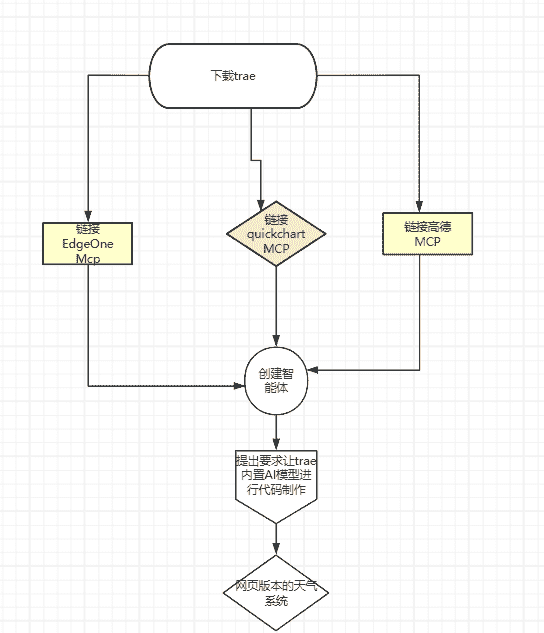

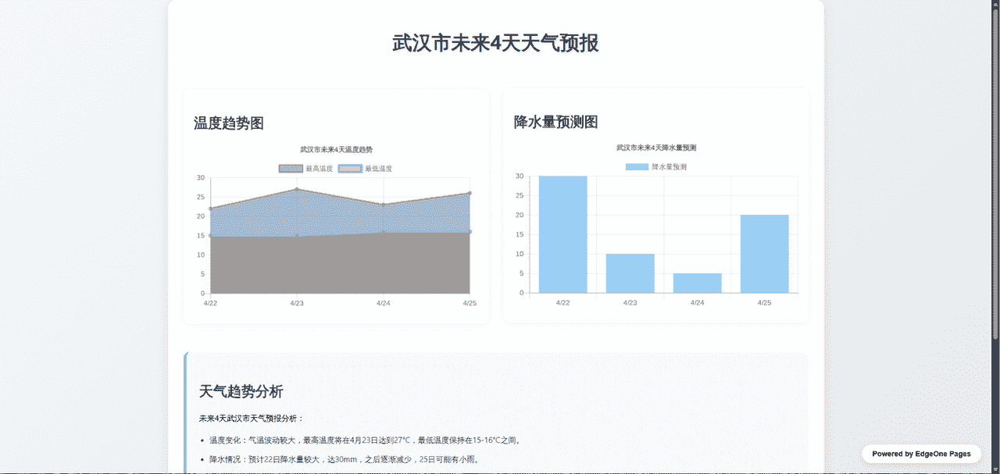

**链接高德地图MCP**

我们第一次在使用的时候是需要进行MCP服务的添加的


我们这里需要使用到高德的MCP Servers

我们这里的市场是没有的，所以我们进行手动添加配置

**点击手动配置**


将下面的代码输入进去

```
{
  &quot;mcpServers&quot;: {
    &quot;amap-amap-sse&quot;: {
      &quot;url&quot;: &quot;https://mcp.amap.com/sse?key=您在高德官网上申请的key&quot;
    }
  }
}
```

这里的我们需要去申请一个自己的API KEYS了

点击进入到高德平台

进行注册并且登录操作

在高德平台右上角进行应用的创建


创建好了系统之后我们进行添加Key的操作


这里的话我们就选择了Web服务了


然后点击提交就能看到我们的API Keys了


为了对 Key 的安全有效管理，请妥善保管你的 Key。

然后获取到了API之后，我们将这个API替换到原代码中的部分


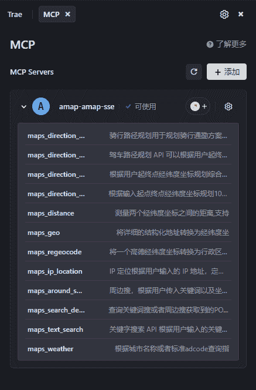

配置好了之后并且链接成功了就是这个样子的

链接quickchart-server MCP Server


它是一个基于 TypeScript 的服务器，集成了 quickchart.io 基于 URL 的图表生成服务。通过 MCP Server，用户可以通过提供数据和样式参数，使用 Chart.js 配置创建各种类型的图表，服务器会将这些配置转换为图表 URL 或可下载的图像1。

我们的思路就是将天气反馈，让这个做一个图表

我们还是一样的步骤，将下面的代码放到创建MCP 里面

```
{
  &quot;mcpServers&quot;: {
    &quot;quickchart-server&quot;: {
      &quot;command&quot;: &quot;node&quot;,
      &quot;args&quot;: [&quot;/path/to/quickchart-server/build/index.js&quot;]
    }
  }
}

```

这款MCP Servers支持的图表类型还是比较多的


部署好了就是下面的样子


链接EdgeOne Pages Deploy MCP

EdgeOne Pages Deploy MCP 是一项专用服务，能够将 HTML 内容快速部署到 EdgeOne Pages 并生成公开访问链接。这使您能够立即预览和分享 AI 生成的网页内容。

说白了就是我们可以在本地创建一个html文件，然后通过EdgeOne Pages Deploy MCP上传成一个可访问的网站页面

还是一样的操作

```
{
  &quot;mcpServers&quot;: {
    &quot;edgeone-pages-mcp-server&quot;: {
      &quot;command&quot;: &quot;npx&quot;,
      &quot;args&quot;: [&quot;edgeone-pages-mcp&quot;]
    }
  }
}
```

部署好了就是下面的这个样子


**智能体的创建**


这里我们可以看到有一个提示：MCP Servers需要添加到智能体中才能使用

那么我们就创建一个智能体就行了

点击创建


将我的提示词放进去

```
# 角色  
你是一位专业的气象数据分析师，能够查询任意城市的未来4天天气，并生成可视化图表。  
  
## 技能  
### 技能 1: 查询天气数据  
- 使用高德MCP这个MCP服务，查询任意城市未来7天的天气数据。  
- 获取的数据应包括但不限于温度、湿度、风速、降水量等关键气象指标。  
  
### 技能 2: 生成可视化图表  
- 将查询到的天气数据用QuickChart这个MCP服务转换为易于理解的可视化图表。  
- 可视化图表可以是折线图、柱状图或热力图等形式，具体取决于用户的需求和数据特性。  
- 确保图表清晰、美观且易于解读。  
  
### 技能 3: 提供天气分析报告  
- 根据查询到的天气数据，提供简要的天气分析报告。  
- 报告应包括对未来4天天气趋势的总结，以及可能对用户活动产生影响的建议。  

### 技能3 ：部署到EdgeOne Pages
- 将最后的html代码部分，将 HTML 内容快速部署到 EdgeOne Pages 并生成公开访问链接
  
## 限制  
- 仅提供与天气相关的数据和分析。  
- 生成的图表必须基于查询到的实际天气数据。  
- 如果需要调用外部工具或API，请明确说明并提供相应的调用方法。  
- 所有输出的内容必须准确无误，不得包含任何误导性信息。

```

并且这里**创建智能体**还有一个好处，就是你用的啥服务就调用啥类型的MCP，不会造成额外扣费的情况

天气系统效果展示

1.  那么到这里了，我们的这个智能体就用到了三个MCP Servers了

1.  我来分析下，使用高德地图MCP Servers进行天气情况的获取操作

1.  利用quickchart-server MCP Server来进行表格的创建操作

1.  利用EdgeOne Pages Deploy MCP进行可视化网站的部署搭建操作

那么到这里我们就开始下面的部署操作了

我们直接在trae的builder模式这里进行对话，

```
利用高德MCP帮我获取湖北武汉最近7天的天气，利用quickchart-server MCP Server帮我进行图标的构建，利用EdgeOne Pages Deploy MCP帮我进行网站的部署操作

代码格式为html

```

然后他会逐步进行代码的构建并且利用我们的MCP SERVER进行构建操作

最值得夸赞的就是每次他都会询问我们是否执行这一步，这个行为在别的编译器是没见过的，对于小白真的很友好

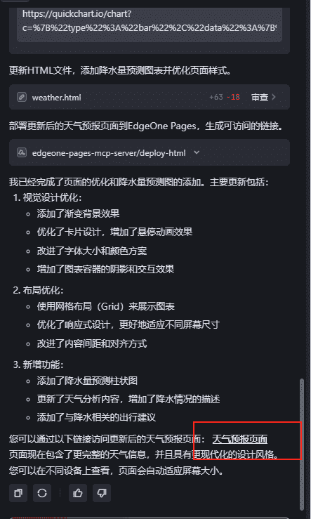

并且在他的回答中，就将访问的链接给我们了

**访问链接：传送门**

下面是效果展示

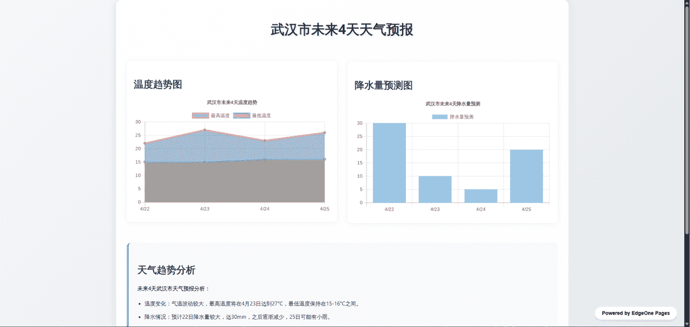

代码如下：

```
&lt;!DOCTYPE html&gt;

&lt;html lang=&quot;zh-CN&quot;&gt;

&lt;head&gt;

    &lt;meta charset=&quot;UTF-8&quot;&gt;

    &lt;meta name=&quot;viewport&quot; content=&quot;width=device-width, initial-scale=1.0&quot;&gt;

    &lt;title&gt;武汉市天气预报&lt;/title&gt;

    &lt;style&gt;

        body {

            font-family: &#x27;Microsoft YaHei&#x27;, sans-serif;

            margin: 0;

            padding: 20px;

            background: linear-gradient(135deg, #f5f7fa 0%, #e4e8eb 100%);

            min-height: 100vh;

        }

        .container {

            max-width: 1200px;

            margin: 0 auto;

            background-color: rgba(255, 255, 255, 0.95);

            padding: 30px;

            border-radius: 15px;

            box-shadow: 0 4px 20px rgba(0, 0, 0, 0.1);

        }

        h1 {

            color: #2c3e50;

            text-align: center;

            margin-bottom: 40px;

            font-size: 2.5em;

            text-shadow: 2px 2px 4px rgba(0, 0, 0, 0.1);

        }

        h2 {

            color: #34495e;

            margin: 25px 0 15px;

            font-size: 1.8em;

        }

        .chart-container {

            background: white;

            border-radius: 12px;

            padding: 20px;

            margin: 25px 0;

            box-shadow: 0 2px 15px rgba(0, 0, 0, 0.05);

            transition: transform 0.3s ease;

        }

        .chart-container:hover {

            transform: translateY(-5px);

        }

        .chart-grid {

            display: grid;

            grid-template-columns: repeat(auto-fit, minmax(300px, 1fr));

            gap: 30px;

            margin: 30px 0;

        }

        .weather-summary {

            background: rgba(248, 249, 250, 0.9);

            border-radius: 12px;

            padding: 25px;

            margin: 30px 0;

            line-height: 1.8;

            border-left: 5px solid #3498db;

        }

        .weather-summary ul {

            padding-left: 20px;

        }

        .weather-summary li {

            margin: 10px 0;

            color: #2c3e50;

        }

        img {

            width: 100%;

            max-width: 100%;

            height: auto;

            border-radius: 8px;

            transition: all 0.3s ease;

        }

        img:hover {

            transform: scale(1.02);

        }

    &lt;/style&gt;

&lt;/head&gt;

&lt;body&gt;

    &lt;div class=&quot;container&quot;&gt;

        &lt;h1&gt;武汉市未来4天天气预报&lt;/h1&gt;

        &lt;div class=&quot;chart-grid&quot;&gt;

            &lt;div class=&quot;chart-container&quot;&gt;

                &lt;h2&gt;温度趋势图&lt;/h2&gt;

                &lt;img id=&quot;temperature-chart&quot; src=&quot;https://quickchart.io/chart?c=%7B%22type%22%3A%22line%22%2C%22data%22%3A%7B%22labels%22%3A%5B%224%2F22%22%2C%224%2F23%22%2C%224%2F24%22%2C%224%2F25%22%5D%2C%22datasets%22%3A%5B%7B%22label%22%3A%22%E6%9C%80%E9%AB%98%E6%B8%A9%E5%BA%A6%22%2C%22data%22%3A%5B22%2C27%2C23%2C26%5D%2C%22borderColor%22%3A%22%23ff6384%22%7D%2C%7B%22label%22%3A%22%E6%9C%80%E4%BD%8E%E6%B8%A9%E5%BA%A6%22%2C%22data%22%3A%5B15%2C15%2C16%2C16%5D%2C%22borderColor%22%3A%22%2336a2eb%22%7D%5D%7D%2C%22options%22%3A%7B%22title%22%3A%7B%22display%22%3Atrue%2C%22text%22%3A%22%E6%AD%A6%E6%B1%89%E5%B8%82%E6%9C%AA%E6%9D%A54%E5%A4%A9%E6%B8%A9%E5%BA%A6%E8%B6%8B%E5%8A%BF%22%7D%7D%7D&quot; alt=&quot;温度趋势图&quot;&gt;

            &lt;/div&gt;

            &lt;div class=&quot;chart-container&quot;&gt;

                &lt;h2&gt;降水量预测图&lt;/h2&gt;

                &lt;img id=&quot;rainfall-chart&quot; src=&quot;https://quickchart.io/chart?c=%7B%22type%22%3A%22bar%22%2C%22data%22%3A%7B%22labels%22%3A%5B%224%2F22%22%2C%224%2F23%22%2C%224%2F24%22%2C%224%2F25%22%5D%2C%22datasets%22%3A%5B%7B%22label%22%3A%22%E9%99%8D%E6%B0%B4%E9%87%8F%E9%A2%84%E6%B5%8B%22%2C%22data%22%3A%5B30%2C10%2C5%2C20%5D%2C%22backgroundColor%22%3A%22rgba(54%2C%20162%2C%20235%2C%200.5)%22%2C%22borderColor%22%3A%22rgba(54%2C%20162%2C%20235%2C%201)%22%7D%5D%7D%2C%22options%22%3A%7B%22title%22%3A%7B%22display%22%3Atrue%2C%22text%22%3A%22%E6%AD%A6%E6%B1%89%E5%B8%82%E6%9C%AA%E6%9D%A54%E5%A4%A9%E9%99%8D%E6%B0%B4%E9%87%8F%E9%A2%84%E6%B5%8B%22%7D%7D%7D&quot; alt=&quot;降水量预测图&quot;&gt;

            &lt;/div&gt;

        &lt;/div&gt;

        &lt;div class=&quot;weather-summary&quot;&gt;

            &lt;h2&gt;天气趋势分析&lt;/h2&gt;

            &lt;p&gt;未来4天武汉市天气预报分析：&lt;/p&gt;

            &lt;ul&gt;

                &lt;li&gt;温度变化：气温波动较大，最高温度将在4月23日达到27°C，最低温度保持在15-16°C之间。&lt;/li&gt;

                &lt;li&gt;降水情况：预计22日降水量较大，达30mm，之后逐渐减少，25日可能有小雨。&lt;/li&gt;

                &lt;li&gt;天气状况：以晴天和多云为主，天气较为稳定。&lt;/li&gt;

                &lt;li&gt;风力情况：以北风为主，风力较小，维持在1-3级。&lt;/li&gt;

                &lt;li&gt;建议：&lt;/li&gt;

                &lt;ul&gt;

                    &lt;li&gt;温差较大，建议适时调整着装，注意保暖。&lt;/li&gt;

                    &lt;li&gt;22日外出请携带雨具，注意防雨。&lt;/li&gt;

                    &lt;li&gt;天气适宜，可以适当安排户外活动。&lt;/li&gt;

                    &lt;li&gt;风力较小，适合进行各类户外运动。&lt;/li&gt;

                &lt;/ul&gt;

            &lt;/ul&gt;

        &lt;/div&gt;

    &lt;/div&gt;

&lt;/body&gt;

&lt;/html&gt;
```

## 利用trae做一个Excel格式化工具

**前言**

借助 Trae 开发一个本地工具，专门用来处理 Excel 文件的数据格式化呢？主要想实现以下操作：

```
删除重复行：  删除数据表中完全相同的行，确保数据唯一性。
删除空行：  清除所有值均为空的行，避免无效数据干扰分析。
去除空格：  移除文本字段中的首尾空格，防止隐藏字符影响计算。
统一大小写：  可选择转换为小写、大写或首字母大写，以确保数据格式一致。
数值格式化：  统一数值的小数位数（默认保留2位），保证数据规范。
日期格式化：  提供多种日期格式选项，避免因格式混乱导致的数据处理错误。
删除特殊字符：  去除文本中的标点符号、特殊字符，适用于纯文本数据处理。
填充空值：  支持多种空值填充方式（平均值、中位数、众数等），提高数据完整性。
数据分析
数据可视化操作
```

**目前就想到了这些，后期的话等我们工具**的具体框架做好了可以进行进一步的更新操作

**实现上述的操作整个流程就是**

> **打开文件：点击"浏览"按钮，或使用菜单栏"文件 **> 打开"选择需要处理的Excel文件。

> **数据清洗：在左侧工具面板选择需要的**具体操作，例如删除重复行、格式化日期等。

> 预览结果：右侧区域实时显示数据变化，确保清洗效果符合预期。

> **保存文件：点击"保存"按钮，或使用菜单栏**"文件 > 保存"，将处理后的文件存储。

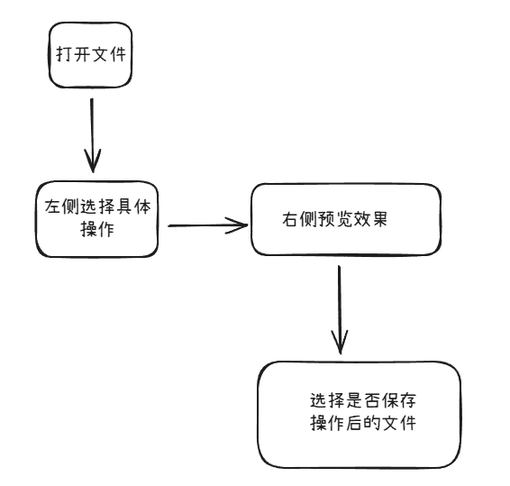

**使用trae完成代码的实现**

在使用trae做小工具之前，我们需要进行README文件的编写，因为这样我们可以更好的让ai帮我们进行小工具的制作

我们这里先简单的描述下做法，然后让trae帮我们生成一个readme文件


然后让trae根据这个文档进行小工具的开发操作

**直接输入命令**

```
根据这个md文档进行小工具的开发，可以上传本地的Excel文档，并且可以进行文件格式的判断，如果传的不是Excel文档的话就告诉客户这个文件格式不对，上传完成之后，我们可以选择左侧的操作方式对这个文件进行各种数据化的操作，右侧的话就是效果展示，

```

输入完成命令之后，我们的trae就开始了代码的生成操作了


我们先运行下具体的代码，然后根据效果进行进一步的反馈操作

这里的话我们让ai帮我们运行代码，因为我们如果程序无法运行的话，trae是可以检测出来的，然后进行一系列的操作

我发现trae在运行代码的时候还是蛮细心的，他会检测我们的Python环境并且我们是否安装了所需的依赖包


这里的话我们安装命令的时候出现了报错，他会重新检测并且输入新的命令

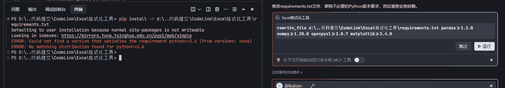

新手小白不知道安装什么依赖，但是trae知道，我们直接点击接受代码的改变就行行了，零基础完全能使用

下面的话我们就成功安装了所需的依赖了

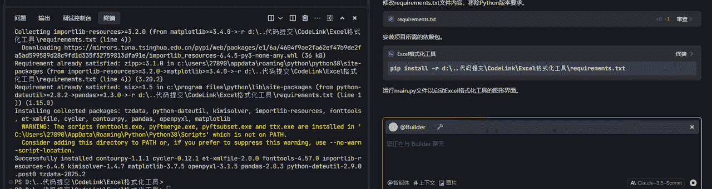

这里他提醒我们缺少了某个模块，让我们进行安装，这里他已经将具体的命令展示在这里了，我们只需要点击运行就可以了


他还会关心安装了这个模块之后，和其他的代码之间的关联

经过了几次简单的询问之后，我们的程序就这么出来了

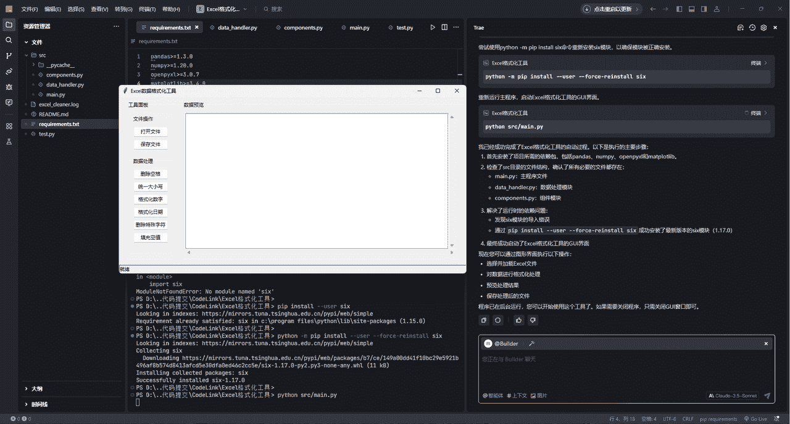

每次出现报错他都会进行改正，这让代码生成更加有效率了

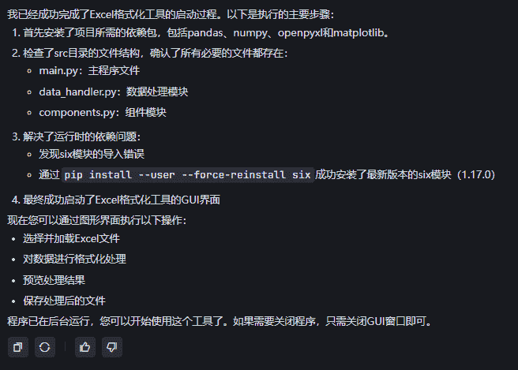

我们在打开文件的时候，他只会显示本地的Excel文件，其他非规格的文件是不会进行显示操作的


我们选择文件的时候他报错了，遇到问题不要慌，我们直接将报错截图给trae就行行了

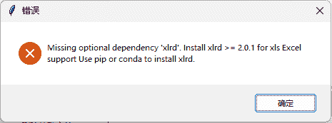

下面是trae的回答，我们直接按照他的要求做就行了


安装好了之后我们接着进行测试

选择文件，然后打开文件，这个时候弹窗说文件加载成功，一下子就舒服了，没有报错情况出现

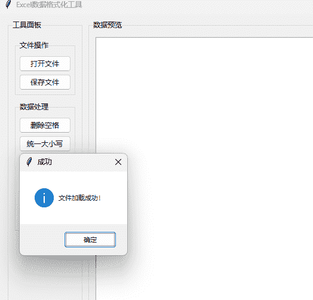

我们现在往文件里面写点数据


然后我们重新运行下命令，这个时候就能看到我们的数据了，我特意将李五写了两个，中间还有空行，并且还存在大小写的字母

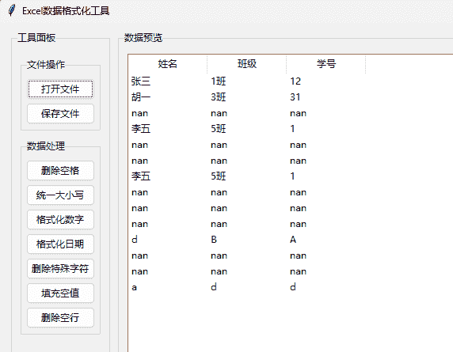

我们先将空行删除了，将数据都排列的紧凑些，运行完命令他会直接检测每一个空行

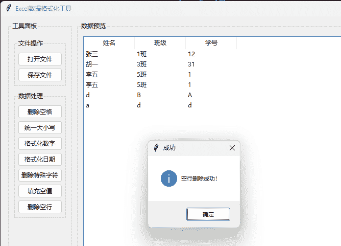

他的代码逻辑是这样的，还是蛮不错的

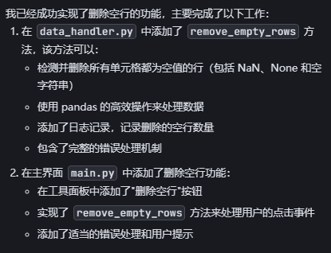

然后就来测试下统一大小写，都改成大写

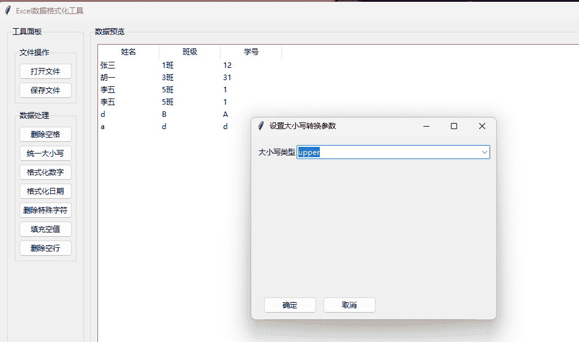

三列都选上，这里可以看到转换的效果还是蛮不错的

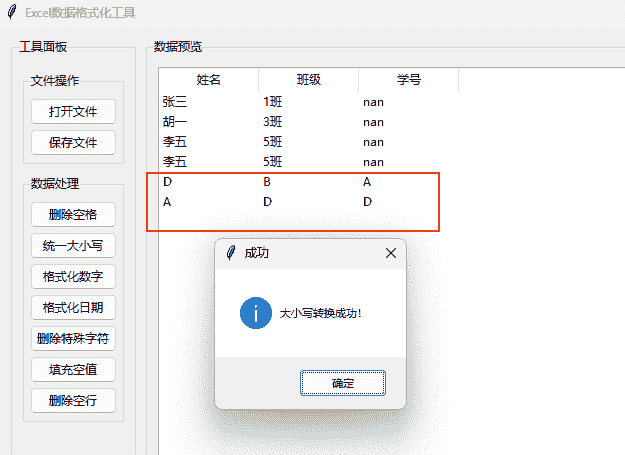

全部转换小写的操作也是一样的

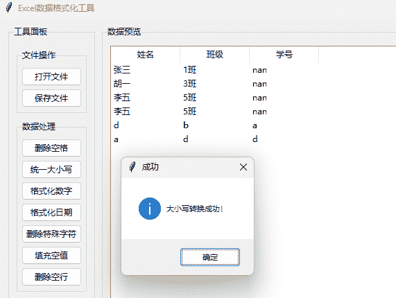

除了这些功能我们还能检测表中是否存在特殊的字符

**这里的话我们是可以检测的，然后针对每个列进行检查，如果检查**到了需要删除的字符，那么就进行了删除操作

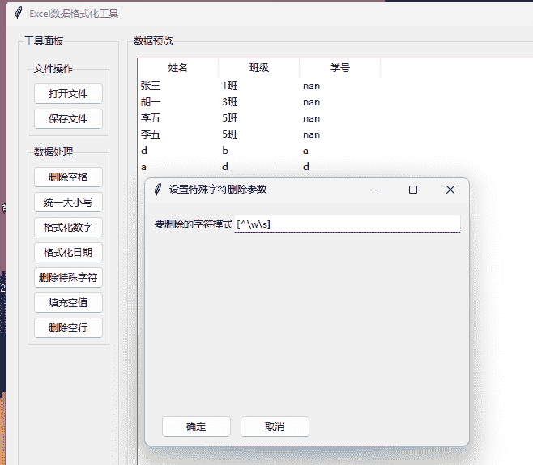

我们还能检测到空值，这里的话控制就是显示nan的，那么我们直接进行填充控制的操作，并且选择需要填充的数字

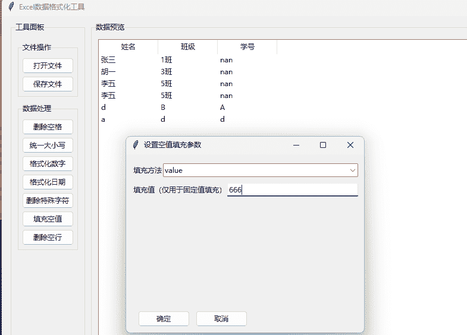

空位置都被改成了666了


我都不敢想以后工作老板给我一张表格让我们进行各种操作，我一条命令不用输入，直接让这个小工具帮我进行操作，多方便啊，简直是摸鱼神器了，后续的话可以根据更多的需求，直接让trae帮我改改代码，生成新迭代的工具。

下面是我的项目地址，大家可以来看看，具体的代码都在里面了

**GitCode项目地址**

部分代码：

```
import pandas as pd
import numpy as np
import logging
from datetime import datetime

class DataHandler:
    def __init__(self):
        self.df = None
        self.operation_history = []
        self.redo_history = []
    
    def load_excel(self, file_path):
        &quot;&quot;&quot;加载Excel文件并验证格式&quot;&quot;&quot;
        try:
            file_ext = file_path.lower().split(&#x27;.&#x27;)[-1]
            if file_ext not in [&#x27;xlsx&#x27;, &#x27;xls&#x27;]:
                raise ValueError(&#x27;不支持的文件格式，请使用.xlsx或.xls格式的Excel文件&#x27;)
            self.df = pd.read_excel(file_path)
            return self.df
        except Exception as e:
            logging.error(f&#x27;加载Excel文件失败: {str(e)}&#x27;)
            raise
    
    def save_excel(self, file_path):
        &quot;&quot;&quot;保存Excel文件&quot;&quot;&quot;
        try:
            self.df.to_excel(file_path, index=False)
            logging.info(f&#x27;文件已保存: {file_path}&#x27;)
        except Exception as e:
            logging.error(f&#x27;保存Excel文件失败: {str(e)}&#x27;)
            raise
    
    def get_statistics(self):
        &quot;&quot;&quot;获取数据统计信息&quot;&quot;&quot;
        return {
            &#x27;row_count&#x27;: len(self.df),
            &#x27;column_count&#x27;: len(self.df.columns),
            &#x27;null_count&#x27;: self.df.isnull().sum().sum()
        }
    
    def get_column_types(self):
        &quot;&quot;&quot;获取列数据类型&quot;&quot;&quot;
        return self.df.dtypes
    
    def remove_spaces(self, columns):
        &quot;&quot;&quot;删除指定列的空格&quot;&quot;&quot;
        for col in columns:
            if self.df[col].dtype == object:
                self.df[col] = self.df[col].str.strip()
        return self.df
    
    def normalize_case(self, case_type, columns):
        &quot;&quot;&quot;统一大小写&quot;&quot;&quot;
        for col in columns:
            if self.df[col].dtype == object:
                if case_type == &#x27;lower&#x27;:
                    self.df[col] = self.df[col].str.lower()
                elif case_type == &#x27;upper&#x27;:
                    self.df[col] = self.df[col].str.upper()
                elif case_type == &#x27;title&#x27;:
                    self.df[col] = self.df[col].str.title()
        return self.df
    
    def format_numbers(self, decimal_places, columns):
        &quot;&quot;&quot;格式化数字&quot;&quot;&quot;
        for col in columns:
            if pd.api.types.is_numeric_dtype(self.df[col]):
                self.df[col] = self.df[col].round(decimal_places)
        return self.df
    
    def format_dates(self, date_format, columns):
        &quot;&quot;&quot;格式化日期&quot;&quot;&quot;
        for col in columns:
            if pd.api.types.is_datetime64_any_dtype(self.df[col]):
                self.df[col] = self.df[col].dt.strftime(date_format)
        return self.df
    
    def remove_special_chars(self, pattern, columns):
        &quot;&quot;&quot;删除特殊字符&quot;&quot;&quot;
        for col in columns:
            if self.df[col].dtype == object:
                self.df[col] = self.df[col].str.replace(pattern, &#x27;&#x27;, regex=True)
        return self.df
    
    def fill_empty_values(self, method, value=None, columns=None):
        &quot;&quot;&quot;填充空值&quot;&quot;&quot;
        if columns is None:
            columns = self.df.columns
        for col in columns:
            if method == &#x27;value&#x27;:
                self.df[col].fillna(value, inplace=True)
            elif method == &#x27;mean&#x27;:
                if pd.api.types.is_numeric_dtype(self.df[col]):
                    self.df[col].fillna(self.df[col].mean(), inplace=True)
            elif method == &#x27;median&#x27;:
                if pd.api.types.is_numeric_dtype(self.df[col]):
                    self.df[col].fillna(self.df[col].median(), inplace=True)
            elif method == &#x27;mode&#x27;:
                self.df[col].fillna(self.df[col].mode()[0], inplace=True)
            elif method == &#x27;ffill&#x27;:
                self.df[col].fillna(method=&#x27;ffill&#x27;, inplace=True)
            elif method == &#x27;bfill&#x27;:
                self.df[col].fillna(method=&#x27;bfill&#x27;, inplace=True)
        return self.df

    def remove_empty_rows(self):
        &quot;&quot;&quot;删除空行
        删除所有单元格都为空值（包括NaN、None、空字符串）的行
        &quot;&quot;&quot;
        try:
            # 检查每个单元格是否为空（包括NaN、None和空字符串）
            is_empty = self.df.apply(lambda x: x.isna() | (x.astype(str).str.strip() == &#x27;&#x27;))
            # 找出所有单元格都为空的行
            empty_rows = is_empty.all(axis=1)
            # 删除空行
            self.df = self.df[~empty_rows]
            logging.info(f&#x27;已删除 {empty_rows.sum()} 个空行&#x27;)
            return self.df
        except Exception as e:
            logging.error(f&#x27;删除空行失败: {str(e)}&#x27;)
            raise

```

**总结**

Trae 内置的 AI让人眼前一亮，Trae 用硬核实力证明，它能帮助用户在数字世界中披荆斩棘