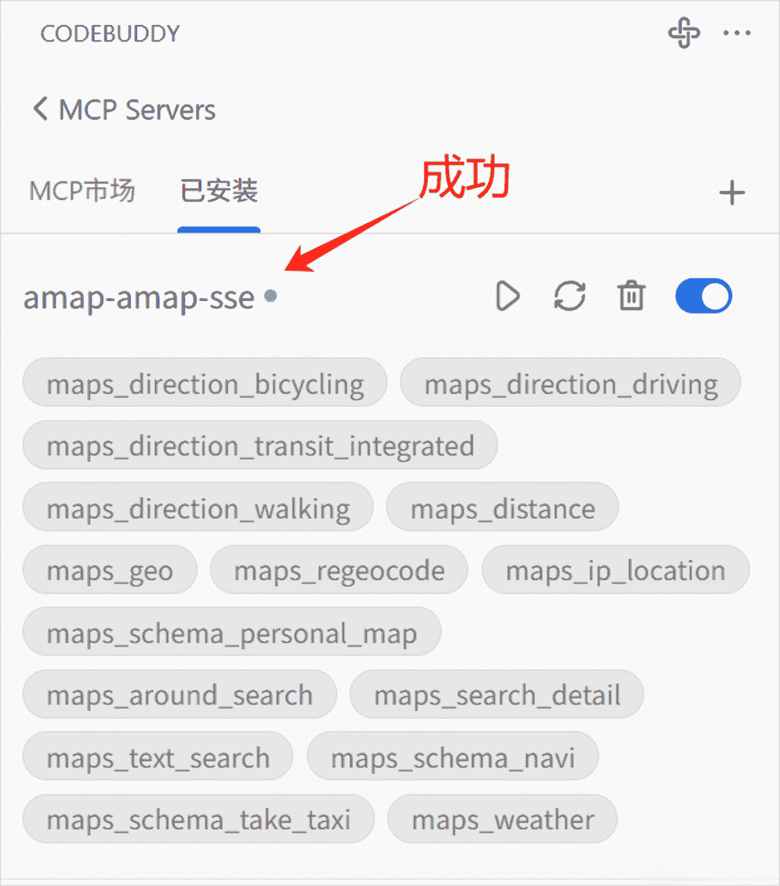
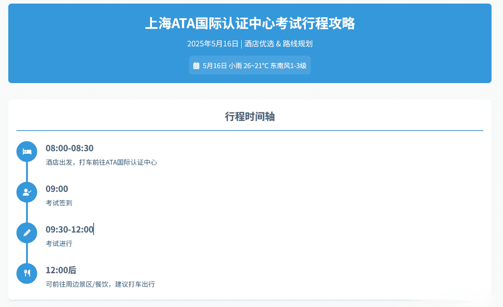
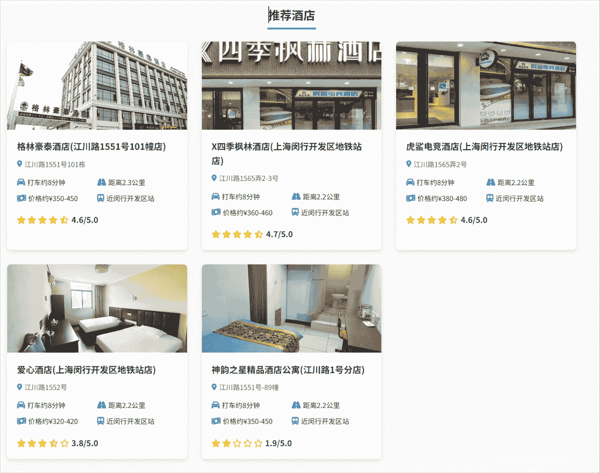
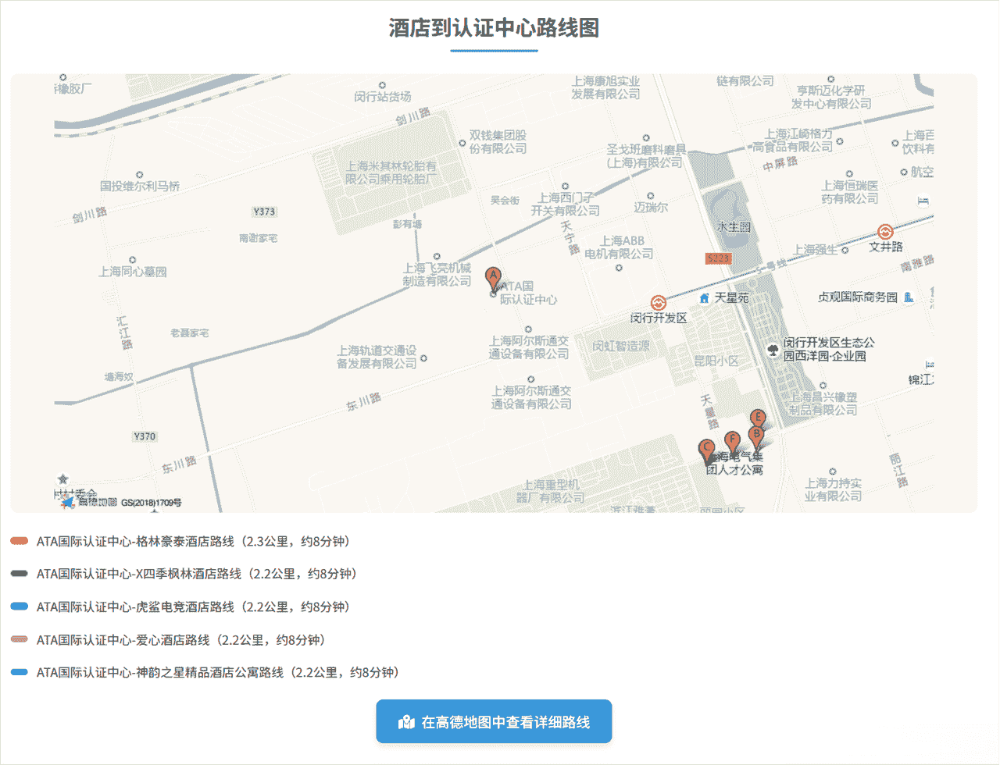
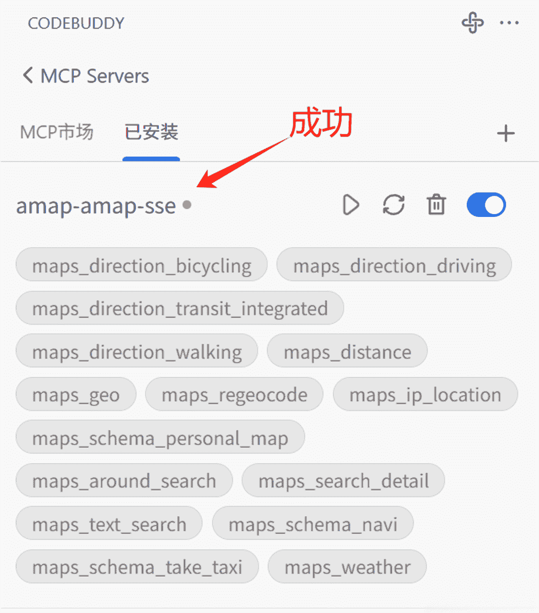
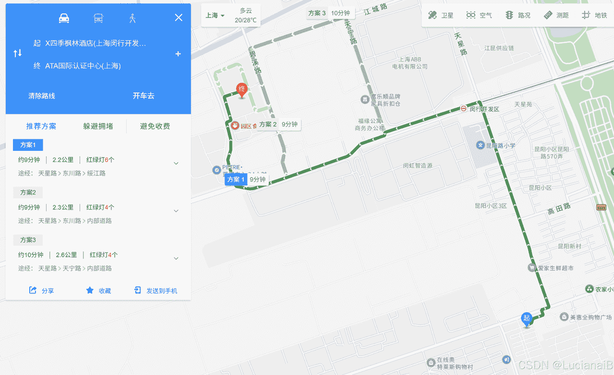

# 高德MCP 2.0 ，快速解决定位调用难题！

> 来源：[https://qqs7y1hozd1.feishu.cn/docx/CBXydVbohotX6mxKuDNcbIKXnWh](https://qqs7y1hozd1.feishu.cn/docx/CBXydVbohotX6mxKuDNcbIKXnWh)

## 配置高德MCP 2.0

### **申请高德开放平台key**

使用下面的代码进行配置，替换下面的<YOUR_API_KEY>

```
{
    &quot;mcpServers&quot;: {
        &quot;amap-amap-sse&quot;: {
            &quot;url&quot;:&quot;https://mcp.amap.com/sse?key=&lt;YOUR_API_KEY&gt;&quot;
        }
    }
}

```

测试服务连接状态（如下，表示成功）：



## **大模型需求描述**

### **第一次模型交互**

```
我要在5.16去上海的ATA国际认证中心考试，帮我筛选附近的酒店。要求如下：
1.帮我找到符合要求的5个酒店作为参考，要求，距离考试中心打车20分钟以内范围，价格在400-500之间
2.帮制作各个酒店到认证中心的路线图（自定义绘制路线和位置，不是之间嵌入PC地图，以打车后的路线为标记），用不同颜色的绘制在一个网页地图中，行程规划结果在实际高德地图app展示，并集成到h5页面中。。
3.网页使用简约美观页面风格，5个酒店的图片以卡片展示。
4.调用高德MCP Server - mcp_schema_personal_map工具，获取并打开专属地图链接
5.我的高德key为：fdda84b24b1c76f6f147
6.上海ATA国际认证中心的具体地址直接搜索，考试具体时间是8：00-12：00
7.生成文件名 LucianaiB.html。

## 基本要求

** 尺寸与基础结构 **
   - 打印友好的配色方案，避免过深的背景色和过小的字体

** 技术实现 **
   - 使用打印友好的CSS设计
   - 提供专用的打印按钮，优化打印样式
   - 使用高对比度的配色方案，确保打印后清晰可读
   - 使用Google Fonts或其他CDN加载适合的现代字体
   - 引用Font Awesome提供图标支持

** 专业设计技巧 **
   - 使用简明的图示代替冗长文字描述
   - 为重要信息添加视觉强调（如框线、加粗、不同颜色等）
   - 在设计中融入城市地标元素作为装饰，增强辨识度

## 设计风格
- ** 实用为主的工具风格 ** ：以清晰的信息呈现为首要目标
- ** 专业旅行指南风格 ** ：参考Lonely Planet等专业旅游指南的排版和布局
- ** 信息图表风格 ** ：将复杂行程转化为直观的图表和时间轴
- ** 简约现代设计 ** ：干净的线条、充分的留白和清晰的层次结构
- ** 整洁的表格布局 ** ：使用表格组织景点、活动和时间信息
- ** 地图元素整合 ** ：在合适位置添加简化的路线或位置示意图

```









### **第二次模型交互**

```
高德地图搜索这个名称来获取准确位置，酒店筛选标准：无，地图是可交互的地图组件，添加实际的&quot;一键导航&quot;功能
```

点击酒店（以**X四季枫林酒店(上海闵行开发区地铁站店)**为例）

**效果页面地址预览：**：驾车规划 - 高德地图



## **生成的html 页面源码**

```
&lt;!DOCTYPE html&gt;
&lt;html lang=&quot;zh-CN&quot;&gt;
&lt;head&gt;
  &lt;meta charset=&quot;UTF-8&quot;&gt;
  &lt;meta name=&quot;viewport&quot; content=&quot;width=device-width, initial-scale=1.0&quot;&gt;
  &lt;title&gt;上海ATA国际认证中心考试行程攻略&lt;/title&gt;
  &lt;link href=&quot;https://fonts.googleapis.com/css2?family=Noto+Sans+SC:wght@300;400;500;700&amp;display=swap&quot; rel=&quot;stylesheet&quot;&gt;
  &lt;link rel=&quot;stylesheet&quot; href=&quot;https://cdnjs.cloudflare.com/ajax/libs/font-awesome/6.4.0/css/all.min.css&quot;&gt;
  &lt;style&gt;
    :root {
      --primary-color: #3598DB;
      --secondary-color: #F39C12;
      --dark-color: #2C3E50;
      --light-color: #ECF0F1;
      --accent-color: #27AE60;
      --danger-color: #E74C3C;
      --warning-color: #F1C40F;
      --info-color: #3498DB;
      --border-radius: 8px;
      --card-shadow: 0 4px 8px rgba(0, 0, 0, 0.1);
      --transition: all 0.3s ease;
    }
    
    * {
      margin: 0;
      padding: 0;
      box-sizing: border-box;
    }
    
    body {
      font-family: &#x27;Noto Sans SC&#x27;, sans-serif;
      line-height: 1.6;
      color: #333;
      background-color: #f9f9f9;
    }
    
    .container {
      max-width: 1200px;
      margin: 0 auto;
      padding: 20px;
    }
    
    .header {
      position: relative;
      background-color: var(--primary-color);
      color: white;
      padding: 20px;
      text-align: center;
      border-radius: var(--border-radius);
      margin-bottom: 30px;
    }
    
    .header::before {
      content: &#x27;&#x27;;
      position: absolute;
      top: 0;
      left: 0;
      width: 100%;
      height: 100%;
      background-image: url(&#x27;https://img.zcool.cn/community/016b5f59e163c3a801216a538aa3db.jpg@1280w_1l_2o_100sh.jpg&#x27;);
      background-size: cover;
      background-position: center;
      opacity: 0.15;
      border-radius: var(--border-radius);
      z-index: 0;
    }
    
    .header-content {
      position: relative;
      z-index: 1;
    }
    
    .header h1 {
      font-size: 32px;
      margin-bottom: 10px;
    }
    
    .header p {
      font-size: 18px;
      color: rgba(255, 255, 255, 0.9);
    }
    
    .date-weather {
      background-color: rgba(255, 255, 255, 0.1);
      border-radius: var(--border-radius);
      padding: 10px;
      margin-top: 15px;
      display: inline-block;
    }
    
    .date-weather i {
      margin-right: 5px;
    }
    
    .timeline {
      position: relative;
      margin: 40px 0;
      padding: 20px;
      background-color: white;
      border-radius: var(--border-radius);
      box-shadow: var(--card-shadow);
    }
    
    .timeline h2 {
      text-align: center;
      padding-bottom: 15px;
      border-bottom: 2px solid var(--primary-color);
      margin-bottom: 25px;
      color: var(--dark-color);
    }
    
    .timeline-item {
      display: flex;
      margin-bottom: 30px;
      position: relative;
    }
    
    .timeline-item:last-child {
      margin-bottom: 0;
    }
    
    .timeline-item::before {
      content: &#x27;&#x27;;
      position: absolute;
      left: 23px;
      top: 30px;
      bottom: -30px;
      width: 4px;
      background-color: var(--primary-color);
      z-index: 0;
    }
    
    .timeline-item:last-child::before {
      display: none;
    }
    
    .timeline-icon {
      position: relative;
      width: 50px;
      height: 50px;
      background-color: var(--primary-color);
      color: white;
      border-radius: 50%;
      display: flex;
      align-items: center;
      justify-content: center;
      margin-right: 20px;
      z-index: 1;
      flex-shrink: 0;
    }
    
    .timeline-content {
      flex: 1;
    }
    
    .timeline-content h3 {
      margin-bottom: 5px;
      color: var(--dark-color);
      font-size: 20px;
    }
    
    .timeline-content p {
      color: #666;
      margin-bottom: 5px;
    }
    
    .hotels {
      margin-top: 40px;
    }
    
    .hotels h2 {
      text-align: center;
      margin-bottom: 25px;
      color: var(--dark-color);
      position: relative;
      padding-bottom: 10px;
    }
    
    .hotels h2::after {
      content: &#x27;&#x27;;
      position: absolute;
      bottom: 0;
      left: 50%;
      transform: translateX(-50%);
      width: 100px;
      height: 3px;
      background-color: var(--primary-color);
    }
    
    .hotel-cards {
      display: grid;
      grid-template-columns: repeat(auto-fill, minmax(280px, 1fr));
      gap: 30px;
    }
    
    .hotel-card {
      background-color: white;
      border-radius: var(--border-radius);
      overflow: hidden;
      box-shadow: var(--card-shadow);
      transition: var(--transition);
    }
    
    .hotel-card:hover {
      transform: translateY(-5px);
      box-shadow: 0 10px 20px rgba(0, 0, 0, 0.15);
    }
    
    .hotel-image {
      width: 100%;
      height: 180px;
      overflow: hidden;
    }
    
    .hotel-image img {
      width: 100%;
      height: 100%;
      object-fit: cover;
      transition: var(--transition);
    }
    
    .hotel-card:hover .hotel-image img {
      transform: scale(1.05);
    }
    
    .hotel-details {
      padding: 20px;
    }
    
    .hotel-name {
      font-size: 18px;
      font-weight: bold;
      margin-bottom: 10px;
      color: var(--dark-color);
    }
    
    .hotel-address {
      font-size: 14px;
      color: #666;
      margin-bottom: 10px;
      display: flex;
      align-items: flex-start;
    }
    
    .hotel-address i {
      margin-right: 5px;
      margin-top: 4px;
      color: var(--primary-color);
    }
    
    .hotel-info {
      display: flex;
      flex-wrap: wrap;
      margin-top: 15px;
    }
    
    .hotel-info-item {
      width: 50%;
      display: flex;
      align-items: center;
      margin-bottom: 10px;
      font-size: 14px;
    }
    
    .hotel-info-item i {
      color: var(--primary-color);
      margin-right: 5px;
      font-size: 16px;
    }
    
    .hotel-rating {
      display: flex;
      align-items: center;
      margin-top: 10px;
    }
    
    .hotel-rating .rating-stars {
      color: #FFD700;
      margin-right: 5px;
    }
    
    .hotel-rating .rating-number {
      font-weight: bold;
      color: var(--dark-color);
    }
    
    .map-section {
      margin-top: 40px;
      padding: 30px;
      background-color: white;
      border-radius: var(--border-radius);
      box-shadow: var(--card-shadow);
    }
    
    .map-section h2 {
      text-align: center;
      margin-bottom: 25px;
      color: var(--dark-color);
      position: relative;
      padding-bottom: 10px;
    }
    
    .map-section h2::after {
      content: &#x27;&#x27;;
      position: absolute;
      bottom: 0;
      left: 50%;
      transform: translateX(-50%);
      width: 100px;
      height: 3px;
      background-color: var(--primary-color);
    }
    
    .map-container {
      width: 100%;
      height: 500px;
      border-radius: var(--border-radius);
      overflow: hidden;
    }
    
    .hotel-route {
      margin-top: 15px;
      font-size: 14px;
      display: flex;
      align-items: center;
    }
    
    .hotel-route .route-color {
      width: 20px;
      height: 8px;
      border-radius: 4px;
      margin-right: 10px;
    }
    
    .route-1 {
      background-color: #FF5733;
    }
    
    .route-2 {
      background-color: #33FF57;
    }
    
    .route-3 {
      background-color: #3357FF;
    }
    
    .route-4 {
      background-color: #FF33E9;
    }
    
    .route-5 {
      background-color: #33FFF9;
    }
    
    .map-app-link {
      text-align: center;
      margin-top: 20px;
    }
    
    .map-app-button {
      display: inline-block;
      padding: 12px 25px;
      background-color: var(--primary-color);
      color: white;
      text-decoration: none;
      border-radius: var(--border-radius);
      font-weight: 500;
      transition: var(--transition);
      box-shadow: 0 4px 6px rgba(0, 0, 0, 0.1);
    }
    
    .map-app-button:hover {
      background-color: #2980B9;
      transform: translateY(-2px);
      box-shadow: 0 6px 8px rgba(0, 0, 0, 0.15);
    }
    
    .map-app-button i {
      margin-right: 8px;
    }
    
    .footer {
      margin-top: 40px;
      text-align: center;
      padding: 20px;
      color: #777;
      font-size: 14px;
    }
    
    .footer p {
      margin-bottom: 10px;
    }
    
    .print-button {
      display: block;
      margin: 20px auto;
      padding: 10px 20px;
      background-color: var(--accent-color);
      color: white;
      border: none;
      border-radius: var(--border-radius);
      cursor: pointer;
      font-size: 16px;
      transition: var(--transition);
    }
    
    .print-button:hover {
      background-color: #219651;
    }
    
    .print-button i {
      margin-right: 8px;
    }
    
    @media print {
      body {
        background-color: white;
      }
      
      .container {
        max-width: 100%;
        padding: 0;
      }
      
      .header {
        background-color: #f0f0f0;
        color: black;
      }
      
      .header::before {
        opacity: 0.05;
      }
      
      .header p {
        color: #333;
      }
      
      .date-weather {
        background-color: #f5f5f5;
        color: #333;
      }
      
      .timeline-icon {
        background-color: #333;
      }
      
      .timeline-item::before {
        background-color: #333;
      }
      
      .hotel-info-item i, 
      .hotel-address i {
        color: #333;
      }
      
      .hotel-rating .rating-stars {
        color: #333;
      }
      
      .hotel-card:hover {
        transform: none;
        box-shadow: var(--card-shadow);
      }
      
      .hotel-card:hover .hotel-image img {
        transform: none;
      }
      
      .map-section,
      .print-button,
      .map-app-link {
        display: none;
      }
      
      .hotel-cards {
        grid-template-columns: repeat(2, 1fr);
        gap: 20px;
      }
    }
    
    @media (max-width: 768px) {
      .container {
        padding: 15px;
      }
      
      .header h1 {
        font-size: 26px;
      }
      
      .header p {
        font-size: 16px;
      }
      
      .hotel-cards {
        grid-template-columns: repeat(auto-fill, minmax(250px, 1fr));
        gap: 20px;
      }
      
      .map-container {
        height: 350px;
      }
    }
    
    @media (max-width: 480px) {
      .timeline-item {
        flex-direction: column;
      }
      
      .timeline-icon {
        margin-bottom: 15px;
        margin-right: 0;
      }
      
      .timeline-item::before {
        left: 25px;
        top: 50px;
      }
      
      .hotel-cards {
        grid-template-columns: 1fr;
      }
    }
  &lt;/style&gt;
&lt;/head&gt;
&lt;body&gt;
  &lt;div class=&quot;container&quot;&gt;
    &lt;header class=&quot;header&quot;&gt;
      &lt;div class=&quot;header-content&quot;&gt;
        &lt;h1&gt;上海ATA国际认证中心考试行程攻略&lt;/h1&gt;
        &lt;p&gt;2025年5月16日 | 酒店优选 &amp; 路线规划&lt;/p&gt;
        &lt;div class=&quot;date-weather&quot;&gt;
          &lt;i class=&quot;fas fa-calendar-alt&quot;&gt;&lt;/i&gt; 5月16日 小雨 26~21℃ 东南风1-3级
        &lt;/div&gt;
      &lt;/div&gt;
    &lt;/header&gt;
    
    &lt;div class=&quot;timeline&quot;&gt;
      &lt;h2&gt;行程时间轴&lt;/h2&gt;
      &lt;div class=&quot;timeline-item&quot;&gt;
        &lt;div class=&quot;timeline-icon&quot;&gt;
          &lt;i class=&quot;fas fa-bed&quot;&gt;&lt;/i&gt;
        &lt;/div&gt;
        &lt;div class=&quot;timeline-content&quot;&gt;
          &lt;h3&gt;08:00-08:30&lt;/h3&gt;
          &lt;p&gt;酒店出发，打车前往ATA国际认证中心&lt;/p&gt;
        &lt;/div&gt;
      &lt;/div&gt;
      &lt;div class=&quot;timeline-item&quot;&gt;
        &lt;div class=&quot;timeline-icon&quot;&gt;
          &lt;i class=&quot;fas fa-user-check&quot;&gt;&lt;/i&gt;
        &lt;/div&gt;
        &lt;div class=&quot;timeline-content&quot;&gt;
          &lt;h3&gt;09:00&lt;/h3&gt;
          &lt;p&gt;考试签到&lt;/p&gt;
        &lt;/div&gt;
      &lt;/div&gt;
      &lt;div class=&quot;timeline-item&quot;&gt;
        &lt;div class=&quot;timeline-icon&quot;&gt;
          &lt;i class=&quot;fas fa-pencil-alt&quot;&gt;&lt;/i&gt;
        &lt;/div&gt;
        &lt;div class=&quot;timeline-content&quot;&gt;
          &lt;h3&gt;09:30-12:00&lt;/h3&gt;
          &lt;p&gt;考试进行&lt;/p&gt;
        &lt;/div&gt;
      &lt;/div&gt;
      &lt;div class=&quot;timeline-item&quot;&gt;
        &lt;div class=&quot;timeline-icon&quot;&gt;
          &lt;i class=&quot;fas fa-utensils&quot;&gt;&lt;/i&gt;
        &lt;/div&gt;
        &lt;div class=&quot;timeline-content&quot;&gt;
          &lt;h3&gt;12:00后&lt;/h3&gt;
          &lt;p&gt;可前往周边景区/餐饮，建议打车出行&lt;/p&gt;
        &lt;/div&gt;
      &lt;/div&gt;
    &lt;/div&gt;
    
    &lt;section class=&quot;hotels&quot;&gt;
      &lt;h2&gt;推荐酒店&lt;/h2&gt;
      &lt;div class=&quot;hotel-cards&quot;&gt;
        &lt;div class=&quot;hotel-card&quot;&gt;
          &lt;div class=&quot;hotel-image&quot;&gt;
            &lt;img src=&quot;http://store.is.autonavi.com/showpic/5550ab13760462e8ecdc1bed4b84f57c&quot; alt=&quot;格林豪泰酒店&quot;&gt;
          &lt;/div&gt;
          &lt;div class=&quot;hotel-details&quot;&gt;
            &lt;div class=&quot;hotel-name&quot;&gt;格林豪泰酒店(江川路1551号101幢店)&lt;/div&gt;
            &lt;div class=&quot;hotel-address&quot;&gt;
              &lt;i class=&quot;fas fa-map-marker-alt&quot;&gt;&lt;/i&gt;
              &lt;span&gt;江川路1551号101栋&lt;/span&gt;
            &lt;/div&gt;
            &lt;div class=&quot;hotel-info&quot;&gt;
              &lt;div class=&quot;hotel-info-item&quot;&gt;
                &lt;i class=&quot;fas fa-car&quot;&gt;&lt;/i&gt;
                &lt;span&gt;打车约8分钟&lt;/span&gt;
              &lt;/div&gt;
              &lt;div class=&quot;hotel-info-item&quot;&gt;
                &lt;i class=&quot;fas fa-road&quot;&gt;&lt;/i&gt;
                &lt;span&gt;距离2.3公里&lt;/span&gt;
              &lt;/div&gt;
              &lt;div class=&quot;hotel-info-item&quot;&gt;
                &lt;i class=&quot;fas fa-money-bill-wave&quot;&gt;&lt;/i&gt;
                &lt;span&gt;价格约¥350-450&lt;/span&gt;
              &lt;/div&gt;
              &lt;div class=&quot;hotel-info-item&quot;&gt;
                &lt;i class=&quot;fas fa-subway&quot;&gt;&lt;/i&gt;
                &lt;span&gt;近闵行开发区站&lt;/span&gt;
              &lt;/div&gt;
            &lt;/div&gt;
            &lt;div class=&quot;hotel-rating&quot;&gt;
              &lt;div class=&quot;rating-stars&quot;&gt;
                &lt;i class=&quot;fas fa-star&quot;&gt;&lt;/i&gt;
                &lt;i class=&quot;fas fa-star&quot;&gt;&lt;/i&gt;
                &lt;i class=&quot;fas fa-star&quot;&gt;&lt;/i&gt;
                &lt;i class=&quot;fas fa-star&quot;&gt;&lt;/i&gt;
                &lt;i class=&quot;fas fa-star-half-alt&quot;&gt;&lt;/i&gt;
              &lt;/div&gt;
              &lt;div class=&quot;rating-number&quot;&gt;4.6/5.0&lt;/div&gt;
            &lt;/div&gt;
          &lt;/div&gt;
        &lt;/div&gt;
        
        &lt;div class=&quot;hotel-card&quot;&gt;
          &lt;div class=&quot;hotel-image&quot;&gt;
            &lt;img src=&quot;http://store.is.autonavi.com/showpic/7e6bf3755e2b50f012072544d77d9fe1&quot; alt=&quot;X四季枫林酒店&quot;&gt;
          &lt;/div&gt;
          &lt;div class=&quot;hotel-details&quot;&gt;
            &lt;div class=&quot;hotel-name&quot;&gt;X四季枫林酒店(上海闵行开发区地铁站店)&lt;/div&gt;
            &lt;div class=&quot;hotel-address&quot;&gt;
              &lt;i class=&quot;fas fa-map-marker-alt&quot;&gt;&lt;/i&gt;
              &lt;span&gt;江川路1565弄2-3号&lt;/span&gt;
            &lt;/div&gt;
            &lt;div class=&quot;hotel-info&quot;&gt;
              &lt;div class=&quot;hotel-info-item&quot;&gt;
                &lt;i class=&quot;fas fa-car&quot;&gt;&lt;/i&gt;
                &lt;span&gt;打车约8分钟&lt;/span&gt;
              &lt;/div&gt;
              &lt;div class=&quot;hotel-info-item&quot;&gt;
                &lt;i class=&quot;fas fa-road&quot;&gt;&lt;/i&gt;
                &lt;span&gt;距离2.2公里&lt;/span&gt;
              &lt;/div&gt;
              &lt;div class=&quot;hotel-info-item&quot;&gt;
                &lt;i class=&quot;fas fa-money-bill-wave&quot;&gt;&lt;/i&gt;
                &lt;span&gt;价格约¥360-460&lt;/span&gt;
              &lt;/div&gt;
              &lt;div class=&quot;hotel-info-item&quot;&gt;
                &lt;i class=&quot;fas fa-subway&quot;&gt;&lt;/i&gt;
                &lt;span&gt;近闵行开发区站&lt;/span&gt;
              &lt;/div&gt;
            &lt;/div&gt;
            &lt;div class=&quot;hotel-rating&quot;&gt;
              &lt;div class=&quot;rating-stars&quot;&gt;
                &lt;i class=&quot;fas fa-star&quot;&gt;&lt;/i&gt;
                &lt;i class=&quot;fas fa-star&quot;&gt;&lt;/i&gt;
                &lt;i class=&quot;fas fa-star&quot;&gt;&lt;/i&gt;
                &lt;i class=&quot;fas fa-star&quot;&gt;&lt;/i&gt;
                &lt;i class=&quot;fas fa-star-half-alt&quot;&gt;&lt;/i&gt;
              &lt;/div&gt;
              &lt;div class=&quot;rating-number&quot;&gt;4.7/5.0&lt;/div&gt;
            &lt;/div&gt;
          &lt;/div&gt;
        &lt;/div&gt;
        
        &lt;div class=&quot;hotel-card&quot;&gt;
          &lt;div class=&quot;hotel-image&quot;&gt;
            &lt;img src=&quot;http://store.is.autonavi.com/showpic/e50d94f6af0e1d4b90b89561e80292e0&quot; alt=&quot;虎鲨电竞酒店&quot;&gt;
          &lt;/div&gt;
          &lt;div class=&quot;hotel-details&quot;&gt;
            &lt;div class=&quot;hotel-name&quot;&gt;虎鲨电竞酒店(上海闵行开发区地铁站店)&lt;/div&gt;
            &lt;div class=&quot;hotel-address&quot;&gt;
              &lt;i class=&quot;fas fa-map-marker-alt&quot;&gt;&lt;/i&gt;
              &lt;span&gt;江川路1565弄2号&lt;/span&gt;
            &lt;/div&gt;
            &lt;div class=&quot;hotel-info&quot;&gt;
              &lt;div class=&quot;hotel-info-item&quot;&gt;
                &lt;i class=&quot;fas fa-car&quot;&gt;&lt;/i&gt;
                &lt;span&gt;打车约8分钟&lt;/span&gt;
              &lt;/div&gt;
              &lt;div class=&quot;hotel-info-item&quot;&gt;
                &lt;i class=&quot;fas fa-road&quot;&gt;&lt;/i&gt;
                &lt;span&gt;距离2.2公里&lt;/span&gt;
              &lt;/div&gt;
              &lt;div class=&quot;hotel-info-item&quot;&gt;
                &lt;i class=&quot;fas fa-money-bill-wave&quot;&gt;&lt;/i&gt;
                &lt;span&gt;价格约¥380-480&lt;/span&gt;
              &lt;/div&gt;
              &lt;div class=&quot;hotel-info-item&quot;&gt;
                &lt;i class=&quot;fas fa-subway&quot;&gt;&lt;/i&gt;
                &lt;span&gt;近闵行开发区站&lt;/span&gt;
              &lt;/div&gt;
            &lt;/div&gt;
            &lt;div class=&quot;hotel-rating&quot;&gt;
              &lt;div class=&quot;rating-stars&quot;&gt;
                &lt;i class=&quot;fas fa-star&quot;&gt;&lt;/i&gt;
                &lt;i class=&quot;fas fa-star&quot;&gt;&lt;/i&gt;
                &lt;i class=&quot;fas fa-star&quot;&gt;&lt;/i&gt;
                &lt;i class=&quot;fas fa-star&quot;&gt;&lt;/i&gt;
                &lt;i class=&quot;fas fa-star-half-alt&quot;&gt;&lt;/i&gt;
              &lt;/div&gt;
              &lt;div class=&quot;rating-number&quot;&gt;4.6/5.0&lt;/div&gt;
            &lt;/div&gt;
          &lt;/div&gt;
        &lt;/div&gt;
        
        &lt;div class=&quot;hotel-card&quot;&gt;
          &lt;div class=&quot;hotel-image&quot;&gt;
            &lt;img src=&quot;http://store.is.autonavi.com/showpic/7285eb05d7f874c4a4b9ac73c381b991&quot; alt=&quot;爱心酒店&quot;&gt;
          &lt;/div&gt;
          &lt;div class=&quot;hotel-details&quot;&gt;
            &lt;div class=&quot;hotel-name&quot;&gt;爱心酒店(上海闵行开发区地铁站店)&lt;/div&gt;
            &lt;div class=&quot;hotel-address&quot;&gt;
              &lt;i class=&quot;fas fa-map-marker-alt&quot;&gt;&lt;/i&gt;
              &lt;span&gt;江川路1552号&lt;/span&gt;
            &lt;/div&gt;
            &lt;div class=&quot;hotel-info&quot;&gt;
              &lt;div class=&quot;hotel-info-item&quot;&gt;
                &lt;i class=&quot;fas fa-car&quot;&gt;&lt;/i&gt;
                &lt;span&gt;打车约8分钟&lt;/span&gt;
              &lt;/div&gt;
              &lt;div class=&quot;hotel-info-item&quot;&gt;
                &lt;i class=&quot;fas fa-road&quot;&gt;&lt;/i&gt;
                &lt;span&gt;距离2.2公里&lt;/span&gt;
              &lt;/div&gt;
              &lt;div class=&quot;hotel-info-item&quot;&gt;
                &lt;i class=&quot;fas fa-money-bill-wave&quot;&gt;&lt;/i&gt;
                &lt;span&gt;价格约¥320-420&lt;/span&gt;
              &lt;/div&gt;
              &lt;div class=&quot;hotel-info-item&quot;&gt;
                &lt;i class=&quot;fas fa-subway&quot;&gt;&lt;/i&gt;
                &lt;span&gt;近闵行开发区站&lt;/span&gt;
              &lt;/div&gt;
            &lt;/div&gt;
            &lt;div class=&quot;hotel-rating&quot;&gt;
              &lt;div class=&quot;rating-stars&quot;&gt;
                &lt;i class=&quot;fas fa-star&quot;&gt;&lt;/i&gt;
                &lt;i class=&quot;fas fa-star&quot;&gt;&lt;/i&gt;
                &lt;i class=&quot;fas fa-star&quot;&gt;&lt;/i&gt;
                &lt;i class=&quot;fas fa-star-half-alt&quot;&gt;&lt;/i&gt;
                &lt;i class=&quot;far fa-star&quot;&gt;&lt;/i&gt;
              &lt;/div&gt;
              &lt;div class=&quot;rating-number&quot;&gt;3.8/5.0&lt;/div&gt;
            &lt;/div&gt;
          &lt;/div&gt;
        &lt;/div&gt;
        
        &lt;div class=&quot;hotel-card&quot;&gt;
          &lt;div class=&quot;hotel-image&quot;&gt;
            &lt;img src=&quot;http://store.is.autonavi.com/showpic/526078aff43fa6ed1e2a3007b1698199&quot; alt=&quot;神韵之星精品酒店公寓&quot;&gt;
          &lt;/div&gt;
          &lt;div class=&quot;hotel-details&quot;&gt;
            &lt;div class=&quot;hotel-name&quot;&gt;神韵之星精品酒店公寓(江川路1号分店)&lt;/div&gt;
            &lt;div class=&quot;hotel-address&quot;&gt;
              &lt;i class=&quot;fas fa-map-marker-alt&quot;&gt;&lt;/i&gt;
              &lt;span&gt;江川路1551号-89幢&lt;/span&gt;
            &lt;/div&gt;
            &lt;div class=&quot;hotel-info&quot;&gt;
              &lt;div class=&quot;hotel-info-item&quot;&gt;
                &lt;i class=&quot;fas fa-car&quot;&gt;&lt;/i&gt;
                &lt;span&gt;打车约8分钟&lt;/span&gt;
              &lt;/div&gt;
              &lt;div class=&quot;hotel-info-item&quot;&gt;
                &lt;i class=&quot;fas fa-road&quot;&gt;&lt;/i&gt;
                &lt;span&gt;距离2.2公里&lt;/span&gt;
              &lt;/div&gt;
              &lt;div class=&quot;hotel-info-item&quot;&gt;
                &lt;i class=&quot;fas fa-money-bill-wave&quot;&gt;&lt;/i&gt;
                &lt;span&gt;价格约¥350-450&lt;/span&gt;
              &lt;/div&gt;
              &lt;div class=&quot;hotel-info-item&quot;&gt;
                &lt;i class=&quot;fas fa-subway&quot;&gt;&lt;/i&gt;
                &lt;span&gt;近闵行开发区站&lt;/span&gt;
              &lt;/div&gt;
            &lt;/div&gt;
            &lt;div class=&quot;hotel-rating&quot;&gt;
              &lt;div class=&quot;rating-stars&quot;&gt;
                &lt;i class=&quot;fas fa-star&quot;&gt;&lt;/i&gt;
                &lt;i class=&quot;fas fa-star&quot;&gt;&lt;/i&gt;
                &lt;i class=&quot;far fa-star&quot;&gt;&lt;/i&gt;
                &lt;i class=&quot;far fa-star&quot;&gt;&lt;/i&gt;
                &lt;i class=&quot;far fa-star&quot;&gt;&lt;/i&gt;
              &lt;/div&gt;
              &lt;div class=&quot;rating-number&quot;&gt;1.9/5.0&lt;/div&gt;
            &lt;/div&gt;
          &lt;/div&gt;
        &lt;/div&gt;
      &lt;/div&gt;
    &lt;/section&gt;
    
    &lt;section class=&quot;map-section&quot;&gt;
      &lt;h2&gt;酒店到认证中心路线图&lt;/h2&gt;
      &lt;div class=&quot;map-container&quot;&gt;
        &lt;div style=&quot;width:100%; height:100%; display:flex; flex-direction:column; justify-content:center; align-items:center; background-color:#f5f5f5; border-radius:var(--border-radius);&quot;&gt;
          &lt;img src=&quot;https://restapi.amap.com/v3/staticmap?location=121.361654,31.000977&amp;zoom=14&amp;size=1000*500&amp;markers=mid,,A:121.361654,31.000977|mid,,B:121.374500,30.994298|mid,,C:121.372094,30.993746|mid,,D:121.372077,30.993709|mid,,E:121.374575,30.995025|mid,,F:121.373368,30.994094&amp;key=fdda842keyf355b24b1c76f6f147&quot; alt=&quot;酒店到认证中心路线图&quot; style=&quot;max-width:100%; max-height:100%; border-radius:var(--border-radius);&quot;&gt;
        &lt;/div&gt;
      &lt;/div&gt;
      
      &lt;div style=&quot;margin-top: 20px;&quot;&gt;
        &lt;div class=&quot;hotel-route&quot;&gt;
          &lt;div class=&quot;route-color route-1&quot;&gt;&lt;/div&gt;
          &lt;span&gt;ATA国际认证中心-格林豪泰酒店路线（2.3公里，约8分钟）&lt;/span&gt;
        &lt;/div&gt;
        &lt;div class=&quot;hotel-route&quot;&gt;
          &lt;div class=&quot;route-color route-2&quot;&gt;&lt;/div&gt;
          &lt;span&gt;ATA国际认证中心-X四季枫林酒店路线（2.2公里，约8分钟）&lt;/span&gt;
        &lt;/div&gt;
        &lt;div class=&quot;hotel-route&quot;&gt;
          &lt;div class=&quot;route-color route-3&quot;&gt;&lt;/div&gt;
          &lt;span&gt;ATA国际认证中心-虎鲨电竞酒店路线（2.2公里，约8分钟）&lt;/span&gt;
        &lt;/div&gt;
        &lt;div class=&quot;hotel-route&quot;&gt;
          &lt;div class=&quot;route-color route-4&quot;&gt;&lt;/div&gt;
          &lt;span&gt;ATA国际认证中心-爱心酒店路线（2.2公里，约8分钟）&lt;/span&gt;
        &lt;/div&gt;
        &lt;div class=&quot;hotel-route&quot;&gt;
          &lt;div class=&quot;route-color route-5&quot;&gt;&lt;/div&gt;
          &lt;span&gt;ATA国际认证中心-神韵之星精品酒店公寓路线（2.2公里，约8分钟）&lt;/span&gt;
        &lt;/div&gt;
      &lt;/div&gt;
      
      &lt;div class=&quot;map-app-link&quot;&gt;
        &lt;a href=&quot;https://uri.amap.com/marker?position=121.361654,31.000977,121.374500,30.994298,121.372094,30.993746,121.372077,30.993709,121.374575,30.995025,121.373368,30.994094&amp;name=上海ATA国际认证中心,格林豪泰酒店,X四季枫林酒店,虎鲨电竞酒店,爱心酒店,神韵之星精品酒店公寓&amp;src=mypage&amp;coordinate=gaode&amp;callnative=1&quot; class=&quot;map-app-button&quot; target=&quot;_blank&quot;&gt;
          &lt;i class=&quot;fas fa-map-marked-alt&quot;&gt;&lt;/i&gt;在高德地图中查看详细路线
        &lt;/a&gt;
      &lt;/div&gt;
    &lt;/section&gt;
    
    &lt;button class=&quot;print-button&quot; onclick=&quot;window.print()&quot;&gt;
      &lt;i class=&quot;fas fa-print&quot;&gt;&lt;/i&gt;打印行程
    &lt;/button&gt;
    
    &lt;footer class=&quot;footer&quot;&gt;
      &lt;p&gt;上海ATA国际认证中心地址：上海市闵行区碧溪路55号7幢&lt;/p&gt;
      &lt;p&gt;考试时间：2025年5月16日 09:00-12:00&lt;/p&gt;
      &lt;p&gt;建议提前30分钟到达考场&lt;/p&gt;
    &lt;/footer&gt;
  &lt;/div&gt;
  
  &lt;script&gt;
    document.addEventListener(&#x27;DOMContentLoaded&#x27;, function() {
      // 检查是否支持打印功能
      if (!window.print) {
        const printButton = document.querySelector(&#x27;.print-button&#x27;);
        if (printButton) {
          printButton.style.display = &#x27;none&#x27;;
        }
      }
    });
  &lt;/script&gt;
&lt;/body&gt;
&lt;/html&gt; 
```