# MCP+数据库，rag之外的另一种解决方案

> 来源：[https://qqs7y1hozd1.feishu.cn/docx/CWMmdr1wVoYke3x3X9lcDGvhnyc](https://qqs7y1hozd1.feishu.cn/docx/CWMmdr1wVoYke3x3X9lcDGvhnyc)

## 什么是MCP

`MCP` 是一个开放协议，它为应用程序向 `LLM` 提供上下文的方式进行了标准化。它设计出来的目标，主要是统一模型与外部数据源之间的协议，以解决大模型因数据孤岛限制而无法充分发挥潜力的难题。在这个统一标准下，应用端只要集成了 `MCP client`，就没有了开发成本，通过配置可以调用任何已经发布的 `mcp server`。因此 ai 应用有了链接万物的。

而 `qwen3` 的发布，直接原生支持 `MCP`。我们只要通过配置 `mcp server`，提交给 `qwen3`，就能调用对应的 `mcp` 服务。见 Qwen3 来了！全面超越 DeepSeek R1，原生支持 `MCP` 最后的代码调用。

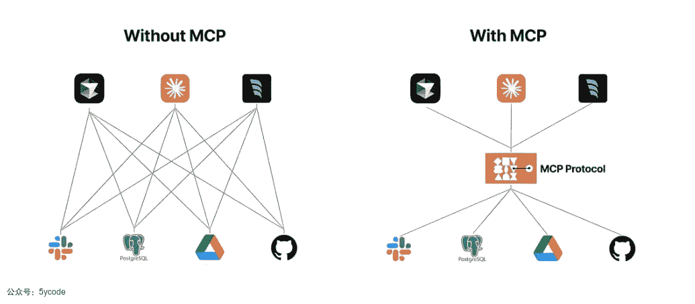

在没有 `MCP` 的时候，我们暴露出来的服务 `api` 接口，各个应用平台对接都需要进行适配。如左侧图所示。举个例子，在已经拥有了高德的 `api` 的前提下，各个应用想用高德的 `api`，每个应用都要对接一遍，再有其他的 `api` 还要再对接一遍。

而有了 `MCP` 以后，底层的各个 `api` 只需要将接口适配到 `MCP` 协议，我们在各个应用中引入一个 `MCP client` 客户端就 ok 了，只需要对接一次。对于非开发人员还是非常友好的，解决了调用外部工具的技术门槛问题。

### MCP 与 `Function Calling` 的区别

这里有必要说一下和 `Function Calling` 的区别，两者都是为了增强大模型与外部数据的交互。但是 `MCP` 不仅适用于大模型。

### 工作流程

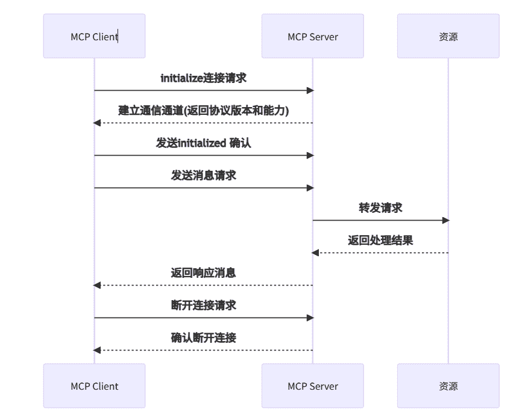

整个工作流程如上图所示。

+   初始化：

+   `MCP Client` 发送包含协议版本和能力的 `initialize` 请求，给 `MCP Server`

+   `MCP Server` 会返回支持的协议版本和能力

+   `MCP Client` 会发送 `initialized` 通知作为确认

+   消息交换：支持 `Request-Response`、双向 `Notification`

+   `MCP Client` 根据需求，构建请求消息，并把请求消息发送给 `MCP Server`

+   `MCP Server` 接收到请求以后，解析请求消息，执行对应的操作，比如调用接口，读取文件，读取数据库等。

+   `MCP Server` 将处理的结果，封装成响应消息，发送给 `MCP` 客户端

+   断开连接：

+   双方可以主动关闭连接

+   传输端口、错误终止也会断开

### MCP 核心架构

`MCP` 遵循客户端-服务器架构

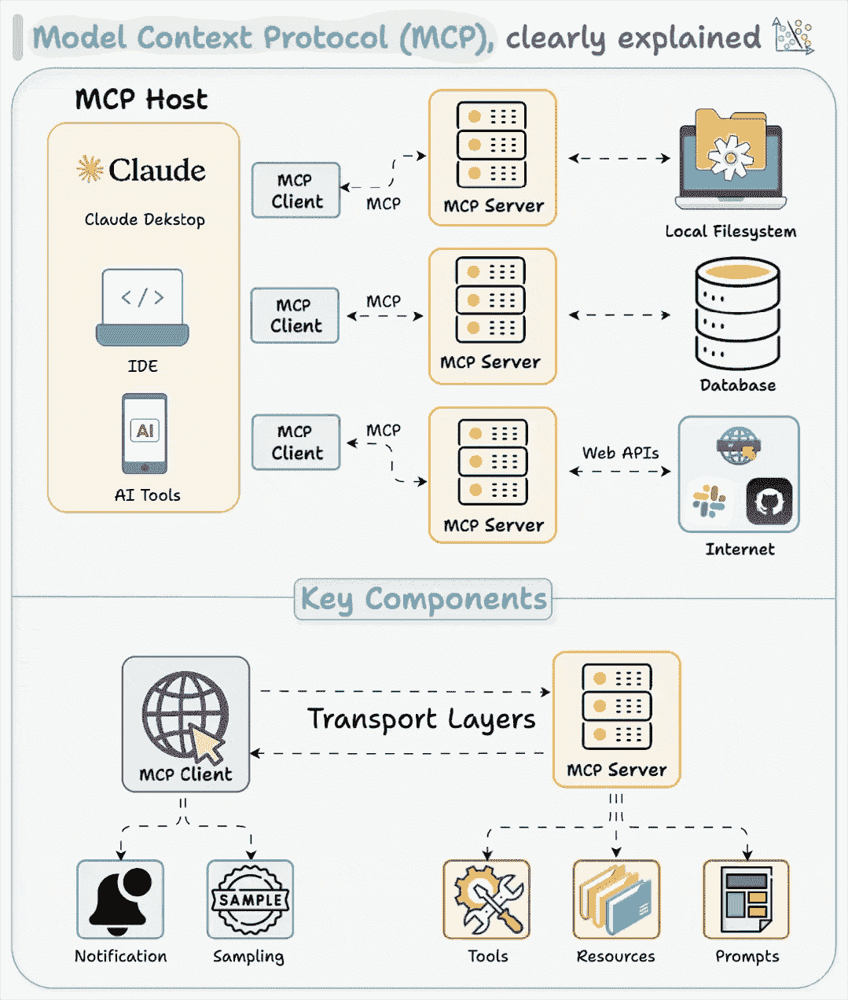

+   `MCP Hosts`：是 `LLM` 应用，如上图的 `claude`，以及我们使用的各种 `ai` 工具，内部集成了 `MCP client`，他们发起连接。

+   `Clients` 在 `host` 应用中与 `servers` 保持 1:1 的连接

+   这就是一个长链接，建议在开发的时候，使用池化技术进行优化

+   `Servers` 为 `clients` 提供上下文、`tools` 和 `prompts`

### 基于 `MCP` 的集成架构

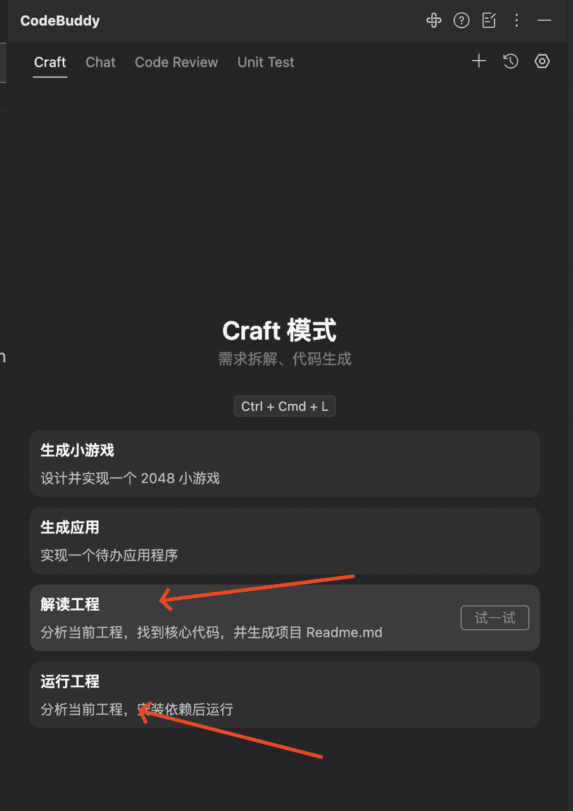

#### 协议层

负责消息的封装与拆解、请求/响应匹配，以及高层通信模式（消息类型）

#### 传输层

传输层支持多种传输机制，使用 `JSON-RPC 2.0` 格式。

+   `Stdio` 传输协议

+   基于标准输入输出进行通信

+   适用于本地进程，比如文件系统，在 `linux` 中，一切皆进程

+   通过 `HTTP+SSE` 传输协议

+   使用 `HTTP POST` 发送消息，`Server-Sent Events` 推送通知

+   适合跨网络、需要 `HTTP` 兼容的场景

+   定义传输

+   可以自定义网络协议，比如可以用 `WebSocket` 实现

#### 消息类型

`MCP` 具有以下四种主要的消息类型

+   `Request`：需要对端返回结果的调用

+   `Result` 成功响应 `Request`

+   `Error` 请求失败时的错误码和信息

+   `Notification` 单向消息，无需响应

#### Resources

`Resources` 允许 `MCP Server` 将文件、数据库记录、`API` 响应、日志文件、图片等各种数据内容暴露给 `Client`，为 `LLM` 提供必要的上下文信息。

资源是 `application-controlled` 的，意味着 `Client` 决定何时、如何使用资源，包括用户手动选择或自动化策略。

按照定义，一共有两类资源：文本资源和二进制资源

+   文本资源：`UTF-8` 编码

+   源代码

+   配置文件

+   日志文件

+   `json`/`xml` 数据，比如 `api` 的响应，数据库记录

+   纯文本

+   二进制资源：`base64` 编码的二进制数据

+   图片

+   `pdf`

+   音频文件

+   视频发现

+   其他非文本格式

### 资源发现与读取

+   直接资源

+   服务器通过 `resources/list` 端点公开一系列具体资源，包含 `uri`、`name`、`description`、`mimeType`。

+   动态模板

+   对于动态或目录型资源，`Server` 可提供符合 `RFC 6570` 的 `URI` 模板，`Client` 根据模板构建具体 `URI` 后再发起读取请求。

+   读取

+   `Client` 提交某个资源的 `URI`，`Server` 返回包含一组 `contents` 的列表，每项可带 `text`（文本）或 `blob`（`Base64` 二进制）。

+   一次读取请求可返回多个资源（如读取目录下所有文件）。

#### 资源更新

+   列表变更通知

+   当 `Server` 的资源集合发生变化时，发送 `notifications/resources/list_changed`，`Client` 可重新拉取最新列表。

+   内容变更通知

+   `Client` 可通过 `resources/subscribe` 订阅某个 `URI`，`Server` 在内容变化时发送 `notifications/resources/updated`，`Client` 再用 `resources/read` 获取更新后的内容；取消订阅则用 `resources/unsubscribe`。

#### Prompts

在 `MCP` 中，`Prompts` 是服务器暴露给客户端的一组可复用的提示模板和工作流，用于统一、标准化与大型语言模型（`LLM`）的交互。服务器通过 `prompts/list` 和 `prompts/get` 两个 `JSON-RPC` 接口，向客户端公开可用的提示项（包括名称、描述和参数定义），客户端在用户触发时填充参数并向 `LLM` 发送生成请求。通过参数化、上下文嵌入和多步工作流，`Prompts` 实现了对复杂操作的封装与复用，并可在客户端以快捷命令、上下文菜单、表单等 UI 形式展现，大大提升了 `LLM` 应用的一致性与可用性。

### 发现与使用

发现

客户端通过调用 `prompts/list`，服务器返回所有可用 `Prompt` 的元数据列表。

```

// 请求
{
  method: "prompts/list"
}

// 响应
{
  prompts: [
    {
      name: "analyze-code",
      description: "Analyze code for potential improvements",
      arguments: [
        {
          name: "language",
          description: "Programming language",
          required: true
        }
      ]
    }
  ]
}

```

+   `name` 是提示词的名称

+   `description` 描述提示词的用户

+   `arguments` 描述该提示词有哪些参数，这些参数是否必填

#### 使用

客户端调用 `prompts/get`，传入 `name` 与对应的 `arguments`，服务器返回用于 `LLM` messages

```

// 请求获取
{
  method: "prompts/get",
  params: {
    name: "analyze-code",
    arguments: {
      language: "python"
    }
  }
}

// 服务器响应
{
  description: "Analyze Python code for potential improvements",
  messages: [
    {
      role: "user",
      content: {
        type: "text",
        text: "Please analyze the following Python code for potential improvements:\n\n```python\ndef calculate_sum(numbers):\n    total = 0\n    for num in numbers:\n        total = total + num\n    return total\n\nresult = calculate_sum([1, 2, 3, 4, 5])\nprint(result)\n```"

      }

    }

  ]

}

```

#### Tools

`MCP Server` 能够将任意可执行操作封装为函数接口，供客户端发现与调用。

+   工具调用意图由 `LLM` 决定，客户端根据模型输出执行实际调用

+   从简单计算到复杂 `API` 集成，`Tools` 均可覆盖，并可修改系统状态或与外部实体交互。

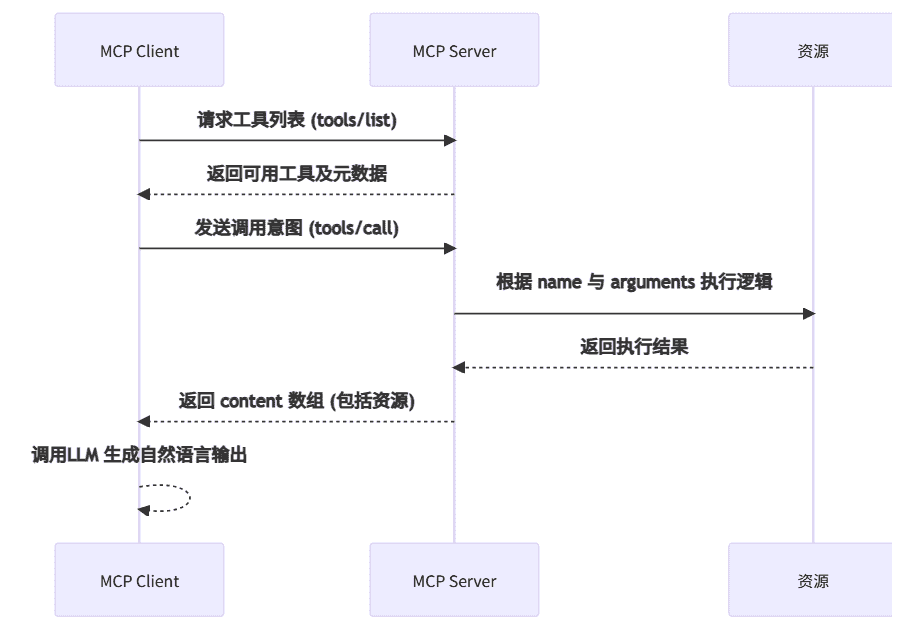

这里最后一步，没问题，`qwen3` 内置 `mcp client`，目前在模型没有支持 `mcp` 协议的时候，都是通过外部应用内置 `mcp client` 实现。

### 结构

每个工具都使用下面的结构定义

```

{

  name: "github_create_issue",

  description: "Create a GitHub issue",

  inputSchema: {

    type: "object",

    properties: {

      title: { type: "string" },

      body: { type: "string" },

      labels: { type: "array", items: { type: "string" } }

    }

  }

}

```

+   `name`：`Tool` 的唯一标识

+   `description`：描述这个 `Tool` 是干嘛的

+   `inputSchema`：调用这个 `Tool` 的输入参数的 `Schema`

+   `properties`：`Tool` 需要的所有参数，定义了参数名和类型

#### Sampling

在 `MCP` 中，`Sampling` 允许 `Server` 通过 `Client` 向 `LLM` 发起补全（completion）请求，形成一种“反向调用”模式，既能支持复杂的多步骤智能代理行为，又通过“人机在环”设计确保安全与隐私控制

+   反向调用机制：`Sampling` 让 `MCP Server` 能主动向 `Client` 请求 `LLM` 补全，而非仅在 `Client` 发起时调用，扩大了协议的灵活性与支持多方交互的能力。

+   人机在环设计：通过在请求和补全阶段都引入 `Client` 审核，确保用户对提示词和生成结果拥有修改或拒绝的权利，强化安全与隐私保护。

+   `Agentic` 行为支持：`Sampling` 是实现智能代理（`agentic workflows`）的关键，使 `Server` 可以动态读取资源、决策、生成结构化数据并执行多步任务。

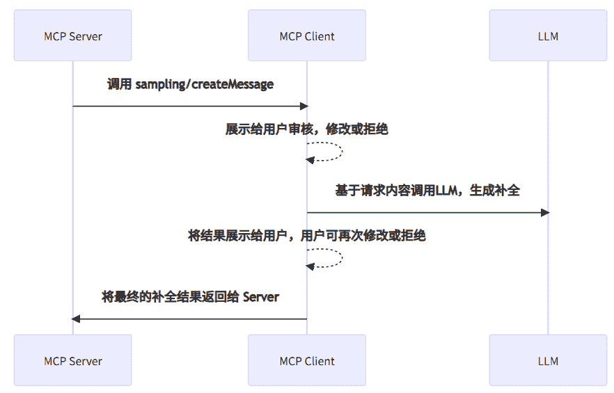

> `mpling` 让整个流程可人为控制，通过交互式确认，让整个生成过程更可控。

### Roots

`Roots` 是 `MCP` 中用于限定服务器可操作的上下文边界的机制。客户端在连接时以根 `URI`（如文件路径、`HTTP API` 地址等）告知服务器“关注哪些资源”，从而实现对资源范围的清晰划分与组织管理。

举个栗子：当我们开发代码的时候，我们使用一个 `MCP Server`，用于读取项目文件，我们不可能让 `MCP Server` 读取所有的文件，也不可能一个工程开发一个 `MCP Server`，怎么办？我们开发 `MCP Server` 的时候，把工程路径给它，它只处理这个工程里的文件即可，这样就限定了边界。

当然 `MCP Server` 并不是只能处理当前目录下的文件，它可以处理任何目录，但是没有意义了。

虽然不是一个强制性约束，当时在开发的 `MCP Server` 的时候，建议遵循该约束。

### 使用 `MCP` 查询数据库

#### server 端配置

我使用 `mysql_mcp_server` 作为 `mcp server`。

`https://github.com/designcomputer/mysql_mcp_server`

#### 要求

```

uv

python>=3.11

mcp>=1.0.0

mysql-connector-python>=9.1.0

```

#### 安装 uv

```

# macos 或 linux 安装，没有 curl 就用 get

curl -LsSf https://astral.sh/uv/install.sh | sh

wget -qO- https://astral.sh/uv/install.sh | sh

# win 安装

powershell -ExecutionPolicy ByPass -c "irm https://astral.sh/uv/install.ps1 | iex"

# uv 验证

uv -V

```

#### python 环境配置

```

# 使用 uv 安装 python3.11 环境

uv python install 3.11

# 创建 mcp 环境

uv venv mcp

# 激活环境

source mcp/bin/activate

# 验证环境

python -V

# 安装依赖

uv pip install mysql-mcp-server --index-url https://pypi.tuna.tsinghua.edu.cn/simple

```

#### Cherry studio

我重度使用 `cherry studio`。使用的 `v1.2.10` 版本。

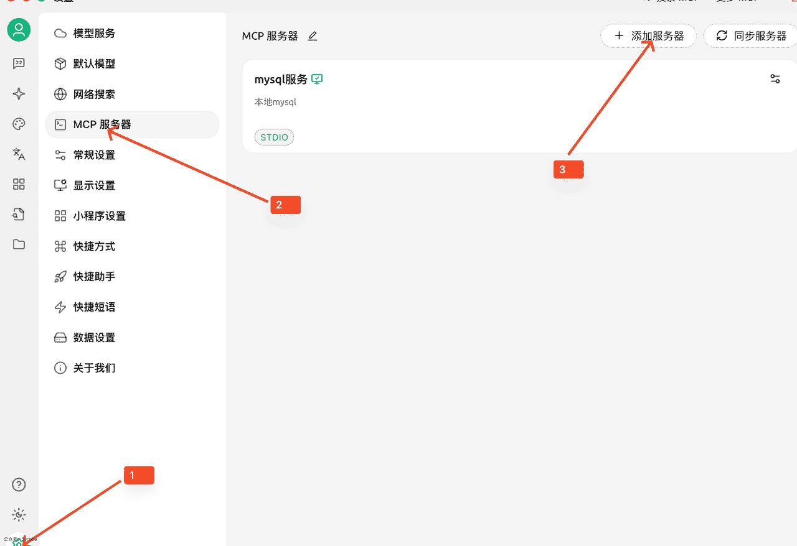

点击 1 设置，点击 2 `MCP` 服务器，点击 3 添加服务器。

官方给了一个 `claude` 和 `visual studio code` 两个配置方案。我参考了 `vs` 的配置

```

{

  "mcpServers": {

    "mysql": {

      "type": "stdio",

      "command": "uvx",

      "args": [

        "--from",

        "mysql-mcp-server",

        "mysql_mcp_server"

      ],

      "env": {

        "MYSQL_HOST": "localhost",

        "MYSQL_PORT": "3306",

        "MYSQL_USER": "root",

        "MYSQL_PASSWORD": "123456",

        "MYSQL_DATABASE": "admin"

      }

    }

  }

}


# MCP 配置与使用指南

注意官方写的是`servers`，其实应该写`mcpServers`，将对应的配置填写进去

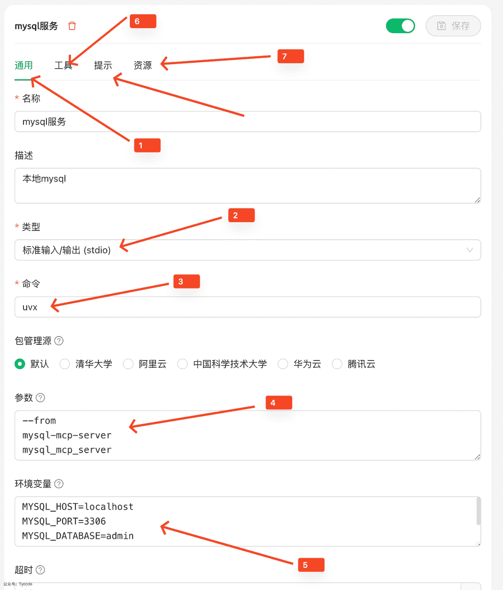

将上面的配置拆解后填进去。注意4参数那里，两个`mysql-mcp-server`少一个都不行。

通过`6`可以看该`mcp`提供了哪些工具，通过`7`可以看该`mcp`提供了哪些资源。

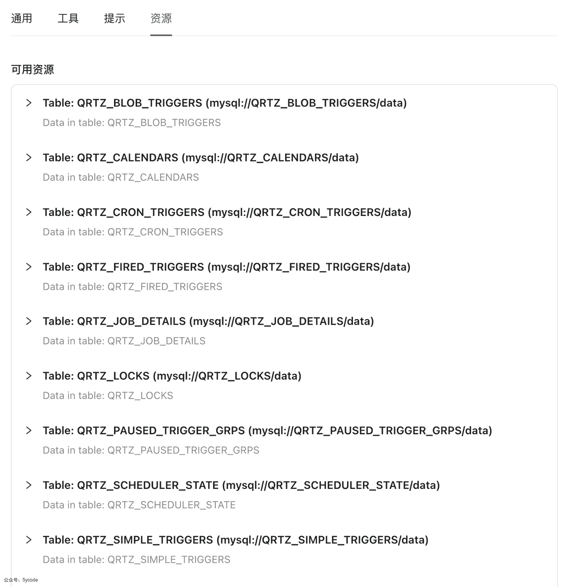

### 资源是这个账户可以查看的表。

使用

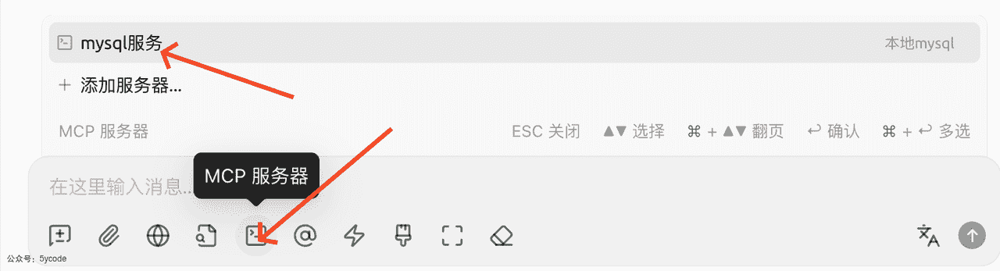

在聊天框点击箭头指向的位置，添加`mysql`的`mcp`服务。

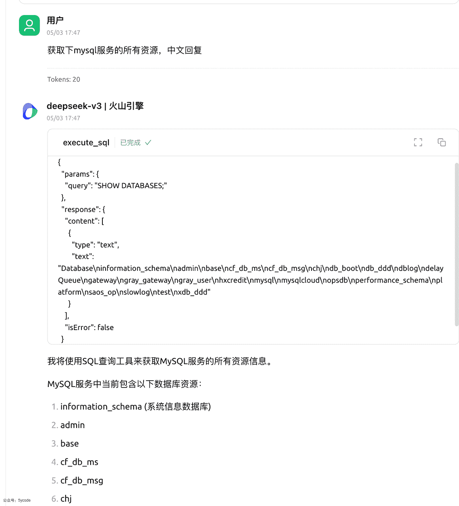

通过`cherry studio`获取连接的`mysql`的所有资源。这个时候它会调用`mcp`的工具执行`Show databases`，每个模型的能力不一样，最后执行的`sql`不一样。

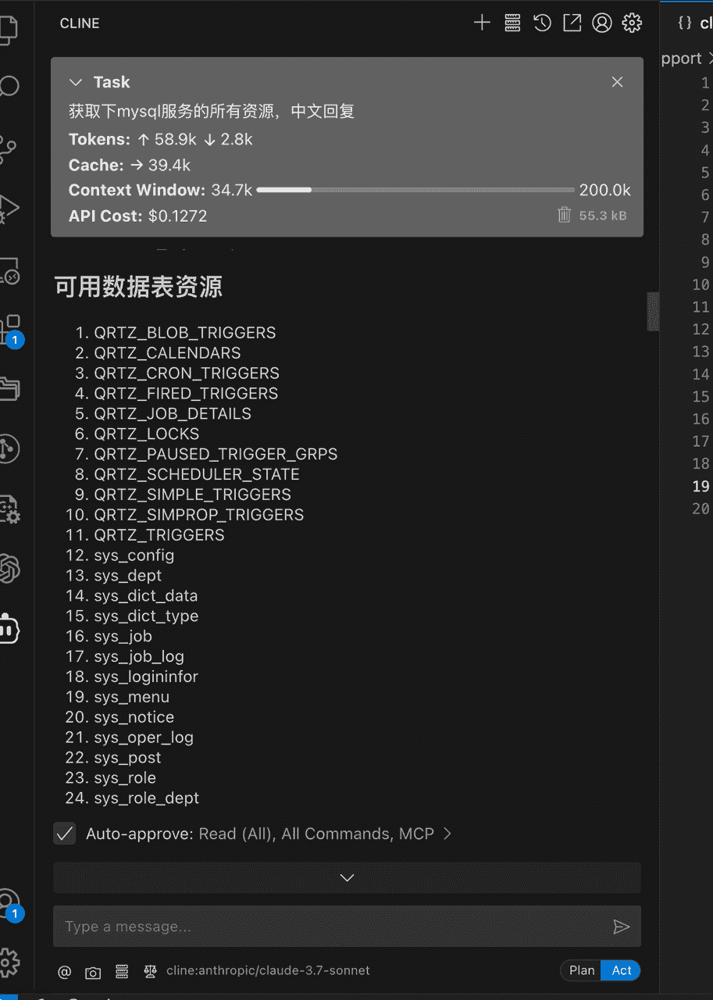

使用`cline`，就严格处理指定资源内的资源。

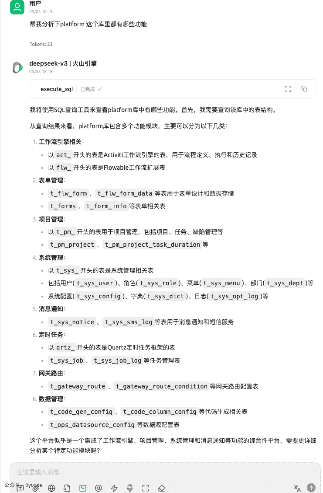

我指定数据库让它分析这个库有什么功能，它只是通过表结构进行分析。

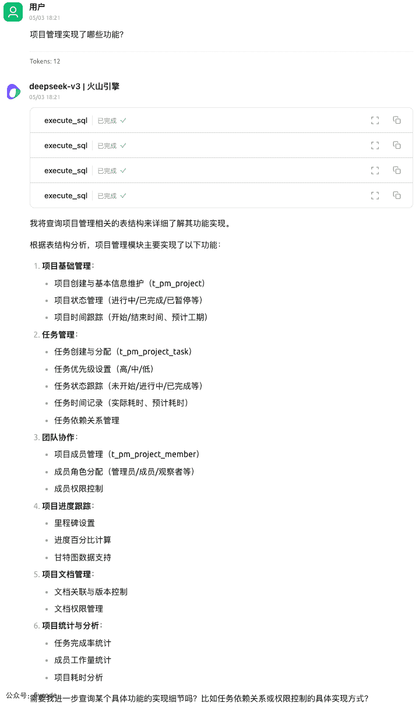

**当你没有限定它必须依赖查询到的数据的时候，它就开始出现了幻觉。而且瞎掰。**

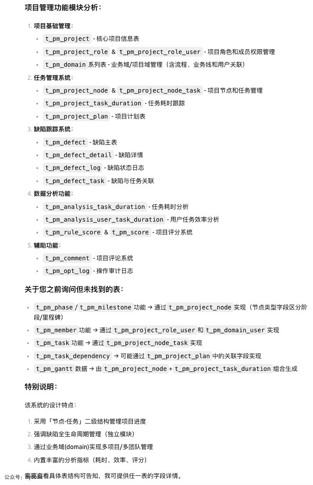

当你限定以后，它完全可以根据你的语义来。

使用同样的提示词，`cherry studio`中，并没有精准的统计出我想要的信息，不过只花费了`560tokens`。

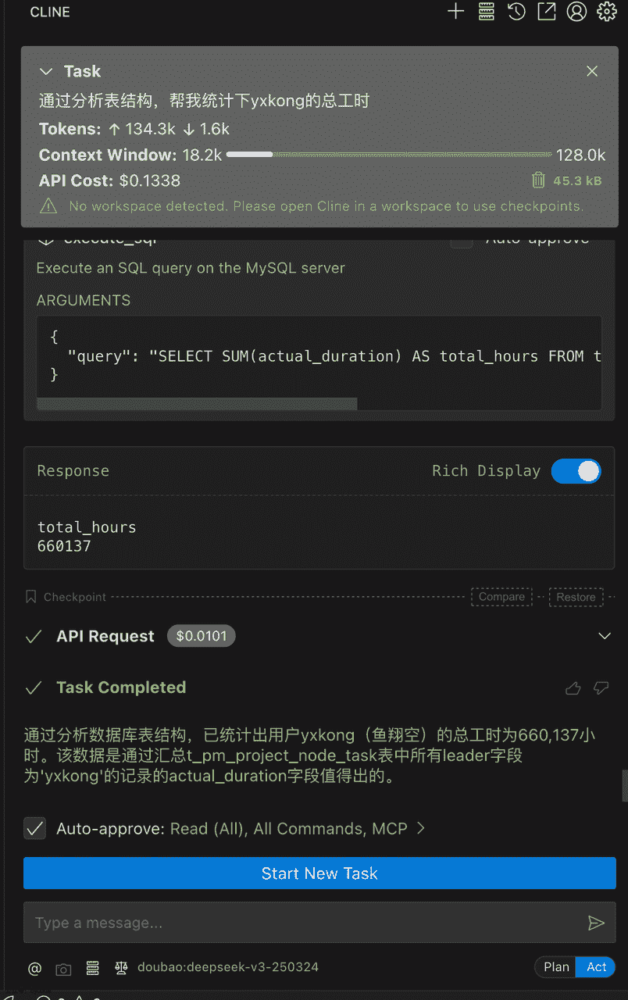

使用`cline`能完美的查询到我想要的结果。但是一个查询耗费了`13`万多的`tokens`。

## cline 配置

在测试的过程中`cline`的效果最好，而且支持你修改交互内容。附上`cline`的配置。

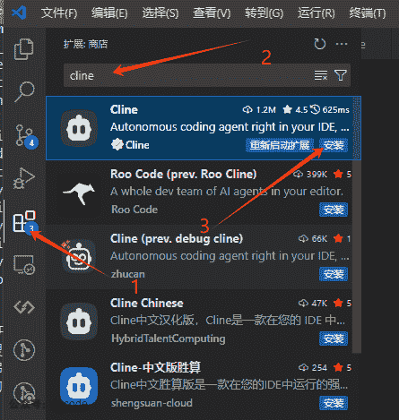

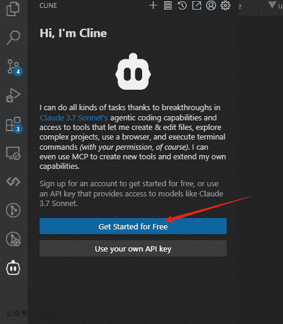

### 授权

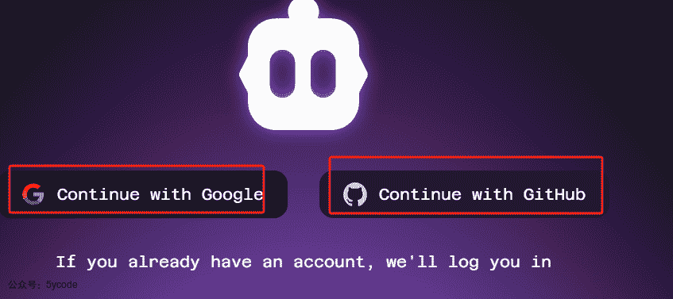

你有哪个账户选哪个。我一般选`github`

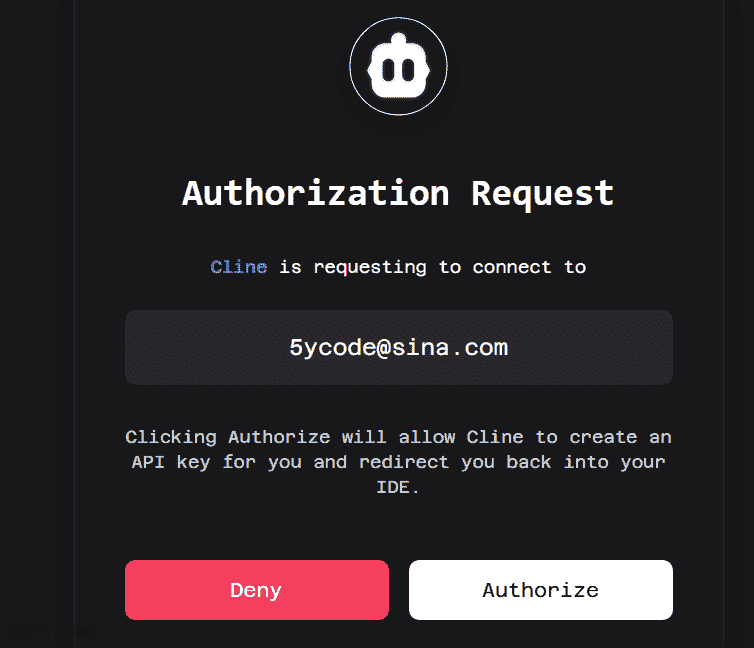

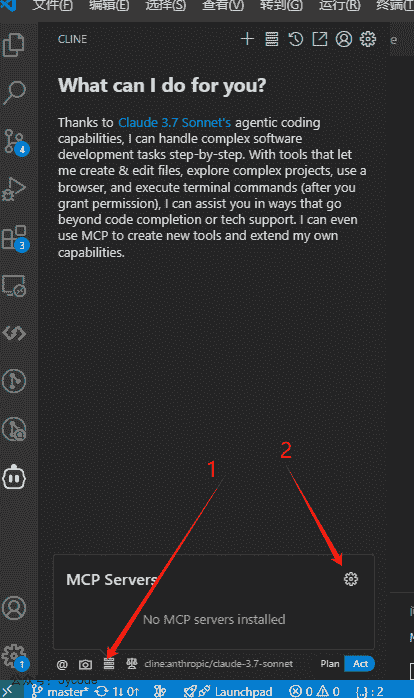

### 配置`mcp`服务。

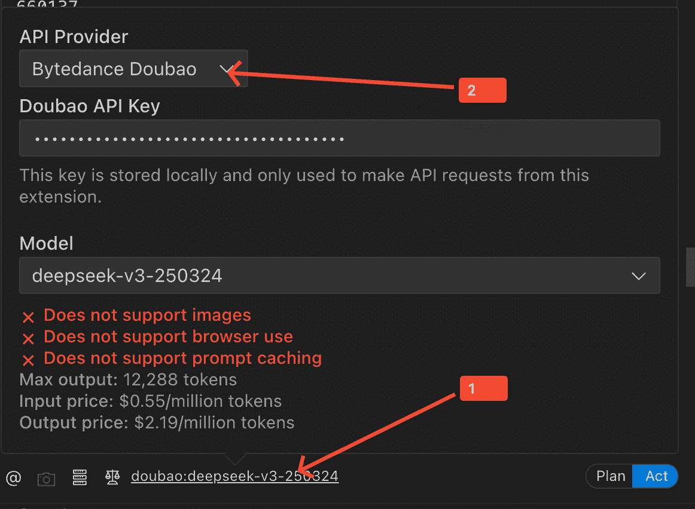

点击`1`切换模型服务,点击`2`选择模型供应商，然后根据自己的需求配置。

## 安全

远程调用，基于`http`协议，我们可以在请求`mcp server`之前，先获取一个`access_token`，然后把`access_token`作为交互的凭证，等退出以后清空，访问的时候，动态续期。后端可以设置过期时间。

## MCP 常用地址

### 文档

+   `MCP` 官网： https://modelcontextprotocol.io/introduction

+   中文版文档地址（机器翻译的，可读性有点差）： https://mcp-docs.cn/introduction

### 综合性网站

+   https://mcp.so/

### servers 地址

+   官方披露的`server`

+   glama ai `MCP Server`

+   精选的`MCP Server`

### 工具

+   `MCP`转化网关，把`stdio`转化为`SSE`

+   官方 `python` `sdk`

+   `fastmcp` `python`开发

+   `fastmcp` `TypeScript`开发

## 后记

+   `MCP` 不仅仅是一个标准化协议，它提供了一套解决方案。如果大模型实现了它，基本上通过自然语义+`MCP Server`就能完成各种工作流。

+   `MCP`能提供各种资源，真正好不要，还要看应用或者`LLM`如何组织

+   在测试的过程`cline`消耗的`tokens`是最多的，基本上一个任务`10`万左右的`tokens`，但是效果是真的不错。`Cherry Studio`消耗的比较少，但是功能比较简单。

+   使用`mcp`查询数据库，一定要先定，要不然查询的数据太多，会把数据库查崩
