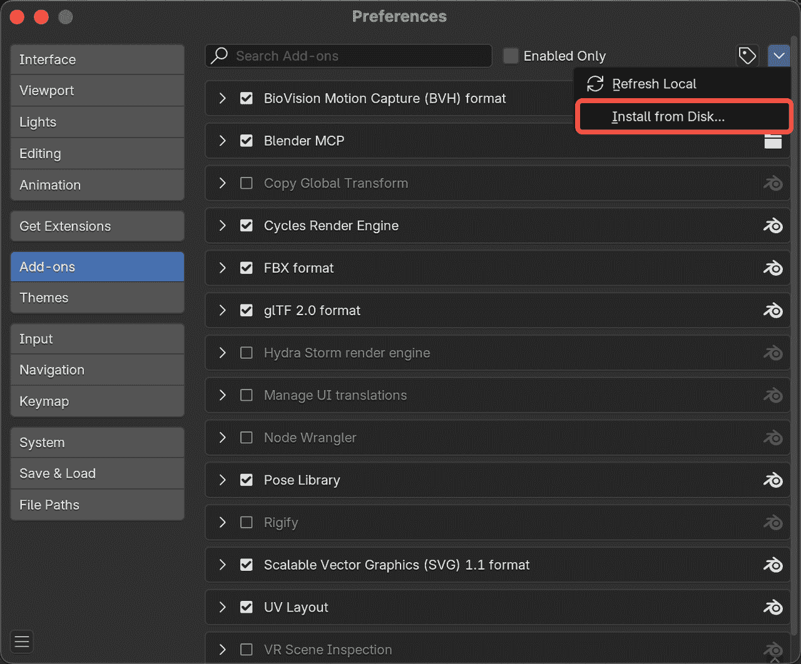
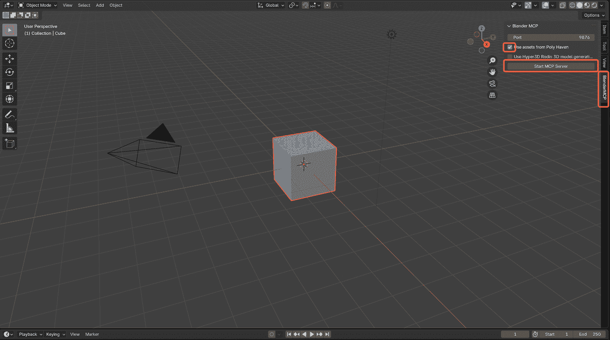
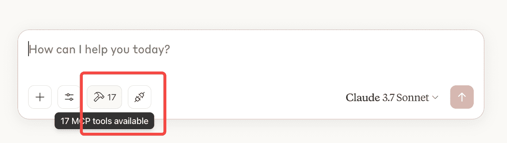
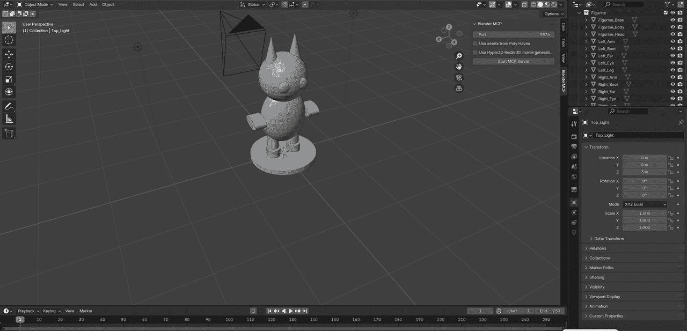

# Blender MCP, 手搓三维建模智能体

> 来源：[https://qqs7y1hozd1.feishu.cn/docx/VQXFdtRiTocX7ZxMKOMctdhWnvh](https://qqs7y1hozd1.feishu.cn/docx/VQXFdtRiTocX7ZxMKOMctdhWnvh)

> BlenderMCP 是一种基于 MCP（Model Context Protocol，模型上下文协议）的插件系统，可将 Blender 与 Claude AI 无缝连接。

> 通过该集成，Claude 可以读取 Blender 场景信息，甚至直接控制建模、材质、相机等操作，让 AI 参与到你的 3D 建模工作流中，大幅提升效率。

本文将一步步展示如何安装所需组件、配置环境，并在 Claude 中通过自然语言指令控制 Blender。

## 一、所需软件与安装顺序

以下是使用 BlenderMCP 所需的组件，请按照顺序安装：

### Blender（3.0 或更高版本）

前往 Blender 官网 下载并安装最新版本。推荐使用稳定版本 3.0 以上。

### Python（3.10 或更高版本）

Blender 自带内置 Python，但 MCP 服务依赖系统中的 Python 环境。

可以从 Python 官网 安装 Python 3.10+，并确保 python 命令可在终端中使用。

### 安装 uv 包管理器

BlenderMCP 使用 uv 来运行服务，安装方式如下：

#### macOS 用户

```
brew install uv
```

#### Windows 用户

打开 PowerShell，执行以下命令：

```
irm https://astral.sh/uv/install.ps1 | iex
```

安装完成后，请将 uv 可执行文件添加到系统环境变量中：

```
set Path=C:\Users\你的用户名\.local\bin;%Path%
```

⚠️ 务必确认 uv 安装成功后再进行下一步配置！

## 二、配置 Claude Desktop 与 MCP 服务连接

确保你已安装并登录 Claude 桌面客户端。接下来配置它与 BlenderMCP 通信：

步骤：

> 打开 Claude Desktop

进入菜单：

> Settings → Developer → Edit Config

> 编辑配置文件 claude_desktop_config.json。

添加如下内容：

```
{
    &quot;mcpServers&quot;: {
        &quot;blender&quot;: {
            &quot;command&quot;: &quot;uvx&quot;,
            &quot;args&quot;: [
                &quot;blender-mcp&quot;
            ]
        }
    }
}
```

保存后关闭配置界面。

## 三、安装 Blender 插件（addon.py）

Blender 插件用于在界面中开启 MCP 功能，步骤如下：

> 下载 addon.py 文件（从 BlenderMCP 的 GitHub 项目中获取）

> 打开 Blender

> 点击菜单 Edit → Preferences → Add-ons

> 点击右上角 Install...，选择 addon.py

> 搜索 Interface: Blender MCP，勾选以启用插件



## 四、启动 MCP 服务并连接 Claude

### 在 Blender 中连接 Claude

1.  打开 3D 视图界面（按 N 键呼出右侧工具栏）

1.  点击 “**BlenderMCP**” 标签页

1.  勾选 “Poly Haven” 以启用免费素材库（可选）

1.  点击 “Start MCP Server” 按钮



一切正常的话，Claude 就可以识别当前 Blender 场景了！



### Cursor 配置（mcp.json）设置

Cursor 的 MCP 配置文件默认存放在：

```
C:\Users\Administrator\.cursor\mcp.json
```

在该文件中，你需要添加 Blender MCP 的配置。示例如下：

```
{
    &quot;mcpServers&quot;: {
        &quot;blender&quot;: {
            &quot;command&quot;: &quot;cmd&quot;,
            &quot;args&quot;: [
                &quot;/c&quot;,
                &quot;uvx&quot;,
                &quot;blender-mcp&quot;
            ]
        }
    }
}
```

#### 自动启动批处理脚本编写

为了方便启动 Blender MCP 后端，你可以编写一个 Windows 批处理脚本。将下面内容保存为 Blender_MCP_Server_Start.bat：

```
@echo off
title Blender MCP Server Launcher
echo 正在启动 Blender MCP Server...
cd /d &quot;F:/_Software/Blender 4.1/blender-mcp-main/src&quot;
&quot;F:/_Software/Blender 4.1/blender.exe&quot; --background --factory-startup --python blender_mcp/server.py
pause
```

**说明：**

+   脚本中 cd /d 命令切换到项目根目录（改为你的lu'ji）。

+   执行命令后，Blender 将以后台模式启动，并运行 MCP 后端。

+   pause 用于在脚本结束后暂停窗口，便于查看启动日志。

#### 运行流程及验证步骤

启动流程：

###### 启动 Blender MCP 后端

> 双击运行 Blender_MCP_Server_Start.bat 批处理脚本。

> 命令行窗口中应显示相关日志（例如：启动成功、连接信息）。

###### 启动 Cursor 客户端

> 打开 Cursor，确保其读取了 mcp.json 配置。

> 在 Cursor 的 MCP Servers 部分，blenderMCP 应显示绿灯，表示连接成功。

###### 执行控制指令

可以在右边的 聊天框（New Chat） 直接打中文

```
创建一个球体
```

+   Cursor 会自动生成 Python 代码，然后点击“Run”按钮

+   检查 Blender 是否自动在场景中创建了一个立方体。

## 五、支持的功能与 Claude 指令示例

Claude 能执行的操作包括：

> 获取当前场景与对象的详细信息

> 创建、修改或删除几何体模型

> 添加或修改材质、贴图、HDRI 光照

> 控制摄像机视角与光照设置

> 执行任意 Python 脚本（基于 Blender API）

> 利用 Poly Haven 获取资源（模型、纹理、HDRIs）

> 利用 Hyper3D 生成 AI 模型

示例指令：

你可以直接对 Claude 说：

> “Create a low poly scene in a dungeon, with a dragon guarding a pot of gold” 创建一个地下城低多边形场景，有一条龙守着一锅金子

> “Create a beach vibe using HDRIs, textures, and models like rocks and vegetation from Poly Haven” 生成一个海滩环境，添加岩石和植被，并使用 HDRI 光照

> “Give a reference image, and create a Blender scene out of it” 根据我上传的参考图像，创建一个相似的场景

> Claude 会自动生成并执行相应操作。

## 六、常见错误与解决方案

#### GPU API 不可用错误

+   **错误信息**：

```
SystemError: GPU API is not available in background mode
```

+   **原因**：后台模式下加载了不适用的插件（如 HOps）。

+   **解决方案**：在启动 Blender 时使用 --factory-startup 参数，禁用用户配置插件。

#### ModuleNotFoundError: No module named 'mcp'

+   **错误信息**：

```
ModuleNotFoundError: No module named &#x27;mcp&#x27;
```

+   **原因**：当前工作目录不正确，导致 Python 无法找到 mcp 模块。

+   **解决方案**：

+   确保工作目录正确；

+   或在 server.py 开头添加代码，将上级目录加入 sys.path

```
import sys, os
sys.path.insert(0, os.path.abspath(os.path.join(os.path.dirname(__file__), &quot;..&quot;)))
```

## 七、关闭流程

### 关闭 MCP 后端

> 在运行批处理脚本的命令行窗口中，按下 Ctrl+C 终止服务。

### 关闭 Blender

> 如果 Blender 是以后台模式运行，关闭命令行窗口后 Blender 通常也会退出；如未退出，则手动关闭 Blender。

### 关闭 Cursor 客户端

> 退出或关闭 Cursor。

## 八、效果

“Give a reference image, and create a Blender scene out of it” 根据我上传的参考图像，创建一个相似的场景 ，这效果比起《哪吒》来还是差一些。

