# 基于MCP搭建“私人旅行助手”智能体

> 来源：[https://qqs7y1hozd1.feishu.cn/docx/IRwZdz4ShoZYvAxF2bWcDOinn6m](https://qqs7y1hozd1.feishu.cn/docx/IRwZdz4ShoZYvAxF2bWcDOinn6m)

> 本文结合 AI IDE（以 Cursor 为例），**利用 MCP **服务快速搭建一个私人定制的“行旅小助手”系统。

##### 搭建思路

> 使用高德地图的地点推荐 MCP 服务获取景点信息，再借助 Mi**nima**x 的语音生成 MCP 服务合成导览音频，并最终通过 Agent 自动生成 HTML 页面，实现一个“旅游景点推介”的一条龙流程。

## 私人旅行助手开发流程

+   注册并配置高德地图 MCP 服务：获取城市与景点的推荐接口，实现地点信息检索。

+   注册并配置 Minimax 语音生成 MCP 服务：将文字转为语音，生成导览音频。

+   在 Cursor 中完成 MCP 服务的接入与调用配置：包括填写密钥、Model 兼容性设置、Agent 自动运行配置等。

+   编写 Prompt 驱动 Agent：自动获取西安各类景点介绍，并按类别分条整理。

+   调用 Minimax 生成语音导览：将生成的景点介绍文本自动转为语音文件。

+   **生成并部署 HTML 页面：**利用 Agent 将整理好的文本输出为一个静态网页，并部署到线上。

## 使用高德开放平台的地图 MCP 服务

高德地图（amap）官方提供了自己的 MCP 服务 sse 接口，要使用它的 MCP 服务，登录高德开放平台，创建一个应用，并获取相应的 key。

接口地址：👉高[**德开放平台**](https://lbs.amap.com/)


### 注册为高德开放平台开发者

进入个人控制台，会要求先完成开发者认证，这里选择个人开发者。


### 获取高德服务密钥

下一步，是获取高德服务密钥的步骤。刚才提到，要获得密钥，需要先创建一个应用才行。进入控制台，选择 应用管理 -> 我的应用 -> 创建新应用。

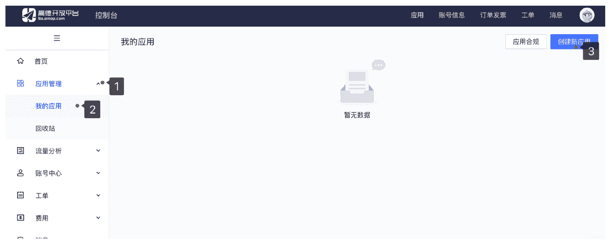

应用类型选择“出行”。

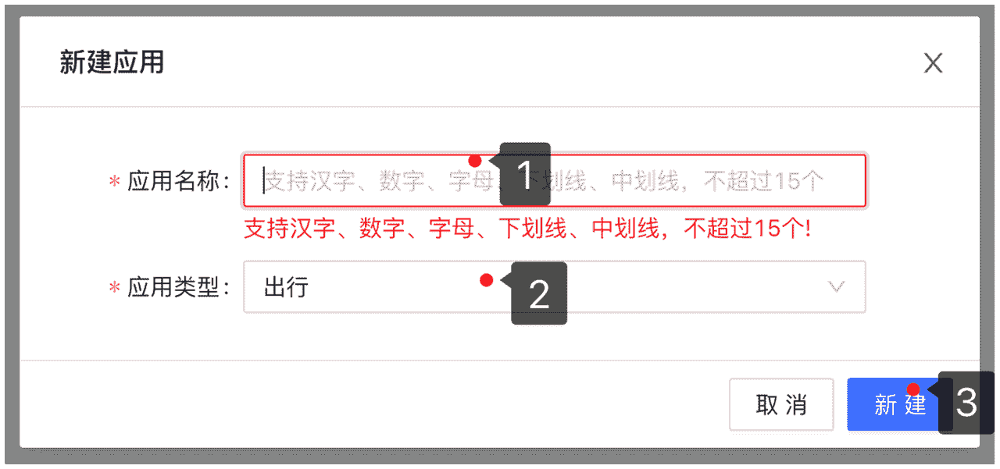

创建应用完成后，点击“添加 key”。

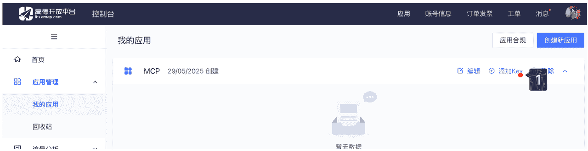

填写“Key 名称”，服务平台选择 “Web 服务”，勾选已阅读协议，提交创建 key。

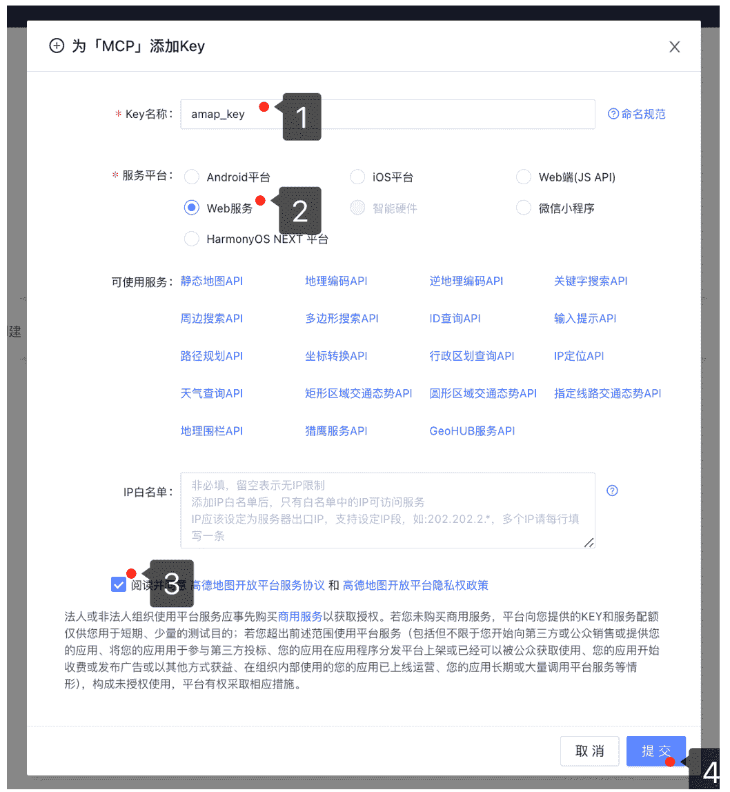

此时，key 就创建好了，可以把它复制下来，下一步在 Cursor 中配置 MCP 服务时会需要用到。

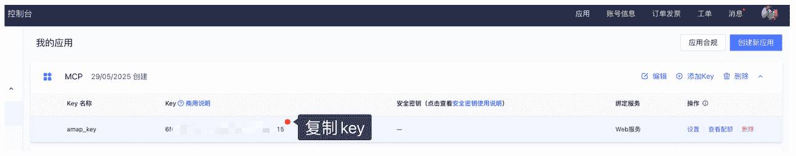

## 在 Cursor 中配置高德 MCP

下面，进入 cursor，选择右上角 settings->MCP->Add new global MCP server。

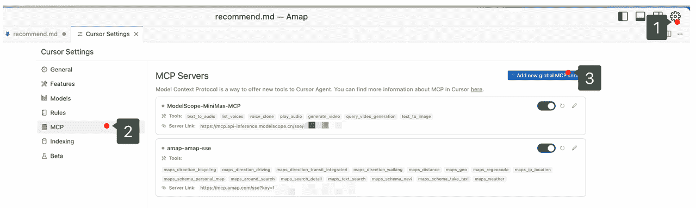

之后我们返回  Cursor  设置界面查看  MCP  服务工具状态。

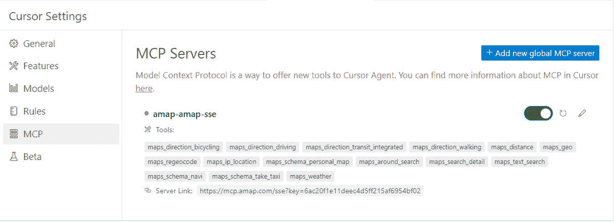

如果遇到任何问题，可以点击图右侧的绿色按钮重新 Enable 这些工具的功能。

## 使用 MiniMax 大模型的语音服务

配置好了高德地图 MCP 服务之后，我们再来配置我们这个应用程序中要使用到的下一个 MCP 服务—— MiniMax 提供的语音服务。


MiniMax 可以提供即时生成的多模态数据。对于 MCP 产品，目前支持 stdio、sse 两种传输方式，即可以本地部署或平台托管（这里我将使用 ModelScope 魔搭平台进行托管），并且提供本地路径、远程 url 两种处理图片音视频等资源输入输出的方式。

## 注册 Minimax 开放平台

接口地址：👉m[**inimax开放平台**](https://platform.minimaxi.com/login)


### 创建接口密钥

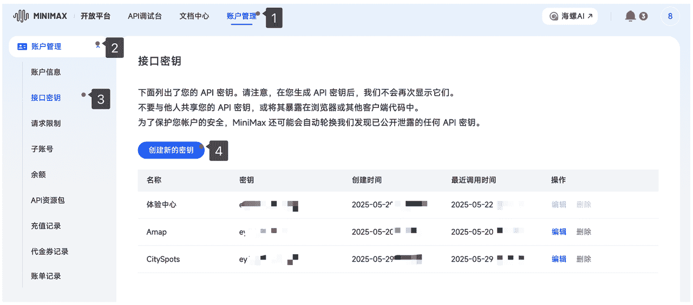

## 在 ModelScope 平台部署 Minimax sse

接口地址：[**modelscope**](https://modelscope.cn/mcp/servers/@MiniMax-AI/MiniMax-MCP)

**分别填入：**

> 刚才在** Minimax **开放平台创建的 key 密钥

> 本地存放获取音视频的目录（有** stdio 和 url **两种模式，这里是必填项，先填一个本地存储生成音视频的目录）

点击“连接”，即在** ModelScope **部署完成了托管服务，复制这里的完整 url。

## 在 Cursor 中配置 Minimax MCP

在 Cursor 中配置 Minimax MCP，准**备工作有两步。在 Mode**l 平台托管的 MiniMax-MCP 配置 URL，然后在 Minimax 开放平台账户管理中，查看并复制 GroupID。

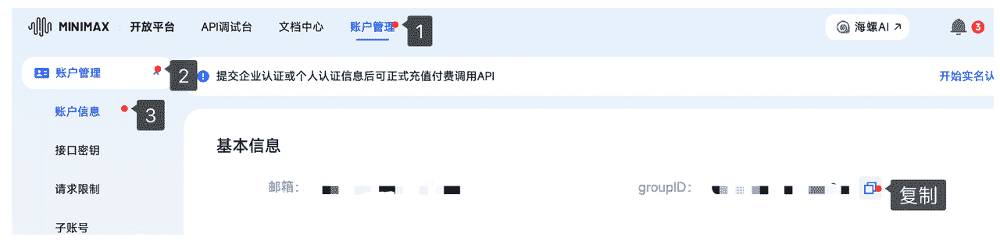

这里填入刚刚复制的：ModelScope 平台托管的 Minimax 的 urlMinimax 个人的 GroupID

回到 MCP 服务列表，打开这个服务的按钮打开，并刷新。等一会儿后，“Tools:”后面的“No Tools Available”会变成显示一系列的可用方法。如果一直显示“No Tools Available”，需要检查 url 有没有完整复制，账户的 GroupID 和 key 是否正确。

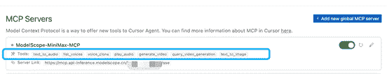

## 在 Cursor 中使用 MCP 服务开发自己的应用

下面我们就要开始在 Cursor 中使用刚才配置好的两种 MCP 服务了，不过在这之前，还要再做一些 MCP 兼容性的设置。

### 选择对 MCP 兼容性好的模型

在 Cursor 提供的模型中，部分对 MCP 的兼容性还不好。这里推荐 Agent 执行能力、对 MCP 反馈的整合能力都很强的模型：gemini-2.5-pro-exp-03-25。

在下图的 Cursor 设置中，调整备选的 Models。

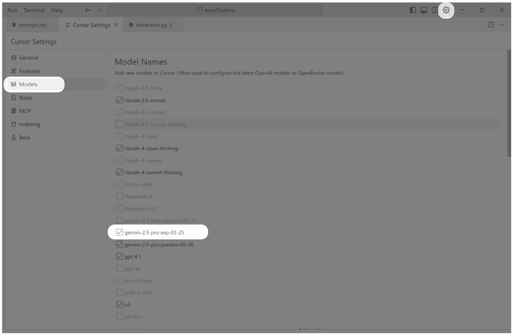

### 允许自动流畅执行 MCP 工具调用

在 Feature 中找到 auto-run mode，为了让整个交互过程更加流畅，选择如下设置：

勾选（3）“允许 Agent 默认不询问直接调用工具”，

不勾选（4）“阻止 Agent 自动运行 MCP 工具”

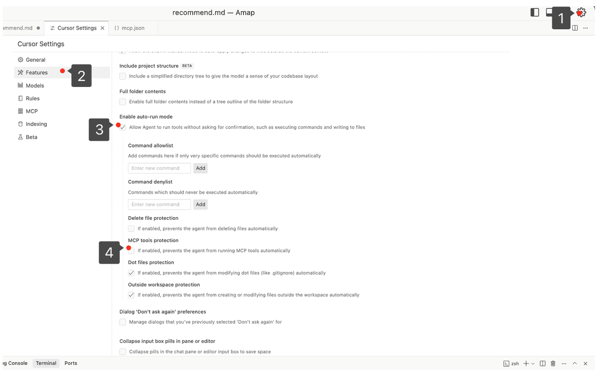

好，上面就是 MCP 兼容性的设置，下面我们通过提示工程来实现所想要的功能。

### 获取城市景点的介绍

在 Cursor 的 Chat 对话框中，首先获取主要旅游景点信息。

```
根据高德地图，获取西安市内的主要旅游景点信息|
```

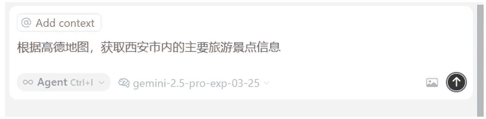

Cursor 作为 MCP Host，将通过 gemini-2.5-pro-exp-03-25 模型自动在对话中拉取调用 MCP 工具，完成上面的任务。

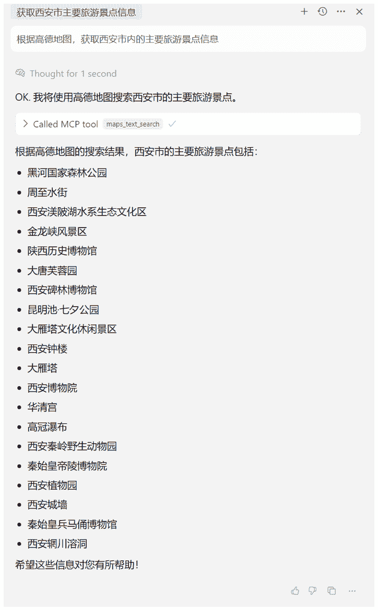

### 按照类别整理景点介绍

下一步，再通过提示工程来按照类别，整理景点的介绍。

```
帮我对这些景点分类，在百度百科上搜索相关的介绍，对每个景点生成一个详细的介绍，生动活泼有条理，并写入一个markdown文件
```

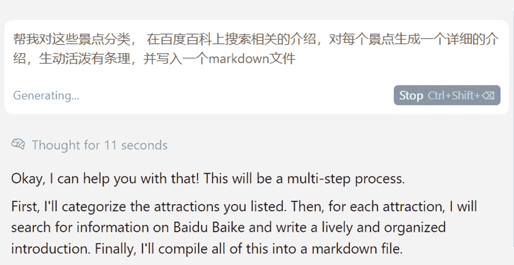

可以看到 Agent 在努力地调用 MCP 服务，自行分条检索信息并汇总。

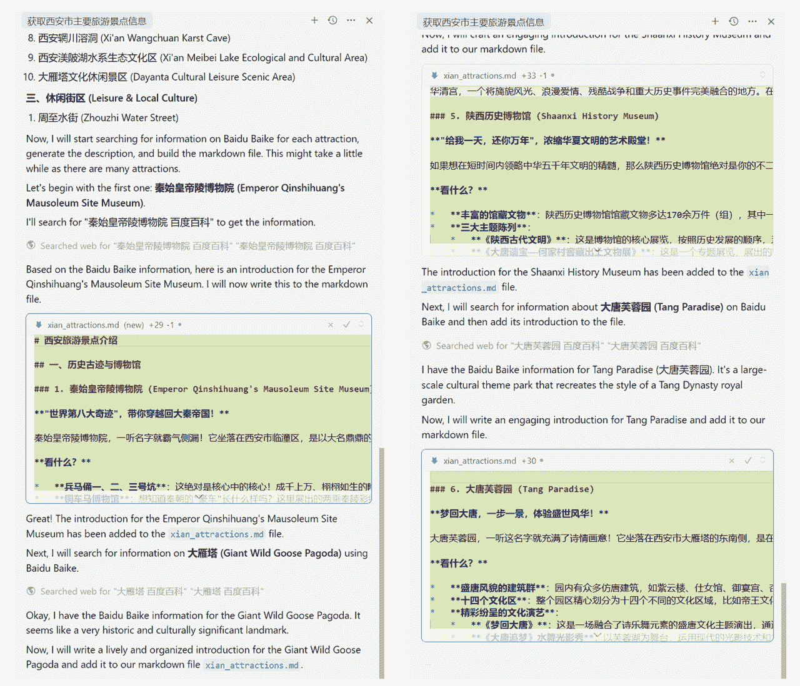

最后，Agent 会把生成的内容保存成新的 Markdown 文件，各景点信息已经分门别类整理到位。

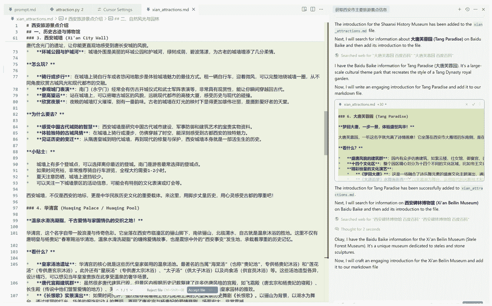

## 调用 Minimax 生成语音导览

下面通过 @或者拖动到对话框的方式引用文件，并在对话中输入以下提示。

```
生成各个景点的语音介绍，把得到的语音导览的链接放在标题的下方。
```

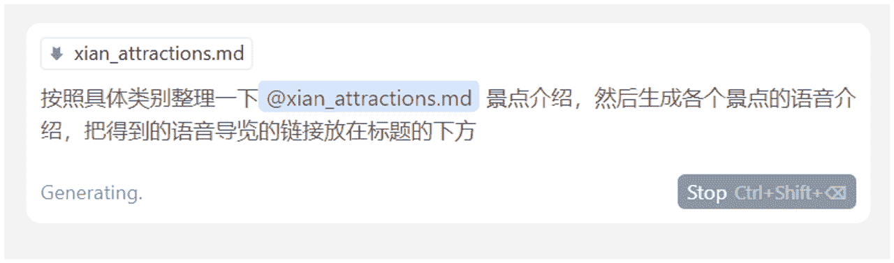

Agent 会识别、嵌入成功调用 MCP 并正确返回的 url，自动修改 markdown 文件。

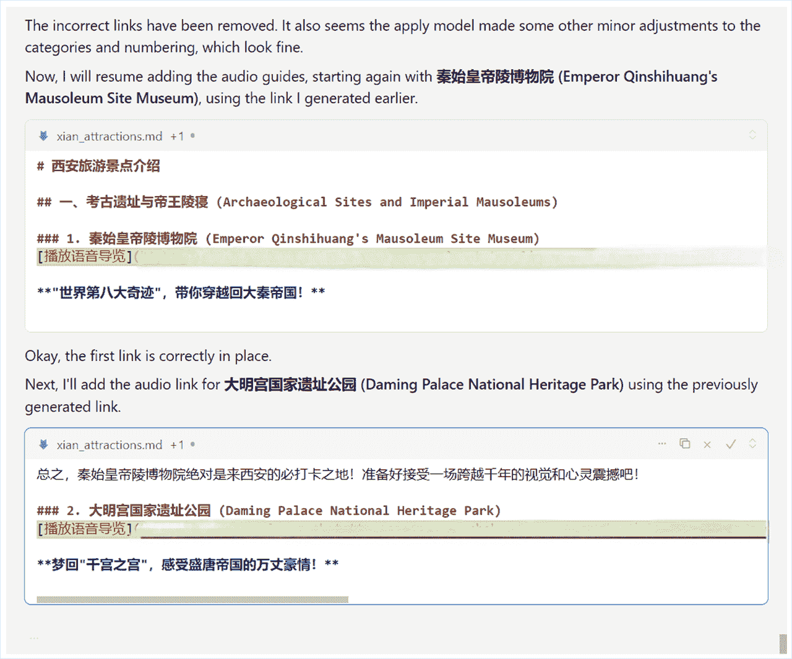

## 网页制作和部署

现在已经得到了每个景点的分类分条的文字和音频介绍，我们要用网页把内容呈现出来。这里我们让 Agent 按照给定的提示词生成网页并保存。

新建一个文件，叫 “prompt.md”，然后保存下面的内容。

```
Markdown
   #   页面提示词
   ## 网页风格指南
   你是一位国际顶尖的数字景区导览设计师和前端开发专家，擅长将传统景区介绍与现代网页设计完美融合，创造出令人身临其境的视觉体验。请设计高品质景区介绍手机h5网页，将景区信息以生动优雅的方式呈现，让用户在浏览前就能感受到景区魅力。
   **可选设计风格：
   **1. **文化复古风格**
       适合历史文化类景区，使用仿古纸张纹理背景，搭配书法或篆刻风格的标题。色调以米黄、棕色等复古色系为主，点缀传统中国色。排版可参考古籍设计，正文使用简体宋体增强文化氛围。可加入水墨画元素作为分隔符或装饰。文案语调应庄重有文化底蕴，介绍中可穿插诗词或历史典故。
   2. **现代简约风格**
       采用极简设计理念，主色调限制在2-3种，确保视觉统一性。排版注重网格系统，所有元素严格对齐。字体选用无衬线体，增强现代感。景点信息使用卡片式设计，便于用户快速浏览。图标采用线性设计，保持风格一致性。动效应简洁克制，仅用于增强用户体验的关键环节。整体设计追求&quot;少即是多&quot;的理念，让内容成为主角。
   **必要页面组件：**
   1. **景区名称列表**：   
     1. 景区名称
     2. 音频开始按钮：点击音频可以直接播放，播放时可以暂停，暂停的音频还可以继续播放
   2. **景区介绍**：    
     1. 默认收缩，点击景区名称可弹出详细介绍
   ## 技术规范
   * 资源引用：  
     * Tailwind CSS:   `----`  
     * Font Awesome:   `----`  
     * 中文字体:   `----`  
     * ----`
   * 音频处理：  
     * 使用HTML5   audio元素实现音频播放  
     * 实现自定义播放控制按钮  
     * 支持语音解说的暂停/继续功能，切换新音频直接打断正在播放的音频
   ## 输出要求
   * 提供一个完整的HTML文件，包含所有景区介绍内容
   * 代码应当简洁高效，注释充分，易于维护
   * 确保在不同尺寸的移动设备上都能良好展示
   * 所有文字内容使用中文输出
   * 确保文字的可读性，背景与文字有足够对比度
```

最后一步，准备好提示词和刚刚的景点介绍内容文件，交给 Agent 生成 HTML 页面。

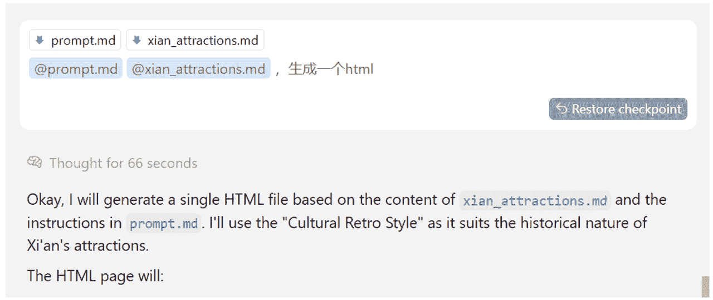

可以看到 Agent 帮我们快速生成了 HTML。

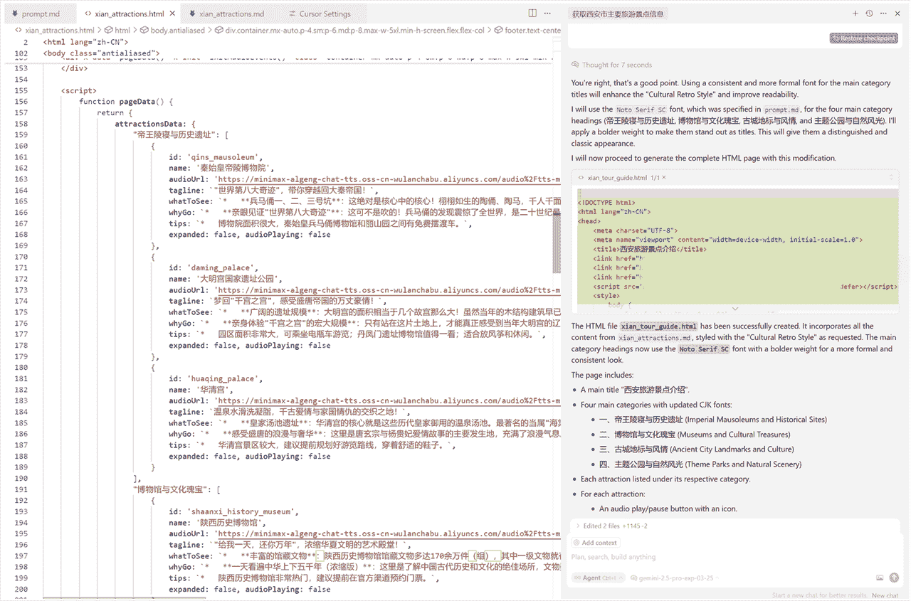

## 网页效果的呈现

下面，我们把这个页面上传到 youware，进行部署和展示。

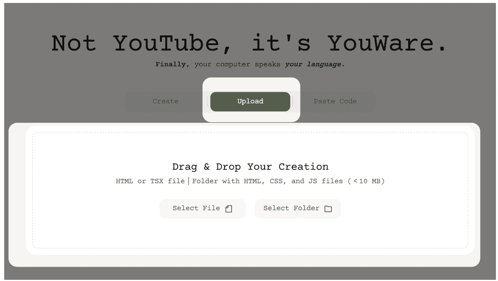

下面就是实际在线部署的页面。

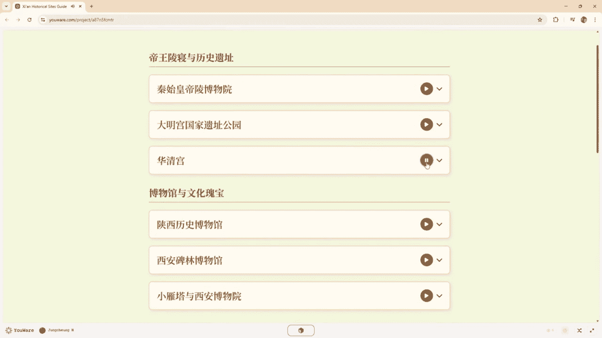