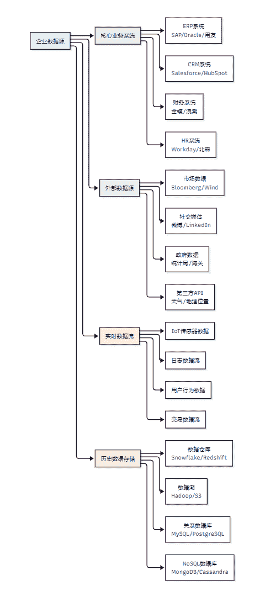
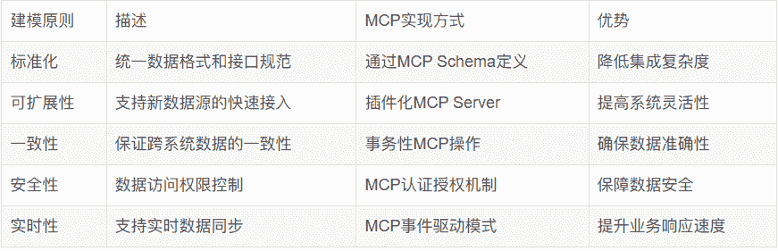
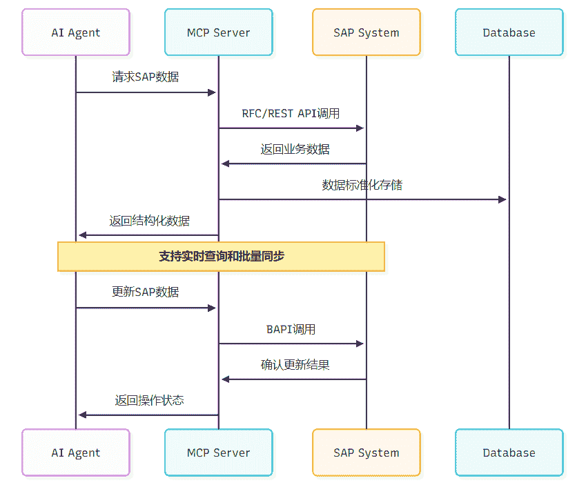
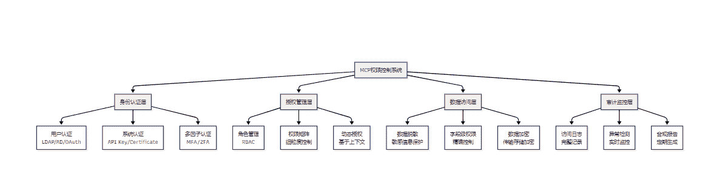
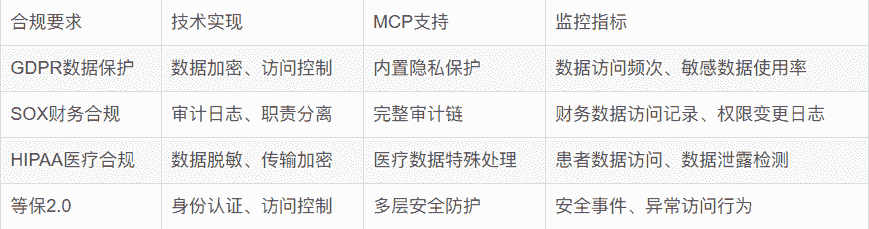
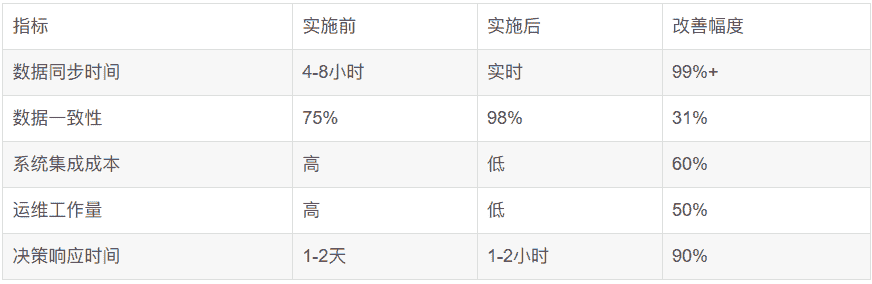
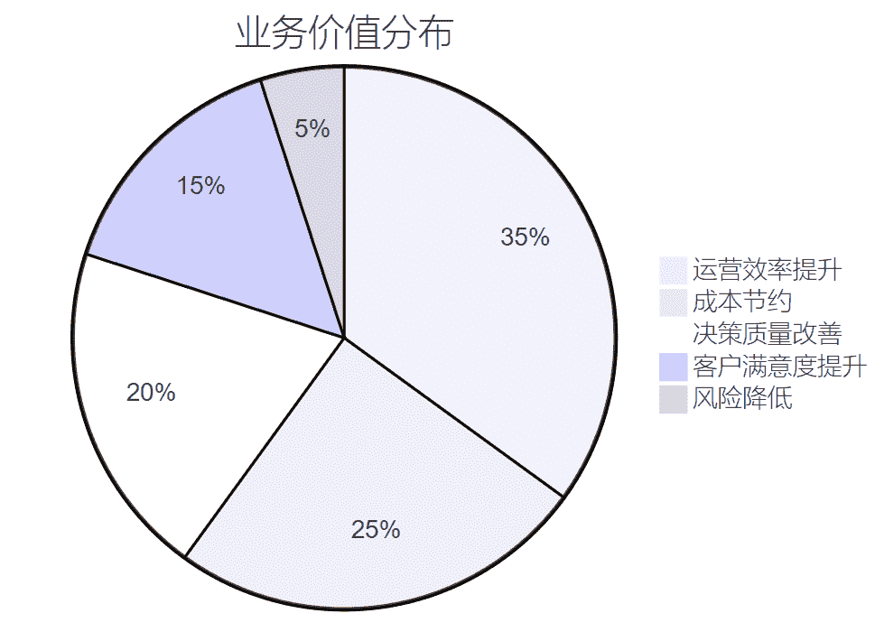
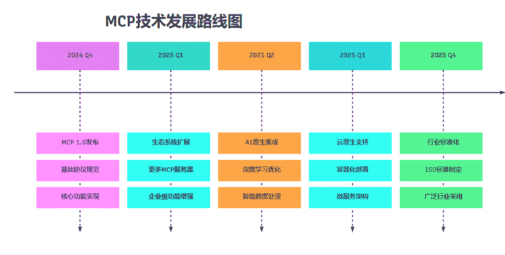
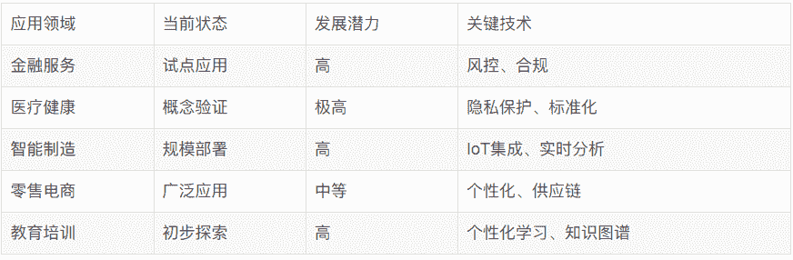

# MCP与企业数据集成：ERP、CRM、数据仓库的统一接入

> 来源：[https://qqs7y1hozd1.feishu.cn/docx/XjBAdoIj6ouoCWxzmaecehBuned](https://qqs7y1hozd1.feishu.cn/docx/XjBAdoIj6ouoCWxzmaecehBuned)

> 随着企业数字化转型的深入推进，各类业务系统如ERP（Enterprise Resource Planning，企业资源规划）、CRM（Customer Relationship Management，客户关系管理）、数据仓库等系统的数据互联互通需求愈发迫切。
>
> 传统的点对点集成方式不仅开发成本高昂，维护复杂度也呈指数级增长，更重要的是难以满足实时性和一致性要求。Anthropic推出的MCP（Model Context Protocol，模型上下文协议）为这一痛点提供了革命性的解决方案。

+   MCP通过标准化的协议接口，实现了AI模型与各类企业系统的无缝连接，不仅大幅降低了集成复杂度，更为企业数据的统一管理和智能化应用奠定了坚实基础。

本文将从企业数据源分析建模、主流系统集成实践、数据权限控制合规性保障以及实时数据同步一致性维护四个维度，深入探讨MCP在企业数据集成领域的应用实践，为企业数字化转型提供切实可行的技术路径和最佳实践指导。

## 企业数据源分析与建模

### 1.1 企业数据源全景分析

现代企业的数据生态系统呈现出多样化、复杂化的特征。从数据来源角度分析，主要包括以下几类：



### 1.2 数据模型设计原则

基于MCP协议的企业数据集成需要遵循统一的数据建模原则：



### 1.3 统一数据模型实现

```python
# MCP企业数据模型定义
from typing import Dict, List, Optional, Union
from pydantic import BaseModel
from datetime import datetime
 
class MCPDataSource(BaseModel):
    """MCP数据源基础模型"""
    source_id: str
    source_type: str  # ERP, CRM, DW, etc.
    connection_config: Dict
    schema_version: str
    last_sync_time: Optional[datetime]
 
class MCPDataEntity(BaseModel):
    """MCP数据实体模型"""
    entity_id: str
    entity_type: str
    source_system: str
    data_payload: Dict
    metadata: Dict
    created_at: datetime
    updated_at: datetime
 
class MCPDataMapping(BaseModel):
    """MCP数据映射模型"""
    mapping_id: str
    source_field: str
    target_field: str
    transformation_rule: Optional[str]
    validation_rule: Optional[str]
 
# MCP数据源管理器
class MCPDataSourceManager:
    def __init__(self):
        self.data_sources: Dict[str, MCPDataSource] = {}
        self.mappings: Dict[str, List[MCPDataMapping]] = {}
    
    def register_data_source(self, source: MCPDataSource) -> bool:
        """注册新的数据源"""
        try:
            # 验证数据源连接
            if self._validate_connection(source):
                self.data_sources[source.source_id] = source
                return True
        except Exception as e:
            print(f"数据源注册失败: {e}")
        return False
    
    def _validate_connection(self, source: MCPDataSource) -> bool:
        """验证数据源连接有效性"""
        # 实现具体的连接验证逻辑
        return True
```

## SAP、Salesforce等系统集成实践

### 2.1 SAP ERP系统集成架构

SAP作为全球领先的ERP解决方案，其集成复杂度较高。通过MCP协议可以大幅简化集成过程：



### 2.2 SAP集成实现代码

```python
# SAP MCP Server实现
import pyrfc
from typing import Dict, List
import json
 
class SAPMCPServer:
    def __init__(self, sap_config: Dict):
        self.sap_config = sap_config
        self.connection = None
    
    def connect(self) -> bool:
        """建立SAP连接"""
        try:
            self.connection = pyrfc.Connection(**self.sap_config)
            return True
        except Exception as e:
            print(f"SAP连接失败: {e}")
            return False
    
    def get_customer_data(self, customer_id: str) -> Dict:
        """获取客户主数据"""
        if not self.connection:
            raise Exception("SAP连接未建立")
        
        try:
            # 调用SAP RFC函数
            result = self.connection.call(
                'BAPI_CUSTOMER_GETDETAIL2',
                CUSTOMERNO=customer_id
            )
            
            # 数据标准化处理
            customer_data = {
                'customer_id': result['CUSTOMERNO'],
                'name': result['CUSTOMERDETAIL']['NAME1'],
                'address': {
                    'street': result['CUSTOMERDETAIL']['STREET'],
                    'city': result['CUSTOMERDETAIL']['CITY1'],
                    'country': result['CUSTOMERDETAIL']['COUNTRY']
                },
                'contact': {
                    'phone': result['CUSTOMERDETAIL']['TELEPHONE1'],
                    'email': result['CUSTOMERDETAIL']['E_MAIL']
                }
            }
            
            return customer_data
            
        except Exception as e:
            raise Exception(f"获取客户数据失败: {e}")
    
    def create_sales_order(self, order_data: Dict) -> str:
        """创建销售订单"""
        try:
            # 构建SAP订单结构
            order_header = {
                'DOC_TYPE': order_data.get('doc_type', 'OR'),
                'SALES_ORG': order_data.get('sales_org'),
                'DISTR_CHAN': order_data.get('distribution_channel'),
                'DIVISION': order_data.get('division')
            }
            
            order_items = []
            for item in order_data.get('items', []):
                order_items.append({
                    'ITM_NUMBER': item['item_number'],
                    'MATERIAL': item['material_code'],
                    'REQ_QTY': item['quantity']
                })
            
            # 调用SAP BAPI创建订单
            result = self.connection.call(
                'BAPI_SALESORDER_CREATEFROMDAT2',
                ORDER_HEADER_IN=order_header,
                ORDER_ITEMS_IN=order_items
            )
            
            if result['RETURN']['TYPE'] == 'S':
                return result['SALESDOCUMENT']
            else:
                raise Exception(f"创建订单失败: {result['RETURN']['MESSAGE']}")
                
        except Exception as e:
            raise Exception(f"SAP订单创建异常: {e}")
```

### 2.3 Salesforce CRM集成实践

Salesforce作为全球领先的CRM平台，其API丰富且标准化程度高，非常适合MCP集成：


```
# Salesforce MCP Server实现
from simple_salesforce import Salesforce
from typing import Dict, List, Optional
import json
 
class SalesforceMCPServer:
    def __init__(self, sf_config: Dict):
        self.sf_config = sf_config
        self.sf_client = None
    
    def authenticate(self) -> bool:
        """Salesforce认证"""
        try:
            self.sf_client = Salesforce(
                username=self.sf_config['username'],
                password=self.sf_config['password'],
                security_token=self.sf_config['security_token'],
                domain=self.sf_config.get('domain', 'login')
            )
            return True
        except Exception as e:
            print(f"Salesforce认证失败: {e}")
            return False
    
    def get_account_info(self, account_id: str) -> Dict:
        """获取客户账户信息"""
        try:
            account = self.sf_client.Account.get(account_id)
            
            # 标准化数据格式
            account_data = {
                'account_id': account['Id'],
                'name': account['Name'],
                'type': account.get('Type'),
                'industry': account.get('Industry'),
                'annual_revenue': account.get('AnnualRevenue'),
                'employees': account.get('NumberOfEmployees'),
                'address': {
                    'street': account.get('BillingStreet'),
                    'city': account.get('BillingCity'),
                    'state': account.get('BillingState'),
                    'country': account.get('BillingCountry'),
                    'postal_code': account.get('BillingPostalCode')
                },
                'created_date': account['CreatedDate'],
                'last_modified': account['LastModifiedDate']
            }
            
            return account_data
            
        except Exception as e:
            raise Exception(f"获取账户信息失败: {e}")
    
    def create_opportunity(self, opp_data: Dict) -> str:
        """创建销售机会"""
        try:
            opportunity = {
                'Name': opp_data['name'],
                'AccountId': opp_data['account_id'],
                'Amount': opp_data.get('amount'),
                'CloseDate': opp_data['close_date'],
                'StageName': opp_data.get('stage', 'Prospecting'),
                'Probability': opp_data.get('probability', 10)
            }
            
            result = self.sf_client.Opportunity.create(opportunity)
            return result['id']
            
        except Exception as e:
            raise Exception(f"创建销售机会失败: {e}")
    
    def sync_contacts_to_mcp(self) -> List[Dict]:
        """同步联系人数据到MCP"""
        try:
            # 查询最近更新的联系人
            query = """
                SELECT Id, FirstName, LastName, Email, Phone, AccountId, 
                       CreatedDate, LastModifiedDate 
                FROM Contact 
                WHERE LastModifiedDate >= YESTERDAY
            """
            
            contacts = self.sf_client.query(query)
            
            standardized_contacts = []
            for contact in contacts['records']:
                standardized_contacts.append({
                    'contact_id': contact['Id'],
                    'first_name': contact.get('FirstName'),
                    'last_name': contact.get('LastName'),
                    'email': contact.get('Email'),
                    'phone': contact.get('Phone'),
                    'account_id': contact.get('AccountId'),
                    'source_system': 'Salesforce',
                    'created_date': contact['CreatedDate'],
                    'last_modified': contact['LastModifiedDate']
                })
            
            return standardized_contacts
            
        except Exception as e:
            raise Exception(f"同步联系人数据失败: {e}")
```

## 2.4 集成效果对比分析


## 数据权限控制与合规性保障

### 3.1 多层级权限控制架构

企业数据安全是数据集成的核心要求，MCP提供了完善的权限控制机制：



### 3.2 权限控制实现代码


```
# MCP权限控制系统实现
from typing import Dict, List, Set, Optional
from enum import Enum
import hashlib
import jwt
from datetime import datetime, timedelta
 
class PermissionLevel(Enum):
    READ = "read"
    WRITE = "write"
    DELETE = "delete"
    ADMIN = "admin"
 
class DataClassification(Enum):
    PUBLIC = "public"
    INTERNAL = "internal"
    CONFIDENTIAL = "confidential"
    RESTRICTED = "restricted"
 
class MCPPermissionManager:
    def __init__(self):
        self.users: Dict[str, Dict] = {}
        self.roles: Dict[str, Dict] = {}
        self.permissions: Dict[str, Set[str]] = {}
        self.data_classifications: Dict[str, DataClassification] = {}
    
    def create_user(self, user_id: str, user_info: Dict) -> bool:
        """创建用户"""
        try:
            self.users[user_id] = {
                'user_id': user_id,
                'name': user_info['name'],
                'email': user_info['email'],
                'department': user_info.get('department'),
                'roles': user_info.get('roles', []),
                'created_at': datetime.now(),
                'is_active': True
            }
            return True
        except Exception as e:
            print(f"创建用户失败: {e}")
            return False
    
    def create_role(self, role_id: str, role_info: Dict) -> bool:
        """创建角色"""
        try:
            self.roles[role_id] = {
                'role_id': role_id,
                'name': role_info['name'],
                'description': role_info.get('description'),
                'permissions': role_info.get('permissions', []),
                'data_access_level': role_info.get('data_access_level', DataClassification.PUBLIC)
            }
            return True
        except Exception as e:
            print(f"创建角色失败: {e}")
            return False
    
    def check_permission(self, user_id: str, resource: str, action: PermissionLevel) -> bool:
        """检查用户权限"""
        try:
            user = self.users.get(user_id)
            if not user or not user['is_active']:
                return False
            
            # 检查用户角色权限
            for role_id in user['roles']:
                role = self.roles.get(role_id)
                if role and self._has_permission(role, resource, action):
                    # 检查数据分类权限
                    if self._check_data_classification(role, resource):
                        return True
            
            return False
            
        except Exception as e:
            print(f"权限检查失败: {e}")
            return False
    
    def _has_permission(self, role: Dict, resource: str, action: PermissionLevel) -> bool:
        """检查角色是否有特定权限"""
        permissions = role.get('permissions', [])
        required_permission = f"{resource}:{action.value}"
        return required_permission in permissions or f"{resource}:*" in permissions
    
    def _check_data_classification(self, role: Dict, resource: str) -> bool:
        """检查数据分类访问权限"""
        resource_classification = self.data_classifications.get(resource, DataClassification.PUBLIC)
        role_access_level = role.get('data_access_level', DataClassification.PUBLIC)
        
        # 定义访问级别层次
        access_hierarchy = {
            DataClassification.PUBLIC: 0,
            DataClassification.INTERNAL: 1,
            DataClassification.CONFIDENTIAL: 2,
            DataClassification.RESTRICTED: 3
        }
        
        return access_hierarchy[role_access_level] >= access_hierarchy[resource_classification]

# 数据脱敏处理
class DataMaskingProcessor:
    def __init__(self):
        self.masking_rules = {
            'phone': self._mask_phone,
            'email': self._mask_email,
            'id_card': self._mask_id_card,
            'bank_account': self._mask_bank_account
        }
    
    def mask_sensitive_data(self, data: Dict, user_permission_level: DataClassification) -> Dict:
        """根据用户权限级别脱敏数据"""
        if user_permission_level == DataClassification.RESTRICTED:
            return data  # 最高权限，不脱敏
        
        masked_data = data.copy()
        
        for field, value in data.items():
            if self._is_sensitive_field(field):
                masking_func = self.masking_rules.get(self._get_field_type(field))
                if masking_func:
                    masked_data[field] = masking_func(value, user_permission_level)
        
        return masked_data
    
    def _mask_phone(self, phone: str, level: DataClassification) -> str:
        """手机号脱敏"""
        if level == DataClassification.CONFIDENTIAL:
            return phone[:3] + "****" + phone[-4:]
        else:
            return "***-****-****"
    
    def _mask_email(self, email: str, level: DataClassification) -> str:
        """邮箱脱敏"""
        if level == DataClassification.CONFIDENTIAL:
            parts = email.split('@')
            return parts[0][:2] + "***@" + parts[1]
        else:
            return "***@***.com"
    
    def _is_sensitive_field(self, field: str) -> bool:
        """判断是否为敏感字段"""
        sensitive_keywords = ['phone', 'email', 'id_card', 'bank', 'password', 'ssn']
        return any(keyword in field.lower() for keyword in sensitive_keywords)
    
    def _get_field_type(self, field: str) -> str:
        """获取字段类型"""
        if 'phone' in field.lower():
            return 'phone'
        elif 'email' in field.lower():
            return 'email'
        elif 'id' in field.lower():
            return 'id_card'
        elif 'bank' in field.lower():
            return 'bank_account'
        return 'default'
```

### 3.3 合规性保障机制

"数据合规不是技术问题，而是治理问题。技术只是实现合规的手段，真正的挑战在于建立完善的数据治理体系。" —— 数据治理专家



## 实时数据同步与一致性维护

### 4.1 实时同步架构设计

**实时数据同步是企业数据集成**的核心挑战，MCP通过事件驱动机制实现高效的实时同步：


### 4.2 实时同步实现代码


```
# MCP实时数据同步系统
import asyncio
import json
from typing import Dict, List, Callable, Optional
from datetime import datetime
import hashlib
from enum import Enum

class SyncEventType(Enum):
    CREATE = "create"
    UPDATE = "update"
    DELETE = "delete"
    BULK_SYNC = "bulk_sync"

class DataSyncEvent:
    def __init__(self, event_type: SyncEventType, source_system: str,
                 entity_type: str, entity_id: str, data: Dict, timestamp: datetime = None):
        self.event_type = event_type
        self.source_system = source_system
        self.entity_type = entity_type
        self.entity_id = entity_id
        self.data = data
        self.timestamp = timestamp or datetime.now()
        self.event_id = self._generate_event_id()

    def _generate_event_id(self) -> str:
        """生成唯一事件ID"""
        content = f"{self.source_system}:{self.entity_type}:{self.entity_id}:{self.timestamp}"
        return hashlib.md5(content.encode()).hexdigest()

class MCPRealTimeSyncManager:
    def __init__(self):
        self.event_handlers: Dict[str, List[Callable]] = {}
        self.sync_rules: Dict[str, Dict] = {}
        self.conflict_resolvers: Dict[str, Callable] = {}
        self.sync_status: Dict[str, Dict] = {}

    def register_sync_rule(self, source_system: str, target_systems: List[str],
                          entity_types: List[str], sync_config: Dict):
        """注册同步规则"""
        rule_id = f"{source_system}_to_{'_'.join(target_systems)}"
        self.sync_rules[rule_id] = {
            'source_system': source_system,
            'target_systems': target_systems,
            'entity_types': entity_types,
            'sync_config': sync_config,
            'created_at': datetime.now()
        }

    def register_event_handler(self, event_type: str, handler: Callable):
        """注册事件处理器"""
        if event_type not in self.event_handlers:
            self.event_handlers[event_type] = []
        self.event_handlers[event_type].append(handler)

    async def process_sync_event(self, event: DataSyncEvent):
        """处理同步事件"""
        try:
            # 查找适用的同步规则
            applicable_rules = self._find_applicable_rules(event)

            for rule in applicable_rules:
                await self._execute_sync_rule(event, rule)

            # 更新同步状态
            self._update_sync_status(event, 'success')

        except Exception as e:
            print(f"同步事件处理失败: {e}")
            self._update_sync_status(event, 'failed', str(e))

    def _find_applicable_rules(self, event: DataSyncEvent) -> List[Dict]:
        """查找适用的同步规则"""
        applicable_rules = []

        for rule_id, rule in self.sync_rules.items():
            if (event.source_system == rule['source_system'] and
                event.entity_type in rule['entity_types']):
                applicable_rules.append(rule)

        return applicable_rules

    async def _execute_sync_rule(self, event: DataSyncEvent, rule: Dict):
        """执行同步规则"""
        for target_system in rule['target_systems']:
            try:
                # 数据转换
                transformed_data = await self._transform_data(
                    event.data, event.source_system, target_system
                )

                # 冲突检测和解决
                resolved_data = await self._resolve_conflicts(
                    transformed_data, target_system, event.entity_id
                )

                # 执行同步操作
                await self._sync_to_target(resolved_data, target_system, event)

            except Exception as e:
                print(f"同步到 {target_system} 失败: {e}")
                raise

    async def _transform_data(self, data: Dict, source_system: str, target_system: str) -> Dict:
        """数据转换"""
        transformation_key = f"{source_system}_to_{target_system}"
        transformer = self.data_transformers.get(transformation_key)

        if transformer:
            return await transformer.transform(data)

        # 默认转换逻辑
        return data

    async def _resolve_conflicts(self, data: Dict, target_system: str, entity_id: str) -> Dict:
        """冲突解决"""
        resolver_key = f"{target_system}_resolver"
        resolver = self.conflict_resolvers.get(resolver_key)

        if resolver:
            return await resolver.resolve(data, entity_id)

        # 默认冲突解决策略：最新数据优先
        return data

    def _update_sync_status(self, event: DataSyncEvent, status: str, error_msg: str = None):
        """更新同步状态"""
        status_key = f"{event.source_system}:{event.entity_id}"
        self.sync_status[status_key] = {
            'last_sync': datetime.now(),
            'status': status,
            'error': error_msg,
            'event_id': event.event_id
        }

# 数据一致性检查器
class DataConsistencyChecker:
    def __init__(self):
        self.consistency_rules = {}
        self.validation_results = {}

    def add_consistency_rule(self, rule_name: str, rule_func: Callable):
        """添加一致性规则"""
        self.consistency_rules[rule_name] = rule_func

    async def check_consistency(self, entity_type: str, entity_id: str,
                              systems_data: Dict[str, Dict]) -> Dict:
        """检查数据一致性"""
        results = {}

        for rule_name, rule_func in self.consistency_rules.items():
            try:
                result = await rule_func(entity_type, entity_id, systems_data)
                results[rule_name] = {
                    'passed': result['passed'],
                    'details': result.get('details', {}),
                    'confidence': result.get('confidence', 1.0)
                }
            except Exception as e:
                results[rule_name] = {
                    'passed': False,
                    'error': str(e),
                    'confidence': 0.0
                }

        # 计算整体一致性分数
        overall_score = self._calculate_consistency_score(results)

        return {
            'entity_type': entity_type,
            'entity_id': entity_id,
            'consistency_score': overall_score,
            'rule_results': results,
            'timestamp': datetime.now().isoformat()
        }

    def _calculate_consistency_score(self, results: Dict) -> float:
        """计算一致性分数"""
        if not results:
            return 0.0

        total_weight = 0
        weighted_score = 0

        for rule_result in results.values():
            confidence = rule_result.get('confidence', 1.0)
            passed = rule_result.get('passed', False)

            total_weight += confidence
            weighted_score += confidence if passed else 0

        return weighted_score / total_weight if total_weight > 0 else 0.0
```

## 4.3 一致性维护策略

企业数据一致性维护需要多层次的策略支持：


## 企业级MCP部署最佳实践

### 5.1 高可用架构设计


# MCP高可用集群管理

```
import asyncio
from typing import List, Dict, Optional
from enum import Enum

class NodeStatus(Enum):
    HEALTHY = "healthy"
    DEGRADED = "degraded"
    FAILED = "failed"
    MAINTENANCE = "maintenance"

class MCPClusterManager:
    def __init__(self, cluster_config: Dict):
        self.cluster_config = cluster_config
        self.nodes: Dict[str, Dict] = {}
        self.load_balancer = LoadBalancer()
        self.health_checker = HealthChecker()
        self.failover_manager = FailoverManager()
    
    async def initialize_cluster(self):
        """初始化MCP集群"""
        for node_config in self.cluster_config['nodes']:
            node_id = node_config['id']
            self.nodes[node_id] = {
                'config': node_config,
                'status': NodeStatus.HEALTHY,
                'last_health_check': None,
                'connection_pool': ConnectionPool(node_config['uri']),
                'metrics': NodeMetrics()
            }
        
        # 启动健康检查
        asyncio.create_task(self.health_check_loop())
        
        # 启动负载均衡
        await self.load_balancer.initialize(self.nodes)
    
    async def health_check_loop(self):
        """健康检查循环"""
        while True:
            for node_id, node_info in self.nodes.items():
                try:
                    health_status = await self.health_checker.check_node(
                        node_info['connection_pool']
                    )
                    
                    node_info['status'] = health_status['status']
                    node_info['last_health_check'] = datetime.now()
                    node_info['metrics'].update(health_status['metrics'])
                    
                    # 处理节点状态变化
                    if health_status['status'] == NodeStatus.FAILED:
                        await self.handle_node_failure(node_id)
                    
                except Exception as e:
                    print(f"节点 {node_id} 健康检查失败: {e}")
                    await self.handle_node_failure(node_id)
            
            await asyncio.sleep(30)  # 30秒检查一次
    
    async def handle_node_failure(self, failed_node_id: str):
        """处理节点故障"""
        print(f"检测到节点故障: {failed_node_id}")
        
        # 从负载均衡器中移除故障节点
        await self.load_balancer.remove_node(failed_node_id)
        
        # 触发故障转移
        await self.failover_manager.handle_failover(failed_node_id, self.nodes)
        
        # 发送告警通知
        await self.send_alert(f"MCP节点 {failed_node_id} 发生故障")
    
    async def get_healthy_node(self) -> Optional[str]:
        """获取健康的节点"""
        return await self.load_balancer.select_node()

class LoadBalancer:
    def __init__(self, strategy: str = "round_robin"):
        self.strategy = strategy
        self.current_index = 0
        self.healthy_nodes: List[str] = []
        self.node_weights: Dict[str, float] = {}
    
    async def select_node(self) -> Optional[str]:
        """选择节点"""
        if not self.healthy_nodes:
            return None
        
        if self.strategy == "round_robin":
            return self._round_robin_select()
        elif self.strategy == "weighted":
            return self._weighted_select()
        elif self.strategy == "least_connections":
            return self._least_connections_select()
        
        return self.healthy_nodes[0]
    
    def _round_robin_select(self) -> str:
        """轮询选择"""
        node = self.healthy_nodes[self.current_index]
        self.current_index = (self.current_index + 1) % len(self.healthy_nodes)
        return node
```

## 5.2 性能监控与优化

```
# MCP性能监控系统
class MCPPerformanceMonitor:
    def __init__(self):
        self.metrics_store = MetricsStore()
        self.alert_thresholds = {
            'response_time': 1000,  # ms
            'error_rate': 0.05,     # 5%
            'cpu_usage': 0.8,       # 80%
            'memory_usage': 0.85    # 85%
        }
        self.performance_optimizer = PerformanceOptimizer()
    
    async def collect_performance_metrics(self) -> Dict:
        """收集性能指标"""
        metrics = {
            'timestamp': datetime.now().isoformat(),
            'response_times': await self._measure_response_times(),
            'throughput': await self._measure_throughput(),
            'error_rates': await self._calculate_error_rates(),
            'resource_usage': await self._get_resource_usage(),
            'connection_stats': await self._get_connection_stats()
        }
        
        # 存储指标
        await self.metrics_store.store(metrics)
        
        # 检查告警条件
        await self._check_performance_alerts(metrics)
        
        # 触发自动优化
        await self._trigger_auto_optimization(metrics)
        
        return metrics
    
    async def _measure_response_times(self) -> Dict:
        """测量响应时间"""
        test_requests = [
            ('resources/list', {}),
            ('tools/list', {}),
            ('prompts/list', {})
        ]
        
        response_times = {}
        
        for method, params in test_requests:
            start_time = time.time()
            try:
                await self._make_test_request(method, params)
                response_time = (time.time() - start_time) * 1000
                response_times[method] = response_time
            except Exception as e:
                response_times[method] = -1  # 表示请求失败
        
        return response_times
    
    async def _trigger_auto_optimization(self, metrics: Dict):
        """触发自动优化"""
        optimization_actions = []
        
        # 响应时间优化
        avg_response_time = sum(
            t for t in metrics['response_times'].values() if t > 0
        ) / len(metrics['response_times'])
        
        if avg_response_time > self.alert_thresholds['response_time']:
            optimization_actions.append('increase_connection_pool')
            optimization_actions.append('enable_caching')
        
        # 内存使用优化
        if metrics['resource_usage']['memory'] > self.alert_thresholds['memory_usage']:
            optimization_actions.append('garbage_collection')
            optimization_actions.append('reduce_cache_size')
        
        # 执行优化操作
        for action in optimization_actions:
            await self.performance_optimizer.execute_optimization(action)

# 性能优化器
class PerformanceOptimizer:
    def __init__(self):
        self.optimization_strategies = {
            'increase_connection_pool': self._increase_connection_pool,
            'enable_caching': self._enable_caching,
            'garbage_collection': self._trigger_gc,
            'reduce_cache_size': self._reduce_cache_size
        }
    
    async def execute_optimization(self, strategy: str):
        """执行优化策略"""
        if strategy in self.optimization_strategies:
            await self.optimization_strategies[strategy]()
            print(f"执行优化策略: {strategy}")
    
    async def _increase_connection_pool(self):
        """增加连接池大小"""
        # 实现连接池扩容逻辑
        pass
    
    async def _enable_caching(self):
        """启用缓存"""
        # 实现缓存启用逻辑
        pass
```


## 5.3 企业级安全配置


## 案例研究：某大型制造企业MCP集成实践

### 6.1 项目背景与挑战

某大型制造企业拥有以下系统：

+ SAP ERP系统（财务、采购、生产）
+ Salesforce CRM系统（销售、客户管理）
+ Oracle数据仓库（数据分析、报表）
+ 自研MES系统（制造执行）

面临的主要挑战：


### 6.2 MCP集成架构设计

```
class ManufacturingMCPIntegration:
    def __init__(self):
        self.systems = {
            'sap_erp': SAPMCPServer(),
            'salesforce_crm': SalesforceMCPServer(),
            'oracle_dw': OracleMCPServer(),
            'mes_system': MESMCPServer()
        }
        self.data_hub = EnterpriseDataHub()
        self.sync_manager = RealTimeSyncManager()
        self.analytics_engine = IntelligentAnalyticsEngine()
    
    async def initialize_integration(self):
        """初始化集成系统"""
        # 初始化各系统连接
        for system_name, server in self.systems.items():
            await server.initialize()
            print(f"{system_name} MCP服务器初始化完成")
        
        # 配置数据同步规则
        await self._configure_sync_rules()
        
        # 启动实时监控
        await self._start_monitoring()
    
    async def _configure_sync_rules(self):
        """配置数据同步规则"""
        sync_rules = [
            {
                'name': 'customer_sync',
                'source': 'salesforce_crm',
                'targets': ['sap_erp', 'oracle_dw'],
                'entity_type': 'customer',
                'sync_frequency': 'real_time',
                'conflict_resolution': 'salesforce_wins'
            },
            {
                'name': 'order_sync',
                'source': 'sap_erp',
                'targets': ['mes_system', 'oracle_dw'],
                'entity_type': 'sales_order',
                'sync_frequency': 'real_time',
                'conflict_resolution': 'timestamp_based'
            },
            {
                'name': 'production_sync',
                'source': 'mes_system',
                'targets': ['sap_erp', 'oracle_dw'],
                'entity_type': 'production_data',
                'sync_frequency': 'batch_hourly',
                'conflict_resolution': 'mes_wins'
            }
        ]
        
        for rule in sync_rules:
            await self.sync_manager.register_sync_rule(**rule)

# 智能分析引擎
class IntelligentAnalyticsEngine:
    def __init__(self):
        self.ml_models = {}
        self.analysis_rules = {}
        self.alert_manager = AlertManager()
    
    async def analyze_production_efficiency(self) -> Dict:
        """分析生产效率"""
        # 从MES系统获取生产数据
        production_data = await self.get_production_data()
        
        # 从ERP系统获取订单数据
        order_data = await self.get_order_data()
        
        # 计算效率指标
        efficiency_metrics = self._calculate_efficiency_metrics(
            production_data, order_data
        )
        
        # 预测分析
        predictions = await self._predict_production_trends(efficiency_metrics)
        
        # 生成优化建议
        recommendations = self._generate_optimization_recommendations(
            efficiency_metrics, predictions
        )
        
        return {
            'current_efficiency': efficiency_metrics,
            'predictions': predictions,
            'recommendations': recommendations,
            'timestamp': datetime.now().isoformat()
        }
    
    def _calculate_efficiency_metrics(self, production_data: Dict, order_data: Dict) -> Dict:
        """计算效率指标"""
        return {
            'oee': self._calculate_oee(production_data),  # 设备综合效率
            'throughput': self._calculate_throughput(production_data),
            'quality_rate': self._calculate_quality_rate(production_data),
            'on_time_delivery': self._calculate_otd(production_data, order_data)
        }
```

### 6.3 实施效果评估





"通过MCP协议的统一集成，我们不仅解决了长期困扰的数据孤岛问题，更重要的是为企业数字化转型奠定了坚实的数据基础。" —— 项目负责人

## 未来发展趋势与展望

### 7.1 技术发展趋势



### 7.2 应用场景扩展



### 7.3 技术挑战与机遇

> **主要挑战：**
>
> + 标准化程度：需要更多行业标准和最佳实践
> + 性能优化：大规模部署下的性能瓶颈
> + 安全合规：不同行业的合规要求差异
> + 人才培养：专业技术人才短缺

> **发展机遇：**
>
> + AI技术融合：与大模型技术深度结合
> + 边缘计算：支持边缘设备的轻量级部署
> + 区块链集成：增强数据可信度和溯源能力
> + 量子计算：为未来量子计算环境做准备

## 总结

通过深入研究和实践MCP与企业数据集成的各个方面，我深刻认识到这项技术正在重新定义企业数据管理和AI应用的边界。MCP协议不仅仅是一个技术标准，更是企业数字化转型的重要推动力，它通过标准化的接口和协议，打破了传统企业系统间的壁垒，实现了真正意义上的数据互联互通。

> 从企业数据源分析建模到主流系统集成实践，从数据权限控制合规性保障到实时数据同步一致性维护，MCP协议在每个环节都展现出了其技术优势和实用价值。特别是在SAP、Salesforce等主流企业系统的集成实践中，MCP协议显著降低了集成复杂度，提高了开发效率，为企业节省了大量的时间和成本。

> 在数据安全和合规性方面，MCP协议通过多层级权限控制、数据脱敏处理、审计日志等机制，为企业数据安全提供了全方位的保障，满足了GDPR、SOX、HIPAA等各种合规要求。实时数据同步和一致性维护是企业数据集成的核心挑战，MCP协议通过事件驱动机制、冲突解决策略、一致性检查等技术手段，有效解决了这一难题，确保了企业数据的准确性和时效性。

通过某大型制造企业的实际案例分析，我们可以看到MCP集成方案在实际应用中取得的显著成效，不仅解决了数据孤岛问题，更为企业的智能化决策提供了强有力的数据支撑。展望未来，随着AI技术的不断发展和企业数字化转型的深入推进，MCP协议必将在更多行业和场景中发挥重要作用，成为连接AI智能与企业数据的重要桥梁，推动整个行业向更加智能化、标准化、高效化的方向发展，最终实现企业数据价值的最大化释放和AI技术的广泛普及应用。

参考资料

+ Anthropic MCP Official Documentation
+ Enterprise Data Integration Best Practices
+ SAP Integration Technologies Guide
+ Salesforce API Documentation
+ Data Governance and Compliance Framework
+ Real-time Data Processing Architectures
+ Enterprise Security Architecture Guidelines
+ GDPR Compliance for Data Integration
