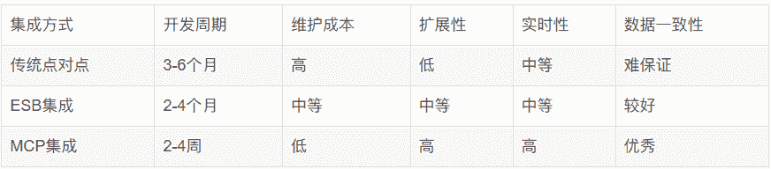
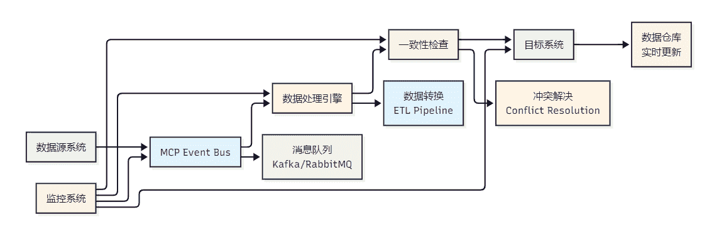
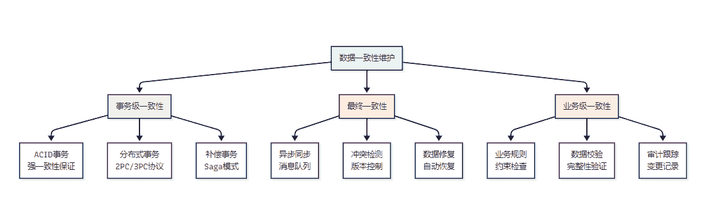
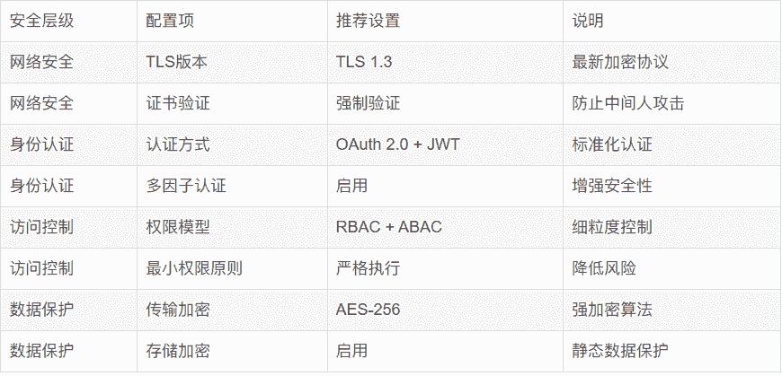
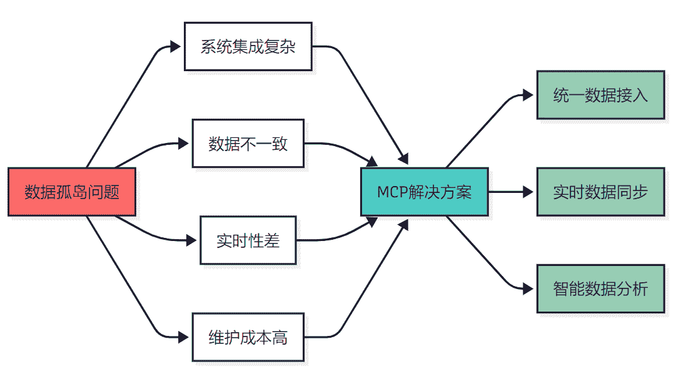

# MCP与企业数据集成：ERP、CRM、数据仓库的统一接入

> 来源：[https://qqs7y1hozd1.feishu.cn/docx/XjBAdoIj6ouoCWxzmaecehBuned](https://qqs7y1hozd1.feishu.cn/docx/XjBAdoIj6ouoCWxzmaecehBuned)

> 随着企业数字化转型的深入推进，各类业务系统如ERP（Enterprise Resource Planning，企业资源规划）、CRM（Customer Relationship Management，客户关系管理）、数据仓库等系统的数据互联互通需求愈发迫切。

> 传统的点对点集成方式不仅开发成本高昂，维护**复杂度也呈指数级增**长**，更重要的是难以满足实时性和一致性要求。Anthrop**ic推出的MCP（Model Context Protocol，模型上下文协议）为这一痛点提供了革命性的解决方案。

+   MCP通过标准化的协议接口，实现了AI模型与各类企业系统的无缝连接，不仅大幅降低了集成复杂度，更为企业数据的统一管理和智能化应用奠定了坚实基础。

本文将从**企业数据源分析建模、主流系统集成实践、数据**权限控制合规性**保障以及实时数据同步一致性维护四个维度，深入探讨MCP在企**业数据集成领域的应用实践，为企业数字化转型提供切实可行的技术路径和最佳实践指导。

## 企业数据源分析与建模

1.1 企业数据源全景分析

现代企业的数据生态系统呈现出多样化、复杂化的特征。从数据来源角度分析，主要包括以下几类：


1.2 数据模型设计原则

基于MCP协议的企业数据集成需要遵循统一的数据建模原则：


1.3 统一数据模型实现

```
# MCP企业数据模型定义
from typing import Dict, List, Optional, Union
from pydantic import BaseModel
from datetime import datetime
 
class MCPDataSource(BaseModel):
    &quot;&quot;&quot;MCP数据源基础模型&quot;&quot;&quot;
    source_id: str
    source_type: str  # ERP, CRM, DW, etc.
    connection_config: Dict
    schema_version: str
    last_sync_time: Optional[datetime]
 
class MCPDataEntity(BaseModel):
    &quot;&quot;&quot;MCP数据实体模型&quot;&quot;&quot;
    entity_id: str
    entity_type: str
    source_system: str
    data_payload: Dict
    metadata: Dict
    created_at: datetime
    updated_at: datetime
 
class MCPDataMapping(BaseModel):
    &quot;&quot;&quot;MCP数据映射模型&quot;&quot;&quot;
    mapping_id: str
    source_field: str
    target_field: str
    transformation_rule: Optional[str]
    validation_rule: Optional[str]
 
# MCP数据源管理器
class MCPDataSourceManager:
    def __init__(self):
        self.data_sources: Dict[str, MCPDataSource] = {}
        self.mappings: Dict[str, List[MCPDataMapping]] = {}
    
    def register_data_source(self, source: MCPDataSource) -&gt; bool:
        &quot;&quot;&quot;注册新的数据源&quot;&quot;&quot;
        try:
            # 验证数据源连接
            if self._validate_connection(source):
                self.data_sources[source.source_id] = source
                return True
        except Exception as e:
            print(f&quot;数据源注册失败: {e}&quot;)
        return False
    
    def _validate_connection(self, source: MCPDataSource) -&gt; bool:
        &quot;&quot;&quot;验证数据源连接有效性&quot;&quot;&quot;
        # 实现具体的连接验证逻辑
        return True
```

## SAP、Salesforce等系统集成实践

2.1 SAP ERP系统集成架构

SAP作为全球领先的ERP解决方案，其集成复杂度较高。通过MCP协议可以大幅简化集成过程：


2.2 SAP集成实现代码

```
# SAP MCP Server实现
import pyrfc
from typing import Dict, List
import json
 
class SAPMCPServer:
    def __init__(self, sap_config: Dict):
        self.sap_config = sap_config
        self.connection = None
    
    def connect(self) -&gt; bool:
        &quot;&quot;&quot;建立SAP连接&quot;&quot;&quot;
        try:
            self.connection = pyrfc.Connection(**self.sap_config)
            return True
        except Exception as e:
            print(f&quot;SAP连接失败: {e}&quot;)
            return False
    
    def get_customer_data(self, customer_id: str) -&gt; Dict:
        &quot;&quot;&quot;获取客户主数据&quot;&quot;&quot;
        if not self.connection:
            raise Exception(&quot;SAP连接未建立&quot;)
        
        try:
            # 调用SAP RFC函数
            result = self.connection.call(
                &#x27;BAPI_CUSTOMER_GETDETAIL2&#x27;,
                CUSTOMERNO=customer_id
            )
            
            # 数据标准化处理
            customer_data = {
                &#x27;customer_id&#x27;: result[&#x27;CUSTOMERNO&#x27;],
                &#x27;name&#x27;: result[&#x27;CUSTOMERDETAIL&#x27;][&#x27;NAME1&#x27;],
                &#x27;address&#x27;: {
                    &#x27;street&#x27;: result[&#x27;CUSTOMERDETAIL&#x27;][&#x27;STREET&#x27;],
                    &#x27;city&#x27;: result[&#x27;CUSTOMERDETAIL&#x27;][&#x27;CITY1&#x27;],
                    &#x27;country&#x27;: result[&#x27;CUSTOMERDETAIL&#x27;][&#x27;COUNTRY&#x27;]
                },
                &#x27;contact&#x27;: {
                    &#x27;phone&#x27;: result[&#x27;CUSTOMERDETAIL&#x27;][&#x27;TELEPHONE1&#x27;],
                    &#x27;email&#x27;: result[&#x27;CUSTOMERDETAIL&#x27;][&#x27;E_MAIL&#x27;]
                }
            }
            
            return customer_data
            
        except Exception as e:
            raise Exception(f&quot;获取客户数据失败: {e}&quot;)
    
    def create_sales_order(self, order_data: Dict) -&gt; str:
        &quot;&quot;&quot;创建销售订单&quot;&quot;&quot;
        try:
            # 构建SAP订单结构
            order_header = {
                &#x27;DOC_TYPE&#x27;: order_data.get(&#x27;doc_type&#x27;, &#x27;OR&#x27;),
                &#x27;SALES_ORG&#x27;: order_data.get(&#x27;sales_org&#x27;),
                &#x27;DISTR_CHAN&#x27;: order_data.get(&#x27;distribution_channel&#x27;),
                &#x27;DIVISION&#x27;: order_data.get(&#x27;division&#x27;)
            }
            
            order_items = []
            for item in order_data.get(&#x27;items&#x27;, []):
                order_items.append({
                    &#x27;ITM_NUMBER&#x27;: item[&#x27;item_number&#x27;],
                    &#x27;MATERIAL&#x27;: item[&#x27;material_code&#x27;],
                    &#x27;REQ_QTY&#x27;: item[&#x27;quantity&#x27;]
                })
            
            # 调用SAP BAPI创建订单
            result = self.connection.call(
                &#x27;BAPI_SALESORDER_CREATEFROMDAT2&#x27;,
                ORDER_HEADER_IN=order_header,
                ORDER_ITEMS_IN=order_items
            )
            
            if result[&#x27;RETURN&#x27;][&#x27;TYPE&#x27;] == &#x27;S&#x27;:
                return result[&#x27;SALESDOCUMENT&#x27;]
            else:
                raise Exception(f&quot;创建订单失败: {result[&#x27;RETURN&#x27;][&#x27;MESSAGE&#x27;]}&quot;)
                
        except Exception as e:
            raise Exception(f&quot;SAP订单创建异常: {e}&quot;)
```

2.3 Salesforce CRM集成实践

Salesforce作为全球领先的CRM平台，其API丰富且标准化程度高，非常适合MCP集成：

```
# Salesforce MCP Server实现
from simple_salesforce import Salesforce
from typing import Dict, List, Optional
import json
 
class SalesforceMCPServer:
    def __init__(self, sf_config: Dict):
        self.sf_config = sf_config
        self.sf_client = None
    
    def authenticate(self) -&gt; bool:
        &quot;&quot;&quot;Salesforce认证&quot;&quot;&quot;
        try:
            self.sf_client = Salesforce(
                username=self.sf_config[&#x27;username&#x27;],
                password=self.sf_config[&#x27;password&#x27;],
                security_token=self.sf_config[&#x27;security_token&#x27;],
                domain=self.sf_config.get(&#x27;domain&#x27;, &#x27;login&#x27;)
            )
            return True
        except Exception as e:
            print(f&quot;Salesforce认证失败: {e}&quot;)
            return False
    
    def get_account_info(self, account_id: str) -&gt; Dict:
        &quot;&quot;&quot;获取客户账户信息&quot;&quot;&quot;
        try:
            account = self.sf_client.Account.get(account_id)
            
            # 标准化数据格式
            account_data = {
                &#x27;account_id&#x27;: account[&#x27;Id&#x27;],
                &#x27;name&#x27;: account[&#x27;Name&#x27;],
                &#x27;type&#x27;: account.get(&#x27;Type&#x27;),
                &#x27;industry&#x27;: account.get(&#x27;Industry&#x27;),
                &#x27;annual_revenue&#x27;: account.get(&#x27;AnnualRevenue&#x27;),
                &#x27;employees&#x27;: account.get(&#x27;NumberOfEmployees&#x27;),
                &#x27;address&#x27;: {
                    &#x27;street&#x27;: account.get(&#x27;BillingStreet&#x27;),
                    &#x27;city&#x27;: account.get(&#x27;BillingCity&#x27;),
                    &#x27;state&#x27;: account.get(&#x27;BillingState&#x27;),
                    &#x27;country&#x27;: account.get(&#x27;BillingCountry&#x27;),
                    &#x27;postal_code&#x27;: account.get(&#x27;BillingPostalCode&#x27;)
                },
                &#x27;created_date&#x27;: account[&#x27;CreatedDate&#x27;],
                &#x27;last_modified&#x27;: account[&#x27;LastModifiedDate&#x27;]
            }
            
            return account_data
            
        except Exception as e:
            raise Exception(f&quot;获取账户信息失败: {e}&quot;)
    
    def create_opportunity(self, opp_data: Dict) -&gt; str:
        &quot;&quot;&quot;创建销售机会&quot;&quot;&quot;
        try:
            opportunity = {
                &#x27;Name&#x27;: opp_data[&#x27;name&#x27;],
                &#x27;AccountId&#x27;: opp_data[&#x27;account_id&#x27;],
                &#x27;Amount&#x27;: opp_data.get(&#x27;amount&#x27;),
                &#x27;CloseDate&#x27;: opp_data[&#x27;close_date&#x27;],
                &#x27;StageName&#x27;: opp_data.get(&#x27;stage&#x27;, &#x27;Prospecting&#x27;),
                &#x27;Probability&#x27;: opp_data.get(&#x27;probability&#x27;, 10)
            }
            
            result = self.sf_client.Opportunity.create(opportunity)
            return result[&#x27;id&#x27;]
            
        except Exception as e:
            raise Exception(f&quot;创建销售机会失败: {e}&quot;)
    
    def sync_contacts_to_mcp(self) -&gt; List[Dict]:
        &quot;&quot;&quot;同步联系人数据到MCP&quot;&quot;&quot;
        try:
            # 查询最近更新的联系人
            query = &quot;&quot;&quot;
                SELECT Id, FirstName, LastName, Email, Phone, AccountId, 
                       CreatedDate, LastModifiedDate 
                FROM Contact 
                WHERE LastModifiedDate &gt;= YESTERDAY
            &quot;&quot;&quot;
            
            contacts = self.sf_client.query(query)
            
            standardized_contacts = []
            for contact in contacts[&#x27;records&#x27;]:
                standardized_contacts.append({
                    &#x27;contact_id&#x27;: contact[&#x27;Id&#x27;],
                    &#x27;first_name&#x27;: contact.get(&#x27;FirstName&#x27;),
                    &#x27;last_name&#x27;: contact.get(&#x27;LastName&#x27;),
                    &#x27;email&#x27;: contact.get(&#x27;Email&#x27;),
                    &#x27;phone&#x27;: contact.get(&#x27;Phone&#x27;),
                    &#x27;account_id&#x27;: contact.get(&#x27;AccountId&#x27;),
                    &#x27;source_system&#x27;: &#x27;Salesforce&#x27;,
                    &#x27;created_date&#x27;: contact[&#x27;CreatedDate&#x27;],
                    &#x27;last_modified&#x27;: contact[&#x27;LastModifiedDate&#x27;]
                })
            
            return standardized_contacts
            
        except Exception as e:
            raise Exception(f&quot;同步联系人数据失败: {e}&quot;)
```

2.4 集成效果对比分析



## 数据权限控制与合规性保障

3.1 多层级权限控制架构

企业数据安全是数据集成的核心要求，MCP提供了完善的权限控制机制：


3.2 权限控制实现代码

```
# MCP权限控制系统实现
from typing import Dict, List, Set, Optional
from enum import Enum
import hashlib
import jwt
from datetime import datetime, timedelta
 
class PermissionLevel(Enum):
    READ = &quot;read&quot;
    WRITE = &quot;write&quot;
    DELETE = &quot;delete&quot;
    ADMIN = &quot;admin&quot;
 
class DataClassification(Enum):
    PUBLIC = &quot;public&quot;
    INTERNAL = &quot;internal&quot;
    CONFIDENTIAL = &quot;confidential&quot;
    RESTRICTED = &quot;restricted&quot;
 
class MCPPermissionManager:
    def __init__(self):
        self.users: Dict[str, Dict] = {}
        self.roles: Dict[str, Dict] = {}
        self.permissions: Dict[str, Set[str]] = {}
        self.data_classifications: Dict[str, DataClassification] = {}
    
    def create_user(self, user_id: str, user_info: Dict) -&gt; bool:
        &quot;&quot;&quot;创建用户&quot;&quot;&quot;
        try:
            self.users[user_id] = {
                &#x27;user_id&#x27;: user_id,
                &#x27;name&#x27;: user_info[&#x27;name&#x27;],
                &#x27;email&#x27;: user_info[&#x27;email&#x27;],
                &#x27;department&#x27;: user_info.get(&#x27;department&#x27;),
                &#x27;roles&#x27;: user_info.get(&#x27;roles&#x27;, []),
                &#x27;created_at&#x27;: datetime.now(),
                &#x27;is_active&#x27;: True
            }
            return True
        except Exception as e:
            print(f&quot;创建用户失败: {e}&quot;)
            return False
    
    def create_role(self, role_id: str, role_info: Dict) -&gt; bool:
        &quot;&quot;&quot;创建角色&quot;&quot;&quot;
        try:
            self.roles[role_id] = {
                &#x27;role_id&#x27;: role_id,
                &#x27;name&#x27;: role_info[&#x27;name&#x27;],
                &#x27;description&#x27;: role_info.get(&#x27;description&#x27;),
                &#x27;permissions&#x27;: role_info.get(&#x27;permissions&#x27;, []),
                &#x27;data_access_level&#x27;: role_info.get(&#x27;data_access_level&#x27;, DataClassification.PUBLIC)
            }
            return True
        except Exception as e:
            print(f&quot;创建角色失败: {e}&quot;)
            return False
    
    def check_permission(self, user_id: str, resource: str, action: PermissionLevel) -&gt; bool:
        &quot;&quot;&quot;检查用户权限&quot;&quot;&quot;
        try:
            user = self.users.get(user_id)
            if not user or not user[&#x27;is_active&#x27;]:
                return False
            
            # 检查用户角色权限
            for role_id in user[&#x27;roles&#x27;]:
                role = self.roles.get(role_id)
                if role and self._has_permission(role, resource, action):
                    # 检查数据分类权限
                    if self._check_data_classification(role, resource):
                        return True
            
            return False
            
        except Exception as e:
            print(f&quot;权限检查失败: {e}&quot;)
            return False
    
    def _has_permission(self, role: Dict, resource: str, action: PermissionLevel) -&gt; bool:
        &quot;&quot;&quot;检查角色是否有特定权限&quot;&quot;&quot;
        permissions = role.get(&#x27;permissions&#x27;, [])
        required_permission = f&quot;{resource}:{action.value}&quot;
        return required_permission in permissions or f&quot;{resource}:*&quot; in permissions
    
    def _check_data_classification(self, role: Dict, resource: str) -&gt; bool:
        &quot;&quot;&quot;检查数据分类访问权限&quot;&quot;&quot;
        resource_classification = self.data_classifications.get(resource, DataClassification.PUBLIC)
        role_access_level = role.get(&#x27;data_access_level&#x27;, DataClassification.PUBLIC)
        
        # 定义访问级别层次
        access_hierarchy = {
            DataClassification.PUBLIC: 0,
            DataClassification.INTERNAL: 1,
            DataClassification.CONFIDENTIAL: 2,
            DataClassification.RESTRICTED: 3
        }
        
        return access_hierarchy[role_access_level] &gt;= access_hierarchy[resource_classification]
 
# 数据脱敏处理
class DataMaskingProcessor:
    def __init__(self):
        self.masking_rules = {
            &#x27;phone&#x27;: self._mask_phone,
            &#x27;email&#x27;: self._mask_email,
            &#x27;id_card&#x27;: self._mask_id_card,
            &#x27;bank_account&#x27;: self._mask_bank_account
        }
    
    def mask_sensitive_data(self, data: Dict, user_permission_level: DataClassification) -&gt; Dict:
        &quot;&quot;&quot;根据用户权限级别脱敏数据&quot;&quot;&quot;
        if user_permission_level == DataClassification.RESTRICTED:
            return data  # 最高权限，不脱敏
        
        masked_data = data.copy()
        
        for field, value in data.items():
            if self._is_sensitive_field(field):
                masking_func = self.masking_rules.get(self._get_field_type(field))
                if masking_func:
                    masked_data[field] = masking_func(value, user_permission_level)
        
        return masked_data
    
    def _mask_phone(self, phone: str, level: DataClassification) -&gt; str:
        &quot;&quot;&quot;手机号脱敏&quot;&quot;&quot;
        if level == DataClassification.CONFIDENTIAL:
            return phone[:3] + &quot;****&quot; + phone[-4:]
        else:
            return &quot;***-****-****&quot;
    
    def _mask_email(self, email: str, level: DataClassification) -&gt; str:
        &quot;&quot;&quot;邮箱脱敏&quot;&quot;&quot;
        if level == DataClassification.CONFIDENTIAL:
            parts = email.split(&#x27;@&#x27;)
            return parts[0][:2] + &quot;***@&quot; + parts[1]
        else:
            return &quot;***@***.com&quot;
    
    def _is_sensitive_field(self, field: str) -&gt; bool:
        &quot;&quot;&quot;判断是否为敏感字段&quot;&quot;&quot;
        sensitive_keywords = [&#x27;phone&#x27;, &#x27;email&#x27;, &#x27;id_card&#x27;, &#x27;bank&#x27;, &#x27;password&#x27;, &#x27;ssn&#x27;]
        return any(keyword in field.lower() for keyword in sensitive_keywords)
    
    def _get_field_type(self, field: str) -&gt; str:
        &quot;&quot;&quot;获取字段类型&quot;&quot;&quot;
        if &#x27;phone&#x27; in field.lower():
            return &#x27;phone&#x27;
        elif &#x27;email&#x27; in field.lower():
            return &#x27;email&#x27;
        elif &#x27;id&#x27; in field.lower():
            return &#x27;id_card&#x27;
        elif &#x27;bank&#x27; in field.lower():
            return &#x27;bank_account&#x27;
        return &#x27;default&#x27;
```

3.3 合规性保障机制

"数据合规不是技术问题，而是治理问题。技术只是实现合规的手段，真正的挑战在于建立完善的数据治理体系。" —— 数据治理专家


## 实时数据同步与一致性维护

4.1 实时同步架构设计

**实时数据同步是企业数据集成**的核心挑战，MCP通过事件驱动机制实现高效的实时同步：



4.2 实时同步实现代码

```
# MCP实时数据同步系统
import asyncio
import json
from typing import Dict, List, Callable, Optional
from datetime import datetime
import hashlib
from enum import Enum
 
class SyncEventType(Enum):
    CREATE = &quot;create&quot;
    UPDATE = &quot;update&quot;
    DELETE = &quot;delete&quot;
    BULK_SYNC = &quot;bulk_sync&quot;
 
class DataSyncEvent:
    def __init__(self, event_type: SyncEventType, source_system: str, 
                 entity_type: str, entity_id: str, data: Dict, timestamp: datetime = None):
        self.event_type = event_type
        self.source_system = source_system
        self.entity_type = entity_type
        self.entity_id = entity_id
        self.data = data
        self.timestamp = timestamp or datetime.now()
        self.event_id = self._generate_event_id()
    
    def _generate_event_id(self) -&gt; str:
        &quot;&quot;&quot;生成唯一事件ID&quot;&quot;&quot;
        content = f&quot;{self.source_system}:{self.entity_type}:{self.entity_id}:{self.timestamp}&quot;
        return hashlib.md5(content.encode()).hexdigest()
 
class MCPRealTimeSyncManager:
    def __init__(self):
        self.event_handlers: Dict[str, List[Callable]] = {}
        self.sync_rules: Dict[str, Dict] = {}
        self.conflict_resolvers: Dict[str, Callable] = {}
        self.sync_status: Dict[str, Dict] = {}
    
    def register_sync_rule(self, source_system: str, target_systems: List[str], 
                          entity_types: List[str], sync_config: Dict):
        &quot;&quot;&quot;注册同步规则&quot;&quot;&quot;
        rule_id = f&quot;{source_system}_to_{&#x27;_&#x27;.join(target_systems)}&quot;
        self.sync_rules[rule_id] = {
            &#x27;source_system&#x27;: source_system,
            &#x27;target_systems&#x27;: target_systems,
            &#x27;entity_types&#x27;: entity_types,
            &#x27;sync_config&#x27;: sync_config,
            &#x27;created_at&#x27;: datetime.now()
        }
    
    def register_event_handler(self, event_type: str, handler: Callable):
        &quot;&quot;&quot;注册事件处理器&quot;&quot;&quot;
        if event_type not in self.event_handlers:
            self.event_handlers[event_type] = []
        self.event_handlers[event_type].append(handler)
    
    async def process_sync_event(self, event: DataSyncEvent):
        &quot;&quot;&quot;处理同步事件&quot;&quot;&quot;
        try:
            # 查找适用的同步规则
            applicable_rules = self._find_applicable_rules(event)
            
            for rule in applicable_rules:
                await self._execute_sync_rule(event, rule)
            
            # 更新同步状态
            self._update_sync_status(event, &#x27;success&#x27;)
            
        except Exception as e:
            print(f&quot;同步事件处理失败: {e}&quot;)
            self._update_sync_status(event, &#x27;failed&#x27;, str(e))
    
    def _find_applicable_rules(self, event: DataSyncEvent) -&gt; List[Dict]:
        &quot;&quot;&quot;查找适用的同步规则&quot;&quot;&quot;
        applicable_rules = []
        
        for rule_id, rule in self.sync_rules.items():
            if (event.source_system == rule[&#x27;source_system&#x27;] and 
                event.entity_type in rule[&#x27;entity_types&#x27;]):
                applicable_rules.append(rule)
        
        return applicable_rules
    
    async def _execute_sync_rule(self, event: DataSyncEvent, rule: Dict):
        &quot;&quot;&quot;执行同步规则&quot;&quot;&quot;
        for target_system in rule[&#x27;target_systems&#x27;]:
            try:
                # 数据转换
                transformed_data = await self._transform_data(
                    event.data, event.source_system, target_system
                )
                
                # 冲突检测和解决
                resolved_data = await self._resolve_conflicts(
                    transformed_data, target_system, event.entity_id
                )
                
                # 执行同步操作
                await self._sync_to_target(resolved_data, target_system, event)
                
            except Exception as e:
                print(f&quot;同步到 {target_system} 失败: {e}&quot;)
                raise
    
    async def _transform_data(self, data: Dict, source_system: str, target_system: str) -&gt; Dict:
        &quot;&quot;&quot;数据转换&quot;&quot;&quot;
        transformation_key = f&quot;{source_system}_to_{target_system}&quot;
        transformer = self.data_transformers.get(transformation_key)
        
        if transformer:
            return await transformer.transform(data)
        
        # 默认转换逻辑
        return data
    
    async def _resolve_conflicts(self, data: Dict, target_system: str, entity_id: str) -&gt; Dict:
        &quot;&quot;&quot;冲突解决&quot;&quot;&quot;
        resolver_key = f&quot;{target_system}_resolver&quot;
        resolver = self.conflict_resolvers.get(resolver_key)
        
        if resolver:
            return await resolver.resolve(data, entity_id)
        
        # 默认冲突解决策略：最新数据优先
        return data
    
    def _update_sync_status(self, event: DataSyncEvent, status: str, error_msg: str = None):
        &quot;&quot;&quot;更新同步状态&quot;&quot;&quot;
        status_key = f&quot;{event.source_system}:{event.entity_id}&quot;
        self.sync_status[status_key] = {
            &#x27;last_sync&#x27;: datetime.now(),
            &#x27;status&#x27;: status,
            &#x27;error&#x27;: error_msg,
            &#x27;event_id&#x27;: event.event_id
        }
 
# 数据一致性检查器
class DataConsistencyChecker:
    def __init__(self):
        self.consistency_rules = {}
        self.validation_results = {}
    
    def add_consistency_rule(self, rule_name: str, rule_func: Callable):
        &quot;&quot;&quot;添加一致性规则&quot;&quot;&quot;
        self.consistency_rules[rule_name] = rule_func
    
    async def check_consistency(self, entity_type: str, entity_id: str, 
                              systems_data: Dict[str, Dict]) -&gt; Dict:
        &quot;&quot;&quot;检查数据一致性&quot;&quot;&quot;
        results = {}
        
        for rule_name, rule_func in self.consistency_rules.items():
            try:
                result = await rule_func(entity_type, entity_id, systems_data)
                results[rule_name] = {
                    &#x27;passed&#x27;: result[&#x27;passed&#x27;],
                    &#x27;details&#x27;: result.get(&#x27;details&#x27;, {}),
                    &#x27;confidence&#x27;: result.get(&#x27;confidence&#x27;, 1.0)
                }
            except Exception as e:
                results[rule_name] = {
                    &#x27;passed&#x27;: False,
                    &#x27;error&#x27;: str(e),
                    &#x27;confidence&#x27;: 0.0
                }
        
        # 计算整体一致性分数
        overall_score = self._calculate_consistency_score(results)
        
        return {
            &#x27;entity_type&#x27;: entity_type,
            &#x27;entity_id&#x27;: entity_id,
            &#x27;consistency_score&#x27;: overall_score,
            &#x27;rule_results&#x27;: results,
            &#x27;timestamp&#x27;: datetime.now().isoformat()
        }
    
    def _calculate_consistency_score(self, results: Dict) -&gt; float:
        &quot;&quot;&quot;计算一致性分数&quot;&quot;&quot;
        if not results:
            return 0.0
        
        total_weight = 0
        weighted_score = 0
        
        for rule_result in results.values():
            confidence = rule_result.get(&#x27;confidence&#x27;, 1.0)
            passed = rule_result.get(&#x27;passed&#x27;, False)
            
            total_weight += confidence
            weighted_score += confidence if passed else 0
        
        return weighted_score / total_weight if total_weight &gt; 0 else 0.0
```

4.3 一致性维护策略

企业数据一致性维护需要多层次的策略支持：



## 企业级MCP部署最佳实践

5.1 高可用架构设计

```
# MCP高可用集群管理
import asyncio
from typing import List, Dict, Optional
from enum import Enum
 
class NodeStatus(Enum):
    HEALTHY = &quot;healthy&quot;
    DEGRADED = &quot;degraded&quot;
    FAILED = &quot;failed&quot;
    MAINTENANCE = &quot;maintenance&quot;
 
class MCPClusterManager:
    def __init__(self, cluster_config: Dict):
        self.cluster_config = cluster_config
        self.nodes: Dict[str, Dict] = {}
        self.load_balancer = LoadBalancer()
        self.health_checker = HealthChecker()
        self.failover_manager = FailoverManager()
    
    async def initialize_cluster(self):
        &quot;&quot;&quot;初始化MCP集群&quot;&quot;&quot;
        for node_config in self.cluster_config[&#x27;nodes&#x27;]:
            node_id = node_config[&#x27;id&#x27;]
            self.nodes[node_id] = {
                &#x27;config&#x27;: node_config,
                &#x27;status&#x27;: NodeStatus.HEALTHY,
                &#x27;last_health_check&#x27;: None,
                &#x27;connection_pool&#x27;: ConnectionPool(node_config[&#x27;uri&#x27;]),
                &#x27;metrics&#x27;: NodeMetrics()
            }
        
        # 启动健康检查
        asyncio.create_task(self.health_check_loop())
        
        # 启动负载均衡
        await self.load_balancer.initialize(self.nodes)
    
    async def health_check_loop(self):
        &quot;&quot;&quot;健康检查循环&quot;&quot;&quot;
        while True:
            for node_id, node_info in self.nodes.items():
                try:
                    health_status = await self.health_checker.check_node(
                        node_info[&#x27;connection_pool&#x27;]
                    )
                    
                    node_info[&#x27;status&#x27;] = health_status[&#x27;status&#x27;]
                    node_info[&#x27;last_health_check&#x27;] = datetime.now()
                    node_info[&#x27;metrics&#x27;].update(health_status[&#x27;metrics&#x27;])
                    
                    # 处理节点状态变化
                    if health_status[&#x27;status&#x27;] == NodeStatus.FAILED:
                        await self.handle_node_failure(node_id)
                    
                except Exception as e:
                    print(f&quot;节点 {node_id} 健康检查失败: {e}&quot;)
                    await self.handle_node_failure(node_id)
            
            await asyncio.sleep(30)  # 30秒检查一次
    
    async def handle_node_failure(self, failed_node_id: str):
        &quot;&quot;&quot;处理节点故障&quot;&quot;&quot;
        print(f&quot;检测到节点故障: {failed_node_id}&quot;)
        
        # 从负载均衡器中移除故障节点
        await self.load_balancer.remove_node(failed_node_id)
        
        # 触发故障转移
        await self.failover_manager.handle_failover(failed_node_id, self.nodes)
        
        # 发送告警通知
        await self.send_alert(f&quot;MCP节点 {failed_node_id} 发生故障&quot;)
    
    async def get_healthy_node(self) -&gt; Optional[str]:
        &quot;&quot;&quot;获取健康的节点&quot;&quot;&quot;
        return await self.load_balancer.select_node()
 
class LoadBalancer:
    def __init__(self, strategy: str = &quot;round_robin&quot;):
        self.strategy = strategy
        self.current_index = 0
        self.healthy_nodes: List[str] = []
        self.node_weights: Dict[str, float] = {}
    
    async def select_node(self) -&gt; Optional[str]:
        &quot;&quot;&quot;选择节点&quot;&quot;&quot;
        if not self.healthy_nodes:
            return None
        
        if self.strategy == &quot;round_robin&quot;:
            return self._round_robin_select()
        elif self.strategy == &quot;weighted&quot;:
            return self._weighted_select()
        elif self.strategy == &quot;least_connections&quot;:
            return self._least_connections_select()
        
        return self.healthy_nodes[0]
    
    def _round_robin_select(self) -&gt; str:
        &quot;&quot;&quot;轮询选择&quot;&quot;&quot;
        node = self.healthy_nodes[self.current_index]
        self.current_index = (self.current_index + 1) % len(self.healthy_nodes)
        return node
```

5.2 性能监控与优化

```
# MCP性能监控系统
class MCPPerformanceMonitor:
    def __init__(self):
        self.metrics_store = MetricsStore()
        self.alert_thresholds = {
            &#x27;response_time&#x27;: 1000,  # ms
            &#x27;error_rate&#x27;: 0.05,     # 5%
            &#x27;cpu_usage&#x27;: 0.8,       # 80%
            &#x27;memory_usage&#x27;: 0.85    # 85%
        }
        self.performance_optimizer = PerformanceOptimizer()
    
    async def collect_performance_metrics(self) -&gt; Dict:
        &quot;&quot;&quot;收集性能指标&quot;&quot;&quot;
        metrics = {
            &#x27;timestamp&#x27;: datetime.now().isoformat(),
            &#x27;response_times&#x27;: await self._measure_response_times(),
            &#x27;throughput&#x27;: await self._measure_throughput(),
            &#x27;error_rates&#x27;: await self._calculate_error_rates(),
            &#x27;resource_usage&#x27;: await self._get_resource_usage(),
            &#x27;connection_stats&#x27;: await self._get_connection_stats()
        }
        
        # 存储指标
        await self.metrics_store.store(metrics)
        
        # 检查告警条件
        await self._check_performance_alerts(metrics)
        
        # 触发自动优化
        await self._trigger_auto_optimization(metrics)
        
        return metrics
    
    async def _measure_response_times(self) -&gt; Dict:
        &quot;&quot;&quot;测量响应时间&quot;&quot;&quot;
        test_requests = [
            (&#x27;resources/list&#x27;, {}),
            (&#x27;tools/list&#x27;, {}),
            (&#x27;prompts/list&#x27;, {})
        ]
        
        response_times = {}
        
        for method, params in test_requests:
            start_time = time.time()
            try:
                await self._make_test_request(method, params)
                response_time = (time.time() - start_time) * 1000
                response_times[method] = response_time
            except Exception as e:
                response_times[method] = -1  # 表示请求失败
        
        return response_times
    
    async def _trigger_auto_optimization(self, metrics: Dict):
        &quot;&quot;&quot;触发自动优化&quot;&quot;&quot;
        optimization_actions = []
        
        # 响应时间优化
        avg_response_time = sum(
            t for t in metrics[&#x27;response_times&#x27;].values() if t &gt; 0
        ) / len(metrics[&#x27;response_times&#x27;])
        
        if avg_response_time &gt; self.alert_thresholds[&#x27;response_time&#x27;]:
            optimization_actions.append(&#x27;increase_connection_pool&#x27;)
            optimization_actions.append(&#x27;enable_caching&#x27;)
        
        # 内存使用优化
        if metrics[&#x27;resource_usage&#x27;][&#x27;memory&#x27;] &gt; self.alert_thresholds[&#x27;memory_usage&#x27;]:
            optimization_actions.append(&#x27;garbage_collection&#x27;)
            optimization_actions.append(&#x27;reduce_cache_size&#x27;)
        
        # 执行优化操作
        for action in optimization_actions:
            await self.performance_optimizer.execute_optimization(action)
 
# 性能优化器
class PerformanceOptimizer:
    def __init__(self):
        self.optimization_strategies = {
            &#x27;increase_connection_pool&#x27;: self._increase_connection_pool,
            &#x27;enable_caching&#x27;: self._enable_caching,
            &#x27;garbage_collection&#x27;: self._trigger_gc,
            &#x27;reduce_cache_size&#x27;: self._reduce_cache_size
        }
    
    async def execute_optimization(self, strategy: str):
        &quot;&quot;&quot;执行优化策略&quot;&quot;&quot;
        if strategy in self.optimization_strategies:
            await self.optimization_strategies[strategy]()
            print(f&quot;执行优化策略: {strategy}&quot;)
    
    async def _increase_connection_pool(self):
        &quot;&quot;&quot;增加连接池大小&quot;&quot;&quot;
        # 实现连接池扩容逻辑
        pass
    
    async def _enable_caching(self):
        &quot;&quot;&quot;启用缓存&quot;&quot;&quot;
        # 实现缓存启用逻辑
        pass
```

5.3 企业级安全配置



## 案例研究：某大型制造企业MCP集成实践

6.1 项目背景与挑战

某大型制造企业拥有以下系统：

+   SAP ERP系统（财务、采购、生产）

+   Salesforce CRM系统（销售、客户管理）

+   Oracle数据仓库（数据分析、报表）

+   自研MES系统（制造执行）

面临的主要挑战：



6.2 MCP集成架构设计

```
# 制造企业MCP集成架构
class ManufacturingMCPIntegration:
    def __init__(self):
        self.systems = {
            &#x27;sap_erp&#x27;: SAPMCPServer(),
            &#x27;salesforce_crm&#x27;: SalesforceMCPServer(),
            &#x27;oracle_dw&#x27;: OracleMCPServer(),
            &#x27;mes_system&#x27;: MESMCPServer()
        }
        self.data_hub = EnterpriseDataHub()
        self.sync_manager = RealTimeSyncManager()
        self.analytics_engine = IntelligentAnalyticsEngine()
    
    async def initialize_integration(self):
        &quot;&quot;&quot;初始化集成系统&quot;&quot;&quot;
        # 初始化各系统连接
        for system_name, server in self.systems.items():
            await server.initialize()
            print(f&quot;{system_name} MCP服务器初始化完成&quot;)
        
        # 配置数据同步规则
        await self._configure_sync_rules()
        
        # 启动实时监控
        await self._start_monitoring()
    
    async def _configure_sync_rules(self):
        &quot;&quot;&quot;配置数据同步规则&quot;&quot;&quot;
        sync_rules = [
            {
                &#x27;name&#x27;: &#x27;customer_sync&#x27;,
                &#x27;source&#x27;: &#x27;salesforce_crm&#x27;,
                &#x27;targets&#x27;: [&#x27;sap_erp&#x27;, &#x27;oracle_dw&#x27;],
                &#x27;entity_type&#x27;: &#x27;customer&#x27;,
                &#x27;sync_frequency&#x27;: &#x27;real_time&#x27;,
                &#x27;conflict_resolution&#x27;: &#x27;salesforce_wins&#x27;
            },
            {
                &#x27;name&#x27;: &#x27;order_sync&#x27;,
                &#x27;source&#x27;: &#x27;sap_erp&#x27;,
                &#x27;targets&#x27;: [&#x27;mes_system&#x27;, &#x27;oracle_dw&#x27;],
                &#x27;entity_type&#x27;: &#x27;sales_order&#x27;,
                &#x27;sync_frequency&#x27;: &#x27;real_time&#x27;,
                &#x27;conflict_resolution&#x27;: &#x27;timestamp_based&#x27;
            },
            {
                &#x27;name&#x27;: &#x27;production_sync&#x27;,
                &#x27;source&#x27;: &#x27;mes_system&#x27;,
                &#x27;targets&#x27;: [&#x27;sap_erp&#x27;, &#x27;oracle_dw&#x27;],
                &#x27;entity_type&#x27;: &#x27;production_data&#x27;,
                &#x27;sync_frequency&#x27;: &#x27;batch_hourly&#x27;,
                &#x27;conflict_resolution&#x27;: &#x27;mes_wins&#x27;
            }
        ]
        
        for rule in sync_rules:
            await self.sync_manager.register_sync_rule(**rule)
 
# 智能分析引擎
class IntelligentAnalyticsEngine:
    def __init__(self):
        self.ml_models = {}
        self.analysis_rules = {}
        self.alert_manager = AlertManager()
    
    async def analyze_production_efficiency(self) -&gt; Dict:
        &quot;&quot;&quot;分析生产效率&quot;&quot;&quot;
        # 从MES系统获取生产数据
        production_data = await self.get_production_data()
        
        # 从ERP系统获取订单数据
        order_data = await self.get_order_data()
        
        # 计算效率指标
        efficiency_metrics = self._calculate_efficiency_metrics(
            production_data, order_data
        )
        
        # 预测分析
        predictions = await self._predict_production_trends(efficiency_metrics)
        
        # 生成优化建议
        recommendations = self._generate_optimization_recommendations(
            efficiency_metrics, predictions
        )
        
        return {
            &#x27;current_efficiency&#x27;: efficiency_metrics,
            &#x27;predictions&#x27;: predictions,
            &#x27;recommendations&#x27;: recommendations,
            &#x27;timestamp&#x27;: datetime.now().isoformat()
        }
    
    def _calculate_efficiency_metrics(self, production_data: Dict, order_data: Dict) -&gt; Dict:
        &quot;&quot;&quot;计算效率指标&quot;&quot;&quot;
        return {
            &#x27;oee&#x27;: self._calculate_oee(production_data),  # 设备综合效率
            &#x27;throughput&#x27;: self._calculate_throughput(production_data),
            &#x27;quality_rate&#x27;: self._calculate_quality_rate(production_data),
            &#x27;on_time_delivery&#x27;: self._calculate_otd(production_data, order_data)
        }
```

6.3 实施效果评估


"通过MCP协议的统一集成，我们不仅解决了长期困扰的数据孤岛问题，更重要的是为企业数字化转型奠定了坚实的数据基础。" —— 项目负责人

## 未来发展趋势与展望

7.1 技术发展趋势


7.2 应用场景扩展


7.3 技术挑战与机遇

> **主要挑战：**

+   标准化程度：需要更多行业标准和最佳实践

+   性能优化：大规模部署下的性能瓶颈

+   安全合规：不同行业的合规要求差异

+   人才培养：专业技术人才短缺

> 发展机遇：

+   AI技术融合：与大模型技术深度结合

+   边缘计算：支持边缘设备的轻量级部署

+   区块链集成：增强数据可信度和溯源能力

+   量子计算：为未来量子计算环境做准备

## 总结

通过深入研究和实践MCP与企业数据集成**的各个方面，我深刻认识到这项**技术正在重新定义企业数据管理和AI应用的边界。MCP协议不仅仅是一个技术标准，更是企业数字化转型的重要推动力，它通过标准化的接口和协议，打破了传统企业系统间的壁垒，实现了真正意义上的数据互联互通。

> **从**企业数据源分析建模到主流系统集成实践，从数据权限控制合规性保障到实时数据同步一致性维护，MCP协议在每个环节都展现出了其技术优势和实用价值。特别是在SAP、Salesforce等主流企业系统的集成实践中，MCP协议显著降低了集成复杂度，提高了开发效率，为企业节省了大量的时间和成本。

> 在数据安全和合规性方面，MCP协议通过多层级权限控制、数据脱敏处理、审计日志等机制，为企**业数据安全提供了全方位的保障，满足了GDPR、SOX、HIPAA等各种合规要求。实时数**据同步和一致性维护是企业数据集成的核心挑战，MCP协议通过事件驱动机制、冲突解决策略、一致性检查等技术手段，有效解决了这一难题，确保了企业数据的准确性和时效性。

通过某大型制造企业的**实际案例分析**，我们可以看到MCP集成方案在实际应用中取得的显著成效，不仅解决了数据孤岛问题，更为企业的智能化决策提供了强有力的数据支撑。展望未来，随着AI技术的不断发展和企业数字化转型的深入推进，MCP协议必将在更多行业和场景中发挥重要作用，成为连接AI智能与企业数据的重要桥梁，推动整个行业向更加智能化、标准化、高效化的方向发展，最终实现企业数据价值的最大化释放和AI技术的广泛普及应用。

参考资料

+   Anthropic MCP Official Documentation

+   Enterprise Data Integration Best Practices

+   SAP Integration Technologies Guide

+   Salesforce API Documentation

+   Data Governance and Compliance Framework

+   Real-time Data Processing Architectures

+   Enterprise Security Architecture Guidelines

+   GDPR Compliance for Data Integration