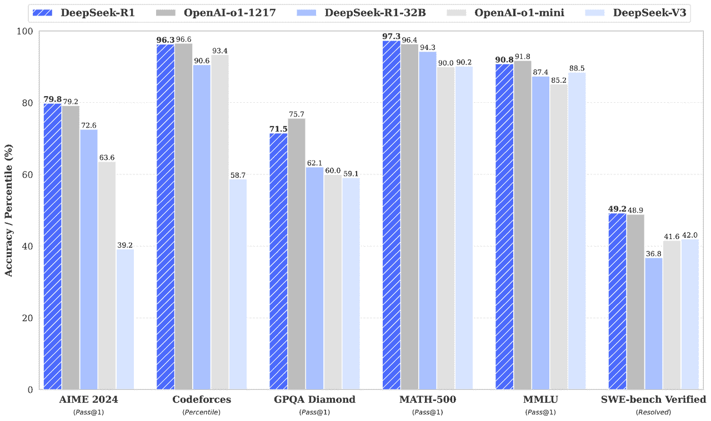
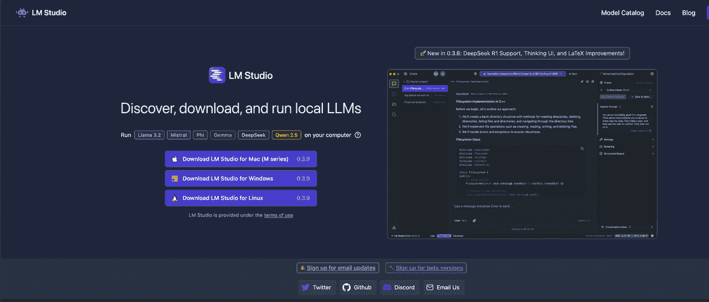
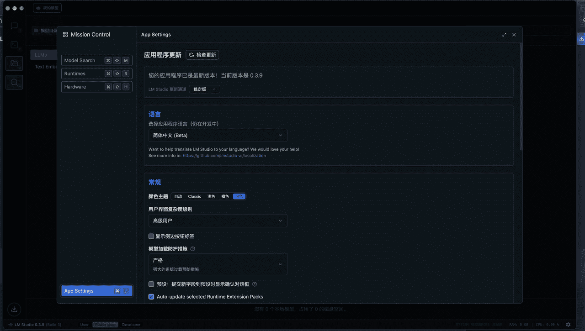
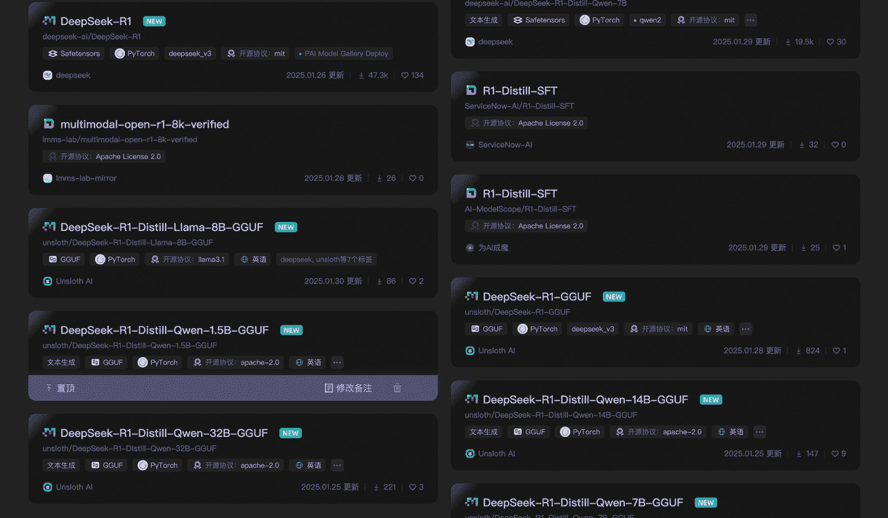
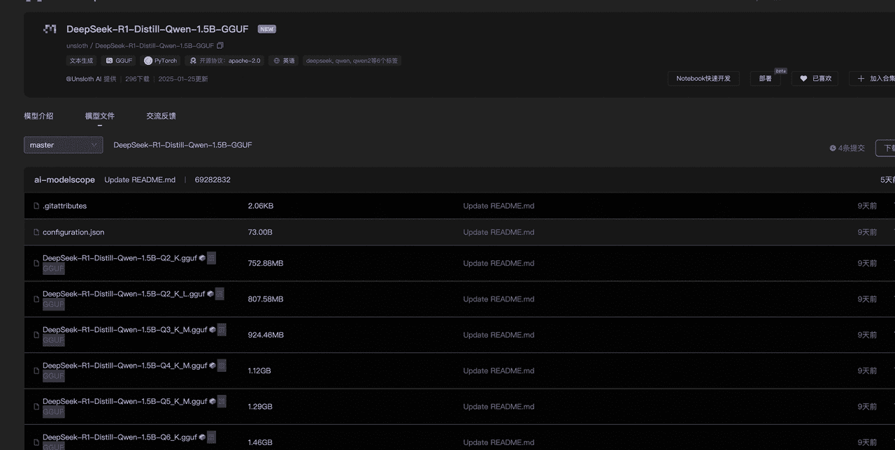
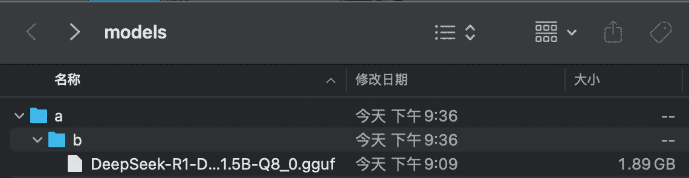
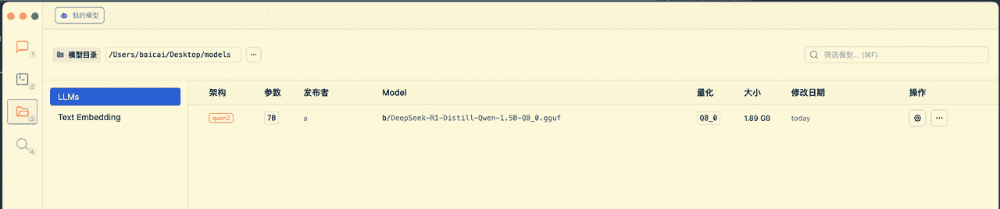
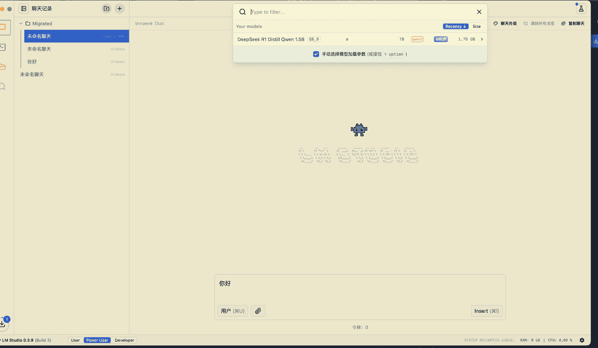
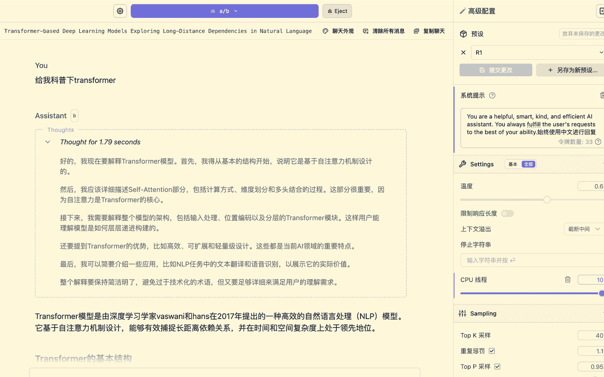
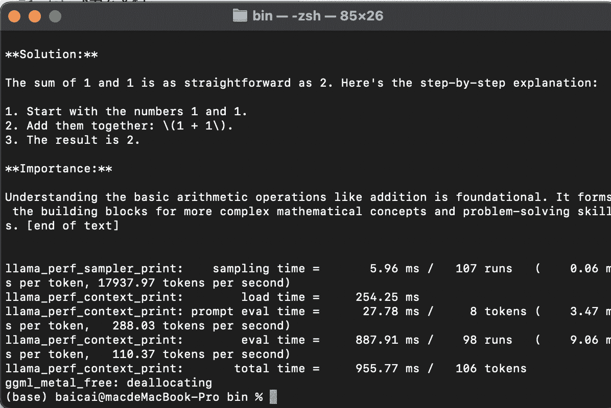

# 实践DeepSeek R1本地部署

> 来源：[https://qqs7y1hozd1.feishu.cn/docx/VWrGd2CaHoP2dRxAPiGcVxilnLg](https://qqs7y1hozd1.feishu.cn/docx/VWrGd2CaHoP2dRxAPiGcVxilnLg)

# 一、Ollama 方式部署 （方便快速，但是需要熟悉命令行）

> 这是最快捷推荐的方式，但注意有时候国内可能遇到奇怪的网络问题

+   **ollama程序自行安装：**https://ollama.com/download

> 通过以下链接，我们可以搜索找到所有r1相关的ollama托管模型：​

+   https://ollama.com/search?q=r1

## 性能对比



+   **AIME - 数学竞赛评估**

+   MATH-500 - 数学能力评估

+   Codeforces - 代码竞赛评估

+   GPQA Diamond - 复杂专业领域评估

+   **MMLU - 常识能力评估**

+   SWE-bench Verified - 软件工程能力评估

## 模型运行

在终端中运行ollama shell命令，会自动拉取并且运行模型

###  原始SFT + RL版本

真正经过RL强化学习训练的模型，能力非常强，与官方API性能一致

**DeepSeek-R1**

模型权重文件大小有400余G，需要足够大的显存和CPU内存才能运行

```
ollama run deepseek-r1:671b
```

### SFT蒸馏版本

使用RL版DeepSeek R1输出的80万条 <问题, 思考 + 答案> 数据二次训练普通模型得到的版本（俗称蒸馏）最小的1.5B版（15亿参数量）甚至可以在树莓派上高速运行，​7 ~ 14B版适合在手机/普通笔记本电脑上运行32、70B版本适合运行在具有较高配置的电脑上

DeepSeek-R1-Distill-Qwen-1.5B

```
ollama run deepseek-r1:1.5b
```

DeepSeek-R1-Distill-Qwen-7B

```
ollama run deepseek-r1:7b
```

DeepSeek-R1-Distill-Llama-8B

```
ollama run deepseek-r1:8b
```

DeepSeek-R1-Distill-Qwen-14B

```
ollama run deepseek-r1:14b
```

DeepSeek-R1-Distill-Qwen-32B

```
ollama run deepseek-r1:32b
```

DeepSeek-R1-Distill-Llama-70B

```
ollama run deepseek-r1:70b
```

## 使用许可

> 模型权重根据 MIT 许可证授权。DeepSeek-R1 系列支**持商业用途，允许任**何修改和衍生作品，包括但不限于用于训练其他大型语言模型的蒸馏。请注意以下事项：​

1.  Qwen 蒸馏模型源自 Qwen-2.5 系列，原始许可证为 Apache 2.0 许可证，现使用 DeepSeek-R1 生成的 800k 样本进行微调

1.  Llama 8B 蒸馏模型源自 Llama3.1-8B-Base，原始许可证为 llama3.1 许可证

1.  Llama 70B 蒸馏模型源自 Llama3.3-70B-Instruct，原始许可证为 llama3.3 许可证

+   视频教程：​[https://www.bilibili.co](https://www.bilibili.com/video/BV1RpFUeHEWa)m/video/BV1RpFUeHEWa

# 二、LM Studio方式部署（不用懂命令行，适合小白 新手）

## 安装LM Studio

**在官网**安装lm studio软件，链接：https://lmstudio.ai





## 安装模型

### 你可以直接在LM Studio里搜索下载R1相关的gguf模型（需要梯子）​

### 国内打开以下链接：​[h](https://www.modelscope.cn/collections/R1-03d90cabe39248)ttps://www.modelscope.cn/collections/R1-03d90cabe39248

+   选择其中带有gguf字样的卡片，这里以1.5B GGUF为例（1.5B效果会差一些，但是下载和运行速度最快）



+   点击“模型文件”tab，选中其中任意一个版本在右侧进行下载 （从Q8 ~ Q2，模型精度依次下降，但是内存占用要求也降低）



+   这里我下载的是这个文件，Q8_0基本上接近无损精度的量化


+   在你喜欢的位置（比如桌面上）创建一个models文件夹，在models文件夹中建一个a文件夹（模型作者），a文件夹内建一个b文件夹（模型名称），把下载好的1.5B模型放进b文件夹中，如下



+   到LM Stduio里设置模型存放路径为 models文件夹，就显示出我们的模型了



+   下次聊天时可以在上方选中并加载该模型 （第一次聊天加载会比较慢）





> 1.5B的效果比较一般，我必须在右侧的系统提示里指定使用中文回复才能用中文answer响应我的中文query，因此建议大家直接常识大一点的版本

> 不过这个小模型的速度还是挺快的，在我的m1 max处理器上每秒钟可以产生103个token，如果训练个猫娘版（或者干脆不用说话回复，只用控制神态表情、动作指令的电子宠物版），说不定可以解解闷用

+   视频教程：[https://www.bilibili.co](https://www.bilibili.com/video/BV1euFQeZEi2)m/video/BV1euFQeZEi2

# 三、llama.cpp 方式部署（适合专业用户、开发者、极客）

> llama.cpp 是一个高效的工具，能够在本地运行大型语言模型（LLM），并且支持 GPU 加速。无论是使用 CPU 还是 GPU，llama.cpp 都提供了灵活的配置选项，帮助你高效地进行模型推理

## 准备工作

### 安装 llama.cpp

首先，确保你已经安装了最新版本的 llama.cpp

你可以通过以下命令获取：（记得打开终端的网络代理）

```
git clone https://github.com/ggerganov/llama.cpp
cd llama.cpp
cmake -B build
cmake --build build --config Release -j 16
cd build/bin
```

[你](https://github.com/ggerganov/llama.cpp/blob/master/docs/build.md)也可以自行学习研究编译部署教程（包括docker方式）https://github.com/ggerganov/llama.cpp/blob/master/docs/build.md

### 下载模型

你需要下载 DeepSeek-R1-Distill-Qwen-1.5B-GGUF 模型。可以从 Hugging Face 或 ModelScope 获取模型文件。确保模型文件是 GGUF 格式。

## 运行模型

### 基本运行命令

使用以下命令运行模型：

```
./llama-cli \
    --model /Users/baicai/Desktop/models/a/b/DeepSeek-R1-Distill-Qwen-1.5B-Q8_0.gguf \
    --cache-type-k q8_0 \
    --threads 16 \
    --prompt &#x27;What is 1+1?&#x27; \
    -no-cnv
```

**注意：****这里我**用的路径是按照LM Studio部署方式中我们放在桌面文件夹中的位置，你可以自定义修改为自己的路径。（/Users/baicai/Desktop/models/a/b/DeepSeek-R1-Distill-Qwen-1.5B-Q8_0.gguf ）

### 参数说明

--model：指定模型文件的路径

--cache-type-k q8_0：设置缓存类型为 q8_0，这是一种量化方式，可以提高推理速度

--threads 16：设置使用的线程数，根据你的 CPU 核心数进行调整

--prompt：输入提示词，模型会根据提示词生成回答

-no-cnv：禁用自动对话模式

### GPU 加速

如果你有支持 CUDA 的 GPU（如 RTX 4090），可以通过以下命令将部分计算卸载到 GPU 上，以加速推理过程：

```
./llama-cli \
    --model /Users/baicai/Desktop/models/a/b/DeepSeek-R1-Distill-Qwen-1.5B-Q8_0.gguf \
    --cache-type-k q8_0 \
    --threads 16 \
    --prompt &#x27;What is 1+1?&#x27; \
    --n-gpu-layers 20 \
    -no-cnv
```

--n-gpu-layers 20：指定将 20 层模型计算卸载到 GPU 上。你可以根据 GPU 的内存大小调整这个值。(在我的m1 max上使用 20 反而很慢，填写 29 会很快(28层decoder block + 1层lmhead)，因为当你写 20 时会有模型参数在反复进出vram）

> **注意事项：**

> **温度设置**：建议将温度设置在 0.5-0.7 之间（推荐 0.6），以避免模型生成重复或无意义的输出

> **系统提示**：不要添加系统提示，所有指令都应包含在用户提示中

> **数学问题**：对于数学问题，建议在prompt中加入类似“请逐步推理，并将最终答案放在 \boxed{} 中”的指令

> **多次测试**：在评估模型性能时，建议进行多次测试并取平均值

**示例输出：**

运行上述命令后，模型会生成类似以下的输出（由< think > ***📦 < /think >包裹着的思考过程）：

```
&lt;think&gt;
 Okay, so I need to figure out what 1 plus 1 is. Hmm, where do I even start? I remember from school that adding numbers is pretty basic, but I want to make sure I understand it properly.
 Let me think, 1 plus 1. So, I have one item and I add another one. Maybe like a apple plus another apple. If I have one apple and someone gives me another, I now have two apples. So, 1 plus 1 should be 2. That makes sense.
 Wait, but sometimes math can be tricky. Could it be something else? Like, in a different number system maybe? But I think the question is straightforward, using regular numbers, not like binary or hexadecimal or anything.
 I also recall that in arithmetic, addition is combining quantities. So, if you have two quantities of 1, combining them gives you a total of 2. Yeah, that seems right.
 Is there a scenario where 1 plus 1 wouldn&#x27;t be 2? I can&#x27;t think of any...
&lt;/think&gt;
```

**实际运行效果:**

