# 技术前沿：万字解析DeepSeek

> 来源：[https://qqs7y1hozd1.feishu.cn/docx/A5APdedzXoMx0cxCXTzcZ2fGnhc](https://qqs7y1hozd1.feishu.cn/docx/A5APdedzXoMx0cxCXTzcZ2fGnhc)

## 开源模型R1

DeepSeek-R1作为一款开源的大型语言模型，在数学、编程和推理等多个任务上表现出了强大的性能。其纯强化学习的训练方法、开源与低成本的特性以及技术创新使得DeepSeek-R1成为了AI领域的一颗新星。

在多个基准测试中，DeepSeek-R1的表现优于或接近OpenAI o1。例如，在AIME 2024数学测试中，DeepSeek-R1的准确率接近OpenAI o1-0912的水平；在MATH-500、Codeforces和MMLU等测试中，也取得了优异的成绩。

### 一、DeepSeek

DeepSeek（深度求索）是什么？DeepSeek是杭州深度求索人工智能基础技术研究有限公司的简称，同时DeepSeek也是该公司研发的通用人工智能开源大模型平台。DeepSeek完全基于自研训练框架、自建智算集群和万卡算力等资源，在短时间内取得了显著的研发成果。它通过大幅度缩减以往大模型所需要的庞大算力，直接把大模型的成本降了下来，被称为“AI界的拼多多”。

DeepSeek系列模型有哪些？DeepSeek系列模型包括R1（数学、代码及推理领域开源大模型，回答全面详实）、V3（自研MoE模型，性能顶尖且性价比极高）、VL（视觉与语言理解开源多模态模型）、V2（创新架构，推理成本低廉）、R1-Zero（强化学习预模型，独特优势）、以及蒸馏版Qwen和Llama小模型（从R1数据蒸馏，表现优异）。

+ DeepSeek-R1：一款在数学、代码及自然语言推理领域与OpenAI o1比肩的开源大模型，以其全面、详实的回答和结构化输出著称。
+ DeepSeek-V3：凭借自研MoE模型和671B参数，在性能上超越所有已发布的开源模型，成为极具性价比的顶尖大模型之一。
+ DeepSeek-VL：专为视觉和语言理解设计的开源多模态模型，能够处理复杂场景下的逻辑、公式识别及自然图像等问题。
+ DeepSeek-V2：以创新的模型架构和极低的推理成本，成为性价比极高的大模型选择。
+ DeepSeek-R1-Zero：采用强化学习训练的预模型，不走传统监督微调路线，展现独特优势。
+ 蒸馏版Qwen、Llama系列小模型：从DeepSeek-R1数据上蒸馏得到的小模型，表现优秀，部分任务上甚至超越GPT-4o。

### 二、DeepSeek-R1

DeepSeek-R1是什么？DeepSeek-R1是一款在2025年1月20日发布的大型语言模型，它采用了包含6710亿参数的MoE（专家混合）架构，特别主打推理功能。同时DeepSeek-R1开源了模型权重，并采用了宽松的MIT许可协议，为开发者提供了极大的便利和灵活性。DeepSeek-R1与OpenAI-o1相比，其优势在于开源特性、强化学习训练的高效推理能力以及低成本，为开发者提供了更多选择和灵活性。

DeepSeek-R1的核心亮点是什么？DeepSeek-R1的核心亮点在于其作为首个完全通过强化学习训练的大型语言模型，无需监督微调，结合冷启动数据显著提升了推理能力，并提供多个蒸馏版本及低成本的API服务。

+ DeepSeek-R1-Zero是首个完全通过强化学习（RL）训练的大型语言模型，无需依赖监督微调（SFT）或人工标注数据。为了进一步提升模型性能，DeepSeek-R1引入了冷启动数据，结合强化学习进行训练。解决了R1-Zero在可读性和语言混合方面的局限性，显著提升了模型的推理能力。
+ DeepSeek-R1提供了六个蒸馏版本（1.5B至70B），适合不同规模的开发者使用。与OpenAI o1相比，API调用成本显著降低。

DeepSeek-R1的核心创新是什么？DeepSeek-R1的技术创新在于开发了GRPO算法以优化策略网络，避免了高计算开销，同时设计了多层次奖励机制和“思考-回答”双阶段训练模板，确保模型推理的高效性、可读性和过程可追踪性。

+ DeepSeek开发的GRPO算法通过群组相对优势估计，优化了策略网络，有效降低了传统Critic网络的高计算开销。
+ DeepSeek-R1采用了包括准确性、格式和语言一致性在内的多层次奖励机制，确保了模型在推理任务中的高效性和输出内容的可读性。
+ 通过“思考-回答”双阶段训练模板，DeepSeek-R1实现了推理过程的可追踪性，并为奖励计算提供了明确基准，从而输出了结构化的答案。

## DeepSeek-R1-Zero和DeepSeek-R1

DeepSeek推出了第一代推理模型——DeepSeek-R1-Zero和DeepSeek-R1，通过强化学习激励大型语言模型（LLMs）的推理能力。

DeepSeek-R1-Zero是一个未经监督微调（SFT）这一初步步骤，直接通过大规模强化学习（RL）训练的模型。通过强化学习，DeepSeek-R1-Zero自然地展现出众多强大且引人入胜的推理行为。然而，它也面临着可读性差和语言混杂等挑战。

为了解决这些问题并进一步提升推理性能，DeepSeek推出了DeepSeek-R1，该模型在强化学习之前加入了多阶段训练和冷启动数据。DeepSeek-R1在推理任务上的性能可与OpenAI-o1-1217相媲美。

为了支持研究界，DeepSeek开源了DeepSeek-R1-Zero、DeepSeek-R1，以及基于Qwen和Llama从DeepSeek-R1中提炼出的六个密集模型（15亿、70亿、80亿、140亿、320亿、700亿参数）。

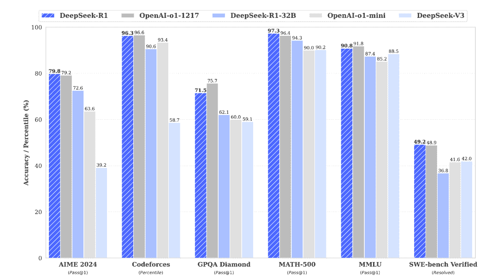

### 一、有监督微调（SFT）

有监督微调（Supervised Fine-Tuning，SFT）是什么？有监督微调是指在已经训练好的大型语言模型（如GPT、Llama等）基础上，通过使用有标注的特定任务数据进行进一步的训练，从而使模型具备在特定任务或领域上表现更好的能力。这种技术通常涉及对模型权重的微调，以最小化任务特定的损失函数。有监督微调（SFT）的核心在于利用有限的标注数据，对预训练模型进行精细化调整。预训练模型通常是在大规模无监督数据集上训练的，已经掌握了语言的基本结构和知识。通过引入标注数据，模型可以针对特定任务进行微调，学习如何在该任务上进行预测和推理。

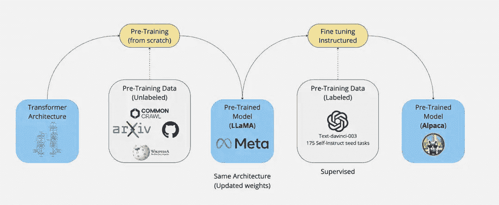

DeepSeek-R1为什么不使用有监督微调（SFT）？DeepSeek-R1摒弃了传统的有监督微调作为初步步骤的做法，旨在通过纯粹的强化学习（RL）来训练模型，以激发模型的自主学习能力。

这一理念认为，通过让模型在自主试错中学习正确的方法（即Self play），可以更符合人类的思维规则，同时提升模型的适应性和灵活性。

DeepSeek-R1通过强化学习提升了自主学习能力，无需依赖大量标注数据，从而实现了与有监督微调模型相媲美的推理性能，这一特性不仅降低了数据成本，还显著增强了模型的适应性。

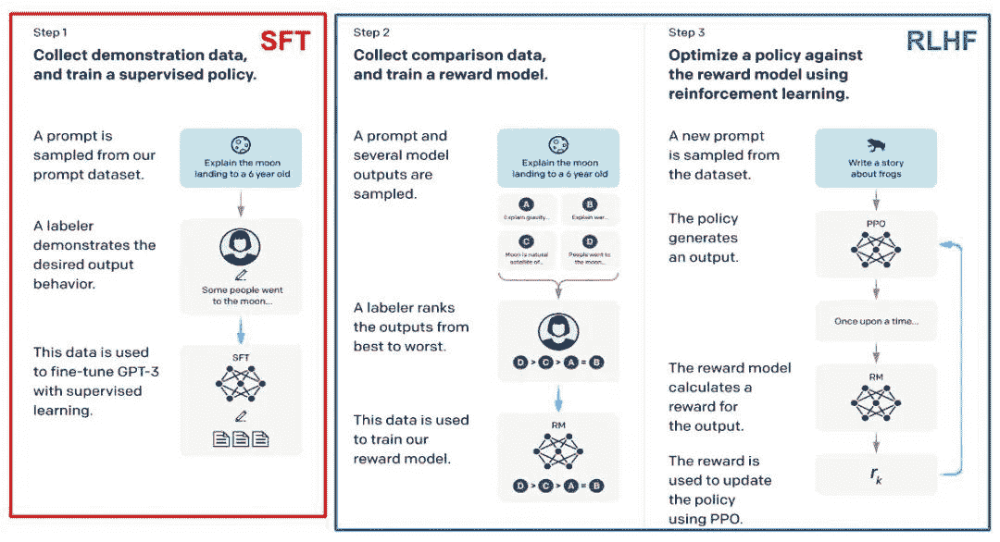

### 二、强化学习（RL）

强化学习（Reinforcement Learning, RL）是什么？强化学习专注于探索模型如何通过与环境的互动，利用试错方式学习最优策略，旨在最大化累积奖励。强化学习的核心在于模型（通常被称为智能体）会在环境中执行一系列动作，并根据这些动作所获得的奖励来不断优化其行为策略。在DeepSeek中，强化学习被用于提升模型的推理能力。

DeepSeek-R1为什么使用强化学习（RL）？DeepSeek-R1采用强化学习是为了提升推理能力并减少对监督数据的依赖，实现模型在复杂环境中的自我优化与进化。

DeepSeek-R1利用强化学习来训练模型，使其能够在特定任务环境中（如数字游戏、数学推理题等）通过不断尝试和反馈来学习如何改进策略，以获得更高的奖励。这个过程类似于人类的学习方式，即通过试错和经验积累来逐渐掌握技能。

## 结合冷启动的强化学习

受DeepSeek-R1-Zero积极成果的启发，DeepSeek-R1自然而然地提出了两个问题：

（1）通过引入少量高质量数据作为冷启动，能否进一步提高推理性能或加速收敛？（2）如何训练一个既能够产生清晰连贯的思维链（Chains of Thought, CoT），又展现出强大通用能力的用户友好型模型？

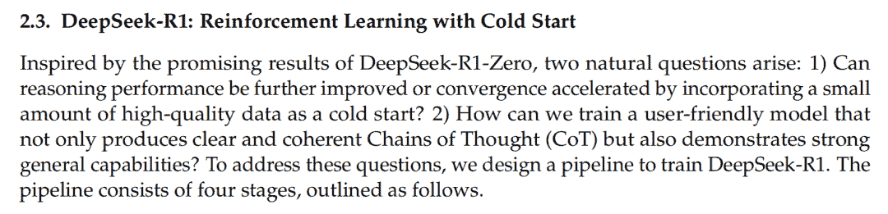

为了解决这些问题，DeepSeek-R1设计了结合冷启动的强化学习的四阶段训练方法。从冷启动数据微调、强化学习提升推理，到监督微调融合多领域数据，再到全场景强化学习确保帮助性与无害性，四阶段训练方法逐步塑造了DeepSeek模型的强大推理与泛化能力。

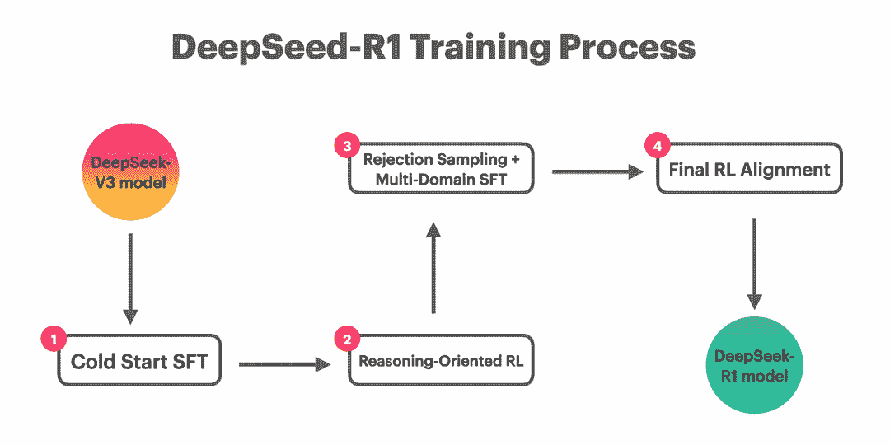

### 一、冷启动

冷启动（Cold Start）阶段是什么？冷启动是指在模型或系统初始运行阶段，由于缺乏足够的历史数据或用户行为信息，而面临难以做出智能决策或提供个性化服务的问题。在DeepSeek-R1的研发过程中，为了避免强化学习训练初期的这种不稳定冷启动阶段，通过构建长思维链数据和采用特定的数据收集与处理方法，有效地缓解了这一挑战。这些数据通过带有详细反思和验证步骤的提示生成，并用于微调模型。同时，DeepSeek还收集了DeepSeek-R1-Zero的输出，并由人类标注者进行精炼和优化。

1. 长思维链数据：这是一种特殊的数据集，用于帮助模型在强化学习初期更好地理解和处理复杂的任务。它包含了详细的步骤和逻辑链条，可以引导模型进行深入的反思和验证。
2. 微调模型：使用这些长思维链数据对模型进行微调，可以使其更好地适应强化学习的环境，并在后续的训练中表现出更出色的性能。
3. DeepSeek-R1-Zero的输出：这是另一个数据源，它提供了模型在处理某些任务时的输出。这些输出被收集起来，并由人类标注者进行进一步的精炼和优化，以确保数据的质量和准确性。
4. 人类标注者的作用：人类标注者在这里扮演了重要的角色。他们不仅需要对收集到的数据进行清理和整理，还需要对数据进行进一步的优化和精炼，以确保模型在训练过程中能够充分利用这些数据。

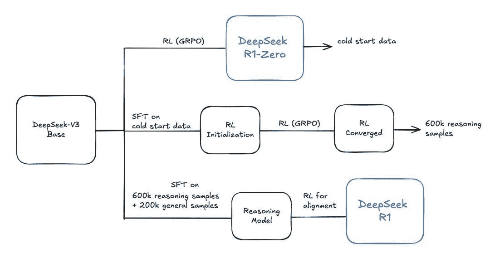

### 二、面向推理的强化学习

面向推理的强化学习（Reasoning-oriented RL）阶段是什么？面向推理的强化学习是一种将强化学习应用于推理任务的学习范式。它通过智能体与环境的交互、奖励机制的设计以及策略的优化来不断提升模型的推理能力。在利用冷启动数据微调DeepSeek-V3-Base后，DeepSeek采用了与DeepSeek-R1-Zero相同的强化学习训练，以提升模型在编码、数学、科学和逻辑推理等推理密集型任务上的能力。训练过程中，DeepSeek观察到思维链（CoT）存在语言混合现象，尤其在涉及多种语言时。为此，DS引入了语言一致性奖励，根据目标语言单词比例计算，以缓解该问题。尽管这可能导致模型性能略有下降，但提高了输出的可读性。最终，DeepSeek将推理任务准确性和语言一致性奖励相加，形成最终奖励，直至模型在推理任务上收敛。

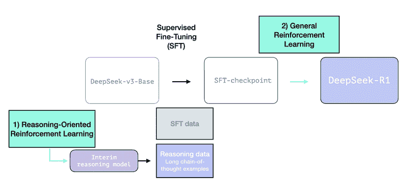

### 三、拒绝采样与监督微调

拒绝采样（Rejection Sampling）与监督微调（SFT）阶段是什么？拒绝采样和监督微调是解决不同问题的两种技术。拒绝采样主要用于从复杂分布中生成样本，而监督微调则用于在预训练模型的基础上快速适应新的监督学习任务。当面向推理的强化学习收敛后，DeepSeek-R1利用所得检查点收集后续轮次所需的监督微调（SFT）数据。与主要关注推理的初始冷启动数据不同，这一阶段纳入了来自其他领域的数据，以增强模型在写作、角色扮演和其他通用任务方面的能力。

### 四、全场景强化学习

全场景强化学习（RL for all Scenarios）阶段是什么？全场景强化学习旨在通过整合多源奖励信号和多样化数据分布，训练出能在各种场景下提供有用、无害且具备强大推理能力的模型。为进一步使模型符合人类偏好，DeepSeek-R1实施了第二阶段强化学习，旨在提升模型的帮助性、无害性及推理能力。R1采用组合奖励信号和多样提示分布进行训练。对于推理数据，遵循DeepSeek-R1-Zero的方法论，利用基于规则的奖励指导学习。对于通用数据，依靠奖励模型捕捉人类偏好。基于DeepSeek-V3管道，采用类似偏好对分布和训练提示。在帮助性方面，专注于最终摘要的实用性和相关性。在无害性方面，评估整个响应以识别和缓解潜在风险。整合奖励信号和多样数据分布，训练出推理出色且优先考虑帮助性和无害性的模型。

## 强化学习和蒸馏

DeepSeek-R1在Introduction部分提到，R1通过结合冷启动数据、多阶段训练管道和纯强化学习，显著提升了大型语言模型的推理能力，实现了与OpenAI的o1系列模型相当的性能，并通过蒸馏技术将推理能力传递给更小的模型。

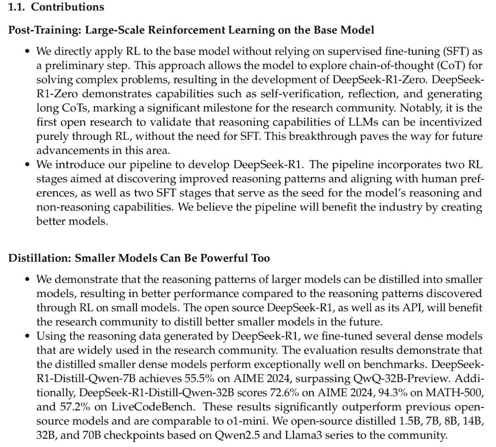

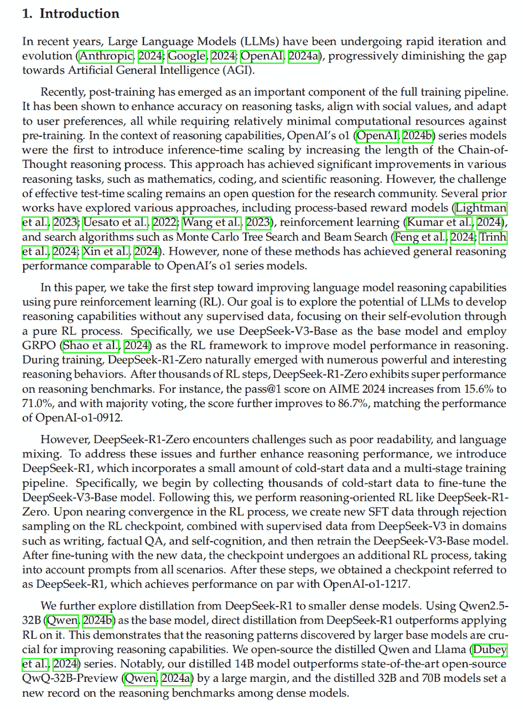

DeepSeek-R1在Contributions部分重点提到两个贡献：

> （1）训练后：在基础模型上进行大规模强化学习。通过在基础模型上直接应用大规模强化学习，成功开发出具备自我验证和长思维链等推理能力的DeepSeek-R1。
> （2）蒸馏：小模型同样强大。同时证明了大模型的推理模式可被有效蒸馏到小模型中，实现性能显著提升。

### 一、Post-Training:大规模强化学习

LLMs的推理能力仅通过强化学习来激励？DeepSeek-R1-Zero表明大型语言模型（Large Language Models）的推理能力可以仅通过强化学习来激励，而无需监督微调。DeepSeek直接在基础模型上应用强化学习（Reinforcement Learning，简称RL），而不依赖于监督微调（Supervised Fine-Tuning，简称SFT）作为初步步骤。这种方法使模型能够探索用于解决复杂问题的思维链（Chain of Thought，简称CoT），从而开发出DeepSeek-R1-Zero。DeepSeek-R1-Zero展示了自我验证、反思和生成长思维链等能力，为研究领域树立了重要里程碑。不依赖于监督微调（SFT），仅通过强化学习（RL）来激励大语言模型，来激发LLMs的推理能力。这一技术创新突破为该领域的未来发展铺平了道路。第一次来自中国的0-1技术创新让硅谷骚动，让英伟达市值暴跌。

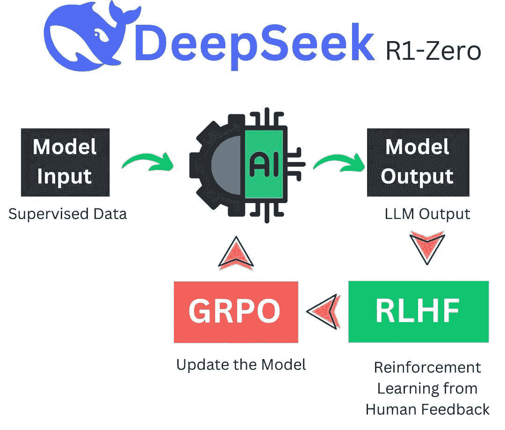

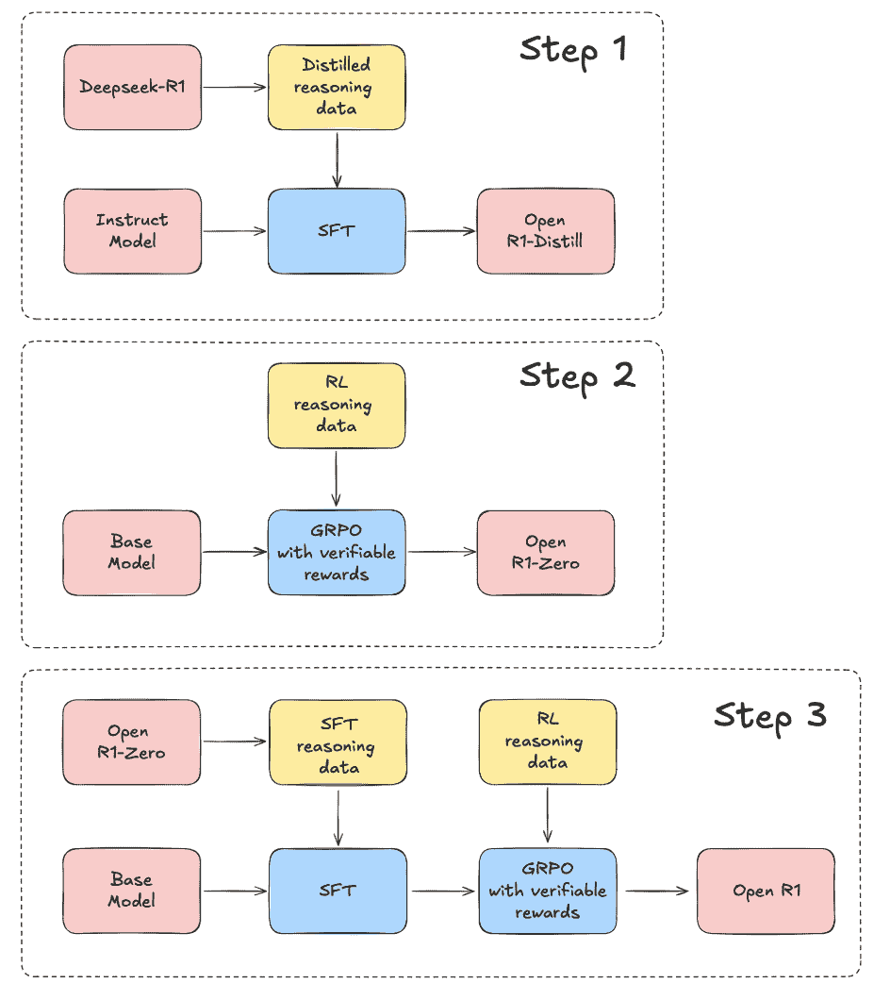

开发DeepSeek-R1的流程是什么？R1流程包含两个强化学习阶段，旨在发现改进的推理模式并与人类偏好保持一致，同时还包含两个监督微调阶段，作为模型推理和非推理能力的基础。DeepSeek相信，该流程将通过创建更好的模型为行业带来益处。

### 二、蒸馏：小模型同样强大

蒸馏（Distillation）让小模型也同样强大？大模型的推理模式可以被蒸馏到小模型中，与通过小模型上的强化学习发现的推理模式相比，这种方法能获得更好的性能。开源的DeepSeek-R1及其应用程序接口API将有助于研究界在未来蒸馏出更好的小型模型。DeepSeek-R1系列蒸馏的小模型在多个基准测试中的评估结果显著优于之前的开源模型，其中DeepSeek-R1-Distill-Qwen-32B等表现尤为突出，其性能可与o1-mini相媲美，且DeepSeek已向研究界开源了基于Qwen2.5和Llama3系列的15亿、70亿、80亿、140亿、320亿和700亿等多个参数规模的检查点。蒸馏，让小模型同样强大。又一王炸级别的0-1技术创新，难怪硅谷一帮大佬坐不住了。因为这一技术创新被国内外技术人员进行了验证，大家发现按照R1论文的方法可以成功基于DeepSeek-R1蒸馏出性能与o1-mini相媲美的小模型。再一次膜拜梁文峰大神。

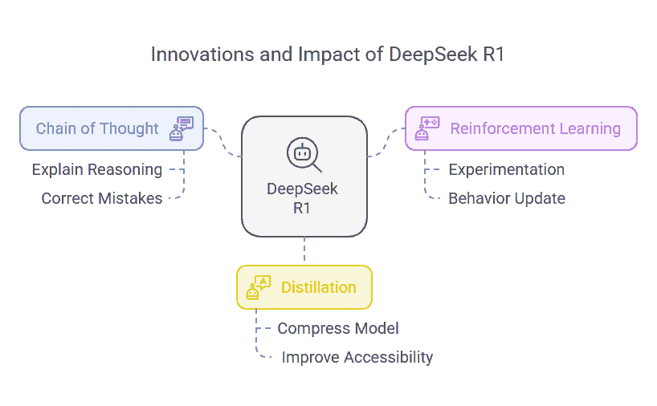

如何蒸馏DeepSeek-R1-Distill-Qwen-32B？通过选择DeepSeek-R1作为教师模型，Qwen-32B作为学生模型，并准备大规模文本数据集，经过教师模型推理、学生模型训练、损失函数设计与优化算法选择等步骤，最终评估与调优得到性能优异的学生模型DeepSeek-R1-Distill-Qwen-32B。

#### 一、确定模型角色

+ 教师模型：选择性能卓越、知识丰富的DeepSeek-R1作为指导者。
+ 学生模型：选用参数适中、易于蒸馏的Qwen-32B作为学习者。

#### 二、准备数据集

+ 数据收集：整合涵盖广泛领域的高质量文本数据，为蒸馏过程奠定基础。
+ 数据预处理：严格筛选和处理数据集，确保蒸馏效果不受数据质量影响。

#### 三、模型训练与蒸馏

1. 教师模型推理：DeepSeek-R1输出软标签和中间层特征，作为Qwen-32B的学习标杆。
2. 学生模型训练：Qwen-32B模仿DeepSeek-R1的决策，继承其知识和经验。

## 三、模型训练

1. **损失函数设计：**采用`KL散度`或`交叉熵`等，衡量学生模型与教师模型的输出差异。

1. **优化算法选择：**选用`SGD`或`Adam`等算法，更新学生模型参数，最小化损失函数。

## 四、模型评估与调优

+ **模型评估：**利用独立测试数据集，比较学生模型与教师模型的表现，评估蒸馏效果。

+ **模型调优：**根据评估结果，调整超参数、优化损失函数等，提升蒸馏效果。

# 混合专家（MoE）

DeepSeek推出了`DeepSeek-V3`，这是一个强大的混合专家（`Mixture-of-Experts`，`MoE`）语言模型，总参数量达到6710亿，每个标记（`token`）激活的参数量为370亿。

为了实现高效的推理和成本效益高的训练，`DeepSeek-V3`采用了在`DeepSeek-V2`中经过充分验证的多头潜在注意力（`Multi-head Latent Attention`，`MLA`）和`DeepSeekMoE`架构。

DeepSeek对`DeepSeek-V3`进行了预训练，使用的是14.8万亿个多样且高质量的标记，随后进行了监督微调（`Supervised Fine-Tuning`）和强化学习（`Reinforcement Learning`）阶段，以充分发挥其能力。

`DeepSeek-V3`以低成本（仅需278.8万`H800` GPU小时）实现卓越训练稳定性，性能媲美领先闭源模型。

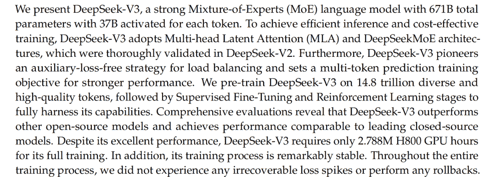

## 一、混合专家

混合专家（`Mixture of Experts`，`MoE`）是什么？`MoE`由多个子模型（即“专家”）组成，每个子模型都是一个局部模型，专门处理输入空间的一个子集。`MoE`不是将整个网络用于每个输入，而是学习计算成本低的映射函数，该函数确定网络的哪些部分（即哪些专家）最有效地处理给定的输入。同时，`MoE`模型还包含一个门控网络（或“路由器”），用于选择性地激活给定任务所需的特定专家，而不是为每项任务激活整个神经网络。

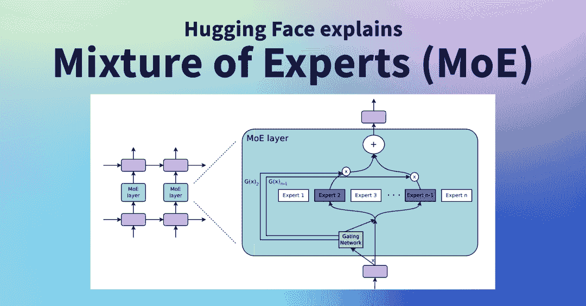

`GPT-4`中如何应用`MoE`模型？`GPT-4`的`MOE`模型由16个专家模型组成，每个专家模型拥有1110亿参数。此外，`GPT-4`还包括一个注意力层（`Attention`），拥有550亿的共享参数。这些组成部分共同构成了总计1.831万亿参数的`GPT-4`模型。这种模型架构的设计旨在通过混合专家策略来优化计算效率和模型性能。

## 二、DeepSeekMoE

`DeepSeekMoE`模型是什么？`DeepSeekMoE`模型整合了专家混合系统（`MoE`）、改进的注意力机制和优化的归一化策略，在模型效率与计算能力之间实现了新的平衡。

1. **专家混合系统（`MoE`）层：**该层包含动态路由机制和专家共享机制。动态路由机制允许模型根据输入数据的特点选择性地激活部分专家，而不是一次性激活所有专家，从而提高计算效率。专家共享机制则通过在不同令牌或层间共享部分专家的参数，减少模型冗余并提升性能。

1. 多头潜在注意力（`Multi-Head Latent Attention`，`MLA`）机制：`MLA`机制引入潜在向量用于缓存自回归推理过程中的中间计算结果，降低了生成任务中的浮点运算量。同时，`MLA`机制还通过预计算并复用静态键值来优化键值缓存，进一步提高了计算效率。

1. `RMSNorm`归一化：`DeepSeekMoE`采用`RMSNorm`替代传统`LayerNorm`，仅使用均方根统计进行输入缩放。这种简化设计不仅减少了计算量，还提升了训练稳定性。

多头潜在注意力（`MLA`）和多头注意力（`MHA`）的区别是什么？`MLA`在计算注意力时，通过`projection`的方式获取多头的`Key`和`Value`，保留了多头的注意力计算方式。这使得`MLA`在降低计算和内存开销的同时，能够保持与`MHA`相当的模型性能。同时`MLA`通过合并权重矩阵，进一步减少了参数数量和计算量。

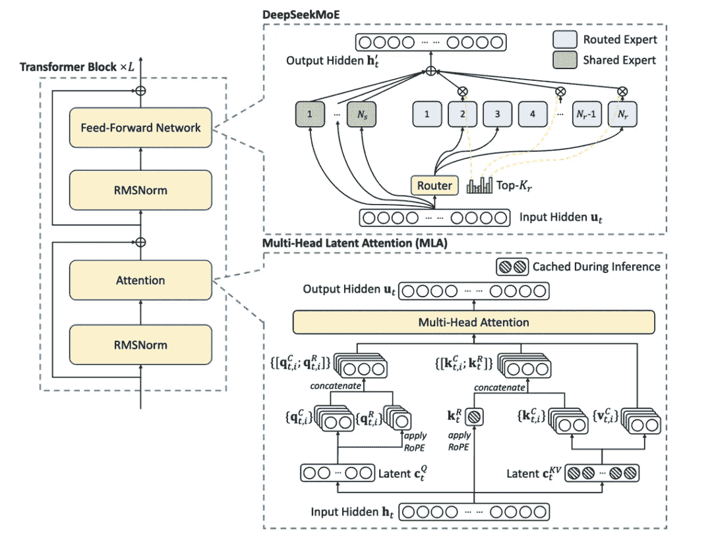

1. 低秩联合压缩键值：`MLA`通过低秩联合压缩键值（`Key-Value`），将它们压缩为一个潜在向量（`latent vector`），从而大幅减少所需的缓存容量。这种方法不仅减少了缓存的数据量，还降低了计算复杂度。

1. 优化键值缓存：在推理阶段，`MHA`需要缓存独立的键（`Key`）和值（`Value`）矩阵，这会增加内存和计算开销。而`MLA`通过低秩矩阵分解技术，显著减小了存储的`KV`（`Key-Value`）的维度，从而降低了内存占用。

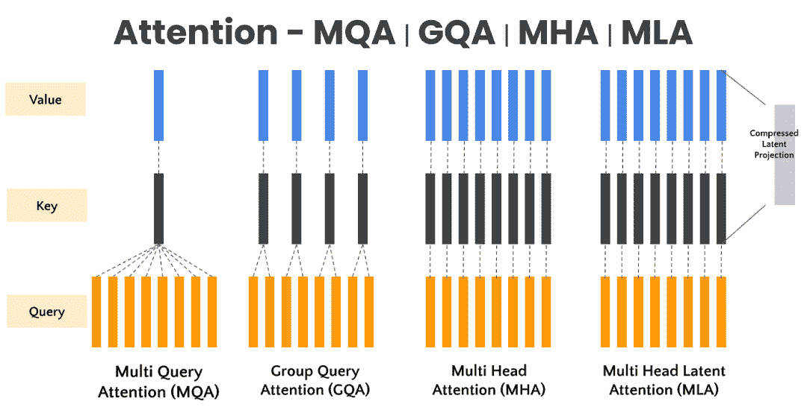
