# 使用DeepSeek+RAG实现私人知识库

> 来源：[https://qqs7y1hozd1.feishu.cn/docx/E1IWdbGgeowK1zx9a4XccXU5nXd](https://qqs7y1hozd1.feishu.cn/docx/E1IWdbGgeowK1zx9a4XccXU5nXd)

> 我使用包括 ChatGPT** 在内的 AIGC 工**具，回答 SAP 相关领域问题时，经常遇到大模型「一本正经的胡说八道」。这种现象的正式术语是大模型的幻觉现象。对于 LLM 模型而言，它是一种基于上下文的生成模型，其预测是基于先前的文本序列。在实际应用中，由于模型的复杂性和对大量数据的学习，它可能会在生成文本时添加一些虚构的元素，这就是所谓的 "幻觉现象"

这并不是模型有意为之，而是因为在训练时它学到了语言的统计规律，有时在生成文本时可能产生一些不合逻辑或与实际情况不符的内容。模型参数中存储的知识是固定且有限的，而现实世界的信息却在持续更新。大模型的幻觉现象，在回答需要最新数据支撑的问题时尤为明显

减少或者避免大模型幻觉现象的一种解决方案就是RAG(Retrieval-Augmented Generation)当用户对一个通过 RAG 增强的大语言模型提问时，系统首先通过检索模块（Retriever）从外部知识库中查找相关文档(下图图例2)，然后将检索结果与原始问题共同输入生成模块（Generator）进行答案合成（下图图例4）

同模型参数中固化的知识不同，外部知识库的内容(下图的 New Content)可以实时更新，从而让大语言模型提供实时的准确回复。外部知识库通常存储于数据库中，即下图图例的 Vector Database

**本文我们用DeepSeek、Ollama 和 AnythingLLM 这三个工具，然后手动**上传 SAP 文档，来演示如何基于 RAG 架构，打造自己的个人 SAP 知识库

# **实现工具与操作步骤**

## 1）安装Ollama并运行 DeepSeek

Ollama 是一个用于在本地环境运行大语言模型的工具。它允许开发者在本地 GUI 或者命令行加载和运行各种 AI 模型，而无需深入理解底层的机器学习框架

Ollama 设计思路类似于 Docker，通过它管理的 AI 模型类似于 Docker Image，但 Ollama 专门针对 AI 模型进行了优化

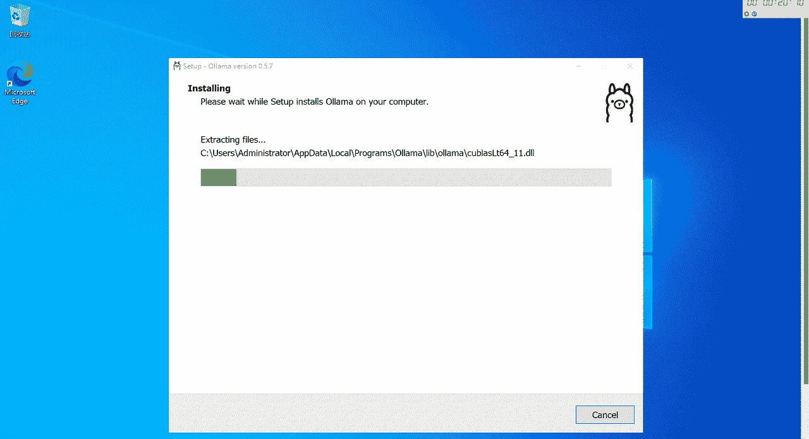

Ollama 安装成功之后，使用命令行 ollama run deepseek-**r**1:1.5b, 这个命令会自动下载 DeepSeek 模型到 HAI 并运行。1.5b 意思是下载参数个数为 15 亿的 DeepSeek 版本，为了节省时间，笔者选择了这个文件尺寸为 1.1 GB 的最精简的模型

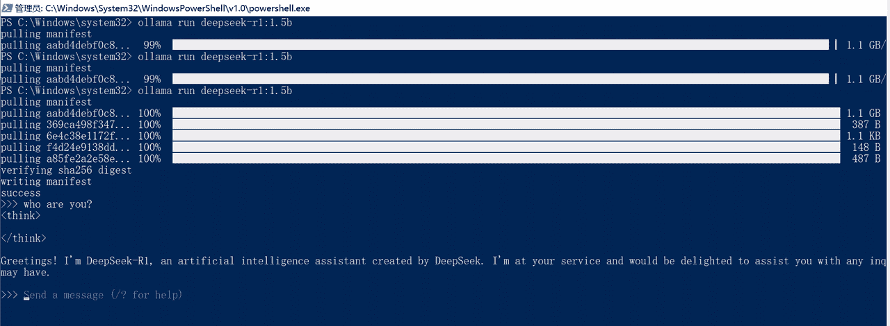

耐心等待下载结束，看到命令行里弹出 think 提示符，输入 who are you? 得到 DeepSeek 的自我介绍回复，说明 Ollama 和自动下载的 DeepSeek R1 已经正常工作了

## 2）上传 SAP 文档作为知识库素材

既然是打造私人的 SAP 知识库， 我们就需要给 DeepSeek 喂一些外部文档作为知识库的文档素材

在 Bing 搜索引擎里使用 **site:****sap.com**** filetype: pdf** 随便搜一些 SAP 官方发布的 PDF 来测试。在实际使用场景中，企业级客户可以将自己的私密数据，喂给本地部署的大模型，而不用担心隐私泄漏的问题

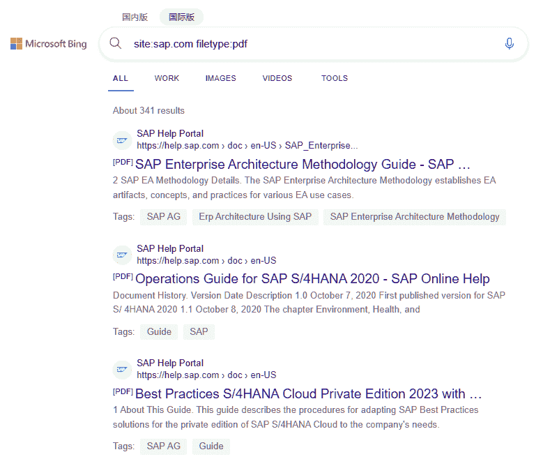

这里我从 Bing 的搜索结果下载了一个名叫 SAP S4HANA private cloud - implementation guide.pdf 的文件

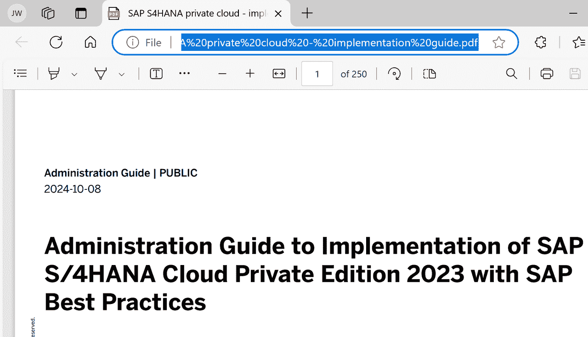

## 3）使用AnythingLLM建立工作区

下一步，下载 AnythingLLM 并安装

AnythingLLM 是一个开源的 AI 工具，能够方便地将用户提供的各种格式的文档，嵌入到自定义 AI 模型中，使其在同用户对象中作为可参考上下文的一部分。这意味着通过 AnythingLLM, AI 模型在回答问题时，可以检索和分析用户提供的文档，将其内容整合作为最终的输出，即本文开头部分介绍的 RAG 工作方式

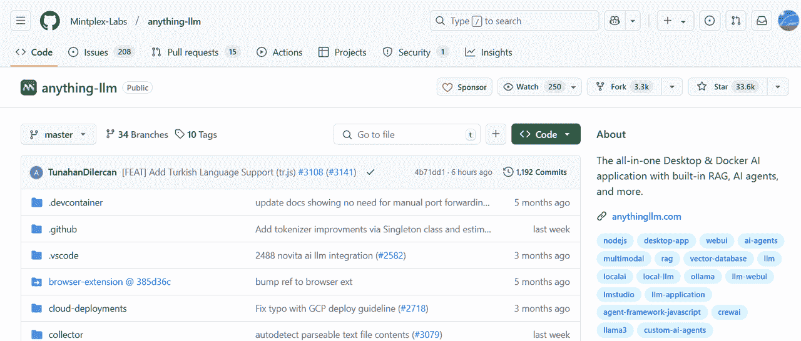

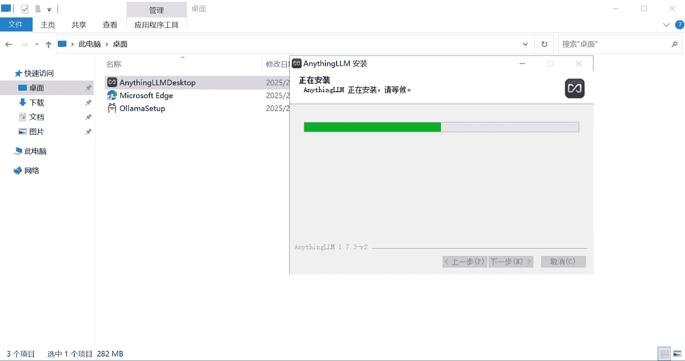

AnythingLLM 安装完毕之后，像使用 ABAP Development Tool 一样，新建一个工作区(Workspace)：

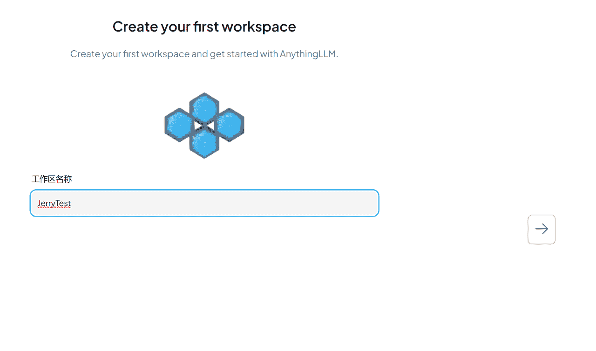

**点击「聊天设置」：**

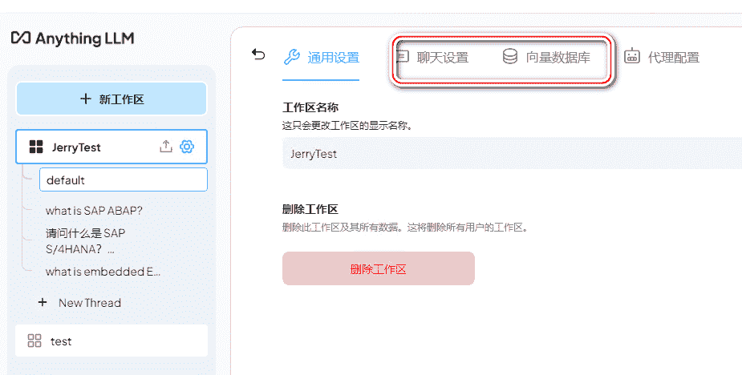

还记得我们刚才下载的 Ollama 和通过 ollama run 命令下载的 DeepSeek R1 吗？在工作区 LLM 提供者的下拉菜单中，找到通过 Ollama 管理的 DeepSeek R1

这个设置的意思是，我们接下来可以通过 AnythingLLM 提供的 GUI 窗口，同 DeepSeek 对话，可以同 Ollama 自带的命令行窗口说再见了

## **4）文档嵌入与向量数据库**

接下来通过[向量数据库](https://cloud.tencent.com/product/vdb?from_column=20065&from=20065)来上传并存储用户提供的文档。点击上传图标，打开上传对话框：

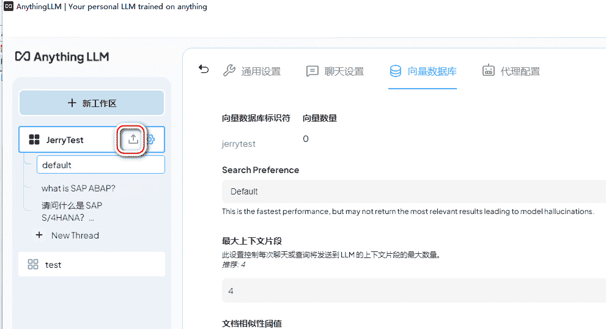

点击 Upload 区域，将刚才从 Bing 搜索下载的 SAP S/4HANA private cloud PDF 文档上传：

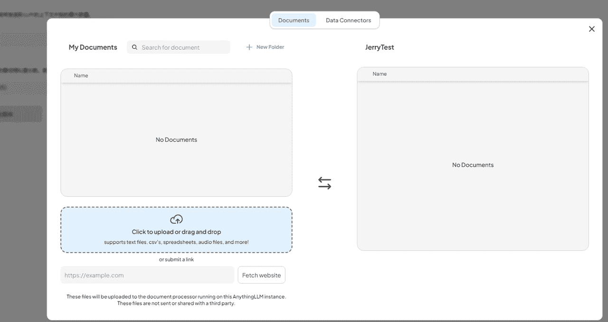

待文档上传完毕，点击 Save and Embed 按钮，将文档内容转换成向量数据并执行嵌入操作

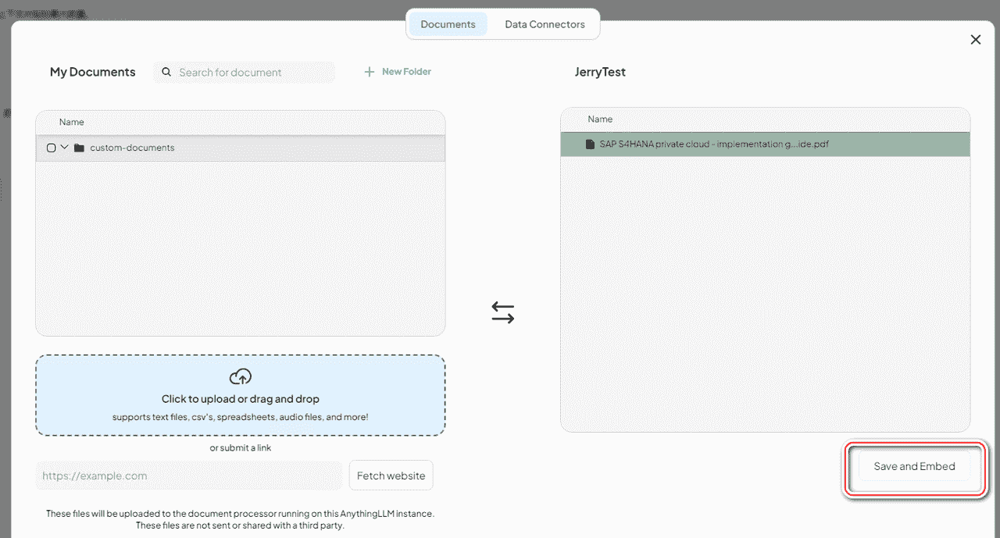

向[量数据库是一](https://cloud.tencent.com/product/tencentdb-catalog?from_column=20065&from=20065)种用于存储和查询高维向量数据的数据库，其核心功能是提供高效的相似度搜索，使得查询向量能够找到与之最接近的向量。相比传统关系型数据库（如 MySQL、PostgreSQL），向量数据库更适合存储和检索非结构化数据，如文本、图像、音频等

在 RAG 架构中，向量数据库的作用类似于一个知识库，它存储了大量文本片段的嵌入（Embeddings），当用户输入查询时，模型会将查询转换为向量，并在数据库中检索最相关的向量，进而找到对应的文本内容。这种方式大幅提高了生成式 AI 的可控性和可解释性

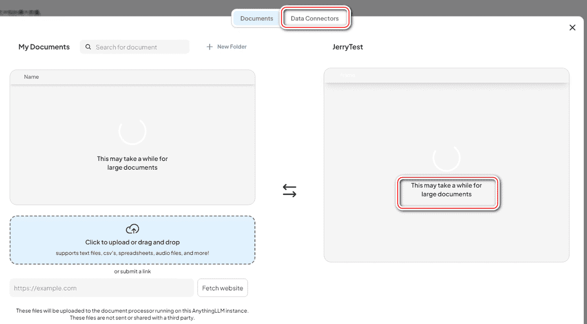

**文档嵌入（Embedding）**是将文本数据转换为向量的过程。**这**一过程的核心是将文本内容映射到一个高维向量空间中。相似的文本在该空间中的距离较近，而不相关的文本距离较远

当然在实际企业级应用中，除了小规模的人工手动上传文档外，AnythingLLM 也支持通过 Data Connection 进行批量上传大规模文档，比如批量上传某个 Github Repo 里的文件。这种模型下，AnythingLLM 读取 Github 仓库内容的方式，通过 Access Token 完成

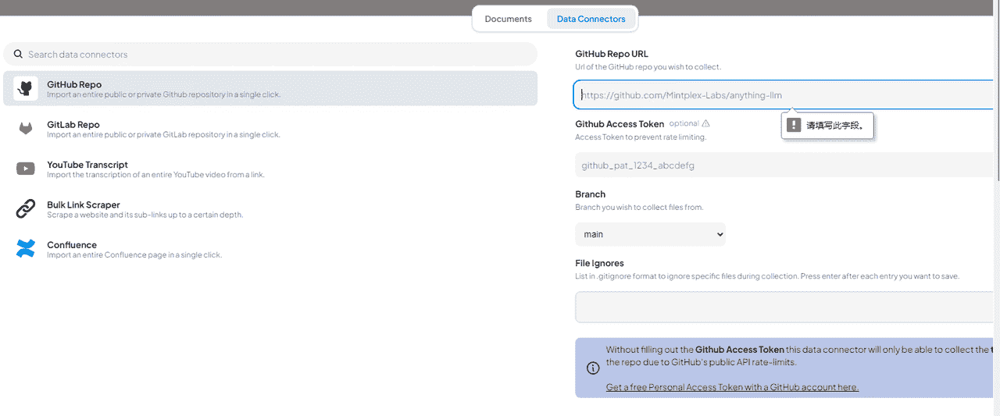

等我们上传的文件出现在工作区右边区域后，说明文档的向量化即嵌入操作已经完成

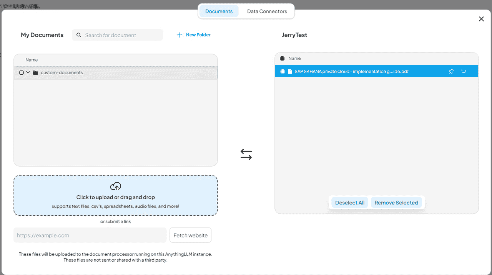

# **效果验证**

此时，我们回到 AnythingL**LM 同 De**epSeek 的对话窗口，提出一个问题：

+   What is embedded EWM?

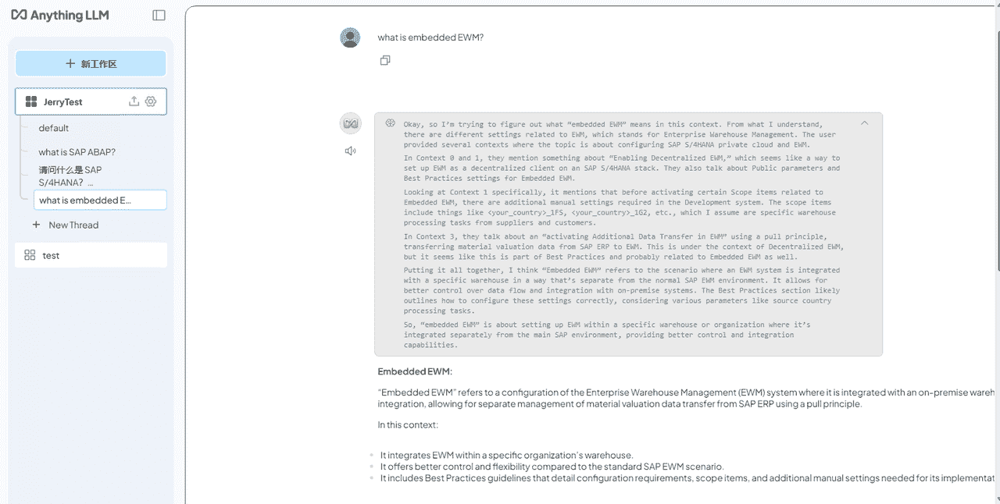

**DeepSeek 给出的回答的确是**基于我们刚刚上传的 PDF 文件来完成的

**这一**点可以从 DeepSeek 回复的 Citation 即引用区域得到证实，该区域显示本次回答引用了 SAP S4HANA private cloud edition.pdf 这个文件

# **后记：模型部署**

[对于企业](https://cloud.tencent.com/product/dsgc?from_column=20065&from=20065)级用户而言，大模型的私有部署，在数据安全性、响应速度、可定制化、长期成本以及可靠性等多个方面都有着显著优势。而对于个人 AI 学习者来说，可以选择本地部署或者在某个云服务提供商的基础设施(IaaS)上进行私有部署的尝试

笔**者现在使用的笔记本电脑，本地****部署满血** DeepSeek 比较吃力。所以，我选择了腾讯云 HAI，这样就不用自己掏钱升级硬件了，你可以登录腾讯 HAI 控制台，新建一个 Windows Server 实例：

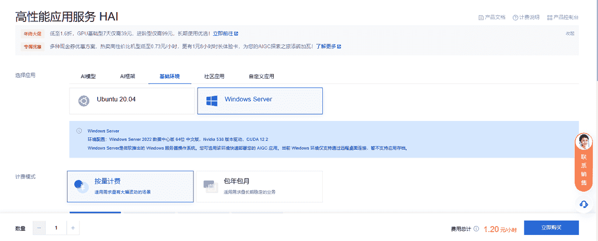

使用 Windows 自带的 Remote Desktop Connection 登录到创建好的 HAI 实例上

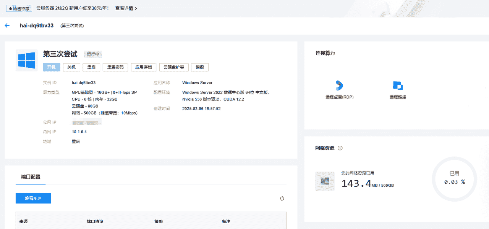

**通过**本文展示的步骤，即使是一个不了解大语言模型底层实现细节的普通用户，借助 Ollama 和 AnythingLLM 这两个工具，也能轻松完成 DeepSeek 的本地部署，并打造自己的私人知识库