# 万字详解：`DeepSeek` `V3`/`R1`的架构与训练技术

> 来源：[https://qqs7y1hozd1.feishu.cn/docx/Iw9wdWjxGoSbgrx7LZMc6l8KnJf](https://qqs7y1hozd1.feishu.cn/docx/Iw9wdWjxGoSbgrx7LZMc6l8KnJf)

下面从`V3`与`R1`的架构分析开始，分层解读`DeepSeek`的创新。

## 1 V3与R1的主要特征

`DeepSeek-R1`的模型架构来自于`V3`，甚至可以说`R1`是具有推理（`Reasoning`）能力的`V3`。下面先分别分析`V3`和`R1`的架构特征。

### 1.1 V3/R1架构特征

> `DeepSeek-V3` 是一个混合专家（`MoE`）语言模型，具有 6710 亿（671B）参数，其中每个`Token`（词元）的计算约激活 370 亿（37B）参数。这个模型参数量与`GPT-4`大致在同一数量级。

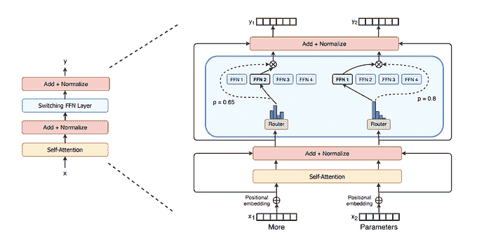

> `DeepSeek-V3` 采用了多头潜注意力（`MLA`，对传统多头注意力机制的改进）和 `DeepSeekMoE` 架构（对传统`MoE`架构的改进），无辅助损失的负载平衡策略等创新技术，基于 14.8 万亿`Token`的数据进行训练，在代码生成、分析等任务中表现出色。

### 1.2 R1在`CoT`的进化

广义上的`DeepSeek-R1` 不是一个单一的模型，还包括了`R1`的初始阶段模型`DeepSeek-R1-Zero`，以及几个基于`R1`蒸馏的较小的大模型。在这里我们主要讨论`R1-Zero`和`R1`。

### 1.2.1 DeepSeek-R1-Zero

> `DeepSeek-R1-Zero`最大的特点在于，该模型仅使用强化学习进行的训练，通过各种思维链（`CoT`，Chain of Thought）数据特别是`Long CoT`数据来激活模型的推理能力。

### 1.2.2 DeepSeek-R1

> 相比之下，`DeepSeek-R1`采用了多阶段训练方法，加入了`SFT`，而不是采用纯粹的强化学习，`R1`从一小组精心挑选的示例数据（称为“冷启动数据”）进行有监督微调（`SFT`），再进入强化学习。这种方法改善了 `DeepSeek-R1-Zero` 的语言可读性和连贯性，同时在推理之外的测试中实现了更好的性能。

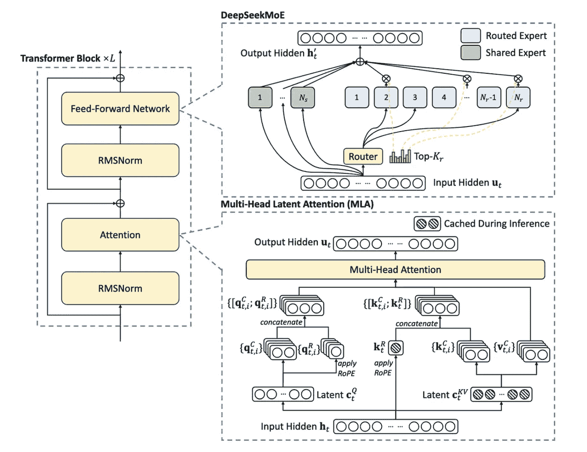

## 2 V3/R1的架构提升

### 2.1 多头潜注意力（`MLA`）

### 2.1.1 从`KV Cache`（`KV`缓存）说起

> 当使用传统 `Transformer` 在推断（`Inference`）过程中计算并生成 `Token`（词元）时，模型需要读入所有过去 `Token` 的上下文，以决定接下来输出什么`Token`。最直观的方法就是简单的再次进行一次包括所有过去 `Token` 的前向传播（计算）。

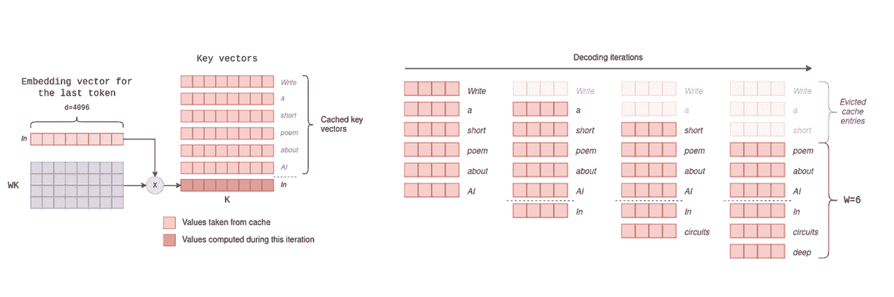

传统的基于 `Transformer` 的模型在推理过程中会计算每个键值（`KV`）对，但事实上这种方法效率并不高，因为大部分过去的 `Token` 已经在上一次计算中处理过了，重复计算会产生大量的浪费。

> 目前常用的方法是缓存所有过去 `Token` 的相关内部状态，主要是注意力机制中的键（`Key`）和值（`Value`）向量。这也是键值缓存（简称 `KV` 缓存）名称的由来。

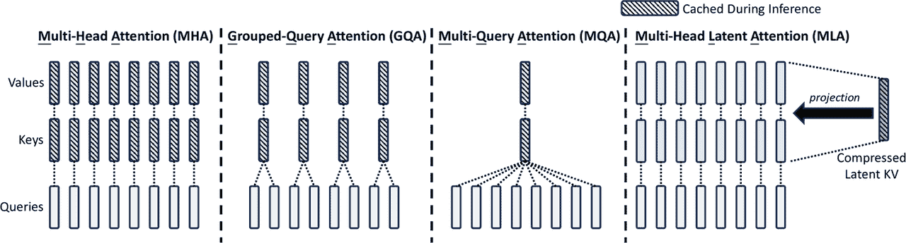

### 2.1.2 `MLA`的原理与优势

`DeepSeek`使用的`Multi-Head Latent Attention`技术可大大节省`KV`缓存，从而显著降低了计算成本。

> `MLA`的方法是将`KV`矩阵转换为低秩形式：将原矩阵表示为两个较小矩阵（相当于潜向量）的乘积，在推断过程中，仅缓存潜向量，而不缓存完整的键`KV`。这规避了分组查询注意力和多查询注意力的查询的信息损失，从而在降低`KV`缓存的前提下获得更好的性能。

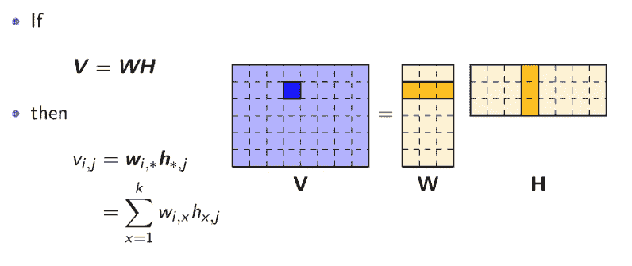

另外为了与`MLA`技术的低秩`KV`压缩兼容，`DeepSeek`也将编码方式`RoPE` 进行了改进，使`V2`/`V3`/`R1`获得了长上下文的外延能力。

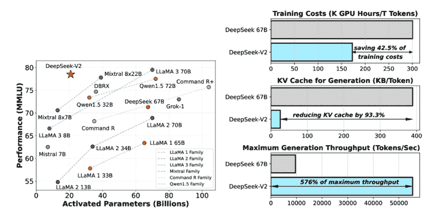

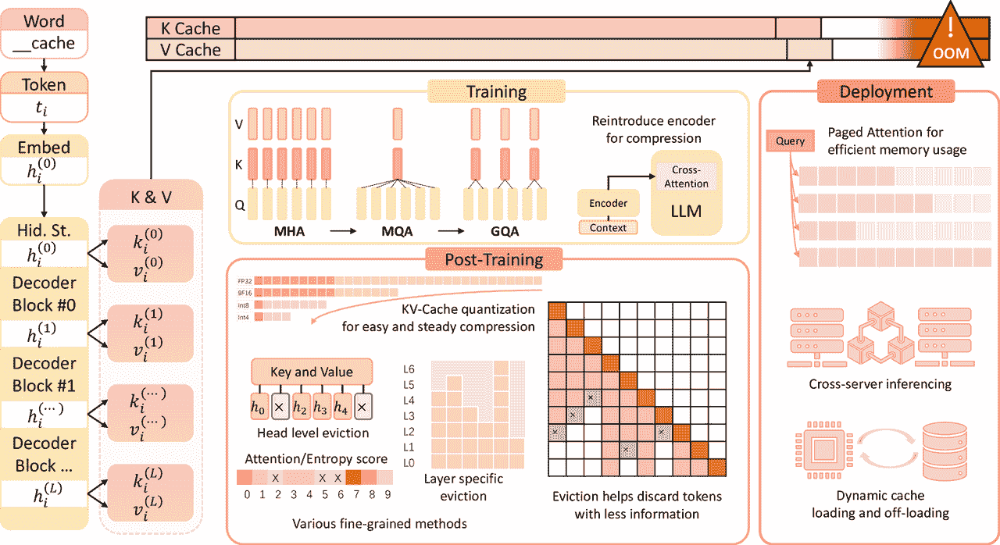

### 2.2 `MoE`架构与辅助无损负载均衡

### 2.2.1 `MoE`与`Dense`模型的混战

目前的主流的大模型架构可以分为`Dense`（稠密）架构和`MoE`架构。

> 一般来说，`Dense`模型可以视为仅有一个专家的`MoE`模型。在大模型领域，`Dense`模型和`MoE`各有各的应用场景和优势，`MoE`还无法代替`Dense`模型的行业应用。

### 2.2.2 无辅助损耗负载均衡

> 传统的规避路由崩溃的方法是强制“平衡路由”，即通过训练策略让每个专家在足够大的训练批次中被激活的次数大致相等。这一策略也就是“辅助损失”。但这种强制性的辅助损失会由于训练数据的结构不均衡特征，导致同领域的专家能力分散到不同的专家模块之中，极度损害`MoE`模型的性能。

`DeekSeek`采用了“增加共享专家+无辅助损耗负载平衡”的方法解决这一问题。

`DeepSeek`将专家分为两类：共享专家和路由专家。共享专家始终会被路由，在训练中重点确保路由专家的路由均衡。

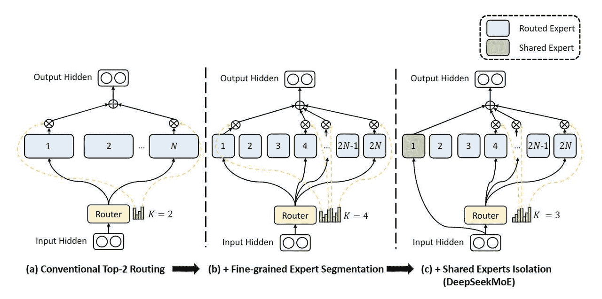

通过动态调整，`DeepSeek-V3` 在训练过程中获得了比有辅助损失均衡模型更好的性能。

## 3 V3/R1训练架构的独特优势

`DeepSeek` 的优势不仅仅来自于其模型架构。从低比特 `FP8` 训练到`All-to-All`通信优化，其专用训练框架旨在尽可能提高训练的速度，以最高效率在解空间中找到较优的`MoE`参数集。

**这一架构的核心优势包括：**

> 1）引入了`FP8`混合精度训练框架，并在超大规模大模型训练上验证了框架的有效性。

> 2）设计了`DualPipe`算法来实现更高效的流水线并行，隐藏了大模型训练过程中的大部分通信开销。

> 3）开发了高效的跨节点`All-to-All`通信内核，以充分利用`InfiniBand`（`IB`）和`NVLink`带宽；对显存使用进行了优化。

### 3.1 `HAI-LLM`框架的软硬件协同设计

`V3` 的训练基于`DeepSeek`自研的`HAI-LLM` 框架。`HAI-LLM`是一个高效、轻量级的训练框架，其设计充分考虑了多种并行策略，包括`DP`、`PP`、`TP`、`EP`和`FSDP`的并行模式。

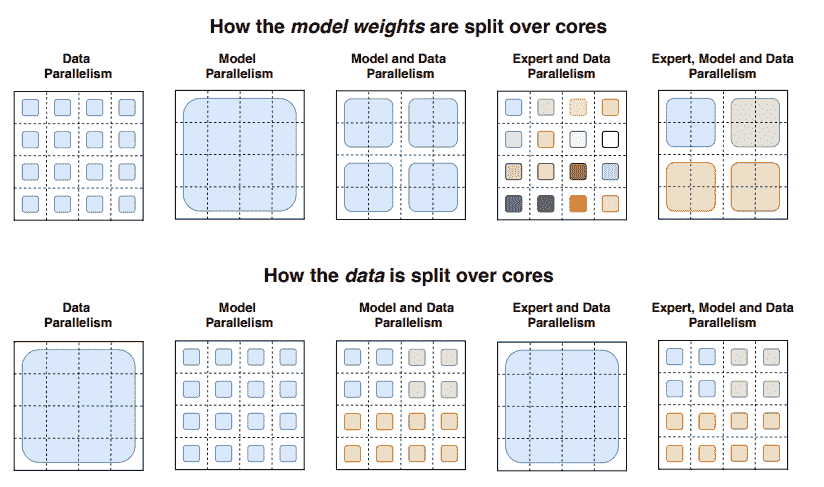

### 3.1.1 软件层面的并行优化

根据`DeepSeek`的论文，`V3` 应用了 16 路流水线并行 （`PP`）、跨越 8 个服务器节点的 64 路专家并行 （`EP`）和 `ZeRO-1` 数据并行 （`DP`）。

### 3.1.2 针对软件并行策略的硬件优化

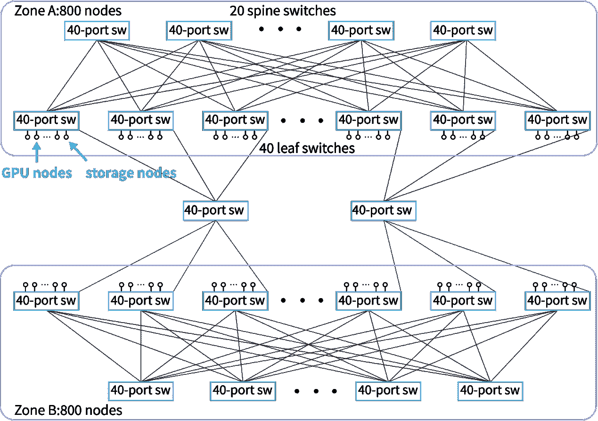

> 为了配合`HAI-LLM`训练框架（软件），`DeepSeek`采用两层`Fat-Tree`拓扑+ `InfiniBand` （`IB`）作为集群架构（硬件）。这一集群架构的核心思路是减少互连层次，降低训练的综合成本。相对`DGX-A100` 的标准万卡集群三层`Fat-Tree`的1320个交换机，`DeepSeek`的同规模集群仅仅需要122台交换机，至少节省了40%的互连成本。

### 3.1.3 针对硬件架构的软件优化

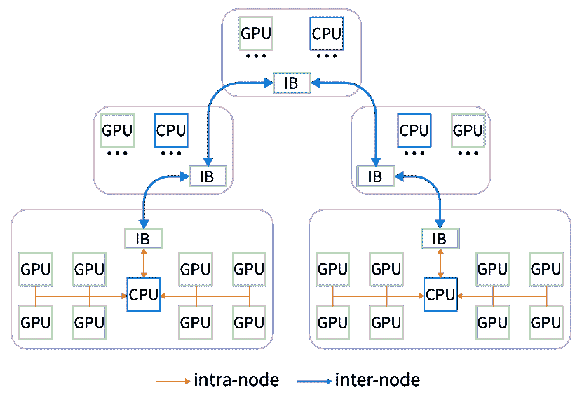

> 针对所采用的硬件架构特点，`DeekSeek`开发了`HFReduce`（针对不使用`NVLink`的方案），以执行高效的 `allreduce`操作。 `HFReduce`会首先执行节点内 `reduce`，然后通过 `CPU` 执行节点间 `allreduce`，最后将 `reduced` 数据传输到 `GPU` 。这样的优化需要`DeepSeek`团队对硬件互连有非常深刻的理解。

### 3.2 `FP8` 训练框架体系

**低比特训练框架的构建**

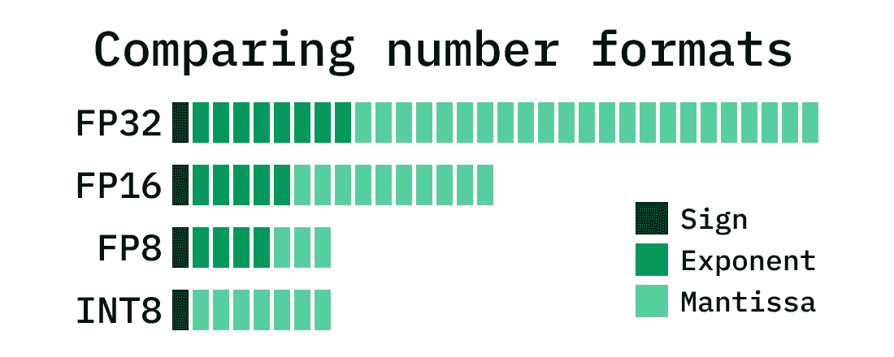

> 通常的大模型训练会采用`BF16`（16位浮点）或`FP32`/`TF32`（32位浮点）精度作为数据计算和存储的格式，来确保较高的训练精度。相比之下，`FP8`占用的数据位宽仅为`FP32`的1/4，可以有力的提升计算速度，降低对存储的消耗。当然，`FP8`也存在精度不高，容易导致训练失败的潜在问题。

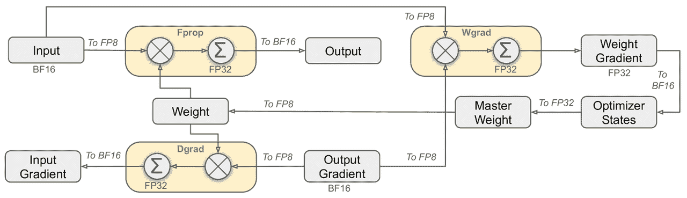

使用`FP8`框架进行训练的主要挑战在于精度与误差的处理。

该框架中以下组件保持原始精度（例如 `BF16` 或 `FP32`）：嵌入模块、`MoE` 门控模块、归一化算子和注意力算子，以确保模型的动态稳定训练。为保证数值稳定性，以高精度存储主要权重、权重梯度和优化器状态。

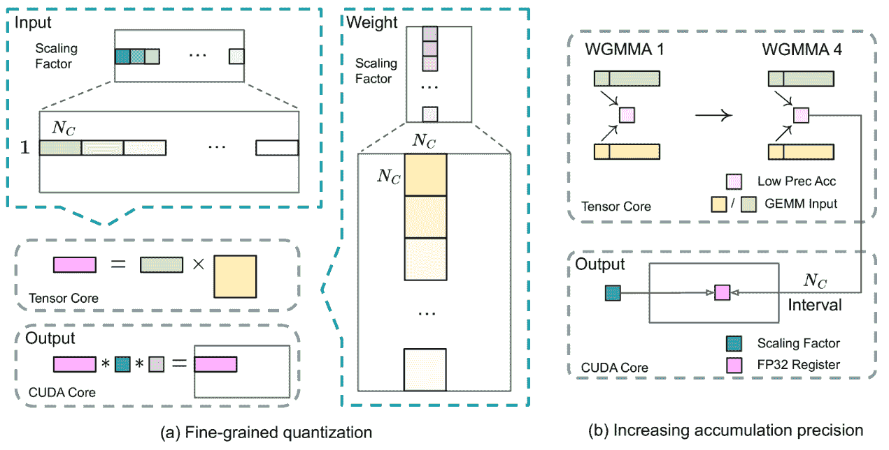

### 3.3 `DualPipe`优化

`V3`/`R1`的训练框架中引入`DualPipe`算法以实现高效的流水线并行性。

与现有的流水线并行（`PP`）方法相比，`DualPipe`具备以下优势：

> 1）`DualPipe`的流水线气泡更少，信道使用效率更高。

> 2）`DualPipe`将前向和后向传播中的计算和通信重叠，解决了跨节点专家并行（`EP`）带来的繁重通信开销问题.

> 3）在确保计算与通信比例恒定的情况下，具有很好的`Scale-out`能力。

> `DualPipe`算法将每个数据块分为四个部分：`attention`（图中`ATTN`）、`all-to-all dispatch`（图中`DISPATCH`）、`MLP` 和 `all-to-all combine`（图中`COMBINE`）。对于后向块，`attention`和 `MLP` 都进一步分为后向输入、后向权重。对于一对前向和后向块，针对通信和计算的过程和瓶颈进行优化。`DualPipe`采用双向流水线调度，同时从流水线发送前向和后向数据，尽可能提高使用率。

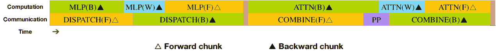

### 3.4 跨节点 `All-to-All` 通信与显存优化

`V3`/`R1`的训练框架还定制了高效的跨节点`All-to-All`通信内核，以充分利用`IB` 和 `NVLink` 带宽，并节约流式多处理器 （`SM`，(`Stream Multiprocessor`）。`DeepSeek`还优化了显存分配，以在不使用或少使用张量并行 （`TP`） 的情况下训练 `V3`/`R1`。

### 3.4.1 对于`SM`与`NVLink`的优化

为了保证 `DualPipe`的计算性能不被通信影响，`DeepSeek`定制了高效的跨节点 `All-to-All` 通信内核（包括 `dispatching` 和 `combining`），以节省专用于通信的 `SM`数量。

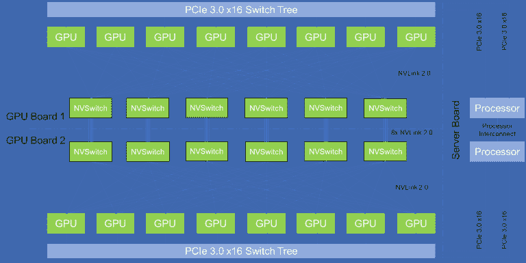

> 通信内核（通信`SM`控制代码）的实现与`MoE` 门控算法和集群网络拓扑是按照软硬件协同的思路来进行设计的。具体来说，在集群中，跨节点 `GPU`与 `IB` 完全互连，节点内（单台服务器内）通信通过`NVLink`完成。`NVLink` 提供 160 GB/s 的带宽，约是 `IB` 的 3.2 倍 （50 GB/s）。

实际算法中，`V3`/`R1`只通过路由选择了8个专家，但在保持相同通信成本的情况下，该架构可以扩展到最多13 个专家（4 个节点x3.2个专家/节点）。

`DeepSeek`还采用了`warp`（线程束）专用化技术，将20个`SM`划分为10个通信信道。

> 1）在调度过程中，（a）`IB` 发送、（b）`IB` 到`NVLink` 转发、（c） `NVLink` 接收由相应的`warp`处理。分配给每个通信任务的`warp`数量会根据所有`SM`的实际工作负载动态调整。

> 2）在合并过程中，（a） `NVLink` 发送、（b）`NVLink`到`IB`的转发和累积、（c）`IB`接收和累积也由动态调整的`warp`处理。

> 3）`dispatching` 和`combining` kernel都与计算流重叠，采用定制的`PTX`（`Parallel Thread Execution`）指令以自动调整通信块大小，减少了对`L2`缓存的使用和对其他 `SM` 的干扰。

### 3.4.2 显存节省技术

为了减少训练期间的内存占用，`V3`/`R1`还采用了以下技术节省显存：

`DeepSeek`采用的显存节省技术

下面继续分析`V3`与`R1`的训练和蒸馏，分层解读`DeepSeek`的创新。

## 4 `V3`的训练流程

`DeepSeek`的`R1`是以`V3`为基础构建的（冷启动）。如果想深入理解`R1`的训练，就要先看`V3`的训练流程。`V3`的训练包括预训练（含基础预训练和上下文长度扩展）、后训练三个阶段。

> 在预训练阶段后，对`DeepSeek-V3` 进行了两次上下文长度扩展，第一阶段将最大上下文长度扩展到32K，第二阶段进一步扩展到128K。然后在 `DeepSeek-V3`的基础模型上进行包括有监督精调（`SFT`）和强化学习(`RL`)在内的后训练，使其更贴近人类的偏好。

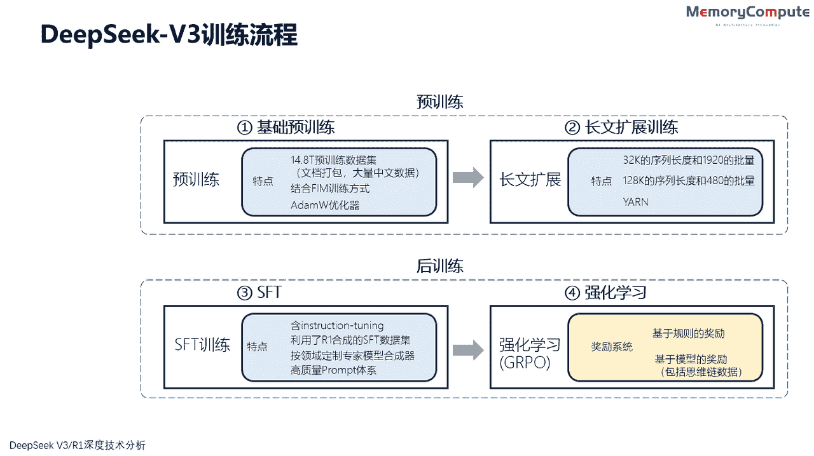

### 4.1 `V3`的基础预训练

`DeepSeek-V3` 总共包含 671B参数，其中每个`Token`激活了37B。在路由专家中，每个`Token`激活8个专家，并确保每个`Token`最多发送到4个节点，以减小通信资源的浪费。多`Token`预测（`MTP`）深度设置为1，即除了下一个 `Token`之外，每个`Token`还将预测一个额外的`Token`。

在14.8T预训练数据集结构上，`V3`采用了以下策略：

> 1）提高数学和编程样本的比例来优化预训练语料库，以提升推理能力。

> 2）基于中国互联网可用的语料库整合了更多的中文数据。（这也是`V3`能玩中文梗的关键）

> 3）将多语言覆盖范围扩展到英文和中文之外。

> 4）优化数据处理/过滤算法，在保持语料库多样性的同时最大限度减少信息冗余。

> 过滤掉有争议的内容，减少特定区域文化引入的数据偏差

> 5）通过文档打包，减少在短文本块的训练浪费，同时在训练过程中没有使用交叉样本注意力屏蔽。

高质量的数据结构与数据投喂顺序，其实是大模型性能提升的关键。可惜`DeepSeek`并没有给出预训练数据更具体的构建方法。

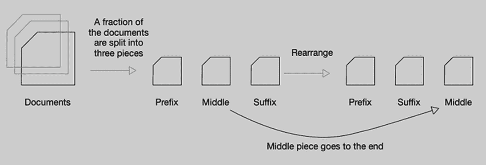

> `V3`的训练采用前缀-后缀-中间（`PSM`）框架来构建`FIM`训练数据。`Fill-in-Middle`（`FIM`，中间补全）是一种针对代码补全能力的预训练方式，模型在训练过程中学习使用上下文的语境来预测文段中间缺失的部分。`FIM`策略不会损害下一`Token`预测（`NTP`）能力，同时可使模型能够根据上下文线索准确预测中间文本。

`V3`使用 `AdamW` 优化器来预训练，同时避免过度拟合。

### 4.2 `V3`长文扩展训练

在基础预训练后，`V3`使用`YARN`技术将上下文长度，按照两阶段训练扩展到128K，每个阶段包括1000步。在第一阶段，使用32K的序列长度和1920的批量来执行1000步训练。在第二阶段，采用128K的序列长度和480个序列的批量大小执行1000步训练。

### 4.3 `V3`的后训练/精调

### 4.3.1 `V3`的有监督精调（`SFT`）

`V3`的有监督精调做了以下这些事：

> 1）梳理指令精调（`instruction-tuning`）数据集。该数据集包括1.5M个实例，跨多个域，每个域都量身定制的不同的数据合成方法。

> 2）利用`DeepSeek-R1` 模型合成与推理（`Reasoning`）相关的`SFT`数据集。这里很有意思，基于`R1`来`SFT` `V3`，再基于`V3`冷启动`R1`。感觉上这里有关键的训练信息没有透露，`DeepSeek`应该还是留了一手。

> 3）为特定领域（例如代码、数学或一般推理）构建量身定制的专家模型数据合成器。使用复合有监督精调和强化学习训练该专家模型。训练过程中为每个实例生成两种不同类型的 `SFT`样本：第一种将问题与其原始响应耦合，格式为`<problem, original response>`，而第二种将系统提示与问题和`R1`响应合并，格式为`<system prompt, problem, R1 response>`。

> 4）建立高质量提示（`Prompt`）体系，引导模型形成自身的反馈与验证机制。同时整合了来自`R1`合成的数据，通过强化学习加强这一能力。

> 5）对于非推理数据（例如创意写作、角色扮演和简单的问答），利用 `DeepSeek-V2.5`生成数据，并通过人工注释验证数据的准确性。

### 4.3.2 `V3`的强化学习

`V3`的强化学习包括奖励模型与组相对策略优化（`GRPO`）。

与`GPT-4`类似，`V3`中奖励模型包括：

**1）基于规则的奖励模型**

对于可以使用特定规则验证的问题，采用基于规则的奖励模型来提供训练反馈。例如，对于 `LeetCode` 问题，可以利用编译器根据测试用例生成反馈。基于规则的模型验证，可以确保更高的生成可靠性。

**2）基于模型的奖励模型**

对于不具有收敛性的问题，依靠模型判断来确进行强化学习。`V3`训练中构建了特殊的偏好数据，该数据同时包括提供最终奖励结果和形成奖励的思维链，以降低特定任务中的奖励破解攻击风险。

> 大模型的训练通常用无监督或有监督进行预训练，然后通过有监督精调（`SFT`）进一步学习。然而`SFT`有时难以将人类的偏好显式地整合进去，这时就需要强化学习来进行精调。在以往的大模型训练中一般使用`PPO`（`Proximal Policy Optimization`）来形成梯度策略。`PPO`的代价在于需要维护较大的价值网络（也是一个神经网络），需要占用较大的显存与计算资源。

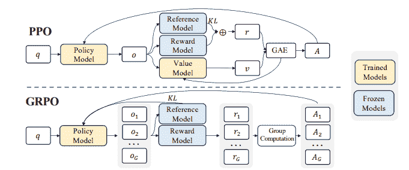

V3中则采用了DeepSeek提出的GRPO（Group Relative Policy Optimization）策略，只需要在一个分组内进行多个采样输出的比较，再根据比较结果选择较优的策略。GRPO中不再需要一个显式的价值网络，从而降低了显存占用并提高了训练速度。

GRPO的计算流程包括：

> 1）采样一组输出并计算每个输出的奖励。
> 2）对组内奖励进行归一化处理。
> 3）使用归一化后的奖励计算优势函数。
> 4）通过最大化目标函数更新策略模型。
> 5）迭代训练，逐步优化策略模型。

## 5 R1的训练流程

### 5.1 无SFT的R1-Zero训练

DeepSeek-R1 建立在其基础模型DeepSeek-V3的混合专家（MoE）架构之上，采用专家并行方式，对于任意输入，只有部分参数处于活跃状态。

作为R1的无SFT版本，R1-Zero使用 DeepSeek-V3-Base 作为基础模型，直接使用 GRPO进行强化学习来提升模型的推理（Reasoning）性能, 根据准确度和格式进行训练奖励。

奖励的计算方式在很大程度上决定了强化学习训练的效果。DeepSeek-R1-Zero 的基于规则的奖励系统包括：

> 1）准确度奖励（Accuracy rewards）。评估响应是否正确。
> 2）格式奖励（Format rewards）。奖励模型将其思考过程置于`<think>`和`</think>`标签之间。

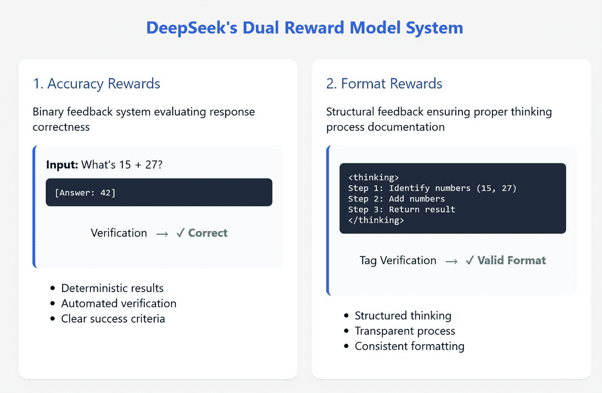

通过强化学习训练，R1-Zero 形成了复杂的推理能力，包括反思（模型重新审视并重新评估其先前的回答）以及探索解决问题的替代方法。这些能力并非通过常规编程或提示工程实现的，而是大模型在强化学习环境中自发产生的能力。

### 5.2 DeepSeek-R1的训练流程

DeepSeek-R1 的训练过程分为4个阶段，包括使用数千高质量CoT示例进行SFT的冷启动，面向推理的强化学习，通过拒绝抽样的SFT，面向全场景任务的强化学习与对齐。

两个SFT阶段进行推理和非推理能力的能力植入，两个强化学习阶段旨在泛化学习推理模式并与人类偏好保持一致。

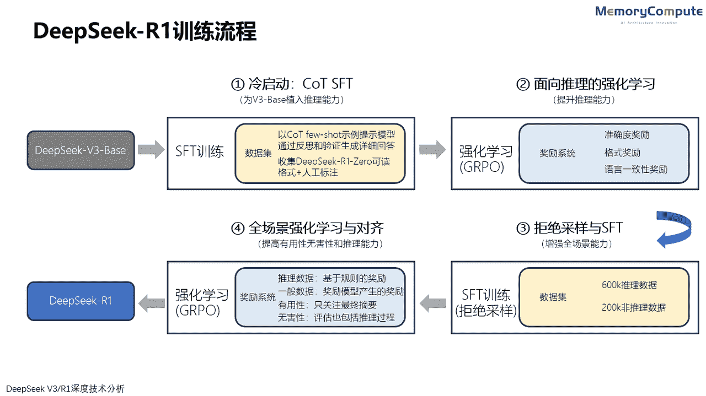

#### 5.2.1 冷启动（Cold Start）：CoT SFT

与R1-Zero不同，R1首先基于DeepSeek-V3-Base进行有监督精调（SFT），以克服强化学习的早期不稳定。DeekSeek认为这种基于人类先验知识冷启动并进行迭代训练的方式更适合推理模型。

由于这一训练阶段主要采用CoT数据，将其称为CoT SFT。

> 为构建少量的长CoT数据，DeepSeek探索了几种合成方法：使用长CoT 的few-shot提示作为示例，直接提示模型通过反思和验证生成详细回答，以可读格式收集DeepSeek-R1-Zero 输出，并通过人工标注员的后处理来完善结果。在此步骤中收集了数千个冷启动样本以进行精调。

其中可读模式指为每个回答在末尾包含一个摘要，并过滤掉不易阅读的部分。其输出格式为`|special_token|<reasoning_process>|special_token|
`。

#### 5.2.2 面向推理的强化学习

> 在基于冷启动数据对V3-Base 精调后，采用与R1-Zero相当的强化学习训练流程，基于GRPO进行强化学习，根据准确度和格式进行训练奖励。为了解决语言混杂问题，还在强化学习训练中引入了语言一致性奖励，该奖励以CoT中目标语言单词的比例计算。

此阶段主要提升模型的推理（Reasoning）性能，特别是在编码、数学、科学和逻辑推理等推理密集型任务，这些任务涉及定义明确且解决方案明确的问题。

#### 5.2.3 拒绝采样与SFT

这是另一个使用标记数据的有监督精调 (SFT)训练阶段，分批进行了两个epoch的精调，样本量为800k。800k中包括600k推理数据和200k非推理数据。

与主要侧重于推理的冷启动数据不同，此阶段结合了来自其他领域的数据，以增强模型在写作、角色扮演和其他通用任务中的能力。

拒绝采样（Rejection Sampling）提供了一种桥梁，使用易于采样的分布来近似训练真正感兴趣的复杂分布。目标响应（ground-truth）从一组生成的回答经过拒绝采样生成，其分数由奖励系统确定。

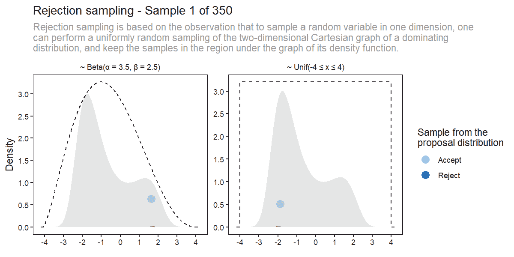

600k推理数据的生成：

> 1）通过从上一轮强化学习训练的检查点进行拒绝抽样，整理推理提示并生成推理轨迹（Reasoning Trajectories）。
> 2）除基于规则奖励进行评估的数据外，还包括了基于奖励模型的V3判断生成数据。
> 3）过滤掉了混合语言、长段落和代码块的思路链数据。
> 4）对于每个提示（Prompt），会生成多个回答，然后并仅保留正确的响应。

200k非推理数据的生成（如写作、事实问答、自我认知和翻译等）：

> 1）采用DeepSeek-V3流程并复用V3 的部分 SFT 数据集。
> 2）可调用V3生成潜在的思路链，再通过提示回答。
> 3）对于更简单的查询（例如“你好”），不提供CoT回答。

#### 5.2.4 面向全场景的强化学习与对齐

最后，再次进行面向全场景的强化学习和人类偏好对齐，以提高模型的有用性和无害性，并完善推理能力。此阶段还整合了来自不同管道的数据，将奖励信号与不同的提示分布相结合。

> 1）使用奖励信号和多种提示分布（Diverse Prompt Distributions）的组合来训练模型。
> 2）对于推理数据，利用基于规则的奖励来指导数学、代码和逻辑推理领域的训练过程。
> 3）对于一般数据，采用奖励模型来捕捉复杂微妙场景中的人类偏好。即参考DeepSeek-V3 管训练流程，采用类似的偏好对和训练提示分布。
> 4）对于有用性，只关注最终摘要，以确保重点响应对用户的实用性和相关性，最大限度减少对底层推理过程的干扰。
> 5）对于无害性，评估模型的整个响应，包括推理过程和摘要，以识别和减轻生成过程中可能出现的潜在风险、偏见或有害内容。

至此已完成R1的完整训练过程，获得了具备全场景推理能力的通用MoE模型，上下文长度均为128K。

### 5.3 从MoE回归Dense（蒸馏SFT）

尽管MoE架构有各种优点，特别是在通用的to C领域具备低成本的优势。但是MoE的架构特点使得其可能不太适用于专业应用场景（例如单一专家场景）和资源限制场景（例如端侧推理）。

> 蒸馏是将复杂的大型神经网络压缩为更小、更简单的神经网络，同时尽可能多的保留结果模型的性能的过程。此过程涉及训练较小的“学生“神经网络，通过其预测或内部表示的精调来学习模拟更大、更复杂的“教师”网络的行为。

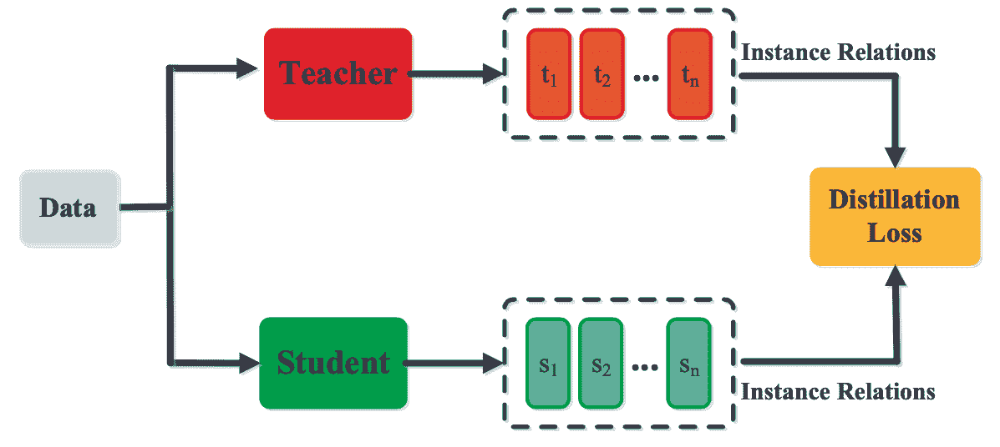

> 为了能够将推理能力迁移到MoE架构不适合的场景，DeepSeek选择Llama和Qwen系列开源大模型进行蒸馏，使相应的Dense模型也能获得推理能力。与使用强化学习相比，直接SFT更适合较小的大模型，蒸馏完成的Dense模型推理能力明显好于原开源模型。

`DeepSeek-R1-Distill`模型

## 6 结语

对于R1/V3的主要创新，可以参考下表：

DeepSeek-R1/V3的主要创新

DeepSeek的算法架构能力已经达到国际一线水平（例如MLA和GRPO算法），而其AI Infra团队的软硬件协同设计水平（例如FP8训练框架和基于PTX进行All-to-All通信内核优化）和自由探索，可能已暂时超越大部分国际大模型企业。基本上DeepSeek团队对GPU的性能使用率已接近技术上限，实现了在现有GPU体系内的软件Sacle-up。
