# 办公利器：DeepSeek+Word教程，让你的工作更高效！

> 来源：[https://qqs7y1hozd1.feishu.cn/docx/X3rwdOONuof5xKx7GrUcoKJynIe](https://qqs7y1hozd1.feishu.cn/docx/X3rwdOONuof5xKx7GrUcoKJynIe)

> **Dee**pSeek + Word ，让你的工作更高效！在 Word 界面里，选中文字点击按钮，就能让 DeepSeek 为你快速检索信息、精准翻译文本、智能生成内容等等。这样就不需要在多个软件之间频繁切换，告别低效的信息处理方式，让工作效率大幅提升！

# **效果演示**

按照文本教程完成操作后，Word 的选项卡中将会出现 DeepSeek 的生成图标，选中文本并点击生成，即可实现模型回复！

> 例如：我们想要根据哪吒 2 番外写一段文稿

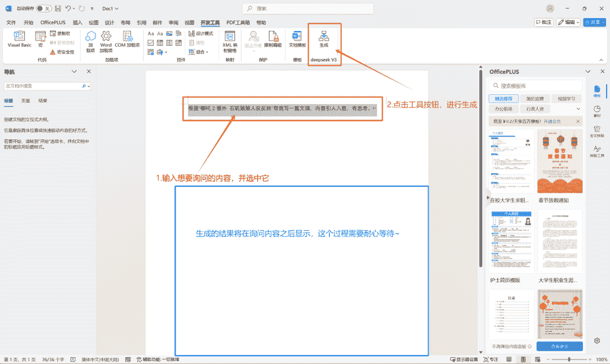

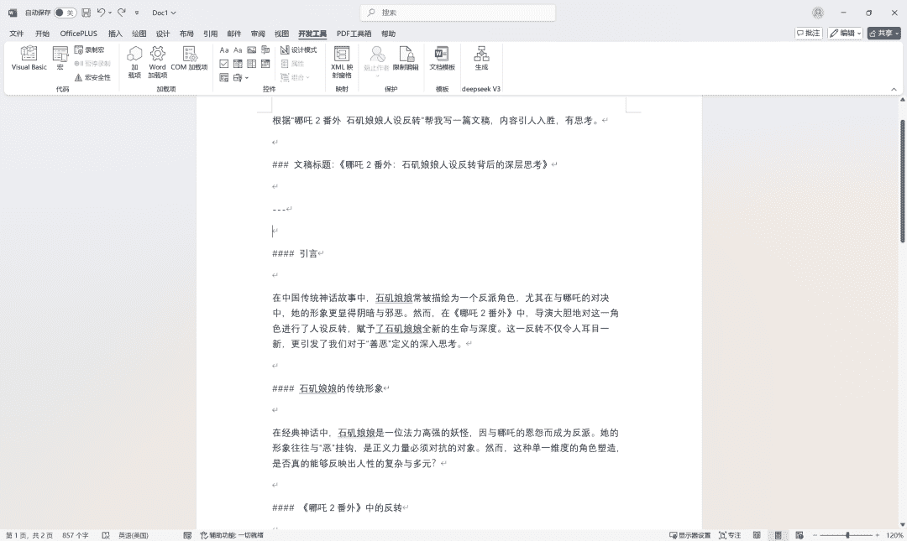

接下来我将详细介绍，如何实现 DeepSeek 与 Word 和 WPS 的结合。

# **获取 ****API Key**

进入 deepseeek 官网链接：https://platform.deepseek.com/sign_in

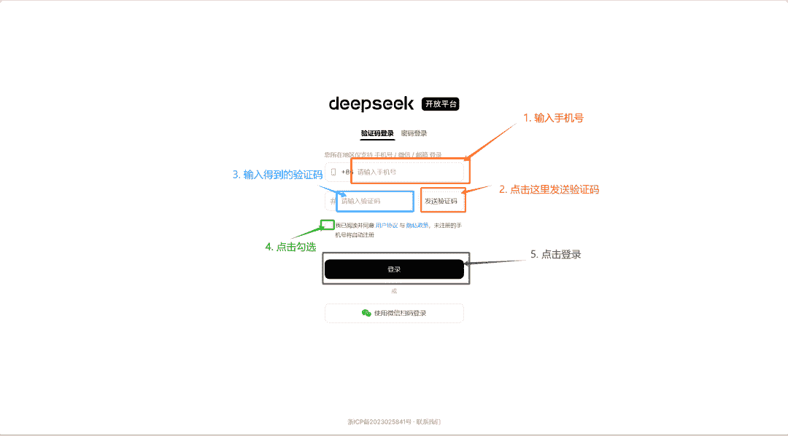

这样，我们的账号就已经注册好了。接下来我们将使用 deepseek R1 模型。昨天 API 开放平台又可以进入了，免费赠送了 10 元额度


+   接下来让我们获取 API 密钥，为 word 使用 AI 能力做准备

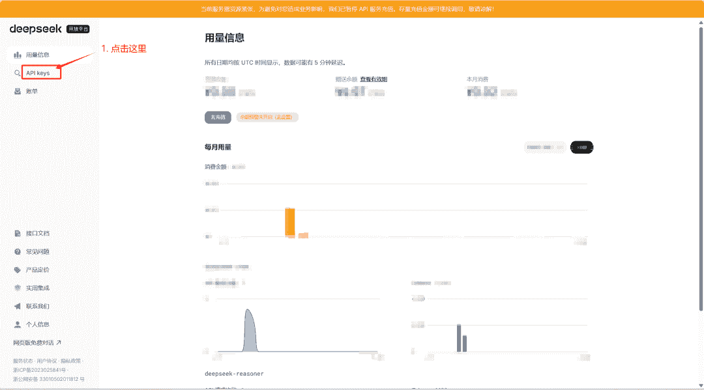

我在这里已经创建了一个 API 密钥了，这步还是非常简单的。创建好后记得复制并保存好自己的密钥，这个作为 API 访问的凭证

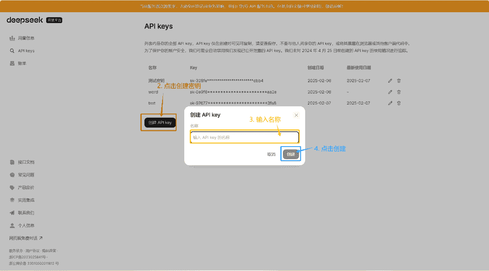

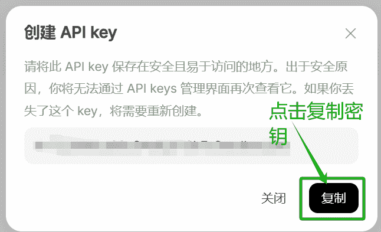

# word配置DeepSeek R1

+   [因为这里需](https://cloud.tencent.com/product/coding?from_column=20065&from=20065)要使用到 word 文档中的开发者工具来完成 API 调用，因此我们需要先让开发工具功能显示出来

+   新建一个 Word 文档，点击 文件 -> 选项 -> 自定义功能区，勾选“开发者工具”

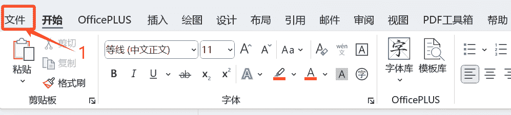

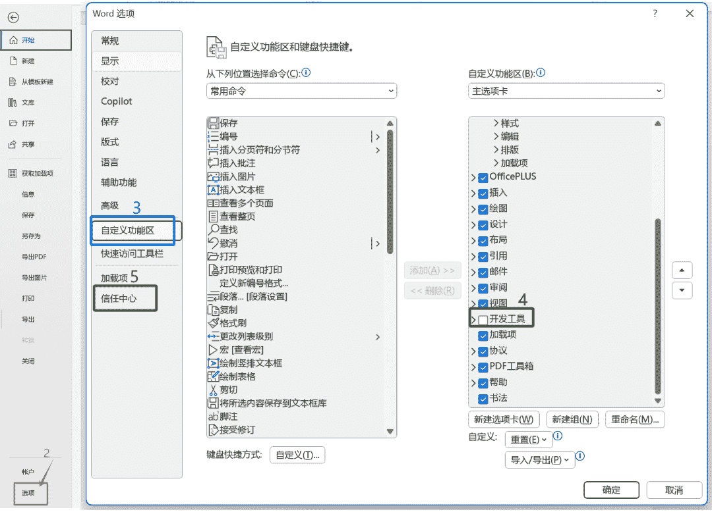

再点击 信任中心 -> 信任中心设置，选择“启用所有宏”与“信任对VBA......”

完成后点击“确定”保存，回到上一菜单后同样点击“确定”保存。这样，“开发工具”就出现在顶部菜单了

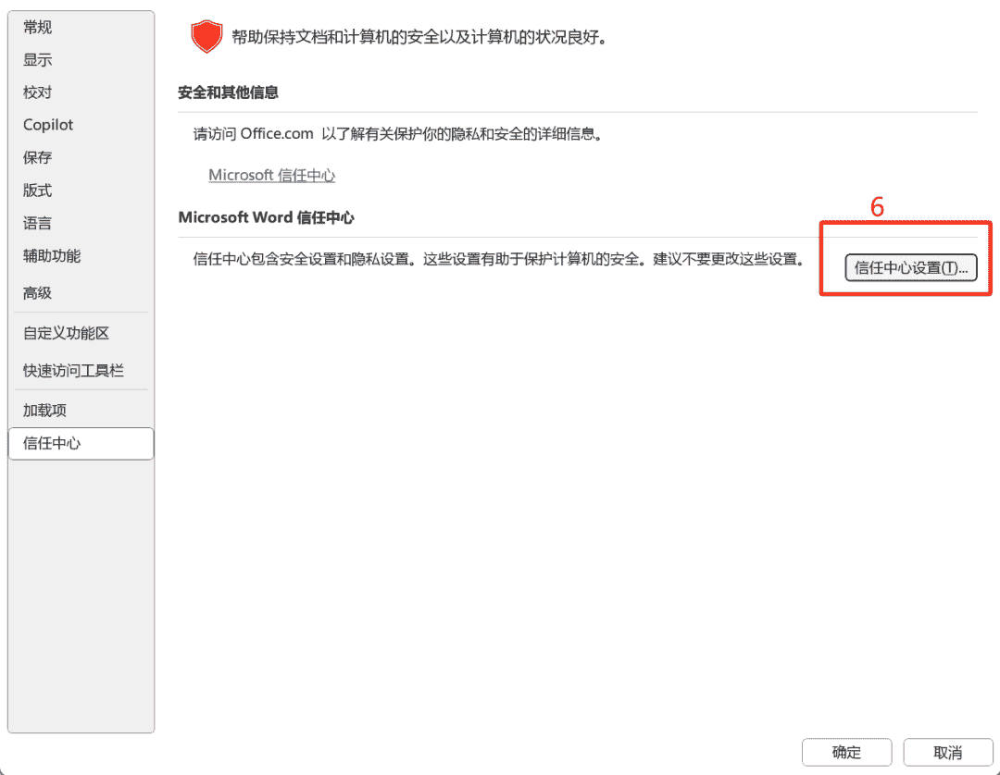

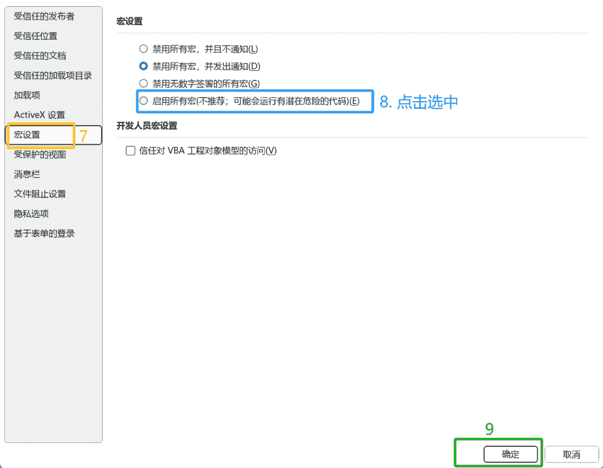

+   接下来，我们点击开发者工具，再点击 Visual Basic，将会弹出一个窗口

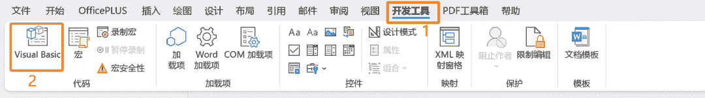

+   打开后进入的页面是这样。如果中间没有编辑块，则可以点击“插入”，再点击“模块”

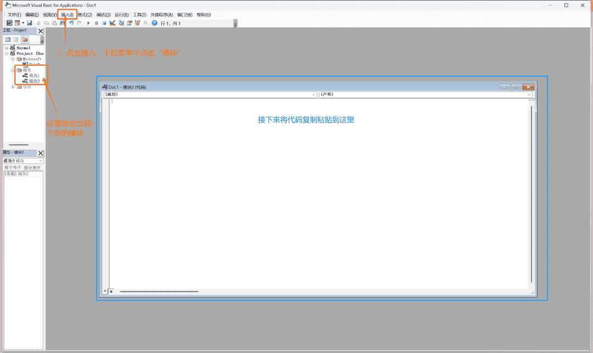

把以下代码复制进编辑区，再把复制好的密钥放到 api_key = "请输入自己的API密钥" ，替换文本内容

```
Function CallDeepSeekAPI(api_key As String, inputText As String) As String
    Dim API As String
    Dim SendTxt As String
    Dim Http As Object
    Dim status_code As Integer
    Dim response As String

    API = &quot;https://api.deepseek.com/chat/completions&quot;
    SendTxt = &quot;{&quot;&quot;model&quot;&quot;: &quot;&quot;deepseek-reasoner&quot;&quot;, &quot;&quot;messages&quot;&quot;: [{&quot;&quot;role&quot;&quot;:&quot;&quot;system&quot;&quot;, &quot;&quot;content&quot;&quot;:&quot;&quot;You are a Word assistant&quot;&quot;}, {&quot;&quot;role&quot;&quot;:&quot;&quot;user&quot;&quot;, &quot;&quot;content&quot;&quot;:&quot;&quot;&quot; &amp; inputText &amp; &quot;&quot;&quot;}], &quot;&quot;stream&quot;&quot;: false}&quot;
    &#x27; 不想用R1模型，想用V3模型，就把上面的model的deepseek-reasoner换成deepseek-chat

    Set Http = CreateObject(&quot;MSXML2.XMLHTTP&quot;)
    With Http
        .Open &quot;POST&quot;, API, False
        .setRequestHeader &quot;Content-Type&quot;, &quot;application/json&quot;
        .setRequestHeader &quot;Authorization&quot;, &quot;Bearer &quot; &amp; api_key
        .send SendTxt
        status_code = .Status
        response = .responseText
    End With

    &#x27; 弹出窗口显示 API 响应（调试用）
    &#x27; MsgBox &quot;API Response: &quot; &amp; response, vbInformation, &quot;Debug Info&quot;

    If status_code = 200 Then
        CallDeepSeekAPI = response
    Else
        CallDeepSeekAPI = &quot;Error: &quot; &amp; status_code &amp; &quot; - &quot; &amp; response
    End If

    Set Http = Nothing
End Function

Sub DeepSeekV3()
    Dim api_key As String
    Dim inputText As String
    Dim response As String
    Dim regex As Object
    Dim matches As Object
    Dim originalSelection As Range

    &#x27; API Key
    api_key = &quot;请输入自己的API密钥&quot;
    If api_key = &quot;&quot; Then
        MsgBox &quot;Please enter the API key.&quot;, vbExclamation
        Exit Sub
    End If

    &#x27; 检查是否有选中文本
    If Selection.Type &lt;&gt; wdSelectionNormal Then
        MsgBox &quot;Please select text.&quot;, vbExclamation
        Exit Sub
    End If

    &#x27; 保存原始选区
    Set originalSelection = Selection.Range.Duplicate

    &#x27; 处理特殊字符
    inputText = Selection.Text
    inputText = Replace(inputText, &quot;\&quot;, &quot;\\&quot;)
    inputText = Replace(inputText, vbCrLf, &quot; &quot;)
    inputText = Replace(inputText, vbCr, &quot; &quot;)
    inputText = Replace(inputText, vbLf, &quot; &quot;)
    inputText = Replace(inputText, &quot;&quot;&quot;&quot;, &quot;\&quot;&quot;&quot;) &#x27; 转义双引号

    &#x27; 发送 API 请求
    response = CallDeepSeekAPI(api_key, inputText)

    &#x27; 处理 API 响应
    If Left(response, 5) &lt;&gt; &quot;Error&quot; Then
        &#x27; 解析 JSON
        Set regex = CreateObject(&quot;VBScript.RegExp&quot;)
        With regex
            .Global = True
            .MultiLine = True
            .IgnoreCase = False
            .Pattern = &quot;&quot;&quot;content&quot;&quot;:&quot;&quot;(.*?)&quot;&quot;&quot; &#x27; 匹配 JSON 的 &quot;content&quot; 字段
        End With
        Set matches = regex.Execute(response)

        If matches.Count &gt; 0 Then
            &#x27; 提取 API 响应的文本内容
            response = matches(0).SubMatches(0)

            &#x27; 处理转义字符
            response = Replace(response, &quot;\n&quot;, vbCrLf)
            response = Replace(response, &quot;\\&quot;, &quot;\&quot;) &#x27; 处理 JSON 里的反斜杠
            response = Replace(response, &quot;&amp;&quot;, &quot;&quot;) &#x27; 过滤 `&amp;`，防止意外符号

            &#x27; 让光标移动到文档末尾，防止覆盖已有内容
            Selection.Collapse Direction:=wdCollapseEnd
            Selection.TypeParagraph
            Selection.TypeText Text:=response

            &#x27; 将光标移回原来选中文本的末尾
            originalSelection.Select

        Else
            MsgBox &quot;Failed to parse API response.&quot;, vbExclamation
        End If
    Else
        MsgBox response, vbCritical
    End If
End Sub
```

```
完成修改后，关闭弹窗即可。　
```

+   点击 文件 -> 选项 -> 自定义功能区，右键开发工具，点击添加新组

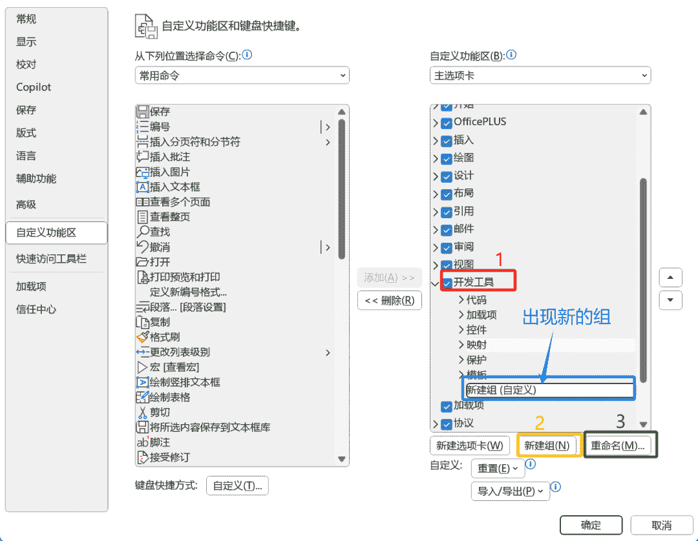

+   下拉列表找到“宏”，然后把之前创建的宏模块添加到开发工具里：

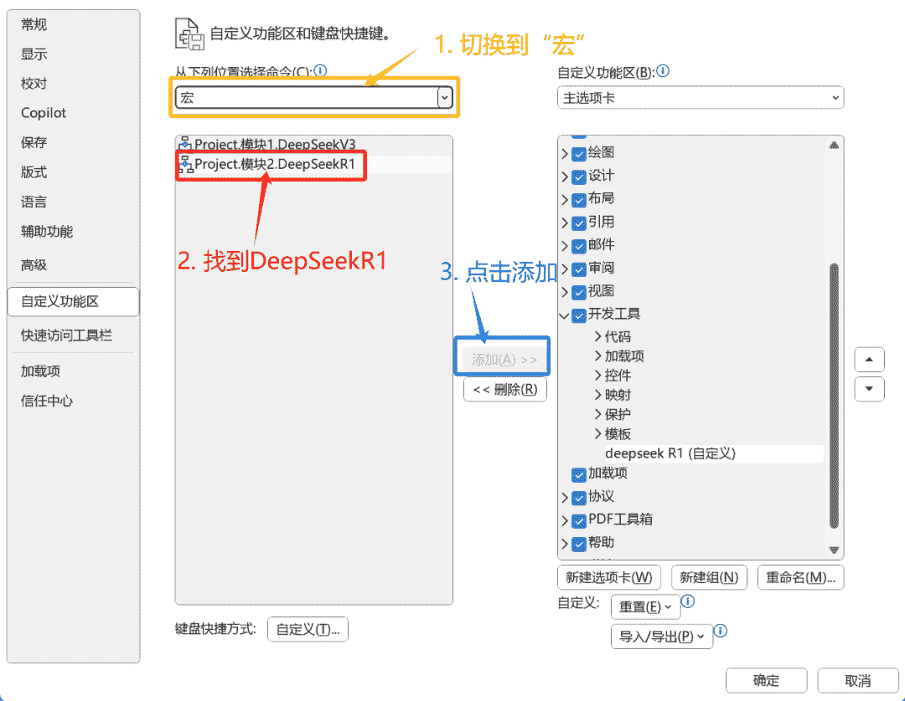

+   如果出现下面这样，说明导入成功了

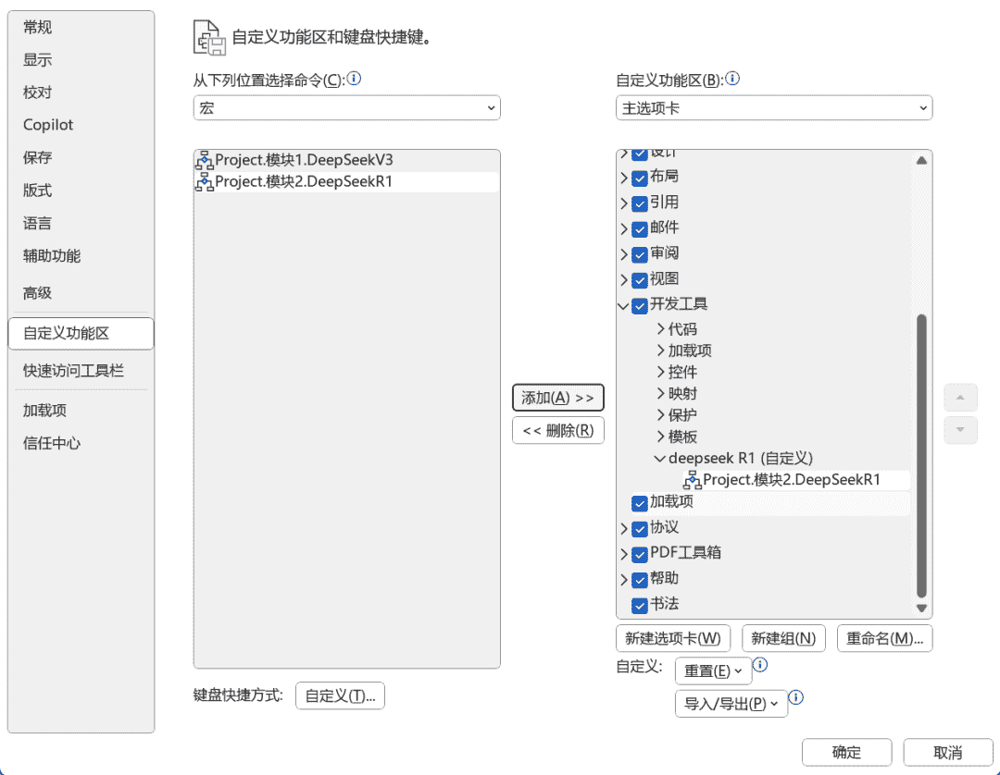

+   随后，选中添加的命令，右键点击重命名，选择开始符号作为图标，并重命名为“生成”

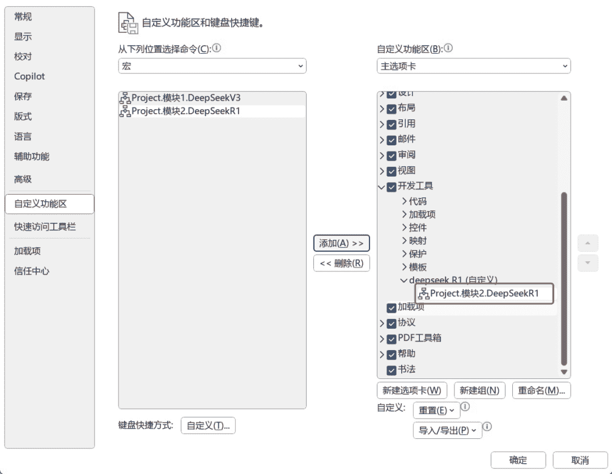

> 最后点击确定

> 我们发现，工具栏中出现了自己添加的工具

> 至此，Word 成功接入 DeepSeek R1

> 选中文字，点击生成，就可以直接将选中的文本发送给大模型，大模型将会按照你选中的文本，做出响应

# WPS配置DeepSeek R1

没有 Word ，日常使用 WPS 的同学可以看以下增补内容：

点击“工具”，找到“开发工具”菜单，点击它

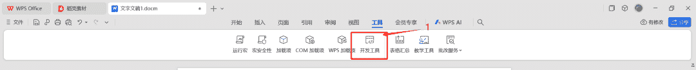

进入二级菜单后，点击“切换到 VB 环境”，这时候会有**提示安装一个插件，点击等待插件**安装完成。安装完成后记得要重启 WPS。

点击“WPS”宏编辑器，剩下的步骤就和 Word 完全一样了

