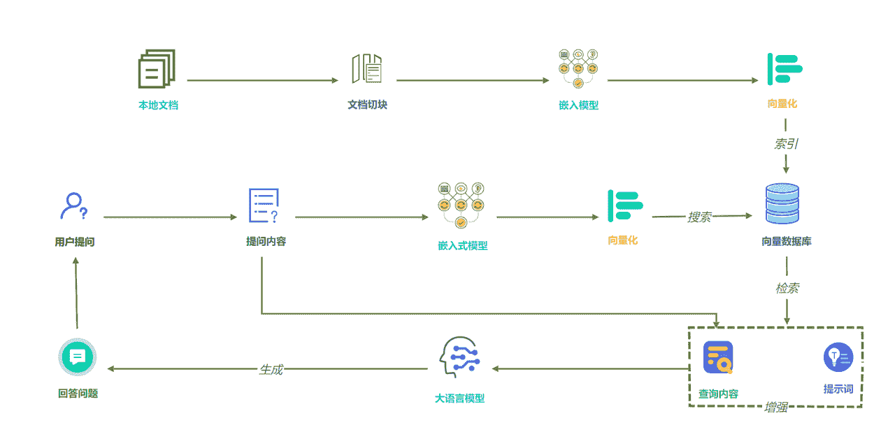
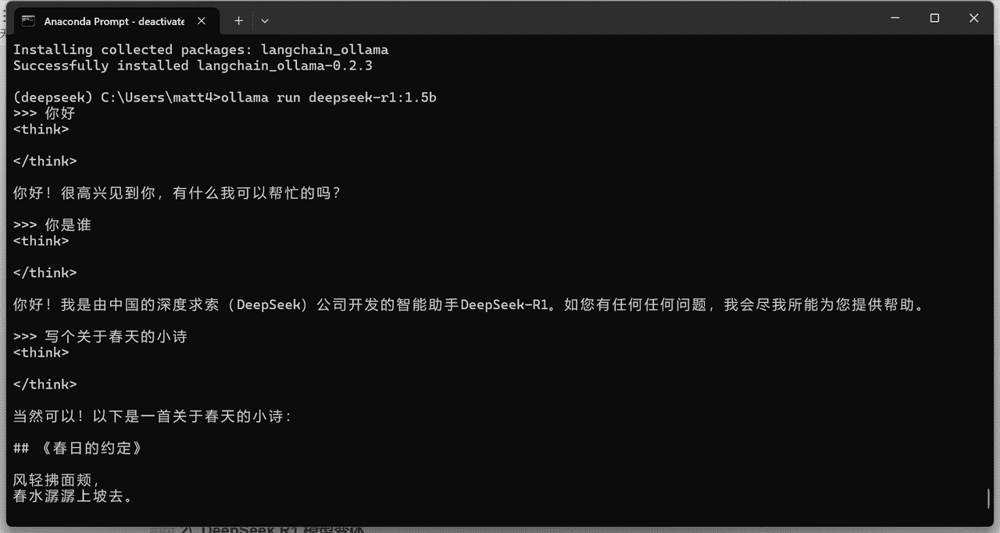
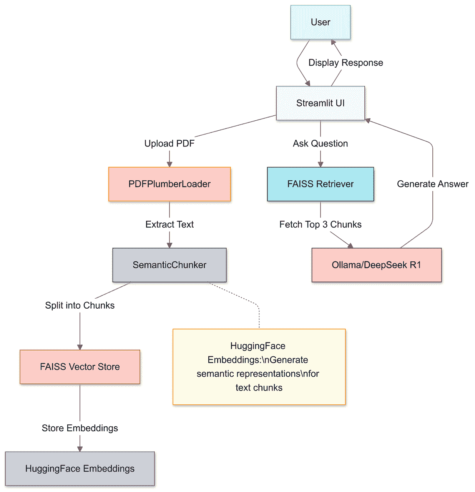
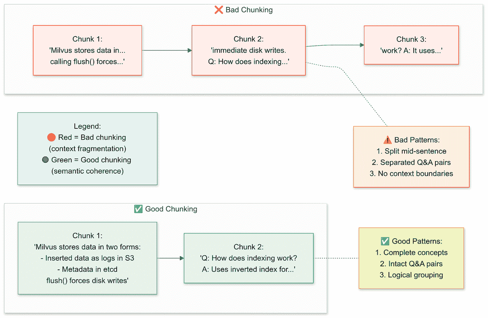
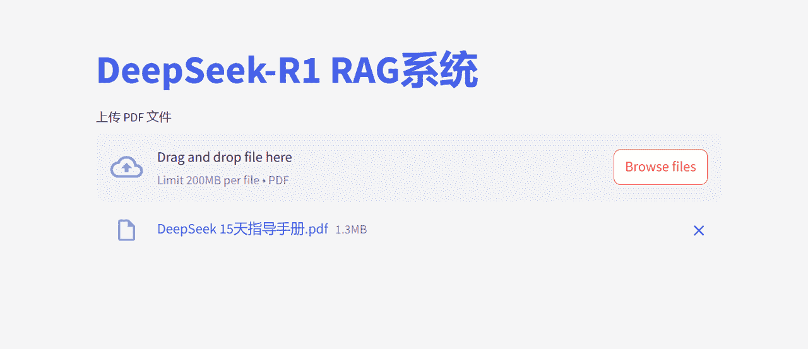
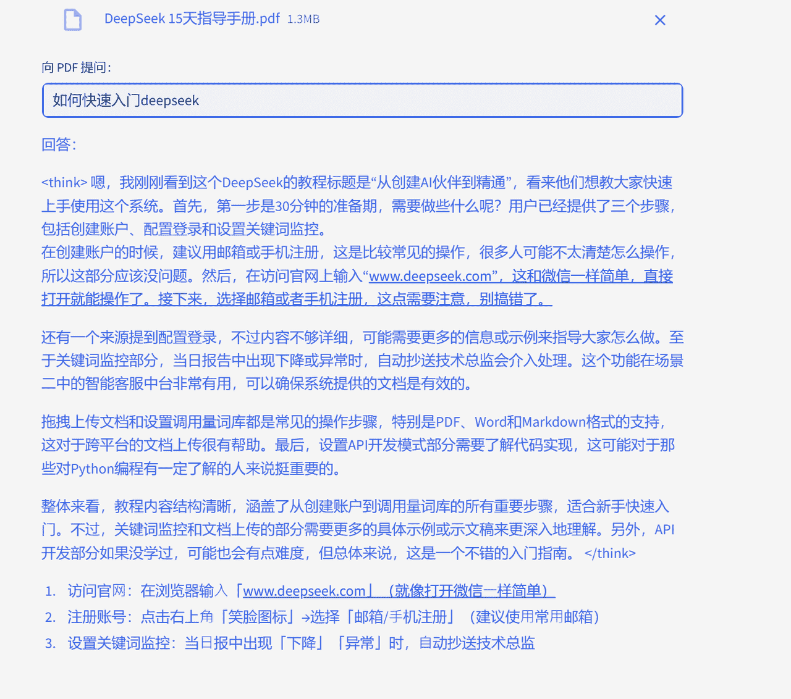
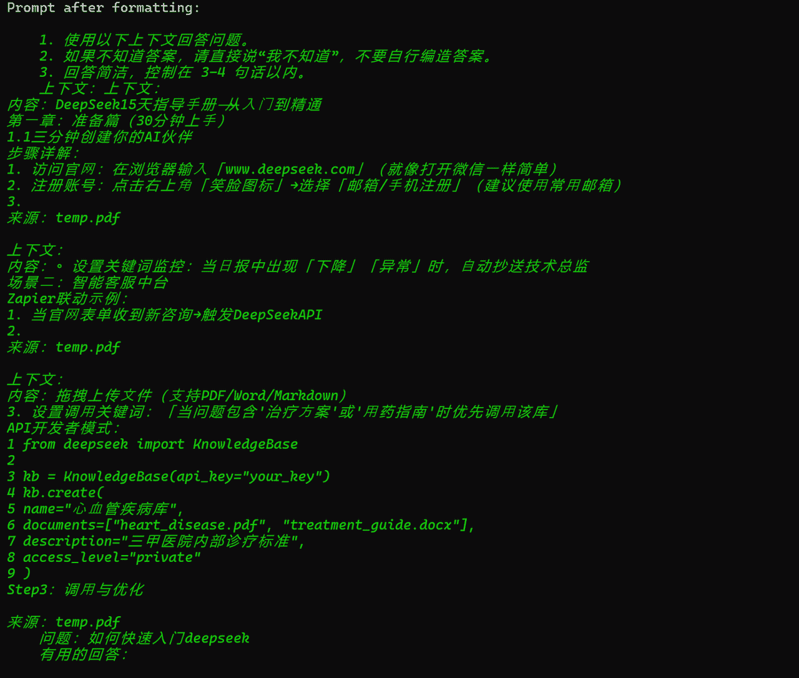

# 基于 DeepSeek R1 和 Ollama 构建本地知识库(RAG)系统

> 来源：[https://qqs7y1hozd1.feishu.cn/docx/D8qedBUZhob7M3xRxLjcVzEtn7g](https://qqs7y1hozd1.feishu.cn/docx/D8qedBUZhob7M3xRxLjcVzEtn7g)

## 概述

随着人工智能（AI）、自然语言处理（NLP）、大语言模型（LLM）技术的不断进步，传统的 LLM 虽然强大，但存在知识有限、准确性不足等问题。而检索增强生成（RAG）的出现，大大弥补了 LLM 的不足，有效克服了这些缺点。

## 一、RAG

尽管 LLM 不断推动机器理解和实现的边界，但它们仍受到一些限制，例如对未见数据的准确响应困难或与最新信息保持同步的挑战，这些问题导致了幻觉的产生，而 RAG 正是为了应对这些问题而开发的。RAG 将 LLM 的能力与外部知识源相结合，以生成更具洞察力和准确性的响应。当接收到用户查询时，RAG 系统首先处理文本以理解其上下文和意图，然后从知识库中检索与用户查询相关的数据，并将其与查询一起作为上下文传递给 LLM。由于 LLM 存在上下文限制，即模型一次能够处理或理解的文本量有限，因此 RAG 只传递相关数据，而不是整个知识库。

具体来说，RAG 首先将查询转换为向量嵌入，使用嵌入模型进行处理。然后，将该嵌入向量与文档向量数据库进行比较，识别出最相关的文档。这些相关文档与原始查询结合，为 LLM 提供丰富的上下文，从而生成更准确的响应。这种混合方法使模型能够利用外部来源的最新信息，使 LLM 能够生成更具洞察力和准确性的响应。



### 1.1 长上下文窗口可能使 RAG 过时的原因

随着 LLM 的上下文窗口不断扩大，这些模型的输入和生成响应的方式将受到直接影响。通过增加 LLM 一次能够处理的文本量，扩展的上下文窗口增强了模型理解更全面的叙述和复杂思想的能力，提高了生成响应的整体质量和相关性。这使得 LLM 在处理更长文本时能够更有效地把握上下文及其细节，从而可能减少对 RAG 的依赖。

#### 准确性

RAG 通过提供相关文档作为上下文来提高模型的准确性，但它不会实时适应或从上下文中学习。相反，它检索与用户查询相似的文档，这些文档可能并不总是最具上下文适应性的，从而可能导致响应不准确。相比之下，LLM 的长上下文窗口允许其内部的注意力机制专注于不同部分的上下文，以生成更精确的响应。此外，这种机制还可以进行微调，通过调整 LLM 模型以减少损失，从而生成更准确和上下文相关的响应。

#### 信息检索

从知识库中检索信息以增强 LLM 的响应时，往往难以找到完整且相关的数据用于上下文窗口。检索到的数据是否完全回答了用户的查询始终存在不确定性。如果所选择的信息不足或与用户的实际意图不符，可能导致低效和错误的响应。

#### 外部存储

传统上，LLM 无法同时处理大量信息，因为它们在处理上下文时受到限制。然而，随着上下文窗口的扩大，LLM 能够直接处理更多数据，从而消除了每个查询的单独存储需求。这简化了架构，加快了对外部数据库的访问速度，并提高了 AI 的效率。

### 1.2 RAG 将继续存在的原因

尽管 LLM 的扩展上下文窗口为模型提供了更深入的见解，但也带来了更高的计算成本和效率等挑战。RAG 通过选择性地检索最相关的信息来解决这些挑战，从而优化性能和准确性。

#### 复杂的 RAG 将持续发展

简单的 RAG，其中数据被分成固定长度的文档并根据相似性进行检索，正在逐渐减少。然而，复杂的 RAG 系统不仅持续存在，而且发展迅速。复杂的 RAG 包括更广泛的功能，例如查询重写、数据清理、反思、优化的向量搜索、图搜索、重新排序器和更复杂的分块技术。这些增强不仅改进了 RAG 的功能，还扩展了其能力。

#### 超越上下文长度的性能

尽管将 LLM 的上下文窗口扩展到数百万个标记看起来很有前景，但实际实现仍面临时间、效率和成本等多方面的挑战：

+ **时间**：随着上下文窗口的扩大，LLM 处理更多标记的时间增加，导致延迟和响应时间延长。许多 LLM 应用程序需要快速响应，额外的延迟可能会严重影响其在实时场景中的性能，成为实现更大上下文窗口的主要瓶颈。

+ **效率**：研究表明，与提供大量未经筛选的数据相比，LLM 在提供[较少但更相关](https://link.csdn.net/?target=https%3A%2F%2Fcs.stanford.edu%2F~nfliu%2Fpapers%2Flost-in-the-middle.arxiv2023.pdf%3Flogin%3Dfrom_csdn)的文档时表现更好。最近的一项斯坦福研究发现，最先进的 LLM 在从广泛上下文窗口中提取有价值信息时经常遇到困难，尤其是当关键数据埋在大文本块的中间时，导致 LLM 忽略重要细节，数据处理效率低下。

+ **成本**：LLM 中上下文窗口的扩大导致计算成本增加。处理更多的输入标记需要更多的资源，从而导致运营费用上升。例如，在 ChatGPT 等系统中，重点是限制处理的标记数量以控制成本。

相比之下，RAG 通过仅传递相关文档作为上下文，使 LLM 更快地处理信息，不仅减少了延迟，还提高了响应质量并降低了成本。

#### 为什么微调不是最佳选择

除了使用更大的上下文窗口，RAG 的另一种替代方案是微调。然而，微调可能既昂贵又繁琐。每次有新信息进来时，更新 LLM 以使其保持最新状态是一项挑战。微调的其他问题包括：

+ 训练数据限制：无论 LLM 取得了多大的进展，总会有一些上下文在训练时不可用或被认为不相关。

+ 计算资源：对 LLM 进行微调并为其特定任务定制需要高计算资源。

+ 专业知识需求：开发和维护尖端 AI 并非易事。需要专业的技能和知识，而这可能难以获得。

其他问题还包括数据收集、质量保证以及模型部署等。

### 1.3 RAG 与微调或长上下文窗口的比较

以下是 RAG 与微调或长上下文窗口技术的比较概述（由于后两者具有相似的特点，因此在此图表中将它们合并）。它突出了成本、数据时效性和可扩展性等关键方面。

### 1.4 使用向量数据库优化 RAG 系统

尽管最先进的 LLM 可以同时处理数百万个标记，但数据结构的复杂性和不断变化使 LLM 难以有效管理异构企业数据。RAG 解决了这些挑战，尽管检索准确性仍然是端到端性能的一个主要瓶颈。无论是 LLM 的大上下文窗口还是 RAG，目标都是充分利用大数据，并确保大规模数据处理的高效性。

使用先进的 SQL 向量数据库（如 [`MyScaleDB`](https://link.csdn.net/?target=https%3A%2F%2Fmyscale.com%2F%3Flogin%3Dfrom_csdn)）将 LLM 与大数据进行集成，可以增强 LLM 的效果，并从大数据中提取更好的智能。此外，它可以减少模型幻觉，提供数据透明度，并提高可靠性。`MyScaleDB` 是一个基于 `ClickHouse` 的开源 SQL 向量数据库，专为大型 AI/RAG 应用程序量身定制。利用 `ClickHouse` 作为基础，并结合专有的 `MSTG` 算法，`MyScaleDB` 在管理大规模数据方面展示了与其他向量数据库相比的卓越性能。

## 二、环境搭建

### 2.1 Ollama

[`Ollama`](https://link.csdn.net/?target=https%3A%2F%2Fdownload.csdn.net%2Fdownload%2FMr_Roki%2F90383108%3Flogin%3Dfrom_csdn) 允许在本地运行像 `DeepSeek R1` 这样的模型。


测试环境：

```
ollama run deepseek-r1:1.5b
```



### 2.2 开发环境搭建

```
conda create -n deepseek python==3.10
activate deepseek
# langchain_community
pip install langchain langchain_community
# Chroma
pip install langchain_chroma
# Ollama
pip install langchain_ollama
pip install streamlit
pip install langchain-experimental
pip install pdfplumber
pip install sentence-transformers
pip install faiss-cpu
```

## 三、代码实现

### 3.1 导入库



```
import streamlit as st  
from langchain_community.document_loaders import PDFPlumberLoader  
from langchain_experimental.text_splitter import SemanticChunker  
from langchain_community.embeddings import HuggingFaceEmbeddings  
from langchain_community.vectorstores import FAISS  
from langchain_community.llms import Ollama

```

### 3.2 上传并处理 PDF 文件

这里使用 `Streamlit` 的文件上传器，让用户选择本地的 PDF 文件。

```
# Streamlit 文件上传器  
uploaded_file = st.file_uploader("上传 PDF 文件", type="pdf")  

if uploaded_file:  
    # 临时保存 PDF  
    with open("temp.pdf", "wb") as f:  
        f.write(uploaded_file.getvalue())  

    # 加载 PDF 文本  
    loader = PDFPlumberLoader("temp.pdf")  
    docs = loader.load()

```

上传完成后，`PDFPlumberLoader` 函数将从 PDF 中提取文本，为管道的下一步做好准备。这种方法的优点是它能够自动读取文件内容，无需手动进行繁琐的解析。

### 3.3 策略性地拆分文档

使用 `RecursiveCharacterTextSplitter`，代码将原始 PDF 文本拆分为更小的片段（块）。这里解释一下好的拆分与坏的拆分的概念：



**为什么使用语义拆分？**

+ 将相关句子组合在一起（例如，“Milvus 如何存储数据”保持完整）

+ 避免拆分表格或图表

```
# 将文本拆分为语义块  
text_splitter = SemanticChunker(HuggingFaceEmbeddings())  
documents = text_splitter.split_documents(docs)

```

此步骤通过略微重叠片段来保留上下文，这有助于语言模型更准确地回答问题。小而明确的文档块也使搜索更高效、更相关。

### 3.4 创建可搜索的知识库

> 拆分完成后，管道将为片段生成向量嵌入，并将它们存储在 `FAISS` 索引中。

```
# 生成嵌入  
embeddings = HuggingFaceEmbeddings()  
vector_store = FAISS.from_documents(documents, embeddings)  

# 连接检索器  
retriever = vector_store.as_retriever(search_kwargs={"k": 3})  # 检索前 3 个块

```

这将文本转换为更易于查询的数值表示形式。后续的查询将针对此索引运行，以找到最相关的上下文片段。

### 3.5 配置 DeepSeek R1

在这里，使用 `DeepSeek R1` 1.5B 作为本地 LLM，实例化一个检索增强型问答链。

```
llm = Ollama(model="deepseek-r1:1.5b")  # 我们的 1.5B 参数模型  

# 构建提示模板  
prompt = """  
1. 仅使用以下上下文。  
2. 如果不确定，请说“我不知道”。  
3. 回答不超过 4 句话。  

上下文：{context}  

问题：{question}  

答案：  
"""  
QA_CHAIN_PROMPT = PromptTemplate.from_template(prompt)

```

此模板强制模型根据 PDF 的内容进行回答。通过将语言模型与连接到 `FAISS` 索引的检索器包装在一起，任何通过链提出的查询都将从 PDF 的内容中查找上下文，从而使答案基于原始材料。

### 3.6 组装 RAG 链

可以将上传、拆分和检索步骤整合为一个连贯的管道。

```
# 链 1：生成答案  
llm_chain = LLMChain(llm=llm, prompt=QA_CHAIN_PROMPT)  

# 链 2：组合文档块  
document_prompt = PromptTemplate(  
    template="上下文：{page_content}\n来源：{source}",  
    input_variables=["page_content", "source"]  
)  

# 最终 RAG 管道  
qa = RetrievalQA(  
    combine_documents_chain=StuffDocumentsChain(  
        llm_chain=llm_chain,  
        document_prompt=document_prompt  
    ),  
    retriever=retriever  
)

```

这是 RAG（检索增强型生成）设计的核心，为大型语言模型提供经过验证的上下文，而不是完全依赖其内部训练。

### 3.7 启动 Web 界面

最后，代码使用 `Streamlit` 的文本输入和写入功能，让用户能够输入问题并立即查看答案。

```
# Streamlit UI  
user_input = st.text_input("向 PDF 提问：")  

if user_input:  
    with st.spinner("思考中..."):  
        response = qa(user_input)["result"]  
        st.write(response)

```

用户输入查询后，链将检索最匹配的块，将其输入到语言模型中，并显示答案。如果正确安装了 `langchain` 库，代码现在应该可以正常运行，而不会触发缺少模块的错误。

### 3.8 完整代码

以下是完整代码：


# 使用 DeepSeek R1 和 Ollama 构建 RAG 系统

## 代码实现

```python
import streamlit as st
from langchain_community.document_loaders import PDFPlumberLoader
from langchain_experimental.text_splitter import SemanticChunker
from langchain_community.embeddings import HuggingFaceEmbeddings
from langchain_community.vectorstores import FAISS
from langchain_community.llms import Ollama
from langchain.prompts import PromptTemplate
from langchain.chains.llm import LLMChain
from langchain.chains.combine_documents.stuff import StuffDocumentsChain
from langchain.chains import RetrievalQA

# 颜色主题
primary_color = "#1E90FF"
secondary_color = "#FF6347"
background_color = "#F5F5F5"
text_color = "#4561e9"

# 自定义 CSS
st.markdown(f"""
<style>
.stApp {{
    background-color: {background_color};
    color: {text_color};
}}
.stButton>button {{
    background-color: {primary_color};
    color: white;
    border-radius: 5px;
    border: none;
    padding: 10px 20px;
    font-size: 16px;
}}
.stTextInput>div>div>input {{
    border: 2px solid {primary_color};
    border-radius: 5px;
    padding: 10px;
    font-size: 16px;
}}
.stFileUploader>div>div>div>button {{
    background-color: {secondary_color};
    color: white;
    border-radius: 5px;
    border: none;
    padding: 10px 20px;
    font-size: 16px;
}}
</style>
""", unsafe_allow_html=True)

# Streamlit 应用标题
st.title("使用 DeepSeek R1 和 Ollama 构建 RAG 系统")

# 加载 PDF
uploaded_file = st.file_uploader("上传 PDF 文件", type="pdf")

if uploaded_file:
    # 将上传的文件保存到临时位置
    with open("temp.pdf", "wb") as f:
        f.write(uploaded_file.getvalue())

    # 加载 PDF
    loader = PDFPlumberLoader("temp.pdf")
    docs = loader.load()

    # 拆分为块
    text_splitter = SemanticChunker(HuggingFaceEmbeddings())
    documents = text_splitter.split_documents(docs)

    # 实例化嵌入模型
    embedder = HuggingFaceEmbeddings()

    # 创建向量库并填充嵌入
    vector = FAISS.from_documents(documents, embedder)
    retriever = vector.as_retriever(search_type="similarity", search_kwargs={"k": 3})

    # 定义 LLM
    llm = Ollama(model="deepseek-r1")

    # 定义提示
    prompt = """
    1. 使用以下上下文回答问题。
    2. 如果不知道答案，请直接说“我不知道”，不要自行编造答案。
    3. 回答简洁，控制在 3-4 句话以内。

    上下文：{context}

    问题：{question}

    有用的回答：
    """
    QA_CHAIN_PROMPT = PromptTemplate.from_template(prompt)

    llm_chain = LLMChain(
        llm=llm,
        prompt=QA_CHAIN_PROMPT,
        callbacks=None,
        verbose=True
    )

    document_prompt = PromptTemplate(
        input_variables=["page_content", "source"],
        template="上下文：\n内容：{page_content}\n来源：{source}"
    )

    combine_documents_chain = StuffDocumentsChain(
        llm_chain=llm_chain,
        document_variable_name="context",
        document_prompt=document_prompt,
        callbacks=None
    )

    qa = RetrievalQA(
        combine_documents_chain=combine_documents_chain,
        verbose=True,
        retriever=retriever,
        return_source_documents=True
    )

    # 用户输入
    user_input = st.text_input("向 PDF 提问：")

    # 处理用户输入
    if user_input:
        with st.spinner("处理中..."):
            response = qa(user_input)["result"]
            st.write("回答：")
            st.write(response)
    else:
        st.write("请上传 PDF 文件以继续。")
```

## 界面预览

**上传文件**：提问：






