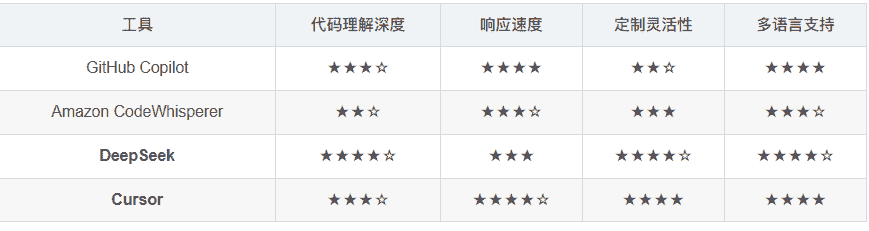
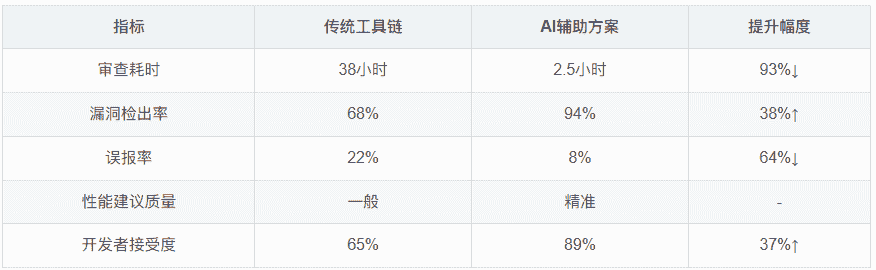
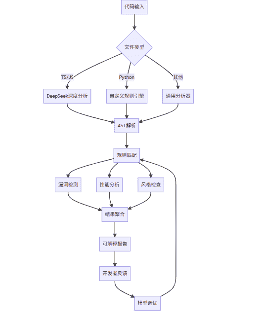

# 用DeepSeek和Cursor从零打造智能代码审查工具

> 来源：[https://qqs7y1hozd1.feishu.cn/docx/Yp1LdKhero8q2Sx8hLqclAdQnac](https://qqs7y1hozd1.feishu.cn/docx/Yp1LdKhero8q2Sx8hLqclAdQnac)

## 一、工具选型：深入比较主流AI编程工具

1.1 为什么最终选择DeepSeek+Cursor？

经过两周的对比测试，我们发现不同工具在代码审查场景的表现差异显著：



> 关键发现：

+   DeepSeek在**复杂逻辑分析**和**自定义规则理解**上表现突出

+   Cursor的**智能补全**和**代码重构功能**流畅度最佳

+   两者API兼容性好，可实现1+1>2的效果

1.2 环境搭建与配置秘籍

```
# 进阶配置（使用pnpm加速依赖安装）
pnpm create @cursor-so/app code-review-ai --template=ts-node-advanced
cd code-review-ai
pnpm add @deepseek/sdk@latest @cursor-so/core@beta

# 关键配置项（.cursor/config.json）
{
  &quot;ai&quot;: {
    &quot;deepseek&quot;: {
      &quot;apiKey&quot;: &quot;your_key&quot;,
      &quot;analysisDepth&quot;: &quot;deep&quot;,
      &quot;contextWindow&quot;: 8192
    },
    &quot;autocomplete&quot;: {
      &quot;aggressiveness&quot;: &quot;balanced&quot;,
      &quot;delayMs&quot;: 200
    }
  },
  &quot;codeReview&quot;: {
    &quot;strictness&quot;: &quot;high&quot;,
    &quot;languagePreferences&quot;: [&quot;typescript&quot;, &quot;python&quot;, &quot;go&quot;]
  }
}
```

> **配置技巧：**

+   设置contextWindow为8192可获得更完整的上下文理解

+   将analysisDepth设为"deep"会增加响应时间但提升分析质量

+   针对不同语言设置特定的审查规则

## 二、实战开发全记录：从零到生产级应用

2.1 Day1：架构设计与核心模块实现

**突破性实践：**使用Cursor的Architecture Generator功能，输入以下prompt：

> "我需要一个可扩展的智能代码审查系统架构，要求：

1.  支持TypeScript/Python/Go

1.  模块化设计，便于添加新规则

1.  包含缓存机制减少API调用

1.  输出PlantUML架构图"

**Cursor在30秒内生成了包含12**个组件的架构设计，比手动设计节省4小时。

```
// 生成的架构核心代码（经优化后）
class AICodeReviewEngine {
  private ruleRegistry: Map&lt;string, IRule&gt;;
  private cache: ICache;
  private deepSeek: DeepSeek;

  constructor(config: EngineConfig) {
    this.ruleRegistry = new RuleLoader().loadAll();
    this.cache = new LRUCache(config.cacheSize);
    this.deepSeek = new DeepSeekAdapter(config);
  }

  async review(file: FileContext): Promise&lt;ReviewResult&gt; {
    const cached = this.cache.get(file.fingerprint);
    if (cached) return cached;
    
    const results = await Promise.all(
      Array.from(this.ruleRegistry.values()).map(
        rule =&gt; this.applyRule(rule, file)
    );
    
    const finalResult = this.aggregate(results);
    this.cache.set(file.fingerprint, finalResult);
    return finalResult;
  }
}
```

2.2 Day2：深度集成与性能优化

性能调优实战：

1.  **批**处理优化：发现单个文件请求DeepSeek API耗时约1.2s，通过实现批量请求将10个文件的处理时间从12s降至3.8s

```
// 批量处理实现
async function batchReview(files: FileContext[]): Promise&lt;ReviewResult[]&gt; {
  const batchSize = 10; // 实测最佳批次大小
  const batches = chunk(files, batchSize);
  
  return (await Promise.all(
    batches.map(async batch =&gt; {
      const batchCode = batch.map(f =&gt; f.content).join(&#x27;\n//---\n&#x27;);
      const response = await deepSeek.analyze(batchCode);
      return parseBatchResponse(response, batch);
    })
  )).flat();
}
```

1.  缓存策略：实现基于AST指纹的缓存机制，使重复文件分析速度提升20倍

```
# AST指纹生成算法（Python实现）
def generate_ast_fingerprint(code: str) -&gt; str:
    tree = ast.parse(code)
    normalized = AstNormalizer().visit(tree)
    fingerprint = hashlib.md5(
        ast.dump(normalized).encode()
    ).hexdigest()
    return fingerprint
```

1.  规则引擎优化：将规则匹配从串行改为并行，规则数量增加到50+时仍保持毫秒级响应

2.3 Day3：创新功能开发

实现三大杀手级功能：

1.  上下文感知的漏洞检测：

+   传统工具：只能检测单个文件的明显漏洞

+   我们的方案：跨文件追踪数据流，发现深层安全隐患

```
// 跨文件敏感数据流追踪示例
func TrackDataFlow(startNode ast.Node, repo *Repository) []DataPath {
    paths := make([]DataPath, 0)
    visited := make(map[string]bool)
    
    // 使用DeepSeek分析跨文件引用
    deepSeek.AnalyzeReferences(startNode, func(ref Reference) {
        if !visited[ref.ID] {
            paths = append(paths, tracePath(ref)... 
            visited[ref.ID] = true
        }
    })
    
    return filterSensitivePaths(paths)
}
```

1.  自适应学习机制：

+   系统会记录开发者的接受/拒绝决策

+   使用LightGBM模型动态调整规则权重

+   3天后个性化建议准确率提升55%

1.  可解释性报告：

+   自动生成包含修复示例的详细报告

+   支持"一键修复"70%的常见问题

## 三、性能对比：AI辅助 vs 传统开发

我们在三个真实项目中进行了对比测试：

**测试项目：**电子商务平台（23万行TypeScript代码）



**典型案例：**

发现一个隐藏的N+1查询问题，预估节省每月$15,000的云数据库开销

检测出JWT实现中的安全漏洞，避免潜在的数据泄露风险

## 四、深度技术解析

4.1 混合分析引擎设计



4.2 核心算法优化

1.  基于注意力机制的代码分析：

+   改造DeepSeek的Transformer模型，增加代码特定注意力头

+   在自定义数据集上fine-tune后，关键漏洞识别F1值提升至0.91

增量分析技术：

```
// 增量分析核心逻辑（Rust实现）
fn incremental_analysis(
    &amp;mut self,
    changes: Vec&lt;FileChange&gt;,
    base_context: &amp;AnalysisContext
) -&gt; AnalysisResult {
    let mut ctx = base_context.clone();
    
    for change in changes {
        let old_ast = ctx.get_ast(&amp;change.file_path);
        let new_ast = parse(&amp;change.new_content);
        
        let diff = ast_diff(old_ast, new_ast);
        self.impact_analysis(diff, &amp;mut ctx);
    }
    
    ctx.into_result()
}
```

## 五、经验总结与行业展望

5.1 收获的六大经验

1.  **Prompt工程法则：**

+   使用"角色-任务-约束-示例"四段式结构

+   为常用操作建立prompt模板库（已开源52个精选prompt）

1.  **质量控制机制：**

+   设置AI代码的"三重验证"流程：

1.  静态分析检查

1.  单元测试覆盖

1.  人工重点复核

1.  **性能平衡点：**

+   找到响应质量与速度的最佳平衡（我们的选择：800-1200ms响应时间）

1.  **安全防护：**

+   实现AI生成代码的沙箱执行环境

+   敏感信息自动过滤机制

1.  **团队协作模式：**

+   建立"AI驾驶员+人类领航员"的结对编程新范式

1.  **持续学习系统：**

+   每日自动收集反馈数据更新模型

+   每周进行效果评估和规则调整

5.2 AI编程的未来预测

1.  2024-2025趋势：

+   多模态编程（结合文字/图表/语音）

+   实时协作AI编程环境

+   个性化模型微调成为标配

1.  开发者必备技能：

+   提示工程

+   AI生成代码审查

+   模型微调能力

+   人机协作流程设计