# 从0-1搭建个性化推荐系统

> 来源：[https://qqs7y1hozd1.feishu.cn/docx/MsYYdXECLoqv3dxhkCxcAaEVngc](https://qqs7y1hozd1.feishu.cn/docx/MsYYdXECLoqv3dxhkCxcAaEVngc)

## 项目拆解

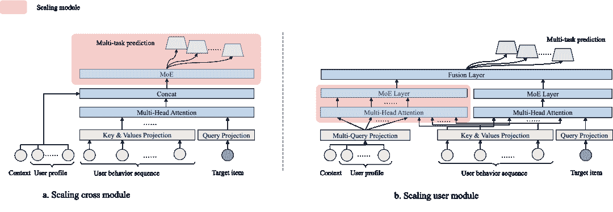

> 经典的推荐系统模型可以针对需要预估的用户-商品对。

> 根据处理信息不同，可以把模型拆解成三个部分，User module（编码用户的历史行为序列等信息）

> Item module（编码候选商家的信息）以及Cross module（同时编码用户和候选的交叉信息）。

## 项目搭建

### MTGR模型框架

通过MTGR，将这些信息编码成自然语言中的Token，然后利用HSTU架构进行建模。

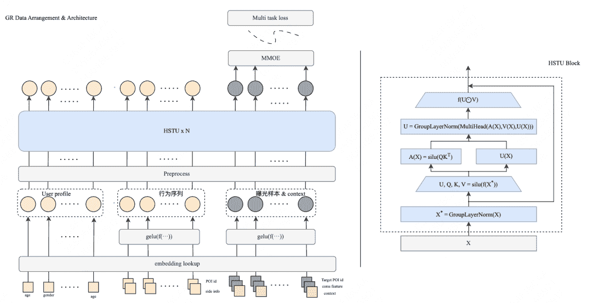

### 数据&特征

**对齐DLRM的特征使用策略：**采用生成式方案完全抛弃交叉特征会极大的损害MTGR模型性能，为了尽可能的减少信息损失，特征与DLRM基本一致，这些特征包括：

> **User Profile：**用户统计信息，如登陆频次/购买频次等。

> **Context：**用户当前请求的场景信息，如哪个场景，时间，地点。

> User Behaviour Sequence：用户历史点击/曝光序列。

> 其中每个item为有用户交互行为的商家，此外还包含了大量side info，包含了商家的各种属性信息（tag、品牌等）、历史统计信息（历史点击、订单数量等）、当次交互的细分行为（例如停留时长、子页面点击数量等）等，不同请求（用户）的序列长度不同。

**Target item：**

待打分商家信息，如商家ID、各种该商家的side info以及大量的基于统计的交叉特征。

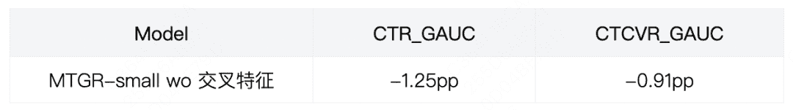

**按用户粒度压缩训练数据：**

> 如图3所示，左图表现了传统DLRM数据组织方式，针对用户的N个曝光，在数据组织中需要存N行，在处理不同长度的序列数据时，往往使用padding进行补全。

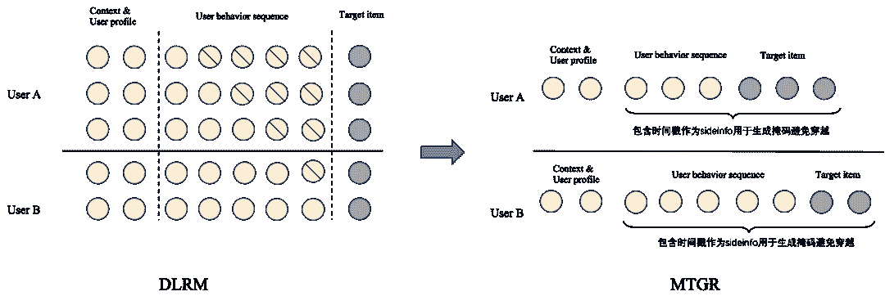

### 模型架构

在模型架构上，首先将输入信息Token化，再针对不同类型Token进行Group LayerNorm，并设计了一种特殊的动态混合掩码策略，以实现用统一的HSTU架构针对不同序列、用户信息、Target信息进行统一编码。

下表展现采用Group LayerNorm的离线效果。

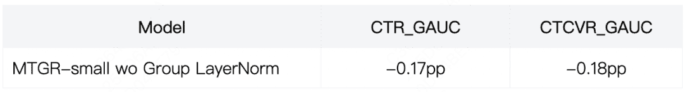

> **对于Target 1，**因为它出现的时间较晚，因此它可以看到全部的User Profile & Sequence以及Real-Time Sequence；

> **对于Target 2，**有一部分Real-Time Sequence出现在其之前，因此它只能看到部分Real-Time Sequence。

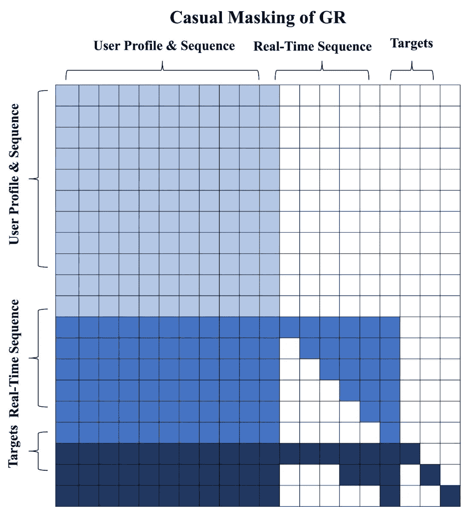

表3展示了采用动态混合掩码对比传统因果掩码的离线效果，采用动态混合掩码可以更好的发挥HSTU作为encoder的学习能力。

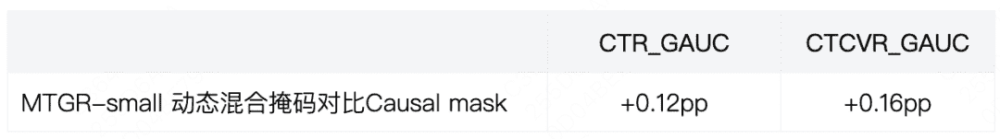

### MTGR训推引擎

MTGR模型训推引擎，解决模型计算量和存储量激增带来的诸多性能挑战。包含两个核心组件：

> **MTGR-Training：**支持低成本、高效率大规模分布式训练。

> **MTGR-Inference：**支持低延迟、高吞吐大规模线上推理部署。

#### MTGR-Training

基于TorchRec构建了简单易用、高性能、可扩展的GR模型训练引擎MTGR-Training，可支持千亿参数、100GFLOPs/example甚至更大计算量的模型的高效分布式训练。

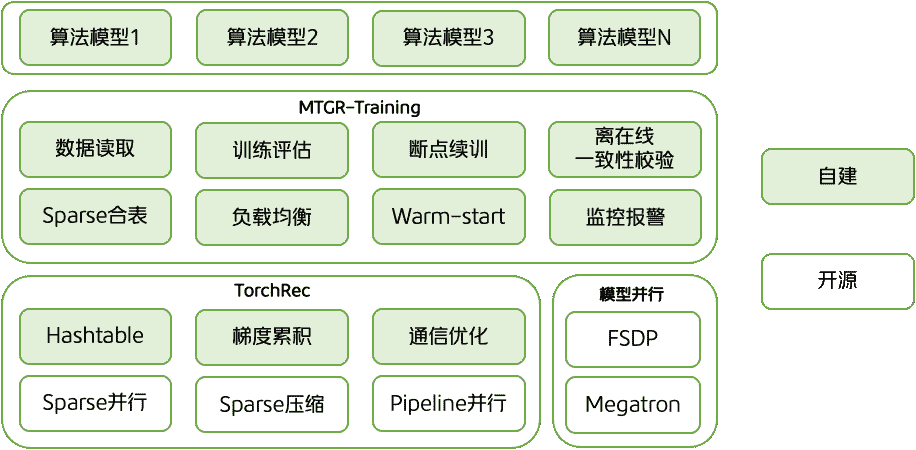

**如图5所示，系统框架分成三层：**

+   **最底层是****TorchRec****。**TorchRec是Meta开源的稀疏模型训练框架，对其做了一些功能上的扩展，例如支持动态Hashtable、梯度累积等，满足业务的实际需求。

+   **中间层就是****MTGR-Training****，**的主要工作也集中在这层，其对训练流程进行了封装，包括离线/流式数据读取、训练评估流程、断点续训、离在线一致性校验、warm-start等。

+   **最上层是算法模型层，**不同业务根据提供的接口定义自己的算法模型。

**MTGR-Training具体的**功能支持和性能优化工作总结如下表4所示：

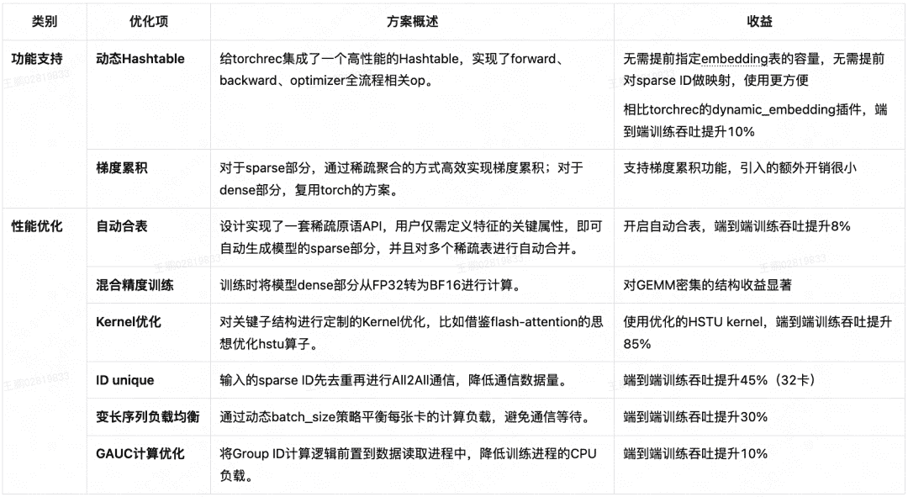

**下面重点介绍下****Kernel****优化和变长序列负载均衡的工作：**

> **Kernel****优化：**GR模型中最核心的计算单元就是Attention模块——HSTU。原始的pytorch实现存在算子细碎、无法支持动态序列长度、计算效率低下等问题；Triton版本的实现一定程度上解决了这个问题，但仍有较大优化空间。

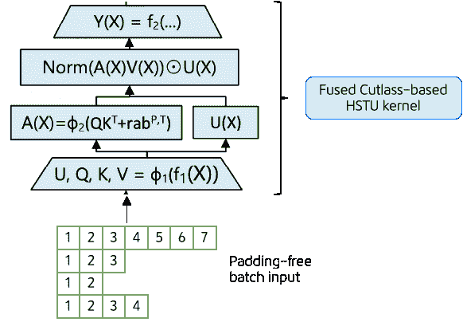

> **变长序列负载均衡：**GR模型的样本是按照用户维度去组织的，而在推荐系统中，用户序列呈现明显的长尾分布：少数用户的序列很长，大部分用户的序列都比较短。

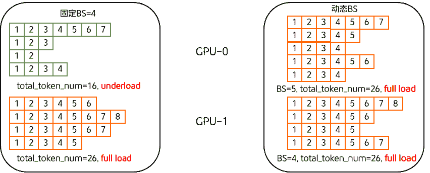

总的来说，得益于用户粒度的样本聚合方式使得相同用户的大部分计算可以共享，以及MTGR-Training的诸多优化。

如表5所示，不采用任何序列采样策略时，65倍计算复杂度GR模型训练成本相比DLRM baseline，只增加了1倍。

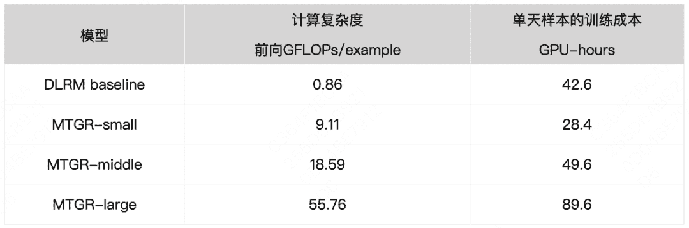

### MTGR-Inference

**基于Nvidia软件生态，构****建**了高性能的GR模型推理引擎MTGR-Inference：

> 选择TensorRT作为模型推理框架：TensorRT是Nvidia推出的推理优化框架，在业界广泛应用，具有较强的算子融合、低精度量化能力。

> 选择Triton Inference Server作为模型部署框架：Triton Inference Server是Nvidia推出的高性能模型部署框架，在业界广泛应用，是TensorRT官方推荐的模型部署方案。

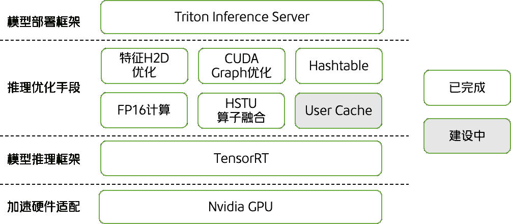

**如图8所示，系统框架分成四层：**

> 最底层是硬件层，主要适配Nvidia GPU；

> 再上层是模型推理框架层，基于TensorRT。

> 最上层是模型部署层，基于Triton Inference Server进行部署。

**下面详细介绍各种优化手段：**

**特征H2D优化：**推荐模型一般都包含数百个特征，将特征从Host读到GPU时，有较大的传输耗时。

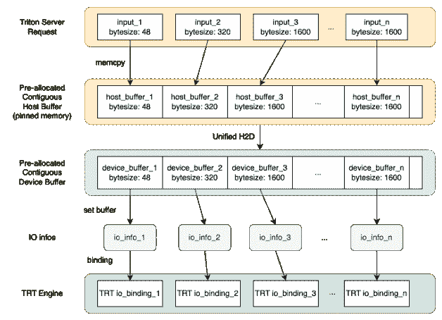

**CUDA Graph优化：**在的场景下，使用CUDA Graph优化后吞吐提升13%，不同QPS压力下，Avg延迟降低17%~52%，P99延迟降低16%~57%。

**FP16计算：**FP16推理具有内存占用少、计算速度快等优势。在的场景下，使用FP16格式进行推理，相比FP32，吞吐提升50%；精度几乎无损（相比FP32打分diff控制在0.006以内）。

### Scaling效果

在验证Scaling Law过程中，除了传统的增加深度、宽度外，还特别伴随不同的模型尺寸，同步增大稀疏参数的大小（调整embedding dim），该参数作为超参数存在，且针对不同尺寸的模型以及不同类型的Token分开设置，假设某一个Token由个特征组成，每个特征的embedding dim通常会被设置为附近的整数。

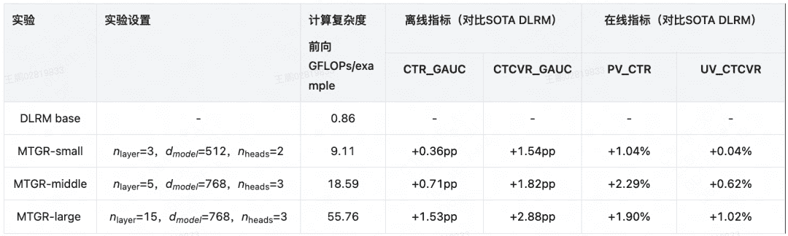

> 基于MTGR-large在外卖推荐业务中完成了全量，对比之前SOTA的DLRM base，MTGR单样本前向FLOPs提升65倍，达到55.76GFLOPs，图10给出了AB test阶段MTGR-large对比DLRM订单收益曲线。

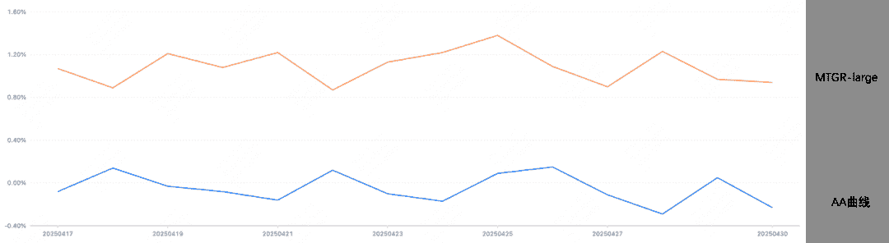

对于训练资源，采用与GR原方案一致的随机长度采样策略，优化后训练成本降低至与DLRM持平，且离在线效果基本无损；

> 对于推理资源则节省12%，推理资源下降是由于对比DLRM，MTGR在推理阶段资源消耗对于候选数量不敏感，对比DLRM需要多分片推理来降低耗时，MTGR采用单分片推理即可，较好的提升了在线吞吐。

## 上下文感知的聚合页广告优化实践

### 聚合页广告

> 聚合页广告是一个重要的业务场景，将商家和多种优惠以聚合的形式展示给用户。如下图1所示，聚合页通过多种发券模式吸引用户下单。

> 上下文信息建模是聚合页实现精准个性化匹配的重要途径，从上下文信息中选择了最能影响用户决策心智的“发券”和“排序”两个方向进行了深入探索。

对于排序，在预估中除了要考虑广告本身的信息还需要考虑相邻展示的其它广告对其的影响，而精排中的Point Wise预估无法建模此类上下文信息。

下文实践一和实践二将具体介绍在这两项工作中面临的技术挑战和创新性解法。

### 实践一：上下文增强的全链路Uplift建模方法（ECUP）

**与**传统监督学习不同，Uplift建模本质上是反事实推理问题：需要同时估计用户在干预组（T）和对照组（C）的潜在结果。

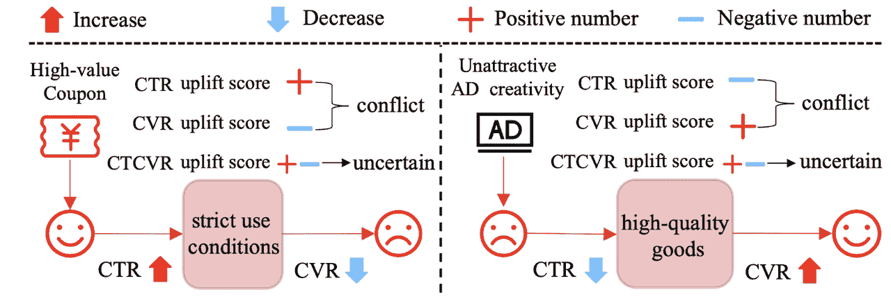

#### 链路偏差分析

**据此，计算了CTCVR（曝光空间）和**CVR（点击空间）的实际Uplift值。

> 如下图所示，CTCVR和CVR在不同段的变化趋势并不完全一致，这表明不能仅通过点击集上的CVR提升来推断全链路的实际Uplift。

> 这种现象的主要原因是用户在不同阶段的行为关注点不同，导致Treatment对行为的影响在链路各阶段存在差异。

> 因此，提出在全链路空间中构建Uplift模型，并引入任务先验信息，以精准捕捉Treatment对不同任务的影响，从而解决链路偏差问题。

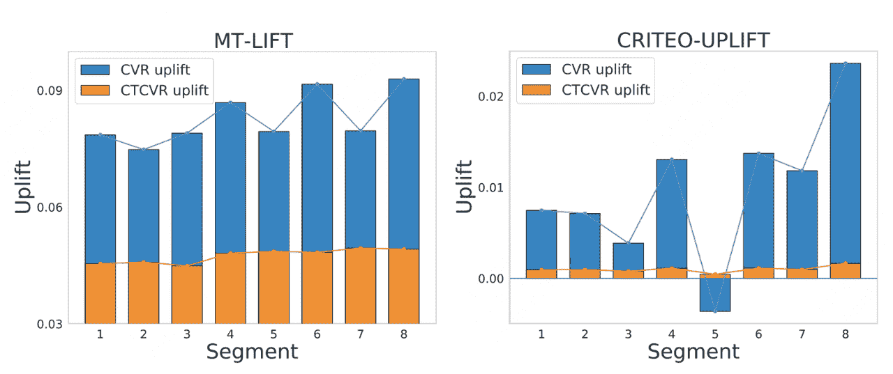

#### 方法

ECUP模型整体结构如下图所示，主要由两部分组成：

> 1.全链路增强网络(ECENet)，使用用户的序列模式来估计整个链路空间中每个任务的结果，并使用任务增强网络（TAENet）注入任务先验信息以实现上下文表征，捕捉每个任务上的不同uplift，以避免链路偏差的负面影响。

> 2.Treatment增强网络（TENet），旨在引导初始特征的Treatment感知细化，并实现不同Treatment下embedding表征的bit级别自适应调整，以解决Treatment不适应问题。

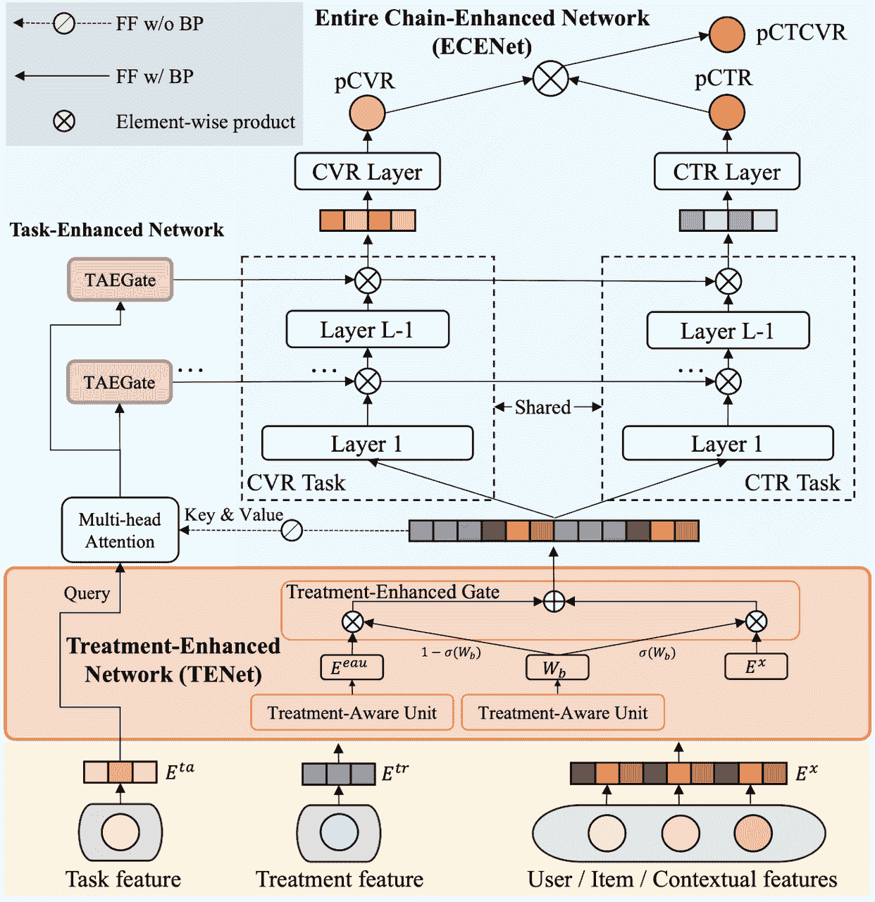

#### 全链路增强网络（ECENet）

> 在特定Treatment中，个体对不同任务的响应存在差异。此部分的目标是在捕获任务感知特征表达，传统方法通过多个塔来学习多任务目标的方法表达能力有限，无法捕捉Treatment对不同任务的不同影响。

为此，本文提出任务增强网络（TAENet, Task-Enhanced Network），以深度融合任务先验与Treatment增强表示（TENet的输出），实现上下文增强的参数学习。

TAENet通过个性化选择和调整DNN参数，平衡不同上下文中特征的稀疏性。

#### Treatment增强网络（TENet）

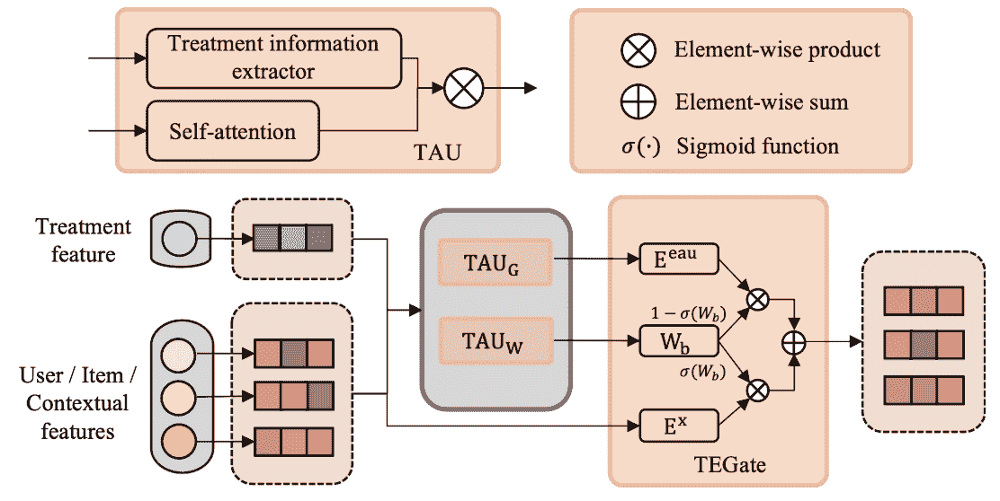

### 实践二：利用邻域列表的重排方法（NLGR）

NLGR遵循评估器-生成器范式，并改进了生成器的训练方式和生成方式。具体来说，使用组合空间中的邻居列表去增强生成器的训练过程，使生成器能感知相对分数并找到优化方向。

> 进一步，提出了一种新颖的基于采样的非自回归生成方法，它可以使生成器灵活地从当前列表跳转至任意邻居列表。

> 模型结构如下图所示，左侧是评估器，中间是生成器，右侧是细节结构。

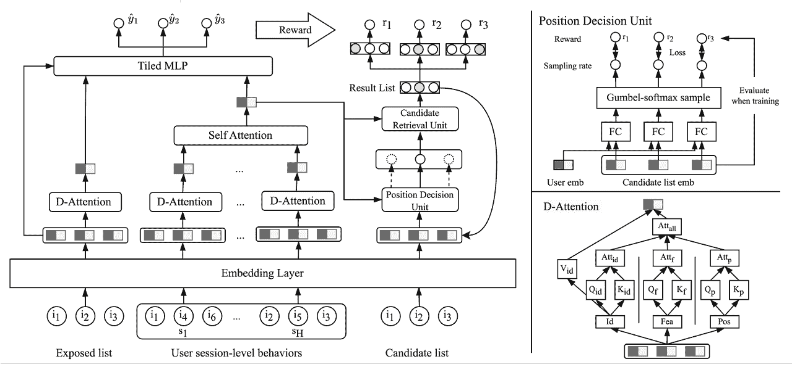

#### 评估器

> 生成器评估任意一个候选列表。输入主要包括候选列表和用户历史session-level的行为（其他的特征没有列出来），然后经过特征提取后送入预估层（MLP）进行预估，

**预估层的输入包括四部分：**j-th项目的emb、候选列表的emb、从用户历史行为提取出来的用户emb和j-th的位置emb。

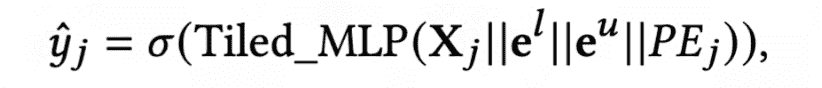

#### 生成器

生成器将任意一个候选列表生成为排列空间中的最优列表。

> **生成过程分为2步，**先从候选列表中决定要替换的位置（PDU），再从剩余候选项目中挑选出一个项目放入候选列表中（CDU）。

**位置决策单元（PDU）输出每个位置应该被替**换的概率。输入和评估器预估层的输入一样，

> **也包括四部分：**j-th项目的emb、候选列表的emb、从用户历史行为提取出来的用户emb 和 j-th的位置emb。

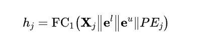

**在训练时为了保证梯度传播，用gumbel**-softmax采样，得到要替换的位置：

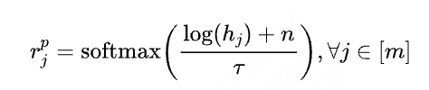

+   候选召回单元（CDU）输出每个候选被召回的概率。输入仍然和评估器预估层的输入一样，也包括四部分：k-th候选的emb、mask掉j-th个位置后的候选列表的emb、从用户历史行为提取出来的用户emb和j-th的位置emb。

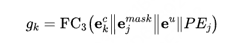

同样的，在训练时为了保证梯度传播，用gumbel-softmax采样，得到要插入的候选：

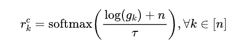

#### **邻居训练**

**评估器采用常规的交叉熵损失：**

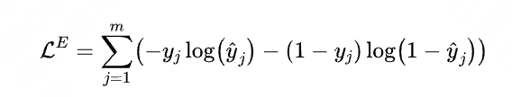

重点在生成器的训练方式。依次替换候选列表每个位置上的项目，构造邻居列表，评估邻居列表的reward，与候选列表reward的相对值作为生成器的reward：

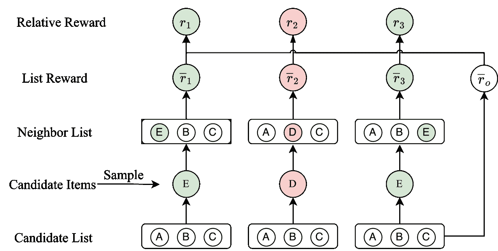

近一年多来，工业界针对生成式推荐展开了系统性探索，主要呈现三种技术路径：

> **生成式架构：**以Meta的GR和快手OneRec为典型，基于类LLM的Transformer架构，结合高效的FlashAttention算子实现自回归内容生成。

> **堆叠式架构：**如阿里LUM和字节HLLM，通过生成式技术赋能传统推荐框架。

> **混合式架构：**类似于生成式架构针对训练数据按用户进行压缩，减少冗余计算。

此外，对MTGR的训练、推理框架进行针对性优化，大幅提高了MTGR在混合式架构下的计算性能表现。