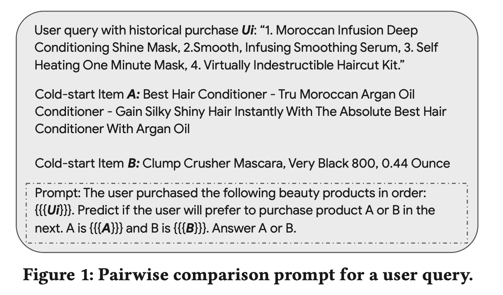
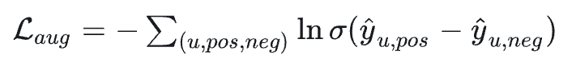
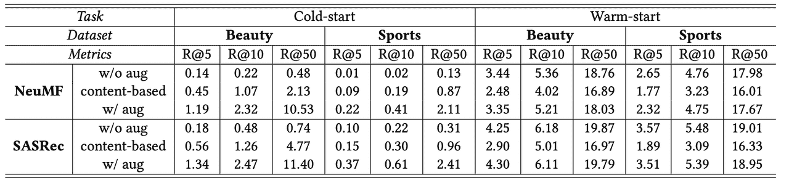
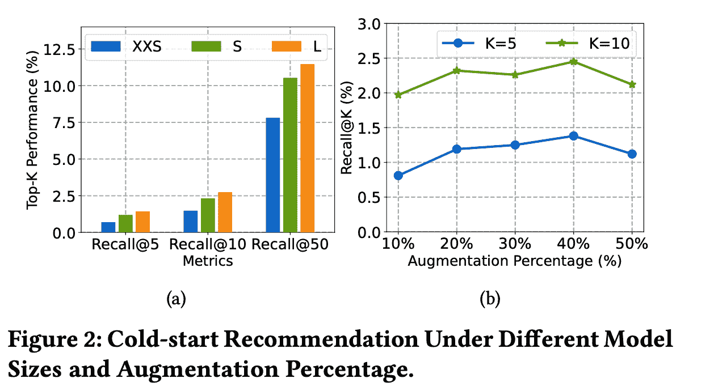

# 谷歌利用LLM的数据增强从冷启动到热推荐

> 来源：[https://qqs7y1hozd1.feishu.cn/docx/Oh61dFRbwo3fP4xbO7gc4e3jntb](https://qqs7y1hozd1.feishu.cn/docx/Oh61dFRbwo3fP4xbO7gc4e3jntb)

# **简介**

**大型语言模型（****LLMs****）**在大规模网络数据上的训练，赋予了它们全面的理解能力，展现出卓越的推理和泛化能力，这些能力已推动多个领域的创新，包括创作性写作、交互式对话系统和搜索引擎设计等

鉴于**LLMs**在**深入理解用户需求和内容特性的潜力，深入探讨了其在推荐系统中的应用，尤其强调**在解决冷启动问题中的应用。推荐系统作为在线平台上推广引人兴趣内容的关键途径，通过解析用户的先前互动来预测和理解其喜好偏好，并以此为基础，建立个性化推荐，指导用户发现符合其兴趣的内容

**在推荐系统领域，基于**模型的方法广泛采用用户与内容ID相关的学习嵌入，旨在记录并预测相关性。这种方法依赖于对用户行为的深入理解和内容间的复杂关系，以及通过预测共同模式来构建个性化推荐策略。

> **传统推荐系统主要基于：**

+   **协同过滤**

+   **矩阵分解等方法**

+   **最新的深度学习模型**

> **以**上旨在强化用户与内容间的交互，通过感知用户的历史行为模式，预判其未来的兴趣点，从而提供精准的个性化推荐

在用户与内容频繁互动的环境下，利用基于I**D的嵌入方法来推荐新颖且个性**化的**内容**时，面临着被称为冷启动的核心挑战，主要涉及新内容缺乏充分的曝光和互动数据。为应对这一难题，基于内容的推荐系统尝试通过运用内容的元信息辅助内容表示学习，通过使用元特征转换或其组合替代理由ID指定的内容嵌入，以此从大量互动的内容中推断出对冷启动内容的理解。

> 近期大模型的突破性进展为改进推荐系统提供了新机遇。现有研究已探讨了将用户查询转换为文本，并利用生成式大型语言模型（LLM）构建无需特定ID的推荐系统的可能性。然而，为了使推荐模型适应不同场景，仍需针对每种场景对大规模预训练模态编码器进行微调--这一过程既复杂又耗时，需要大量的工程投入。此外，按照上述方法要求为每个用户分别提供LLM或大型基础模型服务以获取推荐结果，结果的生成往往延迟显著，通常远超过推荐系统期望的O(100ms)响应时间界限。因此，满足在线推荐服务需要以每秒处理大量查询的性能要求时，这种方式导致的成本过高，难以实现商业应用。

+   **是否**能够生成关于冷启动内容的合成用户行为数据，如用户偏好由二元比较（如"可能更倾向于观看教授Andrew Ng的视频"或"可能对Selena Gomez的新剧感兴趣"）来表示？

+   结合这些合成交互数据是否会改善经典推荐模型在冷启动场景下的表现？

> 本文提出的方法旨在不增加服务时的延迟，同时有效的解决了数据稀缺性问题：

1.   引入了利用**LLMs**在二元比较提示下的能力，推测用户对内容的选择偏好

1.   将**LLM**生成的合成偏好与标准推荐任务融入了一致的损失函数框架

1.   在实际数据集上进行了实验，结果表明，即使使用较小型的模型，这样的合成数据增强方法也能显著提升冷启动场景下的推荐性能

# **相关背景**

+   **LLM**在推荐系统中的应用日益受到关注，研究焦点包括将其融入特征工程或增强传统推荐系统中的特性编码。

> 利用LLM改进现有的推荐系统优势明显，尤其是在服务效率上，直接部署LLM于大规模内容服务可能成本高昂，并阻碍其广泛应用

+   相反， 提出在训练阶段利用**LLM**生成的合成示例供**传统基于ID的推荐系统使用，此策略**在提升服务效率的同时，保持了系统的实用性

针**对冷启动内容推荐问题，即新上传内容在缺**乏用户反馈情况下的推荐挑战， 关注在对这类内容进行推荐时面临的困难。传统推荐系统通过整合额外的辅助信息与基于ID的推荐嵌入关联来解决信息不足的问题。尽管已有一些通过元学习方式训练冷启动内容嵌入的研究，但这些方法似乎仍缺乏有效处理交互数据较少的内容策略。

**有**效的方法则寻求利用LLM生成冷启动内容的合成训练线索，进而直接从这些合成线索中学习协作嵌入，以提高冷启动内容的推荐精度

在**数据增强策略中****，神经网络模型的训练效率提升已获证实。在推荐系统场景中，借**鉴了先前成功案例，CLS4Rec通过随机内容剪裁、遮蔽和重新排序，创建了用户历史交互的增强视角，显著提升了模型的鲁棒性和预测准确性。

针**对**用户交互较低的情况，引入了一种学习-学习管道，旨在增强这类用户的训练数据集，从而提高整个模型的性能。然而， 是首个致力于使用历史交互数据生成增强训练数据以填补冷启动内容知识缺口的尝试，专门为解决冷启动内容的知识获取难题而设计

# **Preliminaries**

1.  用户集𝑈包含个体用户 至 ，平台上的热门内容组 包含 到 ，而冷启动内容组 则包含了从 到 的内容

1.  这些内容的相同ID关联着可训练的嵌入表示，个性化推荐的基本逻辑是预测用户与每个内容的相容性，进一步从候选内容集中筛选出与其相容性高的内容，形成个性化的推荐列表

1.  潜在因素模型，作为大规模矩阵分解的有效变体，被Netflix Prize等场景广泛研究。该模型通过相似的潜在因子向量乘积来近似用户与内容的相容性

**具体而言：**如果用户𝑢和内容𝑖的潜在因子向量分别为 和 ，那么它**们**的相容性 将由  计算得来。 当前许多推荐框架是潜在因素模型的拓展版本。然而，在冷启动问题中，由于缺乏数据信号以供获取内容𝑖的嵌入 ，现存方法面临挑战。

+   **为了缓解知识缺陷， 提出使用合成数据来模拟用户**对冷启动内容的可能交互，以此填补数据空白

# LLMs as Data Augmenters

## **增强数据生成**

+    专注于**PaLM**系列模型，直接使用其生成结果而无需微调。 遵循将用户交互过的商品描述放入提示中。具体而言，对于训练集中的用户查询 ， 采用商品标题来表示历史互动。

+   为了从描述性用户查询推断用户的偏好， 可以询问用户是否喜欢某个冷启动商品（点对点）或比较两个冷启动商品 和 （成对）

+   大型语言模型在精确的点对点相关性评估方面有困难，但在成对比较任务上表现更好。

因此， 利用大型语言模型生成冷启动商品间的成对偏好

具体的， 随机选取一对商品 ，其中 ，并构建如图所示的提示来获取用户对 与 的偏好。成对比较确保了每次调用大型语言模型都能得到两件冷启动商品间的偏好信号。相比之下，针对用户随机冷启动商品的点对点推断大多会得出负面标签（不感兴趣），而正面标签则较少。

## **成对比较损失**

为了在训练过程中整合这一增强信号， 将冷启动商品对的成对**偏**好预测作为辅助任务加入到常规推荐任务中大型语言模型返回的答案被视为 项，另一项为

**如果用户𝑢更偏好冷启动商品 ****而****非 ****，** 采用受贝叶斯个性化排名(BPR)损失启发的以下成对损失函数：

在这个过程中，**Sigmoid**激**活函数****𝜎**被用来调整输出，确保最后的输出在0和1之间，可以解释为正例和负例之间的偏好值。通过将这个成对的BPR损失整合进推荐模型的标准训练中，实现了该损失函数能够引导模型的反向传播过程，从而将计算出的梯度应用于对冷启动内容进行表示学习的嵌入参数上。

> 特别地，成对损失提供了额外的训练信号，对于那些在常规数据集中较少被提及或交**互较少的冷启动内容格外有用。常**规的推荐任务可能不足以充分训练这些内容的嵌入向量，因为它们的交互历史信息不够丰富

> **通过实施这个成对比较的辅助损失，即使对于这些训练不足的冷启**动内容，模型也能通过成对比较的方式学习到用户的偏好模式，进而增强其泛化能力，特别是针对潜在冷启动场景的能力

# **Experiments**

## **数据与预处理**

+   使用公开的亚马逊评论数据集来评估性能

选择了"美容"和"运动与户外用品"类别，这些类别包括用户对这两类物品的评分和评论。为了划分训练集和测试集， 遵循单点分割策略，并按照7:3的比例选择时间点进行数据分割。分割时间点之前的数据用于模型训练，训练后的模型在分割时间点之后的数据上进行测试。

具体而言， 将仅出现在测试数据中的物品视为"冷启动项目"，而其他物品则视为"热启动"项目，这与实际设置相似。

> 例如，在"运动与户外用品"类别中，分割后得到55,255个热启动物品和2,751个冷启动物品。该类别中总共有224,956个用户查询。 随机选取一部分用户查询，并为每个查询随机选取两个冷启动物品，生成增强数据示例

+   **模型与参数**

**使用两种已建立的推荐系统后**端**来评估 提出的**方法的一般性：神经矩阵分解（NeuMF）和SASRec

> NeuMF从物品ID中学习用户嵌入 和物品嵌入 ，而SASRec通过自我注意力层在用户的历史交互上编码序列信息来编码用户嵌入 。

> 这些后端代表了许多推荐系统的核心组件， 测试了这三个基于它们的变体：

1.  无增广基础模型，该模型使用原始训练数据进行推荐系统训练

1.  **基于内容方法使用物品的袋模型表示，并整合其类别**和标题，这是处理冷启动项目的一种常见方法

1.  **带有增广的****LLM****（LLM增广），整合LLM生成的增广并补充训练过程中的二元比较损失。** 使用具有不同模型大小（即XXS、S和L）的PaLM2来研究合成数据生成上的性能

+   **K项评估指标**

对于每个测试用户查询， 从集合  中检索与最高兼容性评分匹配的前K个物品

为了离线比较推荐系统的性能， 采用召回率来检查测试查询的地面真值物品是否出现在TOP-K列表中

将结果按地面真值标签分组，即当购买的物品为冷启动项目时，结果在"冷启动"列中分组，其余在"热启动"列中

# Results and Analysis

在总体比较中， 使用**PaLM2-S**生成合成数据，并将其与常规训练数据相结合。 随机抽取用户查询的20%，为每个查询生成一个增广数据示例

在表中， 报告了测试在**NeuMF**和**SASRec**上的有效性的结果。**在没有任何增广数据示例的情况下，冷启动项**目**的**训练信号不足，导致所有K值的召回极低。而基于内容的方法利用物品的标题和描述可以为冷启动项目提供不错的性能，但它忽略了协作信号，显著影响了热启动项目的推荐

**相比之下，**通**过成对损失学**习的冷启动项目的增广**训练信号，可以对NeuMF和**S**A**SRec的表示学习产生益处，并在冷启动推荐上显著提升性能。此外，增广信号和成对比较损失在较高K值上提高了召回率，因为它们使模型能够排名更多的冷启动项目，包括一些不太相关但仍然符合用户喜好的项目

**结果表明：****LLM****是一种有效的方法来填充冷启动项目上的缺失知识。尽管冷启动项目的增广训练信号对某些召回指标对热启**动项目推荐产生轻微负面影响，但与冷启动推荐的巨大收益相比，性能的下降是微不足道的

为了解不同大型语言模型(Large Language** Model, LLM)型**号的影响，** 在Ama**zon-Beauty上采用基于NeuMF的推荐系统，使用不同型号的PaLM2（即XS、S和L型号）作为数据增强器

在图(a)中， 发现模型尺寸确实影响了增强性能

**众所周知，随着****LLM**规模的增加，它们的许多能力是涌现出来的

> **假设较大的模型能够更准确地推断用户的历史行为和偏好，在图(b)中， 还观察到，通过生成更多的用**户查询来生成增强的训练信号， 可以进一步提高冷启动推荐的性能，尽管增加更多的合成数据超过某一特定点（40%）后，并未带来进一步的改进

