# 快手LLM Embedding在推荐系统中的0-1应用实践

> 来源：[https://qqs7y1hozd1.feishu.cn/docx/EWzodQ6xSoBr3Lxi4z2cFG46nOb](https://qqs7y1hozd1.feishu.cn/docx/EWzodQ6xSoBr3Lxi4z2cFG46nOb)

# **背 景**

**推荐系统（RS）****利用ID嵌入策略处理**用户和内容，通过交互学习建立关联。然而，它忽视了内容描述中的语义信息，影响新用户和长尾用户推荐的精准度。因此，如何利用这些信息以改进RS是研究重点

+   借助**LLMs**在**NLP**的强大能力，**尤其是其对开放世界知识的掌握**，正在探索如何将**LLM**应用于推荐系统，**以增强其对内容描述的理解**。**目标是利用****LLM**的预训练内容嵌入，以补充ID嵌入法在新用户和长尾推荐上的不足

> **由于****LLM****的通用知识与推荐系统的交互数据（协作知识）不**同，需要克服通用知识与推荐领域间的鸿沟：

1.  **冻结LLM参数：**通过构建对话式任务，让LLM解析用户-内容交互，生成推荐

1.  **“微调LLM”：**在特定推荐领域数据上训练，让它通过预测任务理解用户和内容关系

**这**两种方法都旨在通过LLM的逻辑推理，提升推荐系统的准确性和泛化能力。在实际应用环境中，直接应用推理的LLM处理全量用户交互数据困难

鉴于**LLM**的**输入限制通常为2K到4K个令牌，处理成千上万**商**品的频****繁交互是个巨大**的挑战。随着序列长度的增加，计算复杂度会以指数级增长，这使得一次性加载所有历史交互成为不可能。因此，需要设计更有效的分块或近似策略，以降低对LLM资源的直接消耗

+   同时，在推荐系统中微调LLM往往导致遗忘和性能退化

尽**管在理论上可行，但在大量推荐数据上对**大型语言模型（LLMs）进行全面参数微调通常会导致对开放世界知识的遗忘，从而导致性能下降，即使是部分参数调整，如LoRA，也往往无法达到满意的效果。

> **造成这些问题的关键因素有两个：**

1.  **领域差距**

> 即**LLMs**的通用知识与推荐系统的专有知识间存在鸿沟

1.  **训练目标不匹配**

> **LLMs**的预训练目标与推荐任务对信息的需求不一致

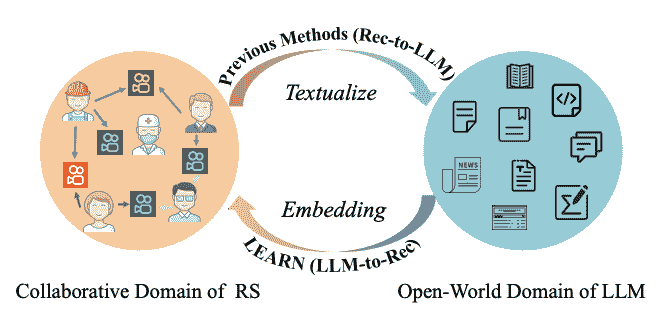

+   **为解决这些问题，快手提出****LEARN****框架，其核心是****LLM-to-Rec****，而非从推荐到LLM的路径**

> 利用**LLM**作为内容提取器，以推荐任务为导向进行微调，以保持对开放世界**知**识的利用，同时适应推荐系统的具体需求。这种方法在处理大规模数据和应对计算挑战时表现出优势，避免了全面微调可能导致的问题，从而提高了推荐系统的性能。

# 方 法

**首先证实了利用LLM生成的物品内容嵌入具**有区分性，证明了其在推荐系统中的应用潜力

随后，引入了**LEARN****框架，这是**一种创新**的双塔****结构设计。LEARN**通过结合LLM**的开放式**知识和推荐任务需**求，通过LLM-to-Rec途**径，实现了对LLMs知识的有效利用，以提升推荐系统的准确性和适应性，特别是在处理新用户和长尾推荐问题上

# Content Embedding of LLM

> 内容嵌入在当前推荐系统（RS）的研究和实践备受关注，尤其是得益于LLM的强大内容理解和推理。

> 快手主张将**LLM**生成的嵌入融入**RS**，通过巧妙地处理文本输入，**LLMs**能捕捉用户兴趣，提取产品特征，并关联相似产品。

然而，如何将这些文本信息转化为RS能用的形式呢？

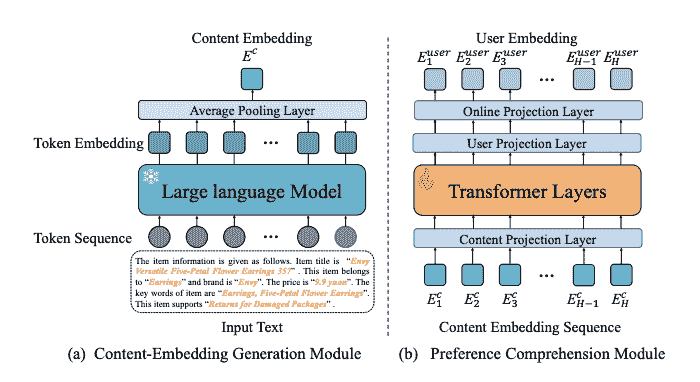

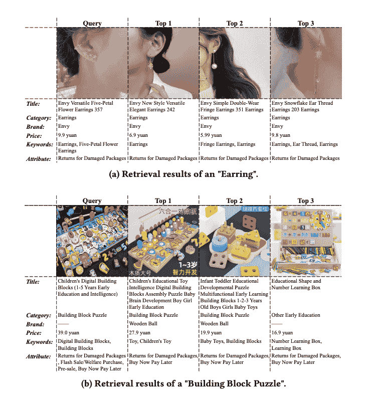

+   因此，不直接使用LLM预测的词汇，而是提议利用LLM的输出嵌入作为输入

考虑到对**LLM****嵌入效果的探索相对有限，尤其是针对主要基于解码的模型**，设计了一个基于物品对（I2I）的实证研究，使用包含100万样本的大规模数据集来评估其实际价值

# **模型架构**

> 快手的目标是建立一个推荐模型，能通过分析用**户过去的购买或互动行为，理解**他们的兴趣，因此构建了两个时间序列数据集

## **User Tower**

> **用户塔由两个模块组成：**

1.  **分内容嵌入生成（CEG）**

1.  **偏好理解（PCH）**

+   **CEG**模块利用预训练LLM作为基础网络，冻结参数，避免直接使用线性分类器

> 它通过LLM的解码器隐藏状态生成商品的令牌嵌入，这些嵌入通过平均池化聚合为内容嵌入 。所有商品共享相同的CEG模块结构。

+   **PCH**模块则根据商品内容嵌入创建用户偏好嵌入

> 它利用用户历史交互序列 的每个商品描述生成相应内容嵌入序列 ，然后通过Content Projection层进行维度调整，接着是一个12层自定义的Transformer，类似BERT-base，但采用因果注意力机制，以捕获商品关系和用户时间顺序偏好。

## **Item Tower**

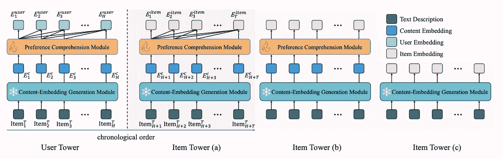

> **项目塔负责处理商品内容描述，生成针**对推荐的个性化物品嵌入，设计了三种变体：

1.  **变体1沿用用户塔结构**

> 使用相同模型并忽略用户历史交互 ，而是使用用户目标交互

> 通过因果注意力增强用户和物品嵌入的关联，性能优秀，是默认选择

1.  **变体2对比**

> 采用自我注意力，每个商品仅考虑自身内容，虽然能进行内容到协作域的映射，但性能低于使用因果注意力的变体1

1.  **变体3独创**

> 直接将LLM的全局内容嵌入直接用于推荐，省去对齐步骤。在训练阶段，变体1处理用户目标交互，变体2和3独立处理每个商品，推理时则仅依据单个商品描述

# Training Target of Recommendation Domain

为解决**LLM****的开放世界内容与推荐系统中用**户和商品的协作域之间的差距，快手设定推荐任务作为训练目标

在线推荐系统通过比较用户嵌入与商品库中所有商品嵌入，**找出最相关的K个商品。为了适应在线环境，采用自监督对比学习**，通过最大化用户对感兴趣商品的相似性，同时最小化与其他商品的相似性来建模用户偏好

+   **LEARN****框架使用****InfoNCE****损失进行训练**

用户嵌入 源于用户历史交互序列 ，通过用户塔计算；商品嵌入 来自用户目标交互通过物品塔获得。正样本包括目标交互中用户和商品的嵌入对，负样本则包含不同用户间以及不同用户目标交互下的用户和商品嵌入对。

**InfoNCE****损失函数的具体形式如下：**

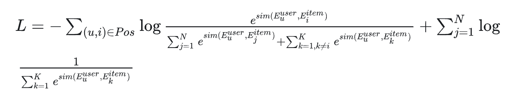

> **其中**** ****表示相似度计算**** ****表示正样本对**** ****是负样本的数量**** ****是正样本的大小**

在具体操作中，用户第 的历史交互嵌入 来自前 个交互，目标交互嵌入 来自第 个目标交互。整个训练集有 个用户。生成 个用户嵌入和 个商品嵌入，形成 个正样本对，对应于用户历史与目标交互的匹配，以及

个负样本对，这些负样本是与不同用户的历史交互及非目标交互的组合，其中 是批大小

对于每一个正样本，应用损失函数，作为全面的、密集型的损失来优化模型

**这样，****LEARN****框架通**过这样的对比学习策略，既能缩小LLM内容与实际推荐环境的差距，又能精确地学习到用户的个性化偏好

# 实验分析

## 离线数据集

> 基于快手电商平台的数据，历时10个月，从2022年6月至2023年4月，共收集了1200万真实用户和3100万件商品。剔除无效和异常，只保留了1200万有效用户。商品行为按照季度分类，如购买、搜索、浏览、点击，每种行为的样本数量依据80%分位数确定

**从**六个维度收集商品详情，包括标题、类别、品牌、价格、关键词和属性，特别是包含服务类型如"花呗分期"、"退货换货"和"先买后付"等的属性

+   **整****个用户交互序列被划分为****9**个月的历史交互序列 和1个月的目标交互序列

+   **数据集被分为训练集和测试集**

> 其中训练集包含1200万用户，总计2500万历史交互商品和1200万目标交互商品；测试集则有24万用户，500万历史交互商品，以及一个独立的20万商品展示集用于评估

## 离线数据设置

### Implementation Details

快手利用**Baichuan2-7B**作为中文理解的主力模型，**因其强大的中文处理能力**。

+   在训练初期，冻结参数以保持稳定性

+   选择**Adam优化器**，批大小为30。**采用余弦学习率**，**初始学习率为5e-5**，**warm-up阶段设置为0.1****，整个训练过程共10个epoch，实验在8台**NVIDIA V100 GPU上并行执行

在评估时，采用hit rate（H\@50, H\@100）和recall（R\@50, R\@100）作为标准，以衡量模型性能。默认情况下，用户历史交互和目标交互的长度分别为80和40

### **Offline Results**

#### Comparison of embedding types (RQ1)

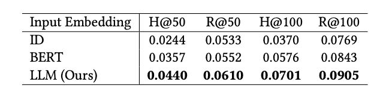

**为了检验内容嵌入的有效性，尝试将传**统推荐系统中常用的ID嵌入替换为内容嵌入

结果显示，利用**LLM**生成的内容嵌入显著提升了性能，**H\@100指标从0.0370提**升至0.0701，增长率高达89.46%

**为了更深**入地证明这一点，快手还**用BE**RT的 ** tok**en替换了LLM**嵌入。****与BE**RT生成的内容相比，LLM嵌入的表现更好，达到0.0701，这表明LLM嵌入能提供更强的表达能力。

**这种内容嵌入源于****LLM****在大规模预训练中处理了大量文本，因此**具备更高的信息量和更强的文本信息解读能力

#### Comparison with previous Rec-to-LLM method (RQ2)

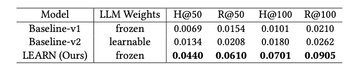

> **为了解决****RS****与****LLM**在协同域与开放世界域间差异的问题，快手设计了两个基准方法：

+   首先，**Baseline-v1**（冻结LLM参数）利用预训练但固定的LLM，将用户历史与所有内容内容融合成单个文本，通过平均池化提取用户嵌入。每内容单独输入LLM进行计算。评估策略与之前保持一致

+   其次，**Baseline-v2**（调整所有LLM参数）允许所有参数更新，它也模仿Rec-to-LLM，将推荐数据转化为自然语言对话，通过预测下一个词优化模型

> **这**两种基线分别代表了冻结和调整LLM的不同策略，旨在通过观察LLM在不同条件下的表现，来揭示两者在处理推荐任务中的异同

**实验数据显示：****Baseline-v1，由于其使用预训练LLM的冻**结参数处理推荐数据，表现出明显的性能瓶颈，主要原因是缺乏针对推荐领域的专业知识，无法有效利用协同信息

相比之下，Baseline-v2虽然**在H\****@100指**标上有轻微提升，但在微调LLM以适应推荐任务后，其性能并未达到LEARN框架

我**们观察到，**这种差异源于协同领域与开放世界知识的鸿沟，尤其是在处理包含大量噪声的行业推荐数据时，开放世界知识的处理效果灾难性地下降。因此，LEARN框架能够更好地平衡这两者，有效克服了这一问题，这也是其优越性的一个体现。

> **对比了**前文提到的Baseline-v2方法，尽管它借鉴了LLM融入推荐的模式，但实验结果却与之相异主要原因有两点：

+   首先，之前的验证通常在有限且经过处理的公开数据集（如MovieLens和Beauty）上，这些数据集规模小且可能无法全面反映真实工业环境，如我们的数据集，包含3100万商品和1200万用户，远超样本量

+   其次，由于数据质量高且规模较大，微调LLM并未造成所谓的"灾难性遗忘"，反而LLM的全局理解和文本解析能力为传统推荐模型带来了额外价值，通过将文本信息输入LLM并获取用户偏好描述，提升了Rec-to-LLM方法的表现

#### Comparison with SOTA models proposed for industry scenarios (RQ3)

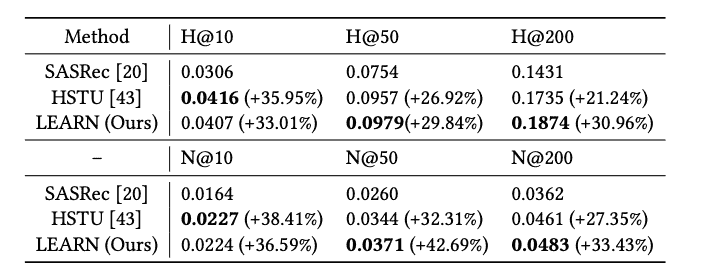

在将**LEARN**应用于实际工业环境的比较中，选择Amazon Book Reviews 2014作为基准，该数据集包含800万用户对200万本书的2200万条评论。

> 为确保公正性，遵循HSTU的处理和评估标准，结果显示：

> **LEARN在H\@50和H\@200上的提升分别为2.92%和9.72%，N\@50和N\@**200分别高出10.38%和6.08%，但在H\@10和N\@10指标上略逊一筹

**这种差异源于模型特性：**I**D嵌入擅长高**频**互动和热**门商品预测，而内容嵌入则**擅长理解和**推荐**非高频**但内容相关物品，尤其在大推荐列表（如前50或100）上表现突出。与SASRec和HSTU这类基于ID的模型相比，LEARN通过LLM的丰富内容表示实现了显著性能提升，验证了其有效性。

#### Ablation studies of modules within the LEARN framework (RQ4)

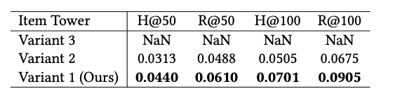

快手构建了三个变体来验证塔式结构的必要性。实验数据显示，变体3，当直接使用LLMs生成的内容**嵌入作****为项**嵌入时，模型无法正常训练，原因在于用户塔和项塔间架构的显著不匹配，以及LLM内容与推荐任务所需的项嵌入在领域上的差距。相比之下，尽管带自注意力的变体2表现稍弱，带因果注意力的变体1通过整合前一项嵌入特征显著增强了项嵌入的表现。基于这些结果，我们决定采用图(a)中的变体1作为LEARN框架的标准配置

**LoRA**通过添加可训练的新特征，结合原始参数，生成**混合特****征，作**为微调模型的输入**。然而，**由于LLM的多数参数冻结，原始特征占主导，导致混合特征质量不高。同时，LLM的开放世界知识与LoRA的协作知识在领域上存在鸿沟，这导致混合特征在推荐任务中的性能不理想。

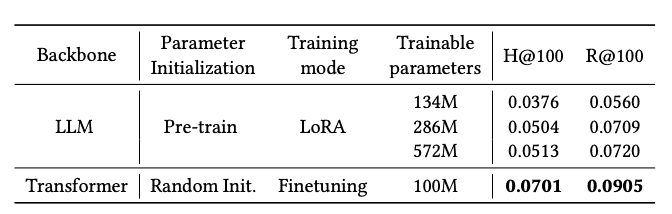

# **A/B测试**

> 在推荐系统的A/B测试中采用了**LEARN**架构，在快手应用的短视频广告推送环境中实施了这项技术的部署

## **模型****架构**

为了将**LEARN**框架生成的**LLM****嵌**入与ID嵌入有效融合，在现在线性模型中增加了辅助网络。这个附加部分旨在优化不同嵌入类型的融合，以提升系统性能，辅助网络通过定义CVR损失，引导LEARN生成的用户和项嵌入。

随后，这些嵌入与辅助网络由多层**MLP**生成的融合嵌入一起输入到推荐系统的核心（主塔）中

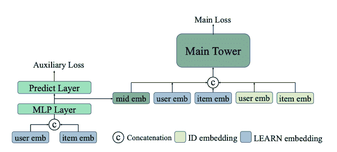

### **AUC Evaluation**

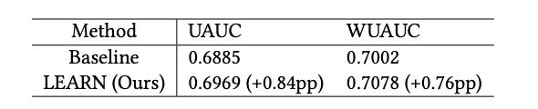

> 在快手电商平台一个包含3亿用户交互和1千万商品的十亿级离线数据集上进行评估，数据于2023年12月7日采集，分为训练集和测试集，后者于前者后一天获取。评估指标选用UAUC（用户平均AUC）和WUAUC（加权用户平均AUC），而非仅AUC，因为它们能更全面反映用户排名的性能，体现用户体验。UAUC考虑均匀权重，尤其关注长尾用户的表现。

**如表所见：方法在****UAUC****和****WUAUC****上的提升****分别达到了****0**.84%和0.76%，这归功于LEARN框架的优异泛化能力，它显著提升了对长尾用户兴趣的捕捉，为确认这一推断，我们进行了线上A/B测试以进行更深入的验证

#### Online Revenue Improvement

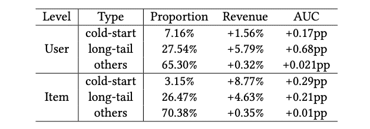

**在快手Ap**p的热门短视频流媒体平台进行了在线A/B测试，该**应用日活跃用户达3亿。将20%的流量分配给我们的改进模**型（LEARN）和基线模型。这项为期9天的实时测试显示，收益和点击率（CVR）稳定且明显提升。即使只有2%的增长，在高用户基数下也体现出显著的实际收益，因为在线推荐模型的收入动辄以百万计。

> **再依据用户过去的六个月交互数据（点击**、印象和购买频次）分类，定义了三种类型：

+   **冷启动用户（无交互）**

+   **长尾用户（1-35次）**

+   **其他用户**

+   研究表明：**LEARN**模型在所有用户群体中，特别是在冷启动和长尾用户中，展现出了显著的性能提升。此外，按购买历史将产品分为冷启动（无购买记录）、长尾（少于30次）和常购（超过30次）

+   实验结果显示：**LEARN**显著提升了冷启动和长尾产品的收入和AUC指标，这归功于其对购买历史稀疏产品表示的高效能力