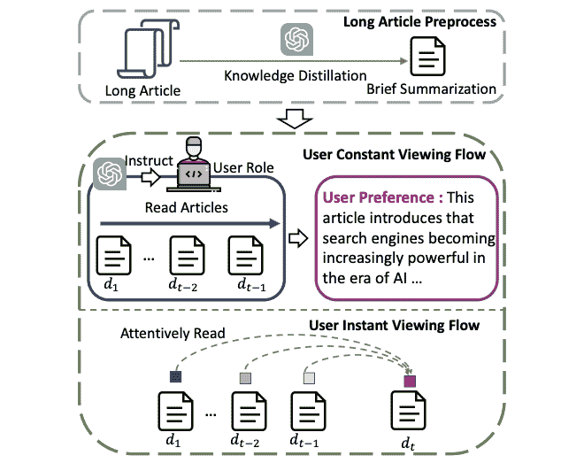
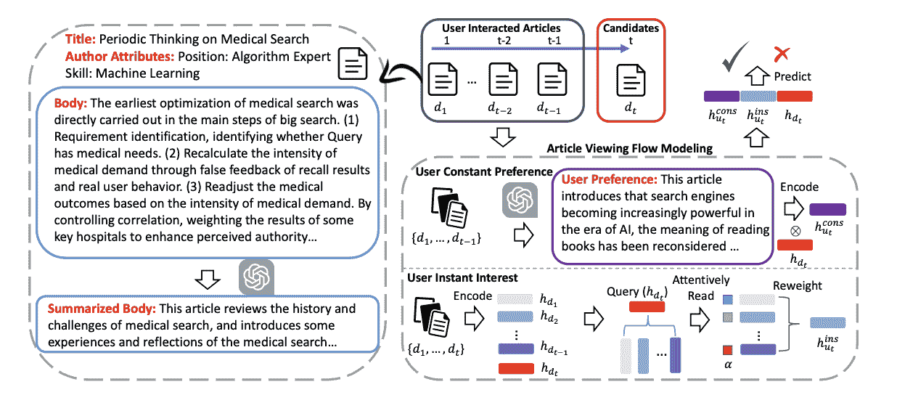
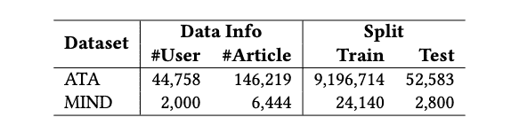
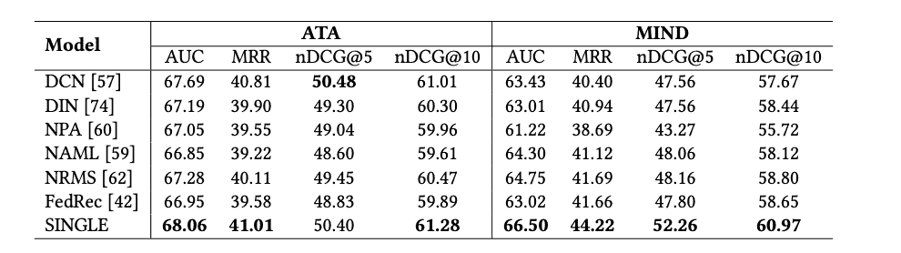
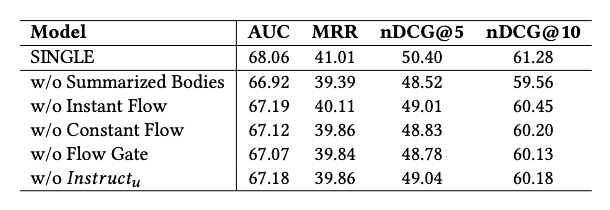
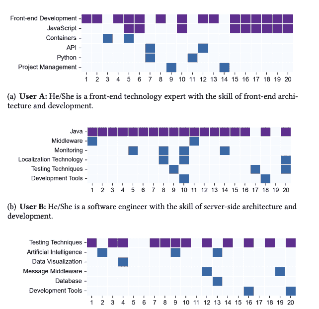
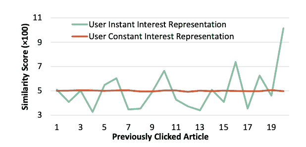
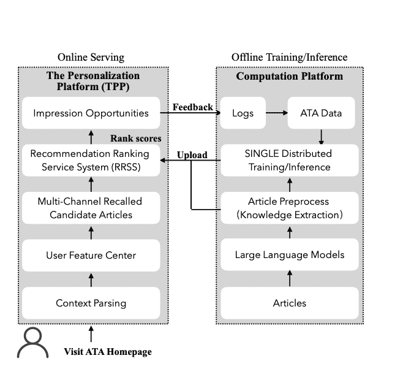
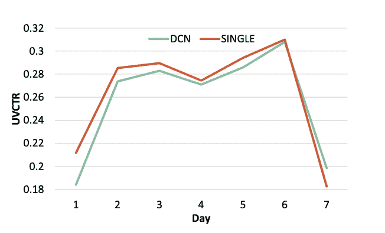

# 阿里结合LLM建模用户阅读流0-1落地

> 来源：[https://qqs7y1hozd1.feishu.cn/docx/HO2mdHejAoE2sExgNKgciNJSnJc](https://qqs7y1hozd1.feishu.cn/docx/HO2mdHejAoE2sExgNKgciNJSnJc)

# **项目****背景**

**在线平台，例如：**Microsoft News、知乎、CSDN、博客

为用户提供了访问新闻信息、交流用户想法和学习专业知识的机会。

然而，信息过载使用户在从大量文章中找到真正需要的信息时耗尽耐心。

在本文中，一种用户浏览流建模**SINGLE**方法来为用户推荐文章

# **项目搭建**

## **SINGLE****框架**

**如图所示：**

+   给定用户已浏览的文章 ，文章推荐任务旨在推荐下一篇文章 以满足用户在第 时刻的信息需求

> 在本小节中，描述了文章表示和编码方法，然后介绍如何根据之前点击的文档 预测下一篇文章

### **内容展现方式**

+   **文章**** ****通常由文章标题**** ****、文章正文**** ****和文章属性**** 组**成

> **具体来说：**文章属性包含作者、部门、性别和职位等信息，以及文章视图和点击特征。

> 文章标题和正文包含重要的语义，有助于通过文本描述理解用户行为。

> 因此，这些模型丢弃了文章正文，只使用文章标题来表示文章。

+   **为了充分建模文章**** ****的语义，尝试借鉴大型语言模型（LL**M）的强泛化能力来减少文章正文的文本长度

**具体来说：**设计了文章摘要指令  ，并利用LLM生成文章正文 的简要摘要 ：

> 其中 是摘要指令。摘要后的文章正文 的长度小于原始文章正文 的长度。例如，在ATA数据集中，原始和摘要文章正文的平均长度分别为3,902和260

> 最后，用摘要后的文章正文 替换原始文章正文 ，文章 可以用文章标题 、摘要后的文章正文  和文章属性 来表

### **文章编码**

+   **可以将文档 **** ****编码为文章表示**** ****：**

> 其中 是连接操作。 、 和 是文章属性 、文章标题  和摘要后的文章正文 的嵌入

**具体来说：**可以使用**BERT**获得标题表示 和正文表示   ：

1.  其中BERT参数在训练期间被冻结。这些文章特征  由随机初始化的嵌入表示

1.  然后，连接这些属性嵌入，并采用多层神经网络获得文章属性 的最终表示

### **下一篇文章预测**

**SINGLE****模型通过建模用户即时兴趣和从之前访问****的**文章中获得的恒定偏好，来学习用户的表示

**然后，可以预测第**** ****时刻候选文章**** ****的点击率：**

> 其中 是连接操作， 是文章 的编码表示

**然后，使用交叉熵损失**** **来优化SINGLE模型的可训练参数：

> 其中  是第 次预测文章的真实标签

> 可以分为两类，包括点击 和未点击

## **用户浏览流建模**

+   **通过使用文章点击历史 **** ****来建模用户行为，并学习用户表示**** **

**具体来说：**旨在通过建模即时和恒定浏览流来模仿用户的即时兴趣和恒定偏好，以推荐第 时刻的文章

**将用户即时兴趣表示 **** ****和用户恒定兴趣表示**** ****连接起来表示用户：**

### **用户即时浏览流建模**

> 用户通常在浏览文章时表现出多视角兴趣，用户即时兴趣表明了用户的快速和即时偏好，在浏览文章时，一些不同主题的文章可能会激发用户的好奇心并吸引用户点击这些文章

为了建模用户的即时兴趣，**SINGLE**通过将第 时刻的潜在交互文章 视为查询，仔细读取用户之前访问的文章 的语义来建模即时浏览流。这样的注意机制旨在根据候选文档  从这些已访问的文章  中提取一些语义，以提供一些支持证据来预测下一篇文章

**具体来说：**首先使用公式2获取已访问文档  的文章表示 和潜在交互文章 的表示

**然后可以计算用户即时兴趣表示**** ****：**

**其中 **** ****是用于加权已访问文档**** ****表示的注意力分数：**

> 其中 是可学习矩阵

### **用户恒定浏览流建模**

+   **与用户即时浏览流建模不同，用户恒定浏览流旨在解耦用户点击**的不同文章的总体偏好，并学习静态用户特征

为了建模用户偏好，通过一个基于**token-level**的协同过滤模型模拟用户一般的浏览行为

具体来说：连接之前点击文章 的文本表示，利用LLMs从  捕捉一些常见关键词，并从  捕捉用户特征：

> 其中 是提示LLMs在从 中提取用户特征时起作用的指令

**然后可以编码用户恒定兴趣表示 **** ****：**

> 其中 是元素级乘积。BERT编码器与公式3中的BERT编码器共享相同的参数。我们使用流门 来控制使用用户恒定兴趣的候选文章 的语义

# **实验方法**

## **数据集**

在实验中使用了两个数据集，**ATA**和**MIND**，以评估不同推荐模型的有效性。

**数据统计如表所示：**

> **ATA** 数据集来自阿里巴巴技术协会（ATA）

> 它是阿里巴巴技术生态系统内的一个内部平台，旨在为工程师提供交流想法和合作解决技术问题的机会，这有助于促进以工程师为中心的文化，并鼓励技术创新。ATA为阿里巴巴的技术专业人员提供博客、专题讨论、社区和活动组织等功能

> **MIND**（Microsoft News Dataset）是一个由微软开源的大规模数据集，服务于新闻推荐研究

> 数据收集来源于微软新闻网站上的匿名行为日志。MIND包含约160,000篇英文新闻文章和由一百万用户生成的超过1500万条日志

## **评估指标**

在实验中，遵循以往的工作，并使用AUC、MRR、nDCG@5、nDCG@10作为评估指标来评估不同模型的推荐效果

同时还使用**UVCTR**评估指标来评估部署在ATA网站上的SINGLE的有效性

## **基线模型**

> **DCN** 引入了一个交叉网络，以更好地提取使用深度神经网络的项目特征。交叉网络有助于从特征中提取高级交互以表示项目

> **DIN**（Deep Interest Network）通过建立候选项目和用户之间的交互，来自适应性地学习用户兴趣表示，从历史交互项目中计算候选项目和之前交互项目之间的相关性

> **NPA** 通过编码标题表示新闻文章，然后使用用户ID的嵌入生成查询向量，并提出一种个性化注意力网络，通过使用词级和文章级注意力机制来表示新闻文章

> **NAML** 旨在学习新闻文章的多视图表示，通过使用CNN编码新闻文章的标题和正文，并通过查询嵌入仔细读取编码的类别、标题和正文的表示来学习文章表示

> **NRMS** 进一步利用多头注意力机制编码标题来表示新闻文章

> **FedRec** 增强了经典的联邦学习推荐系统，以在新闻推荐中实现隐私保护。FedRec使用用户模型学习用户兴趣，并利用模型学习新闻表示。每个用户在本地计算模型梯度，并使用本地差分隐私加密上传到服务器

## **实现细节**

**SINGLE****实现细节**

+   **对于MIND数据集，****SINGLE****模**型利用gpt-3.5-turbo作为LLM模块，并使用不同的提示从点击的文章正文中总结信息，并提取用户偏好

> 文章摘要指令（公式1）为“这是一篇关于[类别]的文章，请在一段简短的句子中总结它以激发读者的兴趣：[文章正文]”。然后，SINGLE使用指令“请总结用户的新闻浏览内容。以下是浏览历史：[访问的文章]”来总结用户恒定偏好。

+   **对于ATA数据集，由于隐私许可，采**用ChatGLM-6B4来实现LLM模块

> 文章正文摘要指令（instructs）和用户恒定偏好指令（instructu）分别为“给定一篇文章，标题为[文章标题]，文章内容为[文章正文]，请根据文章生成200字的摘要”和“给定访问的文章：[访问的文章]，我是[组织]的[职位]，我的技能是[技能]。请基于访问的文章写一个约150字的摘要”

# **评估结果**

## **整体表现**

首先评估**SINGLE**的推荐效果，并在表2中展示模型的性能。

**总体而言：**

+   **SINGLE**模型优于所有基线模型，特别是在MIND数据集上

+   **这证明了****SINGLE**在新闻文章和技术文章推荐任务中推荐更符合用户需求的个性化文章的有效性

在所有基线模型中，个性化新闻推荐方法（如NAML、NRMS和FedRec）通常在MIND数据集上表现优于基于特征的文章推荐方法（如DCN和DIN）

> **这表明：**

1.  这种个性化新闻推荐建模方法在捕捉用户兴趣以匹配候选新闻文章方面是有效的。相反，这两组推荐方法在ATA数据集上的表现几乎相同

1.  主要原因可能在于ATA数据集包含不同角色的用户，如算法专家、产品经理和算法工程师，这使得建模通用兴趣表示更具挑战性

1.  SINGLE在两个数据集上均表现出一致的改进，展示了其在使用我们的文章浏览流建模方法建模不同用户兴趣方面的优势

## **消融研究**

在本实验中进行消融研究以展示**SINGLE**模型中不同模块的作用

**如表所示：**

+   首先评估**LLMs****在摘要文**章正文方面的有效性，并展示了LLMs在从长文本中提取知识的能力。

+   然后，展示了不同文章浏览流建模方法的有效性，包括用户恒定浏览流建模和用户即时浏览流建模

+   最后，进行两个模型的对比：没有流门的SINGLE（SINGLE w/o Flow Gate）和没有用户角色提示的SINGLE（SINGLE w/o Instructu），以探讨流门机制和用户资料提升在从点击的文章中提取用户恒定偏好中的作用

**实验结果表明：**用户即**时浏览流和恒定浏览流建模方法在向用户推荐文章方面**都是有效的。它展示了用户文章浏览行为的潜在兴趣，这应该匹配用户的一般兴趣，同时也推荐一些相关和新鲜的文章以吸引用户的注意力。与用户即时浏览流建模相比，用户恒定浏览流建模在推荐更符合用户需求的文章方面更为有效。这表明恒定浏览流建模在从文章浏览历史中过滤噪声和更好地捕捉用户偏好和一般兴趣方面是有效的

> 在**SINGLE****模型中，**用户恒定浏览流建模方法的有效性主要来自LLMs的强大能力：

+   在建模用户恒定浏览流期间，用户角色提示 Instructu 使用模板来捕捉用户的技能和职位信息。它展示了在从用户点击的文章中提取用户特征方面的有效性

+   另一方面，流门机制在结合用户恒定表示进行文章推荐方面起到了关键作用。流门机制使用元素级操作来学习候选文章的新视图，使用用户恒定表示来控制候选文章的语义以预测用户点击概率

## **不同用户浏览流建模方法的作用**

+   首先展示了不同用户点击文章的话题分布

+   **然后，通过展示用户和访问文章表示之间的相似度得分**，探索用户即时和恒定浏览流建模方法的机制

**在图中：**

选择了三个用户展示他们点击文章的话题分布

总体而言，这些用户通常喜欢点击与JavaScript、Java和测试技术相关的文章，展示了用户的一般兴趣。这些文章话题与用户的技能和职位相关，这支持了用户恒定兴趣建模方法的动机

另一方面，用户也点击了不同话题的文章，表明用户通常有不同的兴趣点可以吸引他们的注意。两种文章浏览行为对于建立个性化推荐系统都是至关重要的。在这种情况下，建模用户恒定和即时浏览流可以通过推荐更合适和多样化的文章来提高用户体验

在右图中用户和点击文章表示之间的相似度：

用户恒定表示在不同时间步长与用户点击文章进行一致的相似度得分，表明用户恒定浏览流建模方法从这些点击文章中学习了通用语义。它有助于提取用户的静态特征并推荐适当的文档，这些文档共享相似的话题并匹配用户的一般兴趣

相比之下，用户即时兴趣表示显示了不同的建模行为。用户即时兴趣表示与一些文章表示更为相似，特别是这些文章的后续用户交互文章，表明用户通常有不同的兴趣视角，可以匹配不同话题的文章。这样的即时兴趣建模方法使推荐系统返回一些多样的文章，以满足用户的兴趣，帮助避免单调和更通用的推荐结果

## **A/B测试**

+   **进一步在线A/B测试以验证****SINGLE****的有效性**

**具体来**说**：首先描述在**线系统开发的流程，然后展示DCN和SINGLE的推荐性能

**如图所示：**

在**线系统部署在**阿里巴巴的ATA平台上，可分为在线服务模块和离线训练/推理模块。在高性能计算服务平台的帮助下，可以使用SINGLE有效地预处理和编码文章，这些是离线推理过程。然后将用户和文章表示上传到在线服务系统，用于对候选文章进行重新排序，执行高效的推荐结果生成过程

在右图中评估在线系统的有效性：

> 选择DCN作为主要基线模型，其在ATA数据集上的表现优于其他基线模型。在线A/B测试连续七天内在ATA平台上进行

**在线A/B测试中：****实验结果表明SINGLE比DCN模型平均提高了2.4****%。这是工业**场景中的显著改进，再次验证了SINGLE模型在为ATA平台用户推荐技术文章方面的有效性

## **案例研究**

+   在第一个案例中，用户访问了一些关于“扩散模型”的文章，然后将兴趣转移到一些LLMs技术上，如“Prompt”和“ChatGPT”。SINGLE模型通过为之前点击的文章分配更多的注意力权重来捕捉这样的主题转换，这些文章是关于“BERT相关性模型”和“Prompt工程”，与之前点击的文章不同。得益于用户恒定兴趣建模，推荐结果也涵盖了关于扩散的文章，展示了用户恒定兴趣建模的有效性

+   第二个案例展示了不同的文章浏览行为，通常保持一致的用户兴趣。用户即时兴趣建模方法也更关注关于“检索”的文章，展示了从之前点击的文章中过滤噪声的有效性