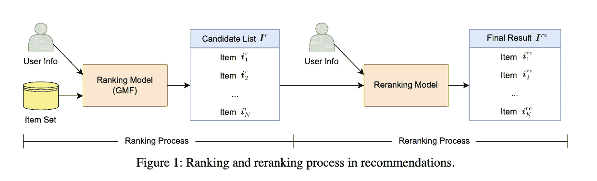
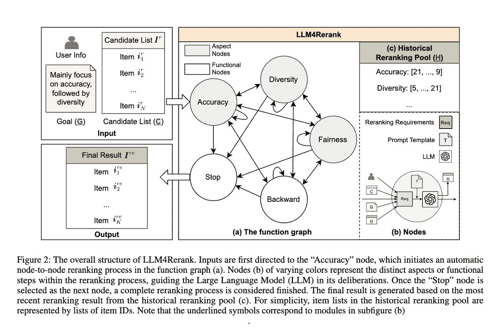
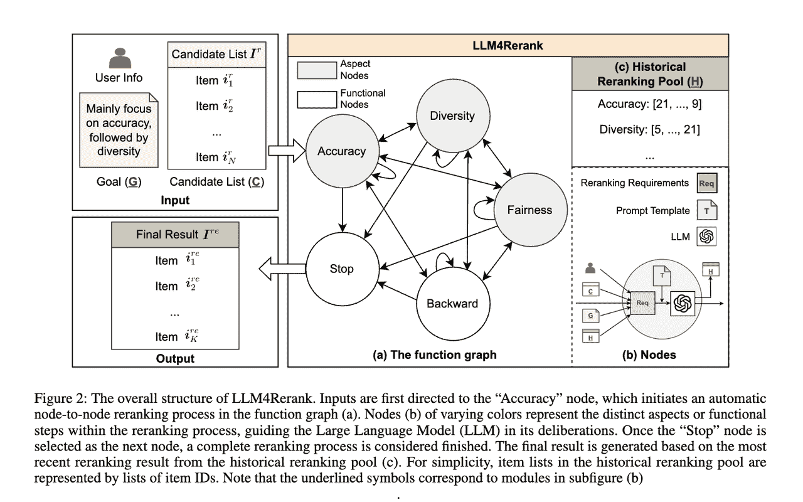
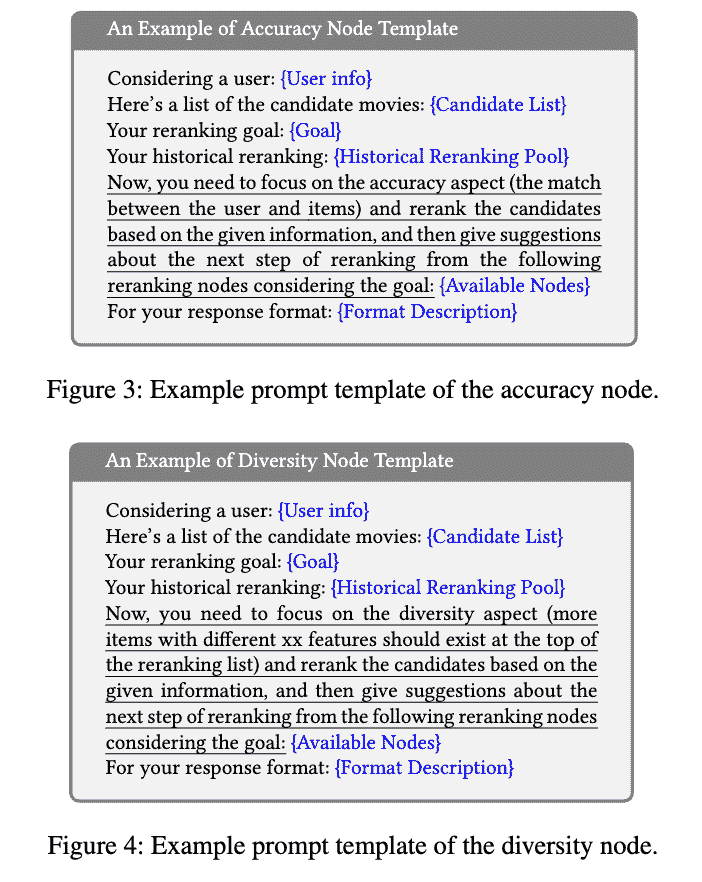
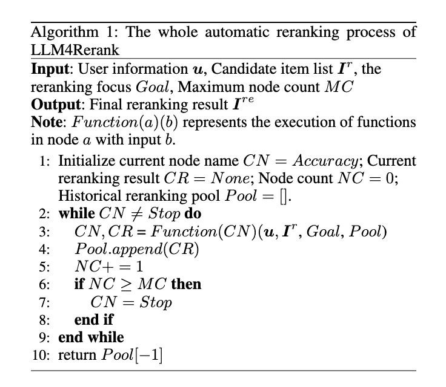
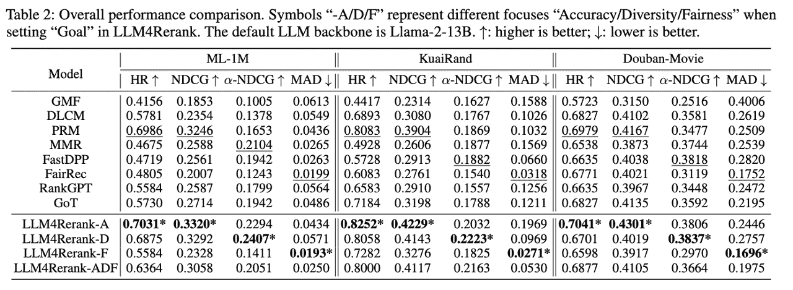
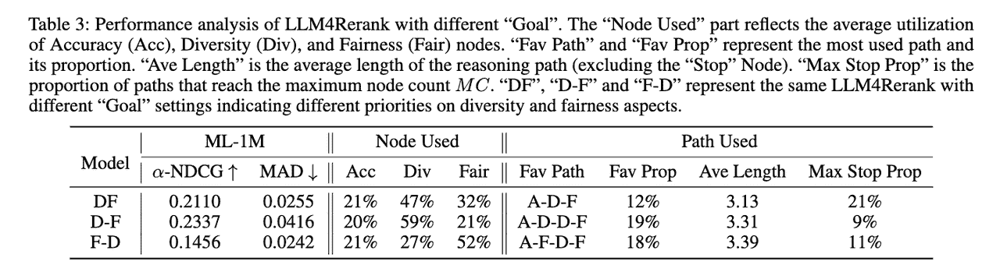
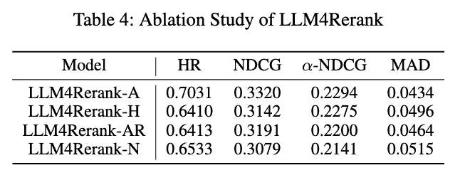
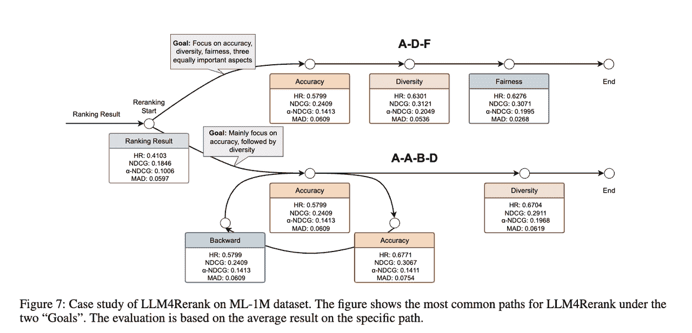
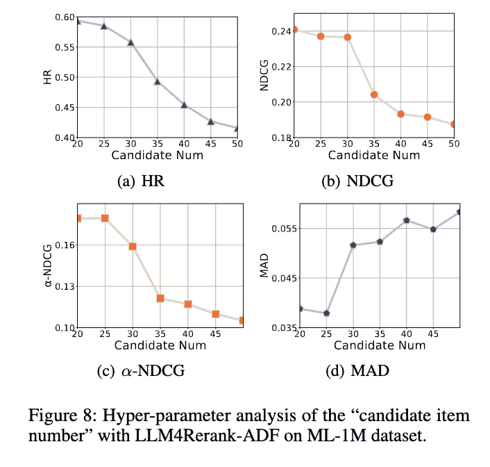

# LLM在推荐系统重排序中的应用

> 来源：[https://qqs7y1hozd1.feishu.cn/docx/FwNHd🐧fUo1scBx2mpacpAvVn7d](https://qqs7y1hozd1.feishu.cn/docx/FwNHd🐧fUo1scBx2mpacpAvVn7d)

# **简 介**

**重排序****在推荐系统中是一个关键环节**，**对于优化推荐算法的输出至关重要**

+   **传统的重排序模型**主要关注准确性，但现代应用程序需要考虑更多的标准，如多样性和公平性

+   现有的重排序方法通常无法在模型层面上有效地协调这些不同的标准

+   由于这些模型的复杂性以及在不同场景下重排序标准的重要性各异，在可扩展性和个性化方面经常遇到挑战

**为此，**引入了一个由**大型语言模型 LLM**** **增强的综合重排序框架，**旨在在保持可扩展性的同时，实现对多**种重排序标准的无缝整合，并支持**个性化**推荐。该框架采用全连接图结构，使得LLM能够通过一致的链式思维（Chain-of-Thought）过程同时考虑准确性、多样性和公平性等多个方面

# **重排序技术**

+   重排序技术是推荐系统领域中的一个基础性方法

> 其重要性在于能够对排名模型生成的结果进行进一步优化和提升，最终为用户提供最相关和个性化的推荐

1.  在典型的推荐过程中，首先由排名模型利用交互特征（如用户属性和物品属性）生成一个候选列表

1.  随后，重排序模型进一步审查候选物品之间的关联，深入分析用户偏好的细微差别，并最终生成最终的推荐列表

目前，现有的重排序模型主要集中在提高推荐的准确性方面，尽管准确性至关重要，但在实际应用中，还需要考虑推荐列表的其他重要方面，如多样性和公平性。多样性确保用户能够接触到各种不同的物品，而公平性则保证不同类别或卖家的平等展示机会。虽然一些研究尝试将这些方面与准确性相结合进行建模，但如何更好地同时考虑和平衡多个方面仍然是一个难题

> 具体而言，现有的重排序模型存在几个局限性：

+   首先，由于这些方面之间存在显著的语义差距，难以在建模中全面考虑和平衡多个方面的复杂组合。这是因为每个方面通过独特的属性维度审查推荐列表，突出了复杂的语义关系和差异，这使得不同方面之间的差距显得尤为明显

+   此外，可扩展性问题是另一个主要障碍，阻碍了单一模型在不同推荐场景中的应用，因为这些场景可能会优先考虑不同的方面或功能规则

> 这一挑战在引入新颖的方面或定制的重排序规则（如反向规则或停止条件）时尤为突出，而这些规则在模型开发时可能未曾预料到。此外，无法个性化地融合各个方面进一步限制了现有模型的个性化能力，正如以往研究所指出的那样。一旦部署，特定模型在不同方面的输出倾向是固定的，无法根据不断变化的业务或用户偏好进行智能调整

**为克服这些障碍：****一个**理想的解决方案是创建一个多功能的重排序框架，该框架能够同时考虑多方面的组合和语义细微差别。这种框架应灵活适应不同环境和用户需求的独特要求，提供更具动态性和针对性的重排序解决方案

**随着大型****语言模型**（LLMs）的迅速发展，大量研究已经开始评估LLMs在各种场景中的能力。先前的研究指出，在信息抽取和推荐等任务中，零样本的LLMs可能无法达到专业化模型的熟练程度。这一限制通常归因于其有限的Token数量以及处理包含数千个项目的广泛上下文的困难

**尽管存在**这**些挑战，**研究表明，在重排序任务中，LLMs的表现可以与监督基准相媲美，甚至超越后者。这种高效表现归功于它们在涉及少量项目的简明上下文中强大的语义理解能力。因此，将LLMs应用于推荐系统的重排序阶段，可能成为通过增强语义理解来整合不同方面的关键策略

> 然而，在使用**LLMs**构建重排序框架时，**仍然面临若干重大挑战：**

1.  第一个挑战是确保框架能够以良好组织且灵活的方式扩展，既能满足当前的方面需求，又能适应未来可能出现的需求

1.  第二个挑战在于制定一种机制，能够根据特定的推荐设置或用户偏好，自动结合不同方面的需求，最终实现真正的个性化推荐

+   为应对这些挑战，华为提出了**LLM4Rerank**，一种利用零样本**LLMs**实现更精确重排序的创新框架

**具体来说：****LLM4Rerank**将重排序中的各种方面需求表示为不同的节点，使框架能够以链式思维（Chain-of-Thought）的方式自动整合这些节点

> **这种方法的优势有：**

1.  **首先，它确保了可扩展性，使得新节**点能够无缝加入，以应对不断出现的方面需求

1.  此外，**LLM4Rerank**中的**LLM**能够**根据当前的重排序历史**和一个额外的输入句子（称为“目标”）自动确定下一个要考虑的节点，这个“目标”由用户或部署者提供，代表正在进行的重排序过程的总体重点和目标，这个动态过程使得LLM4Rerank能够在重排序过程中实现更强的个性化

# 框 架

## 问题定义

+   重排序任务在推荐系统中起着关键作用

**如图所示：**设 为用户集，I为可推荐的物品集。为简明起见，本文将每个用户和物品分别表示为特征向量（分别为 和 ）最初，排名模型为每个用户生成一个包含N个物品的候选列表 。为了提升推荐性能，应用重排序过程来分析初始列表Ir中各物品之间的关系。该分析旨在从初始列表中生成一个包含K个物品的精细列表，记为 重排序模型的目标是通过优化定义的目标函数来增强用户与物品之间的相关性：

> 其中， 是评分函数，用于评估物品i对用户 的相关性，考虑了准确性、多样性和公平性等方面。通过这一优化过程，重排序模型从候选列表Ir中选择出最优的推荐列表 ，使其符合个体用户的偏好，从而显著提升推荐质量。

## **LLM4Rerank**

**重排序框架****LLM4Rerank****：**

> **该框架接收三种类型的输入：**

+   用户信息（user info），包括性别、年龄等特征

+   候选物品列表

+   以及被称为“目标”（Goal）的句子，后者描述了重排序时优先考虑的方面

> **LLM4Rerank**被**构建为**一个完全连接的功能图（不包括“停**止”节点），由图2（a）中所示的各种节点组**成。每个节点代表一个潜在的重排序步骤，通过LLM生成一个重排序列表，同时考虑特定的方面相关或功能需求，如图2（b）所示。功能图中的每条边表示节点间的潜在路径，确保所有节点之间的连通性（“停止”节点除外）

为了展示**LLM4Rerank**的可扩展性，不仅将“准确性”节点，还将“多样性”和“公平性”方面节点，以及两个功**能节点**“回退”和“停止”集成到框架中，以实现实际功能。节点架构经过精心设计，允许LLM依次评估不同的节点，从而优化重排序结果，以全面满足多个方面的要求。此外，为了防止内存丢失并增强LLM对方面组合的评估，使用了一个历史重排序池（图2（c））。该池按顺序记录每个节点的输出，作为后续节点重排序的辅助参考。最终，当“停止”节点被访问时，重排序过程完成。此时的输出正是历史重排序池中最新的重排序结果，表示为

## 节点构建

为了便于大型语言模型**LLM**系统性地分析重排序中复杂的方面需求，该结构旨**在为特**定需求建立不同的节点。这种安排使得LLM能够以链式思维（Chain-of-Thought）方式处理这些需求

> **这种方法提出了两个主要挑战：**

+   首先，自定义节点结构以在引入额外需求时保持可扩展性

+   其次，使**LLM**能够自动选择其后续的重排序步骤

为应对这些挑战，引入了一个通用节点结构。它包括一个重排序步骤，配有一个辅助指**示器，**指**示接下来要执行的重排**序步骤的方向，由下一个节点的名称来标识。这种配置允许LLM在LLM4Rerank框架中自动导航，基于当前可用信息做出决策

## 方面节点

为了便于**LLM**执行针对不同方面需求的重排序任务，在所提出的通用节点结构中采用了基于**提示模板的方法。这种方法允许为特定节点实例化，**以便在重排序过程中评估不同的方面。因此，每个节点都被设计为系统地处理这些关键方面之一，确保重排序结果能够反映出平衡的考量

**为了展示****LLM4Rerank**的可扩展性， 实现了三个专门用于重排序的方面节点：“准确性”、“多样性”和“公平性”

+   **准确性节点**：此节点旨在满足重排序阶段最终推荐列表的性能标准。因此，提示模板的设计强调用户与物品之间的关联性。图中展示了**在该节点中使用的一个**简单的模板。此外，考虑到推荐准确性的重要性——这是推荐系统中不可或缺的基本方面——准确性节点被设定为LLM4Rerank框架的起始点。因此，每一个重排序过程都从准确性节点开始，确保从一开始就以精准度为基础

+   **多样性节点**：此节点专门设计用于在重排序阶段满足最终推荐列表的多样性标准。在**本研究中， 通过评估重排序结果**中某一特定属性的变化程度来评估最终列表中的多样性。为此， 采用了α-NDCG指标

+   **公平性节点**：此**节点旨**在满足重排序阶段最终推荐列表中的公平性目标。推荐结果的公平性被操作化为两个样本组之间的平均分数差异，这些样本组按某一特定特征区分，并使用平均绝对偏差（MAD）指标进行评估。鉴于LLM本质上生成的是重排序列表而非数值分数， 为最终推荐列表中的物品分配了从1到0的线性分数。这些分数随后用于计算MAD以进行公平性评估

## 功能节点

+   **反思在优化****LLM****输出方面具有显著效果**

> 为了增强**LLM4Rerank**在重排序过程中的逻辑能力并引入专业功能， 开发了两个专门用于促进重排序序列中反思和终止的功能节点：

1.  **回退节点**：此节点使**LLM**能够选择性地忽略在先前重排序过程**中被认为不理想的重排**序结果。在此框架内，LLM4Rerank删除历史重排序池中的最新重排序结果，并进入下一个步骤

1.  **停止节点**：此节点负责终止**LLM4Rerank**输出序列。当**LLM4Rerank**将此节点指定为下一个步骤时，这意味着整个重排序过程的完成。随后，该节点从历史重排序池中提取最近的重排序结果，作为最终的重排序结果。

## 自动重排序过程

为了利用**LLM**在基于多方面需求的重排序中发挥作用， 设计了不同的节点，每个节点都针对特定的方面标准。然而，为每个重排序任务从一个节点到另一个节点预定义路径既低效又难以实现

通过应用这些子过程，**LLM4Rerank**的整个自动重排序过程得以建立，如算法中所示：

> **因此，为了适应独特的用户偏好并显著提高个性化效果， 开发了一个**自动重排序过程，主要包括以下三个子过程：

+   **设定“目标”**

+   **节点之间的自动转换**

+   **终止重排序的条件**

# **结 果**

在三个广泛认可的工业数据集上进行实验，以探讨以下研究问题：

+   **RQ1：****LLM4Rerank**在准确性、多样性和公平性方面与已有的重排序基线相比表现如何？

+   **RQ2：****LLM4Rerank****能否自动识别并优先考虑针对个体偏**好量身定制的特定方面需求组合进行重排序？

+   **RQ3：****LLM4Rerank**的自动重排序框架是否相较于预定的重排序路径提供了明显的优势？

## 实现细节

**在评估准确性方面时， 采用了广泛认可的指标：命中率（HR）和归一**化折扣累积增益（NDCG）对于多样性方面的评估， 使用了常用的指标α-NDCG，为了评估公平性， 使用了平均绝对差（MAD）

**MAD的计算公式如下：**

### **总体表现 (RQ1)**

1.  **DLCM和PRM** 在准确性方面表现良好，从HR和NDCG指标来看，PRM由于利用了Transformer架构进行用户与物品相关性评估，在准确性上超过了DLCM

1.  **MMR和FastDPP** 在提高多样性方面表现出色，体现在α-NDCG指标上。这些模型通过强调物品相似性和列表整体多样性，擅长在用户的重排序列表中实现多样化

1.  **FairRec** 在促进公平性方面表现强劲，使用MAD指标进行衡量。通过整合分解对抗学习和正交正则化技术，FairRec在不同用户群体间确保了更公平的推荐结果

1.  **RankGPT** 展现了令人称赞的表现，强调了零样本LLMs在重排序任务中的能力。相比之下，GoT采用链式思维（Chain-of-Thought）方法，通过对多个方面的顺序分析，取得了更优的结果

1.  **LLM4Rerank** 通过个性化的“目标”设定和自动重排序过程，显著超越了基线模型，验证了其综合效能LLM4Rerank巧妙地整合了重排序的各种方面需求，展示了其多功能性。虽然LLM4Rerank-ADF在单一方面可能并不领先，但其在所有维度上的整体平衡表现，证实了将LLMs与自动重排序框架结合的优势。该方法通过语义理解有效地协调了不同方面的需求，提供了在准确性、多样性和公平性方面的优化结果

### **方面组合分析 (RQ2)**

深入探讨了一系列实验，旨在评估**LLM4Rerank**是否能够根据不同用户定义的“目标”自动调整其重排序策略，以纳入特定的方面需求组合。 在ML-1M数据集上进行了实验，测试了在不同“目标”下的LLM4Rerank，这些“目标”反映了对多样性和公平性方面的不同优先级：

+   **DF**：对多样性和公平性方面赋予同等重要性

+   **D-F**：优先考虑多样性，其次是公平性

+   **F-D**：优先考虑公平性，其次是多样性

### **消融研究 (RQ3)**

> 在ML-1M数据集上进行了消融研究，以阐明LLM4Rerank各个组件对整体性能的影响。这些实验旨在通过系统地去除某些功能来剖析模型的架构，从而突出其各个部分的贡献。 重点关注“准确性”方面作为案例研究，并与特定的“目标”对齐：关注准确性方面。 考虑了以下几种LLM4Rerank的变体进行比较：

+   **LLM4Rerank-A**：如表2所述，包括所有子结构，重点关注准确性方面。

+   **去除历史重排序池 (-H)**：去除历史重排序池，删除引用先前重排序结果的能力。

+   **去除自动重排序 (-AR)**：采用静态重排序路径“准确性-准确性-停止”。

+   **去除其他方面节点 (-N)**：仅保留“准确性”和“停止”节点，去除所有其他节点。

> 在上表中的结果得出以下几个结论：

+   缺少历史重排序池（LLM4Rerank-H）会导致性能显著下降，强调了在顺序决策中保持整体视角的重要性。此功能使LLM4Rerank能够回忆并评估先前的选择，增强模型的战略深度

+   移除自动重排序过程（LLM4Rerank-AR）导致性能显著下降，验证了自适应路径在应对多样化方面需求中的实用性。自动重排序机制允许LLM4Rerank根据当前信息的全部情况动态确定后续步骤，从而优化重排序顺序

+   去除其他方面和功能节点（LLM4Rerank-N）也导致性能显著下降。这突出了“回退”节点所促进的全面回顾机制的价值，类似于人类的决策过程。同时，与-AR相比，LLM仍然可以决定在结束重排序过程之前访问该节点的次数。性能的提升验证了即使LLM4Rerank仅有单一方面节点，动态节点访问次数仍能为其带来益处

# **案例研究**

> **通过一个具体的案例研**究进一步说明LLM4Rerank框架的工作原理，并探讨其是否能够真正平衡重排序的不同方面

**在该图中， 报告了在****不同“目标”下LL**M4Rerank最常见的两条路径：

+   第一条路径（A-D-F）同时考虑了准确性、多样性和公平性

+   第二条路径（A-A-B-D）则更侧重于准确性方面，其次是多样性方面。评估基于特定路径的平均结果

1.  从第一条路径可以看出：根据“目标”的指导，LLM4Rerank依次经过“准确性”、“多样性”和“公平性”节点，然后结束重排序。在多样性重排序步骤之后，不仅“α-NDCG”指标变得更高，“HR”和“NDCG”指标也有所提升。这可能是因为在实验中，LLM能够综合考虑当前重排序，不仅考虑当前方面，还考虑历史重排序结果。此外，当一起考虑时，“α-NDCG”和“NDCG”指标之间的正相关关系可能也影响了两者的结果

1.  从第二条路径来看：可以看出功能节点如“回退”的加入有助于LLM进行更系统的思考。当它察觉到在连续访问“准确性”节点后多样性方面几乎没有变化时，它考虑返回上一步并将下一步设置为多样性节点

