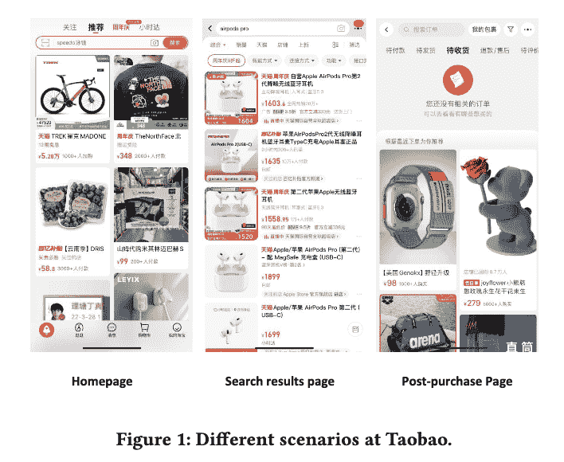
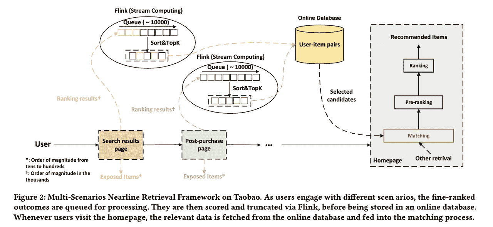
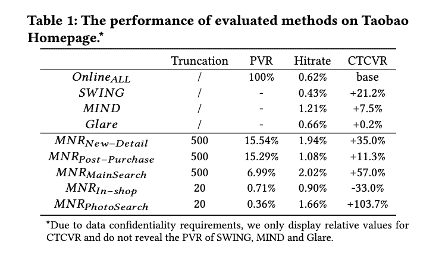
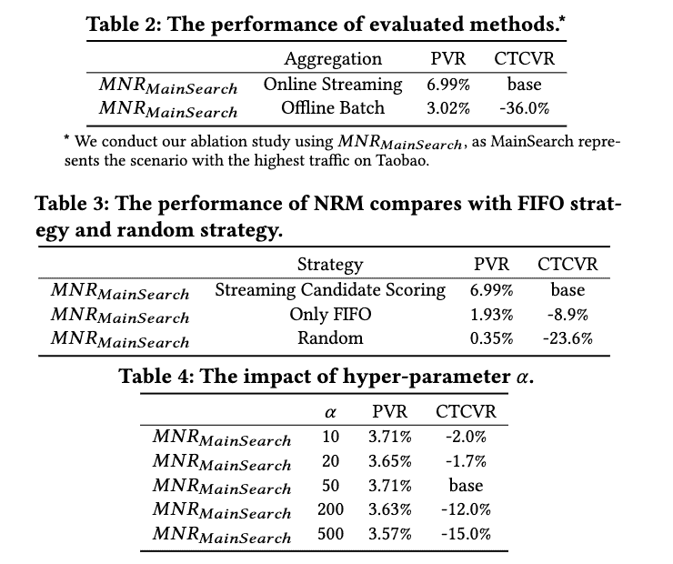

# 淘宝推荐系统多场景高效召回框架

> 来源：[https://qqs7y1hozd1.feishu.cn/docx/VEaYdiGiNo0aWjxI901cLLmQn0f](https://qqs7y1hozd1.feishu.cn/docx/VEaYdiGiNo0aWjxI901cLLmQn0f)

+   **在推荐系统中，****匹配阶段变得越来越关键**，**它为整个推荐过程设定了上限**

> 近年来，一些研究开始探索使用多场景信息进行推荐，例如基于模型的方法和基于数据的方法。然而，匹配阶段由于需要超大规模的检索并满足低延迟要求，因此面临着显著的挑战。结果，在这个阶段应用的方法（如协同过滤和双塔模型）通常被设计得非常轻量化，从而阻碍了对大量信息的充分利用。另一方面，排序阶段拥有最复杂的模型和最强的评分能力，但由于移动设备屏幕空间有限，大多数排序结果可能无法得到展示或曝光

那么今天就介绍一种创新的**多场景近线检索框架**—该框架通过**Flink**利用来自不同场景的排序日志，能够在近乎实时的情况下将其他场景中的精细排序结果纳入匹配阶段

+   此外，还提出了一个流式评分模块，从候选池中选择关键子集

该方法在电商平台淘宝**APP的“猜你喜欢”（即主页）上实施，显示出了显著**的改进，特别是在商品交易量方面提升了5%。此外，该方法不仅不依赖模型，而且高度高效，表明它可以快速应用于不同场景，并展示出良好的性能

# **简 介**

+   随着电商的快速发展，推荐系统已经成为个性化内容推荐的重要工具，提升了用户体验，并增加了业务收入

+   在大多数工业场景中，推荐系统面临着庞大的候选项和严格的延迟限制，因此通常包括多个阶段（例如，匹配、预排序和排序）以平衡效率和准确性

> 匹配阶段的设计旨在快速从庞大的候选池中缩小相关项的范围，优先考虑低计算复杂度以实现可扩展性。这为后续的预排序和排序阶段奠定了基础，这些阶段在初步过滤的基础上进行更细粒度的评分，匹配阶段位于推荐系统的最初阶段，本质上决定了推荐质量的最大潜力

> 现有的匹配算法在推荐系统中主要分为两大类：

1.  基于协同过滤的方法和基于深度学习的方法

> 协同过滤方法利用用户与物品之间的历史交互或潜在因素来理解用户偏好，但通常会面临数据稀疏性的问题

1.  **基于深度学习的方法通常利用端到端的综**合神经网络模型来推断用户对每个项目的感受

> 虽然这些方法有效，但它们依赖于较为简单的模型结构，可能无法完全把握用户偏好的复杂性

**为了解决匹配阶**段中模型复杂性的局限性，Netflix提出了一个近线检索框架，该框架利用间接计算进行复杂模型推理。然而，这种方法存在延迟的实时响应问题，并显著增加了资源消耗

+   多场景建模的概念被引入到推荐系统中

**以淘宝为例：****上**图展示了各种个性化推荐场景，包括主页、搜索结果页面和购买后页面。在一个场景中观察到的用户行为可以潜在地为另一个场景中的推荐提供信息并加以改进

> 然而，目前大多数的多场景建模方法采用了复杂的框架，导致计算成本显著增加，从而使它们在匹配阶段变得不切实际。在实际操作中，每个场景的排序阶段会评估数千个候选项；然而，由于页面限制，通常只有几十个项目最终会展示给用户。结果，大量高分的排序项目尽管具有潜在价值，但仍无法被用户看到

为了解决上述挑战，淘宝提出了一种新的多场景近线检索（MNR）方法用于匹配阶段。通过聚合每个用户在不同场景中的排序结果，将复杂排序模型的优势汇集到一个统一的候选池中。然后，引入了一个在线运行的实时评分模块，通过考虑初始排序和每个项目的访问时间来评估该候选池，以确定最优的匹配集

# **方 法**

## **问题形式化**

在工业推荐系统中，匹配阶段的目标是从一个庞大的物品池  中为每个用户  筛选出合适的物品。该物品池的数量级通常达到数十亿个。这个过程旨在将物品缩小到一个定制的子集    ）确保该子集中的每个物品都符合用户的兴趣

## **多场景近线检索**

在这项工作中，强调利用其他场景的排序结果来增强当前场景匹配阶**段的重****要****性。具体来说，用户可能会在一**个平台中涉及多个场景 。在每个场景 中，排序阶段将根据排序模型提供一组已评分的物品。考虑到用户可能会多次访问一个场景，场景  中用户的排序结果可以表示为：

> 其中 和  表示用户的不同访问时间， 表示排序阶段评分候选集的数量。对于每个场景 ，MNR 的目标可以形式化为：

> 其中  表示从不同精细排序候选集筛选出对当前场景至关重要的前 个物品的函数。  是根据场景 中的排序结果检索到的最终物品集合

**场景感知的排序结果收集**在每个场景中，由预排序阶段过滤的物品然后在排序阶段进行评分。尽管在排序阶段对所有物品都进行了评分，但并非候选集中的每个物品都符合用户偏好。因此， 首先截断每次访问获得的排序结果

然后，将不同访问时间的多个排序结果 聚合到一个统一的集合中是非常重要的。由于在线存储是一个限制因素， 为每个场景  利用优先队列来维护每个用户的排序历史记录

这里采用先进先出的策略（FIFO）来保留用户的最新偏好。通过这种方式，可以在不增加额外计算开销的情况下，保留来自其他场景的用户兴趣

**流式候选评分**在汇总反映用户在场景 中偏好的聚合排序结果 之后，关键是要对  进行精炼和限制，以管理检索集的大小

> **优先考虑两个方面：**

1.  排序结果的初始顺序和用户交互的时间。排序阶段通常采用复杂的模型，具有强大的特征交互功能，表明得分较高的物品更符合用户的兴趣

1.  随着用户口味的演变，更接近当前偏好的排名往往与当前偏好相关性更强

为了协调排序与访问时间， 可以定义如下评分函数：

> 其中， 表示物品在初始排序结果中的位置，按降序排列。术语   指的是用户访问的顺序，其中最近访问的索引为 0。  和 作为平衡超参数，分别影响物品排名的重要性和访问时间的重要性。通过赋予 更高的值，评分公式更加强调用户访问的时间。相应地，提升 则将重点放在物品的原始排名得分上。基于公式，通过从 中选择前k个物品，获得最终检索结果

**实施细节**所提出的框架利用了**Flink**平台来订阅来自不同场景的排序日志（即，候选物品及其在排序过程中的评分记录）。进行准实时操作，如队列管理、聚合和top-k计算。为了促进类别的多样性， 在生成TopK结果时将物品分散到不同的类别中，限制每个类别的物品数量至预定义的阈值

# **Experiment**

+   **淘宝首页**：全球最大的电子商务平台之一的首页

+   **主搜索**：最大的电子商务搜索系统

+   **图片搜索**：淘宝内集成的图像搜索功能，用户可以通过图像搜索产品

+   **购买后推荐**：在用户完成购买后激活推荐功能，通常会突出显示与最近购买相关的物品

+   **店内推荐**：考虑到用户在店内的交互行为和店铺库存，为用户推荐商品

+   **迷你详情**：这是淘宝上的一个高流量场景，在用户点击查看某个商品后，向用户提供该商品旁的额外产品推荐

> **基线**为了进一步评估 所提出框架的有效性， 将其与工**业推荐系统**中的三种代表性方法进行了比较，如下所示：

+   **SWING** 是协同过滤领域中一种最先进的方法。它通过直接学习物品之间的稀疏相似矩阵并优化一个正则化目标函数来生成推荐结果

+   **MIND** 是一种专门为推荐系统领域设计的基于深度学习的算法。它使用一种动态路由机制，进一步增强其能力，以根据目标物品自适应地聚合这些不同的兴趣

+   **Glare** 作为一个近线检索框架，专注于模型在其自身场景内的能力实现，实施方式为非实时的

> **评估指标** 采用了工业推荐系统中最关注的两个指标：

+   **CTCVR** 表示物品从曝光到交易的转化可能性

+   **Hitrate** 表示在所有场景中，用户的实际行为被检索到的物品准确命中的百分比，并已根据检索次数进行了归一化处理

## **总体表现**

表中值得注意的是，在 MNRMiniDetail 和 MNRMainSearch 中观察到的显著性能提升，分别在 CTCVR 上提高了35.0%和57.0%。这些指标强调了 MNR 战略性利用跨场景洞察力的有效性，提高了其在预测和匹配用户偏好方面的精度

在 Hitrate 方面，MNRMiniDetail 和 MNRMainSearch 报告了显著的提升，Hitrate 分别为1.94%和2.02%，超越了基础的0.62% OnlineALL

此外，表1的结果进一步表明，MNR 还优于其他竞争方法如 SWING、MIND 和 Glare。可以观察到，MNR 相比 SWING 的0.43%、MIND 的1.21%和 Glare 的0.66%有显著的提升，转化为更准确的目标推荐

此外，像 MNRIn-Shop 和 MNRPhotoSearch 这样的场景面临着精细排序得分不足的挑战，导致实施了较低的截断阈值。因此，这减少了进入匹配池的物品数量，导致了较低的 PVR。MNRIn-Shop 表现不佳可能与店内场景的性质有关，其中用户仅限于进入特定商店后的一些物品，通常范围从几十到约一百件产品。大多数产品可能会被曝光，因此 MNR 框架回收的大部分产品主要是那些尾部物品

## **消融研究**

**在线流计算的影响** 为**了**评估在线流计算的影响， 将MNR与在线模式（即实时流计算）和离线模式（即每日更新）进行了比较。从表2中可以看出，离线模式下的MNR表现显著下降，性能下降了36.0%，PVR仅为3.02%。这种鲜明的对比突显了在线模式所提供的实时数据处理的关键优势，进一步巩固了流计算在提高推荐模型准确性和效率方面的重要性

**流式候选评分的影响** MNR利用**公式6对从每个场景队列中收集的排序结果进行评分。为了验**证 所提出的评分函数的有效性， 分别使用了先进先出（FIFO）策略和随机策略进行评估，以评估它们的影响。从表3中可以看出，MNR相比替代策略在有效性上表现出显著提升。基础PVR为6.99%。相比之下，仅关注时间因素而忽略排序得分的FIFO策略下的MNR，其性能显著下降，有效性仅为1.93%，并且相比基础减少了8.9%。同样地，采用完全随机选择方法的MNR策略，有效性降至0.35%，减少了23.6%。这种对比突显了MNR的针对性评分方法在优化推荐结果方面相比于更简单的FIFO或随机策略的优越性

**超参数**** ****的影响**  作为权衡超参数起到了关键作用，它在排序影响和访问时间之间调节平衡。表4展示了超参数 影响的结果。值得注意的是，随着 的增加， 观察到 PVR 保持相对稳定，但 CTCVR 发生了显著下降。在 值为200和500时，CTCVR分别下降了-12.0%和-15.0%，这表明将 设置得过高可能导致对访问时间的过度强调，而忽略了相关的排序因素。这一趋势突显了在 的MNR框架中，仔细校准 以在时效性和相关性之间达到最佳平衡的重要性

## **性 能**

通过部署MNR并使用多个选定场景的数据，在淘宝首页的真实流量上进行为期一个月的在线实验。来自淘宝首页真实流量的结果表明，与基线相比， 提出的方法实现了5%的交易量持续稳定增长。这突显了 方法的商业价值和实用性。此外，所提出的算法表现出高效的计算性能和低资源消耗，使其成为实时个性化推荐场景中一个有前景的解决方案

# **结 论**

总之，所提出的多场景近线检索框架通过利用来自各个场景的排序日志在近乎实时的情况下增强了推荐系统匹配阶段的性能，解决了规模和延迟的限制。该框架在淘宝APP内的整合显示出商品交易量增加了5%，表明其有效性和更广泛应用的潜力。这一进展强调了跨场景信息利用的好处。