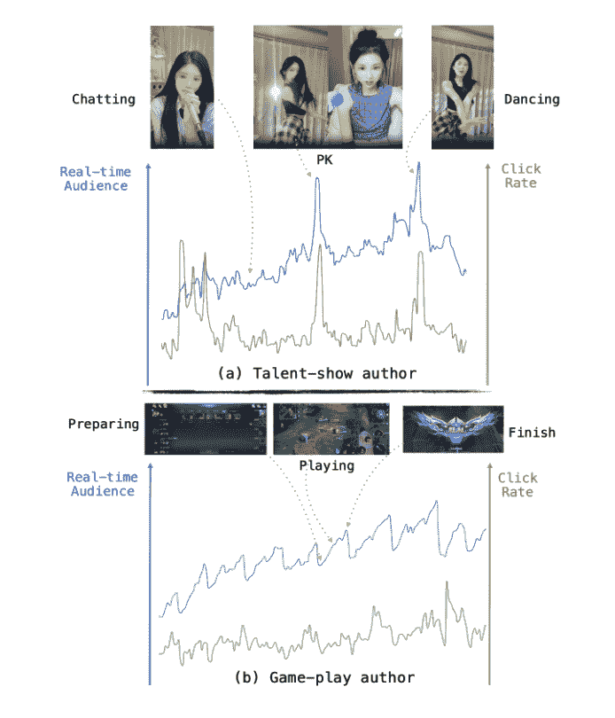
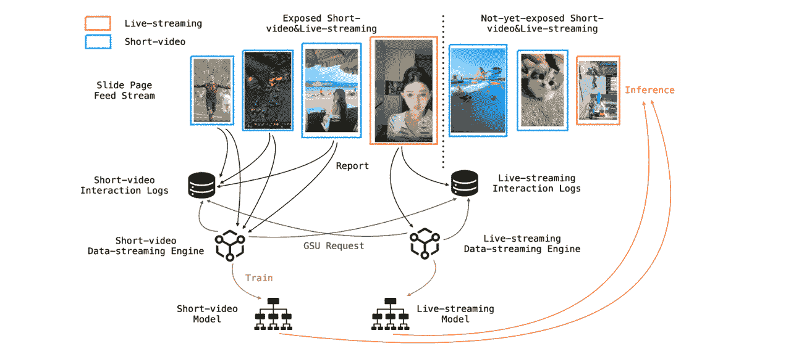
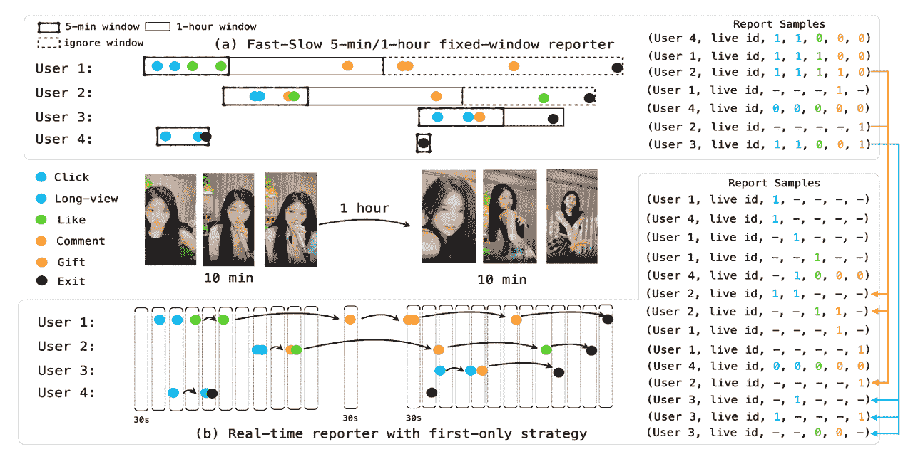
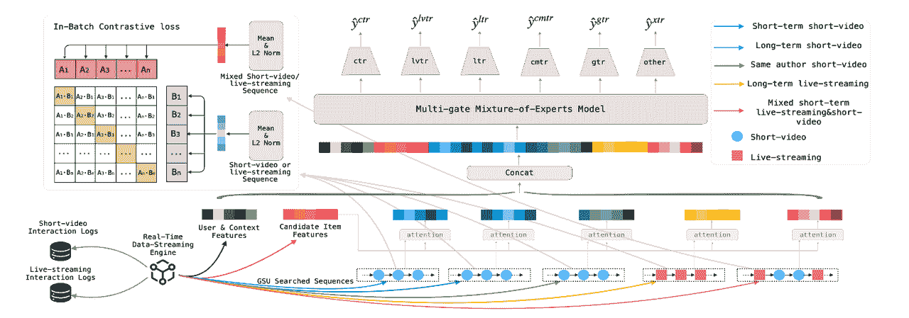
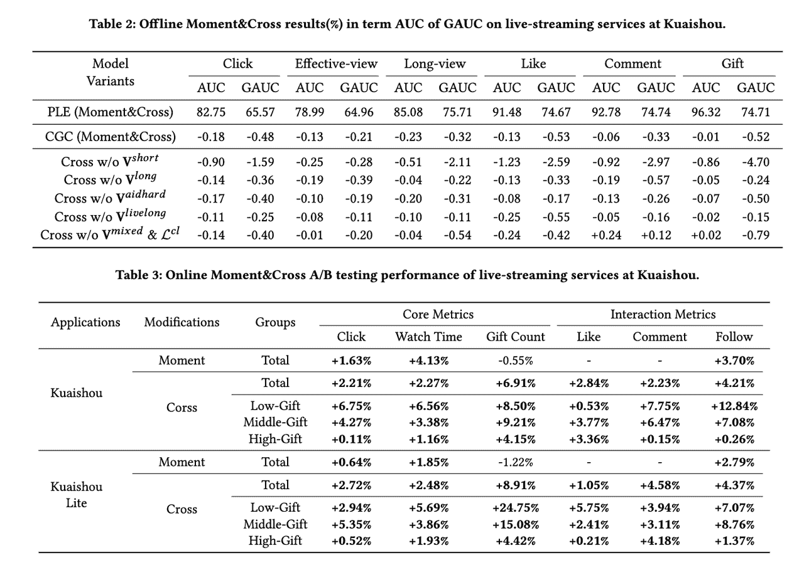

# 快手直播推荐系统中的CTR实践

> 来源：[https://qqs7y1hozd1.feishu.cn/docx/Y2h2dqekxocDlzxF4Urcpi3Unzh](https://qqs7y1hozd1.feishu.cn/docx/Y2h2dqekxocDlzxF4Urcpi3Unzh)

在**快手****平台上，****用户滑动页面时内容**会自动播放，因此推荐系统对用户体验至关重要，相比短视频推荐，直播推荐更具挑战性，因为：

+   **短暂****生命周期**

> 短视频有永久生命周期，而直播平均只有1小时

+   **延迟反馈**

> 短视频平均时长约55秒，用户行为反馈快；而直播较长，重要反馈可能在半小时后才出现，如用户购买礼物

+   **动态内容**

> 短视频从0秒开始播放，而直播内容不断变化，用户在不同时间点的行为可能不同

> 因此，在直播推荐系统需要在适当的时间为用户推荐直播，为了解决这个问题，快手展示了两个直播作者案例：

1.  **才艺表演****直播**

+   花时间与观众聊天、PK，展示才艺高光时刻和聊天之间差异显著：当作者展示才艺时，进入直播间的用户数量增加，才艺展示结束后用户离开

1.  **游戏直播**

+   进行游戏比赛，比赛期间观众数量增加，比赛结束后观众数量下降。 无论作者类别，用户总是倾向于点击观看高光时刻，但由于直播内容不断变化，很难确定哪个直播会展示高光时刻

幸运的是，可以利用大量用户行为来自动识别哪个直播正处于："高光时刻"：点击率趋势与用户点击行为高度一致（即同时达到峰值和谷底）

如果模型能捕捉到点击率上升的趋势，就能发现潜在的高光时刻。除了捕捉高光时刻，直播流模型还面临数据稀疏性的问题

为了解决这个问题，首先解释了架构的工作流程（如图所示）在行业中，不同的业务是分开部署的，例如，用户对短视频的实时交互（如长时间观看、点赞等）仅由短视频数据流引擎组装成特定的训练样本数据格式。短视频模型可以消耗短视频数据流，以适应实时数据分布，从而进行精确推荐。由于不同的数据流引擎会产生不同的训练样本数据格式， 直播流模型只能通过用户的直播流数据流进行监督

虽然不能直接消耗短视频数据流，**但**已**经构建了历史存储服务来保存用户的交互日志，数据流**引擎可以从其他业务中获取用户的历史交互，将它们作为输入特征的一部分进行整合。因此，可以对直播流与短视频嵌入空间进行对齐，利用用户对短视频的兴趣来推荐相似风格的直播流

+   针对第一个挑战， 目标是让实时流媒体模型感知点击率增长趋势。 需要利用实时用户行为尽快训练模型，以捕捉每个实时流媒体的点击率状态。如图所示，点击率信号首先被报告到实时流媒体数据流引擎，然后输入到模型中。然而，报告模块需要等待一段时间（如5分钟）以收集足够的行为，然后一次报告给数据流引擎。 实时流媒体服务也采用了5分钟窗口的固定数据流来支持模型多年，但5分钟的反馈延迟不足以捕捉点击率增长趋势

为此， 将训练框架升级为实时3**0秒报告方式**，并设计了一种新颖的仅第一轮掩码学习策略来监督模型，命名：Moment

+   针对第二个挑战， 的目标是利用用户的历史短视频序列并将其嵌入空间与实时流媒体对齐。用户的历史短视频序列太长而无法直接建模（如一个活跃用户在一个月内可能观看10,000个短视频），因此 主要遵循级联搜索为基础的兴趣建模框架：

1.  **引入通用搜索单元（GSUs）回顾用户一生的历**史，然后过滤以获取相关项目序列（数百级）

1.  **设计精确搜索单元（ESUs）来压缩序列信**息以获取用户兴趣，如序列池化，目标项关注

此外， 还引入了对比性目标，以增强短视频和实时流媒体嵌入空间的相关性，**从而增强模**型根据丰富的短视频交互历史为用户分配相似风格的实时流媒体的能力，命名：Cross

# 快手的**Moment&Cross**

> **行业****CTR**预测模型的训练流程包含两个核心组件：

1.  数据流处理引擎，用于组织训练样本的特征和标签

1.  **多任务**学习模型，以适应实际训练样本的交互（如点击、点赞、长时间观看等）

## 快慢数据流（5分钟&1小时数据流）

+   数据流引擎是工业推荐系统的基础组件

> 一种简单的解决方案是收集用户在完全消费完项目后的操作日志，例如看完一个短视频并滑到下一个，或听完一首歌。对于短视频服务，这种解决方案已经足够实时，因为用户通常在大约1分钟后退出。因此，所有交互反馈都能及时收集

> 然而，在直播服务中，用户可能会观看更长时间，例如30分钟或80分钟。如果在用户退出直播时才收集所有操作，可能会导致模型训练不够实时。因此，许多直播数据流引擎采用固定窗口方式来报告和组装训练样本特征和标签，例如5分钟报告窗口

鉴于直播服务中不同行为的时间分布差异较大，一些有价值的交互可能难以在较小的固定窗口内观察到。例如，用户可能在观看半小时后才赠送礼物。为了解决这个问题， 进一步将固定窗口扩展为快慢窗口，以平衡直播服务。快窗口报告所有交互以便快速训练，而慢窗口报告在快窗口中未观察到的正样本

> **通过统计， 发现大多数用户观看时间**少于1小时，因此， 将用户的观看体验分为三个阶段来监控用户行为，从而监督 的模型训练：

+   5分钟：一个用于收集观察到的所有正面和负面行为作为标签的小窗口，从而获得快速的数据流

+   长时间的数据窗口：对于长时间的数据窗口，仅报告缺少的正样本标签，以纠正五分钟的偏差，适用于慢速数据流传输

+   忽略的窗口不报告任何标签

## 使用正样本-未标记样本学习进行CTR模型训练

广义上，CTR预测是推荐系统流程的最终环节，用于为每位用户排序最相关的数十个商品，也被称为精排模型

> 确实，精排模型不仅预测用户对商品候选点击的概率（即CTR），还会预测长远概率（即LVTR）、喜欢概率（即LTR）、评论概率（即CMTR）和其他XTRs的概率。根据这些预测的概率， 可以对这些概率进行复杂的加权计算，以控制最终得分来对商品进行排名

通常，精排模型的学习过程被表述为一个多任务二分类范式，目标是学习一个给定数据流训练样本的预测函数 对于每个样本，包括用户ID、商品ID、原始特征V以及表示事件发生与否的多个真实标签（例如 和其他）

具体来说，原始特征V主要分为四种类型：用户/商品ID、统计/分类、历史交互序列和预训练的 多模态嵌入，这些特征被投影到低维嵌入中，表示为：

> 其中 表示特征的数量。在直播模型中， 构建了大约 个原始特征来代表用户、商品和上下文状态，根据输入样本特征和标签，模型学习过程形成如下：

、 、  都是预测的概率，而 是一个多任务模块，可以通过MMoE ，PLE 实现。接下来， 利用用户的实际行为来监督 的模型以优化参数。对于5分钟快速流样本，由于它们报告了所有观察到的正负标签，因此 通过最小化标准 来训练 的模型：

对于1小时的慢速流动样本，这些样本仅报告未被发现的正样本，同时隐藏其他一致的正样本， 采用正样本-未标记损失的具体应用来纠正过去的"假定为负"的误差梯度，具体而言：

> [其中表示](https://zhida.zhihu.com/search?q=%E6%8D%9F%E5%A4%B1%E5%87%BD%E6%95%B0&zhida_source=entity&is_preview=1)仅在1小时窗口内观察到的正标签。通过和这两个损失函数的协同作用， 的模型在直播服务训练中实现了效果和效率的平衡。模型收敛后， 可以将其部署为在线全排序模型，以响应实际用户请求，并选择得分最高的项目，如下所示：

> 其中 是[超参数](https://zhida.zhihu.com/search?q=%E8%B6%85%E5%8F%82%E6%95%B0&zhida_source=entity&is_preview=1)，用于将所有预测概率聚合为一个排名分数，以对[几十个项](https://zhida.zhihu.com/search?q=%E5%8A%A0%E6%9D%83%E6%8E%92%E5%90%8D&zhida_source=entity&is_preview=1)目候选进行排序。 仅以一个简单的加权排名得分示例来说明 是用于组装所有预测概率以形成一个排名分数的超参数，以对几十个项目候选进行排序

## 基于首标掩码学习的30秒实时数据流处理

作为之前的版本，快速-慢速5分钟&1小时数据流传输和正例-未标记学习框**架已经迭代了好几年，这是一个稳定、可靠且经过验证的学习**框架，专门用于实时数据流。虽然有效，但它仍然有一些缺点，例如：较小的固定窗口会不可避免地错过一些有价值的正例标签以及礼物

提供了一个关于快速5分钟和慢速1小时数据流标签一致性比较的表格，描述了主要行为（例如点击、喜欢等） 的正样本比例。 可以发现，较稀疏的行为在标签一致性覆盖方面较低，特别是与礼物和礼物价格相关的行为

此外，快速的5分钟窗口仍然不足以支持 的模型捕捉CTR增长趋势，以解决严重挑战： 如何在合适的时间为用户推荐直播？为此， 已经将训练框架从快速慢速报告方式升级为实时30秒报告方式，模型能够尽快感知所有发生的行为。理想情况下，如果在"亮点时刻"的直播，将会有大量的正梯度在短时间内优化 的模型参数，因此模型可以知道哪些直播处于CTR增长状态，然后提高此类直播的在线CTR预测分数，使其被更多用户观看。然而，极其短暂的30秒窗口可能会带来与 以前的数据流不匹配的风险：

+   **引入假阴性**

与5分钟固定窗口相比，如果 也报告观看30秒后的所有正面及负面用户行为，将引入大量的'假阴性'标签，因为一些行为是延迟的，而不是未发生的

+   **频繁的报告**

快慢5分钟&1小时数据流的报告仅对每种行为报告一次正标签，30秒实时流可能会多次报告（例如，用户可以多次评论）

+   **交互超越**

30秒实时数据流可能将正标签划分为多个按照时间顺序排列的训练样本。这样一来，早期的正行为更新的梯度可能有助于预测后续的正行为，例如：早期的点击正样本和长期正样本更新了模型参数两次，这可能高估了后续点赞或评论行为的预测概率

**为了应对假负样本的问题，受到之前慢**速1小时流中'面具标签'理念的启发，引入了一种报告机制：正标签立即被报告，而其余的负标签则在用户退出直播后报告

结果， 发现虽然报告窗口大幅缩小，但数据样本的数量并没有显著增长（例如，大约是快速慢速数据流的两倍），因为额外的报告样本主要依赖于稀疏的行为交互数量，例如点赞、评论和礼物。对于频繁报告的问题， 进一步引入了一种仅首次面具策略，即只为每种行为学习首次的正样本发生，以使学习规则与 之前的数据流保持一致。因此， 的瞬时仅首次标签掩码学习可以形成：

> 其中 代表每种行为中的第一个正向标签，其他行为的标签则被隐藏。 则标记了用户在直播结束后的行为，这些行为的标签为正或负

## 短视频兴趣迁移

在模型部署的滑动页面上，曝光内容主要以短视频为主，约占90%，而直播内容则占10%，由于流量分布不均， 面临的一个挑战是：如何利用用户的短视频行为来改善直播推荐？

如图所示，不同的[业务模式](https://zhida.zhihu.com/search?q=%E4%B8%9A%E5%8A%A1%E6%A8%A1%E5%BC%8F&zhida_source=entity&is_preview=1)只允许消费自己的训练数据流，因此直播模型只能通过用户的直播行为进行监督。然而，幸运的是， 已经构建了历史存储服务来保存用户的交互日志，[并且数据](https://zhida.zhihu.com/search?q=%E8%BE%85%E5%8A%A9%E4%BF%A1%E6%81%AF&zhida_source=entity&is_preview=1)流引擎可以发送请求来获取其他业务的用户交互历史，将其作为输入特征的一部分。实际上，在'交互日志'中， 可以回顾最近10,000个观看项目ID，并获取一些辅助信息，例如时间间隔、内容多模标签、标签等

> 为了建模这样的长序列，一个常用的方法是两阶段搜索-然后提取的想法：

+   引入通用搜索单元（GSUs）来搜索用户历史，然后筛选出与目标直播候选人相关的项目序列

+   设计精确搜索单元（ESUs）来聚合序列信息以压缩用户兴趣，例如序列聚合、目标项目注意力

**在实现中， 引入了几个GSUs，从多角度搜索不同的交**互，以发现与目标直播候选人相关的短视频：

+   最新短期短视频GSU旨在搜索用户最近数百个短视频互动，这能反映用户短期的兴趣焦点

+   点击搜索长期直播短视频GSU系统在直播候选人V长中查找最相似的嵌入式短视频，这可以反映用户是否喜欢这种类型的直播

+   作者ID硬搜索GSU短视频，旨在搜索具有相同作者ID的历史短视频，表示为 ，以反映此作者的精确用户兴趣

+   点击匹配搜索长期获取 ，这能反映出用户是否喜欢这类直播，基于相似的短视频行为

+   在长期视角下，最新的混合直播与短视频GSU，难以在长期视角下找到感兴趣的直播与短视频作为混合序列

为了简洁， 使用短序列向量   、长序列向量  、辅助难度序列向量  、持续长久序列向量 、混合序列向量 来代表不同的GSU序列嵌入，其中 是序列长度。在获得序列嵌入后， 首先通过对比目标使它们的嵌入空间对齐，以实现序列间的有效匹配与理解：

> 其中 是一个简单的[聚合函数](https://zhida.zhihu.com/search?q=%E8%81%9A%E5%90%88%E5%87%BD%E6%95%B0&zhida_source=entity&is_preview=1)，用于压缩序列表示表示 归一化函数，  是一个内部采样函数，用于收集与之对比的负样本。受到CDSR的启发， 发现混合直播&短序列可能是与其他序列对齐的基础，因为它与其它序列有相似性，但并不完全相同

随后， 通过目标项目注意力作为ESU模块，根据目标直播候选嵌入 实现精细粒度的兴趣提取：

> 其中 表示训练样本的所有直播侧特征（例如项目标签、直播ID、作者ID等）。在获取增强的跨域短视频兴趣点后， 将其拼接起来以估计每个互动的可能性，如图所示：

# 整体表现

+   表格展示了 使用的是**Moment**和**Cross**的性能表现

> **具体来说：**[在线服](https://zhida.zhihu.com/search?q=AUC&zhida_source=entity&is_preview=1)**务每天处理数十亿次用户请**求，而在离线评估中AUC和GAUC指标提升0.1%的改进，足以带来实际的在线收益。从结果看， 有以下观察：

+   为了研究 实时数据流的有效性， 实施了两种多任务变体：PLE（时序与交叉）和CGC（时序与交叉）。其中，PLE[是CG](https://zhida.zhihu.com/search?q=%E7%BD%AE%E4%BF%A1%E5%BA%A6&zhida_source=entity&is_preview=1)C的双层堆叠版本，也是用于支持在线请求流量的部署模型。从表格中， 可以观察到PLE变体相对于CGC变体显示出预期的置信度提升，这揭示了 的新实时数据流能够无缝支持其他模型，仅采用标签掩码学习策略

+   为了验证跨域短视频兴趣有效性， 进行消融实验，逐一测试所有GSU序列的有效性，例如，不包含短期短视频序列的跨域情况

**从表中， 有以下观察：**

1.  所有跨域变体都显示出显著的性能退化，这表明用户过去观看的短视频或直播序列能够增强 的模型，使其更准确地捕捉用户兴趣

1.  相比基于直播的序列，基于短视频的序列在为增强直播内容推荐模型提供预测信息方面更为强大，即短期短视频序列 可以提供接近0.9%的提升。原因可能是用户观看的内容大约90%是短视频，这使得他们的兴趣点在短视频历史序列中得到更好的体现。 这说明，从丰富的短视频领域转移用户跨域兴趣是支持 的直播服务的一种强大技术

## **Online A/B Test**

将其对应的修改推送到在线A/B测试系统中，作为两个应用Kuaishou和Kuaishou Lite的排名模型。根据表 ， 可以发现实时Moment数据流训练的模型在点击方面实现了显著的改善，+1.63%/+0.64%，观看时间+4.13%/+1.85%，这表明提高模型实时训练效率对于直播推荐至关重要。关于略低的-0.55%/-1.22%的礼物数量，这是因为礼物是一个"不稳定指标"，在 的系统中处于合理的范围内。 的Cross在观看时间方面实现了2.27%/2.48%的显著提升，在礼物价格方面实现了6.91%/8.91%的显著提升，结果表明 的Cross对 的系统做出了重大贡献。进一步，低礼物用户组的增长量比其他用户组更大，这表明丰富的短视频信号对 的系统有帮助，有助于缓解数据稀疏问题。