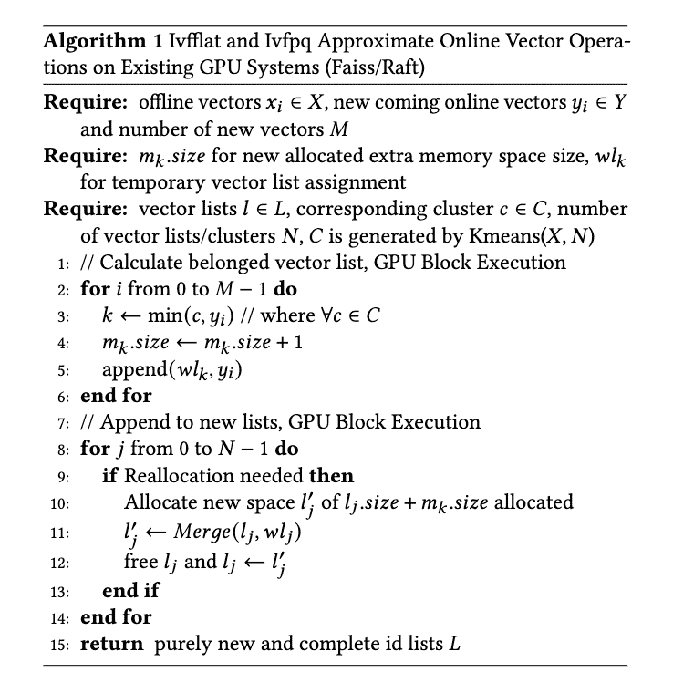
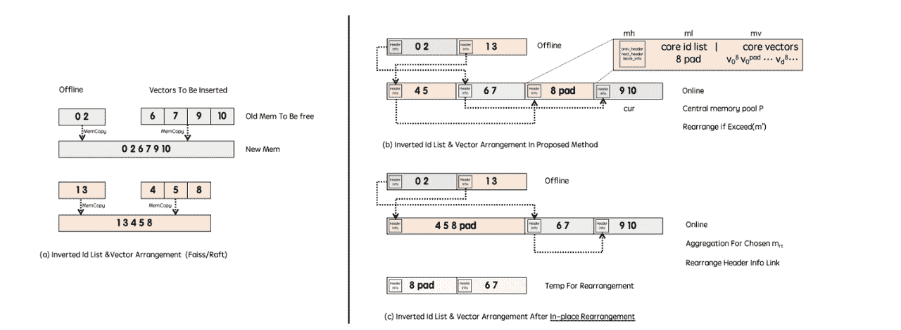
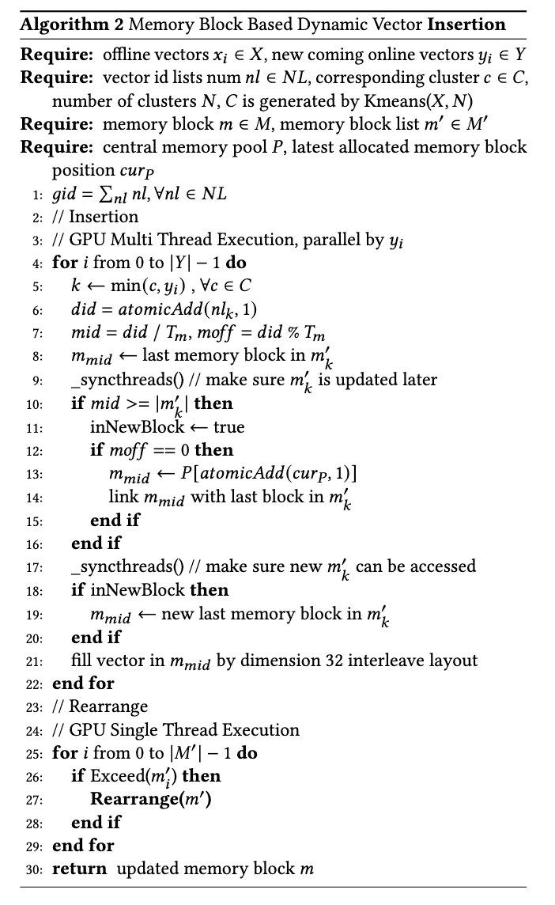
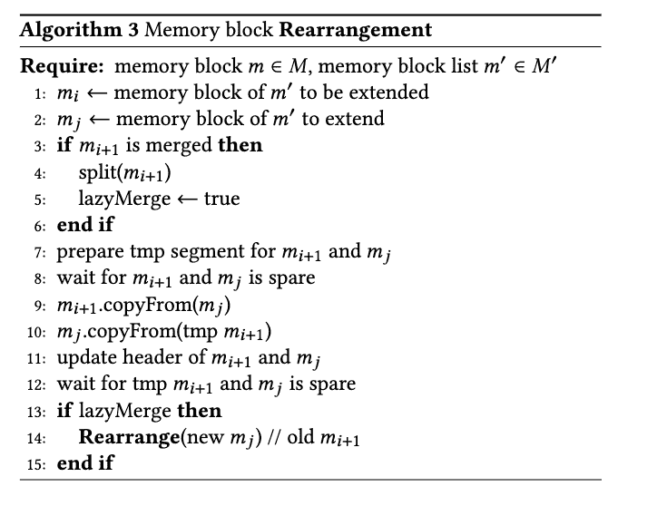
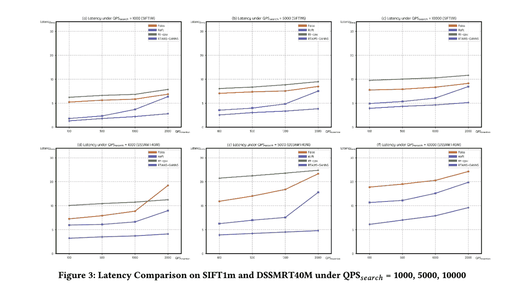
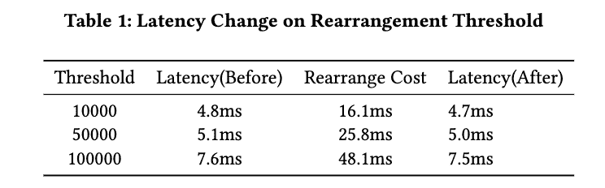
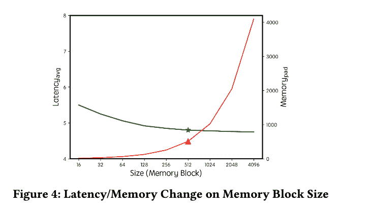

# 小红书在线多流GPU近邻搜索系统

> 来源：[https://qqs7y1hozd1.feishu.cn/docx/HIqKdxqvyotlQnxDVlucXwKtnWg](https://qqs7y1hozd1.feishu.cn/docx/HIqKdxqvyotlQnxDVlucXwKtnWg)

# 写在前面

> 近年来，近似最近邻搜索（Approximate Nearest Neighbor Search, ANNS）在现代搜索和推荐系统中发挥了关键作用，尤其是在诸如检索增强生成（Retrieval-Augmented Generation）等新兴的大语言模型（LLM）应用中。为满足ANNS的巨大需求，利用GPU的并行计算能力成为研究的热点

然而，现有系统主要集中于离线场景，忽略了需要实时插入新向量的在线应用的特殊需求

+   这一局限性使得这些系统在实际场景中效率低下

+   此外，以往的架构由于依赖于串行执行流，难以有效支持实时插入

**因**此小红书提出了一种新颖的实时自适应多流GPU ANNS系统——Real-Time Adaptive Multi-Stream GPU ANNS System, RTAMS-GANNS

---

> 架构通过以下三个主要进展实现了目标：

1.  最初分析了现有**GPU ANNS****系统中的实时插入机制，发现其依**赖于重复的拷贝和内存分配，这显著降低了GPU上的实时效率。为此，提出了一种基于内存块的动态向量插入算法，其中包括就地重排操作

1.  为支持并行向量插入，引入了一种**多流并行执行模式**，与现有单流操作的系统不同。该系统利用动态资源池，允许多个流同时执行，而不会引入额外的执行阻塞

1.  通**过广泛的实验和对比，在不同数据集上的查询每秒（QPS）**水平表现出显著的优势，延迟减少了40%-80%。此外，所提出的系统已成功部署于真实工业搜索和推荐系统中，为每日数亿用户服务，并取得了显著的成果

# **CCS概念**

+   **信息系统** →** 搜索引擎索引**

+   **计算机系统组织** → **实时系统架构；异构（混合）系统**

---

近似最近邻搜索（**Approximate Nearest ****Neighbor Search，ANNS）任务在现**代背景下得到了广**泛的应用和研究，例如搜索系统、推荐系统以及为大语言模型**（Large Language Models, LLM）提供的信息增强，尤其是在检索增强生成（Retrieval-augmented Generation，RAG）中

其目标是**通过聚类、量化、基于树的方法****以**及基于图的方法[12]等近似算法，高效地识别近似的Top-K结果。这些方法在牺牲少量召回率的同时，显著降低了与距离计算相关的计算成本，从而能够在较短时间内从大规模数据集中快速检索近似Top-K结果

> 此外，即便采用了高效的近似算法，基于CPU的ANNS系统仍然面临高计算负载和现代CPU内存带宽瓶颈的挑战。越来越多的研究开始转向利用GPU的高计算能力和内存带宽，以解决CPU性能不足的问题。在Faiss 和Raft 系统中，首次引入了使用GPU代替CPU进行检索的概念，与CPU相比实现了巨大的性能提升。这些实现细节是公开可用的，并已在工业界得到了广泛应用

然而**，发现上述系统仅设计用于离线场景，在这些场景中，索引中的向量**会在搜索之前进行离线处理并加载。这类系统无法应对ANNS中的许多常见在线场景，这些场景要求高频率的实时向量插入。这种能力对于搜索/推荐应用至关重要，因为即时更新可确保始终提供最新数据，从而生成准确且相关的搜索结果

> **这些限制主要体现在两个方面：**

+   一方面，现有系统（如Faiss和**Raft）中的向量插入内存**布局设计不佳，通常需要与现有向量进行合并。如图1a和算法1所示，在典型的基于倒排索引的ANNS算法（如Ivfflat和Ivfpq）中，向量最初会被划分到多个簇中。在搜索过程中，会计算与查询最相关簇的向量列表，并检索最终的Top-K向量。当有新向量到来时，现有系统通常需要将这些新向量的向量列表从离线段复制到新段。因此，这种方法在GPU上引入了显著的开销，因为内存分配和拷贝都需要触发内核启动，这将消耗大量资源

+   另一方面，现有系统在ANNS中采用单流串行执行模式。在任务单一且相互依赖的场景中（例如当前内核依赖于前一个内核的输出），执行顺序高度有序，数据以批量方式逐一处理以最大化吞吐量。然而，在GPU任务多样且彼此独立的情况下，这种执行机制可能不足以应对复杂的场景。如图2所示，依赖串行执行的系统需要分别等待实时向量扩展。如果复制的数据量较大，这种等待时间可能会延长，从而阻塞后续搜索任务的执行。例如，在处理长向量列表（热数据）时，由于重复拷贝，单次实时向量插入可能需要数十毫秒，从而阻碍正常的检索操作

**此外，需要注意的是：****本文仅讨论基于倒排索引的ANNS算法，因为基于图的**方法目前即使在CPU上也很难支持实时处理

> 因此，小红书设计一种系统以解决上述缺点：

1.  实现实时更新在线向量插入

1.  在线向量插入占用最少的额外内存

1.  在线向量插入可与在线搜索过程并行处理

---

小红书提出的新型**实**时自适应多流系统（Real-Time Adaptive Multi-Stream System, RTAMS-GANNS）包括精心设计的动态向量操作算法以及一种新颖的执行模式，该模式利用GPU流中固有的并行性，实现了向量搜索与实时向量插入的高性能并发执行

> **总结如下：**

+   提出了一种创新方法处理实时向量插入

> 基于内存块的动态算法。此方法不仅支持新向量的无缝集成，还结合了原地重排（in-place rearrangement），优化了内存利用率。通过最大限度减少昂贵的GPU内存分配和拷贝需求，该解决方案确保了高效的实时插入，同时不影响性能

+   引入了多流并行执行模式以支持实时插入

> 与传统系统在单一流中顺序执行任务的方式不同，小红书架构通过利用流缓存动态资源池实现了并行性。此创新设计允许不同的流同时执行，消除了额外的执行阻塞需求

+   通过广泛的实验和对比验证了该方法的有效性

> 在基准数据集和工业数据集上的测试表明，小红书解决方案在不同数据集的查询每秒（QPS）水平下表现出色，延迟降低了40%-80%。小红书系统已成功部署于实际工业搜索和推荐系统中，每日为数亿用户提供服务，取得了显著成果

# **相关工作**

## GPU支持的近似最近邻搜索（ANNS）

如前所述，**Faiss**和**Raft**是将向量检索系统从CPU提升到GPU的开创性工作，开启了GPU加速近似最近邻搜索（ANNS）的时代。随后的研究在此基础上展开，主要集中于算法增强或系统架构优化

+   **在算法领域，****RobustiQ**针对GPU实现优化并扩展了量化算法，而其他研究在改进基于GPU的图算法方面取得了显著进展

+   **在系统设计优化方面，**研究分别聚焦于异构CPU-GPU调度的集成、在GPU和CPU之间分配数据以及建立周期性同步机制

**注意：**尽管这些优化措施提升了系统性能，但所有现有方法仍依赖于串行的离线系统，未能有效应对实时向量插入所带来的挑战

## CPU/GPU ANNS中的在线向量插入方法

在CPU系统中，将向量插入到内存是一个相对简单的过程

+   **对于基于倒排索引的算法**

> SPFresh 提出了一个增量重平衡工具，用于分割向量分区并重新分配附近分区中的向量，从而适应数据分布的变化。由于该算法应用于CPU系统，其优化重点与小红书研究不同。SPFresh主要关注于优化ID列表的平衡性，这是一个实时关注点，而小红书重点在于减少GPU中昂贵的内存分配开销、非对齐内存访问和阻塞执行框架。因此，在小红书系统提出之前，该方法难以在GPU上应用，因为缺乏可行的框架支持

+   **对于基于图的算法**

> FreshDiskANN 设计了一种新颖的两遍流式合并（Streaming-Merge）算法，用于高效地将内存索引与SSD索引合并。该算法针对基于SSD的磁盘索引，提出了主要面向大数据场景下的实时更新方法，而不是专注于使更新机制更加适配磁盘。此外，由于GPU与CPU图算法之间存在显著差异，该方法无法直接应用于GPU

1.  小红书仅关注当前更广泛使用的IVF方法，而非基于图的算法

1.  此外，研究主要集中于利用异构硬件，结合CPU和GPU以促进计算。虽然这些方法可能在CPU与GPU之间交换数据的过程中加载最新向量，但它们本身并非旨在解决实时向量插入问题。此外，这些方法仍然面临昂贵的拷贝和重新分配问题，如上一部分所述，这使得此类方法在实践中难以实现

# 系统概述

## 基于内存块的实时向量插入算法

在本节中，主要介绍提出的基于内存块的动态向量插入算法。图1b展示了整体内存布局，算法2则详细说明了主要算法过程。不同于现有系统将所有向量连续排列在内存中的方式，小红书通过每个内存块 的头部将其链接为一个列表，其中向量ID列表 l  属于倒排索引方法（如Ivfflat和Ivfpq）的特定簇  ，这些簇在图1b中用相同颜色表示

+   **为了缓解处理过程中的内存分配**开销，小红书设计了一种内存分配方法

> 该方法由中央内存池 （占用几乎整个GPU内存）和内存块 （最小单元）组成。中央内存池 已按照内存块预先分割，内存块编号为0到 。变量 表示当前分配的最新内存块的位置。在分配内存块时，小红书通过原子操作更新 ，并在逻辑上定位内存块，而无需额外的内存分配。整个算法基于最小单位内存块

新插入向量的内存块ID列表 l  定义为：

对于每个内存块 ，其可能包含 个向量，用户可以预设限制值

内存块的结构如图1b所示，包含头部 、核心ID列表 和核心向量

头部 包含指向前一个头部和下一个头部的地址、内存块信息（如向量容量、向量大小等）

核心ID列表 保存属于此簇的向量ID，而每个内存块中的核心向量 按32维交错排列（类似于Faiss/Raft），由GPU线程号决定，以实现合并读取指令：

> 其中，  表示单个向量的维度。

当有新向量到达时，算法首先调用Insertion动态插入向量到内存块中。执行插入时，算法会在新到的在线向量上并行执行，以实现最大并行性能。小红书首先计算新插入向量所属的簇，由Ivfflat和Ivfpq（算法2第5行）计算是否需要将该向量添加到新的链接内存块或现有的内存块中

如果现有内存块已满并需添加到新内存块中，可能会在多线程环境下引发冲突，从而导致并发访问问题。为此，小红书设计了一种无锁分配方法

首先定位新插入向量的位置，由内存块ID  和内存块中的偏移量 确定，其由表示向量列表长度 的原子值计算。对于需要分配新内存块的线程，小红书调用分配函数   ，重新链接内存块列表 并填充向量

如前所述，分配是线程安全的，仅计算内存块的逻辑位置。插入完成后，如果新插入的内存块列表 的长度超过预设值 ，将执行重排操作：

重排的核心思想是合并两个分裂的内存块，使向量连续，并消除头部跳跃。在某个内存块列表    中，小红书交换第一个内存块的链接内存块与一个额外临时内存段，并更新第一个块的头部。在某些情况下，目标内存块可能需要分裂，然后以递归或迭代方式进行合并

## **流缓存的多流执行机制**

**小红书提出了一种并行执行机制**，使实时向量插入内核能够与GPU上的正常检索排序内核同时运行

如**图**所示，以往的系统采用串行方式操作——这是GPU应用中由于大量计算负载而常见的实践，通过一次运行单个内核来最大化吞吐量。然而，在ANNS中，单个请求的计算可能无法充分利用GPU性能，而实时向量插入内核的串行执行可能阻碍正常的检索内核运行

### **排序内核与多流并行机制的适用性**

因此，并行系统更适合在线系统。通过并发执行这些内核，小红书不仅显著减少了执行时间，还使实时向量插入更加及时。小红书采用CUDA中的多流并行性，这需要领域知识来设计内核执行机制。所有提交到GPU的内核都应该运行在特定的流上。对于搜索内核，每个内核运行在单独的流上，并通过资源池复用流资源。对于插入内核，它应在相同的数据流上运行。因此，最终实现了搜索使用多个流，而插入使用单一流的设计

> 然而，为了成功执行，该系统需要更多考虑：

1.  系统必须避免在线内存分配和释放，以防止全局阻塞以及由于串行机制导致的性能下降

1.  系统中的每个内核不应消耗大量资源，因为过度的资源消耗会导致阻塞

+   **第一点的解决方法**

针对**第一点，从TCMalloc 的方**法中汲取灵感，小红书设计了一种基于双层流的资源池。最初，每个批量搜索请求被分配到一个专用流，并占用一个独立的小内存分配（足以支持Ivfflat和Ivfpq算法）。此外，当资源需求较大时，会从中央内存池请求更大的资源分配，并在使用后归还。对于实时向量插入内核，小红书在设计阶段考虑了并行性和GPU内存的无锁分配。因此，该内核不会遇到任何阻塞问题，并能与检索内核平滑并行执行

+   **第二点的解决方法**

对于**第**二点，由于多个内核会同时调度到流式多处理器（Streaming Multiprocessors，SM）上，确保单个内核不会独占所有计算资源非常重要。此外，当线程数较大时，每个GPU块上的线程数会受到限制。因此，小红书将限制每个内核的块数和线程数，这可能会导致高计算需求在线请求的延迟增加。然而，这在在线场景中是非常常见的

## 部署细节

> 小红书深入探讨了实时自适应多流GPU系统在真实环境中的部署细节。小红书系统已在T4/A10 GPU机器上运行超过六个月，并无缝集成到一个广泛使用的信息应用中，该应用的搜索和推荐系统每天为超过1亿用户提供服务

**系统由两个关键部分组成：****离线部分和在线部分**，分别高效地管理准备好的数据和实时向量插入任务

+   离线部分专注于处理准备好的数据，而在线部分则负责协调实时向量插入操作。在线部分由多个CPU线程管理，并与Kafka进行消息传输交互

+   在线部分实现了动态批处理策略，每两秒聚合向量，或当插入次数达到128的倍数时进行聚合，最大批量为1024，然后将聚合的批量数据发送到GPU

在内核执行之前，小红书从资源池中精确分配32个独立资源，每个资源提供50MB的缓存内存，如前所述。在临时内存需求超过此阈值时，额外的内存将从中央池中获取，每次分配设定为200MB。为确保资源分配的公平性，特别是在高QPS条件下，小红书设计了一种无锁队列机制。当32个资源全部耗尽时，系统将拒绝请求。此外，小红书为向量插入任务建立了专用流，以简化处理流程

对于中央内存池 P ，**小红书将其用于两个不同的领域：****搜索和插入**

为了在单一池中保持一致性控制，小红书采用了高地址分配策略用于搜索，低地址分配用于插入。当资源利用率超过90%的阈值时，将触发警报机制。在内核执行期间，每个内存块  m  的内存分配经过精确设计，以容纳1024个向量，线程数设置为低于1024，以避免冲突。这种预防性措施减少了因向量插入而同时请求两个新内存块的可能性

目前，在向量插入和重排内核中，仅激活一个块，以规避当前设计中潜在的资源争用问题。然而，这种程度的并行性足以有效管理工作负载部分

# **实 验**

> 在本节中，小红书旨在通过实验验证系统在各种环境下的性能表现。小红书将在标准数据集SIFT1M（维度128，使用相同的SIFT1M作为在线向量）和工业数据集DSSMRT40M（维度64，其中包含从在线Kafka源转储的1000万条在线向量）上进行测试

**数据集的具体细节如下：为了模拟实时数据插入，小红书将回放SIFT1M数据集进行插入，而D**SSMRT40M的额外1000万条数据通过从在线Kafka源转储新增插入向量获得

> 设计了以下三组实验以分析系统与现有系统之间的性能差异：

1.  比较标准数据集和工业数据集中，不同检索QPS和实时插入QPS下的性能差异

1.  比较高QPS插入向量场景中，有和没有重排的性能差异

1.  比较不同内存块参数下的性能差异

> **小红书将与以下系统进行比较：**

1.  **Faiss [10]**：实现了一个添加接口（add interface），需要将数据拷贝回CPU以进行统计分析，然后将其拷贝回GPU进行实际向量拼接

1.  **Raft [17]**：实现了一个扩展接口（extend interface），允许在GPU上重新分配链表的新空间并进行交换

1.  **Rt-cpu**：基于小红书提出的方法，使用链表链接预分配的内存块，实现了一个CPU上的动态向量插入系统

1.  RTAMS-GANNS（提出的方法）：第一个在GPU上针对Ivfflat和Ivfpq的动态向量插入系统，支持与检索并行的多流并行性

> 为了模拟在线实时插入请求，小红书开发了一个实时触发程序，用于定期触发批量向量插入请求。此外，小红书将搜索内核的最大批量大小设置为10，因为在线请求无法等待太久，同时批量请求的成本也较高。实验采用了一台配备A10 GPU和28核112线程AMD Milan处理器的机器。Rt-cpu系统仅利用处理器的CPU部分

## 不同QPS下的性能

小红书在SIFT1M和DSSMRT40M数据集上比较了四个系统的性能，重点关注在高QPS下的延迟情况以及特定延迟约束下的表现，因为这些对在线系统至关重要。为应对系统无法及时处理请求的情况，小红书为插入内核和搜索内核设置了延迟超时时间。小红书分析限制在操作前10秒内观察到的延迟数据。为了全面评估系统性能，小红书设计了一种新的度量方式，用于评估搜索和插入操作的综合延迟：

**可以得出结论：****RTAMS-GANNS（提出的方法）不仅在小数据集上显著降低**了延迟，而且在大数据集上也表现出显著改进

> 首先，RTA**MS-GANNS在低QPS{insertion}情况下**仍能超越以往系统，延迟减少高达40%，受益于动态向量插入算法和多流并行性。请求在到达时立即被处理，无需等待前一个任务完成，延迟至少减少1ms。其次，随着QPS增加，RTAMS-GANNS的延迟增长率最低，最大延迟减少超过80%。除了图中由于大数据集高计算负载导致的轻微增长外，其在其他参数下表现为接近线性的增长。此外，其他系统在QPS{search}超过5000且 超过1000时大多超时（反映延迟超过20ms）。这表明，RTAMS-GANNS的动态向量插入算法能够在多流并行框架中高效运行而不会造成任何延迟

在四个系统中，基于CPU的系统由于性能不及GPU，具有最高的延迟。然而，在DSSMRT40M上的较低QPS{search}条件下，它表现**为线**性延迟增长，使其在QPS{insertion}=2000时超越Faiss。这一观察与小红书实践经验一致，即在CPU系统上进行实时插入对正常检索性能影响不大。此外发现，Faiss的检索和插入性能均落后于Raft和RTAMS-GANNS。这是因为Faiss的添加操作需要将向量列表拷贝到CPU再返回GPU，这对大数据集来说效率极低，并且检索操作也更慢

## 重排的影响

**其次，小红书特别关注重排机制是否会阻塞后续向**量插入，以及它是否能够优化在线搜索的性能

小红书模拟了一种场景，在该场景中，向量被连续插入到同一列表中，并观察了在不同重排阈值设置下，重排前后延迟的波动情况以及重排后性能优化的程度。小红书将请求参数固定为 和 ，实验结果如表所示

实验中**设置的阈值较大，通常不会触发到这样的程度。小红书**可以看到，重排时间在50ms以内，这对于实时插入来说是非常理想的。这意味着一旦重排完成，系统会立即更新在此期间等待的向量。此外，重排之后，小红书观察到由于向量被分组在一起，内存读取和跳转性能在一定程度上得到了优化。这使得两项指标的延迟都有约0.1ms的轻微提升。虽然这一改进看似微小，但仍然具有显著意义

## 内存块参数的比较

最**后，小红书将在图4中比较不同内存块大小对性能的影响。较大的内**存块可以容纳更多的向量，但这也意味着可能会有大量内存被闲置。相反，较小的内存块可能导致频繁的内存块分配，并且在搜索过程中会出现更频繁的头部跳跃，从而影响检索性能

同样，小红书将   和  设为常量，仅观察内存块大小变化对性能的影响

> 随着内存块大小的增加，延迟会降低。然而，当内存块超过1024时，收益变得边际化，保留大于1024的内存块会带来收益递减的效果。此外，在大数据集下，如果IVF的簇数为4000，保留1024大小的内存块至少需要1GB的内存。由于GPU内存是一种宝贵资源，保留超过1GB的填充内存会导致显著的浪费。此外，如果某些列表频繁更新新向量，这部分内存可能永远不会被利用

**因此，小红书选择了一种相对低延迟的选项，填充**内存大小为1024，这是一种可接受的选择

# **结 论**

> 在本文中，小红书提出了一种实时自适应多流GPU ANNS系统（RTAMS-GANNS）。当前GPU ANNS系统主要专注于离线场景，忽视了在线场景中对高频率向量插入的需求。现有系统由于单流操作中新内存分配的需求和全局检索阻塞等瓶颈问题，面临效率低下甚至全局检索阻塞的困境

> 小红书系统通过引入两种创新组件有效解决了这些挑战：

1.  一种基于内存块的动态向量插入算法

1.  一种带有流缓存的多流执行架构

+   实验结果表明，小红书系统能够有效处理不同数据集上不同QPS水平的请求，将延迟减少了40%-80%。此外，实验还表明，动态重排机制在不影响检索的情况下聚合了新插入的向量，从而进一步减少了延迟

+   小红书还详细介绍了该系统在工业部署中的经验，系统被用于搜索和推荐应用，每天处理超过1亿用户请求。小红书工作展示了一个在实际部署场景中稳定、可靠且创新的解决方案