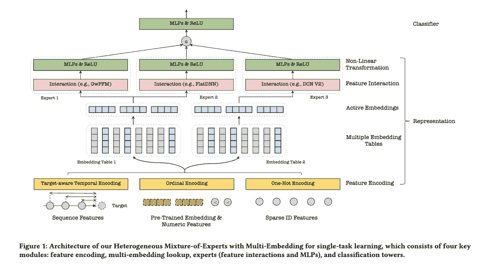
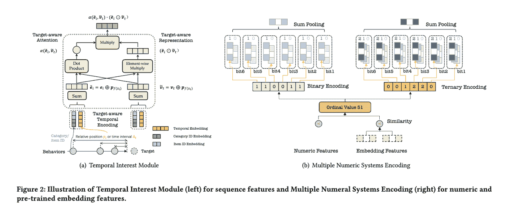

# 腾讯广告推荐

> 来源：[https://qqs7y1hozd1.feishu.cn/docx/DB90dUlPBoqqqdxUSzMcmMMYnid](https://qqs7y1hozd1.feishu.cn/docx/DB90dUlPBoqqqdxUSzMcmMMYnid)

本文腾讯在广告推荐上深入研究了与特征表示相关的两个关键挑战：

+   嵌入维度坍缩（dimensional collapse）

+   跨任务或场景的兴趣纠缠（interest entanglement）

---

进一步探索了多种训练技术，以促进模型优化、减少偏差并增强探索性

> 此外，还引入了三种分析工具，使腾讯能够研究特征相关性、维度坍缩和兴趣纠缠。总结了通用设计原则，并提出了一系列具有实际应用价值的解决方案和分析工具。报告中的性能基于腾讯的在线广告平台，该平台每天处理数千亿的请求，并为数十亿用户提供数百万次广告推荐服务

# **CCS****概念**

> **信息系统** → **展示广告**

> **计算方法论** → **神经网络**；**因式分解方法**

# **引 言**

**在线广告**行业，价值数十亿美元，是**机**器学习成功应用的一个显著例子，各种广告形式，包括赞助搜索广告、上下文广告、展示广告和微视频广告，都高度依赖于通过学习模型准确、高效、可靠地预测广告点击率或转化率

在过去十年中，深度学习在多个领域取得了显著成功，包括计算机视觉（CV）、自然语言处理（NLP）以及推荐系统

深**度学习的有效性关键取决于适当数据表示的选择。研**究人员广泛探索了CV和NLP中表示学习的各个方面，这些研究关注的主题包括先验知识的利用、平滑性与维度灾难、深度与抽象、变化因素的解耦，以及表示的统一性

> 在推荐系统领域，许多工作聚焦于利用表示学习技术处理各种特征类型，捕捉特征相关性（通过显式或隐式特征交互），并解决用户复杂行为中“兴趣纠缠”的问题，尤其是在多任务或多场景环境中，进一步通过自监督学习增强数据表示

> 尽管在这些面向表示的工作中取得了进展，但针**对大规模真实世界广告推荐系统**的表示学习，仍存在一些基本问题尚未解决：

1.  **表示的先验知识**

> 现实系统涉及从多种来源获取的各种特征，包括序列特征（如用户点击/转化历史）、数值特征（如语义保持的广告ID）以及从预训练的外部模型（如GNN或LLM）中获取的嵌入特征。在编码推荐系统的特征时，保留这些特征的内在先验知识至关重要

1.  **维度坍缩**

> 编码过程将所有特征映射为嵌入，通常表示为K维向量，并在模型训练过程中学习。然而，我们观察到，许多领域的嵌入倾向于占据低维子空间，而非充分利用可用的K维空间。这种维度坍缩不仅导致参数浪费，还限制了推荐模型的可扩展性

1.  **兴趣纠缠**

> 广告推荐系统中的用户响应由复杂的底层因素决定，特别是当多个任务或场景被同时学习时。现有的共享嵌入方法可能无法充分解耦这些因素，因为它们依赖于为每个特征创建单一的纠缠嵌入

# 腾讯广告推荐**系统简述**

针**对单任务学习的广告**推**荐模型的整体架构如上图所示。关于多任务学习（M**TL）模型的架构，请参考下图。我们的模型遵循广泛采用的嵌入与显式交互框架，该框架由四个关键模块组成：特征编码、多嵌入查找、专家模块（特征交互与MLP）以及分类塔

1.  在特征编码模块中，针对系统中的各种特征类型应用了特定的编码方法

1.  接着，基于从特征编码模块获取的编码ID，为每个特征从各自的嵌入表中查找多个嵌入。在专家模块中，同一表的嵌入被显式交互后互相作用

1.  专家模块的输出随后传递到具有非线性变换的多层感知机（MLPs）分类塔接收来自专家模块输出的门控加权和

1.  最终，使用Sigmoid激活函数生成最终预测结果

在单任务学习的情况下，例如点击率（CTR）预测，模型采用单个分类塔（如上图所示）。然而，在多任务学习（MTL）的背景下，例如转化率（CVR）预测，其中每种转化类型被视为一个独立任务时，模型采用多个塔及相应的门控，每个塔专注于一组特定的转化类型，从而实现针对任务的特定预测

> 团队负责所有模块的广告推荐，包括检索和预排序、CTR预测（pCTR）、浅层转化预测（pCVR）和各种转化类型的深层转化预测（pDCVR），以及长期价值预测（pLTV）

> 这些模块之间在设计原则上有许多共性，主要将pCTR和pCVR作为单任务和多任务学习的代表模块来讨论。模型服务于腾讯内部的各种广告推荐场景，包括“朋友圈”（社交流）、“视频号”（短视频流）、“公众号”（订阅流）、“腾讯新闻”、“腾讯视频”（长视频平台）和“广告需求方平台”

# 特征编码

在工业级广告推荐系统中，特征来自多个来源，并属于不同类型，例如序列特征、数值特征和嵌入特征。在对这些特征进行编码时， 尽可能保留它们固有的时间、顺序或距离（相似性）先验

## 3.1 序列特征

用户的历史行为反映了其兴趣，这使得其在推荐中至关重要。此类特征的一个关键特点是这些行为与目标之间存在强语义和时间相关性。例如，针对某一目标广告，与目标广告语义相关（例如，属于与目标广告相同类别）或时间上接近的行为对于预测用户对目标广告的响应更为重要

我们提出了时间兴趣模块（Temporal Interest Module, TIM），用于学习行为语义、目标语义、行为时间和目标时间之间的四元语义-时间相关性。具体来说，TIM在语义编码的基础上，为每个行为利用目标感知时间编码（Target-aware Temporal Encoding），例如，行为与目标之间的相对位置或时间间隔。此外，为捕获四元相关性，TIM使用目标感知注意力（Target-aware Attention）和目标感知表示（Target-aware Representation）在注意力和表示中与目标交互行为，从而实现显式的四向交互（如图2(a)所示）。数学上，用户行为序列  \mathcal{H}  的编码可表示为：

其中：

•         \alpha(\tilde{e}_i, \tilde{v}_t)  表示行为  i  和目标  t  之间的目标感知注意力；

•         (\tilde{e}_i \circ \tilde{v}_t)  表示目标感知表示；

•         \tilde{e}_i = e_i \oplus p_f(x_i) ，表示行为  i  的时间编码嵌入，是语义嵌入  e_i  和目标感知时间编码  p_f(x_i)  的逐元素求和，后者为针对目标的每个行为的相对位置嵌入或离散时间间隔的嵌入。

需要注意的是，目标感知表示  \tilde{e}_i \circ \tilde{v}_t  充当特征交互层，以显式方式将行为特征与目标交互，这类似于其他基于FM的显式特征交互模型。此外，近期研究也强调了这种显式行为目标交互在表示中的重要性

部署细节：在实际应用中，我们同时采用相对位置和时间间隔进行时间编码。TIM的输出与特征交互模块（例如DCN V2或GwPFM，将在后续部分讨论）的输出进行拼接。我们将TIM应用于用户点击/转化类别序列特征，以处理多场景中的点击和转化预测任务。在微信pCTR任务中，TIM带来了1.93%的总商品交易额（GMV）提升，而在游戏和电商pLTV任务中，带来了2.45%的GMV提升。我们观察到，模型在时间间隔嵌入中学习到的衰减模式远强于相对位置嵌入，因为用户点击行为较为稀疏，这使得时间间隔比相对位置更具信息性

## 3.2 数值特征

与独立的ID特征不同，数值/序数特征（如年龄20 < 年龄30）之间存在固有的部分顺序关系。为了保留这些序数先验知识，我们采用了一种简化的NaryDis编码变体，即多数字系统编码（Multiple Numeral Systems Encoding, MNSE）。该方法通过获取基于多种数字系统（如二进制、三进制和十进制）的编码来对数值特征进行编码，并将可学习的嵌入分配给这些编码，如图2(b)所示

例如，一个特征值“51”在二进制系统中被转换为编码“{6_1, 5_1, 4_0, 3_0, 2_1, 1_1}”，在三进制系统中则被转换为编码“{6_0, 5_0, 4_1, 3_2, 2_2, 1_0}”。所有编码都被映射到嵌入中，并通过求和池化来获得最终的编码结果。为了提高计算效率，我们在原始NaryDis方法中移除了特征内和特征间的注意力机制。给定一个值为  v  的连续特征，其编码结果为：

f_{\text{MNS}}(v) = \left[ \sum_{k=1}^{K_2} X_{2k+B_k}^{(2)}, \sum_{k=1}^{K_3} X_{3k+C_k}^{(3)}, \cdots, \sum_{k=1}^{K_n} X_{nk+N_k}^{(n)} \right]

其中：

•         \mathbf{X}{2k+B_k}^{(2)}  和  \mathbf{X}{3k+C_k}^{(3)}  分别是二进制和三进制系统的嵌入字典，其编码长度为  K_2  和  K_3 。

•         \text{func\_binary}(v)  和  \text{func\_ternary}(v)  是将连续特征  v  转换为对应编码的二值化和三值化函数。

部署细节：在广告系统中，广告通常由离散标识符（Ad IDs）索引，这些标识符是自增的或随机的，包含的信息量有限。然而，每个广告都与包含丰富视觉语义的创意相关联。我们用新的视觉语义ID替换了这些自增或随机的Ad ID，以保留广告之间的视觉相似性。具体实现是通过使用视觉模型从广告图像中获取视觉嵌入，并应用诸如局部敏感哈希（Locality-Sensitive Hashing, LSH）的哈希算法来保留视觉相似性

视觉语义ID作为数值特征，我们采用最小范数缩放（Minimum Norm Scaling, MNS）来保留其序数先验。此替换在朋友圈（Moments）pCVR任务中实现了1.13%的GMV提升，其中新广告的提升更大，为1.74%。此外，在向同一用户展示的相似广告中，预测得分的变异系数从2.44%显著降低至0.30%，证明我们的方法能够保留视觉相似性先验

## 3.3 嵌入特征

除了主要的推荐模型外，我们还可以训练一个单独的模型，例如LLM或GNN，以学习实体（用户或物品）的嵌入。这些嵌入从不同的角度捕捉用户和物品之间的关系，例如，通过图模型或自监督语言模型进行学习，并可以在更大的或不同的数据集上训练，从而为推荐模型提供额外信息。在我们的推荐系统中直接利用这种预训练嵌入的一个关键挑战是外部模型嵌入空间和推荐模型之间的语义差距。也就是说，这些嵌入捕获的语义与推荐模型中ID嵌入的协作语义不同

我们提出了一种**相似性编码嵌入（Similarity Encoding Embedding）**方法来缓解这种语义差距。以GNN为例。当我们训练了一个GNN模型，并获得每个用户-物品对 (u, i) 的预训练嵌入 \tilde{e}_u, \tilde{e}i 后，我们首先使用相应的相似性函数（例如GraphSage中的余弦函数）计算其GNN嵌入的相似性 \mathbf{w}{\text{sim}}(u, i)。公式如下：

\mathbf{w}_{\text{sim}}(u, i) = \text{sim}(\tilde{e}_u, \tilde{e}_i)

这种相似性分数是一个序数值。因此，类似于数值特征，我们可以使用前面提到的**多数字系统编码（MNSE）**将其转换为一个可学习的嵌入：

e_{\text{sim}}(u, i) = f_{\text{MNS}}(\mathbf{w}_{\text{sim}}(u, i))

然后，编码后的嵌入与推荐系统中的其他ID嵌入一起联合训练。因此，原始空间中的相似性先验通过相似性分数和编码得以保留。随后，这些先验通过将相似性编码嵌入 e_{\text{sim}}(u, i) 与推荐系统的ID嵌入对齐而传递给推荐系统。

此外，这种嵌入编码策略还被开发用于将大语言模型（LLM）的知识整合到我们的推荐系统中。LLM模型首先被转换为仅编码器架构，并通过诸如下一句预测之类的基本代理任务进行训练。通过这种预训练，LLM模型能够编码语义嵌入。之后，LLM模型在广告领域的高质量正负用户-物品对上进行微调。这种对比学习使LLM能够生成高质量的用户嵌入 \tilde{e}_u 和广告嵌入 \tilde{e}_i。通过这种LLM的相似性先验（例如GNN嵌入），我们可以采用相似性编码嵌入来实现空间对齐。

部署细节：我们在一个用户-广告/内容的二分图上训练了GraphSage模型，其中点击行为作为边，覆盖广告和内容推荐领域。随后，我们在GNN嵌入上应用相似性编码嵌入，并将结果表示与特征交互层的输出拼接。在许多场景中，GNN嵌入成功部署，带来了+1.21%、+0.59%和+1.47%的GMV提升，分别对应朋友圈、频道和小程序的pCTR任务。此外，整合LLM还带来了频道pCVR的+2.55% GMV提升以及频道pCTR任务中+1.41%的GMV提升（基于在线A/B测试）

# **解决维度坍缩问题**

在**编码**后，所有特征被转换为嵌入，并通过类似FM的模型显式地彼此交互。然而，显式特征交互的一个主要副作用是嵌入的某些维度会发生坍缩。在本节中，我们将首先解释维度坍缩现象，然后提出两种不同的多嵌入方法以及一种抗坍缩的特征交互函数来缓解这一问题

## 4.1 嵌入维度坍缩

最近的研究表明，大规模模型（尤其是基于Transformer的模型）具有数十亿甚至数万亿参数，可以实现显著的性能（例如，GPT-4、LLaMA）。受这些工作的启发，我们探讨了如何扩展广告推荐模型的规模。通常，嵌入在模型参数中占主导地位。例如，我们生产环境中的模型参数中，99.99%以上来源于特征嵌入。因此，我们尝试通过增大嵌入维度  K （例如，将  K  从64增加到192）来扩展模型。然而，这并未带来显著的性能提升，有时甚至会导致性能下降

我们通过奇异谱分析方法研究了每个字段学习到的嵌入矩阵，观察到了维度坍缩现象。具体而言，许多奇异值非常小，这表明许多字段的嵌入最终仅跨越低维子空间，而非整个可用嵌入空间。嵌入维度的坍缩导致了模型容量的大量浪费，因为许多嵌入维度变得无意义。此外，由于许多嵌入已经发生坍缩，仅通过增加维度长度来扩展模型已不可行

我们进一步研究了维度坍缩的根本原因，发现其源于显式特征交互模块。具体来说，维度坍缩字段的嵌入会使其他字段的嵌入也发生坍缩。例如，某些字段（如性别）的基数  N_{\text{Gen}}  很低，使得其嵌入只能跨越一个  N_{\text{Gen}} -维空间。由于  N_{\text{Gen}}  远小于嵌入维度  K ，这些低维嵌入与可能的高维嵌入（ K -维）之间的交互使得后者坍缩到  N_{\text{Gen}} -维子空间

## 4.2 多嵌入范式

我们提出了一种多嵌入范式（multi-embedding paradigm），以缓解广告推荐系统扩展时的嵌入维度坍缩问题。具体来说，对于每个特征，我们不再仅使用现有单嵌入范式中的一个嵌入，而是学习多个嵌入表，并从这些表中为每个特征查找多个嵌入。然后，来自同一嵌入表的所有特征嵌入在相应的专家模块  I  中彼此交互。形式上，具有  T  个嵌入表的推荐模型定义如下：

e_i^{(t)} = \left( E_i^{(t)} \right)^\top \mathbf{1}_{x_i}, \forall i \in \{1, 2, …, N\},

h^{(t)} = I^{(t)} \left( e_1^{(t)}, e_2^{(t)}, …, e_N^{(t)} \right),

h = \frac{1}{T} \sum_{t=1}^T g^{(t)} h^{(t)}, \quad \hat{y} = F(h),

其中， t  表示嵌入表的索引， g  表示每个专家的门控函数， F(\cdot)  表示最终分类器。一个基本要求是交互专家  I  中需要存在非线性变换（如ReLU）；否则，模型等价于单嵌入范式。整体架构如图1所示

多嵌入范式为扩展推荐模型提供了一种有效的方式。**与简单增加每个特征共享嵌入的长度不同，该范式通过为每个特征学习多个嵌入实现扩展。**采用多嵌入范式，我们可以实现推荐模型的参数扩展，这在过去被认为是一个具有挑战性的任务：随着参数数量的增加，模型性能得到改善

4.3 GwPFM：另一种简化的多嵌入范式方法

FFM（Field-aware Factorization Machine）也可以被视为一种多嵌入范式的方法，因为FFM为每个特征学习多个嵌入。具体而言，对于具有  M  个字段的数据集，FFM为每个特征  x_i  学习  M-1  个嵌入 \{e_{i,F_{l}}|F_l \neq F(i)\}。当特征  x_i  与另一个特征  j  交互时，在  x_i  的嵌入中，FFM选择与字段  j  对应的嵌入，即  e_{i,F(j)} ，其中  F(j)  表示特征  j  所属的字段。

尽管FFM已被证明比FM更有效，但由于其高空间复杂度（参数量是FM的  M  倍， M  通常在实践中为数百），它在工业中并未被广泛部署。为了解决这一高复杂度问题，我们提出将每个特征的嵌入数量与字段数量解耦。具体而言，我们将字段分组为  P  个字段部分（field parts），并为每个字段部分的每个特征学习  P  个嵌入。我们选择较小的  P  以减少总模型大小。此外，为了捕获字段对之间的相关性以提升性能，我们直观的实现方法是为每个字段对分配权重，但这会导致  O(M^2)  的计算复杂度，这是不可接受的。为降低计算成本，我们将字段分组为字段组（field groups），并为每个字段组对学习一个权重。我们将此方法称为基于组加权的部分感知因式分解机（Group-weighted Part-aware Factorization Machines, GwPFM），其交互的形式化表示如下：

\Phi = \sum_{i=1}^n \sum_{j=i+1}^n x_i x_j \langle e_{i,P(j)}, e_{j,P(i)} \rangle r_{G(i),G(j)},

其中：

•         \oplus  表示逐元素求和；

•         P(i)  和  G(i)  分别表示特征  i  所属的字段部分或字段组；

•         r_{G(i),G(j)}  表示字段组对  (G(i),G(j))  的可学习权重。

部署细节：在实践中，我们将所有字段分为两部分：第一部分包括与目标广告无关的所有字段，例如所有用户字段和上下文字段；第二部分包括与目标广告相关的所有字段。然后，我们根据专家知识将第一部分的字段进一步分成  G  个组，其中  G  的数量通常为几十个，通常少于50个。我们没有进一步细分第二部分的字段，以避免在线推理复杂度过高。也就是说，第二部分的所有字段都属于一个字段组。GwPFM自2018年以来已在我们的生产中部署，并已支持多个模块和场景

## 4.4 超越多嵌入范式：抗坍缩特征交互

除了探索多嵌入方法外，我们还进一步研究了特征嵌入之间交互函数的改进。传统方法（如FM中使用的）在两个嵌入之间执行逐元素内积，定义为：

f(e_i, e_j) = e_i \odot e_j

然而，最近的研究表明，直接计算两个嵌入之间的距离可能导致维度坍缩。为了解决此问题，研究人员验证了在嵌入上添加投影矩阵后再计算内积可以有效缓解这种坍缩现象

在广告推荐中，我们证实了该方法的有效性，即在特征交互中引入字段对（field-pair）的投影矩阵  M_{F(i) \to F(j)} \in \mathbb{R}^{K \times K} ，如FiBiNET、FmFM和DCN V2中所做的那样，这也能缓解嵌入的维度坍缩现象。

形式上，使用投影矩阵  M_{F(i) \to F(j)}  的特征嵌入对  (e_i, e_j)  的交互函数定义为：

f_{\text{proj}}(e_i, e_j) = (e_i M_{F(i) \to F(j)}) \odot e_j

#  解决兴趣纠缠问题

广告推荐系统中的用户响应受其在特定任务或场景下的兴趣驱动。最近，存在将多个任务或场景一起训练的趋势，以利用来自更多任务/场景的信息来提高预测准确性。然而，现有工作（例如，MMoE 和 PLE）主要采用共享嵌入范式，为每个用户和广告学习一个嵌入表示。这种方法可能导致学习到的嵌入因来自不同任务或场景的可能冲突的用户兴趣而纠缠，从而导致负迁移。

图3展示了在公开的 TikTok 数据集上用户兴趣的纠缠情况，该数据集包含两个任务：点赞（Like）和完成（Finish）。我们选择了一组用户-物品对  S ，其欧几里得距离在单任务“点赞”嵌入中处于距离最小的40%范围内（如图3(a)所示），但在单任务“完成”嵌入中处于距离最大的40%范围内（如图3(b)所示）。我们绘制了这些用户-物品对的共享嵌入的距离分布（来自 PLE，如图3(c)所示），观察到PLE对于大多数对学习到了较大的距离，这与单任务“完成”的分布相似，但与单任务“点赞”相矛盾。

本节提出了两种方法来解决多任务/场景学习和辅助学习中的兴趣纠缠问题。在随后的讨论中，我们以多任务学习为例，同样的原理适用于多场景学习

5.1 AME 用于多任务学习

为了解决兴趣纠缠问题，我们采用了共享和任务特定嵌入（STEM）范式，该范式结合任务特定嵌入来学习用户在不同任务中的兴趣，同时还使用共享嵌入。任务特定嵌入在任务间解耦了用户和物品的表示（嵌入），从而使得保留用户在不同任务中独特兴趣成为可能，如图3(d)和图3(e)所示。我们使用了一组专家，每个专家要么是任务特定的，要么是在任务之间共享的。我们提出了一种全前向任务特定反向门控机制（All Forward Task-specific Backward Gating），用于任务特定塔，使得每个任务塔从所有专家中接收前向传播，而反向梯度仅流向其对应的专家和共享专家。

然而，现实世界广告推荐系统中存在许多任务。例如，每种转化类型通常被视为一个任务。在预测转化时，这些任务的数量通常从几十到数百不等，这使得为每个任务学习一个嵌入表变得不可行。因此，在实践中，我们将转化类型分组并将每个组作为一个任务。同时，我们将嵌入表的数量与转化组的数量解耦，即，无论组的数量是多少，我们都学习固定数量的嵌入表。然后，我们依赖门控机制在嵌入表和转化组之间进行路由。然而，由于这些嵌入表的对称性，它们可能彼此纠缠。

为此，我们为这些嵌入表设置不同的嵌入大小以解耦它们，从而形成了**不对称多嵌入（Asymmetric Multi-Embedding, AME）**范式，如图4所示。这些嵌入表在任务之间被解耦：数据较少的小任务需要更少的模型容量，并通过门控机制被路由到小尺寸嵌入表，而数据较多的任务则需要更大的模型容量，并被路由到大尺寸嵌入表。其他解耦学习技术也可以使用。

与多嵌入范式的关系：多嵌入（ME）范式主要用于单任务学习以解决嵌入维度坍缩问题。相比之下，共享和任务特定嵌入（STEM）以及不对称多嵌入（AME）主要用于在不同任务或场景中解耦用户兴趣表示。我们尝试将AME用于单任务学习（例如点击预测），但相比ME带来的性能提升较小。同样，将ME用于多任务学习会导致多嵌入MMoE（ME-MMoE），其性能比STEM和AME低，因为其嵌入是对称的，可能仍然存在纠缠问题。

部署细节：我们的转化预测模型同时学习了100多种转化类型。我们将这些转化类型分为约30个塔，并采用了不对称多嵌入（AME）范式，使用嵌入大小为16、32和64的三个嵌入表。相比于嵌入大小  K = 64  的单嵌入基线PLE，AME在三个代表性场景（朋友圈、公众号和新闻）中的AUC平均提升分别为0.32%、0.24%和0.48%，在线A/B测试中的GMV提升分别为4.2%、3.9%和7.1%。特别是，对于小任务（例如支付），AUC提升分别为0.35%、0.27%和0.78%，远高于其他大任务。此外，我们训练了一个  K=128  的PLE模型以研究模型容量的影响，但其性能甚至低于  K=64  的基线PLE。

## 5.2 STEM-AL 用于辅助学习

在工业推荐系统中，有时我们更加关注主任务，并希望利用其他任务的信号来提高该主任务的性能。例如，在点击预测中，主任务是预测可转化点击（convertible click），即能引导用户访问目标页面并进一步转化的点击。除了这一有价值的反馈外，我们还会收集用户关于广告的其他行为，例如点赞、收藏、评论、不喜欢以及停留时长（在视频广告中）。我们希望通过辅助学习（Auxiliary Learning）利用这些额外的任务来提升可转化点击的性能。

为了防止这些辅助任务与用户在主任务中的兴趣纠缠，我们遵循STEM范式，并采用基于STEM的辅助学习架构（STEM-AL）。在随后的讨论中，我们将任务A视为主任务，任务B视为辅助任务。如图4所示，与STEM和AME不同，STEM-AL将任务A作为主要任务，将任务B作为辅助任务以提升任务A的性能。

特别是，STEM-AL引入了两个嵌入表和两个相应的交互专家。第一个嵌入表称为主嵌入表（main embedding table），仅供主任务A的塔独占使用，且仅由主任务转发和优化，确保主任务的独特性不会受到其他任务的干扰。第二个嵌入表称为共享嵌入表（shared embedding table），由两个任务的塔共同转发和优化。该共享嵌入表允许任务A从任务B的知识和洞察中获益。在推理过程中，辅助任务的塔被移除，仅保留主任务的塔。

**部署细节**：我们部署了STEM-AL以通过其他领域的样本提升某一场景中的pCTR。例如，我们将小程序（Applet）的pCTR视为主任务，将朋友圈（Moments）的pCTR视为辅助任务。通过使用STEM-AL，主任务的CTR可以提升1.16%。此外，如果将朋友圈和频道（Channel）的pCTR作为辅助任务，则小程序的CTR可以提升2.93%。

# 6 模型训练

在本节中，我们描述了广告推荐模型训练中面临的若干挑战，并提出了解决方案。通常，点击或转化预测任务被形式化为一个监督学习问题，其优化损失函数为：

\mathcal{L} = \frac{1}{N} \sum_{i=1}^N \text{BCE}(y_i, f(x_i)),

其中  y_i  表示标签， y_i = 1  表示正标签（例如pCTR中的点击）， y_i = 0  表示负标签（例如pCTR中的未点击）， x_i  表示输入，\text{BCE}(y_i, f_i) = -y_i \log \sigma(f_i) - (1-y_i) \log (1-\sigma(f_i)) 是二元交叉熵损失。

## 6.1 梯度消失与排序损失

近期研究发现，将辅助排序损失与BCE损失结合使用能显著提高性能。然而，这种组合形式的有效性尚未被完全理解。我们从一个新角度审视其效率：在正反馈稀疏的情况下（例如，在pCTR模型中，点击率通常仅为0.1%-2%），单独使用BCE损失会导致负样本的梯度消失。通过将BCE与排序损失结合，我们从经验和理论上证明梯度显著增大。这不仅降低了验证集上的BCE损失（表明更好的分类能力），也降低了训练集上的BCE损失（表明更优的优化过程）。

部署细节：BCE与排序损失的组合广泛部署于朋友圈和频道的pCTR模型中，GMV提升分别为0.57%和1.08%。在所有pLTV模型中也得到了应用，总GMV提升达5.99%。此外，这种方法显著降低了预测偏差，尤其是在低预测得分的样本上。

## 6.2 重复曝光与加权采样

重复曝光（即在短时间内向用户展示相同或相似广告）可能增强用户对广告的感知，但也可能损害用户体验。为了解决此问题，我们引入了**重复曝光权重（Repetitive Exposure Weight, REW）**模块，用于降低重复广告的预测分数，从而减少它们的曝光。核心思想是为重复展示（负样本）分配更高的权重。

具体来说，对于每个负标签的重复展示，我们在原始损失中分配权重  w_{\text{rep}} \geq 1 ：

\mathcal{L} = \frac{1}{N} \sum_{i=1}^N w_{\text{rep}} \cdot \text{BCE}(y_i, f(x_i)),

其中  w_{\text{rep}} = \alpha \cdot w_{\text{count}} + (1-\alpha) \cdot w_{\text{recency}} 。这里， w_{\text{count}}  与用户看到的相同或相似广告的总曝光次数（时间衰减）成正比， w_{\text{recency}}  考虑了最后一次重复展示与当前时间之间的时间间隔。

为消除因上调负样本权重导致的模型偏差，我们为所有正样本引入了一个额外权重：

w_{\text{debias}} = \frac{\sum_{i=1}^N (1-y_i) \cdot w_{\text{rep}}}{\sum_{i=1}^N (1-y_i)}。

部署细节：REW模块广泛部署于腾讯的公众号、新闻和视频pCTR模型中，分别将重复广告曝光的比例降低了14.7%、7.8%和9.7%。

## 6.3 在线学习

我们使用在线学习训练pCTR和pCVR模型，其中样本在几秒钟内生成。对于pCVR的在线学习，由于转化延迟反馈的特殊性，提出了一个动态在线学习方法：当观测的CVR与历史CVR接近（方差较小）时，我们尽快填充样本；否则（方差较大），我们设置等待时间以确保转化到达的稳定性，减少因到达波动引起的高偏差风险。

部署细节：该方法已在多个场景中实施，包括朋友圈、频道和公众号的pCVR模型，总体GMV提升了0.3%、1.49%、1.14%和新广告的4.34%。新广告的偏差已从超过10%减少到不到1%

## 6.4 使用不确定性估计进行探索

到目前为止，我们的重点是提高模型准确预测点击率（CTR）或转化率（CVR）的能力，利用这些分数对广告进行排序并最大化利用，但忽略了探索。然而，大量研究表明，在探索与利用之间取得平衡至关重要，特别是对于冷启动广告。

因此，我们提出了一种基于贝叶斯视角的CTR建模方法，其中不再预测单一的CTR点估计，而是预测一个包含不确定性估计的分布。

为实现这一目标，我们引入了一个高斯过程（GP）先验分布，以表示未知的真实CTR函数。我们利用观测数据从后验分布中获得预测和不确定性估计。将这些不确定性估计与成熟的强盗算法（特别是Thompson Sampling, TS）结合，可以有效管理探索-利用权衡并增强长期效用。形式化地：

\text{pCTR}_{\text{TS}} = \sigma(\hat{f}), \quad \text{where} \quad \hat{f} \sim \mathcal{N}(\mu(\mathbf{x}^), \Sigma(\mathbf{x}^))

其中，\mu(\mathbf{x}^) 和 \Sigma(\mathbf{x}^) 分别表示测试数据点 \mathbf{x}^ 的后验对数值 f(\mathbf{x}^) 的均值和方差。

部署细节：基于GP的模型已在腾讯朋友圈的pCTR中部署，GMV提升达+1.92%。

# 7 分析工

在本节中，我们介绍了几种现成的分析工具，用于表示学习中的特征关联分析、检查嵌入坍缩的范围及程度，以及分析用户兴趣的纠缠。分析代码已开源于以下仓库：https://github.com/junwei-pan/RecScope。

## 7.1 特征关联（Feature Correlation）

我们可以通过**互信息（mutual information）同时测量特定样本或特征组合上的真实（ground-truth）和学习到的（learned）**特征关联。真实关联可以通过特征  X  和用户响应（标签） Y  在某些约束下的互信息计算得出。

特别是在处理序列特征时，我们希望衡量用户在特定位置  X_{\text{con}b}  的特定类别行为与用户对目标特定类别  Y{\text{con}_t}  的响应之间的语义-时间相关性。在定义了行为和目标的约束（例如，类别  \text{con}_b  和  \text{con}_t ）后，关联可以量化为：

\text{Cor} = \text{MI}(X_{\text{con}b}, Y{\text{con}_t}),

例如，我们可以先选择目标类别  c_t  的样本子集，然后针对类别为  c_i  的行为（位于不同位置  p  或具有不同时间间隔）量化关联为：

\text{Cor} = \text{MI}(X_C(X) = c_i \land P(X) = p, Y_C(Y) = c_t),

通过这一指标，我们可以观察到以下现象：

1.        强语义关联：属于与目标相同类别的行为，其关联强于其他类别。

2.        强时间关联：存在明显的关联随时间衰减的现象，即越接近当前的行为，其关联越强

## 7.2 嵌入维度坍缩（Embedding Dimensional Collapse）

当嵌入向量仅跨越一个低维子空间时，就会发生维度坍缩。根据研究【30】，我们可以通过对每个字段的嵌入矩阵执行**奇异值分解（SVD）*来测量维度坍缩。具体来说，给定一个字段  i  的嵌入矩阵  E_i \in \mathbb{R}^{N_i \times K} ，在执行SVD  E_i = U\Sigma V^ ，并且  \Sigma = \text{diag}(\sigma^k)  后，我们可以获得奇异值  \sigma_k 。当某些奇异值较小时，就会发生维度坍缩。

此外，我们可以通过一个新的指标**信息丰度（Information Abundance, IA）**进一步量化嵌入矩阵的维度坍缩，该指标定义为所有奇异值之和归一化为最大奇异值的比值：

定义7.1（信息丰度）

考虑一个矩阵  E \in \mathbb{R}^{D \times K} ，其奇异值分解为：

E = U \Sigma V = \sum_{k=1}^K \sigma_k u_k v_k^\top,

则  E  的信息丰度定义为：

\text{IA}(E) = \frac{\|\sigma\|1}{\|\sigma\|\infty},

其中， \|\sigma\|1  表示奇异值的1范数（即所有奇异值之和）， \|\sigma\|\infty  表示奇异值的无穷范数（即最大奇异值）

## 7.3 兴趣纠缠（Interest Entanglement）

广告推荐系统中的用户响应由用户决策过程背后的许多因素驱动。我们可以通过选择一组矛盾的用户-物品对  S  来衡量这种因素纠缠，其中这些对的嵌入距离在一个任务中较大但在另一个任务中较小。然后，我们基于以下内容绘制  S  的距离分布：

a) 每个单任务模型的嵌入；

b) 共享嵌入的多任务学习模型（例如PLE）的嵌入；

c) 每个任务的嵌入以及STEM中的共享嵌入。