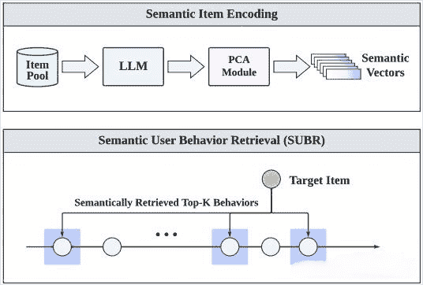
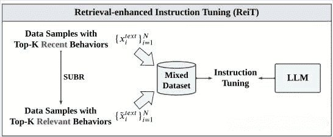
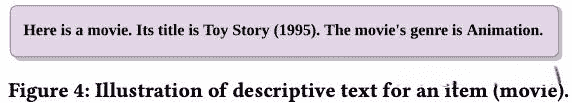
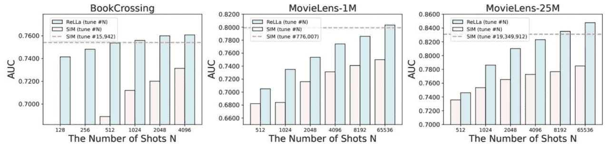
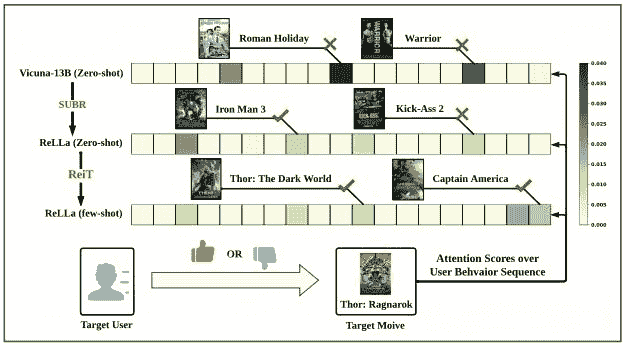

# 华为在推荐系统中的LLM应用

> 来源：[https://qqs7y1hozd1.feishu.cn/docx/ElT5d1cGRo8IaOxkDClcIXgUnFb](https://qqs7y1hozd1.feishu.cn/docx/ElT5d1cGRo8IaOxkDClcIXgUnFb)

## 写在前面

**LLMs**因其在**NLP**中的强大能力，被研究者视为**推荐系统的新潜力工具****。它们**能**有效地处**理推荐任务，包括零样本和少量样本，表现出强大的生成逼真文本的能力。近期的研究聚焦于将LLMs直接应用于推荐系统，如排序和评分，结果显示，无论样本数量多少，LLMs都能展现出优秀的性能。

> 本文主要介绍如何将**大语言模型（LLMs）**应用到零样本和少量样本的推荐系统，克服LLMs在理解和处理长用户行为序列时的挑战。

具体地，提出"长期序列行为理解难题"**，指出在面对长序列，**LLMs未能有效提取推荐相关的信息，如在Vicuna-13B模型的2048个令牌限制下，性能随序列长度增加反而下降。传统推荐模型如SIM在序列增长时有所提升，但当行为数量超过窗口限制时，性能开始下滑。而在标准NLP任务中，LLMs在类似的大上下文环境下通常表现出色。

+   因此，在推荐领域面临的问题是如何让LLMs在有限上下文中推断用户对特定商品的偏好，这要求在用户档案和行为历史基础上进行复杂推理，这是LLMs独有的挑战。

## 数据准备及预训练

首先，收集用户的历史行为数据，比如浏览记录、搜索关键词或购买历史。

然后，将这些行为转化为可以理解的语言表示，比如查询或者短语。接下来，将这些文本输入到LLM中，请求其生成相应的输出，如商品描述、评价或相关推荐结果。

利用LLMs进行点式评分通常涉及两个步骤：

**首先，****LLM通过理解和生成文本，**能够理解每个用户对特定商品或服务的潜在喜好。

**然后，****当用户对某个产品提出查询**或请求时，LLM可以根据其已有的知识库生成对该产品的评分或预测。

> 这种评分可能基于用户的历史行为、商品属性或者LLM对相似情境**的理解。由于LLMs的强**大生成能力，可以生成高度相关的个性化评分，即使在缺乏直接评分数据的情况下。

### 零样本推荐及少样本推荐

> (1) **零样本推荐**是指直接运用预训练的LLMs，不依赖任何额外领域内特定数据，仅通过模型内在的通用知识和推理能力来为用户做推荐。

> (2) 构建文本输入输出对时，首先获取用户信息和目标商**品的相关信息，如用户历史**行为和商品特性，转化为LLM能理解的格式，如查询或描述。然后，将这些输入送入模型，期望得到对商品的预测或评价。

> (3) 利用LLMs进行点式评分时，模型会根据用户特征和商品信息生成个性化的评分。对于少量样本推荐，由于数据有限，LLMs通过理解和推理，利用少有的训练样本，模仿在全样本设置下的学习，生成对未知用户的精准预测。

### 生成上下文

对于LLMs，首先将每个样本 转化为文本格式的 ，遵循特定的提示模板。同时，二元标签 以二进制形式

进行转换。比如，一个输入可能包含用户对商品的描述、行为历史和任务说明。用图表展示了一个输入输出对 的例子，其中 涵盖了所有相关的信息。

> **重要的是，用户行**为序列的长度决定了生成上下文的范围，它可以从十几到几百不等。在处理每个样本 时，限制行为序列长度至𝐾。

> 与之相比，一些标准的点击率预测通常会选取最近的𝐾个行为，但ReLLa则独树一帜，通过语义用户行为检索，获取最相关于目标商品的那𝐾个行为的文本信息，而非仅仅局限于这些行为本身。

### LLM得分记录

大型**语言模型通过接受离**散的文本tokens ，如LanguageModel所示，生成对应的输出token 。这个过程可以通过模型内部的训练函数来实现，该函数基于输入学习和推断，生成连贯且符合上下文的文本内容。

**用数学公式表示为：**

**在某些场景下，如点**式评分或分类任务，LLMs可能会使用softma**x函数来预测每个位**置的输出。给定模型的隐状态 ，softmax函数计算的是目标位置𝑎和所有可能类别𝑏（在这里是所有词汇V）的分数，通过指数函数加权，然后除以总和，得到一个概率分布：

这个概率向量表示了模型对各个类别（如"Yes"或"No"）的信念，常用于多分类问题中选择最可能的类别。在你的例子中 就是用户对目标商品点击的概率估计。

+   评估阶段使用的点击率估计 是基于测试集的，这是为了量化模型对真实点击行为的预测能力。

+   但在实际训练过程中，**会结合LLMs的优化策略****，遵循标准的指导原则，同**时也会利用因果关系的语言建模方法，以确保模型的有效学习和优化。这样既能保持模型的性能，又能充分利用LLMs的潜在优势。

## 训练方法

本文提出了**R**eLLa（Retrieval-enhanced Large Language Models，检索增强大型语言模型）框架。

这个框架通过集成语义**用户行为检索（SUBR）**和**检索增强的指令微调（ReiT）**，针对大型语言模型处理长用户行为序列的挑战，通过优化零样本推荐和少量样本推荐的任务，提升了模型的理解和性能。

> 通过将数据样本 转化为文本输入 ，不仅进行了点式评分，还考虑了训练过程中的指导调优和因果语言建模的方法，确保模型的有效学习和应用。

### ReLLa 概览

在ReLLa框架中，专注于两种特殊推荐场景：零样本和少量样本。

针对零样本，创新性地实施语义用户行为检索（SUBR）。

> **首先，利**用大型语言模型构建每个商品的语义向量。

> 然后，对每个文本样本 ，挑选与目标商品最相关的前𝐾行为，取代原有的最近𝐾行为，以提升样本质量。

+   对于少量样本推荐，设计了**检索增强的指令微调（ReiT）**。这种方法通过语义用户行为检索（SUBR）作为数据增强手段，将原始和检索增强的样本融合，丰富了训练数据，增强了模型在处理长序列行为时的理解和泛化能力。尽管ReLLa是在有限样本条件下优化的，但重要的是，与之对比的基线模型是在全样本环境下进行训练的。

### 语义用户行为检索Semantic User Behavior Retrieval

**在零样本情况下，由于缺乏领域**内训练数据，采用语义用户行为检索（SUBR）来提升样本质量。

> 具体来说，不是简单地使用最近的𝐾个行为，而是找到与目标商品最相关的𝐾个语义行为，用它们替换原始行为。

> 这种方法旨在减少噪声，更精确地捕捉用户对目标商品的兴趣，同时保持行为序列的原始长度作为模型输入。

首先，进行语义项目编码，获取每个项目的语义表示。通过构造针对每个项目的描述性文本（如图所示），利用LLM处理并提取隐藏状态，平均得到一个维度为𝐷（Vicuna-7B为4096，Vicuna-13B为5120）的向量 。

随后，通过**主成分分析（PCA）**降低维度并减少噪声，得到降维后的语义表示 ，其中𝑑=512。

接着，通过计算语义向量间的余弦相似性来评估它们的语义关联性。

> 在零样本测试阶段，利用**检索增强技术**，用目标商品的最相关𝐾个行为替换原始最近的𝐾个行为，形成一个高质且保持上下文长度相似的并行增强测试集。

**这种做法显著提**高了零样本推荐的性能，解决了处理长用户行为序列的难题。

### **检索增强指令微调**Retrieval-enhanced Instruction Tuning

在少量样本推荐中，利用训练集

其中𝑁代表样本总数。传统的做法是直接对LLMs进行转换后文本的指令微调，但注意到这可能导致过拟合和记忆衰退风险。

因此，引入**检索增强指令微调（ReiT）**，创新性地结合语义用户行为检索（SUBR）作为数据增强工具。 SUBR生成了多样化的用户行为模式混合训练集，通过增强每个样本𝑥~𝑖𝑡𝑒𝑥𝑡。合并原始和增强样本，形成包含2𝑁个样本的混合训练集。

> 这样的丰富模式有助于防止过拟合，提升模型在处理长序列行为时的泛化能力。 在微调过程中，遵循因果语言建模的原则，以保持模型结构的稳定，确保其有效学习和提取长期行为中的有用信息。

### 数据效率 (RQ3)

在探究样本效率时，通过调整样本数量𝑁来考察ReLLa（少样本）和SIM（最优全量学习基线）。

> 具体到实验𝑁的取值分别为128,256,512,1024,2048,4096（BookCrossing）以及512,1024,2048,4096,8192,65536（MovieLens-1M和25M）。

以𝐾=60（Book）、30（MovieLens-1M）和30（MovieLens-25M）设定用户行为序列长度。

> 结果显示，无论是ReLLa还是SIM，随着𝑁的增长，性能都有所提升。

> 然而，ReLLa**在所有𝑁下都明显领先，**且优势随𝑁增加而更显著。

> 特别在**BookCrossing**，当𝑁低至128或256时，SIM在达到约0.5的CTR预估阈值上显得力不从心。

这证明了ReLLa在有限样本下具有优秀的推理能力。这是因为ReLLa利用LLMs的深层逻辑理解和开放世界知识，展现出卓越的低样本数据效率。

### 案例研究 (RQ4)

通过实例研究考察了ReLLa如何助力大型语言模型（LLM）解析长用户行为序列。

以MovieLens-25M数据集为例，对比了Vicuna-13B（零样本）、ReLLa（零样本）和ReLLa（少量样本）的表现。 Vicuna-13B在零样本环境下，对目标电影《雷神：诸神黄昏》的关注主要分散在不相关影片如《罗马假日》和《勇士》，导致预测不精确。

引入SUBR后，ReLLa（零样本）聚焦于与目标电影相似的超级英雄类型，如《钢铁侠3》，但仍存在不完全匹配的异常点，如《Kick-Ass 2》。

> 通过进一步的**ReiT（检索增强的指令微调）**，ReLLa（少量样本）强化了对目标电影及其同属漫威系列的其他作品的注意力，这显示出SUBR和ReiT的协同作用。

它们有效地帮助LLM理解了用户行为序列中的逻辑关系，从而提高了对目标电影的识别和预测准确性。总的来说，ReLLa通过优化样本质量和增强模型对长序列的处理，显著提升了LLM的性能。

