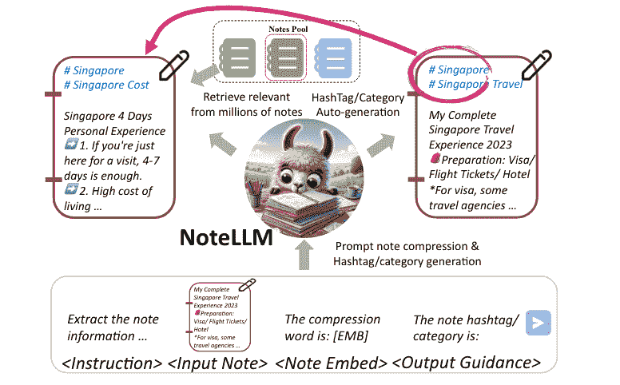
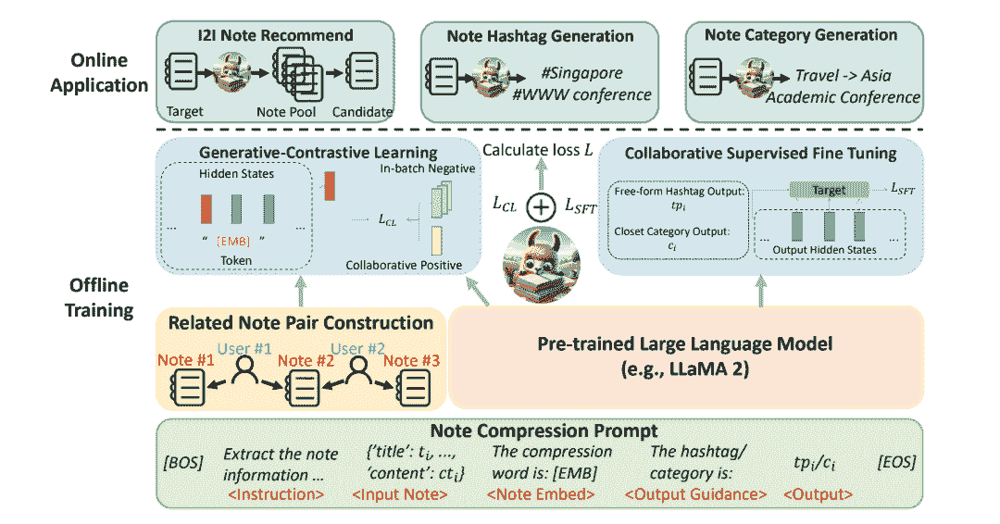
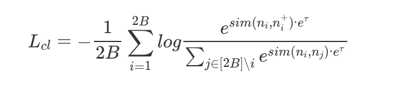
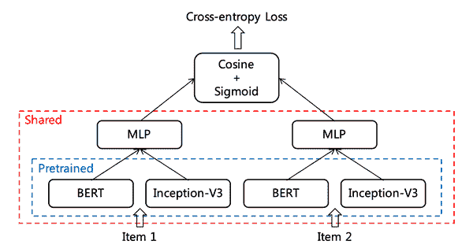
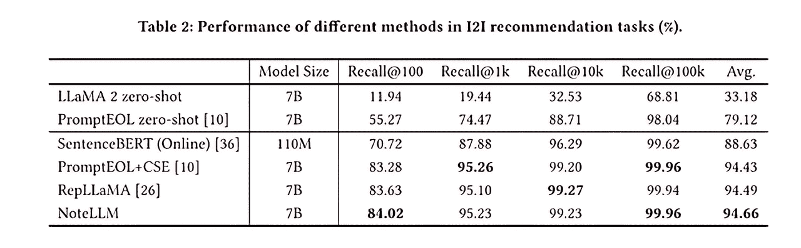
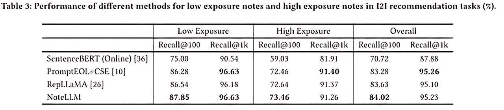
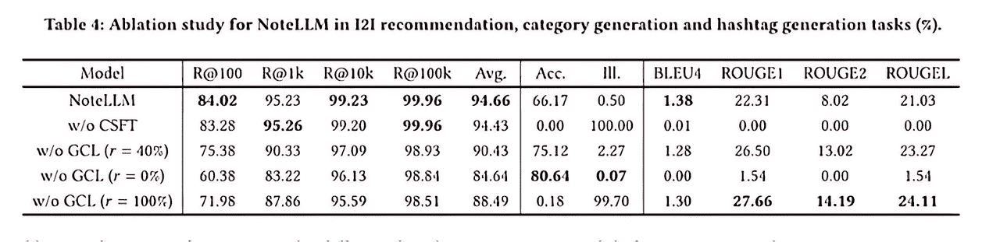

# LLM: 大语言模型在小红书推荐系统的落地应用

> 来源：[https://qqs7y1hozd1.feishu.cn/docx/TCsudBCBeoxj8tx8ITicILqVnZd](https://qqs7y1hozd1.feishu.cn/docx/TCsudBCBeoxj8tx8ITicILqVnZd)

**大语言模型在小红书****笔记推****荐场景下的落地应用，主要****是围绕如何****利用L****LM的表征能力来生****成**更适用于i2i召回的文本embedding。

#####

> **为了解决推荐中的****物品冷启动问**题，在召回阶段中往往会增加一路使用内容多模态表征的i2i召回 。

> 这路召回由于只使用了**纯内容****的特征，和老物品**便可以**公平比较，不会产**生因为新物品后验行为少而导致无法被召回的问题。

现有的多模态**i2i召回**方法在文本侧一般都是用一个**BERT**经过预训练后生成**embedding**然后基于**embedding**的相似度来进行召回。

**但是这样可能也会存在一些问题：**

1.  **BERT表征能力不足**** **

> 相较于**BERT**，使用参数量更大的**LLM**来生成**embedding**可能可以学习到一些更为长尾的信息，但只能代表文本的语义信息，和下游推荐任务的目标存在一定的不一致

>

1.  ** 标签类别信息利用不够充分 **

> **使用笔记内容生成标**签和类别的过程和生成笔记的embedding十分类似，**都是讲笔记的关键信**息压缩成有限的内容，因此引入一个生成标签和类别的任务可能会提升最终embedding的质量。

>

**因此，****采用多任务学习的方法**（**NoteLLM**）**使用Llama 2**作为backbone，旨在生成更适用于推荐任务的文本embedding

**首先为每个样**本构造一个**统一的笔记压缩**Prompt，然**后使用两个预训练任**务来生成更好的文本embedding

+   **一个任务称为 生成式对比学习 （Generative-C****o**ntrastive Learning）。

> 该任务会将笔记的内容压缩到一个特殊的token中，使用该token生成的向量便可以作为笔记的文本表征。这个任务使用了推荐中的协同过滤信号作为标签来进行对比学习，首先会统计所有笔记对的共现分数，然后使用共现分数高的笔记对视为相关性高的笔记，作为正样本，batch内负样本，用对比学习的方式进行训练，由于引入了协同过滤的信号，所以最终生成的embedding可以更适用于下游推荐任务。

>

+   **另****外**一个任务是用笔记标题和内容来生成笔记的标签和类别，称为 协同监督微调 （Generative-Contrastive Learning）。

+   这个任务不仅可以生成标签和类别，同时，由于它和生成embedding的过程类似，都是可以提取笔记文本中的关键信息，因此，引入该任务也可以增强第一个任务生成的笔记embedding。

# **方法介绍**

**方法分为三个部分，一个输入的pro**mpt构建和训练时用到的两个预训练任务：

+   ** 笔记压缩****prompt****构建**

+   ** 生成式对比学习（Generative-C**ontrastive Learning）

+   ** 协同监督微调（Collaborative Sup**ervised Fine-Tuning）

笔记压缩**prompt****构建用来定义模型在训练时的输入**，生成式对比学习和协同监督微调分别对应两个预训练任务，前者引入了推荐中的协同过滤信号作为标签进行对比学习来训练更好的文本表征，后者其实就是根据笔记内容来生成对应的标签和类别。

**具体流程如下****：**

> 首先在离线训练阶段，根据用户行为构建出很多的相关笔记对，作为训练样本

> 然后使用**LLaMA 2**作为**backbone**进行训练，

> 同时也可以生成笔记的标签和类别来辅助其他任务。

## **笔记压缩prompt**

**具体的prompt模板如下：**

> Prompt: [BOS]<Instruction> <Input Note> The compression word is:"[EMB]". <Output Guidance> <Output>[EOS]

**[BOS]**代表句子开头，**[EOS]**代表句子结尾，**[EMB]****则代表最终**要输出文本表征**所对应的那**个token，最终会将这个token对应的隐向量经过一个全连接层映射后得到最终的表征向量。

**同时，针对类别生成**和标签生成使用了不同的prompt，但是模板都是同一个

具体来说，如果是做类别生成，那么prompt就是这样的：

> <Instruction>: Extract the note information in json format, compress it into one word for recommendation, and generate the category of the note. <Input Note>: {’title’: , ’topic’: , ’content’: }. <Output Guidance>: The category is: <Output>:

如果是用来做标签生成，那么prompt就是这样的：

> <Instruction>: Extract the note information in json format, compress it into one word for recommendation, and generate <j> topics of the note. <Input Note>: {’title’: , ’content’: }. <Output Guidance>: The <j> topics are: <Output>: <j> topics from

由于标签有很多，大模型可以不断生成，所以这里从原始标签里随机采样j个标签作为生成的内容，并且在prompt里规定了只能生成j个标签。

在**prompt**构建输入完成后，便可以把**[EMB]**这个特殊token最终输出的隐向量当成笔记的文本表征，同时也能够根据笔记的内容生成对应的标签和类别。

## **生成式对比学习（****G**enerative-Contrastive Learning）

虽然大模型通过**SFT**和**RLHF**预**训练之后能够表征的语义信息是非常丰富的，但是直接用在下游推荐任务中却不一定好，主要是因为大模型的预训练任**务是为了获取语义信息，而下游推荐的目标却是为了点击率，两个目标存在差距，所以这个生成式对比学习就是为了在大模型的预训练中引入推荐的协同过滤信号，从而使得生成的embedding更适用于下游的推荐任务。

具体来说，首先统计一周时间窗口内每个用户点击笔记A后再点击笔记B的次数，然后算出一个共现分数，作为协同过滤的信号，计算两篇笔记共现分数的公式如下：

这里 是用户的个数； 代表用户的点击次数，**实际上就是对活跃用户进行了降权，防止某些高活**用户什么笔记都点导致计算的共现分数不准确。

在计算得到所有笔记两两之间的共现分后，然后再卡阈值，将低于或高于某个阈值的笔记进行过滤，最后对于每个笔记，都会得到和其相关的笔记集合，再两两构建笔记对作为输入的正样本。

**进一步，对于每个笔记，都使用**

这个特殊**token**的隐向量经过全连接层映射得到的向量作为文本表征向量

便可以**采用对比学习**的方式来进行学习，正样本就是构建好的相关笔记对，对应向量记作

负样本采用**batch**内负采样，对应向量记作

**损失函数**使用对比学习的Info-NCE:

相似度计算采用余弦相似度， sim(a,b)=a^\top b/(|a||b|)

**通**过这种方式进行训练，便可以使得LLM学到一些用户行为相关的信息，从而生成更好的文本表征服务于下游推荐任务。

**顺便说一下**，这个思路其实和小红书之前提到的CB2CF其实是一脉相承的，只不过另外一篇同时用了文本和图像特征，损失函数用的交叉熵

## **协同监督微调（****Collaborative Su****p**ervised Fine-Tuning）

> **这个任****务实际**上就是一个做标签/类别生成任务的SFT，加了协同两个字可能是因为要跟前面引入了协同过滤信号的GCL对应起来，为什么要加这样一个任务呢? 文章提到了两个原因：

+   **只用LLM生成句子embedding有点像大炮打蚊子**的感觉，没有充分发挥LLM强大的生成能力。这边猜测应该是因为生成的标签和类别还可以用于一些其他场景，比如当一些笔记缺乏标签，或者类别不正确是可以使用LLM为其补充信息。

+   可以提高上一步生成式对比学习生成的embedding的质量。这是由于生成标签/类别和生成笔记embedding一样，都是旨在总结整个笔记内容。所以加了这个预训练任务可能可以提高生成最终生成的embedding的质量

具体来说，在**CSFT**里面要同时做类别和标签预测，文章提到为了提高训练效率并防止遗忘问题，会从每个批次中选择 r 个笔记用于标签生成任务，而剩余的笔记则分配用于类别生成任务。

CSFT的损失函数如下，其实就是把输出部分的token计算下loss:

**最**终模型的loss由两项加起来，并且用  作为超参控制两个loss的权重：

# **实验结果**

## **离线实验**

离线实验主要是和线上的**Sentence BERT**基线以及其他几种用大模型生成文本嵌入的方法对比，用r**ecall@k做评价指标，效果都要更好，结论就是：No**teLLM>=其他方法微调的LLM>>BERT微调>>LLM zero-shot

**同时，通过对不**同曝光水平的笔记对指标进行了拆分，发现NoteLLM在不同曝**光水平的笔记****上提升都较为一致，**另外可以发现各个方法在低曝光笔记上的召回率都要远高于高曝光的，说明基于内容embedding的方法能够更有效地召回冷启动物品

## **消融实验**

分别把**CSFT**任务以及**GCL**任务去掉，以及在**GCL****内部对****标**签类别生成取不同的数据比例，结果发现就是两部分缺一不可，这里可以发现起到最关键作用的是GCL任务，类别预测和标签生成的任务好像对整体效果是可有可无的感觉，看起来只用协同过滤的目标来做对比学习也能效果很好。

## **在线实验**

A/B测试，跟之前的**Sentence BERT**基线相比，**NoteLLM**的点击率提高了**16.20%**，评论数量增加了**1.10%****，平均每周**发**布者数量（****WAP****）增****加了0****.41%。**结**果表明****将LL**M引入i2i推荐任务可以提高推荐性能和用户体验。此外，还观察到单日对新笔记的评论数量显着增加了3.58%。这表明LLM的引入有利于冷启动，NoteLLM最终推全上线。