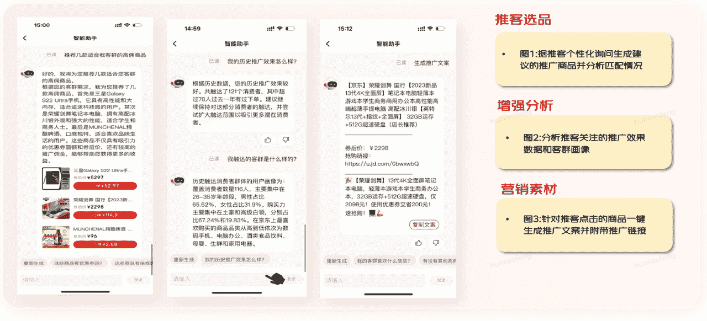
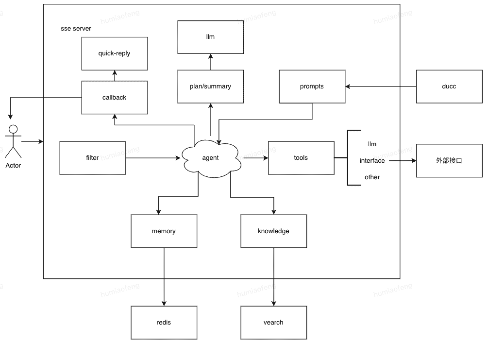
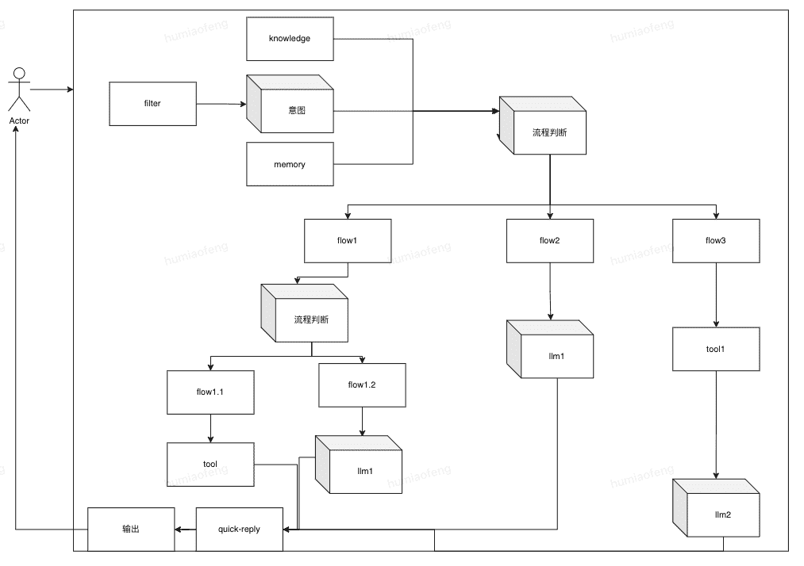
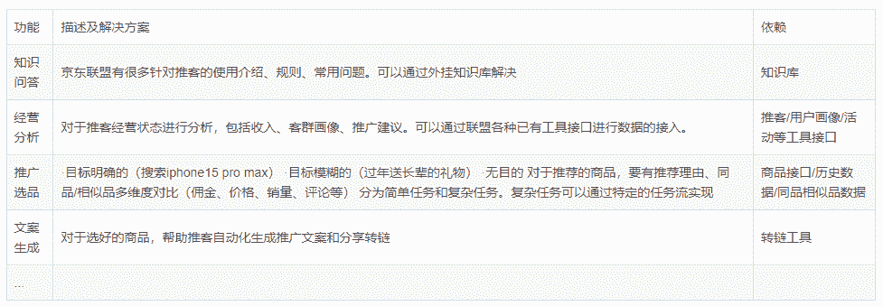
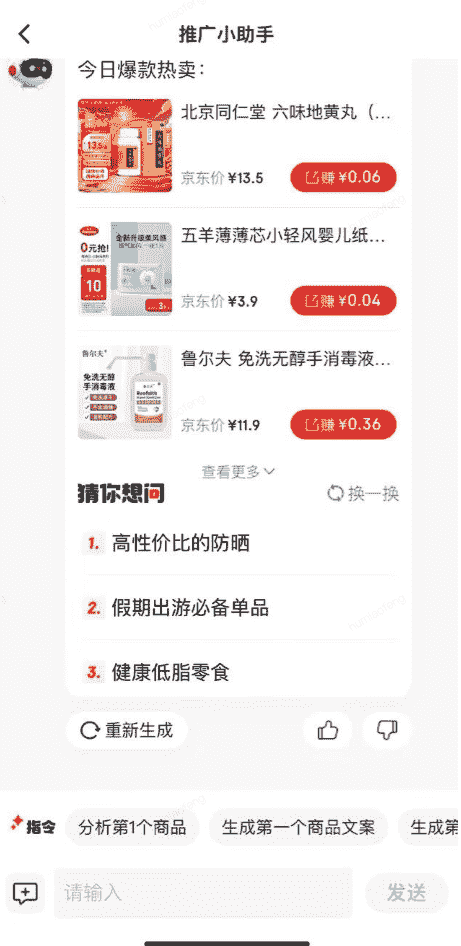
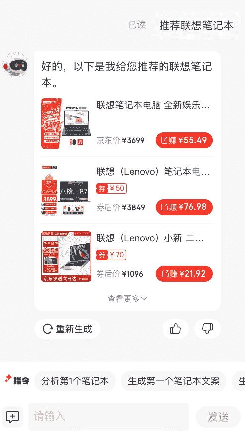
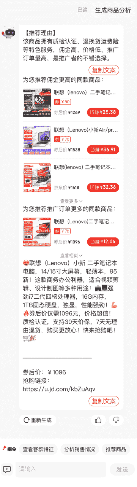
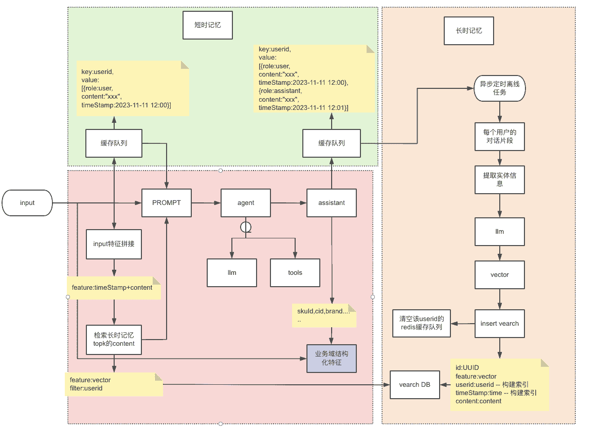
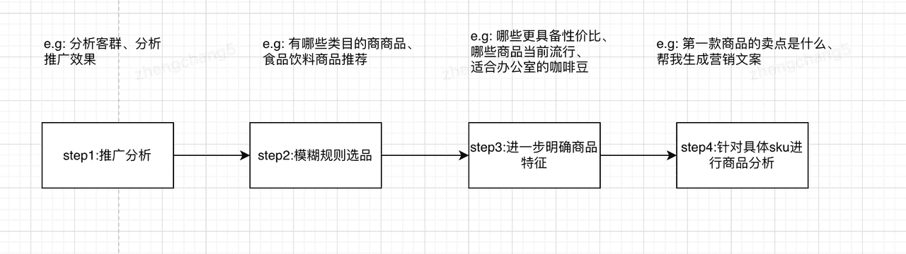

# 某东LLM based Agent实践

> 来源：[https://qqs7y1hozd1.feishu.cn/docx/VGprdh6Wuo54Ptx6SlCc3EO3n9f](https://qqs7y1hozd1.feishu.cn/docx/VGprdh6Wuo54Ptx6SlCc3EO3n9f)

> 借助AIGC大语言模型出色的理解、推理、规划能力。

> 充分理解推客的个性化经营诉求，深度结合广大推客的实际推广链路，从智能选品、推广建议、素材生成、经营指导等多方面为推广者带来经营升级，解决传统被动交互形式中需求差异巨大及获取信息效率低等问题。

## LLM based Agent实践如何做

##### **重点将从以下三部分来介绍：**

> **Agent架构：**

> 分为两部分，一部分是通过对模型的训练提升Agent的核心大模型识别工具的准确性，

> 另一部分要设计一个可扩展并安全可控的Agent架构来填充和扩展业务能力。

> **记忆：**

> 多轮对话应用中如何组织、存储和检索记忆来提升大模型对用户的理解。

> **快捷回复：**

> 利用快捷回复做用户意图的路径规划，实现业务目标。

## 一、实战1-AI Agent

### 1、为什么要用Agent？

> 大模型本身对垂类场景专业知识不足、知识的时效性差、容易出现幻觉。

> 直接使用大模型来和用户做交互很容易出现问题，需要大模型来理解用户的意图并能够利用联盟已有的工具才能更准确的回答用户的问题。

### 2、架构

**Agent架构：**

> 当前Agent仍处于发展的初级阶段，从应用场景来看，从智能客服->智能创意->推荐系统->自动驾驶->智能机器人到一个复杂的城市智能规划系统，所需要感知与交互的环境因素越来越复杂、所要决策的事项也越来越困难，所面对的风险程度和安全级别也差异很大。

**所**以目前没有一种通用的Agent适合在所有场景使用，每种应用场景都需要根据其特点、成本、效率、风险相结合来设计Agent架构。

### 3、技术方案

#### 工具识别

大模型识别工具的方式有两种

> 一种是用system prompt的方式

> 这种扩展性较好，但是需要模型具有极强的指令跟随的能力，一旦出现工具选择错误、或者入参错误，都会造成Agent调用工具失败的情况，在开发初期使用该方法，但是prompt的调优过程就好比魔法，时好时坏。

> 第二种方式就是把工具训练到模型里面去

> 这种对于工具使用的准确性可以大幅提升，并且用起来也很方便。利用ToolLLM框架提供的数据构建、模型微调和评测框架来增强大模型对工具的使用能力。结果证明用LLama-6B sft的效果已经达到了Chat G-T的水平。

#### Agent实现

**对于Agent实现上，最初的方案是基于la**ngchain的agent来开发实现的。

> **在**实现的过程中，发现langchain中的很多问题，过度的封装、异步并发效率低、版本前后不兼容、核心功能难以控制，由于langchain是用python实现的

> 解释性语言运行速度慢、并发处理能力较弱，虽然灵活性很高，但也造成了性能低的问题，所以比较适合做实验或小型应用，但是企业级高并发应用并不合适。

> **所以在ReAct范式基础上，结合京东内部公共组件和自研组件，融入了工具/接口的接入**、自定义工具的编排、记忆模块、vearch向量检索、prompt引擎、流式回调函数、各模块的监控、并用golang重写了Agent主要架构，提升了系统的稳定性和高并发能力，性能上整体提升50%以上。

> **Agent的核心部门主要分**了2个阶段，初始化阶段、迭代执行阶段，初始化阶段是对环境信息的收集，包括用户的输入、历史记忆加载、工具的接入、prompt接入、模型的接入，流式/非流式回调接入，这部分在langchain中agent启动阶段是比较耗时的。

**针对每轮用户的交互，Agent都需要重新初始化，我们采用Agent**复用的方式进行预加载，除了用户的输入和历史记忆，其他模块全部提前加载，提升效率。

另一个阶段是迭代执行阶段，包含4个部分，预处理模块、规划、后处理模块、执行。

> **预处理模块需要维护一个阶段状态**（第几轮迭代）和数据的拼接处理（用户的输入+大模型回复+执行结果）。

> 规划阶段主要是通过大模型推理阶段

> 这里需要预留对工具的解析模块，因为不同的模型对于工具的输入是不一样的。

> 后处理模块是对模型规划的结果进行解析

> 有部分需要注意对模型规划的结果做区分，结束或调用工具，需要在这里进行流式和非流式的结果存储和返回，如果需要调用工具，就进入执行模块。

> 执行阶段将工具的调用结果送入预处理模块进行下一轮的迭代

> 在模型的调用和工具的调用中都预设了自定义钩子，用户可以根据需求在自定义工具执行的任意阶段进行流式输出。

#### 合理的架构

> 从企业级应用来看，越智能的架构越合理吗？这里最重要的问题其实是系统是否足够安全可靠，智能化是所有企业所追求的，但是要在一个可控的边界内智能，一个不受控制的智能体是任何企业无法接受的。

所以安全边界来看，应用架构可以分为以下两种：

**完全智能化架构：**系统的运行完全依靠Agent自主执行

**安全性架构**：系统运行依靠提前编写好的任务流，Agent只做流程的选择和判断。

**这**么多年的经验来看，如果脱离业务聊架构，就会没人用，如果完全按照业务来做，总会被推翻重来，所以架构的设计需要贴合业务的同时还要有一些前瞻性。

京粉智能推广助手的业务主要需求：

> 从功能需求来看，既有简单任务，又有复杂任务

> 而且随着时间的推移，增加的任务会越来越多，同时业务的定制化内容越来越复杂，对Agent的难度会增加很多。

> 为了平衡从业务、安全、成本、效率考虑，最终通过自定义任务流与agent自主决策相结合的方式，兼容了动态规划、自主决策执行任务流与业务的可定制化、可扩展性。

### 4、业务效果

## 二、实战2- 记忆

> 对于多轮对话形式的大模型应用来说，上下文信息对于模型理解人类需求有很大的帮助，如果没有记忆，在多轮对话中，大模型的表现会比较割裂，长期的记忆也会让模型对用户的习惯、偏好有更好的认知。

### 1、挑战

> （1）由于大模型token的限制，和系统内存的限制，无法将用户的所有历史信息进行存储和加载到模型中。

> （2）如何模拟人类大脑记忆和检索方式，构建长/短期记忆。

> （3）多轮对话中的垂类领域知识的结构化记忆。

### 2、技术方案

**记**忆的构建可以概括为理解、存储、删除和检索的过程，通过以下方式对短期记忆、长期记忆、垂类领域知识进行存储和检索。

> **（1）短期记忆的设计比较容易**

> 包括短期滑窗多轮对话的方式和定长时间内的多轮对话都可以作为短期记忆，短期记忆要尽可能的存储细节信息，但是轮数要尽可能的少。

> **（2）长期记忆**

> 将短期的详细记忆提取出实体信息，可以通过NER抽取实体信息，也可以通过大模型对缓存进行总结和压缩，按照记忆片段和时间戳进行向量表征并存入向量库中。

> **（3）垂类领域知识**

> 比如京东的skuid，是一个数字类型，不代表任何语义信息，在前面的对话中可能会输出给用户某个skuid。

如果短期记忆已被压缩成长期记忆，就**会导致不包含任何语义信息的数字类型消失**，可以通过自定义结构化信息存储的方式将这类信息与长/短时记忆进行融合存储和检索，这样在用户多轮次对话中就可以通过（“分析上一个商品”）从记忆中获取结构化的skuid来查找并分析该商品，而不是必须输入分析上一个商品的“skuid”才能够识别。

> **（4）检索时同时检索短时缓存记忆和向量库长时记忆检索（**通过vearch实现）以及垂类领域知识，将三部分进行融合后，作为整体的记忆模块，节省记忆空间。

## 三、实战3-快捷回复

> 从线上实践的数据分析来看，快捷回复功能在整个系统或用户交互上都是使用率最高的，所有的用户都存在选择困难，特别是在一个全新的应用场景中，用户在首次使用时，用户都喜欢使用一些给定的功能，所以如何利用好快捷回复的能力，通过快捷回复引导用户朝着业务目标路径执行，这个也是比较有意思的点。

**快捷回复的三种实现方案：**

> （1）通过历史信息和用户的当前输入，利用大模型总结续写能力，生成一些用户可能继续输入的内容。

> （2）结合应用的功能预设一些常用问题。

> （3）重点：可以根据应用的业务目标，来规划用户使用路径图，使用户按照快捷回复的路径最终达成我们需要的业务目标，在实际业务中可以结合1、2点，既有用户想输入的，又有我们想让用户看到的功能。

**比**如京粉智能推广助手的最终业务目标是帮助推客选品并推广，那么所有的功能点最终都要导向帮助推客生成推广文案和推广链接并分享。

## 小结

未来还需要从以下几个方面持续优化：

> **（1）垂类领域用户意图的理解**

> 结合垂类业务的特点，通过自然语言沟通交流的方式，更加精准更快速的识别用户的意图，模型上需要大量的真实可靠的业务数据来进行训练，机制上需要对Agent进行升级，多个更加专业的助理进行协作，例如multi Agent的应用。

>

> **（2）生成式推荐技术**

> 对现有推荐系统进行技术变革，从召回、排序、重排固有的推荐链路演变成直接生成用户所需的内容或商品。

> **（3）成本效率**

> 大语言模型虽然很强大，但是其应用也带来巨大的成本和效率上的考验，如何在垂类领域采用较小的模型实现大模型的效果，如何对模型推理加速，提高计算利用效率，降低机器成本，也是我们长期需要考虑和优化的地方。