# 某站游戏个性化推荐系统

> 来源：[https://qqs7y1hozd1.feishu.cn/docx/B7D6dtjBqogj48xHv6ycpyeFngd](https://qqs7y1hozd1.feishu.cn/docx/B7D6dtjBqogj48xHv6ycpyeFngd)

# **简 介**

## **B站游戏中心**

> B站游戏中心是一个游戏分发平台，它提供游戏下载、游戏评测、游戏攻略和游戏活动等相关内容，用户可以在这里找到各种优秀的游戏作品，预约测试，下载资源，以及参与游戏社区的互动

## **B站游戏背景**

> 尽管游戏中心的用户是**主站用户的一个子集****，但鉴于主站用户有相当一部分是游戏玩家，游戏**中心的用户规模十分庞大；另外游戏中心的游戏非常丰富，涵盖了各种类型的游戏，包括手机游戏、电脑游戏和主机游戏等

**游**戏中心推荐系统是这些游戏和海量用户的桥梁，为游戏用户推荐他们感兴趣的B服游戏，帮助游戏用户解决游戏数量过多带来的信息过载问题，用户下载了这些游戏并游玩后，作为渠道服的B站能获得相应的渠道分成，从而实现共赢的局面

> **游戏中心推荐系统总体来讲：**

+   **一方面可以帮助用户解决"发现游戏**"的痛点，精准推荐可以降低用户的打开成本

+   **另一方面，推荐系统不仅可以帮助提高转化率，减少无效曝光，而且可以整合利用零碎流**量，交叉推广指定的游戏，还可以建立更加详细的用户画像体系，将用户留在B站生态当中

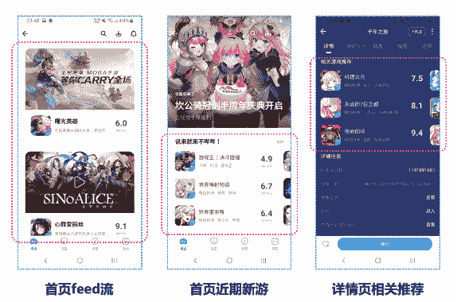

+   **当前游戏**中心涉及到个性化游戏推荐的模块包括首页feed流推荐，首页近期新游推荐和详情页相关游戏推荐等

## **游戏推荐系统的挑战**

> 游戏推荐系统在建设的过程中主要面临以下两个方面的挑战：

+   **系统实现上面临的挑战**

> 为了适应游戏分发业务的快速发展，游戏推荐系统需要能够灵活地应用新的算法和策略。因此，在设计推荐系统的时候，要尽量考虑其通用性和可配置性

+   **模型建设上面临的挑战**

1.  **首先，用户特征构建方面，由于游戏用户的兴趣和偏好可能会随着时间、场景、心情等因素而变化，这要**求推荐系统需要能够及时捕捉和适应这些变化，提供更符合用户当前需求的游戏内容和服务

1.  其次，游戏中心的用户玩游戏需要付出较高的成本

> 用户不仅要下载安装包体，还要花费精力去学习游戏的玩法。这与短视频、电商或信息流推荐不同，用户可以很容易地退出、切换或忽略不喜欢的内容。因此，游戏推荐对用户来说有较高的试错成本，使得用户不愿意轻易改变游戏。例如，用户看了一部动作电影，你再推荐一部动作电影，他很可能会观看，但是用户在玩王者荣耀，你再推荐一个不知名的射击游戏，他很可能会忽略

1.  另外，用户-游戏交互数据的稀疏性和偏差性

> 游戏用户的行为数据往往是非常稀疏和不均衡的，比如用户对游戏的评分、评论、收藏、下载等行为都是低频和少量的，而推荐系统需要能够从这些数据中学习和预测用户的喜好和意图。此外，用户行为数据还可能存在各种维度的偏差，比如曝光偏差、位置偏差、选择偏差等，而推荐系统需要能够消除或减少这些偏差对模型的影响

1.  **最后，游戏推荐系统需要在满足用户的个性**化需求和保证平台的利益之间找到一个平衡点

> 例如，用户可能更喜欢低肝低氪的游戏，而平台可能更想推广付费或高价的游戏。如何设计一个合理的目标函数和评估指标，以兼顾用户和平台的多方利益，也是一个建模挑战

## **游戏推荐系统的目标和评价指标**

**在****游**戏中心推荐场景下，用户消费的是游戏，一旦完成游戏下载和后续的转化，平台就可以获得分成收入，是直接的盈利方式；这与信息流推荐显著不同，信息流推荐场景下，用户消费内容，平台优化算法来提高用户粘性，然后通过互联网广告获得收入，这种盈利方式是间接的

> 游戏中心推荐系统的总目标是提升B服游戏渠道的收入：

+   这一方面要求系统能为用户推荐他们真正喜爱的游戏，从而为游戏带来更多的用户

+   另一方面具体到每一个用户，他们对某个游戏愿意投入的时间是有限的，需要推荐系统尽可能提高游戏用户生命周期的总价值即LTV，而提升LTV与给用户所推荐的游戏关系密切相关。这种目标类似互联网电商，既要提升用户规模，又要提升客单价

衡量游戏中心推荐的指标主要包含消费侧指标和平台侧指标，消费侧指标如点击率，下载率，平台侧指标如新增用户数和LTV等

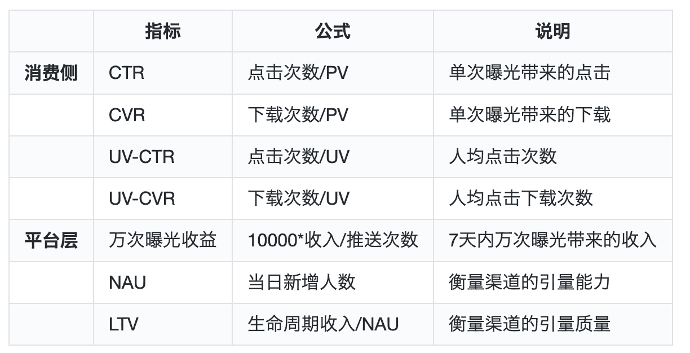

# **游戏推荐系统的整体架构**

> 游戏中心推荐系统在立项阶段就考虑到了复用性，目前该系统不仅服务于推荐系统，还服务于其他游戏算法业务如智能广告投放、游戏礼包推荐、流失预测等系统。其系统架构图如图所示

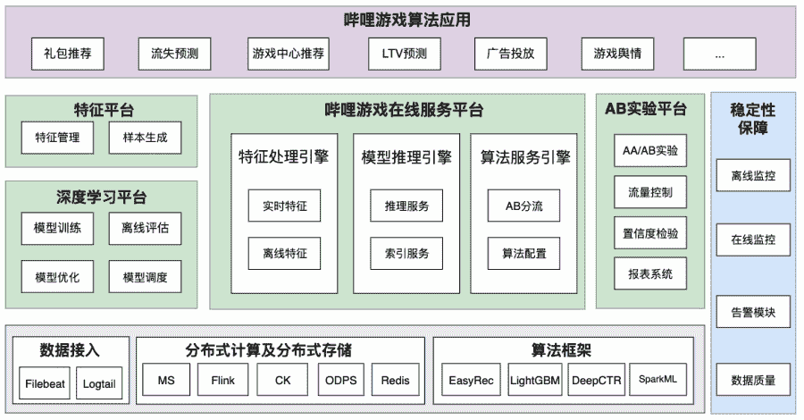

+   **特征平台：** 该模块的核心功能包括特征注册，特征计算，特征评估，特征筛选和样本拼接等。算法团队所有的特征都可以通过该模块进行统一的管理，方便其他业务快速使用，避免重复造轮子现象

+   **深度学习平台：** 该模块的核心功能是包括模型训练，模型评估，模型调优，模型调度和模型分发。所有的训练任务都可以在共享的CPU和GPU资源下进行训练和评估，帮助算法工程师提高工作效率。该模块最主要的产出是模型文件，供在线或者离线推理服务使用

+   **在线服务平台：** 负责提供实时推荐接口服务，包括特征处理引擎，模型推理引擎和算法服务引擎。特征处理引擎负责从特征存储数据库获得在线推理所需的用户、游戏的特征；模型推理引擎负责进行召回或者排序模型的实时推理，包含深度模型推理和机器学习模型的推理；算法服务引擎负责召回、排序和重排等阶段的流量的动态配置，方便快速调整各个算法

+   ** A/B实验平台：**  A/B实验平台是推荐策略产品经理和算法工程师必不可少的工具，它可以帮助他们快速验证新的推荐方案，提升用户体验和业务收益。 A/B实验平台的核心是分流，即如何将用户分配到不同的实验组中，保证实验的公平性和有效性。特别的，由于线上流量宝贵，待验证的模型或者策略较多，这要求 A/B实验平台具备同时验证各个模型优劣的能力，涉及同层互斥，分层正交等。 A/B实验平台还需要提供数据收集、置信度分析和展示的功能，让实验者能够方便地查看实验结果，判断实验是否达到预期目标，是否需要调整或终止实验

+   **配套系统：** 涉及数据接入，分布式数据存储和计算，算法模型框架和全链路的稳定性保障等

# **游戏推荐系统的核心技术**

## **特征工程**

### **涉及的特征和处理方法**

+   数据和特征是推荐系统的基础，决定了推荐系统的效果和性能

+   **特征的选择和构建直接影响推荐系统能否有效地学习用户和游戏之间的**匹配程度，以及能否提高推荐的准确性和效率

> 游戏推荐系统使用的特征类型和特征处理方法主要有：

+   **用户特征**

> 包括用户的基本属性（如年龄、性别、地域等）、用户的游戏中心行为数据（如游戏中心的搜索、曝光、点击、下载、评论、预约等）、用户的游戏内行为数据（如活跃度、时长、玩法、付费等）、用户的兴趣偏好（如游戏类型、风格、标签等）等。用户特征的处理方法包括统计分析、聚类分析、协同过滤等

+   **游戏特征**

> 包括游戏的基本属性（如版本号、OB时间、厂商信息、安装包大小、名称、类型、风格、标签等）、游戏的内容数据（如画面、音效、剧情等）、游戏的评价数据（如评分、评论、点赞等）、游戏中心统计数据（预约数、下载数、关注数等）、游戏运营数据（活跃、留存、平均时长、ARPU、ARPPU、LTV等）等。游戏特征通过文本分析、视频图像分析、语音分析等方法进行处理和提取

+   **上下文特征**

> 包括时间、地点、场景、设备等影响用户选择游戏的外部因素。上下文特征通过时间序列分析、地理位置分析、场景识别等方法进行处理和提取

### **特征平台**

1.  游戏推荐系统的特征平台是专门用来存储，共享和管理算法模型中的特征。该特征平台可以帮助其他游戏算法项目进行特征共享，同时可供非算法项目的使用，如广告投放系统人群包的筛选，舆情分析系统特定人群的洞察等

1.  **特征平台的建设不仅可以提高特征复用率**，减少重复工作，而且还可能保证特征一致性，避免因为特征不一致导致的模型性能下降，还会降低特征开发成本，简化特征开发流程

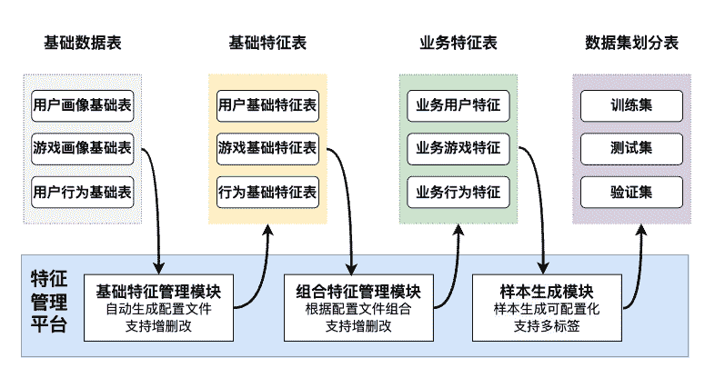

> 如图所示，游戏推荐的特征平台的主要由三部分组成：

+   **基础特征管理模块**

> 一方面将基础数据加工成基础特征，另外涉及特征的注册、更新、删除和查找等

+   **组合特征管理**

> 负责从基础特征出发进行特征的组合，组合维度涉及时间维度，标签维度，场景维度等；当然也支持这些组合特征的增删改查任务

+   **样本生成模块**

> 主要涉及样本拼接和数据集的划分，由于游戏推荐是多目标学习任务，该模块还支持多标签样本的生成

## **游戏推荐模型**

+   有了丰富的用户和游戏特征后，接下来就可以对这些特征数据进行算法建模

+   推荐系统中算法模块在游戏分发和智能决策中承担重要责任，游戏分发链路通常被拆分成召回、排序和重排三大模块

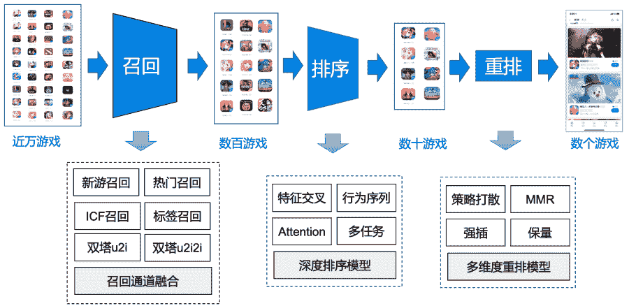

### **召回模型**

> **召回的目的是从海量的游戏库中快速地筛选出少**量**的候选游戏，降低后续排序阶段的排序压力**，召回模型决定了推荐系统的效果上限，所以要尽可能多的从不同维度来挖掘用户的兴趣点，为此从不同的方向进行游戏召回，这些召回包括以下几个方方面：

+   **热门召回模型：** 根据游戏的流行度（点击、下载、预约等）或评分等指标，给用户推荐最热门的游戏。优点是简单易实现，能覆盖大部分用户的需求，缺点是缺乏个性化，容易造成头部效应，忽略了用户的兴趣偏好和多样性

+   **新游召回模型：** 根据游戏的上线时间或更新时间等指标，给用户推荐最新的游戏。优点是能提高新鲜感和探索性，缺点是新游戏可能没有足够的数据支持，难以评估其质量和适合度

+   **ICF召回模型：** 根据用户对游戏的行为或评分，计算游戏之间的相似度，给用户推荐与他喜欢的游戏相似的游戏。优点是能提高个性化和多样性，缺点是计算量大，需要定期更新相似度矩阵，忽略了用户的动态变化和上下文信息

+   **标签召回模型：** 根据游戏的标签属性，如类型、题材、风格等，给用户推荐与他喜欢的游戏标签相匹配的游戏。优点是能提高多样性和可解释性，缺点是标签质量和覆盖度不一定高，需要人工维护标签体系，忽略了用户的行为特征和实时反馈

+   **双塔u2i模型：** 利用深度学习模型，将用户和游戏分别编码成向量，计算用户和游戏之间的匹配度，给用户推荐与他最匹配的游戏。优点是能提高个性化和准确性，缺点是模型复杂度高，需要大量数据训练，难以解释推荐原因

+   **双塔u2i2i模型：** 在双塔u2i召回的基础上，增加一个游戏向量作为输入，计算用户、历史游戏和候选游戏之间的匹配度，给用户推荐与他历史游戏最相关的候选游戏。优点是能提高个性化和多样性，缺点是模型复杂度更高，需要更多数据训练，难以解释推荐原因

1.  鉴于不同游戏召回通道各有优缺点，而且效果也不同，实际使用的时候，将不同的通道进行加权融合，具体做法事给每个召回通道分配一个权重，根据权重对每个通道的召回结果进行排序或截断，得到最终的召回召回组结果，传递给下游排序任务

1.  这样既考虑游戏召回的覆盖度，又考虑了召回的准确性。当然不同召回组之间也可以进行效果对比，来确定什么样的组合效果最好

1.  这些融合方式支持可配置化，根据线上效果快速进行阶段数量的调整，一种在线召回组实验配置如图所示

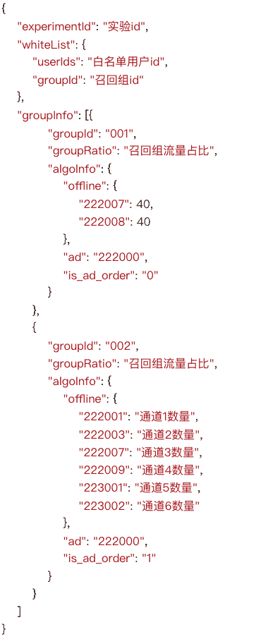

### ** 排序模型**

**排序模型的目的是根据用户和游戏的特征，**更精准的预测用户对游戏的点击率或下载概率

为了提高排序模型的整体收益，排序模型针对多目标进行建模，并从不同的维度来学习用户的不同偏好，包括多阶特征交叉、注意力机制和序列建模

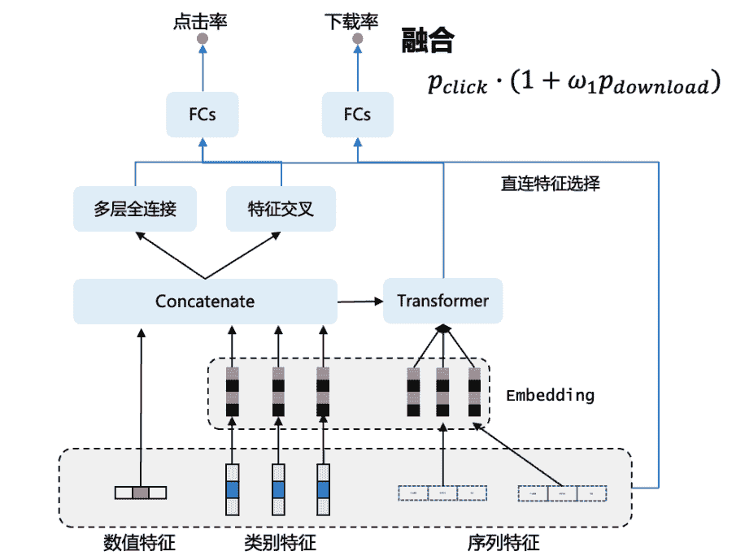

+   **多目标建模**

1.  当前的排序模型能同时优化点击和下载两个目标，可以更好地捕捉用户的长期兴趣和短期需求，提高排序的效果

1.  游戏推荐系统建设初期，为了快速论证算法的价值，使用点击率作为排序模型的建模目标。尽管取得了一定的收益，但是采用点击率的单目标建模不一定能反映用户对游戏的真实满意度，因为用户可能只是出于好奇或误操作而点击了游戏，或者因为标题党或封面党的问题导致用户点击后很快退出，因此在模型的准确性上缺乏保证

1.  为了提高排序模型的效果， 将用户点击与下载联合起来进行多目标建模，以衡量用户对游戏的真实兴趣和偏好。下载是指用户在点击游戏后，是否选择下载并安装游戏。下载可以看作是用户对游戏的一种更深层次的行为反馈，比点击更能体现用户的满意度和忠诚度

+   **多阶特征交叉**

特征交叉是指将两个或多个特征进行组合，生成新的特征，以捕捉特征之间的非线性关系。例如，用户的性别和游戏的类型可以交叉生成一个新的特征，表示用户对某种类型游戏的偏好。特征交叉可以增强模型的表达能力和泛化能力，提高排序效果

+   **注意力机制**

注意力机制是指根据用户或游戏的某些特征，给其他特征分配不同的权重，以突出重要的信息。例如，用户的年龄和兴趣可以作为注意力因子，给用户的历史游戏行为分配不同的权重，表示用户对不同游戏的关注程度。注意力机制可以增强模型的关注度和灵活度，提高排序效果

+   **序列建模**

序列建模是指将用户或游戏的特征按照时间顺序排列，利用循环神经网络或自注意力网络等模型，学习特征之间的时序依赖关系。例如，用户的历史下载游戏行为可以作为一个序列输入，利用Transformer模型，学习用户的兴趣变化和漂移。序列建模可以增强模型的时序性和动态性，提高排序效果

### **重排模型**

> 游戏推荐系统重排阶段的模型是指在精排模型进行候选游戏得分TopK筛选后，对筛选后游戏进行排序和调整，以提高推荐效果和用户体验，同时兼顾平台利益

游戏推荐系统重排阶段的模型可以包括以下几个方面：

+   **策略打散**

策略打散是指根据一些预定义的规则或策略，对候选游戏进行打散或过滤，以避免推荐结果过于单一或重复

+   **MMR多样性模型打散**

MMR多样性模型打散是指利用最大边际相关性的思想，对候选游戏进行打散或调整，以平衡推荐结果的相关性和多样性

+   **活动期游戏强插**

活动期游戏强插是指在一些特定的时间段或场景下，对候选游戏进行强制插入或替换，以提高推荐结果的时效性和吸引力

+   **新游扶持**

新游扶持是指对一些刚上线或缺乏数据的新游戏进行特殊处理或优先推荐，以提高推荐结果的覆盖率和探索性。

## **游戏推荐在线服务**

> 上一节的召回和排序算法经过深度学习平台训练得到对应的模型后，接下来就可以将这些模型部署到线上，为用户提供个性化的游戏服务，其中最主要的服务包含召回服务和排序服务

### **召回服务**

首先是召回服务，其负责给用户提供不同召回通道的召回结果并进行一定的融合，它的输入是候选游戏池，输出是当前用户有可能点击或者下载的游戏列表。

**其包含两种召回方式：**

1.  **倒排索引库直接读取召回结果**

1.  调用实时召回服务获取召回的游戏列表

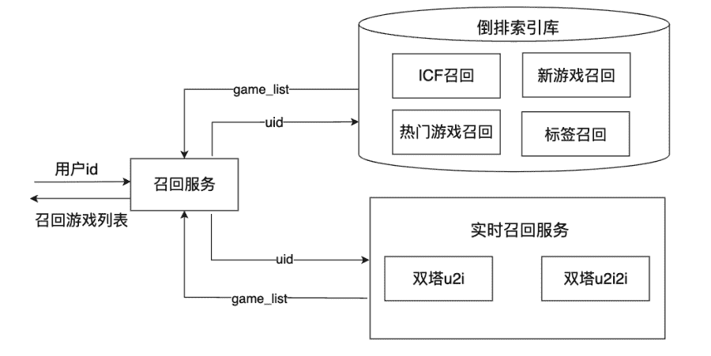

+   **倒排索引库直接返回**

对于那些时效性要求没有那么高的召回结果，直接从倒排索引库获取，比如ICF召回新游召回和热门召回，这些召回结果会提前通过离线方式算法，直接同步到倒排索引库

+   **实时召回服务返回**

对于那些时效性要求比较高的召回结果，需要进行实时的召回。游戏用户的兴趣和偏好可能会随着时间、场景、心情等因素而变化，这要求推荐系统需要能够及时捕捉和适应这些变化

> 为了解决该问题，可以在进行双塔召回的时候，实时计算出用户当前的表征，然后实时的找到与该用户最相关的游戏列表。双塔模型中的实时游戏召回方案，首先通过离线训练获取用户塔的模型参数和所有游戏的表征，其中模型参数交给推理服务，游戏表征交给索引数据库；然后当进行在线推理的时候，将用户特征和用户当前的状态输入到用户塔模型得到用户当前的向量表征，然后调用索引服务获取用户当前状态下的游戏召回列表

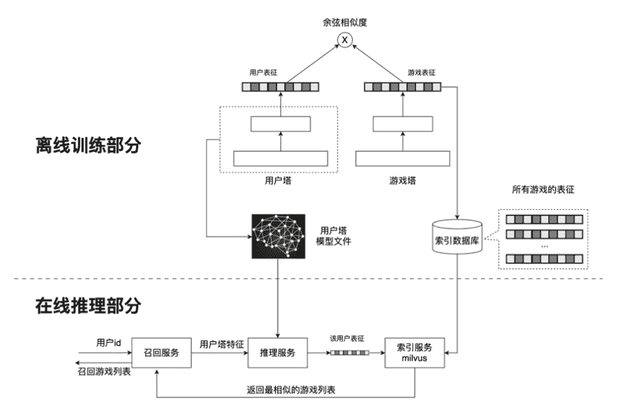

### **排序服务**

**接下来是排序服务**，它负责对召回的游戏进行精准的预估，得到用户最有可能点击或者下载的游戏

**该服务执行过程如图所示：**其接收召回服务得到的游戏列表，然后根据待预测的用户id去特征库获取用户特征，游戏特征和当前的上下文信息进行拼接，然后交给上节提到的排序模型

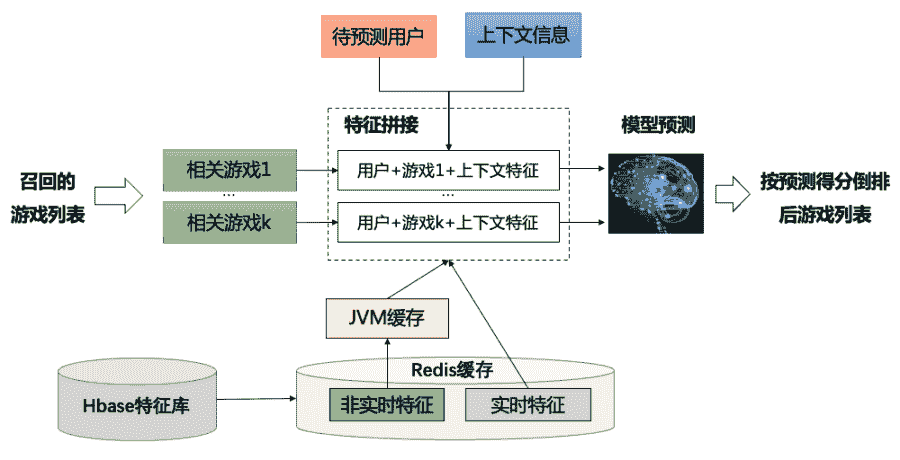

在实际使用过程当中， 采用了多级缓存机制来提升该服务的效率。主要是考虑到每个用户召回的游戏不同，如果每来一次请求就去特征库获取这些游戏的特征比较耗时，而这些游戏特征通常不会频繁的变更，所以可以将它们懒加载到JVM内存，并设定过期时间，这样可以大幅提升排序服务的速度。同样的，一些用户的基础属性和长期兴趣在一定时间段是固定的，这种时效性较低的特征也可以进行类似的缓存

## **A/B Test**

游**戏推荐系统中的 A/B服务系统是一种用于评估**和优化推荐在线效果的工具可以帮助实验者在不同的推荐策略之间进行对比实验，比如不同的排序算法、不同的推荐内容、不同的展示方式等，然后根据实验结果选择最优的方案

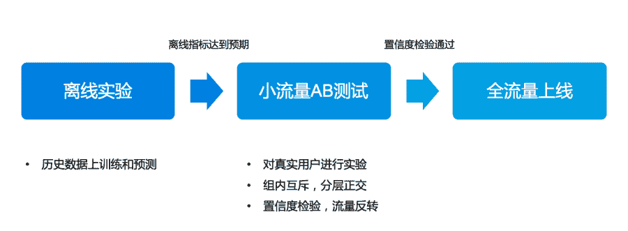

> 当前游戏推荐系统算法或者策略的迭代流程如图所示：

1.  首先进行离线实验，当离线指标（如排序的gAUC,召回的HR值）达到预期的时候，将模型发布到线上先进行小流量的A/B测试

1.  之后进行实验组效果的置信度检验，只有当检验通过后，才可以全流量上线。为了保证该算法的快速迭代， 开发了A/B服务

**该 A/B服务涉及的要点包括：**

+   **组内互斥：** 在同一个实验组内，只有一个实验策略生效，避免实验之间的干扰和冲突。目前支持根据用户ID或设备ID进行哈希分桶，也支持根据用户特征或行为进行分层抽样

+   **分层正交：** 在不同的实验层级上，实验策略可以正交组合，增加实验的灵活性和覆盖度。比如当同时更新了召回和排序模型，需要 A/B服务能够保证不同层的实验是正交的

+   **置信度检验：** 在实验结束后，对实验结果进行统计分析，判断实验效果是否显著和稳定。目前游戏中心推荐系统的 A/B服务支持的置信度检验的方法有多种，既包含t检验、z检验、卡方检验等常用的假设检验方法，也包括贝叶斯后验概率计算等

+   **白名单：** 在实验开始前，对一些特定的用户或设备进行预先分配，保证他们能够接收到指定的实验策略。该项功能在功能测试、线上灰度和产品验收环节经常使用

+   **流量反转：** 为了消除流量本身的影响因素，进一步判断新的模型或者策略的有效性， 在实验流程中，会对部分流量进行反转处理，即将原本分配到对照组的流量分配到实验组，或者将原本分配到实验组的流量分配到对照组

## **其他技术-样本拼接和模型训练**

> 游戏推荐系统中的样本拼接，是指在离线训练模型时，将用户曝光后的点击、下载、新登等数据和候选物品的特征数据进行关联和组合，形成一个完整的样本

样本拼接最大的挑战是样本实时性与准确性不可兼得问题： 当前手机游戏动辄就是几个GB大小的安装包，下载安装包过程比较耗时，这使得游戏曝光和下载完成之间存在很大的时间差，如果在下载完成后进行样本拼接，则拼接的准确率是100%，但是时效性往往超过30分钟。而如果在曝光和下载完成之间进行样本拼接，则会出现一部分的样本被误标注的现象

**通**过Flink窗口等待来解决该问题，其核心是确定窗口的等待时间。首先统计历史数据数据，找到曝光后的点击或者下载完成耗时的拐点，以该拐点所对应的耗时作为Flink窗口等待的时间。例如，假如95%的下载完成发生在游戏被曝光后15分钟内，那么样本拼接可以在曝光后等待15分钟，该时间段内游戏被下载则为正样本，其他情况下都判定为负样本

有了样本后，下一步就是进行模型训练

由于上述方案会导致部分样本标签有误，少量的这种错误对模型几乎没有影响，但是随着时间的推移错误的样本数量会累加，最终会影响模型效果。为了避免这个问题， 额外开启一个Flink样本拼接的Job，该Job的窗口时间设置的比较大，这样可以确保所有的样本都是正确标注的， 把该Job产生的样本定义为"高完整性低时效性"。相应的， 把上述的第一个Job产生的样本定义为"低完整性高时效性"样本

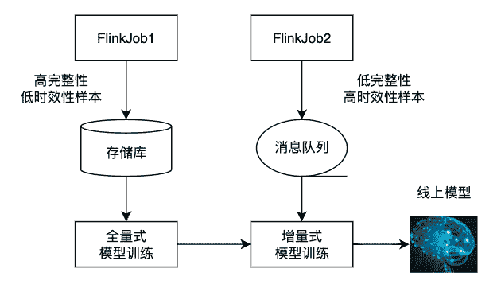

有了这些样本之后， 使用混合训练模式，让训练出更加精准的模型

**这种模式包括两种训练方式：**全量训练和增量训练。全量训练使用的是"高完整性低时效性"的样本，这些样本标注都是正确的，训练出的模型非常精准，但是训练周期较长。增量训练采用实时模式，从消息队列获取"低完整性高时效性"的样本进行训练，训练出的模型可快速应用于线上服务。 还会定期从全量训练中获取精准模型来进行校准，以确保增量模型的准确性和时效性

# **游戏推荐系统的实践效果**

## **实验设计**

> 当前游戏中心推荐系统距离初始版本已经将近一年，为了验证当前推荐系统的效果， 将当前线上流量的20%切给初版推荐策略和模型。来对当前版本和初始版本进行对比。

**实验设置如下：**

+   **实验组：**当前版本的推荐系统

+   **对照组：**初始版本的推荐系统

+   **流量占比：**实验组vs对照组 = 80% vs 20%

+   **实验周期：**两周

+   **当前推荐系统和初始版本推荐系统主要的区别包括特征**源数据、召回、排序、重排和时效性几个方面

| #### **组件** | #### **当前版本推荐系统** | #### **初版推荐系统** |
| --- | --- | --- |
| 特征源数据 | 游戏中心数据游戏SDK数据游戏内数据主站数据广告投放数据三方数据 | 游戏中心数据游戏SDK数据 |
| 召回 | 热门召回ICF新游双塔标签召回融合 | 热门召回ICF新游 |
| 排序 | 多目标优化多阶特征交叉注意力机制行为序列建模 | 单目标优化Deepfm特征交叉 |
| 重排 | 策略重排MMR重排 | 策略重排 |
| 时效性 | 分钟级 | 天级 |

## **实验结果**

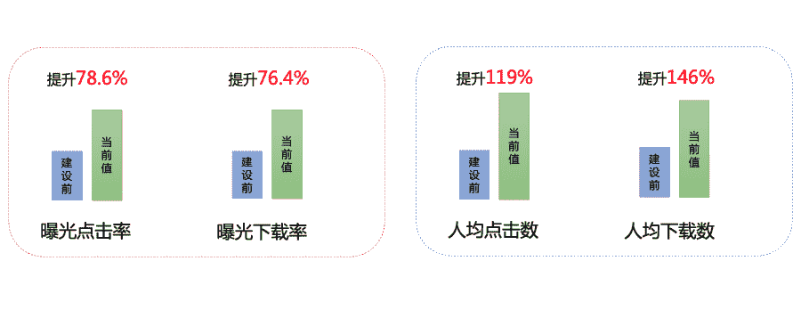

**其中曝光点击率提升78%，曝光下载率提升76%，人均点击提升119%，人均下载提升146%。**可以发现效果提升十分明显，这证明了游戏中心个性化推荐系统确实可以帮助业务提升效果