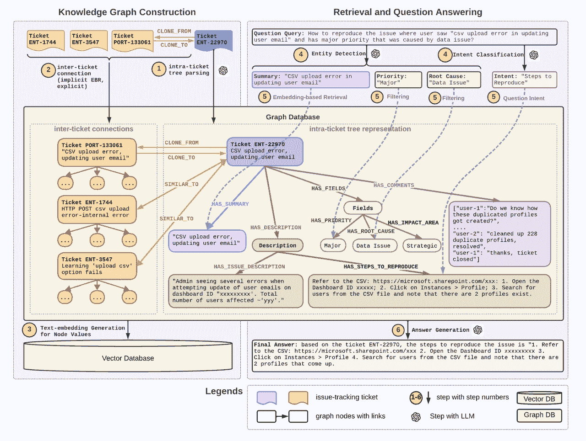
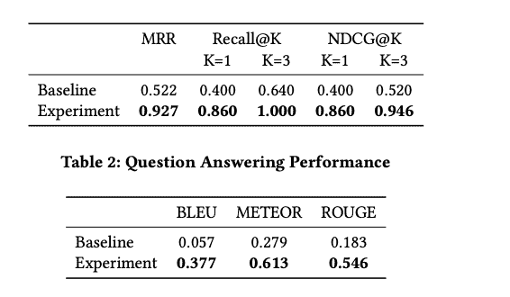
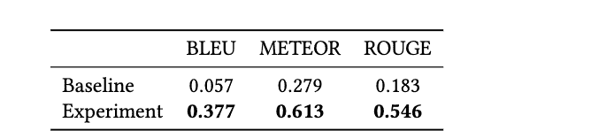

# 基于知识图谱的RAG智能客服

> 来源：[https://qqs7y1hozd1.feishu.cn/docx/BTb8ds1qgoIHzvxj7v0cUjJxnCg](https://qqs7y1hozd1.feishu.cn/docx/BTb8ds1qgoIHzvxj7v0cUjJxnCg)

该方法从历史问题中构建**KG**，保留了问题内部结构和问题间关系，用于检索

1.  在问答阶段，解析消费者查询，并检索相关子图从KG中生成答案

1.  **KG**的整合不仅提高了检索精度，通过保持客户服务结构信息也提高了答案质量，同时减轻了文本分割的影响

## **背 景**

**存在的问题**

1.  在客户服务中，技术支持是产品成功的基石，直接影响客户满意度和忠诚度

1.  鉴于客户询问与之前解决的问题存在相似性，迅速准确地检索相关的过去案例对于高效解决这些询问至关重要

在基于嵌入的检索**EBR**、大型语言模型**LLMs**以及检索增强生成**RAG**方面的进展显著提升了技术支持客户服务的检索性能和问答能力

> **这一过程通常分为两个阶段：**

+   首先，**历史问题记录被视为纯文本**，划分为小块以适应嵌入模型的上下文长度限制；每个块随后转换为嵌入向量用于检索

+   **其次，在**问答阶段，系统检索最相关的块并将它们作为上下文输入LLMs生成回答

### **相关工作**

**在知识图谱（Knowledge Graphs, KGs）**的辅助下进行的问答（QA）可以广泛分为：

+   **检索式**

+   **模板式**

+   **语义解析式方法**

### **方 法**

一种基于**LLM****的客户**服务问答**系统**，该系统无缝集成了检索增强生成RAG和知识图KG

> **该系统包含两个阶段：**

+   首先，在KG构建阶段，系统根据历史客户服务问题单构建了一个全面的知识图。它将每个问题整合成一个树状结构的表示，并根据关系上下文将它们相互链接。每个节点还生成了嵌入，以便于后续的语义搜索

+   其次，在问答阶段，解析消费者查询，以识别命名实体和意图。然后它在KG中导航，以识别相关的子图，生成答案

## 知识图谱的构建

### 图结构定义

在定义知识图用于历史问题表示时，采用了一个双层架构，该架构区分了问题内和问题间的关系

**如图所示：**

+   问题内树 模型将每一个问题单 表示为一棵树，其中每个节点 ，通过唯一的组合 ，对应 的一个明确的部分 ，并且每条边 和 表示这些部分之间的层次关系和关联类型。

+   问题间图 代表了不同问题单之间的连接网络，包括在问题跟踪票据中定义的显式链接 和通过票据间的语义相似性衍生的隐式连接

+   对于隐式连接，利用标题嵌入向量之间的余弦相似度，这一方法适用于特定的用例



> **例如：**图中描绘的问题单ENT-22970以树状结构呈现，节点**代表如摘要、描述和优先****级等部分。它直接**与**PORT-133**061显示明确的克隆关系。此外，它还因为语义相似性而与ENT-1744和ENT-3547间接连接

### 知识图构建

**知识图的构建分为两个阶段：****问题单内解析、问题单间连接**

#### **问题单内解析阶段**

+   此阶段将每个基于文本的问题单 转换为树状表示

+   采用混合方法，最初使用基于规则的提取，为预定义的字段提取信息，例如通过关键词识别的代码部分

+   对于不适合规则解析的文本，使用**LLM**进行解析。**LLM**由一个**YAML**模板指导，该模板表示客户支持中常用的问题单部分

**具体操作为：**

#### **问题单间连接阶段**

在此阶段，各个树 被合并成一个综合图 。显式连接 是根据问题单中的具体说明确定的，如Jira中指定的字段所示。隐式连接 是通过问题单标题、摘要及跨文本的语义相似性推断出的，使用嵌入技术和阈值机制来识别每个问题单最相关的票据。显式连接和隐式连接分别定义为：

### 嵌入生成

**为了支持**基**于在**线嵌入的检索，使用预训**练的文本嵌入模型BERT**和E5来为图节点值生成嵌入，特别是针对文本丰富的部分“问题摘要”、“问题描述”和“重现步骤”，然后这些嵌入被存储在向量数据库中（例如QDrant）

对于大多数情况，每个节点内的文本长度可以满足文本嵌入模型的上下文长度限制，但对于某些较长的文本，可以安全地将文本分割成更小的块进行单独嵌入，而不必担心质量问题，因为所有文本都属于同一部分

## 检索与问答

### 查询实体识别与意图检测

> 在此步骤中，从每个用户查询 中提取命名实体 和查询意图集 ，该方法包括将每个查询 解析为键值对，其中每个键 ，在查询中提到，并对应于图模板 中的元素，而值 代表从查询中提取的信息，同时，查询意图 包括在图模板 中提到的实体，这些实体是查询试图解决的问题

> 通过适当的提示使用LLM进行这一解析过程，例如：

+   对于查询

+   提取的实体是

+   意图集是

这种方法展示了在处理多种查询表达时的灵活性，公式如下：

### 基于嵌入的子图检索

+   **从**知识图中提取相关的子图，与用户提供的特定信息如“问题描述”和“问题摘要”以及用户意图如“修复方案”等对齐此过程主要包括两个主要步骤：基于EBR的问题单识别、LLM驱动的子图提取

在**EBR**基于问题单识别步骤中，通过利用用户查询中得到的命名实体集 ，挑选出最相关的历史问题单。对每个实体对 ，计算 值与 对应的图节点的余弦相似度，通过预训练的文本嵌入。

将这些节点级分数聚合到问题单级，通过对属于同一问题单的节点贡献求和：

**公式如下：**

在**LLM**驱动的子图提取步骤中，系统首先重新表述原始用户查询 ，包含检索到的问题单ID

然后将修改后的查询 转换为图数据库语言，如Neo4j的Cypher，用于问答

**例如：**从初始查询

查询被重新表述为“如何重现'ENT-22970'”，并转换为Cypher查询：

```
MATCH (j:Ticket {ticket_ID: &#x27;ENT-22970&#x27;})
-[:HAS_DESCRIPTION]-&gt;(description:Description)
-[:HAS_STEPS_TO_REPRODUCE]-&gt;(steps_to_reproduce:StepsToReproduce)
RETURN steps_to_reproduce.value
```

这一步非常值得注意，因为**LLM**驱动的查询表述使系统能够灵活地从知识图中检索信息，无论它们来自同一棵树还是不同的树

# **结果分析**

#### 4.2 结果与分析

**检索和问答性能在下表中分别展示**

**值得注意的是：**它在MRR上超过基准线77.6%，在BLEU得分上超过0.32，证明了其更优越的检索效果和问答准确性



