# 宇宙厂A/B 测试

> 来源：[https://qqs7y1hozd1.feishu.cn/docx/H0ltdO3vmoVJusx10i1cm1donCG](https://qqs7y1hozd1.feishu.cn/docx/H0ltdO3vmoVJusx10i1cm1donCG)

** 本文将介绍实验系统所面临的挑战，以**及对未来的展望，主要讲解目前实验平台无法解决的一些问题，以及对下一代评估系统的一些想法和运用

> **围绕以下两点展开：**

+   **传统实验系统无法解决的问题**

+   **对下一代实验系统的展望**

在互联网业务中经常会使用实验系统去做策略实验，以帮助决策

+   例如，测试不同的产品 UI 对用户的影响，进而决定使用哪种 UI

+   在广告业务中通过实验寻找最佳的投放策略以期获得最大收益

诸如此类，实验系统都会客观地给出决策依据，仿佛它是一个高度智能的系统

> 但实际上，传统的实验系统建立在 19 世纪的科学上，在那个年代没有互联网，没有推荐算法，没有网购平台，传统的实验系统不可能完全解决现今互联网业务中遇到的种种问题

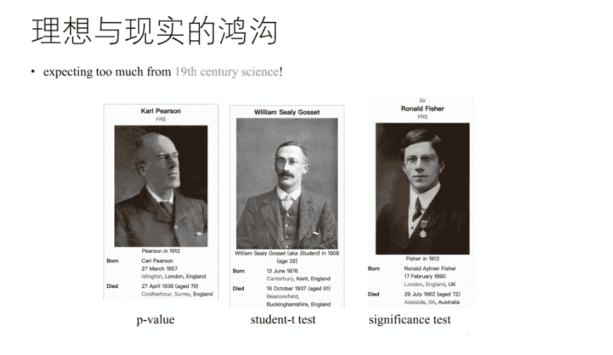

+   **实验系统是如何工作的呢？**

实验的目标是评估某一个策略的效果，总结来说总是通过干预这个策略相关的变量，测量和收集实验对象的数据，对数据进行分析，最后验证效果是否显著

**实验系统中三个最关键的环节是** **：**

1.  **干预**

1.  **测量**

1.  **分析**

**如果在其中的某一个环节失败了，那么整个流程都是**走不下去的，而每个环节都是有可能会失败的

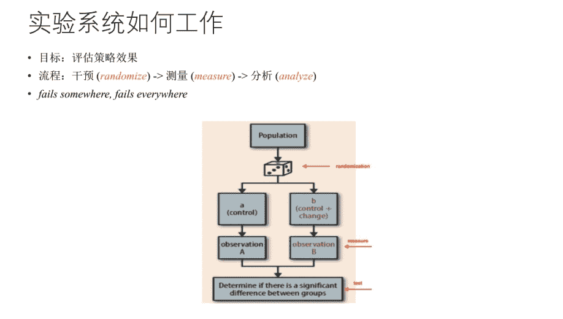

# **传统实验方法无法解决的问题**

> 实验理论源于医药行业或者生物行业，称为随机控制实验。实验的前提是一定要随机地将实验对象划分为 A、B 两组，并且随机性不应该受任何因素所影响。但在真实的生活中，有非常多的场景是无法实现这种过于理想化的前提的

在不能做一个清晰有效的随机分流的时候，如何去评估一个策略的效果呢？

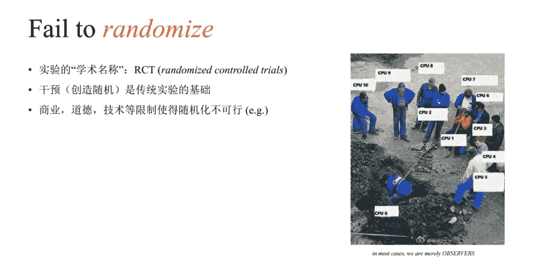

**比如在短视频平台上投放某位明星的在线****演**唱会，会不会让用户更加喜欢这个产品呢？传统的实验方法是无法给这个假设做出定论的，因为不可能让一部分用户看演唱会，而不允许另外一部分人不看演唱会

这个场景下，也不能直接去比较观众与非**观众的指标****，因为这两类人**群有各自的特征，通俗来说，他们是不可比的

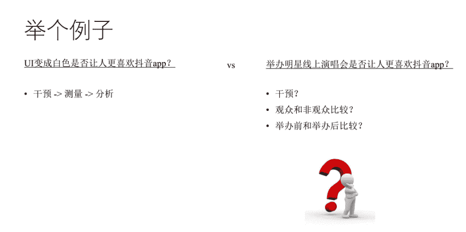

那是否可以直接比较举办前和举办后的指标变化呢？

+   答案是否定的，因为时间是一个最大的混杂，它可能会影响各种各样的东西，比如天气、工作日还是假期，又比如外部发生的新闻，这些被时间影响的同时，也影响着实验指标的因和果。通过时间前后来做比对分析，是难以有说服力的

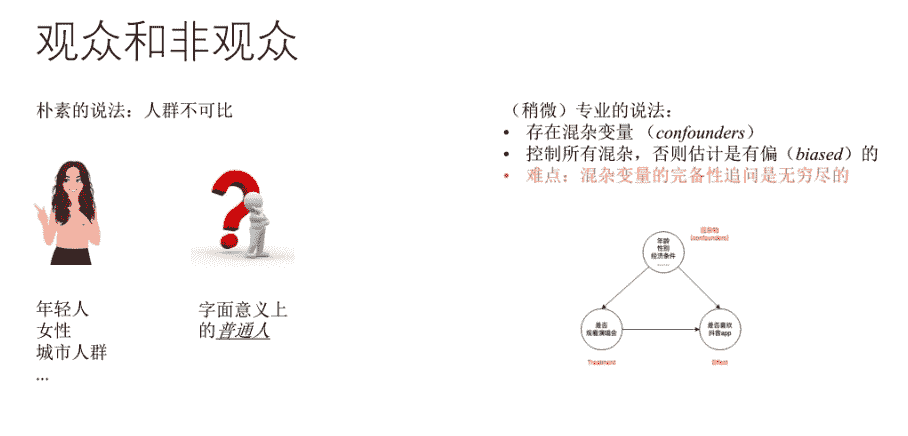

再比如，产品准备上线保护未成年人的风控策略，是否可以去进行实验来验证策略效果？答案是否定的，如果故意地让一部分目标用户不要受到这个策略的保护，那么将产生高昂的道德成本

**上述两个场景，与把短视频平台的 UI 变成白色会不**会让人更喜欢用 TA，到底有什么区别呢？

+   把UI变成白色这件事情是非常容易的，通过随机抽取 A、B 两组用户，将一组的用户的 UI 变成白色，另一组不做任何处理，然后分别统计两组用户的次留，在线时长等指标，是可以轻而易举地得出结论的

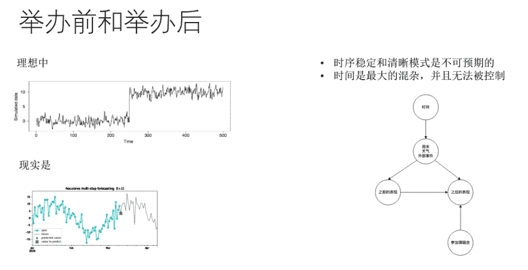

# **无法测量**

传统实验方法中的测量样本是静态的，而在很多互联网业务场景中，测量样本是会动态变化的，或者发生倾轧效应。如果无法对动态变化所产生的效应进行测量、补偿，那么评估和决策是无从说起的

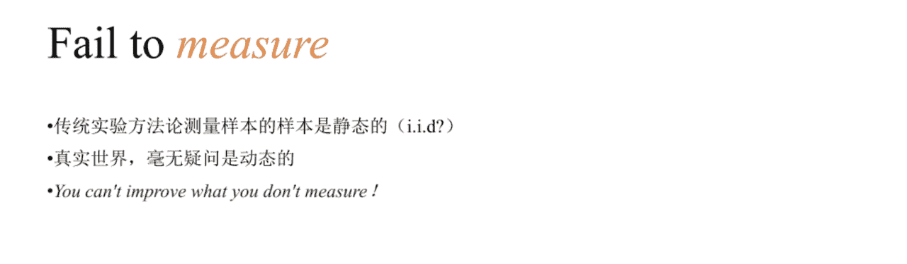

> **例如**产品计划在 APP 上线聊天表情包的功能，用户在跟好友聊天的时候，可以发送表情包。在实验环节的时候，假如只能切 1% 的流量来做这个实验的话，要怎么样去评估效果呢？简单实验会导致什么问题？

1.  **首先，存在样本污染的潜在问题**

> 1% 的实验组的人可以观察并使用这个功能，很可能发生实验组用户发送表情包给对照组用户，而对照组用户本不应该知道有这个功能的存在，而我们也并不能阻止这种行为的发生，如此一来便使得对照组收到了污染

1.  **其次，会产生社交氛围的偏差**

> 这里存在两种可能性，当实验组的用户会发现只有他和很少的一部分人才可以使用这个功能的时候，会产生一种特权的感觉，此时他既可能疯狂地给所有人发这个表情包以展示特权感，导致过度地使用这个功能；也有可能他觉得发表情包是为了和好友进行互动，但他发了表情包而他的好友不能发，这个表情包功能的互动价值被削弱了，他也就不愿意使用了，导致过低估计功能的作用，总之这种不完全的社交氛围就会影响他对产品的体验，也会妨碍我们从实验中获得准确的估计

又比如，在供求双方存在资源竞争的场景中，例如电商场景，我们决定对电商的推荐算法做调整，划分 50% 的用户为实验组，大幅度提高某一商品的推荐力度，那么实验组用户看到该商品的可能性就会大幅度提高，因此大部分商品被实验组购买甚至买光

对于**对照组的用户而言，因为库存的数量下降，那么推荐排序时该商品的分数被自**然拉低，降低了该商品在对照组的曝光度，甚至在局部出现售罄，导致对照组成交下跌，实验组对对照组产生倾轧效应，使实验策略显示一个过于乐观的效果。在做实验时观察指标涨了很多，但上线之后会发现算法策略的效果甚微或者无效。这种情况不仅仅发生在电商场景，也有可能是在直播、信息流等类似于一供一求的场景

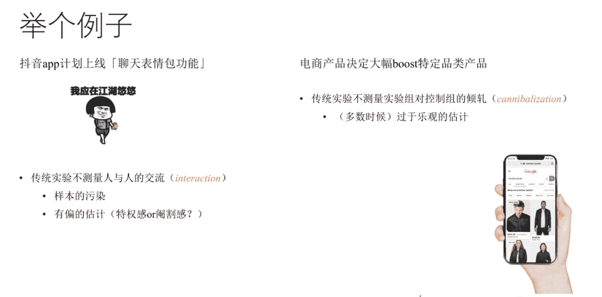

# **无法分析**

互联网公司的实验系统应用是从医药实验、生物实验所借用、改造而来的。但传统实验的分析方法，不能完全适用于互联网的复杂业务场景，有些业务场景的复杂程度已经没有办法通过人力去做分析

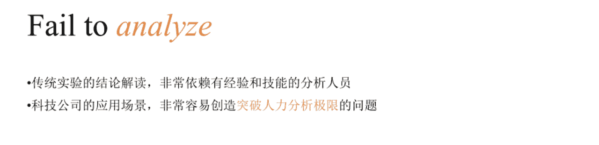

比如，在推荐系统中排序算法的计算公式中存在相当数量的超参数，当只需要调整某 1 个参数的值时，可以给这个参数设置不同的值，然后随机选取若干批用户进行实验，回收指标数据便可以很轻易地得出最优的参数值。但如果参数的数量变成三个、十个、一百个...，那么参数值的组合就出现爆炸性地增长，如果还是按照传统的实验方法进行实验分组测量和分析，那么实验的人力成本和线上流量成本就变得很高昂，以至于完全不可行

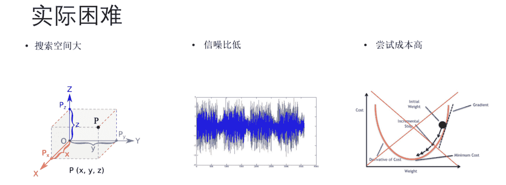

# **下一代实验系统**

## **一个观察系统**

**未**来的实验系统应该是一个**兼容观察的**系统，而不仅仅是一个做干预的系统。换而言之，在无法进行干预的场景中，系统也应该要有方法去评估策略效果。 这类方法通常被叫做 观察性研究 ，是经济学和社会学经常去研究的内容

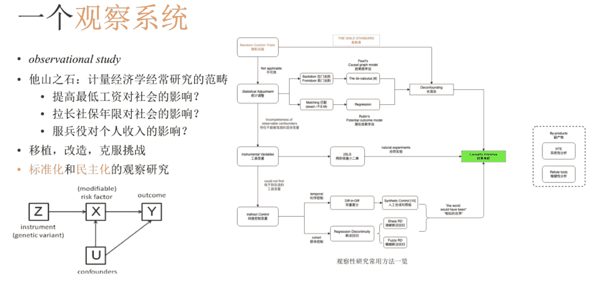

+   比如经济学家经常关心提高最低工资，拉长社保的最低缴纳年限，对社会可能会造成什么样的影响？这类问题和上述提到的问题有一个共同的特点，就是不能进行干预实验

+   例如在现实社会中，不可能说只给一部分人提高最低工资，另外一部分人就不管。这类问题在社会学和经济学的研究中，已经发展出了一套相当完善的理论体系

**因此下一代实验平台，如果要做成一个观察系统，很可能会重新走上一代实验平台的老路，从经**济学和社会学中去借鉴一些已经成熟的方法，再进行一定程度的标准化和民主化改造和移植

> 标准化是指通过系统去批量生产合格的分析，而民主化的意思是什么呢？

> 观察性研究方法即使在今天也并不是人人都掌握的，只有少数研究经济学或者社会学背景的人，有可能经常接触并使用这类方法，但是潜在需要这类方法去做评估的业务场景却有很多，一个统一的、人人都能使用的、非专家也可以通过这个系统去完成合格的观察性研究的平台化系统才能满足现实场景的需求

## **一个动态系统**

**越**来越多的互动导致很多业务场景已经无法通过静态的角度去测量了， 下一代的实验系统势必要站在动态的角度去进行估计。 比如上述的聊天表情包案例中提到的实验组用户与对照组用户发生互动而导致的样本污染问题，一个比较常见的思路是基于社交关系图数据，将实验组用户和关联的好友全放到同一个池子中，来避免样本污染的情况

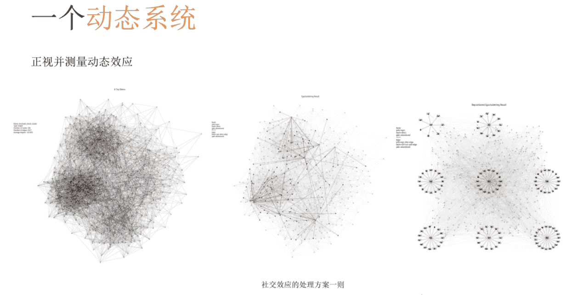

**但**这种思路实际上在应用中有许多问题，比如社交关系不稳定的问题怎么解决，一个成熟的社交网络中又存在多少这种符合要求的“孤岛”？这些问题不解决的话，对效果也会造成非常大的影响

## **一个决策系统**

在上述算法超参搜索的案例中，如何在多个参数构成的高维空间内找到一个最佳的点，传统方法的关键障碍在于人没有办法利用极为有限的数据，对这个高维空间进行有效的想象、推理和决策。 解决这个问题的思路之一，便是使用系统去代替人进行决策

一个合理的想法是利用某个数学性质良好，拟合效果灵活的代理模型去近似高维目标，继而使用自动化的策略均衡探索和利用，代替分析人员决策下一步，然后根据收集到的数据不断完善模型，序列式地进行探索，最大化利用资源——这是一个典型的贝叶斯优化框架。目前在一些我们的业务场景中，这种系统代替人去做决策的解决方案已经被证实已经远优于传统人工方法

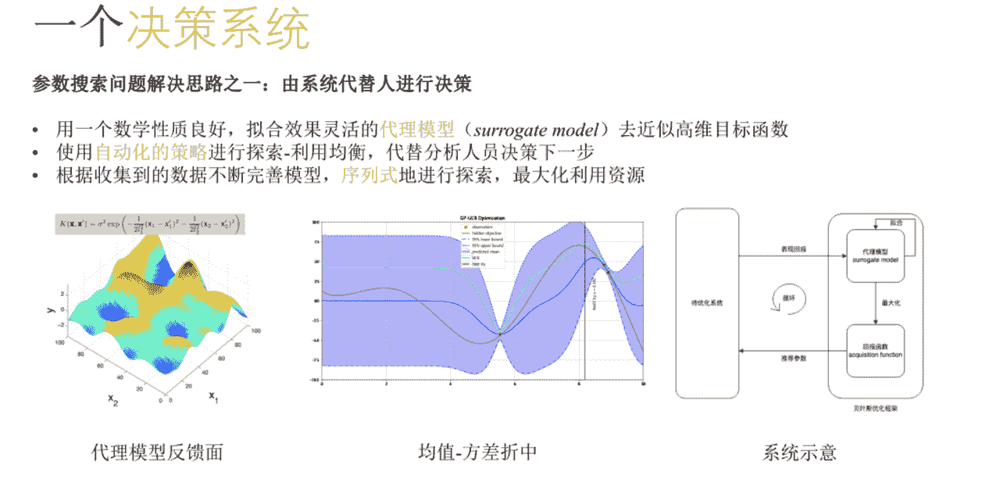