# 数据分析 ：得物平台 A/B test全流程

> 来源：[https://qqs7y1hozd1.feishu.cn/docx/PKGidm3CHob4zhxCwR7chLxqn8g](https://qqs7y1hozd1.feishu.cn/docx/PKGidm3CHob4zhxCwR7chLxqn8g)

# **导读**

# **实验平台简介**

### **实验是什么**

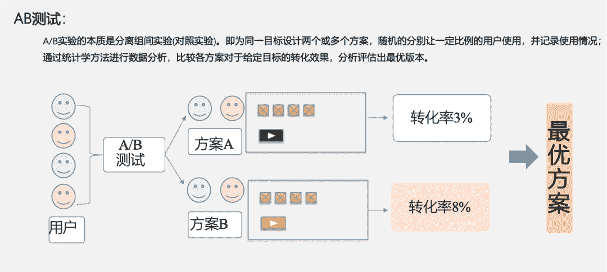

> **AB实验的本质**：**先圈定一部分用**户**，将其随**机分配**到不同分组中**，并为这些分组提供不**同的方案**，例如这张图中，一个组是黑色播放按钮，另一个组是橘色播放按钮。对线上用户应用不同策略后，收集这些用户最终的数据结果，例如转化率的差异。通过对比不同方案的数据结果，确定选用哪种最优方案。

**实验有什么用**

了**解了实验是什么**后，我们来探讨一下为什么要做实验。让我们来看一个例子，小A是一名资深产品经理，有一天他突发奇想，设计了一个天才的优化方案，并已启动开发和测试。一个月后，搜索点击量暴跌，老板质问道：“你在做什么？”

**没有AB实验**

> **小A**：**一定是因为大学生开学了。**

**老板**：**？**

**有AB实验**

> **小A**：**我将用户分为旧样式和新样式两部分，在开学季新样**式的用户搜索点击率始终比旧样式高出5个点

**老板**：做的不错。从这里可以看出，**AB实验**有两个关键用途，且呈**递进关系**，即**归因和量化**。通过**归因**，我们可以确认预期效**果是****否由我们**的改动导致，这是定性评估；通过量化，我们可以确定这个改动究竟提升了多少效果，这是定量评估。

**做一个实验的步骤**

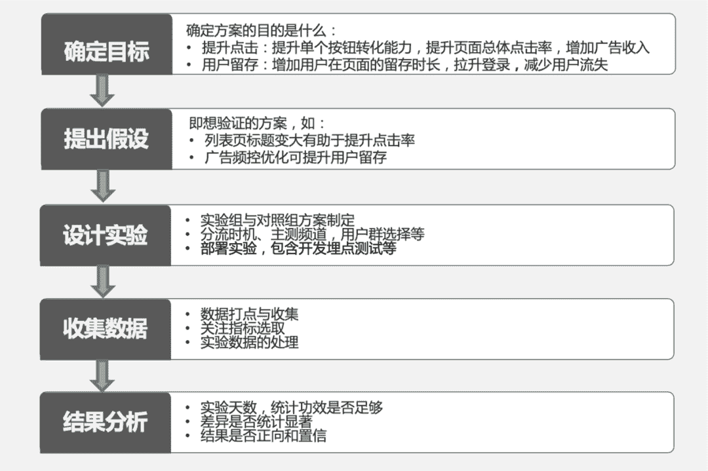

**接下来，**将简要介绍目前平台的实验流**程：

确定目标：第****一步需要**确**定目标**，**根据业务团**队的不同定位，目标也有所区**别。例如，交易团**队可能更关注UV价值、AOV和购买转化率，而社区团队可能更关注社区使用时长和留存率等。

> **提出假设****：在****确定目标之后，针对想**要优化**的目标，我们需要**提**出一个假设，即要做**什么事情才能达成预设的目标。在提出假设之后，我们要基于该假设去设计实验，包括实验的对照组策略、对照组标题字体大小、实验组标题字体大小、实验覆盖的用户范围、实验的调用时机等。设计完成后，需要在AB平台上创建实验。

**设计实验**：创建完成后，进入**实验开发阶段**。**实验开发和测试完成**后，即可上线。**收集数据****：实验上线后，进行灰度发**布，并收集一段**时间的数**据。同时，我们还需要收集实验组和对照组的使用数据，以便最终对比指标差异。

**结果分析****：数据收****集完成后**，我们对实验组和**对照组之**间的数据差异进行分析，判断差异是正向还是负向，是统计显著还是不显著。结合不同指标的结果，我们进行实验决策，判断实验是结束、下线还是重新迭代。

# **得物实验平台技术原理和实践**

在介绍了实验平台的**基本概念和流程**之后，接下来将介绍得物AB实验平台的技术原理和实践。我们首先介绍平台的整体架构，以**便大家对其有个大致****的了解，**然**后介绍目**前的实验接入和使用方式。接下来，我们将介绍实验平台中两个非常核心的模块：分流引擎和数据引擎，包括所面临的挑战、解决方案以及后续的规划。

#### **整体架构**

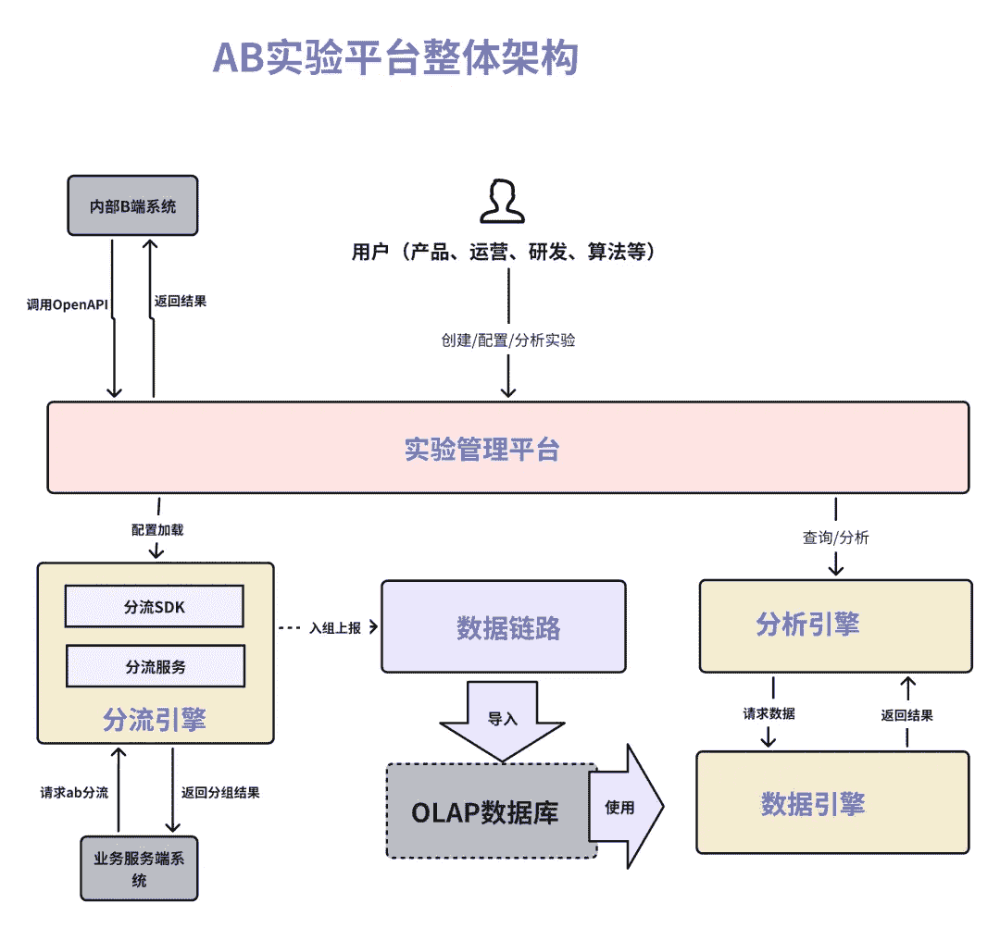

**整体架构**分**为四个模**块**，自上而**下**分别为实**验中台、分流引擎、数据处理和数据分析展示。

**实验中台**是公司内部员工使用的交互页面，用于创建、配置、查看**和分析实验。中台左下角**的分流引擎是实验平台的核心基础设置，其作用是根据用户特征将其划分到不同分组，并确定每个分组的值。

**分流引擎**为客户端、服务端和H5等不同流量来源提供服务。客户端的实验命中上**报会通过网关**统一收集到日志平台，然后再由日志平台将数据传输到Kafka进行处理。而服务端和H5来源的实验上报则会直接同步到Kafka。在完成线上用户分流后，为了分析实验结果，需要对用户数据进行采集、加工和处理，主要包括流式数据处理和批量日志处理。处理完成后，将数据导入OLAP数据库。在数据收集完成后，用户可以在实验平台上选择指标和时间范围进行数据分析。

提交请求后，**数据引擎**将执行**数据查询**。**数据查询**可以基于明细数据进行异步查询，也可以基**于预计算**的数据进行同步查询。查询结果将由统计引擎负责计算p值、显著性、涨跌幅和指标值等统计指标。最终，将统计结果进行数据可视化，以实验报告或Excel的形式展示出来。

#### **接入方式**

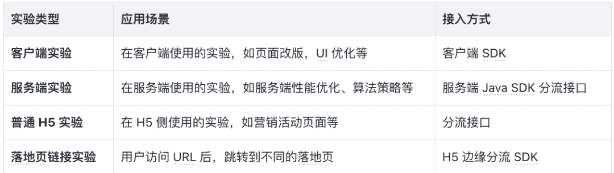

从流量来源上区分，主要存在四种实验类型：客户端实验、服务端实验、普通H5实验、落地页链接实验。

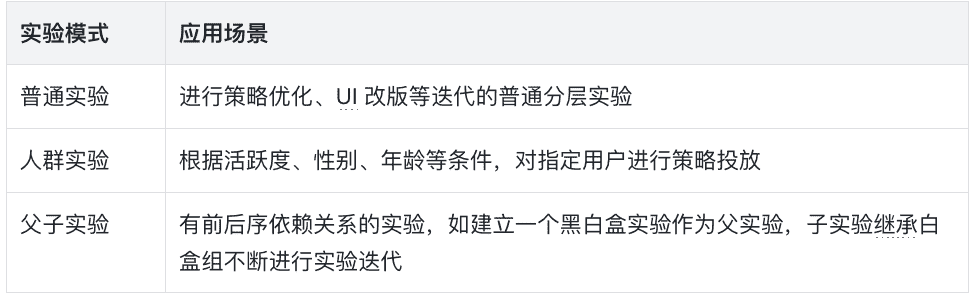

**确定流量来源后，可**根据具体需**求选择合适的实验****模式：是常规的正**交流量实验，还是需要圈定人群进行实验，或者是否有上级的父实验**。通常，选择普通的正交实验即可。若存在与现有实验流量互斥的情况，可将其放在同一流**量层中。对于黑白盒实验或者holdout实验，建议采用父子实验的模式。例如，营销黑白盒实验中的黑盒为无营销策略，白盒则为有营销策略。在此基础上，针对不同场景和用户，进行策略优化及迭代。此时，父实验即为黑白盒实验，子实验则继承白盒实验组。

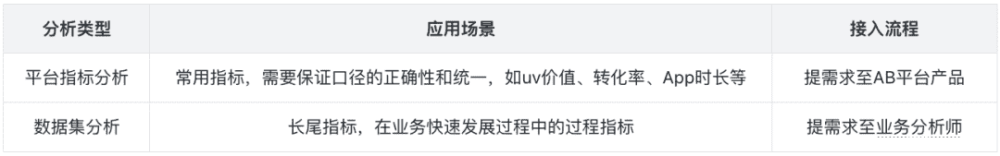

接下来介绍实验数据分析的接入方式：

+   **平台指标分析**

适用于**官方标准指标**，如**留存率**、**DAU**等需要在**不同业务线统一口径和标准的指标**。这类**指标**需向AB平台产品提需求进行**独立建设**。

+   **数据集分析**

**在业务发****展过程**中，**北极星指标变化不频繁，但过程**指标因组织架构、发展阶段、应**用场景不同而多**变且数量众多。为确保平台指标的权威性和标准，支持业务快速迭代，这类长尾指标将提给业务域对应分析师。分析师制作数据集并在AB平台配置数据集和指标定义，即可接入AB的数据分析进行即席查询和分析。介绍完得物实验平台的接入方式后，我们来深入了解一下这个过程中的技术挑战和实验。

+   **分流引擎实践**

**分流引擎**是AB实验平**台中最为重要的****基础模块**。**分流作为**AB系统的基石，只有进行分流之后，用户才**能拥有不同的策略，进而**进行后续的数据回收和分析。从行业内公司的情况来看，部分公司的实验平台集成了分流能力和分析能力，而有些公司的实验平台则仅具备分流能力，分析工作由业务分析师自主完成。毋庸置疑，保证实验分流的高效准确是实验平台的核心目标之一。

#### **技术挑战**

**高并发**

+   如何支撑下游60+服务的在线调用

**低RT**

+   如何保障足够低的RT，避免下游超时

**统计均匀性**

+   如何划分出用户数量均匀的分组

接下来，我将为大家介绍在**分流引擎****建设过程**中遇到的挑战。分流引擎的作用是确定用户属于哪个实验分组，并尽量保证分出的两部分用户能够同质。在这个过程中，我们主要面临三方面的挑战：

+   在线调用的并发量很高，如何避免上游调用导致服务过载？

+   **如何保障下游服务的低延时调用？**

+   如何在分流过程中保证统计均匀性？

#### **解决方案**

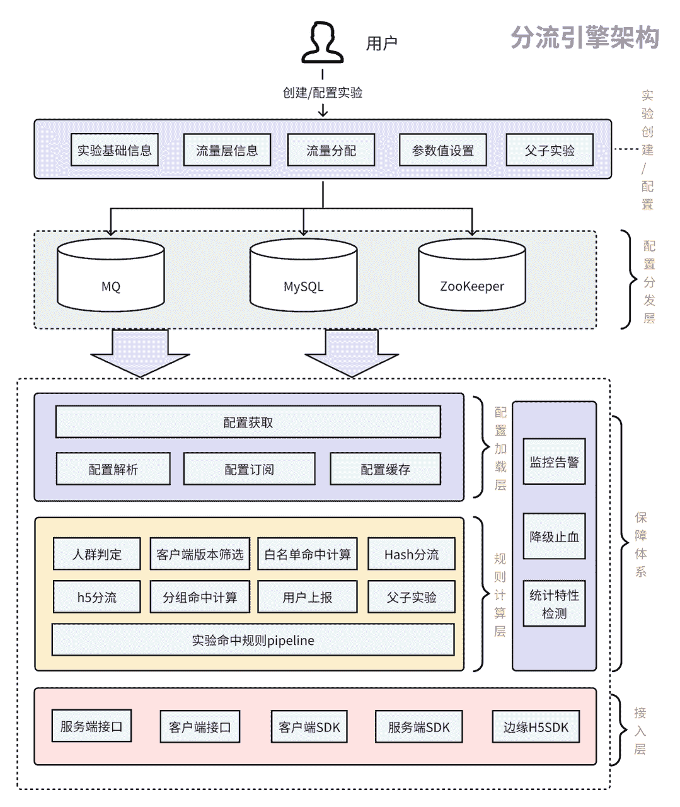

+   **配置分发**：配置数据双写到MySQL和Zookeeper中，基于MQ提供配置变更通知

+   **配置加载**：进行**配置的订阅和解析**，并缓存到内存中，方便直接在本地进行分流命中的计算

+   **规则计算**：读取内存中的**实验配置**，进行实验相关的计算逻辑

+   **接入层**：提供**AB SDK**作为**0RT**的**实验分流解决方案**，提供服务接口支持便捷接入和多语言应用

+   **保障体系**：通过配置校验、均匀性、正交性检测，保障分流的正确性和均匀性

先来看一下**整体分流引擎的架构**。用户首先在AB的管理平台创建和配置实验，包括实验的**基础信息、**流**量层的信息、具体的**流量分配（分组数量、流量分配等），以及分组的参数值设置。创建并上线后，这些配置会双写到对应的MySQL和Zookeeper中，然后通过MQ提供实验流量调整后的变更通知机制。

在**初始化或接收变更通知时，分流引擎会从配置分发层读取数**据，**获取配置后进**行解析并更新本地内存缓存。在线分流调用过程中，基于用户信息和配置缓存进行实验规则的计算，包括客户端版本筛选、人群判定、分组命中计算、白名单计算、用户上报等。在核心分流逻辑之上，提供了接入层，可以选择不同的接入方式，包括服务端、客户端、客户端SDK和服务端SDK。

为了保障**分流系统****的可用性和正**确**性，有监控告**警**的可观测体系，会对系统**的成功率、RT进行监控，并检测配置内容的有效性。在可观测的基础上，还有应急**降级手段，系统高**负载时针对指定接口降级。此外，还会进行一些统计特性检测以确保Hash算法的均匀性和正交性。接着我们再来看一下目前得物AB平台分流引擎的效果：

+   **14w+**：日常的分流**QPS**峰值在**10w+**，大促期间峰值在**14w+**

+   **0ms**：基于**AB SDK**，进行分流计算的耗时为微秒级，时延几乎可以忽略不计

+   **130us**：基于**AB Dubbo SDK**，进行分流计算的耗时为**130us**

+   **30ms**：对全量**2000+**客户端实验进行配置下发，耗时在**30ms**左右

**分流过程示意图：**

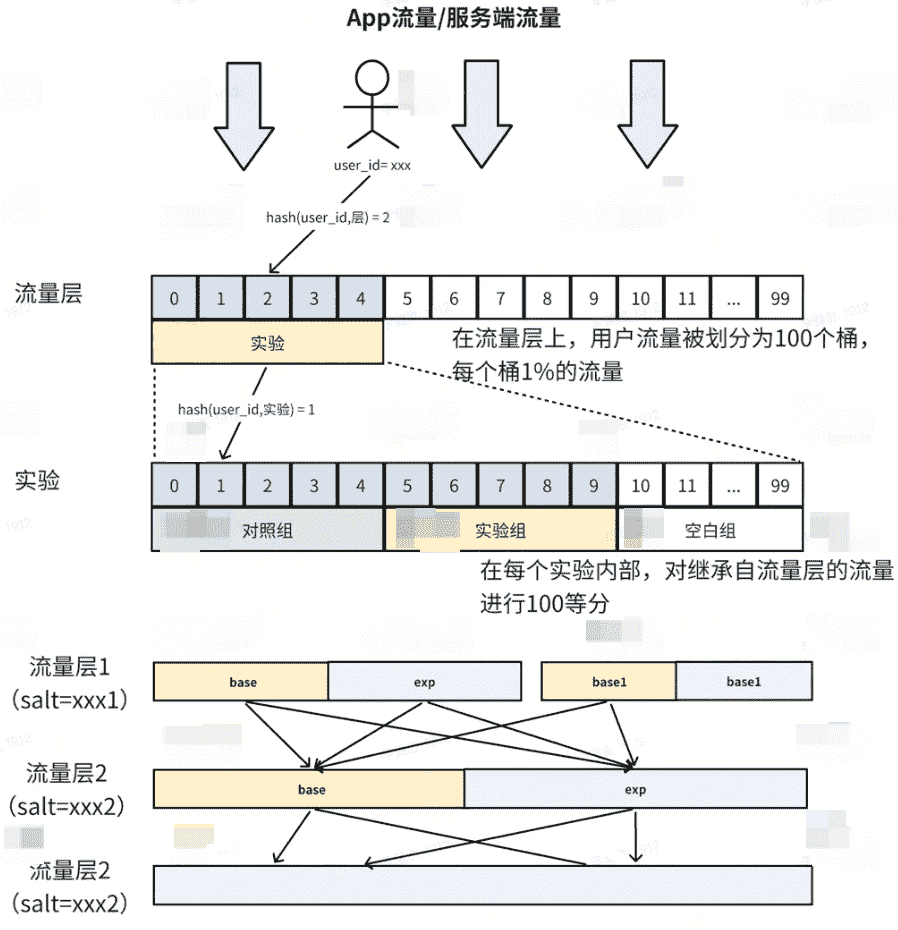

从上到下的过程即App流量的流入，具体用户的分流过程如下：

首先进行第一次**Hash**，根据该用户对应的流量层来决定其命中的流量层中的哪个桶。实验在层中对应的桶范围是在实验配置流量时确定的，例如在本例中，实验配置了5%的流量，层分配给了实验0-4这五个桶。

**在确定具**体命中的**实验之后****，会执行第二次Hash。第二**次**Hash的过程会使用相同**的算法，但这两次的目的不同。第一次是确认用户是否命中实验，第二次则是确认该用户真正命中的分组，即命中了实验的哪个分组。在这个过程中有如下三个保证统计均匀性的要点：

+   **MurmurHash算法**：基于Google MurmurHash3，单线程千万级QPS计算

+   **二次Hash过程**：第一次Hash保证层间正交，第二次Hash保证层内前后实验正交

+   **统计特性检测**：通过卡法拟合优度检验方法对Hash算法的均匀性和正交性进行检测

# **得物AB平台统计特性检测过程**：

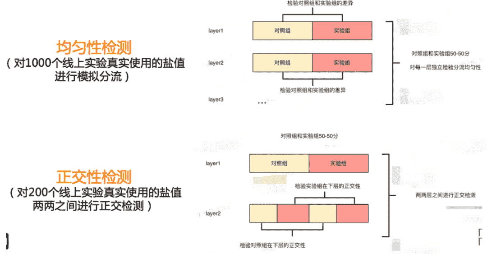

得物AB平台对实验进行了**正交性的检测**，我们对1000个线上真实实验**进行了正**交检测。真实使用的盐值是进行**模拟分流**，去看这1000个实验是否能够分的均匀，以及正交性的检测，正交性检测选取了200个的层，对层和层之间的真实盐值进行模拟分流，看每一层的实验是否能够均匀的被分配到另外一层的实验组和对照组中。

结果如下图所示：**Hash分流**的**均匀性和正交性**的**检验结果p值**分布和**理想p值分布**相差不大，可以认为得物AB平台的随机分流是均匀且正交的。

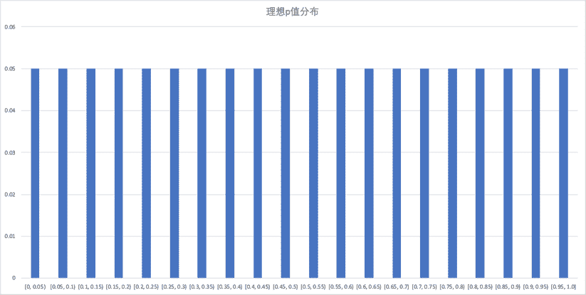

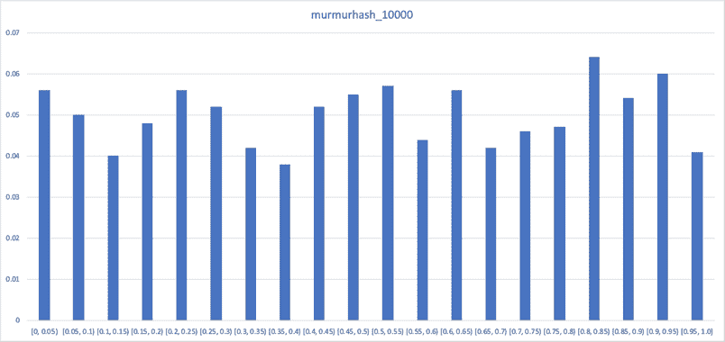

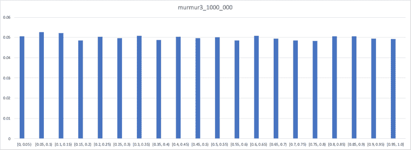

#### **后续规划**

**稳定**

+   **提升SDK配置稳定性**：使用http长轮训配置服务替代ZooKeeper

+   **保障体系完善**：进一步完善限流、熔断策略

**效率**

+   **问题排查效率提升**：分流排查工具完善，快速分析分流结果和链路

+   **分流agent建设**：提供sidecar形式的分流，降低SDK的升级成本

+   **流量控制能力增强**：实验多参数、支持参数复用

**场景化**

+   **特征分流**：基于用户特征进行实时分流，让用户分布尽可能均匀，适用于小样本下的实验分流

+   **Holdout/Combo**：团队化视角评估周期收益，探索业务之间的交互影响

**智能化**

+   **MAB**：流量自动调节

+   **自适应分流**

#### **数据引擎实践**

**技术挑战**

**复杂的实验分析体系**

3种指标类型，3种分析方法，3种分析模式（常规/维度下钻/占比），2种实验周期，3种数据源

**性能**

支撑1000+指标，400+数据集，亿级别表关联、TB级数据查询分析

**得物的实验分析体系较**为复杂。由于历史原因，数据**源分为三种**，分别应用于同步和异步的查询场景，指标也分为四种类型，用于不同的口径。

分析方法上支持**Delta+t-test**和**t-test****两种。分**析模式上支持常规不带**维度的普**通查询、选择不同维度**进行的下**钻分析、选择维度之后**进行的占比分**析、在搜索场景下适用的类目**均摊逻辑**。根据分析的实验**周期不同，**AB平台支持实验开始前的preaa分析和常规的AB期分析。最后，在提供给用户**的展现层**上，有指**标列表**&趋势图、实验报**告文档、Exc****el**下载几类不同的功能形态。除了分析体系的复杂性，数据规模本身也极具挑战，得物AB平台承载了上千的平台指标、数百的数据集，以及在做指标的非用户维度下转时，涉及到的左表和右表都是亿级别的表，数据量将近TB。保证常用查询条件能够秒级返回，并且复杂下钻分析要在几分钟之内完成分析结果的返回，在性能上是一个相当大的挑战。

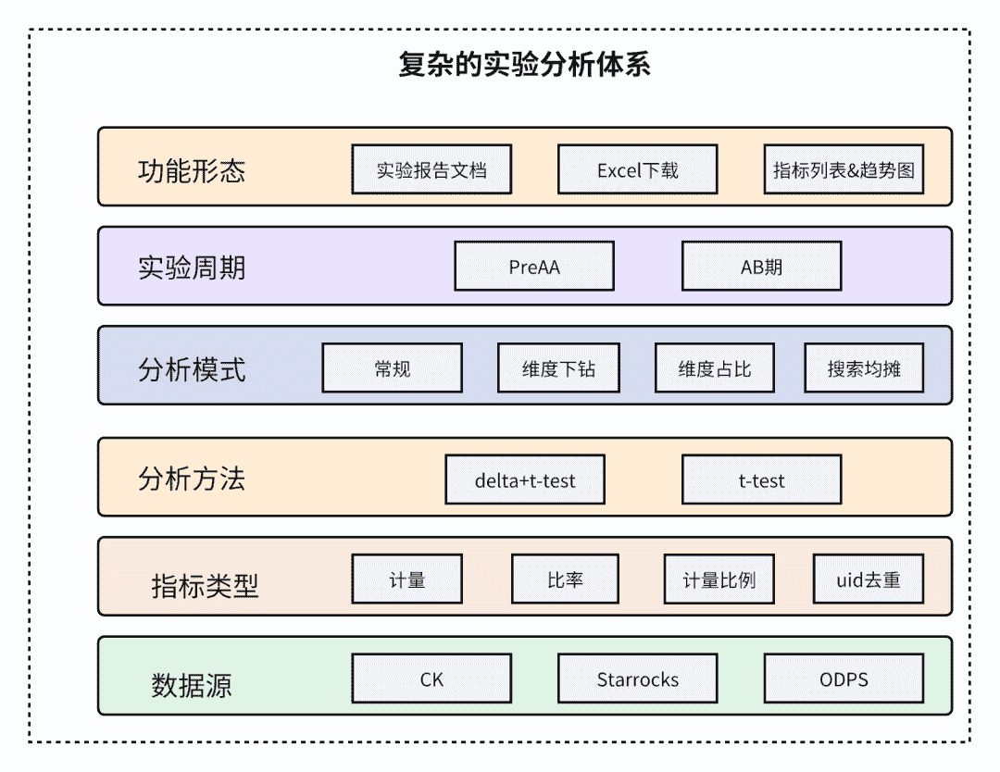

#### **解决方案**

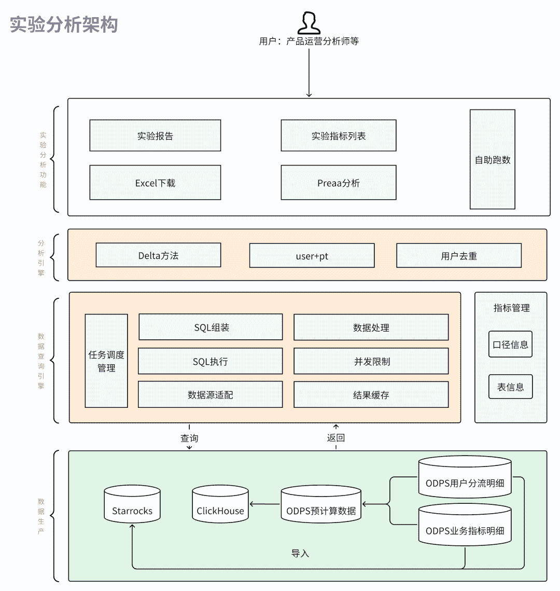

**实验分析功能**：为用户提供多种数据处理方式，如实验报告、Excel数据下载、实验**指标列表、p**reaa分析等，以满足用户在实验结果汇报和深入分析等不同场景的需求。统计分析引擎：在数据引擎查询的基础上，采用Delta方法、user+pt或用户去重等方式计算指标。在后续的实验科学部分，我们将重点介绍分析引擎的功能和应用。在复杂的实验分析体系中，数据引擎负责处理各类复杂的数据查询。总体而言，数据引擎由数据生成、指标管理和数据查询引擎三部分组成。

**数据生产**：目前支持**三种存储**介质：ODPS、Starrocks和CK。其中，CK用于存储预计算指标数据，用户在页面上看到的数据大多来自于CK。Starrocks适用于复杂分析方法，能够实时计算并获取用户的明细数据，并在明细数据的基础上进行分析方法所需的数据聚合，其时效性为秒级到分钟级。ODPS适用于底表量级较大的特殊情况，对于无法在Starrocks上执行的查询会自动降级到ODPS，其时效性一般在10分钟到1小时。指标管理：基于统一的指标管理，定义了各个指标的口径以及底表和数据集信息。

**数据查询引擎**：负责执行具体的查询任务，通过输入的指标和分析类型进行动态SQL模板适配，包括选择不同指标类型和分析场景的模板，拼接成完整的数据查询SQL。根据指标和场景的属性确定使用的数据源，在查询过程中会进行并发限制，以避免影响OLAP集群的稳定性。查询结果出来后，进行后置处理，并缓存到Redis上。

#### **后续规划**

**稳定**

+   **提升可观测性：**查询耗时、成功率告警

+   **提升止血能力：**限流、熔断、降级措施完善

+   **提升数据质量：**SLA&DQC完善

**性能**

+   Colocate Join优化

+   SQL逻辑优化

+   count distinct优化

+   联邦集群查询

**效率**

+   ClickHouse下云迁移到Starrocks，减少多技术栈维护成本

+   自助指标生产流程：分析师或者数仓自助进行

**成本**

+   业务域资源独立，成本拆分可衡量（想要更快？加钱就行）

# **得物实验平台中的数据科学**

**为什么需要做实验**

**我们在日**常**工作中，**往往都是希望去做**一些事情**，比如说一些**策略优化、产品**优化能够去提升公司的核心指标，这些都需要因**果关系来**验证，也就是我们做了**什么事情导致它发生提升，那么**实验之所以能够论证因果关系，就是因为它控制变量来影响最终结果，从而确定变量和效果之间的因果关系。

### **实验决策**

> 在介绍完**实验论证因果关系**的必要性后，我们来探讨一个**实验决策的问题****：为何不能仅****根据实验组**和对照组差异的正**负就直接得**出结论**，而需**要**分析实**验效果呢**？例如，为何不能直接根**据下图所示差值的正负来做出判断，而是还要参考统计显著性？其核心原因在于数据的波动。由于实验组和对照组的用户是随机采样的两组不同用户，因此存在极端情况，即对照组只有一名男性用户，而实验组只有一名女性用户。在这种情况下，用户之间本身就存在一定的差异。因此，我们需要引入统计学方法来更科学地解释数据上的差异。

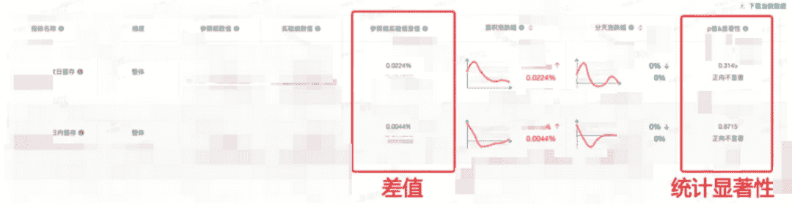

### **假设检验**

**在AB平台中的话，我们做**出的原假设就是实验组的指标=对照组指标。根据原假设本身的正确性以及我们是否接受原假设，会有以下四种情况：

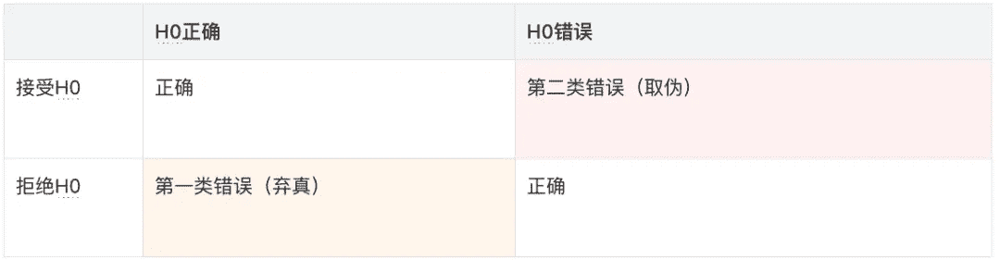

其中包括两种错误情况：

+   第一类错误（弃真错误），可理解为实际上实验没有产生效果，但却被错误地判定为有效果。

通常用希腊字母α表示，在显著度为95%的情况下，即使实验没有采用任何策略，在单个指标上出现显著结果的概率仍有5%（在多个指标上出现显著结果的概率大于5%）。

+   第二类错误（取伪错误），可理解为实际上实验产生了效果，但却被错误地判定为没有效果。

通常用希腊字母β表示，其大小取决于两个总体之间的差异量、样本量、方差以及显著性水平。样本量越大、差异量越大、方差越小、显著性水平越大，第二类错误率就越低，实验效果被检出的概率也就越大。

**统计引擎实践**

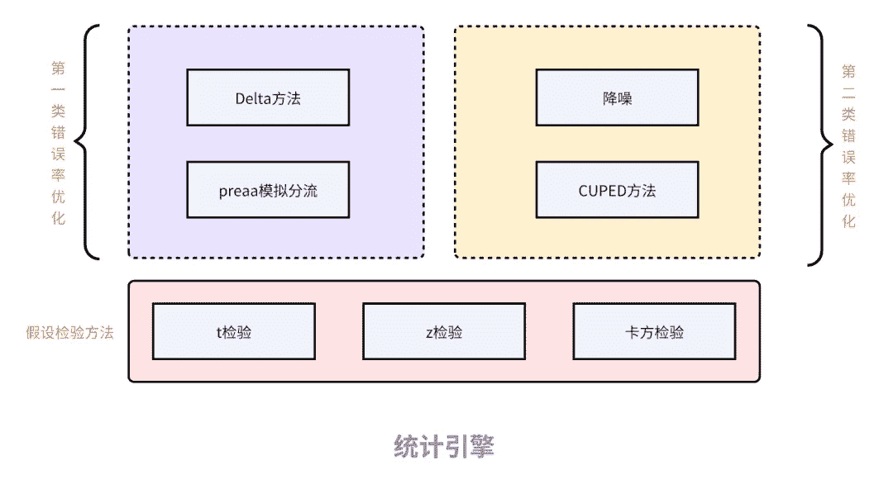

### **检验方法**

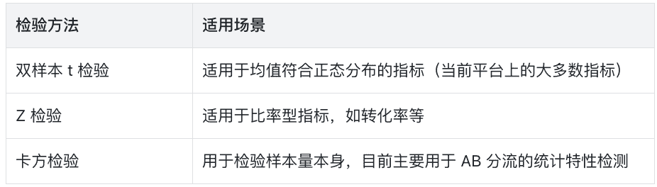

#### **第一类错误率优化**

接下来，将介绍两种第一类**错误率优化方法**：preaa模拟分流和**Delta方差修正**。我们以一个问题引出preaa模拟分流：“为什么我的实验还没有上策略，有的指标就显**著了？”如前文实验决策****部分所**述，第一类错误率本身有5%的概率，当指标数量足够多时，这个概率远不止5%。AB平台目前提供preaa模拟分流功能，它可以在实验开始前，用“场景的DAU”进行模拟分流，根据过去7/14天的指标表现，对实验流量分配进行优化。preaa模拟分流通过后（没有指标出现显著的情况）再开启实验，能够有效保障实验开启后指标的均匀性。

在AB平台上使用preaa校验的步骤如下：

1.  新建一个preaa校验；

1.  选择要进行preaa的实验；

1.  选择页面；

1.  选择分流方式；

1.  计算时间周期；

1.  选择要观测的目标。

**通过以上**步骤，我**们可以得**到对应的分流结**果，并判断**相应指标是否显著。关于preaa的使用，有以下最佳实践：

+   指标数量控制在1到10个之间。指标数量**越多，选****择难度越**大，实验负责人也难以关注核心目标。根据第一类错误率5%计算，10个指标中，有40%的概率会出现一个指标显著。

+   **在无留存或**低**留存的情况下**不太适用。preaa是基于时间前用户的表现来推测时间后的表现，如果用户在实验后不存在，即不存在前后关联关系，就无法用实验前的数据进行推导。例如，一些针对新用户的实验。

同样，我们通过另一个问题来**引入Delta方差修正**：“**为什么我的实验很容易出现显著结果，而且有**的指标呈现正向显著，有**的指标呈**现负向**显著？”在23****年12月份，AB**平台上线**了Delta方法，用于修**正被低估的方差，从而确**定实验结果是否****真的显著。方差被低估的场景**主**要是在分**析因子的粒度比分流因子更细的情况下。举个例子，我们通常基于UV（Unique Visitors，独立访客）进行分流，然后通过每个user_id来判断其所属的分组。然而，在分析时，我们是以PV（Page Views，页面访问量）或者以用户访问的天数计算多个样本。这样一来，对于不同的PV，它们可能来自于同一个用户，把它们当作独立的样本就会导致样本重复，从而低估方差。

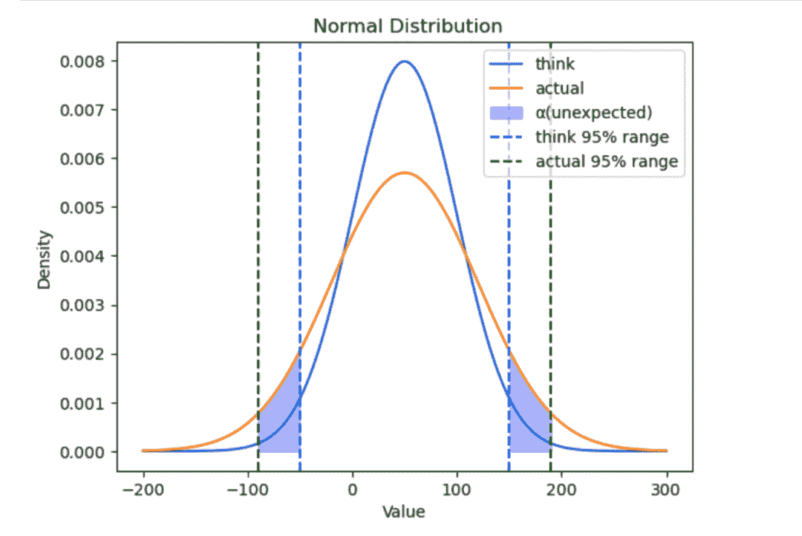

**我们可以看****一下上面这个图，它****描述的是方差**被低估为何会导致第一类错误率偏高。图中橙色的曲线是指标实际的分布情况，绿色的两条竖线围起来的范围是95%的置信区间，超出左右竖线的部分属于统计显著区域。

蓝色的曲线是**低估方差后的曲线**，相比于橙色曲线，蓝色曲线更尖。基于蓝色曲线圈定的95%置信区间即为蓝色的双竖线，左右两边的区域都会被判定为显著。

由于**实际分布**是橙色曲线，所以可以看到紫色阴影这部分面积，在实际分布中并不显著，但会被我们判断为显著，这就是非预期的第一个错误。这样一来，指标出现显著的概率就会增加，超过5%。

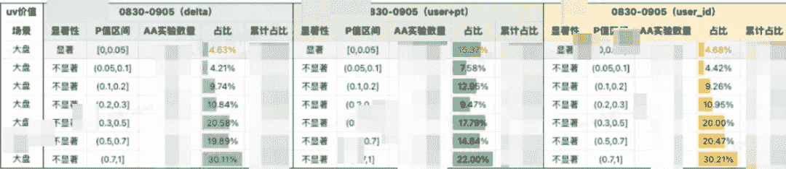

再和大家分享一下Delta修正之后的优化效果。这是我们与**数据分析**团队共同完成的一个探索。使用Delta**方法后，第一类错误率有着明显的**降低。以得物A**B平台的**几个核心指标为例，第一类错误率UV价值从15.37**%下降**到4.63%，DAU均社区时长从23.74%下降到4.11%，推荐流去重pvctr从16.11%下降到4.63%。目前，Delta实验方法已广泛应用于得物实验分析场景，实验覆盖度和指标覆盖度均超过90%。

#### **第二类错误率优化**

**然后再简单**介绍一下第二类错误率的优化。第二**类错误：实验**有效果但为什么还没有显著？出现第二类错误的原因是统计功效不够，导致统计功效不够的原因常见于：

+   提升幅度过小

+   样本量不足

+   方差较大

关于提升幅度，往往取决于实验本身的效果，样本量可以通过实验流量比例控制，在事后的统计分析上可以通过方差缩减来有效提升统计功效。在得物AB平台有两种方差缩减的方式：

+   **降噪**

在平台选择降噪进行实验分析时，部分指标值会做异常值的盖帽处理，用户粒度的指标超出我们设定的阈值时就和阈值相等，这样能有效降低指标的异常值对整体实验效果的影响。

+   **Cuped方法**

这种方法还未进行产品化，只有线下的SOP流程。Cuped方法核心原理就是基于用户行为的相关性，使用实验前的数据调整实验周期内的指标，已经通过Cuped方法的测算效果，平台的核心指标如大盘UV价值、社区使用时长都有30%以上的方差缩减。

### **分析误区**

**正态性假设**

**第一个分析误区****：关于正态性**的假设。很多同**学可能认为，在平台进**行双样本t检验时，前提假设是**指标本身服从**正态分布。然而，这种说法是不正确的。双样本t检验的真正前提是实验指标的均值服从正态分布。

**均值服从正态分布的理解**：我们的**实验组和对照组****都是从大盘抽****样的用户**。对于每次抽样，我们都会计算人**均指标，****即均值。**在实验效果评估**中，我们评估的是实验****组和对照组之**间的均值差异是否显著。这与指标本身是否服从正态分布不同。假设我们进行成千上万次抽样，并将这些均值绘制为一个分布曲线。我们期望这个分布曲线趋近正态分布，只有在这种情况下，我们才能正确使用双样本t检验。

**中心极限定理的应用**：根据**中心极限定理****，只要样****本量足**够大，样本的均值分布会趋近于正态分布。基于上面这两点，我们可以推断出只要样本量足够大，所有指标都可以使用双样本t检验。

**样本量与正态分布的关系****：下面这张图展示了****随着样本量的**增加，大盘UV价值的均值逐渐趋近正态分**布的趋**势。最右边的图是10**万样本量**的结果，可以看到黑色线条表示标准正态分布，蓝色线条表示大盘UV价值的分布。随着样本量逐渐增加到100万，分布差异逐渐减小，到300万和500万时，基本上与正态分布吻合。

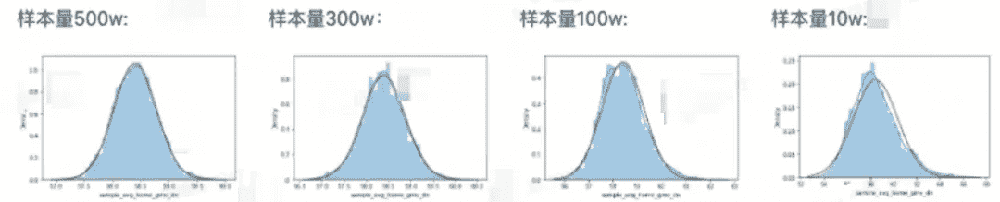

### **辛普森悖论**

**辛普森悖论**是指在某些情况下，将一个整体进行细分后，得到的结果与对整体进行统计的结果存在矛盾。

可以看下面这个例子，**实验组进行流量调节**可能会导致辛普森悖论：

（以下数据为非真实数据）

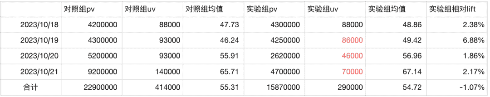

从10月19日晚上开始，**算法策略**的同学将实验组的流量从**20%**缩减到了**10%**，因此**实验组UV对比对照组UV**开始下降。10月**20日和**10月21日正好是周末，用户的人均点击比工作日高**了一截（4**0+ -> 60+），对照组在周末的流量占比相对于实验组更高，也就导致了这四天累计分析时实验组反而不如对照组。为了避免实验分析过程的辛普森悖论，可以采用以下解决方案：

+   实验组和对照组按等比调整，或者不要跨流量调整时间节点分析数据。

+   细分人群分析时，注意用户在人群之间的迁移。

### **幸存者偏差**

**幸存者偏差**早已存在，这一理论源于二战时期的一个研究**小组。在二战期间，盟军组成**了**一个小组研究“如何减少**空**军被击落概率”。当时军方**的高层统计了所有返回的飞机的中弹情况，发现飞机的机翼部分中弹较为密集，而机身和机尾部分则中弹较为稀疏，于是当时的盟军高层建议加强机翼部分的防护。但小组中的一位来自哥伦比亚大学的统计学教授亚伯拉罕·沃德（Abraham Wald）却提出了完全相反的观点，他认为应该加强机身和机尾部分的防护。那么这位统计学家是如何得出这一看似不够符合常识的结论的呢？沃德教授的基本出发点基于三个事实：

+   **统计的样本只是平安返回的战机。**

+   被多次击中机翼的飞机似乎还是能够安全返航。

+   **而在机身机尾的位置很少发现弹孔的原因并非真的不会中**弹，而是一旦中弹，其安全返航的机率极小。

为什么AB实验中会存在**幸存者偏差****？这是****因为我们只统计**进入实验的用户，而观测的指标通常是平均值，观测的时间范围也往往是最近1-2周，如果用户因为实验的效**果流失了，是不**会体现在实验第二天的数据中的。为了避免在AB实验中的幸存者偏差，所有实验都应关注用户的留存，留存出现显著性差异的时候考虑在整个实验周期内进行用户去重分析。一些典型的会出现留存变化的场景包括：

+   黑白盒实验

+   拉活实验

+   异常实验

**后续规划**

**可信**

+   SRM检测

+   Cuped方法产品化

+   检验方法升级

+   ...

**效率**

+   样本量预估流程

+   统计引擎服务化

+   分析功能统一化

+   ...

**场景化**

+   SRM检测

+   Cuped方法产品化

+   检验方法升级

+   ...

**智能化&因果推断**

+   样本量预估流程

+   统计引擎服务化

+   分析功能统一化

+   ...

# **总结**

本文主要介绍了以下内容：

+   AB实验的基本概念、用途和实验流程。

+   AB实验平台的整体架构、接入方式，以及分流引擎和数据引擎的技术难点、架构和后续规划。

+   实验平台中的数据科学，包括实验的必要性、实验决策的基本原理、第一类错误和第二类错误的优化方式，以及一些常见的分析误区。最后还介绍了数据科学方向的后续规划。