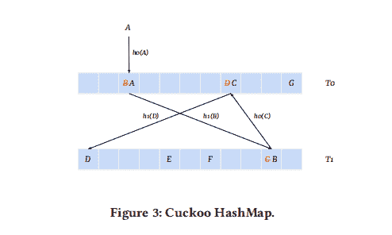
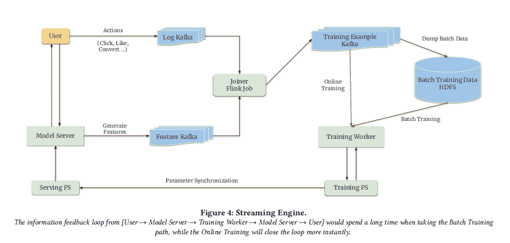
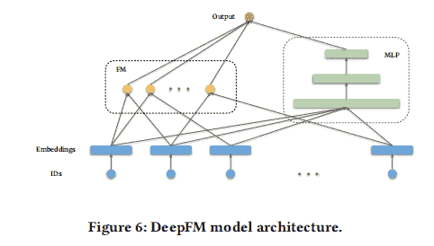
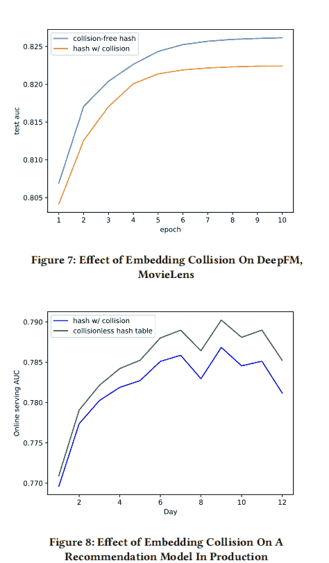
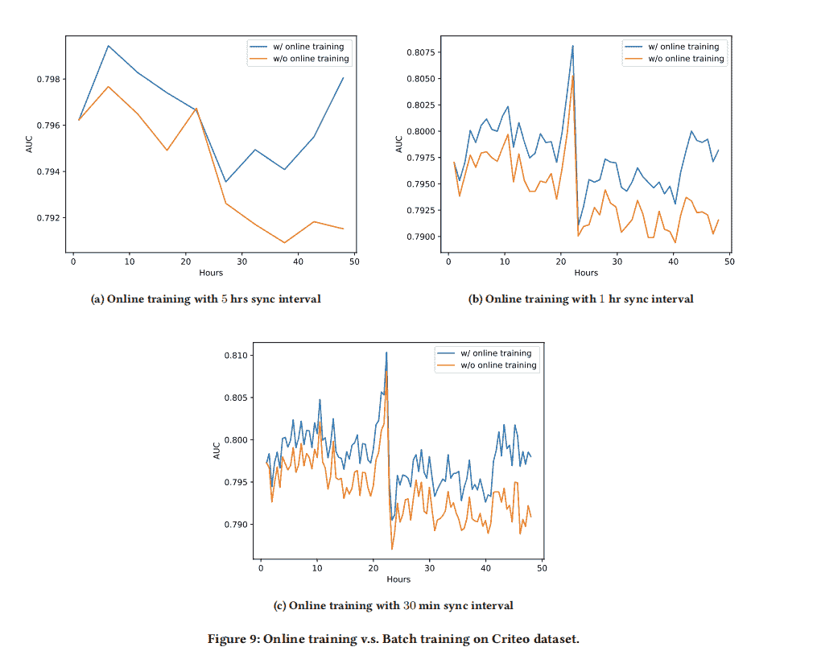
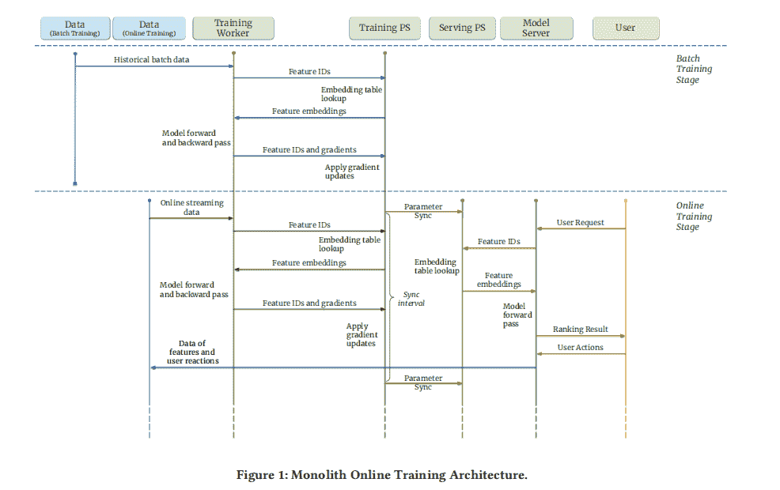

# 宇宙厂推荐系统十佳案例

> 来源：[https://qqs7y1hozd1.feishu.cn/docx/QrOMdTzcDosZzixxkLYcWHPgngd](https://qqs7y1hozd1.feishu.cn/docx/QrOMdTzcDosZzixxkLYcWHPgngd)

## 设计

`Monolith`的整体架构大体上遵循了`TensorFlow`的分布式`Worker-ParameterServer`（`PS`）设置

> 在`Worker-PS`架构中，机器被分配不同的角色：

+ `Worker`机器负责执行图中定义的计算任务

+ 而`PS`机器则负责存储和更新参数

> 这些参数根据`Worker`计算出的梯度来调整

在推荐模型中，参数被分为两类：密集、稀疏

+ 密集参数是深度神经网络中的权重/变量，而稀疏参数则指向嵌入表，这些表对应于稀疏特征

+ 在设计中，密集和稀疏参数都是`TensorFlow`图的一部分，并存储在参数服务器上

类似于`TensorFlow`中处理密集参数的`Variable`，设计了一套高效、无冲突且灵活的哈希表操作，专用于稀疏参数。作为对`TensorFlow`在训练和推理分离中所遇到的限制的补充，`Monolith`的弹性可扩展的在线训练旨在在短时间内高效同步训练-`PS`到在线服务-`PS`的参数，同时通过容错机制提供模型的鲁棒性保证

### 哈希表

在设计稀疏参数表示的首要原则是避免将不同ID的信息挤压进同一个固定大小的嵌入中

> 模拟一个动态大小的嵌入表会不可避免地导致ID冲突，特别是随着新ID的增加和表的增长，使用现成的`TensorFlow Variable`将加剧这种情况

`哈希表`内部使用了布谷鸟哈希算法，该算法支持在不与现有键冲突的情况下插入新键。布谷鸟哈希实现了查找和删除操作的最坏情况时间复杂度为 ，并且插入操作的期望摊销时间复杂度也为

如图3所示，它维护了两个表 ，每个表使用不同的哈希函数 ，并且可以容纳要插入的元素。当尝试将元素 插入 时，如果  的位置已被元素  占用，它首先尝试将  从  中逐出，并尝试将  插入 ，使用相同的逻辑。此过程将重复，直到所有元素稳定下来，或者当插入运行成一个循环时

> 减少内存占用也是设计中的一个重要考虑。通过采用新的ID快速插入哈希表的方法，可以迅速释放内存。

> 从真实生产环境中观察到的结果导致 得出两个结论：

1. 那些只出现几次的ID对模型质量的提升作用有限。重要的发现是ID的分布是长尾的，其中流行的ID可能出现上百万次，而不受欢迎的ID可能不到十次。尝试将这些不频繁出现的ID转化为特征用于训练数据，并在模型中做出良好的估算是不现实的。因为这些ID的数据不足，不太可能在一天结束时影响模型的结果，所以模型质量不会因为这些低频ID的移除而受到影响

1. 那些来自遥远历史的、很少被访问的过时ID对当前模型几乎没有贡献。这可能是因为许多用户永远不会再访问，或者可能是一个过时的视频。在参数服务器（`PS`）内存中存储这些ID的嵌入不会以任何方式帮助模型，只会消耗`PS`内存

> 基于这些观察，设计了几种特征ID过滤启发式方法，以更高效地实现哈希表：

1. `ID`在加入嵌入表之前会被过滤

> 有两种过滤方法：

+ 首先，根据它们作为键插入之前的出现次数进行过滤，其中出现次数的阈值是一个可调的超参数，每个模型可能不同

+ 此外，还使用一种概率性过滤器来进一步减少内存使用

1. `ID`在一段预定义时间内不活跃后会被设置为过期，过期时间也可以针对每个嵌入表进行调整，以区分对历史信息敏感度不同的特征

> 在实现中，哈希表作为`TensorFlow`资源操作来执行，与`Variable`类似，查找和更新操作也实现为原生`TensorFlow`操作，以便更容易集成并提高兼容性

### 在线训练

在`Monolith`中，训练分为两个阶段（见图1）：

1. 批量训练阶段

这一阶段的工作方式类似于普通的`TensorFlow`训练循环：在每个训练步骤中，一个训练工作节点从存储中读取一小批训练样本，请求必要的参数更新，执行前向和后向传递，并最终将更新后的参数推回训练参数服务器（`PS`），稍有不同的是，对于基本学习任务，只对数据集进行一次遍历。批量训练对于训练历史数据很有用，特别是修改模型架构和重新训练模型时

1. 在线训练阶段

模型部署到在线服务后，训练并未停止，而是进入在线训练阶段。与从存储读取小批量样本不同，训练工作节点在此阶段实时消耗现场数据，并将训练结果同步到服务参数服务器（`PS`），这将立即影响用户端。这使得模型能够根据用户的实时反馈交互式地自适应调整

#### 流处理引擎

`Monolith`具备无缝切换批量训练和在线训练的能力，这得益于设计的流处理引擎，如图4所示。在设计中，使用一个`Kafka`队列来记录用户的行为（例如，点击某个项目或喜欢某个项目等），并使用另一个`Kafka`队列来处理特征。

+ 引擎的核心是一个`Flink`流处理作业，该作业用于在线特征生成

这个作业整合了来自用户行为的标签并生成训练样本，随后将这些样本写入一个`Kafka`队列，用于训练的队列样本随后被批量训练消耗

+ 对于在线训练，训练工作者直接从`Kafka`队列读取数据

+ 对于批量训练，一个数据转储作业会首先将数据转储到`HDFS`中；在`HDFS`中积累到一定量后，训练工作者会从`HDFS`检索数据并进行批量训练

训练参数服务器中更新的参数将根据参数同步计划被推送到服务参数服务器

#### 在线加入器

在现实世界的应用中，用户行为记录和特征是流式传入在线加入器（如图5所示）的，且没有时间顺序的保证，因此，为每个请求使用一个独特的键，以确保用户行为和特征能正确配对。用户行为的延迟也可能成为问题

> 例如，用户可能在几天后才决定购买几天前呈现给他们的物品。这对加入器来说是一个挑战，因为如果所有特征都保留在缓存中，它们根本无法适应内存。在系统中，使用了磁盘上的键值存储来存储那些需要等待一定时间的特征。当用户行为记录到达时，系统首先查找内存中的缓存，如果缓存缺失，则查找键值存储

另一个在现实世界应用中出现的问题是，负面和正面例子的分布极不均衡，负面例子的数量可能远超正面例子。为了防止正面例子被负面例子淹没，一个常见策略是进行负采样。这无疑会改变训练模型的基础分布，使其向更有可能产生正面预测的方向偏移。作为补救措施，在服务过程中应用对数赔率修正，确保在线模型是原始分布的无偏估计

#### 参数同步

在线训练期间，`Monolith`训练集群持续接收来自在线服务模块的数据，并在训练参数服务器（`PS`）上更新参数。为了让在线服务`PS`能够利用这些新训练的参数，参数同步是一个关键步骤

在生产环境中，面临以下挑战：

+ 在线服务`PS`上的模型在更新时不能停止服务。的生产模型通常有数TB的大小，因此替换所有参数需要一定时间。在替换过程中停止在线`PS`的服务是无法容忍的，更新必须实时进行

+ 将一个多TB的模型整体从训练`PS`传输到在线服务`PS`会给网络带宽和`PS`内存带来巨大压力，因为这需要双倍模型大小的内存来接受新到的模型

> 为了使在线训练适应业务规模，在`Monolith`中设计了一种增量实时周期性参数同步机制，该机制基于模型的几个显著特性：

1. 稀疏参数主导了推荐模型的大小

1. 在短时间窗口内，只有一小部分ID得到训练，其嵌入被更新

1. 密集变量的变化速度比稀疏嵌入慢得多。这是因为在基于动量的优化器中，密集变量的动量积累由于推荐训练数据的巨大规模而被放大，而在单个数据批次中，只有少量的稀疏嵌入会收到更新

特性(1)和(2)能够利用所有特征ID的稀疏更新。在`Monolith`中，维护一个已触及键的哈希集，表示自上次参数同步以来其嵌入已被训练的ID。以分钟级时间间隔从训练`PS`向在线服务`PS`推送已触及键集中稀疏参数的子集。这种相对较小的增量参数更新包在网络传输时较轻，不会导致同步期间的内存突然激增

还利用特性(3)通过为稀疏参数设置更积极的同步计划来进一步减少网络I/O和内存使用，同时减少密集参数的更新频率。这可能导致提供的密集参数版本相对于稀疏部分来说是相对陈旧的。然而，由于在特性(3)中提到的原因，这种不一致是可以容忍的，因为尚未观察到明显的损失

### 容错性

作为一个生产系统，`Monolith`设计有在`PS`（参数服务器）故障时进行恢复的能力。一个常见的容错选择是定期对模型的状态进行快照，并在检测到`PS`故障时从最新的快照中恢复

> 快照频率的选择有两个主要影响：

1. 模型质量

> 直观地说，随着快照频率的增加，模型质量受到最近历史丢失的影响较小

1. 计算开销

> 对一个多TB的模型进行快照并不是没有代价的。这会带来大量的内存复制和磁盘I/O操作

> 为了在模型质量和计算开销之间取得平衡，`Monolith`每天对所有训练`PS`进行快照。尽管在故障的情况下，`PS`会失去一天的更新，但实验发现性能下降是可以接受的

## 评估

为了更好地理解提出的设计所带来的优势和权衡，在生产规模上进行了若干实验，并通过A/B测试与实时服务流量对`Monolith`进行了不同方面的评估和验证

> 实验旨在回答以下问题：

1. 无碰撞哈希表能为带来多少好处？

1. 实时在线训练有多重要？

1. `Monolith`的参数同步设计在大规模生产场景中是否足够稳健？

### 实验

#### 嵌入表

> `Monolith`中的嵌入表实现为无碰撞哈希表。为了证明在嵌入表中避免碰撞的必要性，并量化无碰撞实现带来的收益，分别在`Movielens`数据集和内部生产数据集上进行了两组实验：

1. `MovieLens ml-25m` 数据集

这是一个用于电影评分的标准公开数据集，包含2500万条评分，涉及约162000个用户和62000部电影

+ 标签预处理

原始标签是0.5到5.0的评分，而在生产中，的任务主要是接收用户的二进制信号。为了更好地模拟的生产模型，将评分标签转换为二进制标签，评分≥3.5视为正样本，其他视为负样本

+ 模型和指标

实现了一个标准的`DeepFM` [9]模型，这是推荐问题中常用的模型架构。它由一个`FM`组件和一个密集组件组成（图6）。预测结果通过`AUC` [2]进行评估，因为这是实际模型的主要衡量标准

+ 嵌入碰撞

该数据集包含大约16万个用户ID和6万个电影ID。为了与无碰撞版本的嵌入表实现进行比较，进行了另一组实验，其中ID通过`MD5`哈希预处理，然后映射到更小的ID空间。因此，一些ID会与其他ID共享其嵌入。表1显示了哈希前后用户和电影ID的详细统计信息

1. 内部推荐数据集

> 还在生产环境中对推荐模型进行了实验。该模型通常采用多塔架构，每个塔负责学习预测特定类型的用户行为。

+ 每个模型大约有1000个嵌入表，嵌入表大小的分布非常不均衡

+ 嵌入表的原始ID空间是 。在基线中，通过分解应用哈希技巧来抑制嵌入表的大小。更具体地说，使用两个较小的嵌入表代替一个巨大的表，通过向量组合为每个ID生成唯一的嵌入：

其中 、 是对应于 、 的嵌入。这有效地将嵌入表大小从 减少到

+ 该模型在实际生产中服务，实验的性能通过实际服务流量的在线`AUC`进行测量

#### 在线训练

在线训练期间，以分钟级间隔用最新的一组参数更新在线服务`PS`。设计了两组实验来验证模型质量和系统稳健性

1. 更新频率

> 为了研究分钟级更新频率的必要性，进行了不同间隔的参数同步实验，将训练模型的参数同步到预测模型中。使用的数据库是`Criteo Display Ads Challenge`数据集，这是用于基准测试`CTR`模型的大规模标准数据集。它包含7天按时间顺序排列的数据，记录了特征和点击行为。

> 为了模拟在线训练，对数据集进行了以下预处理。从数据集中提取7天的数据，并将其分为两部分：5天的数据用于批量训练，2天用于在线训练。进一步将这2天的数据按时间顺序分成N个分片。通过算法1模拟在线训练

因此，模拟以由数据分片数量决定的间隔将训练好的参数同步到在线服务`PS`。实验了N = 10、50、100，这大致对应于5小时、1小时和30分钟的更新间隔

1. 现场实验

> 此外，还通过实际服务流量进行了现场实验，以进一步证明在线训练在实际应用中的重要性。这个A/B实验比较了生产中一个广告模型的在线训练和批量训练。

### 结果与分析

#### 嵌入碰撞的影响

来自`MovieLens`数据集和内部推荐数据集的结果均表明，嵌入碰撞会损害模型质量

1. 使用无碰撞哈希表的模型始终优于存在碰撞的模型

+ 训练轮数的增加，如图7所示，使用无碰撞嵌入表的模型从第一轮开始就有更高的`AUC`，并在更高的值处收敛

+ 概念漂移导致的分布变化，如图8所示，使用无碰撞嵌入表的模型在时间推移以及用户/项目上下文变化时也表现出稳健性

1. 无碰撞嵌入表导致的数据稀疏性不会导致模型过拟合

#### 在线训练：在实时性与可靠性之间的权衡

> 发现更高的参数同步频率总是有助于提高在线服务`AUC`，并且在线服务模型对`PS`中少量分片的丢失比预期的更具容忍性

1. 参数同步频率的影响

在使用`Criteo Display Ads Challenge`数据集的在线流式训练实验中，模型质量随着参数同步频率的增加而持续提高，这在以下两个方面的比较中尤为明显：

+ 带有在线训练的模型比没有的模型表现更好

图9a、9b、9c比较了在线训练模型通过后续数据分片评估的`AUC`与批量训练模型通过每个数据分片评估的`AUC`

+ 参数同步间隔较小的模型表现优于间隔较大的模型

图10和表2比较了同步间隔为5小时、1小时和30分钟的模型的在线服务`AUC`。生产中广告模型的在线训练与批量训练的现场A/B实验也显示，在线服务`AUC`有显著提升（表3）

> 受到这一观察的启发，尽可能频繁地将稀疏参数同步到生产模型的服务`PS`（目前为分钟级），以在计算开销和系统可靠性能够承受的范围内。密集变量需要较不频繁的更新，将其设为日级更新。通过这样做，可以将计算开销降到非常低的水平。假设每分钟更新100,000个ID，嵌入维度为1024，则每分钟需要传输的数据总大小为4KB × 100,000 ≈ 400MB。对于密集参数，由于它们每天同步一次，选择在流量最低时（如午夜）进行同步

1. `PS`可靠性的影响

通过分钟级参数同步，最初预计需要更频繁地对训练`PS`进行快照以匹配实时更新。惊讶的是，将快照间隔扩大到1天，仍然几乎没有观察到模型质量的损失

在个性化排名系统中找到模型质量和计算开销之间的正确权衡是困难的，因为用户对推荐质量极为敏感。传统上，大规模系统倾向于为其模型设置频繁的快照计划，以牺牲计算资源来换取最小化的模型质量损失。在这方面也进行了相当多的探索，令人惊讶的是，模型质量比预期的更稳健。在`PS`机器每天0.01%的故障率下，发现使用前一天的模型效果非常好。

这可以通过以下计算解释：假设模型的参数分布在1000个`PS`上，并且它们每天进行快照。鉴于0.01%的故障率，每10天其中一个会出现故障，将失去此`PS` 1天的所有更新。假设每日活跃用户（`DAU`）为1500万，并且用户ID在每个`PS`上的分布均匀，每10天会失去15000名用户1天的反馈。这是可以接受的，因为(a) 对于用户特定的稀疏特征，这相当于失去0.01% `DAU`的极小部分；(b) 对于密集变量，由于它们更新缓慢，正如上文讨论的那样，失去1000个`PS`中1天的更新是微不足道的。

构建一个可扩展且实时的推荐系统对于许多业务至关重要，这些业务依赖于时间敏感的用户反馈，如短视频排名或在线广告。尽管像`TensorFlow`或`PyTorch`这样的通用深度学习框架被广泛采用，但它们通常无法完全满足生产规模的需求，例如在处理动态参数和商业要求时的灵活性不足：

+ 一方面，企业需要一个能够调整系统参数

+ 另一方面，系统的稳定性和服务阶段的顾客反馈是至关重要的

这些问题导致了从传统设计到寻求新方法的转变

在本文中，字节跳动一种定制的解决方案——`Monolith`，它针对一些应用工作负载和生产环境的特点进行了优化。`Monolith`的设计理念源于对应用工作负载和生产环境的观察，这一新系统显著不同于传统的推荐系统

+ 创造了一个结构，包括过期嵌入和频率过滤优化，减少了内存的占用

+ 其次，提供了一个具备高容错性的生产就绪在线训练架构

+ 最后，字节跳动证明了系统的可靠性，确保能够长期运行

> 在过去的十年中，见证了以推荐系统为动力的商业繁荣。这些系统追求更优的用户体验，通过实时提供个性化内容给每一个用户

> 对于这些商业应用来说，从用户的每次交互中收集反馈并将其作为即时响应，已成为常见做法。这种信息通常被用作训练模型的主要输入，因为它能够精确描绘用户的画像，预测用户的兴趣和未来的行为模式

深度学习已成为推荐模型的主导技术，这自然而然地涉及了大量用户数据的处理。作为数据驱动的神经网络模型，深度学习能够在工业级推荐系统中发挥巨大作用。然而，这些系统在处理实际问题时常常遇到难题，这些问题源自于现实世界用户行为数据的独特特性，这些数据与用于传统深度学习任务（如语言建模或计算机视觉）的数据截然不同

> 这些数据在两个方面存在问题：

+ 特征大多数是稀疏的、类别的，并且动态变化

+ 训练数据的底层分布是非静态的，即所谓的概念漂移

## 稀疏性与动态性

> 推荐系统的数据通常包含稀疏的类别特征，其中一些出现频率较低。这种情况与处理语言模型的数据截然不同，语言模型中单词片段的数量是有限的，用户和排名项的数量则是天文数字。这样庞大的嵌入向量很难完整地存储在单个主机内存中。更糟糕的是，随着越来越多的用户和条目被纳入系统，预期嵌入表的大小将不断增长，而大部分系统则采用固定大小的密集变量来保存嵌入表

实际操作中，许多系统采用低碰撞哈希（Low-collision hashing）技术，以减少内存占用并允许ID的增长。这种方法基于一种非理想化的假设，即嵌入中的ID分布在全球范围内是均匀的，这在现实中很少是真实的。遗憾的是，对于一个真实世界的推荐系统来说，通常只有少数用户或者项目会频繁接收高质量的推荐，这就增加了嵌入表质量下降的机会，从而导致模型性能恶化。因此，生产规模的推荐系统需要有能力捕捉尽可能多的特征，并且能够灵活地调整其参数和书记数量，以适应不断变化的用户和条目数量

## 非静态分布

视觉和语言模式在几百年的时间尺度上几乎不发展，而同一用户对某一主题的兴趣可能在下一分钟就发生变化。因此，底层数据分布也是非静态的，这种现象通常被称为概念漂移（Concept Drift）。从更近期的历史中获取的信息可能更能有效地反映市场变化，从而更好地缓解概念漂移的影响。为此，提供模型服务的系统需要尽可能实时地反映用户的最新兴趣。

> 鉴于这些区别和生产中遇到的问题，设计了一种大规模推荐系统`Monolith`，通过广泛的实验来应对这些痛点。在生产环境中精心设计了该系统，`Monolith`能够：

1. 通过设计一个无冲突的哈希表和动态特征淘汰机制，为稀疏特征提供充分的表达能力
2. 通过在线训练的实时反馈循环提高训练效率

得益于这些架构能力，`Monolith`在不过度增加服务器计算负担的情况下，显著提高了在线服务的AUC表现，超越了采用碰撞哈希技术的系统

## 结 论

1. 在这项工作中，回顾了工业级推荐系统的几个最重要挑战，介绍了的生产系统`Monolith`，以应对这些挑战，并在与现有解决方案的比较中实现了最佳性能
2. 证明了无碰撞嵌入表对于模型质量至关重要，并展示了基于`Cuckoo HashMap`的嵌入表实现不仅在内存上高效，还能帮助提高在线服务指标
3. 还证明了实时服务在推荐系统中的重要性，并且参数同步间隔应尽可能短，以实现最佳模型性能。`Monolith`在线实时服务解决方案具有精心设计的参数同步和容错机制：参数同步算法中，表明可以通过在不同参数部分的版本一致性上进行权衡来减少网络带宽消耗；在容错设计中，展示了通过权衡`PS`可靠性来提高实时性是一个稳健的解决方案。总之，`Monolith`成功地为生产规模的推荐系统提供了一个通用解决方案
