# NLP技术在座舱语音助手中的应用

> 来源：[https://qqs7y1hozd1.feishu.cn/docx/OKVMdyDwnoIHi8xjCX7csQ0Snfg](https://qqs7y1hozd1.feishu.cn/docx/OKVMdyDwnoIHi8xjCX7csQ0Snfg)

> **语音助手中的 NLP **技术应用与研究，主要介绍下面三个方面：

+   Conversational AI Agent

+   XiaoAI Model Pipeline

+   Self-Learning

# **Conversational ****AI Agent**

## **语音对话技术的主要流程**

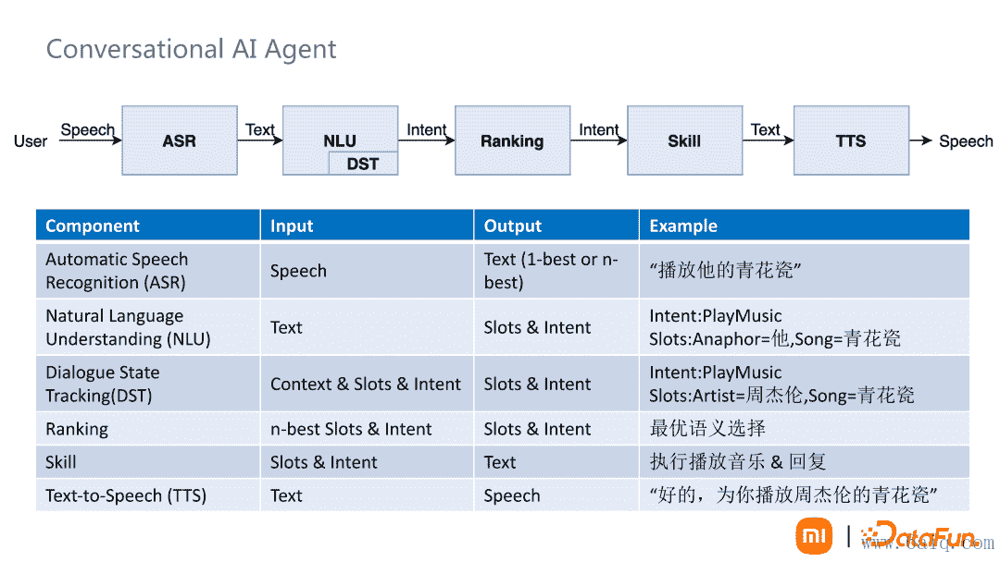

+   首先**普通的语音对话技术的主要流程**，对于一个**语音助手**来说，**一般它的输入是一个用户的语音**，它会**通过 ASR 系统**，生成对应的文本，可能生成一个1-best 或者 n-best 版本

+   然后给到后续的** NLU 模块**。NLU 模块，主要任务就是识别它的意图和槽位。

> **比如“播放周杰伦的青花瓷”，意图**就是播放音乐。槽位应该是周杰伦还有青花瓷

+   现在对于对话处理，一般还会**有一个 Dia**log Sta**te Track**ing（DST**模块），负**责**槽位的继承**和更新，还有进行对话中的信息继承。对于一些复杂的语音助手，还会有一个 Rank 的步骤。因为有很多的query，可以由多个技能或者说垂域来进行承接。要选出用户的最优选择，需要做一个排序。排序完成以后，才会输出一个最优的意图和槽位的结果，给到对应的 Skill，执行它来执行对应的播放音乐，并生成对应的回复。

+   最终是一个 **TTS 模块**，它把对应的文本转成语音再发送给用户。

## **NLU**** 的例子**

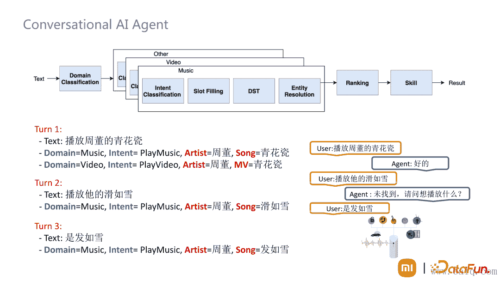

看一个例子，输入一个文本，通过一个 domain 的 classification，垂域的预识别，把它分发到多个垂域。

如图上所示，对于播放内容类，它可能是音乐，可能是 video，也可能是其他。通过分发到多个垂域，在垂域内部会进行对应的意图的识别、槽位抽取，DST 模块以及实体的链接 Resolution，得到对应的结果以后，对输出的统一语义理解结果进行排序，然后给到 Skill。

上面是一个三轮对话的例子，比如说第一轮是播放周董的青花瓷：

+   **对于语音助手来说**：它可能是音乐，也可能是播放 MV。他的意图就是对应垂域内的播放的意图，然后它们会抽取对应的槽位

+   **对于音乐来说：**抽出来的槽位类型是歌曲青花瓷

+   **而对于 video 来说：**可能认为它是一个 MV。

通过多个垂域的识别以后，再通过 Rank模块，最终会输出一个最优的结果，本轮是给他播放音乐类。

第二轮的时候，用户进行了一个歌曲的修改，比如他想听另外一个歌，播放他的滑如雪。其实用户用了一个“他”来指代上文的周董，同时说了 song 是滑如雪，但本轮可能由于 ASR 识别错误，没有找到。用户会继续的进行澄清“是发如雪”，最终完成用户的指令。

**可**以看到，对于一个语音助手，它可能涉及到多轮交互，而每轮交互过程中，它都最终输出一个对应的意图和槽位的理解结果。

## **意图和槽位模型**

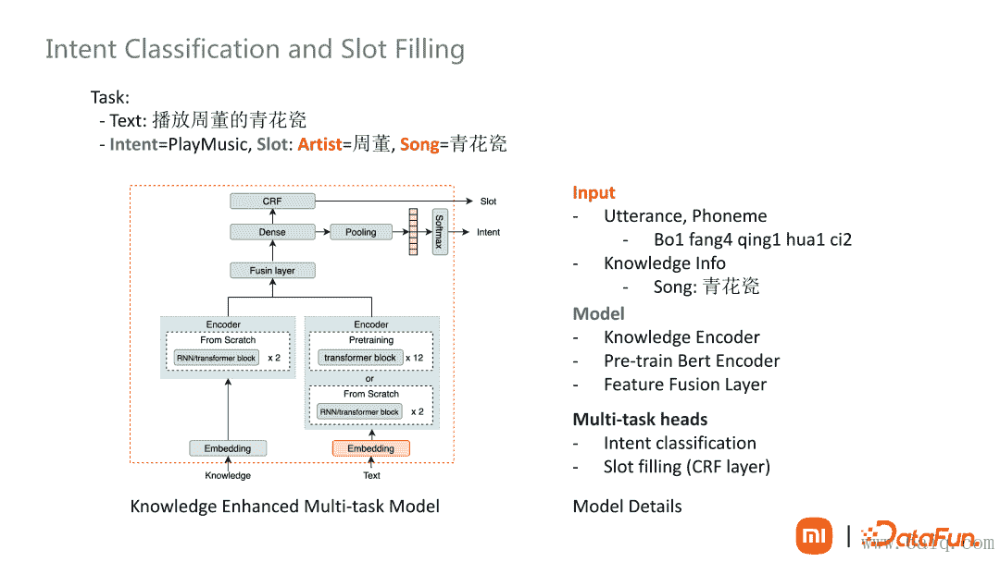

首先先介绍语音助手一个最基础的意图和槽位的模型

**目前对于工业界的一些模型，线上可能**很难用到非常深的 BERT。虽然 BERT 用了大量的文本训练，但 也需要更好地结合各个领域的一些知识

**以这个模型为例**，对于音乐类，可以很**明显地知道，周董是一个人名，**青花瓷是一个歌名。在输入模型的时候，input feature 就包含这样一个比较粗的知识信息，当作一个模型的 Embedding 输入。同时会输入一个最原始的文本。对于目前的语音助手，考虑到 ASR 错误，还会融入一些 Phoneme 信息，也就是拼音，比如播放青花瓷以及它的声调作为一些额外的信息

针对这些额外信息，输入一些常见的 encoder 来进行高层的特征提取。

**分别设计了两个独立的模块：**

+   一个是 knowledge encoder——它专门负责对知识进行解码

+   **另外一部分就是预训练的 BERT 的 encoder，这就**可以复用到目前非常主流的一些预训练模型。

**单独设定 encoder，可以让更好地复用**，不改变预训练模型的结构而更好地融合知识。

**紧接着是一个 feature** 的 fusion layer。有非常多的论文来讨论怎么进行知识融合，比如说有 simple lexicon 方法进行词汇融合， 融合文法加入一些知识的权重，以及亚马逊的gazetteer的融合方式。融合完以后得到一个句子的向量。是一个多任务的联合模型，通过一个简单的 Pooling 来得到一个句子的向量表示，然后通过一个 Softmax 得到它的意图。另外在上面会再加一个 CRF 来进行槽位的抽取，这是一个多任务的一个头。

**对于这个模型，用了 transformer 的一些模型结构，目前大家的模型结构**基本上一致的。真正的难点还是如何更好地结合知识，以及如何建设背后的这套知识体系。

**对于播放音乐，有歌的库，有 MV 的库，歌手的库这种层次的知识信息**，如何对这些知识信息进行层次化的建设，在模型的初期进行介入，是一个比较困难的问题。这就是一个常见的融合知识的多任务模型。

**在完成意图和槽**位识别以后，**后面还有个比较**常见的单轮，需要的就是意图的链接部分。

> **比如**说播放青花瓷，当用户发起这个请求的时候，他的内心都是明确地知道他想播放的是哪首歌。虽然他并没有明确的说明是周杰伦的，是歌曲还是 MV。针对这种混淆的消歧情况，用了类似于排序算法来进行。

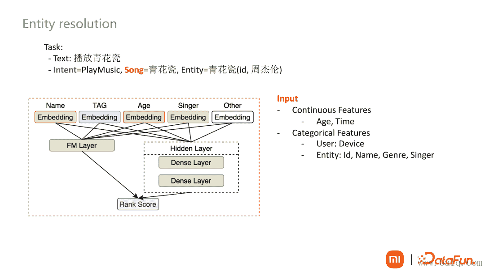

这是一个常见的排序模型的结构。参考了现在搜索的模型结构，左边是一个 FM layer，右边是一个生成的 Hidden layer 来生成交叉特征。对于输入的 Feature，其实 输入了一些连续的特征：比如说当前用户的年龄和发起的时间段。还有一些类型特征：比如说用户的 Device 以及 Entity 的 Name、类型等等，做一个最优的实体链接的排序，最终得到最优的一个实体识别。这是对于对话助手来说最常见的一个单轮所需要的意图识别、槽位识别和实体链接的部分。

## **多轮对话的交互**

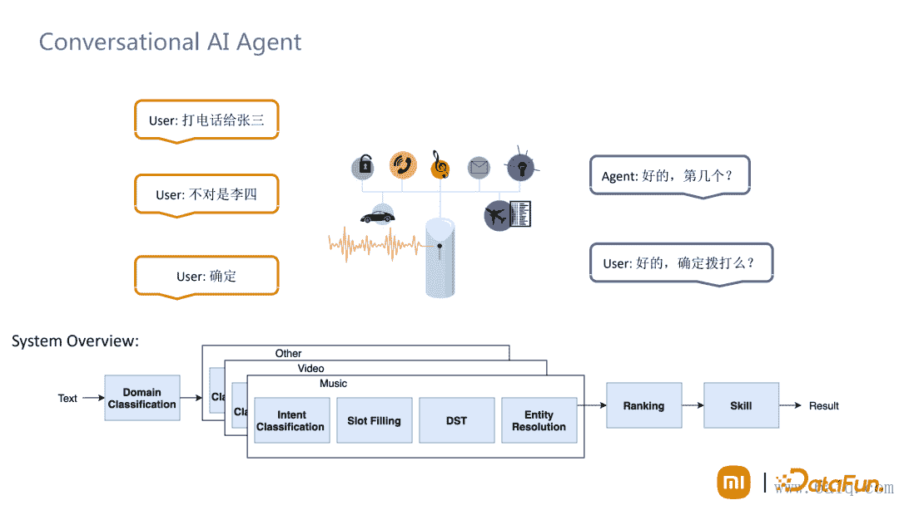

随着语音助手的发展，单轮任务已经不能满足用户的长期需求，用户往往会进行多轮的对话交互。

> 比如说上图是一个打电话的例子。当用户进行电话交互的时候，比如说用户打电话给张三，这个时候如果找到多个联系人，系统会主动地发问要打给第几个。有的时候由于 ASR 的种种错误，用户会澄清说不对，是李四，重新给了一个新的 name 槽位。系统需要更正之前的张三，换成李四，并进行一个新的搜索。假设这次只找到了一个李四的联系人，系统应该直接进行确认，说：好，你确定要拨打，那这个时候用户肯定会说确定。

这样的一个多轮对话式的语义理解， 要怎么构造背后的体系？

这涉及到了整个系统里的** DST模块**， 要对之前的意图槽位信息进行合理的继承和跟踪，来保证对话流不会被打断。

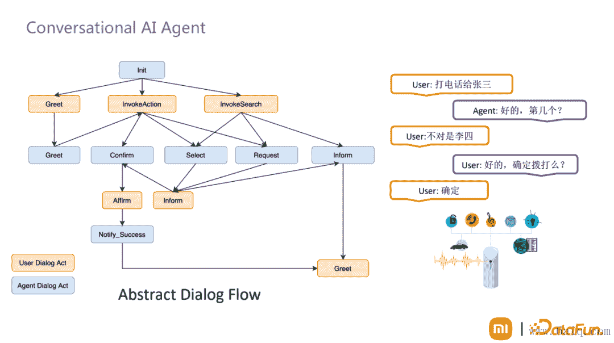

**什么是 Dialog Act？**

对于多轮对话， 建设了一个通用的 Dialog Flow

+   **对于意图：**可以认为它**是一个垂域内定制化的功能**，比如说是播放音乐、播放 MV 等等。

+   **对于多轮对话：**在上层抽象一个更通用的任务型对话 Dialog Flow，它和垂域是没有关联的，它更加抽象独立。

> **以打电话为例，**用户一开始有个初始的状态，他可能一开始会先打个招呼，但对于一个最主要的功能入口，由这黄色的部分 User Dialog Act，它会 Invoke 一个功能，唤起任务型助手背后的一个主要功能。比如说打电话给张三，说明他唤起了打电话的功能。

在打电话的功能背后，会对应的有 Agent 的 Dialog Act。Agent 根据之前用户的意图槽位，选择系统要发问什么动作（用蓝色色块表示）

> **比如系统进行确认，**你是要确认直接拨打，或者找到多个内容进行选择，或者进行一个 Request。用户如果缺少某些槽位，理论上 Agent 会进行继续的发问和补充，或者系统进行一个 Inform 操作来告诉额外的信息。这样的 Dialog Flow ，如果满足了一定的条件，就会继续往下走。

用户可能会说确认，这是 Affirm 的操作，用户可能也会提供额外的信息，这是 Inform。

> **比如用户又更正了一下，**说是李四，他是 Inform 了一个新的 name 槽位。当这些都满足以后，系统会继续执行对应的 Dialog Act，比如说 Notify_Success，代表系统完成了这一个动作，然后用户可以说谢谢等等。

这是**在垂域内部定制的 Intent** 基础上， 抽象了**一层 Dialog Fl**ow。它帮助完成大部分任务型对话所需要的用户侧的动作和系统侧的动作。用户侧的动作是橙色的部分， 一般称 User Dialog Act，浅蓝色的就是 Agent Dialog Act，它们共同构成了整体的对话。

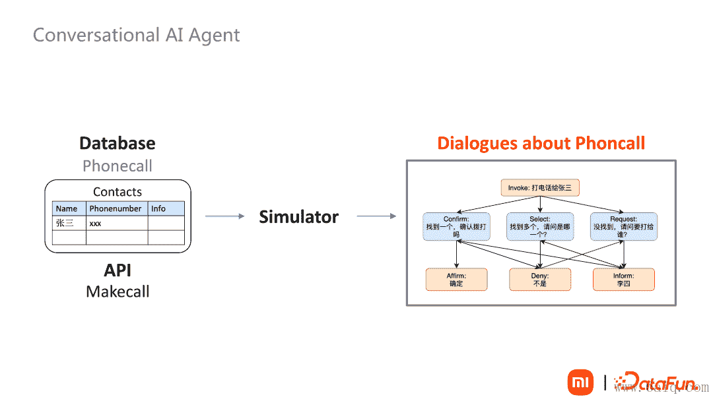

在给定了对话流以后，对于对话语音助手来说，数据怎么办？

其实**目前对语音助手最难的还是****数据**

还是以打电话为例，给定一个 Database，里面有丰厚的基础数据

> 比如人名等等。同时定义一套基础的打电话 API 设计。这些 API 设计有垂域内的基础功能：给某个人打电话，查询某个人的通话记录和信息等等。这些 API 的定义再结合 Dialog Flow 的抽象定义，通过一个 Simulator 来生成虚拟的 Dialogues。右侧就是一个非常简单的打电话流程。在生成这个对话的基础上， 模拟地填充一些假的数据或者模板，来构成这样的对话流。对于这样一个 simulator，考虑到目前语音助手里的 ASR 噪声，也会自动化地 random 加入一些 ASR 错误和噪声以及一些用户的修正行为，来保证这个 Dialog 能覆盖正常的对话流以及异常的对话流。这是目前主流的 simulator 的做法。

下图是目前一些其他的业界厂商（比如亚马逊）类似的做法，其实都是朝这样抽象 Dialog Flow 来生成数据的方式。

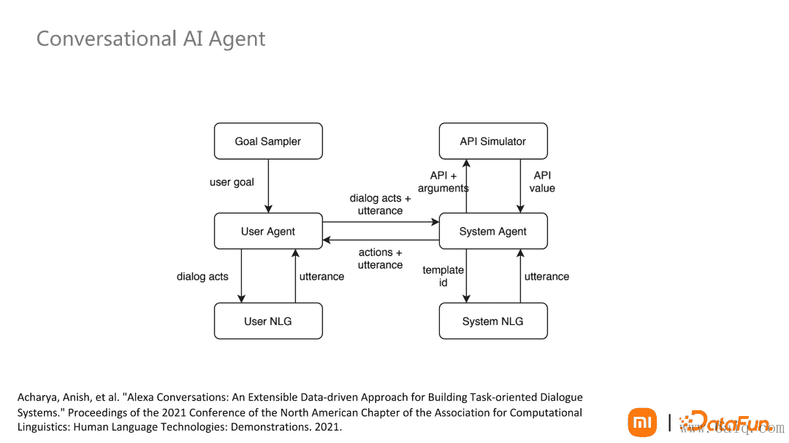

对于一个任务型对话助手，**用户的内心有一个目标**， 叫他 **goal**

**比**如用户想打电话给某某某，就会提前在心里想好， 有 goal sampler 来抽象出 API 目标，作为一个用户的 goal。有了用户目标以后，通过 User Agent 的第一步要生成一个 Dialog Act，invoke 对应的一个 API 。将一个虚拟的 Dialog Act 传给 System Agent， 它会输出一个action（本轮的Agent Dialog Act），返回给 User Agent。

在 System Agent 上下还有几个 simulator， 一个是 API 的 simulator，通过对应的 API 及背后的database 虚拟地得到实体的信息进行填充返回，返回给用户侧。用户侧的 Dialog Act也会有用户侧的 NLG 虚拟平台来生成一个 utterance。通过这样的模拟交互来生成大量的用户对话数据，来模拟进行训练。

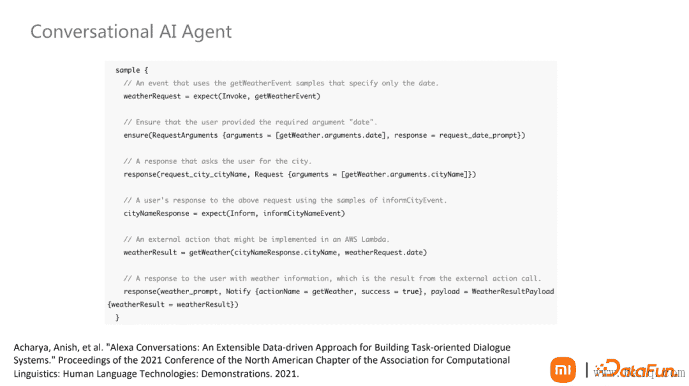

上图是目前亚马逊一个内部对话流的逻辑

> 以查天气为例，有一个唤醒查询天气的主入口。查天气需要一个时间和一个地点的信息， 人为地构造成一个多轮对话。由于目前用户仅提供一个时间的信息，在第三行 response， 有一个 request 的信息，它会 request cityName， 也就是对应的一个城市的信息。

生**成这样对应的 res**ponse 以后，第二轮会构造一个虚拟的用户，提供对**应的城市的名字，**进一步调用背后 getWeather 这样的一个 API，获得对应的天气信息。到了第二轮的时候，信息是完备的状态下，生成最终的 response，就是 notify success，同时把当前的天气传给用户。

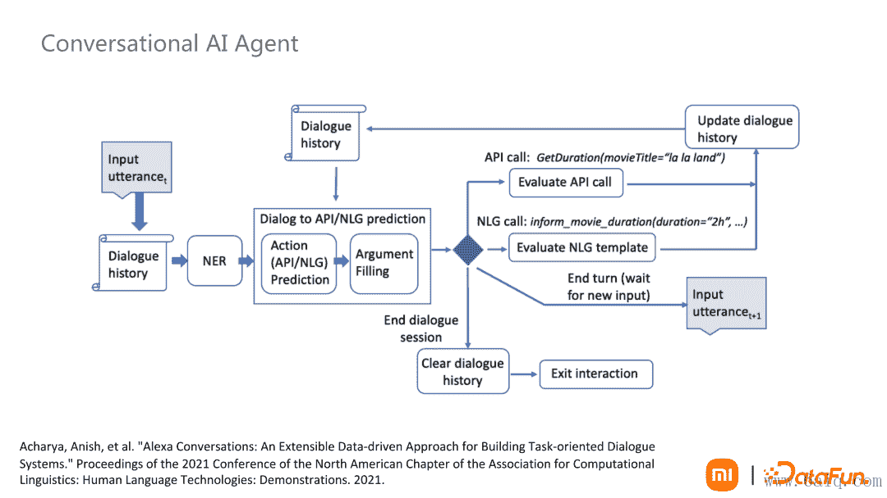

对于语音助手 Alexa，输入一个对话 utterance，有 Dialog history。

**通**过一个 NER 模型，进行 action 的预测以及待填充槽位的 Filling，来得到最终的意图和槽位，然后再下发给对应的下游。小爱同学内部的体系也是类似的，也会生成对应的意图和槽位的识别。同时预测 Dialog Act，然后把对应的槽位进行填充来进行预测。

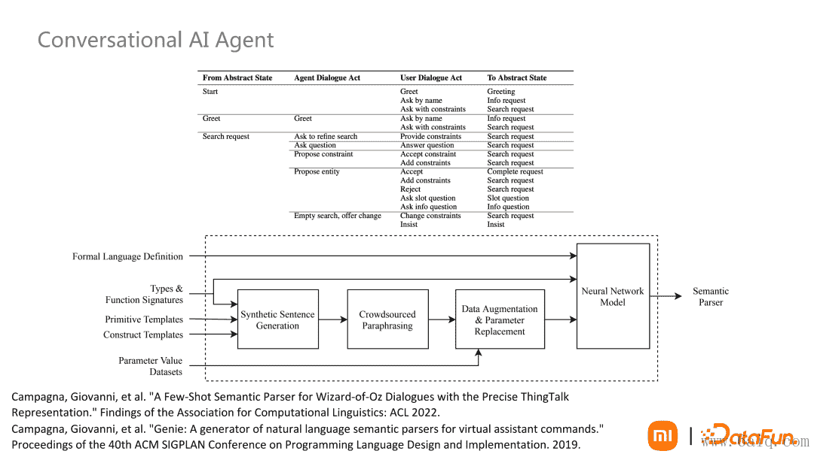

现在斯坦福的学者也提出了对话 AI Agent 的搭建方式。目前大家也都是朝着 Dialog Act 这套体系来进行建设。对于对话，他们提出了一套自己的 Agent Dialog Act 和 User Dialog Act，同时他们还设计了不同的 state 转移的一个规范，也可以说是规则。

在这个规则的基础上构建状态的**跳转机制**，做一些**马尔可夫的状态跳转**，**通过初始的数据来模拟概率**的分布跳转，**得到虚拟的对话**流**。在虚拟对话流的基础上，利用刚****提到的数据生成的方式，**再结合人工重写的方式，目前 NLP 常见的数据增强（比如说槽位的替换、相似词的替换等等）然后送到对**应的神经网络（Sem**antic Parser）这样的模型的句子结构，现在比较常见。比如说李永斌老师提到的 query2SQL 模型，是一个 sequence to sequence 模型，再结合一些 copy net 机制。目前的模型结构大家是差不多的，主要还是多轮对话问题的定义上，怎么把它抽象成一个合理的问题，以及如何模拟地生成这些数据，做 simulator 数据的建设。

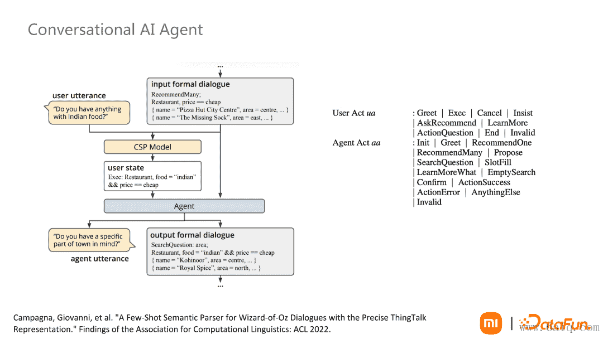

这是一个斯坦福学者提出的对话流，他们的 Dialog Act 是输入一个整体的 Dialog Act

> **比如说上轮的输入信息是：** **给用户提供了一个多**项的**选择，同时之前用户是想查询餐****厅的价格，那么当前的**位置是想**查询一个印度的食品，把**这些用户的** Utterance **和 Dialog State 同时输入一个统一的模型来生成目前的 user state。这个 user state 同时输出了 Dialog Act，也就是 execution 执行某个 API。同时在这个餐厅的垂域内，预测了意图，也预测了所需要的槽位。槽位的类型是 food 的，而槽位的值是 indian，同时槽位价格的值是 cheap。斯坦福学者训练了一个端到端的统一模型，来同时预测 dialog 意图和槽位以及槽位的值。最终通过一个模拟的 agent，用一个规则模式调取背后的 API 以及生成对应的 agent 的 Dialog Act。

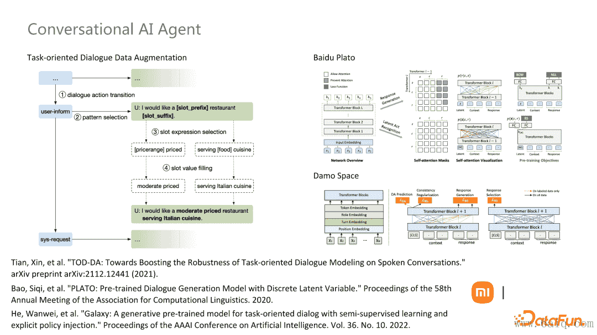

刚刚提到的斯坦福学者，还有百度和达摩院的老师都提到，如何**在预训练的模型上加入**更多的对话的信息。百度的 Plato 和 Plato2，是加入了隐向量。这个隐向量就是一个系统的抽象的 Act，它蕴含对话中一个不同的 Act 而导致的 response 变化。另一个的就是 Damo Space，在对话的基础上抽象出了 Universal Dialog Act，然后把整体的 Dialog Act 当作一个额外的训练任务，来提高整体对话的 agent 理解效果。

上图左边是目前最新的 **Dstc10 的第一名的结果，它是基于 Task-oriented Dialogue Da**ta Augmentation 的方法，在百度 Plato2 的基础上进行了研发。为了处理目前复杂的对话，它首先对用户侧进行一个抽样，inform 的识别也定义了 inform 和 system-request 的 dialog act。同时对于过往的数据，抽象了 dialog act 跳转的方式。对于用户侧，会选择一个 inform

> 比如说目前用户是想 inform 餐厅的价格信息，他们会找到这样的 pattern，同时用 pattern 来填充对应的槽值。通过这样数据增强的方式来构造一个抽象化的 dialog flow 来训练模型。

**以**上就是目前常见的 Conversation AI Agent 的处理流程。小米内部也是采用了这样的方式，用了端到端的方式来训练对话 AI。

# XiaoAI Model Pipeline

## **整体介绍**

以上介绍了的复杂的模型，怎么让这些复杂的模型快速地进行上线和部署？ 简单介绍一下小米的 Model Pipeline。

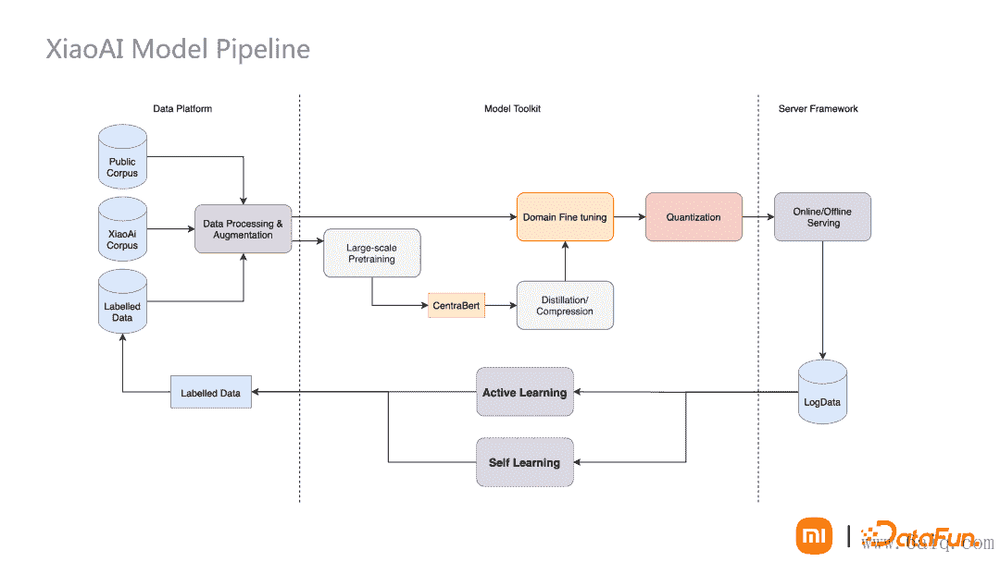

**目前对于小爱（一个语音助手）来说， 刚**提到数据最重要的部分， 把整体的 Model Pipeline 分成三部分：

+   Data Platform

+   Model Toolkit

+   Server Framework

对于数据， 现在有统一的数据平台。

**数据平台分为三部分：**

+   一个是公共的**public corpus**，**用来预训练一个大量的模型**，它是团队内部收集的数据，小爱内部的线上数据，以及 的 label 数据组成。这些 label 的数据，包**含刚刚提到的常见单轮数据以**及 对话流的数据。这些数据，通过统一的数据平台进行数据预处理和增强，给到 model toolkit。model toolkit 支持各种类型的模型，比如说分类序列标注和 sequence to sequence 。首先经过一个大规模的预训练模型， 内部称为 CentraBert。给到 CentraBert 以后，通过一个蒸馏或者压缩的方式。考虑到工业界线上的 QPS 以及服务的性能，压缩完再给到一个垂域内，垂域内进行自己额外的知识融合和嵌入，进行 Fine Turning。

+   **紧接着还有一个向量化的模块**，考虑到目前线上的性能，进一步对整体的模型进行量化，以方便云端或者离线的部署。通过这样的一套 model toolkit，可以简单地通过数据平台获得各样模型。

+   然后是 server framework，为了支持线上各样的业务（ 会支持在线的服务和离线的服务）， 会收集线上的 log data 来进行离线数据分析的部分。

上半部分是在线服务的搭建，同时离线数据的挖掘，对语音助手也是非常重要的。

**下半部分主要分成两部分:**

+   **一个是主动学习**， 会把线上的一些疑难 Case，通过模型的置信度进行挖掘，进行人工的标注加到 label data

+   另一个是**自学习的模块**

现在数据如何能更好更快速地挖掘是一个极端重要的问题。目前也初步搭建了一个小爱内部的自学习模块，能自动地生成一些对应的 label data ，加到数据库里。

## **Model Toolkit**

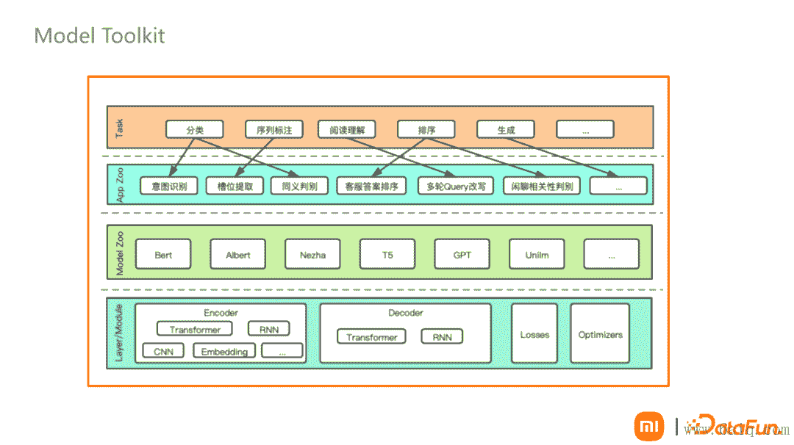

对于** model toolkit****，内部分成了几个层，最基础的**有通用的 Layer 和 Module（考虑到 model toolkit 的开发效率）

> 比如说有** CNN、 Transformer 和 RNN 构成的 enc**oder** 模块，和 decode**r 模块，也是 transformer 等等。还设计了不同的 losses 和优化器。在上一层是目前业界常用的 Model Zoo，比如说 Bert、Albert 等等。

在这些** model **的基础**上，再设立不同的任务，比**如说分类**任务、序列标注任务、阅**读理解任务和排序任务等等。这些任务又构成各种各样的应用，比如说意图识别、槽位抽取等等。 内部搭建了这样一套通用的模型 toolkit 来方便内部的同学进行快速的算法开发，不仅能支持常见的分类任务，还可以做一些复杂的 sequence to sequence 的任务开发和训练

## **CentraBert**

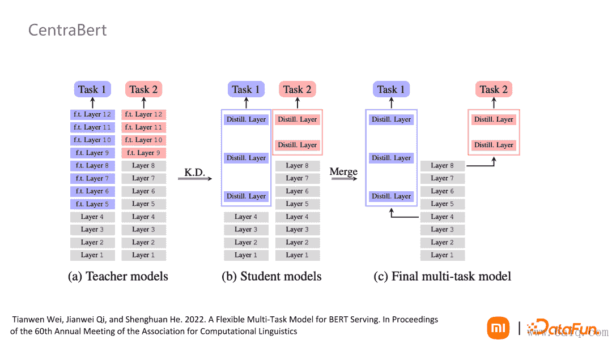

紧**接着介绍 CentraBer**t。对于对话助手，如何更好的结合预训练，在线上进行服务，降低线上流量也是一个要考虑的问题。内部团队也提出了一个灵活的 BERT serving 服务。

**如上图**，**a **是一个整体的 **teacher models**。

> 对于不同**的垂域，它们所需要的 layer** 层数可能是不一样的。比如说 task 1， 只需要 fine turn 后面的 8 层，而 task 2 只要 fine turn 后面的4层。 依次对各个子任务进行独立的训练，然后用知识蒸馏的方式，把 task 1后面的六层蒸馏成三层，而把 task 2 后面的任务通过 logits 蒸馏和中间的权重蒸馏，蒸馏成两层。考虑到线上的流量，最终会把这个模型进行合并，得到融合的 multi-task model。

对**于线上，它会预测前 8 层，对于 task** 1 会拿到第四层的预结果，而对于 task 2 会拿到最后一层结果，来完成各自的任务。这样的训练方式，极大的降低了线上服务的压力，同时提供了非常可靠的 QPS 和延迟。

## **Quantization**

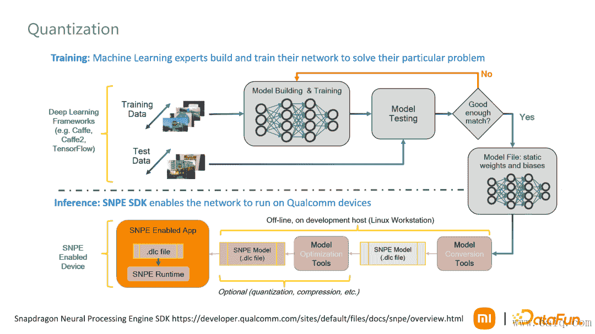

**再进一步介绍目前的向量化模块****。因为对于对话助手，如何应对**离线化或者说线上的性能来降低硬件的成本，降本增效也是要考虑的一个问题。

以上是一个常见的模型量化的流程。这个图来自于高通内部的一个 SDK。training部分对算法开发是一个比较熟悉的流程。

> 以 tensorflow 框架为例， 给定 training data 和 test data， 会得到对应的 model training，在得到对应的模型文件以后，训练部分就已经完成。在 inference 阶段，通过一个模型的量化（model 的 conversion）把模型的参数进行量化，比如说量化到 int8 等等，然后再保存成对应模型的 inference 模型参数，再给到 server 进行服务。这是目前常见的量化流程。

首先， 先介绍下目前常见的一些量化的方式：

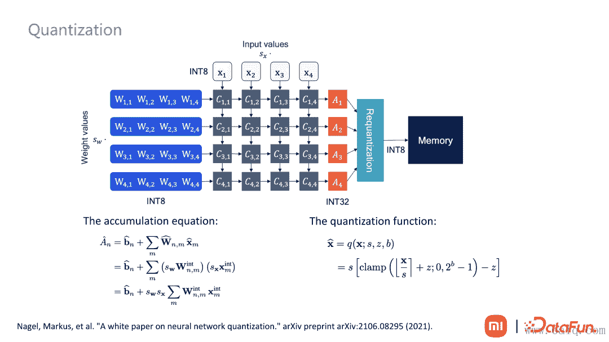

**第一种是最简单的矩阵相乘的方式**，上图是一个例子。

> 比如说现在考虑整个 dense 层是一个 W 乘以 X 。先对模型的权重进行量化

> 比如说模型变成 int 8 的量化。同时对于输入的 input values，也考虑 int 8的量化。量化完以后，他们的输入都是 int 8 的格式，他们相加以后会变成 int 32 的格式，然后通过重采样重量化把它变成 int 8，继续给下一层的模型。

**具体**的公式拆解，假设现在权重是 W 乘 X，通过量化以后得到一个尺度 Sw，对应的是模型权重的尺度。 Sx 是激活值的一个尺度，把这两个尺度给移出来。就是一个量化后的模型和激活值的相乘，对应的尺度就变成一个数值。

那给定对应的一个尺度函数 S，现在输入一个 input X，除完以后，对应地做一个 round，把它做最优的相似数值的邻近，同时再加一个偏差 Z， 然后把它映射到对应的 0，到 需要的量化的数据范围。假设 是 8bit 量化，它就是 0 到 2 的 8 次方减1，就是 0-255 这个范围，然后把它进行量化。量化以后进行复原，要再减去它的一个 Z， 就是一个 offset 再乘以对应的 S，就变成了一个复原。这就是一个最常见的权重的量化和激活值的量化。

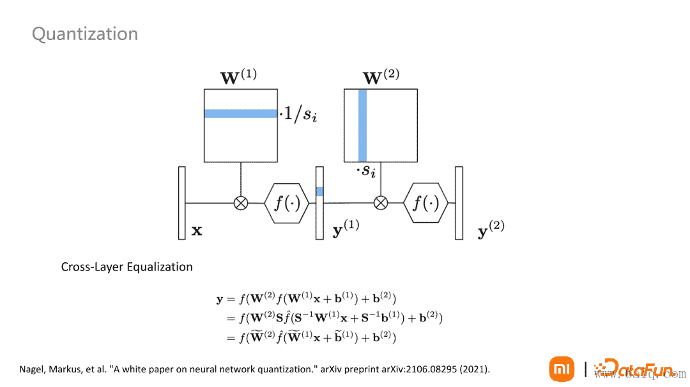

对于一个神经网络，在进行量化的时候也有一些常见的预处理方式。

> **比**如图上所示就是连续的两个 dense 层，输入了一个 X，它先通过一个 dense 得到了中间的模型聚合值。然后又通过了一个模型的 dense 得到了一个聚合值。理论上考虑量化过程中的误差的传递，可以把两层W有的尺度进行一个融合。比如说考虑 W1 中间的某些激活的值过大，可以把它先 scale 的采样，把尺度先缩小，防止 outlier。然后把对应的尺度 S1转移到下一层，也就是 W2。通过这样 Cross-Layer 的规划，可以保证 模型在量化的过程中，它的量化误差是最小。

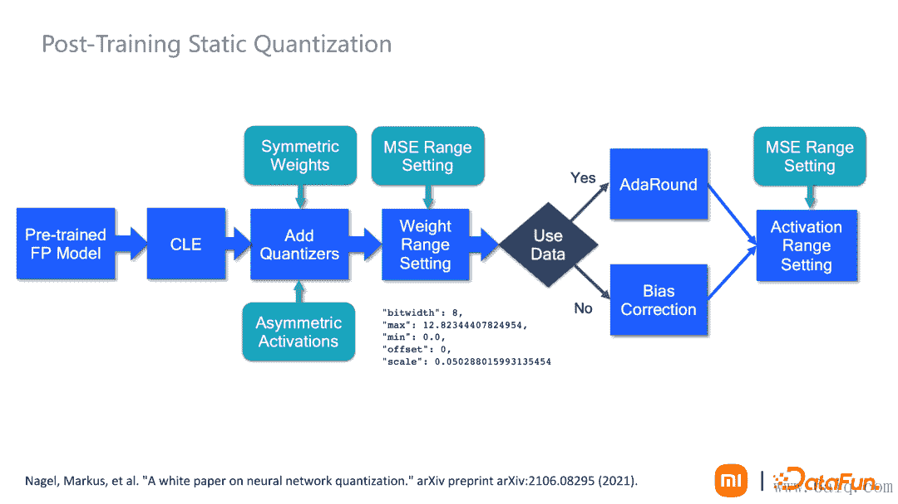

上图是一个常见的整体的量化流程。对于一个训练好的模型， 重点介绍训练后的量化，经过刚提到一个 Cross-Layer Equalization，对模型间的权重进行平衡，然后增加一些对应的量化算子。

上下两部分， 对权重做对称化的一个量化。而针对激活值，考虑到模型的激活值的动态变化，一般是做非对称的量化。然后给定一个量化的范围，进行 MSE 最小均方误差的计算，得到最大值、最小值和 offset。

**底下就是一个例子，通过权值量化以后，**还会用**一些数据进行 vali**dation。如果有 validation 数据，可以对中间的一些 bias 进行进一步校正，来得到更好的权重 range。同时也会对激活值的 range 做一个设置，而激活值的量化方式和刚提到的权重的量化方式一样的，给定一个最大和最小值，以及权重 offset，这是目前常见的量化方式。 内部对主流的 Bert 和 线上的一些业务都做了 int 8 的量化。目前的量化方式都取得了比较好的效果，相对于线上来说并没有太大的损失。

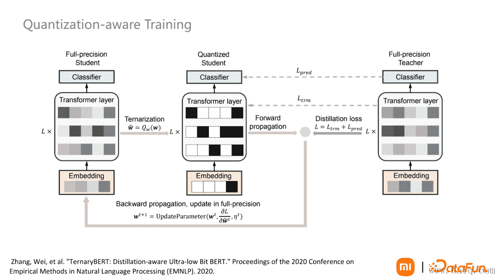

# ** Self-Learning**

**对于离线部分， 怎么更好地进行一个自学习 self l**earning，自学习到底是要学习什么？

## **自学习的错误类型**

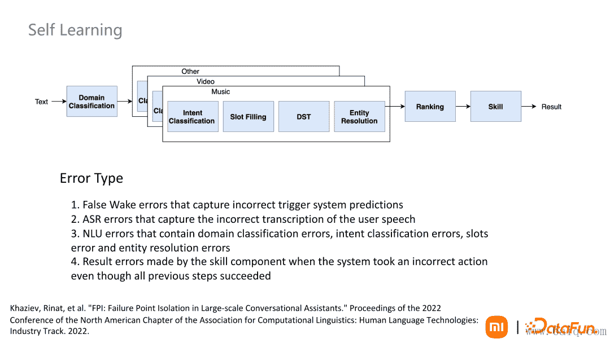

+   ** 先做问题的**定义，对于一个语音助手，首先第一个就是误唤醒的错误， 错误的认为用户唤醒了这个语音助手，这是一个错误。

+   第二个就是** ASR 的错误**。由于错误地识别一些用户的语音口音，导致 的文本出现错误，也就是字错， 认为是一个 ASR 错误。

> 对于 NLU 内部，其实包含了更多的错误，比如说领域的识别错误，意图的识别错误，槽位识别错误或者实体链接的错误。然后更进一步就是虽然 前面 123 都对了，在执行的时候，由于系统的问题导致出错。在这些定义的基础上， 定义一个自学的方式，能够学习到系统中的这些错误，尤其是 ASR 和 NLU 的错误，来优化 对话过程中的各个模型。

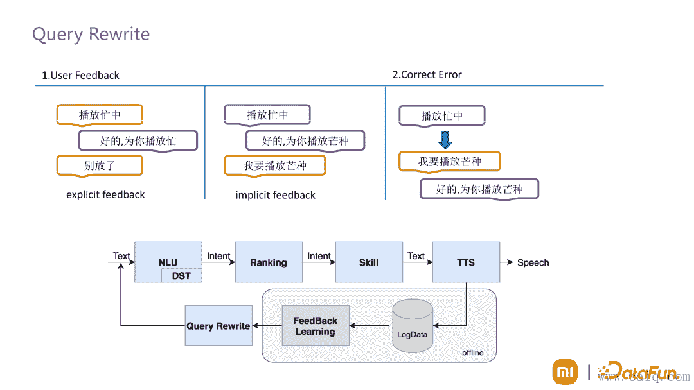

**这**里简单介绍一下，一个基于 query writer 和 user feedback 的方式。什么是 feedback？

+   **一个是显式的用户反馈，**用户说：播放忙中，由于 ASR 错误导致，系统说：为你播放忙，这是一个很严重的错误，最后用户就说别放了。对于音乐类来说，你在播放完歌曲以后的 30 秒内马上就被用户打断，其实这是一个非常明显的用户反馈。

+   **另外一种就是隐式的反馈，**比如说播放忙中，然后用户进一步的进行修正，说我要播放“芒种”，这样的一个修正行为其实是一种隐式的反馈，它可能就是之前播放的内容不对或者有问题。结合这样的显示的和隐式的反馈， 希望能自动地纠正这样的错误。当用户后续再说播放芒种的时候，可以正确地知道用户是要播放芒种，然后正确地播放出来。基于这样的设计， 会离线地挖掘线上的用户的显式行为和隐式行为，构造一个 feedback learning。

**feedback learning 通过挖掘用户过往 60 天甚至 90 天的几十亿级**的交互对话来分析用户的这种跳转的概率，得到一种最优的 query 的推荐或者改写。对于这一套 query 的挖掘， 直接把它变成了一个线上的改写机**制。 偶尔发现这种高置信度的que**ry的时候，直接对用户进行改写，来保证用户的指令虽然包含一些 ASR 错误或者 NLU 错误， 对文本改写以后保证后面的系统能够执行。这是一种 query 改写的方式。但是对于这种直接的 query 改写，它的泛化性是比较差的， 希望能有一些模型提高泛化，更好地自动挖掘这样的数据。因此 在 query 改写的基础上，利用挖掘的数据也训练了矫正的模型。

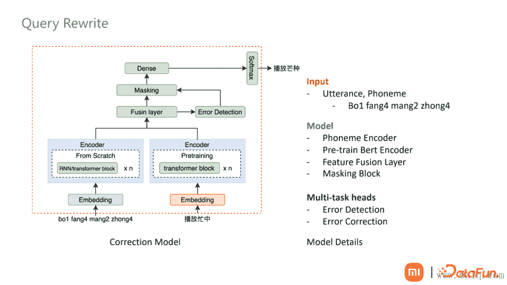

**对**于矫正的模型，其实它也是类似的， 输入一个用户的 Utterance 以及用户的发音，分别通过对应的 encoder 来进行错误的探测。

判**断这个话有没有**错，如果有错，错的**位置是在哪**里。通过 error 探测以后，它的位置会和 feature 做一个 masking， 然后通过一个 dense 层得到整句的特征。在每个句子每个字的基础上，再进一步的判断是否要进行改写，或者要改成什么样的词或者字。

**目前这**个模**型还是在初步阶段，可以看到它对****现在的输入**要求是比较严的，因为它输入输出长度必须是一样的。 现在还不能进行一些增删的操作，只能进行改。后续这样的错误探测模型，也是未来的一个研究方向。 希望有模型能自动地挖掘线上的这些错误，挖掘完错误以后进行这种统一的改写。改写完这样的数据也能统一地变成 label 数据，进入到数据库来提高整体系统的鲁棒性和模型的效果。

这两部分就是目前 内部正在探索的一些自学习的方式，如何更好地用用户的行为反馈来修复 ASR 错误，同时训练一个反馈的模型来挖掘用户的错误并变成 label 数据，加入到整体的数据库来提高整体的效果。

以上就是目前小爱内部常见的 NLP 技术和业界的一些做法。