# 📕高时效推荐系统背后的秘密

> 来源：[https://qqs7y1hozd1.feishu.cn/docx/Tblhdm27MoZO6axjNVEcCjctnzK](https://qqs7y1hozd1.feishu.cn/docx/Tblhdm27MoZO6axjNVEcCjctnzK)

> **在📕APP中****，**推荐系统的实效性对推荐效果有着特别重要的影响，特**别是作为 UGC 平台，📕的推荐系统如果能更快地捕捉用户与笔记之间的变化和**联系，就能够给推荐带来更好的效果。在2021年上半年，📕首页推荐的召回、粗排、精排的主要模块都保持在天级更新的状态，通过持续迭代，将召回 CF 渠道、召回索引更新、召回模型/粗精排模型的训练都做到了分钟级更新，为首页推荐的分发效率带来飞跃式提升，并给业务侧带来非常显著的收益

# 为什么做📕推荐系统的高时效更新

**📕站内“最近一天内发布的新笔记”在首页的曝光占比一直很**高，这段时间更是快速增长，几乎占到了一半

**不过，也经常会有这种情况出现：**

+   用户发了笔记后，过了大半天浏览量却还停留在两位数

1.  这种现象给部分的笔记创作者带来的困扰

> 要想帮助这些内容快速形成滚雪球的效应，就得尽早地让推荐系统理解这些内容到底在哪个赛道上、质量是什么水平、谁可能感兴趣等问题

1.  推荐系统时效性提高后，就可以更快地学习到这篇笔记的信息，从而更快地将这篇新笔记分发给合适的人，在更短的时间内获得用户的正向反馈

1.  同时，发布笔记的作者也会因此受到鼓舞

‍‬⁢‪⁢一个用户刚刚对一篇笔记产生了交互行为（点赞/收藏等），这代表用户对这篇笔记是有兴趣的。如果这个兴趣还是用户在刷📕的历史行为中从未出现过的，这代表一个用户新的兴趣出现。推荐系统时效性提高后，这个兴趣会更快地被推荐系统学习到，那么在用户继续向下刷的过程中，推荐系统可以以很快的速度推送和这个兴趣相关的其他笔记，从而提高用户的个性化体验。⁢‪⁢

‍‬⁢然而📕在推荐系统中最重要的召回/初排/精排模块的时效性还停留在天级，也就是一天更新一次，‍‬⁢‪⁢ 新发布的内容一天有一次上车的机会，错过了就得等明天，今天的笔记就只能和一些不那么合适的用户凑合着过了⁢‪⁢ 。⁢‪⁢

**因此， 决定分阶段地对排序、召回模块进行高时效的改造。具体地，排序模型首先经历了从**天级别到小时级，进一步到分钟级的升级；后续在召回模块中 也进行了全面的时效性升级

# 先头部队一排序模型：**从天级到小时级**

**排序/召回模型应用链路**

+   **推荐系统的时效性牵扯面极其**广泛，排在第一位的自然是排序部分

+   精排模型作为试点项目，经历了最初探索式的天级到小时级的迭代，以及突破式的分钟级升级

+   右图描述了一个典型的排序/召回模型从数据生产开始到最终应用的链路，主要分为数据流/离线训练/线上推理三个部分

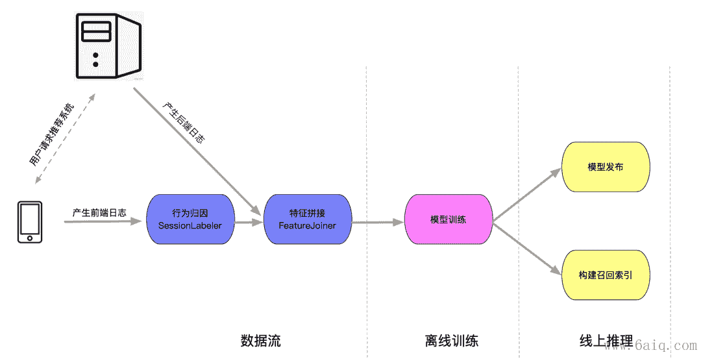

> 模型时效性的提升在每个模块中都面临巨大的挑战：

> ✅ **行为归因⁢‪⁢**

> 传统的做法往往会在 item 展示后等待30min左右的时间来收集交互 label，这使得分钟级别的模型时效性成为一大难题

> **✅ ****特征拼接**

> 需要解决快速 join 归因完的前端日志及后端日志，并低时延地送给后续流程

> **✅ ****模型训练**

> 实时化的训练方式往往会面临效果不稳定/模型不鲁棒等问题

> **✅ ****模型发布**

> 动辄几百个节点的大规模推理服务如何在保障稳定性的前提下低时延地同步训练结果也是一个极具挑战的工程问题⁢‪⁢

**在升级到小时级别的第一阶段中， 快速对齐了一版可进化的方案，在数据流上核心保证的是链路 SLA 以及实时化，在模型训练上研发了**实时化的训练方式以及鲁棒性相关的策略，在模型发布层面也推倒了原先全量重启的方式趟出了 PS-worker 分离发布的架构

-

模型训练：整体 AUC 提升巨大但存在波动

从一天训练一次改为一小时训练一次的模式， 在增量测试中发现，AUC 可以提升接近1个百分点

> 但是偶尔也会出现效果下滑甚至不如基线的情况。在多轮实验验证下， 发现全连接网络比较容易受到一天中数据分布 bias 的影响，而训练实时化的收益来源却大部分来自 sparse embedding 的更新。

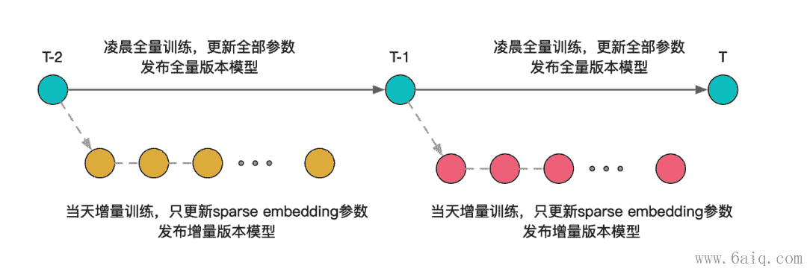

> 因此📕尝试了一种 base+ 增量模型的方案：

> ✅ **base 模型**

> 与传统的天级训练一致，每天凌晨训练前一天完整的数据

> ✅ **增量模型**

> 基于当天跑出来 base 模型，继续一小时一次训练今天实时的数据，但固定全连接网络参数不更新，只更新 sparse embedding

> **此**外， 的全连接网络中还包含了 BN 层，这里📕也发现 BN 层也需要和全连接网络同时固定才能达到最佳的鲁棒性

# 精益求精一排序模型：从小时级到分钟级

从小时级别到分钟级别的跨越，在业务收益上，收窄是可预期的，因为一小时内发布的新内容的曝光量占比大盘有限。但还算不低的预期收益 +show muscles 的技术能力促使了 快速将分钟级更新提上议程，

在每一个上述模块上，做了进一步的优化：‍

+   行为归因：如何跳过传统的固定半小时左右的等待窗口？‬⁢‪⁢

基于📕的业务场景， 引入了额外的提前下发样本的逻辑

> 通过提前判断用户是否已经结束了对当前笔记的消费， 跳过了大部分无谓的等待时间。具体逻辑为当用户在双列上进一步产生了一定数量的曝光或者下拉刷新时，则提前下发当前样本，否则依然沿用原策略。

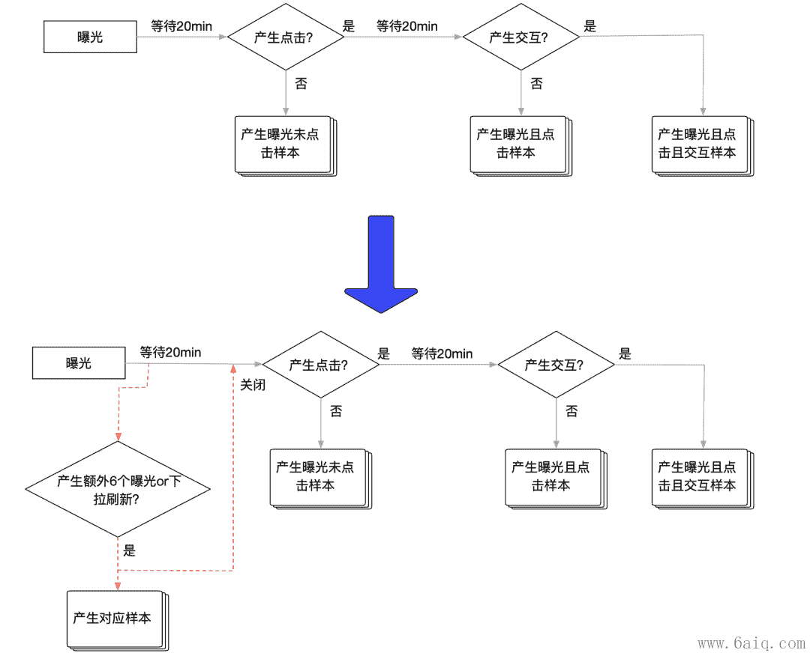

+   模型训练：按时序的训练方式存在稳定性问题？

**更实**时的训练方式，就无法再依赖传统的 shuffle 数据的手段带来的稳定性，相比传统的 shuffle 数据再训练的模式，纯实时的模型训练往往会面临 pcoc 波动较大的问题。

> 在实验过程中， 也观测到了一个现象：经常在小时整点刚开始的时候 pcoc 容易产生偏差。通过深入的分析研究， 定位到原因是因为整点前后的数据分布存在一定差异：由于样本提前下发的逻辑，负样本一般会比正样本更早下发，因此如下图所示请求发生时间在9点的样本 ctr 会显著低于来自8点的样本，而模型中的小时特征就会吸收这部分错误的信息。解决这类问题的方式就是在实时训练的过程中停止这类特征的更新，只依赖天级别模型提供的信息。

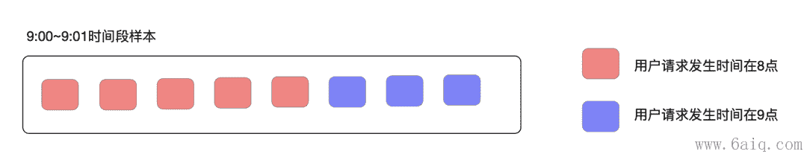

+   模型发布：高效且鲁棒的实时更新模式？

在模型训练过程中 会维护一个需要发**布的队列，**每隔1分钟将队列中所有参数发布Kafka

此外，1小时导出一次文件的逻辑仍然保留，同时会增加对应的 Kafka offset，主要用于稳定性保障，可以支持离线训练重启时，线上 PS 自动从最近的一个小时级文件重启；也可用于线上 PS 发版时减少 Kafka 数据的消费量。

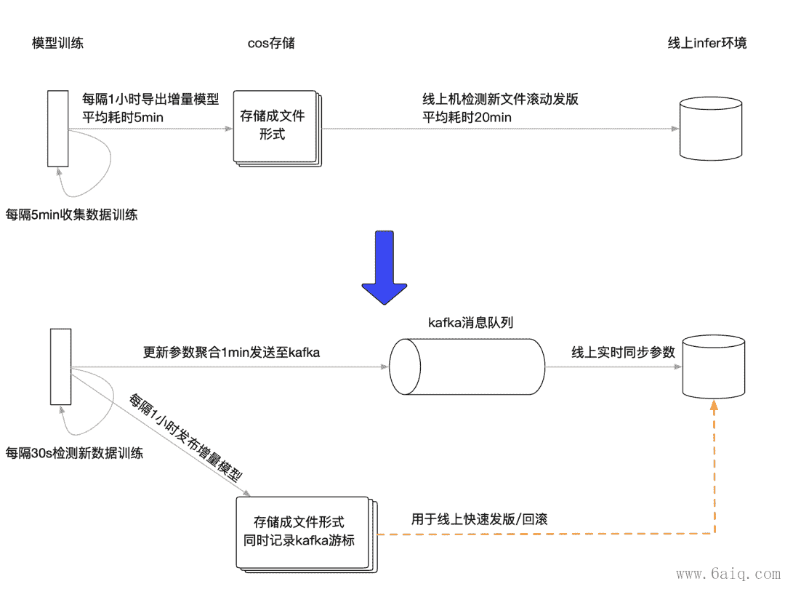

以下是整个改造工程前后每个模块的延迟数据对比：

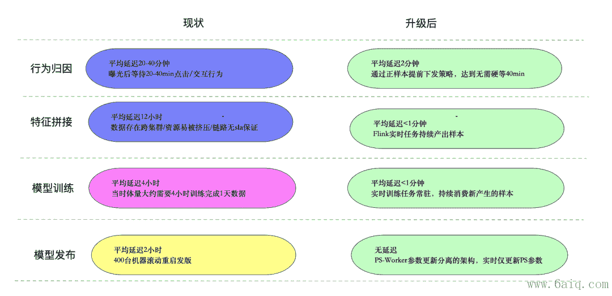

# 全面提升-召回模块：**突破瓶颈**

对**召回来说，在初精排都已经达到分钟级更新的状态下，召回模块已经变成了整个推荐系统**达到高时效性的最大瓶颈。但相比排序来说，召回模块显得更繁杂，打个简单的比方，‍‬⁢‪⁢ 如果提升初精排模型的时效性是在带两兄弟上大学的话，那提升召回模块的时效性就是在带一个班级考大学。⁢‪⁢

> 在项目启动之初，📕召回模块的状态如下：

> **✅ 点召回**

> **包**括根据内容理解属性构建的新笔记倒排和根据用户属性构建的精选笔记倒排，其中前者已经能够做到分钟级更新，后者为小时级更新

> ✅ **协同过滤召回⁢‪**

> **包括 i2i、u2u、a2a 等**多种类型的召回渠道，全部处于天级更新状态，u2i2i 这种依赖 u2i 的高阶版 i2i 召回能力更是尚未建立

> ✅ **模型召回**

> **主要指 u2i 类型的模型召回渠道，同时 u**2i 线上召回依赖向量检索服务(ANN)。其中召回模型训练和更新的频率当时也是天级，而全量可分发笔记索引更新的时效性停留在天级，新笔记索引更新的时效性在小时级，因此整个模型召回渠道的时效性也停留在天级。

> ✅ **图召回**

> 主要指基于 GNN 技术构建的召回渠道。在项目开始之前曾实现过天级的版本，但效果不理想

‍‬⁢可以看出，除了少部分召回渠道外，其他大多的召回渠道均处于天级更新的状态，所以召回模块成为整个推荐系统达到高时效性的最大瓶颈。由于上述不同的召回渠道的原理不同，想要升级成分钟级更新需要的技术栈各不相同，有些升级甚至对整个工程体系架构都提出了很高的要求。召回组的同学一步一个脚印，花了将近一年的时间，将上述渠道逐步全部变成了分钟级更新的状态，使得高时效性的推荐系统最终成为可能。⁢‪⁢

## 整个过程分为三块进行

### **CF召回实时化**

+   CF 召回，即协同过滤召回，是召回算法领域的一个经典算法

**就📕的场景来说，算法的思想就是很多用户同时看过的笔记/作者之间通常会比较相似** (i2i/a2a)，看过很多相同笔记/作者的用户之间也会比较相似 (u2u)，所以算法的核心动作就是统计不同笔记之间/用户之间/作者之间的共现次数。标准的 CF 算法通常是天级频率更新，这样离线的计算流程和代码实现都比较简单。但这样做就导致无法快速的学习用户的实时兴趣。

**以****OnlineSwing** 为例，标准 Swing 算法的公式如下：

**其中 Ui 表示看过笔记 i 的用户集**合， Iu 表示用户 u 看过的笔记集合

**相比传统的****ItemCF**** 算法，****Swing 的主要区别在于引入了不同用户**** ****pair ****的****贡献度，对****于****同时看过笔****记**** ****i 和笔记**** ****j 的用户 u 和用**户 v ，两个用户同时看过的笔记越多，则对笔记 i 和笔记 j 的相似度的贡献越低

由于引入了二跳关系，且📕的活跃用户数和可分发笔记数是比较大的，因此在📕的场景下跑天级 Swing 算法的资源消耗非常巨大

而从另一个角度来说，即使天级 Swing 能够跑得起来，也无法得到用户的实时行为，从而无法捕捉到用户的实时行为信号，综上，将 Swing 算法升级为实时化更新是非常有必要的

**因此📕对算法做了改造，将天级 Spark 任务升级为分钟级 Flink 任务，并结合任务特点在中间存储环节选取**了公司自研的 KV 存储 RedKV，保证了任务的效率和稳定性，最终以比天级 Swing 更少的训练资源拿到了更大的收益

**OnlineSwing****整个架构设计如图：**

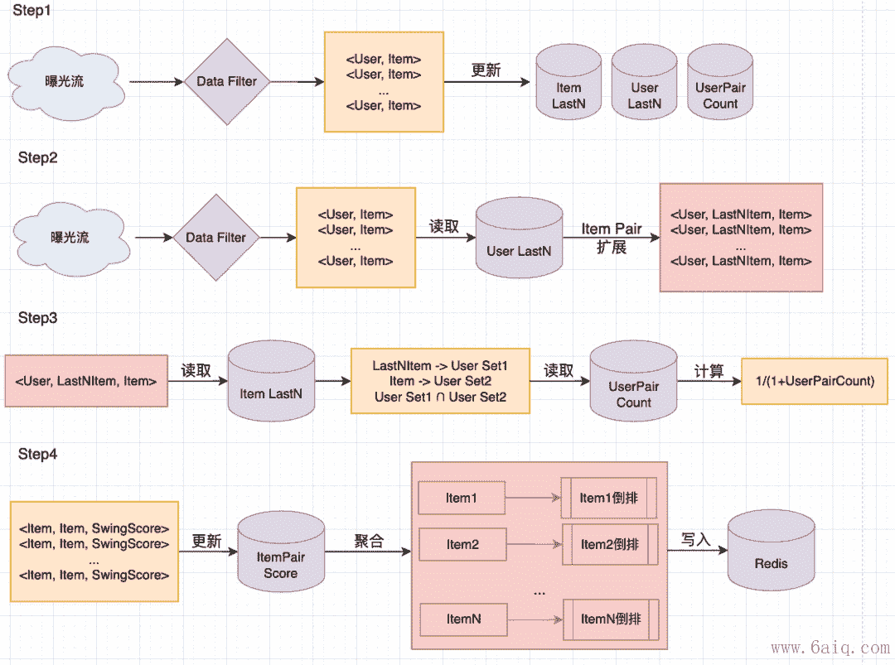

仿照此思路， 将所有的 CF 渠道都进行了升级，从而将 CF 类召回的时效性全部提到了分钟级

**此外，在 Swing 升级到实时化后， 重新尝试了图召回算法。**** 将实时 Swin****g 的倒排用在了异构图GraphSAGE 召回渠道的建图阶段，使得图**中笔记与笔记之间连边也能够做到实时更新，并通过分布式 GNN 框架进行训练，使得图召回模型的能力得到了有效发挥并最终落地

### **召回模型训练更新实时化**

与初精排类似，u2i 模型召回要达到实时化更新，首先需要有一个高时效的模型被训练出来。

**召回模型的训练框架采用了和初精排一样的框架，但和初精排不同的是召**回训练数据通常由多种类型的样本组成，因此实时数据流的 Flink 任务复杂度更甚

以 **DSSM** 模**型召回数据流**为例，正样本提取、曝光负样本采样、召回未曝光样本采样( 称为纯负样本)以及三者按比例 union， 经过大量的 Flink 流式任务改造，最终将召回模型训练样本同样做到了实时化，如右图所示：

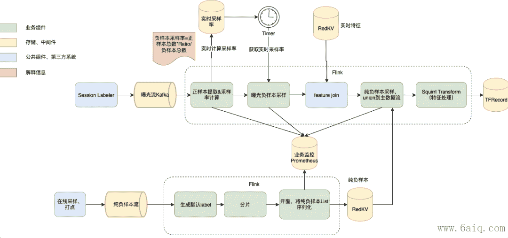

目前召回模型已经完成序列化建模、多兴趣建模、Session 图建模、对比学习建模、EE等多种兴趣建模和多种负采样方式的落地，均达到分钟级更新的能力。

另外在📕复杂召回技术的探索过程中，也处处体现着对高时效性的追求

> 以 LR 召回和近线召回为例（包括但不限于这两种召回，更多的前沿召回技术也在持续调研和落地中）

**◇ ****LR 召回**

LR 召回为模型版的 i2i 召回策略，LR 模型更新同样采取了分钟级更新的框架，实时的将模型的最新 PS 推送至 model converter 实现倒排的快速更新

**◇ ****近线召回**

最开始是为了凌晨闲置资源的高效利用，后续为提高该渠道的时效性以及闲置资源的利用率， 将模式改为在线异步计算，将近线扫库使用的模型升级为更复杂的模型，同时将 CPU 升级为 GPU，实现了近似实时全量扫库的效果。

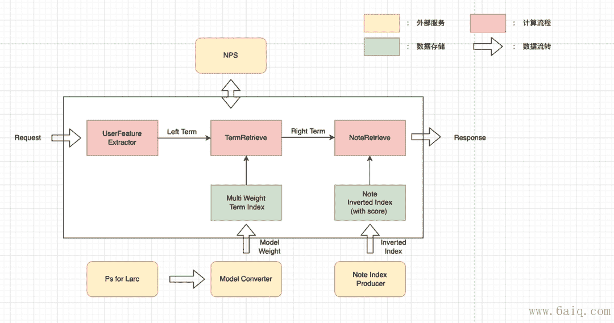

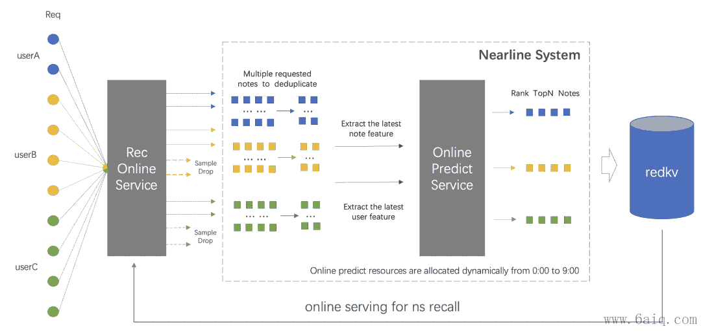

**最后值得一提的是，后来📕还引入了 u2i2i 这**种 u2i 和 i2i 相结合的召回渠道

这种召回分为 u2i 和 i2i 两阶段，由于 u2i 和 i2i 都具备了快速更新的能力，使得 u2i2i 召回也做到了分钟级更新

### **向量检索服务实时化**

**模型召回包括召回模型训练和索引构建两阶段，因此做到实时化还需**要进行索引构建和更新也达到分钟级的时效性。⁢‪⁢

> **ANN**，全称近邻检索服务，是用在向量召回场景的一种特殊的服务。向量召回模型通常是以双塔的形式存在，即一个 User Vector 的预估塔和一个 Item Vector 的预估塔，分别预估用户和笔记的高维抽象表达，两个向量通过余弦相似度/内积等方式来衡量两者的相似度。

> 如果一个用户对一个笔记产生了正向行为，则两个 Vector 也应该比较相似，反之亦然。而向量召回模型在线上 serving 时，面对海量的候选笔记池，是无法做到实时全库暴力计算的，ANN 正是为了解决这个问题而出现的。ANN 的功能在于，离线部分将所有笔记的 vector 组织成一个索引发布到线上，在线部分通过 User Vector 对该索引进行检索得到最相似的笔记作为返回结果，而这个索引是通过一些特殊的算法进行构建的，可以将检索的速度提升到 ms 级，从而满足线上请求的实时性。⁢‪⁢

从上面的描**述可以看出，**ANN 服务涉及到离线笔记id获取、笔记特征获取、笔记 vector 预估、离线索引构建、索引发布到线上、在线 serving 这几个流程，老版本的 ANN 服务全量笔记完成一轮更新需要12个小时左右。想要将这个服务做到分钟级，需要将上述每个环节都做到分钟级甚至秒级的程度。最终，在大家的通力合作下，攻克了一个又一个难题，成功的将 ANN 做到了分钟级，小红时内部称之为RedANN

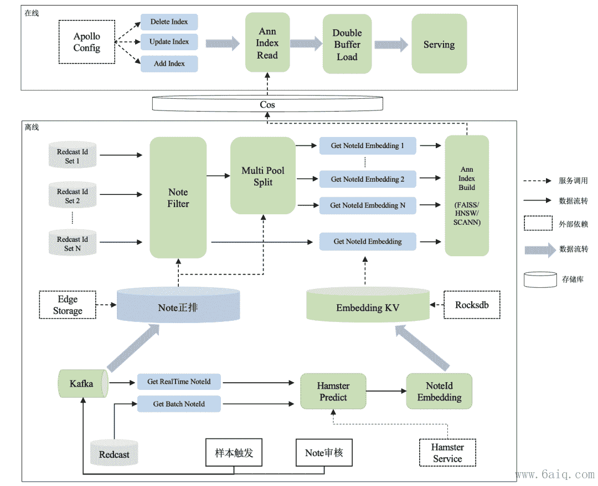

> **此次升级包括以下方面：**

+   **整个服务 C++ 化**

> 原有 ANN 离在线服务主要通过 Java 实现，只有底层检索库采取了 C++ 实现，本次升级将离在线服务改为纯 C++ 实现，提升服务效率。

+   **离线规则引擎升级**

> 自带实时正排(EdgeStorage)，并支持自定义过滤&分库功能，供业务方定制化使用。

+   **检索算法升级**

> 除 **HNSW**外，支持多种业界先进检索算法（包括目前工业界表现最好的 ScaNN 检索库），供业务方自行选择使用。

+   **时效性升级**

> 将全量索引更新时效性提升至10min内，将天级小时级索引更新时效性提升至1min以内。从笔记 id 出现到进入索引一共经历三个阶段：

1.  **笔记 id 获取**

> 采取 Batch 和 Realtime 相结合的方式，Batch 是指每隔一段时间获取全量可分发笔记，从公司内部自研的分布式 p2p 数据传输服务 Redcast 获取；Realtime 是指新笔记或笔记状态发生变化的笔记，从 Kafka 获取

1.  笔记 embedding 生成和存储

> 走独立部署的特征获取和模型预估服务(Hamster)，得到笔记的 embedding，并存入基于 RocksDB 实现的embedding kv

1.  **笔记索引构建**

> 根据规则引擎过滤后的笔记集合，从 embedding kv 中获取最新的 embedding，采取索引构建算法分钟级构建索引上述三个阶段通过三个独立的进程并发执行，达到 id 更新、embedding 生成和索引构建解耦的效果

+   **在线配置化接入升级**

> 之前的在线服务新增索引需要发版，等待时间较久。此次升级中 重建在线服务，支持在线索引配置化接入，同时配合离线模块同步做检索算法升级。

> **升级过程中遇到的困难：**

1.  **纯 C++ 服务**，但📕C++ 基建相对薄弱，需要大量的准备工作，如需要解决非常多的编译问题，很多问题是公司前人从未遇到过的

1.  项目设计之初就将易用性作为最主要的目标之一，希望在业务方零代码开发的前提下支持各场景下的分库&过滤需求。分库&过滤的易用性本就是业界普遍存在的难点，团队成员调研大量业界主流做法和多种胶水语言（Lua、Julia 等），多次讨论后自研基于 Lua 的规则引擎，业务方只需要在配置文件中编写 Lua 脚本就可以基于正排信息做过滤&分库，大幅提升分库&过滤的易用性。由于 Lua 执行时需要开辟栈空间、Lua变量为动态类型等原因导致 Lua 的执行效率比 C++ 慢30倍以上，全库笔记过滤一轮需要 8min 左右，团队成员以更高的标准不断优化，最后将耗时从 8min 左右降到 2min 左右。

1.  **本项目基于 RocksDB 对 embedding 做持久化，RocksDB 原本是为磁盘型存储引擎****设计，上线后全量笔记 embedding 查询需要** 6min，成为全量笔记索引更新达到 10min 以内的目标的最大瓶颈。为了解决这个问题，团队成员对 RocksDB 进行了一系列调优，包括 hash index block 调优 → 内存文件 → plaintable 优化，最终将时延从 6min 优化到 1.5min 以内，为全量索引更新达到分钟级扫清障碍

1.  **ScaNN 是相对较新的检索库，很**难找到业界其他公司公开的成功应用参考案例，接入过程中遇到很多编译问题，如：ScaNN 是基于 Clang 编译，代码与 GCC 编译器不兼容；ScaNN 要求 protobuf 版本不低于 v3.9.2，但公司内的第三方库依赖的protobuf版本都较低，需要同步升级公司内部大量的第三方库。经过耗时一个月的对 ScaNN 的二次开发和封装，解决了各种编译问题，最终成功将 ScaNN 检索算法接入 RedANN 服务