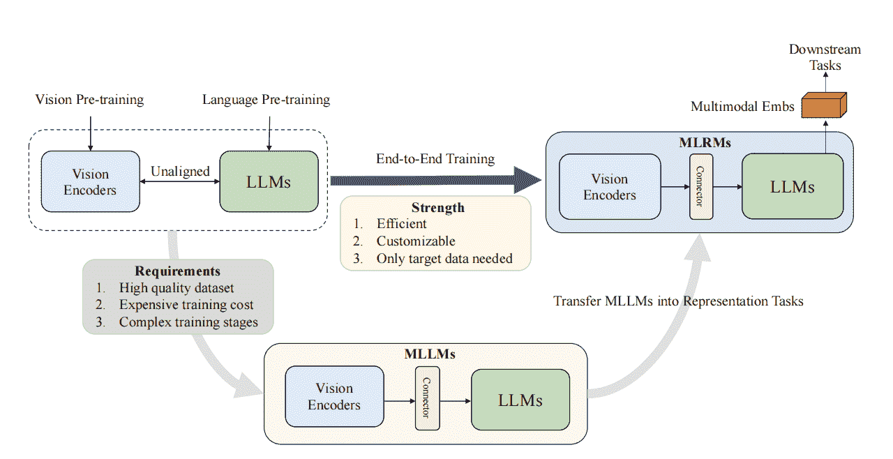
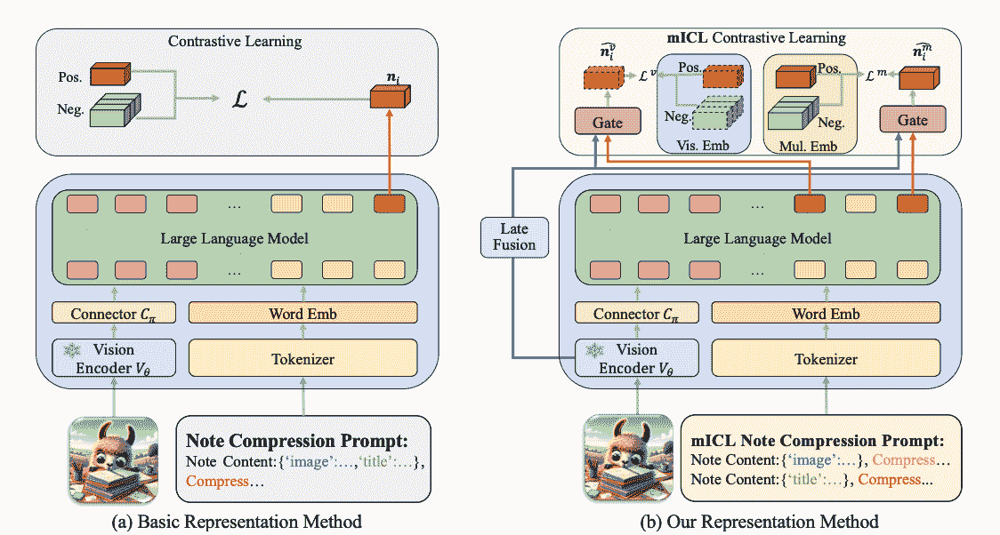
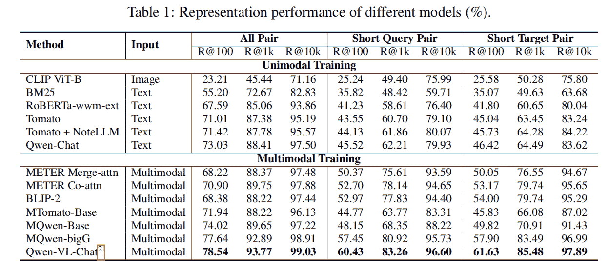
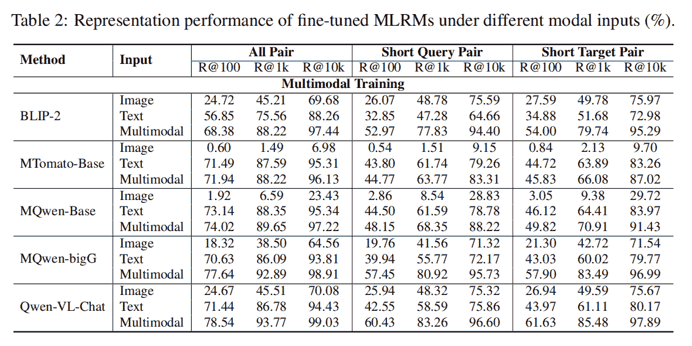
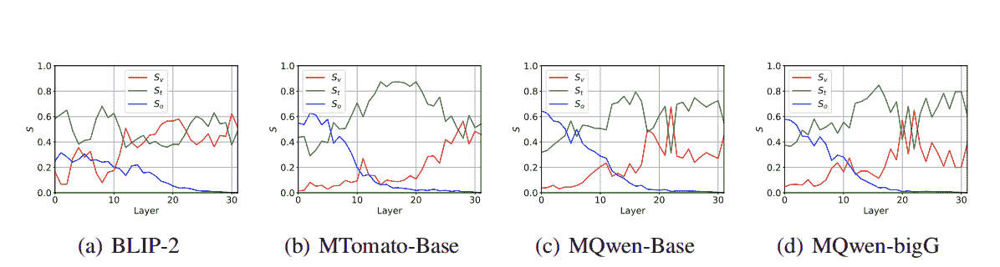
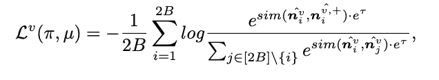
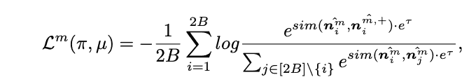
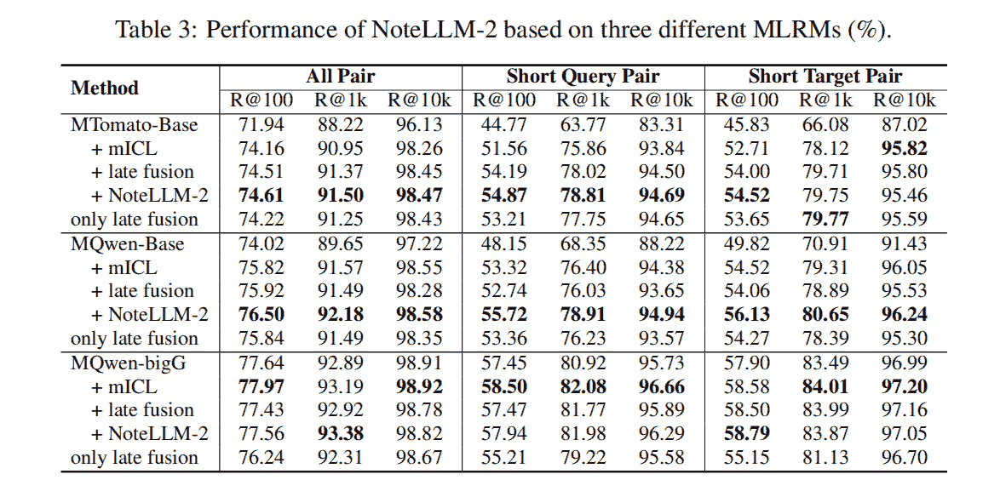
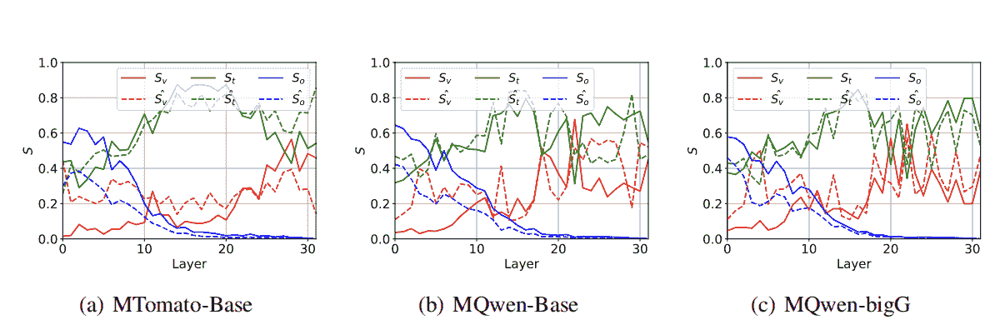
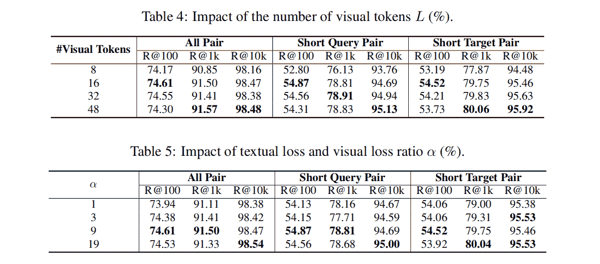

# 📕用于推荐的多模态大模型—NoteLLM-2

> 来源：[https://qqs7y1hozd1.feishu.cn/docx/WusWduvJ2o0eY1xnKxicZzu8n0d](https://qqs7y1hozd1.feishu.cn/docx/WusWduvJ2o0eY1xnKxicZzu8n0d)

> 大**型语言模**型（LLMs）在文本理解方面表现出色，现有研究探索了它们在文本嵌入任务中的应用然而，很少有工作利用LLMs来辅助多模态表示任务

+   **在这项工作中，📕研究了****LLMs****在多模态物品对物品（****I2I****）推荐中增强多模态表示的潜力一种可行的方法是将多模态大**型语言模型（MLLMs）转移到表示任务中

然而，预训练**MLLMs**通常需要收集高质量的、网络规模的多模态数据，导致复杂的训练程**序和高昂的**成本。这使得社区严重依赖开源的**M****L**LMs，阻碍了表示场景的定制化训练。因此，📕设计一种端到端的训练方法，定制整合任何现有的LLMs和视觉编码器，以构建高效的多模态表示模型，初步实验表明，在这种端到端方法中微调的LLMs往往忽视图像内容。

**为了解决这个问题，**提出了一种专为多模态表示设计的新型训练框架—NoteLLM-2

> 提出了两种增强对视觉信息关注的方法：

1.  **第一种方法基于提示视角**

+   将多模态内容分为视觉内容和文本内容

+   **NoteLLM-2**采用多模态内容学习方法，教导LLMs同时关注两种模态并聚合关键信息

1.  **第二种方法基于模型架构**

+   利用晚期融合机制直接将视觉信息融合到文本信息中

+   进行了大量实验来验证该方法的有效性

# 背 景

> **随着互联网的发展，大多数在线平台充满了多模态**信息，以驱动用户参与。多模态推荐对于这些平台来说是必不可少的服务，它基于用户对物品多模态信息的兴趣进行推荐。这些技术主要依赖于多模态表示，将原始多模态内容提取成密集嵌入，然后通过这些多模态嵌入来测量相似性。多模态表示的增强可以从根本上改进许多下游任务，如检索、聚类和物品建模

+   **许多现有的研究已经探讨了多模态表示**，例如CLIP、METER、Siglip

**尽管在这些领域取得了巨大成功，但大多数多模****态**表示模型的参数数量仍具有扩展的巨大潜力，然而，现有的工作主要集中在扩展视觉模型以改进多模态表示，忽视了文本分支。同时，由于缺乏足够的纯文本导向的预训练，多模态表示模型中的文本分支通常表现出对文本信息的次优理解。因此，有必要在多模态表示模型中增强文本理解。

最近，大型语言模型（**LLMs****）在文本**理解和生成方面表现出了令人印**象深刻的能****力。几项**研究表明，LLMs在生成文本嵌入方面表现优越。然而，利用LLMs增强多模态表示中的文本理解仍未被充分探索

**如图所示：**

**一种可行的**方法是将多模态大型语言模型MLLMs

> **用于表示任务然而，预训练****MLLMs**需要收集高质量的、网络规模**的多模态数**据，导致复杂的训练程**序和高昂****的成本**。这使得社区严重依赖开源的ML**LMs，**阻碍了使用最先进的LLMs和视觉编码器进行表示场景的定制化训练。因此，设计一种端到端的训练方法，定制整合任何现有的LLMs和视觉编码器，以构建高效的多模态表示模型

**当目标****LLMs**缺乏**预训练的视**觉组件时，这种端到端方法是实用的，因为它只需要目标领域的数据，消除了预训练数据的收集。此外，可以优化定制的模型结构以适应表示任务，在确保性能的同时实现更高的效率。称这些用于增强多模态表示的模型为多模态大型表示模型（MLRMs）

+   **在这项****工作中，📕探索了****在物品对物**品（I2I）多模态推荐场景中的MLRMs

**进行微调的初步实验，以检验目标**

> **研究结果表明：**

+   朴素微调的端到端**MLRMs**的表示偏向于文本信息，忽视了视觉内容

+   视觉信息主要用于放大多模态内容中的关键元素，而不是被表示直接聚合

+   **为了解决这一挑战，****📕提出了一种新型**训练框架，称为NoteLLM-2，用于多模态表示任务

> 📕设计了两种方法来缓解视觉模态忽视的问题：

1.  **第一种方法是多模态上下文学习（****MICL****）**

+   这**种方法将多模态****内容分为**视觉和文本组件，随后将内容压缩成两个模态压缩词。每个模态压缩词在批内与其对应的模态压缩词进行对比学习。在推理过程中，MICL可以以上下文学习（ICL）的方式聚合多模态信息

1.  **第二种方法是晚期融合机制**

+   大多数**MLLMs**采用早期融合，将视觉特征映射到**LLMs**的文本特征空间，并通过**LLMs****与文本嵌**入进行交互。尽管早期融合可以加深多模态信息的交互，但它在LLMs进行的多模态融合过程中容易导致纯视觉信息的丢失。在早期融合的基础上加入了晚期融合，通过延迟融合过程保留更多的视觉信息

+   具体而言，**采用了多模态门控融合机制**，该机制从视觉编码器和**LLMs**获取视觉表示和文本表示，以生成最终的多模态表示

> **📕的措施：**

+   提出了一种**端到端**的训练方法，定制整合任何现有的**LLMs**和视觉编码器以形成高效的**MLRMs**

+   揭示了微调未对齐的**MLRMs**用于表示任务可能导致模态失衡，忽视视觉**信息。为了解决这个**问题，设计了一个新**框架No****t**eLLM-2其中包含两种机制：MICL、晚期融合

>

#

## **预备知识**

+   **问题陈述**

**在📕的场景中，每个物品代表一个笔记，这**些笔记是由用户生成的，表达他们的生活经历

> 假设N = {n1, n2, ..., nm} 为笔记池，其中m为笔记的数量。每个笔记包含文本信息，如标题、主题和内容，以及图片。将第i个笔记表示为ni = (ti, tpi, cti, vi)，其中ti, tpi, cti, vi分别表示标题、主题、内容和图片

> 给定查询笔记 ，**I2I**推荐系统根据与给定笔记的多模态内容相似性对笔记池N \{ni}进行排序，该系统的目标是优先排序相关的目标笔记

### **数据集构建**

+   按照做法，📕利用共现机制基于用户行为构建相关的笔记对，而不需要人工注释

+   这种机制假设经常一起阅读的笔记可能是相关的

+   然后，统计用户查看笔记 并随后点击笔记 的共现评分，**公式如下：**

> 其中， 表示从笔记 到笔记 的共现评分， 是查看了笔记 并随后点击了笔记 的用户集合， 表示用户 在用户行为数据中点击的笔记集合的数量。

1.  在计算了所有笔记对的共现评分后，构建了从笔记ni到所有其他笔记的共现评分集合

1.  具体而言， 定义为

1.  接下来，从 中去除共现评分高于上限或低于下限的异常值

1.  最后，我们从过滤后的集合中选择共现评分最高的 个笔记作为笔记 的相关笔记

MLRMs的基本表示方法，采用一个明确限制在一个词的提示，将多模态内容压缩成一个嵌入

具体来说，使用json格式来显示笔记内容，提示如下：

> **笔记压缩提示**

> 笔记内容：{’image’:, ’title’: ti, ’topic’: tpi, ’content’: cti}。将这条笔记压缩成一个词：”

> 在这个模板中，****是一个占位符，将被处理自原始图像vi的视觉嵌入所替代

> **总体框架如图2(a)所示：**

+   该框架首先利用视觉编码器 将预处理的图像vi提取为笔记 中的视觉特征 ，其中 是视觉特征的长度， 是视觉特征的维度， 然后，连接器 将视觉特征 转换为LLMs的词嵌入空间，形成视觉嵌入 ，其中 是输入到LLMs的视觉嵌入的长度， 是LLMs隐藏状态的维度，

+   在处理图像后，文本提示被标记化为离散索引，然后形成文本词嵌入 ，其中 是文本标记的长度。为了将视觉嵌入插入到文本嵌入的正确位置，将标记位置的词嵌入替换为视觉嵌入 ，形成多模态嵌入

+   最后，使用LLMs 、 处理多模态嵌入，生成最后的隐藏状态H ∈  ，其中 。我们将 的最后嵌入作为笔记 的表示

> 这种方法限制LLMs将多模态内容压缩成**一个嵌入**，以预测下一个标记的形式，然而，LLMs是使用语言建模损失训练的，这与表示任务有显著差异。为弥补这一差距，采用对比学习，这是一种常用的嵌入训练技术。具体来说，每个小批量包含 个相关的笔记对( )，每个小批量共包含2B个笔记

按照方法，使用梯度下降来最小化对比损失，如下所示：

> 其中 表示可学习的温度，

> 表示我们仅更新连接器 和LLMs  ，而保持视觉编码器 冻结，以获得更大的批量大小和更好的性能。

### 数据集和实验设置

#### **数据集**

+   从平台上获得了一个真实世界的多模态I2I数据集。通过随机选择两周内用户行为数据中的相关笔记对来创建训练数据集。训练数据集中十分之一的对用于验证集。

+   接下来，随机选择下一周的笔记来构建测试集的笔记池，排除任何已在训练数据集中的笔记。

+   然后，统计测试集笔记池中的相关笔记对。训练数据集包含150万个笔记和110万个笔记对，测试数据集包含50万个笔记和21,000个笔记对。

> 为了更好地评估**MLRMs**的多模态表示能力，而不仅仅依赖于文本模态，在测试数据集中收集了包含短笔记的对。将标记长度少于50的笔记定义为短笔记，这大约占测试笔记总数的10%。将包含短查询笔记的对分类为短查询对，将包含短目标笔记的对分类为短目标对。在测试数据集中，短查询对的数量为5,620，短目标对的数量为5,582

#### 实验设置

> 在相关笔记对的构建中，将共现得分的上限设置为30，下限设置为0.01，并将t设置为3。为了保持上下文长度限制，将超过20个标记的标题和超过80个标记的内容进行截断。在微调实验中，为了公平比较，添加了一个线性投影器，将笔记嵌入的维度降低到64。批量大小B设置为128。每个批量包含256个笔记。温度τ初始设置为3。

为了评估**MLRMs**的表示能力，根据查询笔记的内容对笔记池中的所有笔记（排除查询笔记）进行排名。基于目标笔记在排名列表中的位置计算召回率。报告了测试数据集中所有对、短查询对和短目标对的Recall@100、Recall@1k和Recall@10k

### **微调****MLRMs****的多模态表示性能**

**设计了三种端到端的****MLRMs****来检验表示训练方法：**MTomato-Base使用Tomato（基于LLaMA 2持续预训练的LLM，但缺乏视觉感知能力）

作为LLM，CLIP ViT-B [37]作为视觉编码器，随机初始化的Q-Former 作为连接器以提高效率

+   **MQwen-Base在MTomato-Base**中将Tomato替换为Qwen-Chat

+   **MQwen-bigG在MQwen-Base中将C**LIP ViT-B替换为ViT-bigG

> 为了提高效率，将这些模型的视觉嵌入长度设置为16，为了比较，选择了两个预训练的MLLMs：BLIP-2和Qwen-VL-Chat 。所有这些模型中的视觉编码器都是冻结的，以获得更大的批量大小。除了MLRMs，还比较了其他现有的多模态表示基线

> 结果上表所示可以得出一些有趣的观察：

+   首先，基于LLMs的MLRMs可以显著优于现有的基线。Qwen-VL-Chat在所有对的R@100上相比传统方法METER Co-attn提升了10.78%

+   其次，端到端训练表示方法可以增强模型的多模态表示能力。MQwen-bigG在所有对的R@100上相比Qwen-Chat提高了6.31%。然而，当视觉编码器较小时，如CLIP ViT-B，多模态感知的提升并不显著。MTomato-Base相比Tomato在所有对的R@100上仅提高了1.31%，MQwen-Base相比Qwen-Chat在所有对的R@100上仅提高了1.36%

+   最后，尽管MQwen-bigG比使用相同视觉编码器和LLM的Qwen-VL-Chat更高效（见附录E.3），但仍存在性能差距

**📕还在**不同模态输入下评估了所有微调的MLRMs

**如表所示：**当输入仅由图像组成时，MTomato-Base和M**Qwen-Base**几乎无法表示图像内容，表明忽视了视觉信息

由于其更强大的视觉编码器，MQwen-bigG表现出优越的视觉表示能力。然而，与经历过多模态预训练的BLIP-2和Qwen-VL-Chat相比，其性能仍然不够理想

### 探索微调MLRMs的偏差

**为了进一**步挖掘微调MLRMs中的偏差，📕探索了不同LLMs层中两个模态标记的注意力模式

按**照的方法，采用显著性**分数来分析压缩词与注意力矩阵中两个模态标记之间的交互。从训练数据集中随机选择10,000个笔记进行批量统计显著性分数，计算显著性分数如下：

> 其中， 表示第 层第 个注意力头的注意力矩阵值， 是对比损失。我们对所有注意力头求和，以获得第 层的显著性矩阵 。 表示从第 个词到第 个词的信息流的重要性。为了分析不同模态对压缩词的重要性，我们将 分为三个部分：

> ：从视觉嵌入 到最终压缩位置 的信息流的平均重要性

> ：从文本嵌入 到最终压缩位置 的信息流的平均重要性

> ：所有词之间的信息流的平均重要性，排除 和 的影响

显著性矩阵三部分的结果如图所示：

端到端训练的MLRMs在浅层中表现出较低的 和较高的 ，而预训练的MLLMs，如BLIP-2和Qwen-VL-Chat，在浅层中 和 更加平衡

> **这表明：**

+   端到端训练的**MLRMs**主要利用多模态数据的信息增益来增强上下文中的信息流。这些模型中的图像主要辅助信息流以识别关键信息，而不是被表示直接聚合

+   端到端训练的**MLRMs**中的文本信息流显著超过了视觉信息流

#  方法论

> 通过调查，发现端到端训练的**MLRMs**由于**LLMs**处理后忽视了视觉信息，表现不尽如人意，因此，在设计更加关注视觉信号的机制

> **提出了一个新的训练框架****NoteLLM-2**，该框架包含两个来自不同角度的方法：

1.  **第一个方**法是从提示视角出发，称为MICL

+   这种方法通过改变提示来调整注意模式，使其更加关注视觉信息

1.  第二个方法是从模型架构角度出发，结合晚期融合和视觉提示

+   通过延迟视觉信息的融合，增强视觉信息流对最终表示的影响，改进后的整体框架如上图2(b)所示

具体来说，给定笔记 ，**MICL**机制并不尝试将多模态信息压缩成一个压缩词。相反，将多模**态笔记**分为两个单模态笔记。然后，采用类似ICL的方式来聚合多模态信息，重新制定了笔记压缩提示如下：

> **MICL****笔记压缩提示：**

> 笔记内容：{'image': }，将此笔记压缩成一个词："<IMG_EMB>"。笔记内容：{'title': ti, 'topic': tpi, 'content': cti}。将此笔记压缩成一个词："

> 在这个模板中，**<IMG_EMB>**是一个特殊的标记

+   **在使用****LLMs**处理多模态嵌入后，选择相关的隐藏状态来表示笔记

按照方法，将<IMG_EMB>标记的**前一个隐藏状态作为**视觉笔记表示，记为 。由于因果注意力机制， 仅包含笔记的图像信息。最后一个隐藏状态作为多模态笔记表示，记为 ，它可以压缩视觉和文本信息。

这种方法将原始的单一嵌入分离成两个模态笔记嵌入。多模态笔记表示 以类似于ICL的方式聚合有用的视觉信息

+   晚期融合机制采用原始视觉嵌入来增强笔记嵌入

这防止了由于**LLMs**空间造成的文本偏差，并结合了更多原始视觉信息

**具体来说：**在通过视觉编码器Vθ提取图像特征后，获取包含整个图像信息的视觉特征，例如CLIP ViT-B中的[CLS]标记。然后，使用线性层将这些特征转换为LLMs的维度，记为

采用相同的门机制将原始视觉信息融合到两个笔记嵌入中：

> 其中 和 表示融合后的笔记嵌入。[·, ·]表示拼接操作， 和 是可学习的参数。⊙是元素乘积

+   接下来，采用两个融合后的嵌入进行对比学习，如下所示：

> 其中 是来自视觉笔记嵌入的损失， 是来自多模态笔记嵌入的损失

**最终损失计算如下：**

> 其中 是最终损失， 是一个超参数。在评估中，使用 作为笔记嵌入，它包含多模态信息

# **实验**

## 性能评估

+   📕基于三种**MLRMs**对**NoteLLM-2**的所有组件进行了实验，以展示方法的有效性

+   此外，还进行了消融研究，仅使用晚期融合，仅通过晚期融合**整合图像**和文本信息，而不将图像嵌入输入到LLMs中

> **结果如上表所示：**

+   首先，**NoteLLM-2**可以显著提升MTomato-Base和MQwen-Base（具有相对较小的视觉编码器）的整体性能

+   此外，**NoteLLM-2**主要在短对方面增强了MQwen-bigG的性能

+   其次，**MICL**提升**了所有模**型的性能，而晚期融合在具有相对较小视觉编码器的模型中更为有效。同时，发现仅使用晚期融合是一种简单而高效的融合方法。然而，其简便性在视觉编码器更强大时可能成为缺点，因为它可能无法充分有效地与LLMs进行交互，导致性能损失。

+   最后，MQwen-bigG + NoteLLM-2在短对方面仍然不如Qwen-VL-Chat，📕认为这归因于MQwen-bigG和Qwen-VL-Chat在视觉标记长度上的显著差异

## 增强MLRMs的显著性分数

为了进一步了解NoteLLM-2对MLRMs的影响，展示了增强MLRMs显著性分数的差异。原始微调方法的显著性分数为 ,  和 。增强微调方法的显著性分数为 ,  和

> 将视觉笔记压缩词视为视觉嵌入Ev的一部分，结果如上图所示：

+   所有增强的**MLRMs**的表示在浅层中直接增加了对图像的关注，同时减少了对 的重视

+   同时，  几乎保持不变。这归因于mICL使用相同的压缩提示来压缩两种模**态。通过**从图像信息中识别相似的压缩模式，MICL可以增强多模态表示对图像的集中，类似于ICL

## 超参数分析

### 视觉标记长度的影响

**结果如表所示：**

+   将长度从16减少到8会在短对中导致性能下降

+   在视觉标记长度方面，存在性能与推理速度之间的权衡

### 文本与视觉损失比率的影响

> 改变了文本与视觉损失比率α

> **如上表所示：**

+   **当比率较小时，性能略有下降**

+   然而，当增加比率时，对文本与视觉损失比率的变化不敏感

📕在**I2I**推荐场景下使用**LLMs**来提高多模态表示任务中的文本理解能力设计了一种端到端的训练方法，可以定制整合任何现有的LLMs和视觉编码器

**这种方法减**少了对昂贵的多模态预训练的开源MLLMs的依赖

**为防止端**到端训练中忽**视视觉信息的问题，**提出了包含MICL和晚期融合的NoteLLM-2