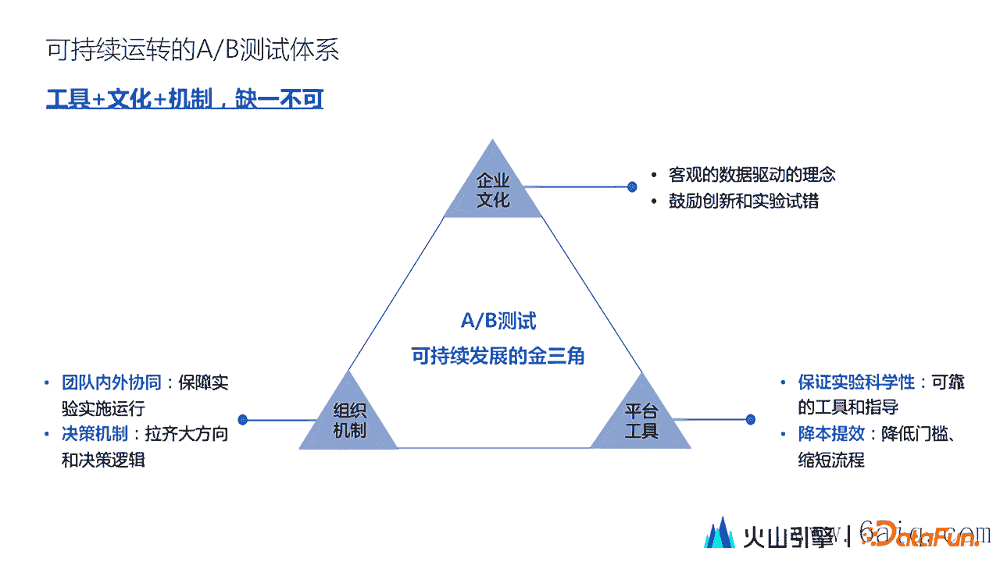
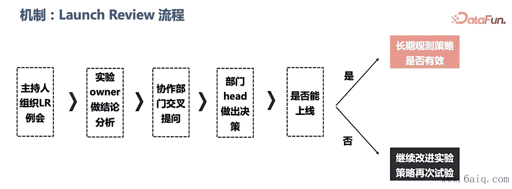
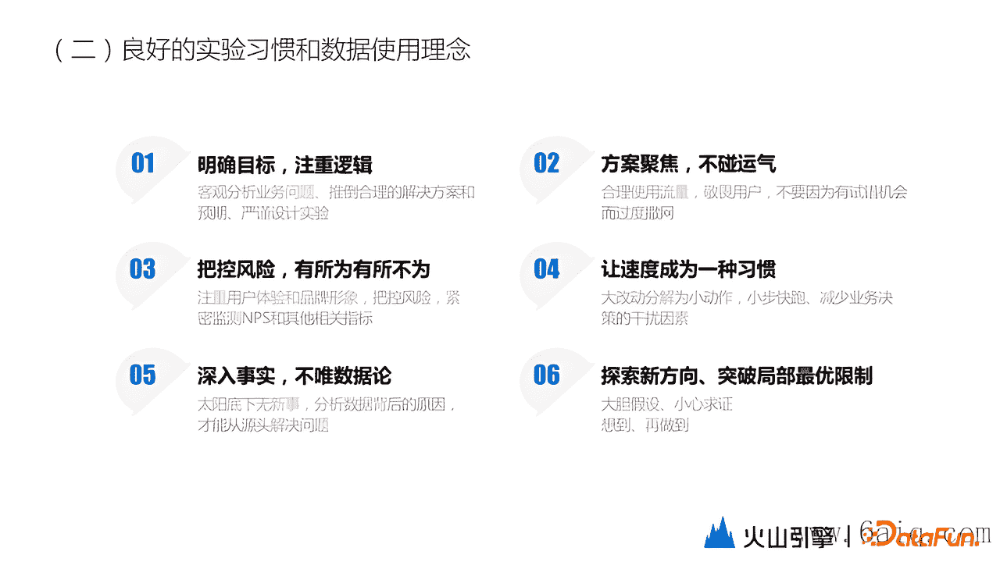

# A/B测试最佳实践

> 来源：[https://qqs7y1hozd1.feishu.cn/docx/D49jdBrjqovJ5zxGl43ccVfHnEb](https://qqs7y1hozd1.feishu.cn/docx/D49jdBrjqovJ5zxGl43ccVfHnEb)

# **背景**

> 本文将从外部用户的角度介绍 **A/B 测试平台的最佳实践**

> **分为三部分：**

1.  整体介绍 A/B 测试的应用场景

1.  字节内部和外部的一些应用来介绍各行业的最佳实践

1.  在实际工作过程中，为了推动 A/B 测试，企业中可持续的应用实践的心得体会

# **全文目录**

+   A/B测试的业务适用性

+   火山引擎A/B测试的内部应用

+   不同行业的最佳实践

+   可持续应用的实验文化

# **A/B测试****的业务适用性**

## A/B 测试到底能做什么？有哪些业务场景？

**图中的数字感受到在字节跳动 A/B 实验应用的**广**度和深度，**并**且这些数字还在继续快速**上涨。A/B实验在临床医学和生物制药领域已经有几百年的应用历史，随着互联网的发展和各行业数字化的普及，更多业务搬到了线上，也具备了实验驱动的基础。

> **A/B测试**是**快**速迭代和做业务决策的一个基础功能，在功能上线前 都会先进行一些小流量的验证，对每一个新的想法、方案，都会先建立假设、运行 A/B 实验，结合业务逻辑对结果的分析理解策略生效过程，从而不断修正方案、做创新尝试，推动整个产品和业务的持续迭代。

根据通用的**海盗增长模型**，**刻画了一个企业在它用户**的整个生命周期里，到底进行了哪些日常工作。从左到右，描述了各个阶段的一些具体场景，从获取用户到推荐传播。

+   上半部分主要表示了各个部门的各个角色所从事的具体业务活动

+   下半部分对应应用场景，可以做哪些 A/B 实验

> **从应用的角度来讲，可以把这张图**切成左右两块，左边是流量获取，右边是流量盘活。

> **（1）流量获取：**即获客**。除了有付费拉**新的模式，也有一些**增长黑客的手段。主要面**向的群体是市场营销部门和增长部门。 可以做一些具体的广告投放的实验、落地页实验、站点优化，以及数值策略的实验。

> **（2）流量盘活：****即提留促活****。从激发活跃一直到传播推荐都属于流量盘活，分为两个阶段，第一个就是激活**、提留到营收的阶段，这个阶段主要是从事一些用户体验、使用链路方面的优化、以及用户侧和商业化的产品功能优化，这部分的主要使用群体是产研部门，包括产品、研发、设计、数据分析师，还有算法团队。产研力量的集中也导致了在这个场景下使用深度是最深的。

**第二个就是推荐传播阶段**，常规的私域运营包括活动激励再营销、以及**多样的用户裂变玩法**，主要使用群体常常是运营团队、业务团队，由产研团队来协同支持。整个流量盘活的部分往往是公司业务运营的核心，创造产品的核心价值。这部分的线上触点也更加丰富，比如 APP 服务端、客户端、小程序，因此可落地的实验类型也更加丰富。

产品**优化是主要在做的 A/B 实验场景，包**括传统的功能、链路的体验优化，还有一些搜索排序的实验、内容推荐的算法模型的实验，营销策略的实验和性能优化的实验，再比如一些常见的服务升级迁移、技术框架升级也可以做实验去观测指标避免负向影响。对于不同业务模式的企业，海盗增长模型也可以演变成不同的变体，但内容上都是通用的。

> 这张图也显而易见地说明了实验的普适性：

> **A/B 测试对于一个公司来说，基本上可以涵盖所有线上业务部门的常见工作和活动。因此，一套科学完善的 A/B 实验**平台，加上配套的场景解决方案和流程机制，能够帮助各个行业的相关从业者用科学的实验方法去衡量其收益，并更好地作出商业决策。

# A/B 通常都做哪些实验？实验平台长什么样子？

一个标准化的实验平台需要五大核心模块：

+   **可靠分流**

+   **科学统计**

+   **实验模板**

+   **智能调优**

+   **灰度发布**

下图展示了火山引擎 A/B 测试实验平台的架构：

A/B 系统除了要做数据回收计算外，还需要跟业务系统直接对接进行分流，因此整体架构可以分为上图中所示的五层。

+   功能层 就是实验平台前台节目可以看到的产品功能

+   **数据层和接入层**都是以**后台服务**的形式存在的，对接客户系统或是内部业务系统主要就是通过数据层和接入层。

+   **会话层和应用层**是对客户公司业务的接入终端和实际应用的模拟例举，火山引擎 A/B 测试是通过接入层的 SDK 跟业务终端进行对接的，同时实现分流服务接入和数据上班，从而实现了实验分流和指标计算。

> **产品后台的核心功能是****实验管控**，包括从实验设计到数据报告、再到上线发布的一站式流程，支持了非常丰富的特型实验； 还提供了实验辅助工具和 Feature Flag 配置发布等功能，为了提高各行业应用能力， 也将在今年推出场景模板、智能优化以及开放平台等额外功能。

下面介绍一下主要的功能：

**（1）服务于多场景的实验模块**

> 这六大类特型实验可以帮助不同职能的用户以更低的门槛快速上手：

> ① 最通用的就是**编程实验**，主要服务于产研和算法团队，这种方式可以实现几乎所有实验，比如服务端可以做一些产品迭代、算法优化、数据策略还有一些技术性能优化实验；客户端可以做一些界面功能、素材优化实验。

> ② 可视化实验和多链接实验的受众更加倾向于增长部门和运营团队，优势是不需要开发介入就可以做一些站点优化、落地页优化、UI 优化，以及 Web 站点重定向的实验等。

> ③ 推送实验和流程画布实验主要适用于运营团队，这种类型的实验包含了常用的推送通道和任务管理能力，支持配置不同的任务内容用于 A/B 测试，从而实现对流失召回和个性化运营的内容素材、时间频次进行优化。

> ④ 广告实验，主要是服务于市场营销团队和增长团队，这种类型的实验包含了常见广告渠道的投放管理能力，支持配置不同的广告计划来测试和优化广告素材、落地页、投放人群、出价，从而提升广告投放的 ROI，还可以通过问卷数据对比的方式对品牌广告进行增效度量。

**（2）科学的统计报告**

保障实验科**学性的重要模块**是统计报告， 提供了P-Value和置信区间等统计信息来**帮助用户甄别数据的可靠性。同**时还提供了一些高级统计功能来修正统计结果，比如多重比较修正、序贯检验等功能，可以进一步提升统计评估的准确度，帮助用户在一些复杂场景下更好地做判断。

**（3）丰富的分析工具**

只**看 A/B 组的数据**对比结果还不足以得到实验结论， 还需要进一步分**析实验的过程，寻找指标涨跌**背后的原因。为此，DataTester提供了丰富的分析工具，比如多维下钻分析、转化漏斗分析、留存和同期群分析，还有常见的热力图等等，帮助用户进一步拆解渠道、人群、路径、点位进行数据深度下钻，知其所以然。

（4）FeatureFlag 灵活可靠的配置发布

A/B 实验也是和研发流程紧密串联的，它和业务系统的服务端、客户端都有深度的对接。想要更大**地提升过程中的效率、减**少实验风险，还需要有配套的配置管理和发布工具。在 DataTester 中实验开发者们提供了 FeatureFlag，除了便于管理实验功能开关、快速全量之外，还可以进行日常的灰度发布、人群定向发布、一键回滚、异常监控，帮助研发在安全的前提下快速提效。

最后通过一个电商场景的例子介绍一下 A/B 测试平台是怎么在线上业务里发挥作用的：

业务在现阶段的核心目标是提升GMV。拆解到各业务方向后每个团队将会围绕着自己所负责的内容继续优化，例如提升DAU、丰富商品品类、提升客单价等等。

市**场投放部门会通过广告去获取流量**，广告素材就**是触达用**户的首个触点， 可以通过广告投放拆分对比实验来评估不同素材的转化效果，或不同投放策略的转化效果。若用户对广告感兴趣，就可以通过优惠券发放来承接流量进行激活，那么发多少金额、通过什么样的条件和策略发券整体 ROI 更高，就可以通过数值策略实验来验证。当用户进场之后，只有他体验到了产品的核心价值，才会真正活跃进一步产生购买，此时可以通过客户端和服务端编程实验来迭代产品功能体验，比如优化选购下单流程链路、优化运营banner 素材。为了让用户停留更久需要让用户能够更快找到喜欢东西， 要提供更多个性化的服务，比如推荐算法，猜你喜欢，这时就会大量用到推荐算法实验，不断地优化模型效果。对于一些已经低活的用户，可以增加降价提醒的功能和一些营销活动，并通过推送策略实验、H5 营销落地页实验来验证收益。对于已经沉睡的用户，运营同学还可以通过推送实验来优化推送时间、推送内容进行召回。

# **火山引擎 A/B 的内部应用**

> 先来看下字节内部A/B 实验的应用：

+   第一个案例要分享的是产品团队在做新功能探索时如何用 A/B 实验来验证方向

> 这是弹幕形态首次在短视频中的尝试，团队希望通过在熟人Tab中加入弹幕来强化熟人社交氛围，进而刺激用户多活跃多发视频，形成正向循环。考虑到弹幕在小屏幕下将影响其他的互动按钮布局，因此设计了两个方案：

1.  一是将强化弹幕，把常用互动功能在底部折叠

1.  二是既增加弹幕，又保留原来常用的互动功能

> 实验后结果发现，第二种方案虽然有利于互动率的提升，但会折损核心内容消费、引发投稿率下降，甚至还导致了留存下降，因此最终决策为**不上线。但实验失败往往是团队经验的向前推进，经过持续的推敲和探索，最终发现当用户**浏览个人视频时弹出熟人互动内容会有更好的体验，找到了弹幕形态的最佳形式。通过这个案例可以看到，A/B 实验既可以通过低风险试错的方式让团队敢于创新探索，又可以帮助 通过实验数据解读加深对用户的理解，从而迭代团队的认知、提升整体决策力。

+   第二个案例是一个设计团队极致优化的例子

> 通过这个例子可以看到，一个非常小的改动，也能够获得超出预期的大收益。

> 选择 A/B 测试来辅助决策，主要有以下这四点原因：

> ① 它可以**激发创新**，帮助 小步快跑、积少成多，进而拿到一些增量的收益

> ② **A/B 测试**是建立在一个**科学的统计评估方法之上的**，如果通过一套完整的实验评估平台在整个公司产品迭代和决策流程中大规模使用，就可以有效地降低决策风险并大幅提升效率

> ③ **A/B 测试**可让**每个产品优化项及时获取数据反馈**，随着实验经验的积累，团队的业务判断力也持续提升

> ④ 可以量化团队工作的收益，为管理赋能

# **不同行业的最佳实践**

**第一个案例是一个天气 APP**

> 为了更好地平衡用户体验和商业化营收团队希望把原有的免费功能转为收费，但这可能带来一些负面影响，甚至导致用户流失，

> **因此决定事前先小流量测试一下：**

> **A方案****直接粗暴地****增加蒙版和收费按钮**

> **B方案****对历史数据免费并增加天气预测****付费订阅的方式进行收费**

**实验发现：**

**方案 B 订阅率有 5 倍的提升，过于激进的方式不可取，但**对于有价值的功能付费订阅也可以被用户接受

第二个案例是租车场景中支付流程的优化。

> 原方案中通过一步流程来完成交易，但免押金的开通率和整体支付率并不高，通过实验发现，如果分离押金和租金的支持流程、先付租金再付押金，免押金的开通率会明显变高，同时带动整体支付率 7% 的提升。

**数据证明这种有违常规认知但符合用户付款心理**的「一步变两步」反而带来了超乎预期的收益

**第三个是金融领域的一个案例。**

> 泰生活 APP 在改版前的用户调研中收集到首页布局不够清晰的反馈，顺应集团品牌升级的大背景进行了进行了一次较为激进的首页改版，但由于变动比较大，团队采用小流量 A/B 实验对新老首页进行了一轮整体测试，以降低负面风险。

**实验数据显示，整体功能可用性、页面性能均无明显负向影响，并收集到一些持续优化的设计细节**，最终决策逐步灰度放量，A/B 测试帮助用户顺利切换到了新版本并获得了更好的体验

# **可持续应用的实验**

来看一下一个实验的完整的生命周期:

一个实验从设计到上线大概需要九步。最后五步都是可以通过一个 A/B 实验平台来进行一站式操作的。而前面四步，从发现问题、提出假设、设计实验，到功能开发，是非常重要的。只要完成了前面的几步，再有一个比较好用的实验测试工具， 就可以正常运行实验了。

**但是一个实验的结果****和最终通过实验做的决策，还需要人的主观判断，人对于实验的不同**解读会影响其结论，影响决策的质量。如果想要用好 A/B 实验，需要可持续运转的一套体系。除了好用的工具之外，机制还有文化都是缺一不可的。

下图展示了一个 A/B 测试可持续发展的金三角:

这个金三角的左右两个角都是比较贴近的实际工作和实验落地的：

> **左边是实验机制**

> **它的作用主要有两方面：**

+   一方面是项目机制，可以让参与实验的各角色高效协同，让实验快速运行实施

+   另一方面是决策机制，统一完备的评价标准和决策逻辑是可以贯穿到业务的毛细血管里面的，可以对评价实验效果好坏、是否符合现阶段业务目标和发展原则进行机制层面的拉齐，从而保证每一次功能迭代都是按照正确的方向去演进。

> **右边是平台工具**

> 好的平台工具的作用也是主要有两方面：

+   一方面，可以保证实验的科学性、统一标准，它往往是由一个专业的团队进行研究，除了产研团队之外，还有数据团队或者统计科学的团队等等，这样就可以最大程度上保证实验的科学性和可靠性

+   第二个作用就是通过工具化进一步降本提效

**这里介绍一个字节实验文化的最**佳代表，实验 Launch Review 流程：

**Launch Review**的会议往往是自上而下推动的，也是复盘文化的一种体现，Review 过程保证了信息的充分透明，不同业务团队可以相互学习借鉴。一般业务专家或 leader 也会参加，在评审时提供一些全局视角和业务长期发展方向的信息，在数据驱动短期价值的同时权衡「追求长期用户价值」

-

最后是一些良好的实验习惯和理念的分享：

> **第一点建议是明确目标，注重逻辑**

> 在实验设计阶段要更加严谨，客观分析当前的业务问题，合理推导「采用什么样的解决方案」、「预计会达到什么样的目标」、「通过哪些指标来评价」，这个是非常重要的一个实验的习惯。

> **第二点建议是实验方案有所聚焦**

> 不要把想到的方案一股脑全上来碰运气，实验需要敬畏用户，合理使用流量，不要因为有试错的机会而广撒网，要提前过滤方案、聚焦测试目标。

> 第三点建议是把控风险，有所为有所不为

> 除了用户行为指标和业务指标外，在实验的过程中 还要注重用户口碑、品牌形象等舆情指标，比如用户社群的反馈、客户之声、NPS 或客户忠诚度等。

> **第四点就是迭代速度**

> 推荐将一个大的改动分解成更多的小动作，小步快跑地进行迭代和 A/B 测试。这样可以减少业务决策时的干扰因素、尽可能避免对用户体验的差异化影响。

> 第五点是推崇深入事实，不唯数据论

> 在看到一个数据结果之后，一定要分析背后的原因，这样才能从源头去解决问题，实验过程的业务沉淀往往比结果更有意义。

> 第六点是通过实验去鼓励探索新的方向

> 通过 A/B 测试可以帮助一个团队突破自己局部最优解的限制，从想到到做到在过程中 A/B 测试都是可以保驾护航的，让你可以大胆假设，小心求证。