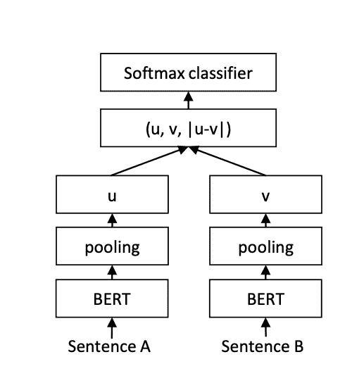
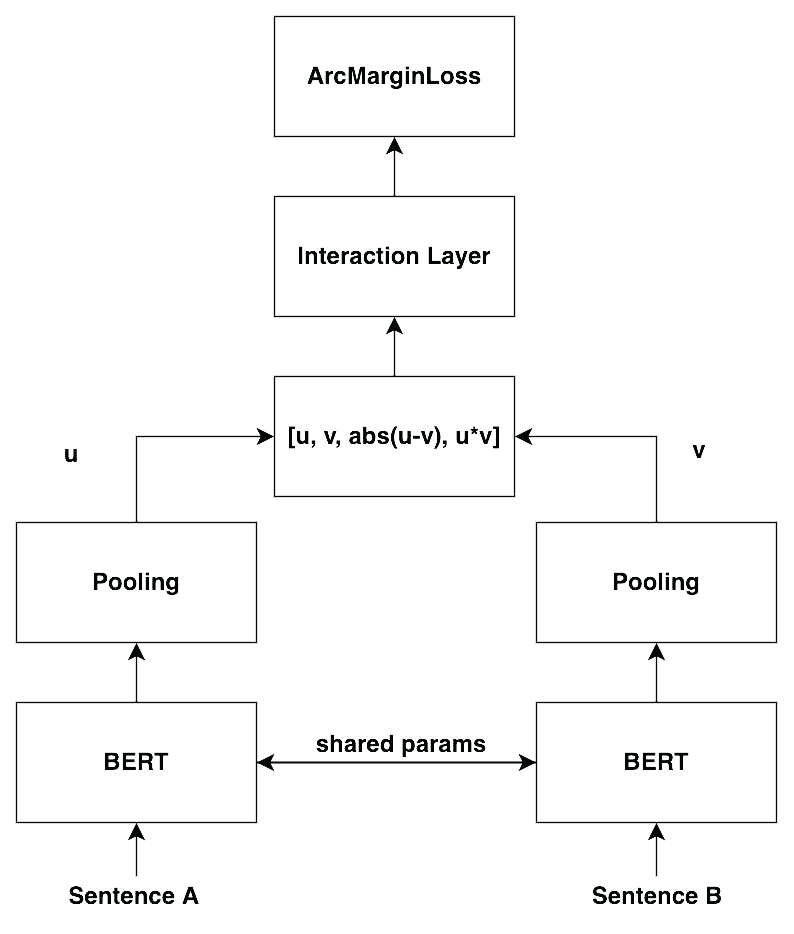
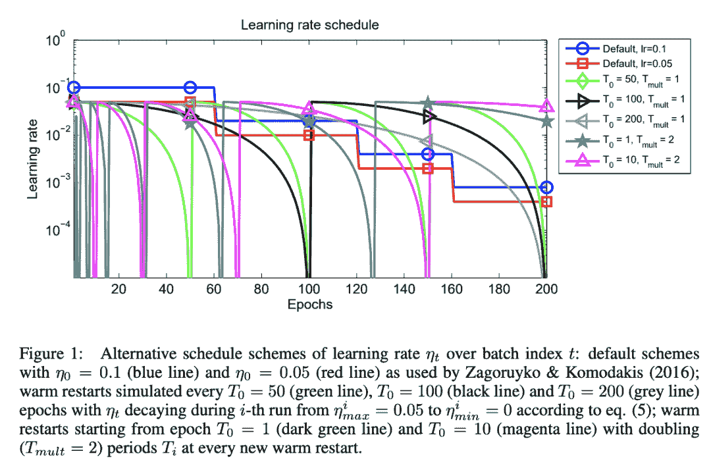
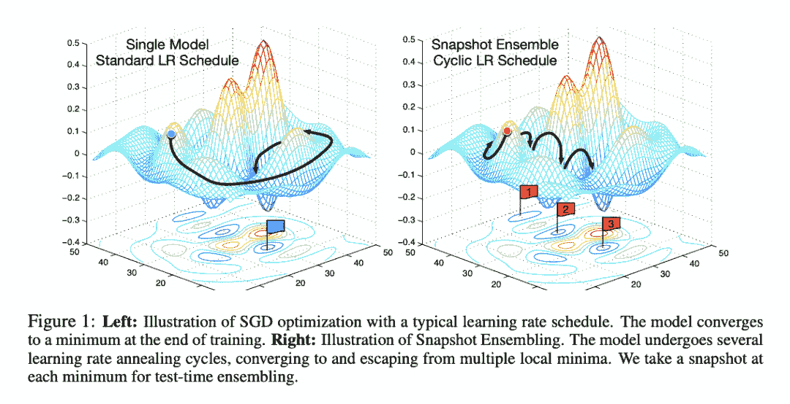
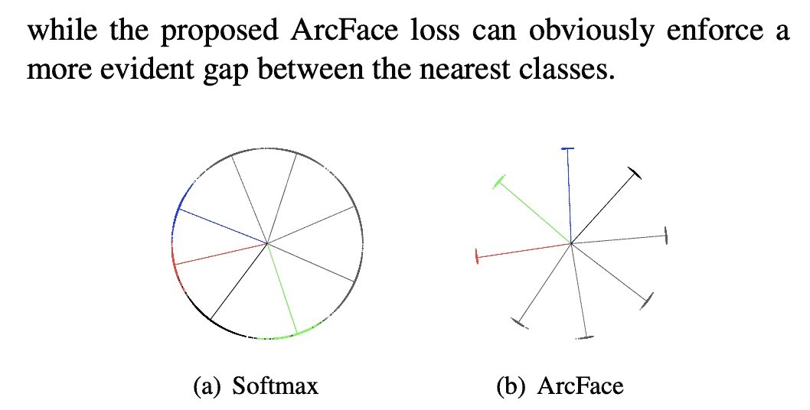
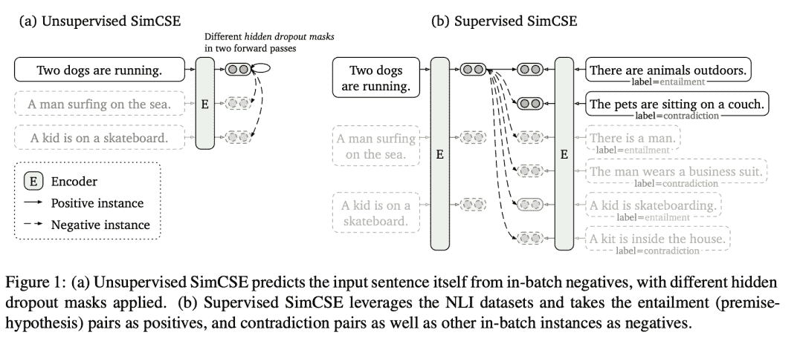
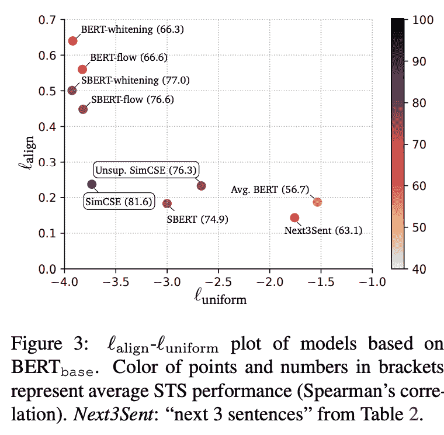
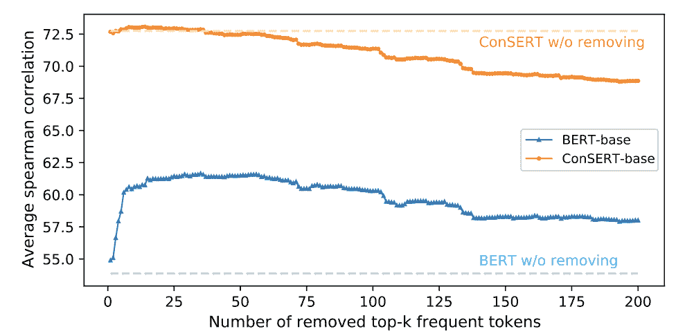

# ｜字节飞书智能问答系统

> 来源：[https://qqs7y1hozd1.feishu.cn/docx/CD6udmaVcozB6cxSgdUcsfDEnEe](https://qqs7y1hozd1.feishu.cn/docx/CD6udmaVcozB6cxSgdUcsfDEnEe)

# 背景

> **飞书智能问答**应用于**员工服务场景，致力于减少客服人力消耗的同时**，以卡片的形式高效解**决用户知识探索性需**求。飞书智能问答整合了服务台、wiki 中的问答对，形成问答知识库，在综合搜索、服务台中以一问一答的方式将知识提供给用户。

作为企业级 **SaaS** 应用，飞书对数据安全和服务稳定性都有极高的要求，这就导致了训练数据存在严重的不足，且极大的依赖于公开数据而无法使用业务数据。在模型迭代过程中，依赖公开数据也导致模型训练数据存在与业务数据分布不一致的情况。通过和多个试点服务台的合作，在得到用户充分授权后，以不接触数据的方式进行训练。即模型可见数据，但人工无法以任何方式获取明文数据。

基于以上原因，** 离线测试数据均为人工构造**。因此在计算 **AUC**(Area Under Curve)值进行评估，会存在与业务数据分布不一致的情况，只能作为参考验证模型的性能，但不能作为技术指标进行优化迭代。因此转而采用用户点击行为去佐证模型效果的是否出现提升。

**在业务落地的过程中****，是否展示答案由模**型计算的相似度决定**。控制展示答案的Threshold，会同时对点击率和展**示率产生重大影响。因此为了避免Threshold的值对指标的干扰，飞书问答采用 SSR（Session Success Rate）作为决定性指标去评估模型的效果。

**其计算方式如下：**

+    total_search_number 会记录用户的每一次提问，search_click_number 会记录用户每一次提问后是否点击、及点击了第几个答案。

+   **bot_solve_rate****(BSR)：**用来评估机器人拦截的效果，机器人拦截越多的工单则会消耗越少的人力。

# 飞书智能问答模型技术

## 原始的 1.0 版本模型

**问答服务最早采用的模型是****BERT****模型，也是业内普遍使用的模型**

**模型结构如下所示：**

通过将**Query** 和**FAQ**的 **Question** 输入孪生BERT中进行训练，并通过二分类对 BERT 的参数进行调整。 **可以离线的**将所有的** question**** 转换为向量存在**索引库中。在推理时，将用户的Query 转换为Embedding，并在索引库中进行召回。向量的相似度均采用余弦相似度进行计算，下文简称为相似度。

**此方案****相对于交互式模型，最大的**优点在于文本相似度的计算时间与Faq的数量脱钩，不会线性增加。

## 改进的 2.0 版本模型

+   **1.0 版本**的模型在表示学习上的表现依然不够好，主要体现在即使是不那么相似的两句话，模型依旧会给出相对较高的分数，导致整体的区分度很低。

+   **2.0 版本**的模型考虑通过**增加两句话的交互**，进而获得更多的信息，能够更好的区分两句话是否相似。并且引入了人脸识别的思想，让相似的内容分布更加紧凑，不相似的内容类间距更大，进而提高模型的区分度。

相对于 1.0 版本的模型，2.0 版本更加强调交互的重要性

在原先 **concat**的基础上，新增了**u*v**作为特征，并增加了**MLP layer**去进一步增强交互。

+   除此之外，**引入了 CosineAnnealingLR(2)和 Ar**cMarinLoss(3)去优化训练过程

+   **除此以外，根据** Bert-Wh**itening**(3)的实验启示，在 pooling的时候采用了多种pooling的方法，去寻找最优的结果

### CosineAnnealingLR

余弦退火学习率通过缓慢下降+突然增大的方法，在模型即将到达局部最优的时候，可以“逃离”局部最优空间，并且进一步检索到更好的局部最优解。

下图源自Co**sineA**nne**alingLR** **的paper****，其中default是Ste**pLR的衰减，其他则为余弦周期性衰减，并在衰减为 0 时恢复最大值。

相比于传统的**StepLR**衰减，余弦退火的衰减方法，可以让模型**更容易找到更好**的局部最优解，下图模拟了 StepLR 和 CosineAnnealingLR 梯度下降过程：

+   **由于余弦退火**模型会找到多个局部最优，因此训练时间也会长于传统的StepLR衰减。

+   另一方面，由于学习率的突然增大**，会导致 loss 的上升，**因此在训练过程中** Early** Stop**ping 的控**制可以根据 Steps 而不是 Epoches

> 在服务台落地场景中，不同的服务台的语义空间明显不同，不同的服务台数据量（包括正负例比例）也存在较大的差异，模型不可避免的存在 bias，余弦退火可以一定程度解决这个问题。

### **ArcMarinLoss**

采用**Arcface**损失函数的灵感来自**SBERT**论文中的**TripletLoss**，其最早被用于人脸识别中。

然而，**TripletLoss** 依赖于**三元组输入****，构建模型的当时不存在这样**的**条件去获****取数****据，因此沿着思**路找到了 ArcMarginLoss：最新用于人脸识别的损失函数，在人脸识别领域达到了SOTA，在Softmax 基础上在对各类间距离进行了加强。

**然而， 无法像人脸识别那样，将语义分成 Gr**oup，并对 Group 进行 N 分类。

NLP相关问题远比人脸识别要复杂得多，训练数据也难以像人脸识别那样获得。但仍然可以通过二分类，将相关/不相关这两类拆分的更开。

### 实验结果

**根据A/B实验的结果，1.0 版本**模型和 2.0 版本模型的指标如下所示：

|  | ### Top 1 SSR | ### Top10 SSR | ### Top 1 Click Rate | ### BSR |
| --- | --- | --- | --- | --- |
| #### 相对提高 | #### +7.75% | #### +6.43% | #### +1.24% | #### +3.55% |

+   Top1 SSR 只是只考虑点击第一位的SSR，而 Top10 SSR 则是点击前 10 位的 SSR。

+   由于对于用户的一次请求，最多只会召回 10 个相似的结果，因此 Top10 SSR 就是整体的 SSR。

+   Top1 Click Rate 是指在点击的条件下，点击第一条信息的概率是多少，即 Top1SSR/Top10SSR。

**由上表可以看出：**整体的 SSR 出现了明显的上升，且 Top1 的点击占比也出现了小幅提高。因此从业务指标来推测 2.0 版本的模型明显好于 1.0 版本的模型。BSR 作为业务侧最关心的指标，受到用户行为和产品策略的影响很大，但通过 AB 实验也可以看出，新的模型通过机器人拦截的工单数明显上升，可以减少下游客服人力的消耗。

### 消融实验

针对 **ArcMarginLoss** 的效果进行消融实验，在其他条件都不变的**情况下，采用相同的人造测试**集，分别采用 ArcMarginLoss 和 CrossEntropyLoss 进行模型训练。

**在这里采用****AUC**** 的原因，是为了观测：**

|  | ### ArcMarginLoss | ### CrossEntropyLoss |
| --- | --- | --- |
| #### AUC 的值 | #### 0.925 | #### 0.919 |

**因此通过消融实验可以看出：****ArcMarginLoss** 虽然在测试集上**有少许提升，但提升并不明显**。

**原因可能是：**用于人脸识别训练模型的**ArcMarginLoss** 通常以海量相似图片作为一个 label 去进行训练，而在此任务的数据为两句间关系的 0/1 分类，导致其和人脸识别目标并不相同，无法产生较好的效果。

### 基于 Contrastive Learning 的 3.0 版本

+   2.0 版本的模型虽然缓解了分数相对集中的问题，但依然无法解决数据整体分布不均匀的问题（正负样本 1:10），即正样本的数量远小于负样本，导致模型更倾向于学习负样本的内容

+   **3.0 版本的模型借鉴了****Con**tr**astive Learning的思想，将二分类问题转化为 **N 分类问题，负样本不再是多个 Item 进而保证模型会更好的学习到正样本的内容

#### Contrastive Learning

**在 3.0 **版本的模型中，参考了最新的论文 SimCSE，将 Contrastive Learning 的思想引入了模型中并进行训练。其思想利用两次 dropout 得到同一句话的不同表示，并进行训练。

**如下图所示：**

在实际训练中，采用了 Super**vised SimCSE 的思想，将<**query_i,question_i>作为正样本的 Pair 输入到模型中。每一个 query 都与其他的 question 作为负样本进行训练，但不与其他的 query 交互（原文不同的 query 间也是负例）

一个例子如下所示，假设输入 3 个 pair，则 label 如下：

|  | ### query1 | ### query2 | ### query3 |
| --- | --- | --- | --- |
| #### question1 | #### 1 | #### 0 | #### 0 |
| #### question2 | #### 0 | #### 1 | #### 0 |
| #### question3 | #### 0 | #### 0 | #### 1 |

通过**BERT**可以将文本转换为**embedding**，并计算相似度。

根据上述构造 label 的方法，使用 CrossEntropyLoss 计算并更新参数。

因此，C**ontrastive Le**arning 的目标函数可以用以下表达：

> 其中 sim 是余弦相似度计算，<hi,hi+>为一个 Sentence Pair

#### 从 Momentum contrastive 而来的 trick

**原始的 ****SimCSE** **采用** C**rossEntropyL**oss 直接得到 loss 的**值**，然而由于超参数 T 的存在，导致余弦相似度的值被放大，最终在 softmax 后概率分布更加集中倾向于相似度高的值，而相似度低的值概率会趋近于 0。

因此，超参数 T 的值会严重影响反向传播的时候梯度的大小，并且随着 T 的缩小梯度不断增大，使得**实际的 ****l****r 远**大于 CrossEntropyLoss 中定义的 lr，导致模型训练收敛速度变慢。为了缓解这个问题，在 Momentum contrastive中采用了 的方法，本文应用了该方法作为 loss 进行训练。

#### 实验结果

**根据 A/B 实验的结果，2.0 **版本和 3.0 版本的模型业务指标如下：

|  | ### Top1 SSR | ### Top8 SSR | ### Top 1 Click Rate | ### BSR |
| --- | --- | --- | --- | --- |
| #### 相对变化 | #### +7.10% | #### +5.88% | #### +1.19% | #### +4.07% |

+   **首先由于不同时期的业务数据存在波动，因此 2.0 版本的 to**p1 SSR 与前文的数据存在一定的偏差。且业务侧进行了改动，总展示数量从 10 个变成了 8 个，因此 Top10 SSR 修改为了 Top8 SSR

+   **最**后，BSR 在该 AB 实验中的表现与上文的 AB 实验中 1.0 版本模型相似，是因为修改了进入机器人工单的统计口径。原先搜索中展示了问题，会直接跳转进入机器人并记录为机器人解决问题，现在搜索会直接展示答案而无需进入服务台。因此，搜索侧拦截了一部分的工单，且未被记入机器人拦截，导致了 BSR 的下降，而非数据波动导致。但对比 AB 实验的结果，新模型的 BSR 仍然提高了 4.07%，提升显著

+   **综上所述，很显然模型在核心技术指标上均有明显提高。不仅在用户需求的满足率上提高**了 5.88%，答案排名在第一位的比例也提高了 1.19%，模型效果有了全面的提

#### 模型提高的原因

1.  **数据的组织方式不同**

> Contrastive Learning 仅使用数据集中正例，采用同一个 batch 内的其他 Question 作为负例，这意味着对于同一个 query 负例的数量远大于原始数据集。相比于 2.0 版本的模型，对于所有的正例模型都有更多的负例去更好的识别真正相似的句子。

1.  **损失函数决定了训练目标不同**

> 2.0 版本的损失函数仅需要考虑两句话之间的关系，而 3.0 版本模型需要同时考虑一个 batch 内的所有句子间的关系，进行 batch_size = N 的 N 个句子中找到正例。

1.  **通过 **Contrastive Learning 可以消除 BERT 的各向异性（Anisotropy）

> 具体体现在 BERT 的语义空间集中在一个狭窄的锥形区域，导致余弦相似度的值会显著偏大，即使完全不相关的两句话也能得到比较高的分数。该观点在 Ethayarajh(6)和 Bohan Li(7)对预训练模型的 embedding 研究中得到了证明。而使用 Contrastive Learning 或各种 postprocessing(如 whitening(8), flow(9))可以消除这一问题。

高频的词汇严重影响了**BERT** 中句子的 **embedding**，少量的高频词汇决定了 **embedding** 的分布，导致 **BERT**模型的表达能力变差，Contrastive L**earning **可以消除**此影响。根据**论文 ConSERT的实验，证明了高频词确实会严重影响 embedding 的表达，如上图所示：

#### 消融实验

**为了探索 Los**s 和数据对模型的影响，该消解实验采用与 Contrastive Learning 一样的正负样本及比例进行训练，其训练方法如下：

+   令 batch_size = 32, 则根据 Contrastive Learning 的思想得到余弦相似度矩阵，维度为[32,32]。

+   根据 Contrastive Learning 生成 label 矩阵，即[32,32]的单位矩阵。

+   将余弦矩阵和 label 矩阵，均转换为[32*32,1]的矩阵，在此条件下数据组织模式完全相同，只有损失函数和训练方式不同。用以上方式进行训练，并在离线测试集上进行 AUC 计算。

**简单来说：**Contrastive Learning 从 32 个句子中找到了最相似的 1 个，而 CrossEntropyLoss 则是进行了 32 次二分类。通过上述方法，分别对Contrastive Learning 和 CrossEntropyLoss 的二分类进行训练

**结果如下：**

|  | ### Contrastive LearningN 分类 | ### CrossEntropyLoss 二分类 |
| --- | --- | --- |
| #### AUC 的值 | #### 0.935 | #### 0.861 |

+   通过进一步研究发现，**C**rossEntropyLoss 的二分类会倾向于将文本的相似度标为 0，因此过量的负样本使得模型忽略了对正样本的学习，仅通过判断 label = 0 的情况即可在训练集上达到 98%的准确率。

+   通过消解实验也证明了损失函数对该模型的训练存在显著的影响，当负样本足够多，在相同数据组织方**式的条件下，Contrast**ive Learning 的效果要优于 CrossEntropyLoss。由于在真实业务中，正样本的数量远小于负样本，因此基于 Contrastive Learning 的训练方法更适合应用于业务中。