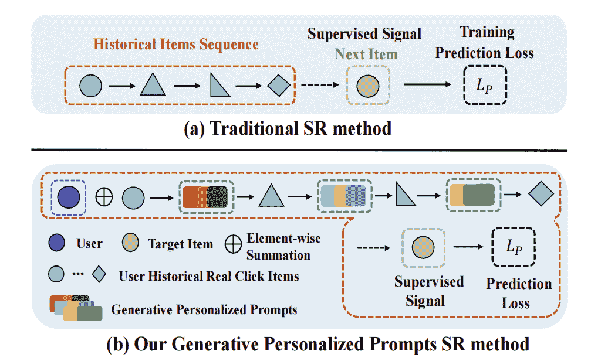
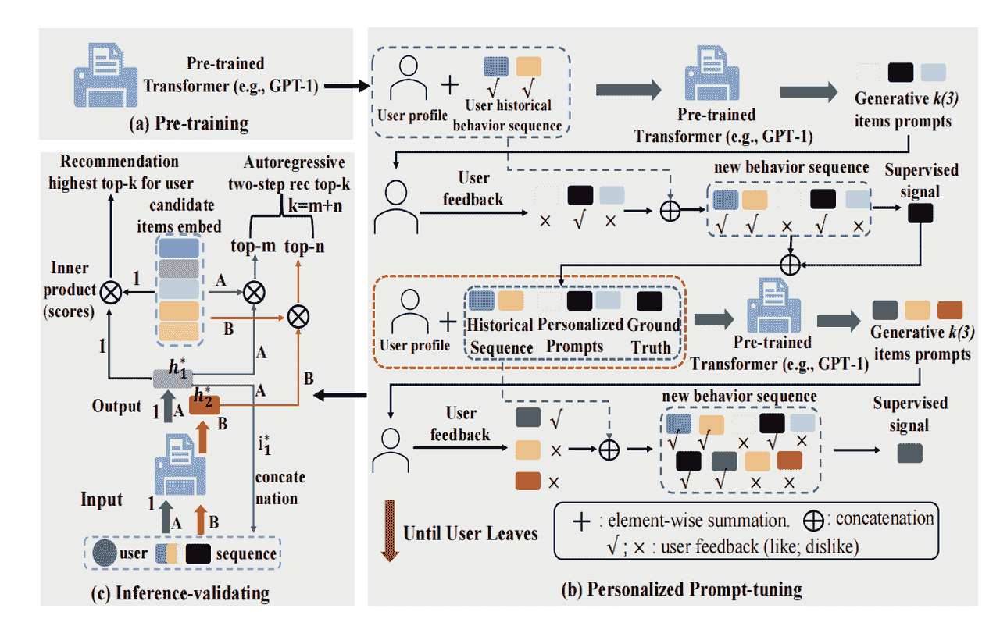
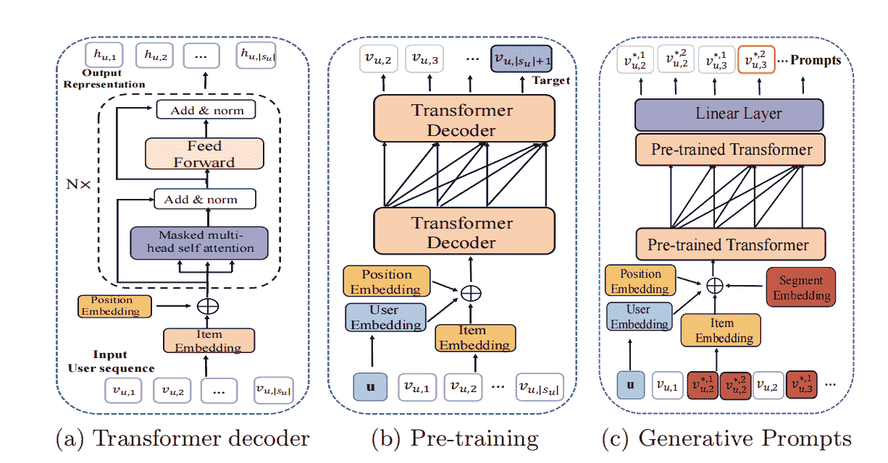
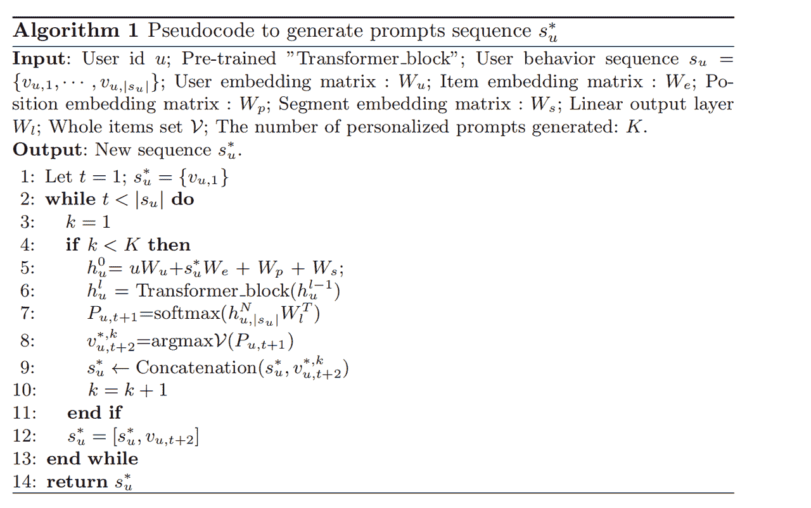
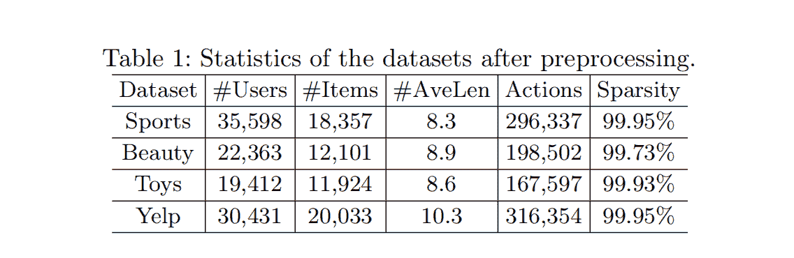
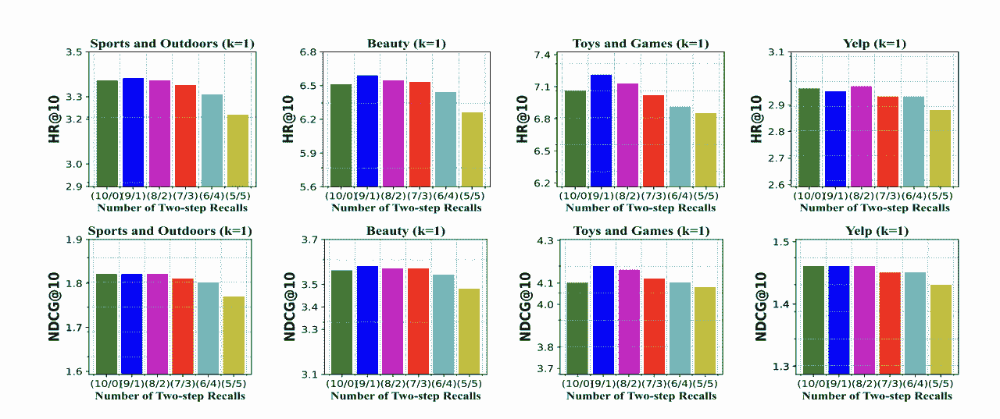
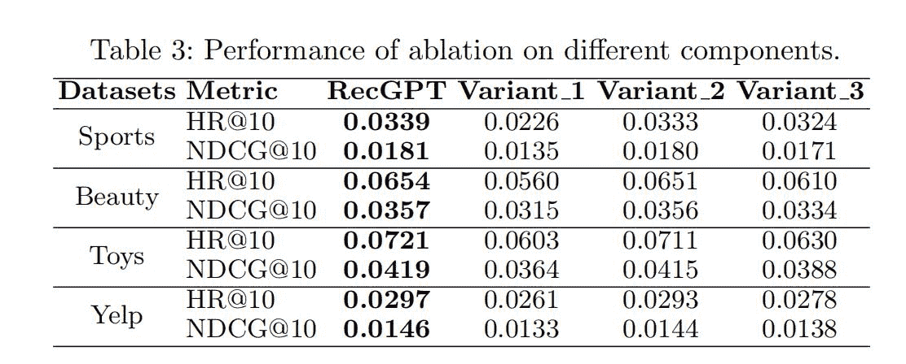

# 快手将ChatGPT智能模式融入短视频序列推荐

> 来源：[https://qqs7y1hozd1.feishu.cn/docx/Nh3BdDihqoUxYNxtFxXcEg1xn7f](https://qqs7y1hozd1.feishu.cn/docx/Nh3BdDihqoUxYNxtFxXcEg1xn7f)

## 背景

我们都知道`ChatGPT`在自然语言理解方面取得了显著的成功

考虑到推荐系统实际上是用户与系统之间的对话，其中的项目如同词语，具有与`ChatGPT`相似的基本模式，快手为推荐任务设计了一个新的项目索引级别的对话框架。

快手的创新主要包括三个部分：`模型`、`训练`、`推理`

+   **模型部分：**采用生成预训练`Transformer`（`GPT`）作为连续推荐模型，并设计了一个用户模块来捕捉个性化信息

+   **训练部分：**采用`ChatGPT`的两阶段范式，包括预训练和微调

    1.  **预训练阶段：**通过自回归训练`GPT`模型

    1.  **微调阶段：**通过提示训练模型，这些提示包括模型生成的新结果和用户的反馈

+   **在推理部分：**以自回归方式预测用户的多个兴趣作为用户表示

## 简介

`ChatGPT`因其令人印象深刻的能力和独特的训练范式而获得了广泛关注。此外，它在法律、伦理、教育和推理等不同领域中找到了广泛的实际应用。这激发了快手在探索其在推荐系统中的潜在应用

在过去的一年里，基于`ChatGPT`的许多推荐模型被提出

+   `Chat-REC`利用`ChatGPT`为推荐提供透明且可理解的推理，从而增强信任和用户参与。`GPT4Rec`是一个生成框架，可以同时生成个性化推荐和可解释的用户兴趣表示

+   还有一种提示策略，通过引导`GPT-3`生成下一个推荐项目

> 这些方法存在以下局限性：

+   在这些方法中，用户和项目在语义空间中表示，无法很好地表示复杂的偏好关系

+   这些大型语言模型对于在线推荐服务来说太过庞大

因此，探索将`ChatGPT`灵活且有效地整合到推荐系统中的方法成为一个有前途的方向

在本文中，快手放弃了自然语言的形式，使用`ChatGPT`的模型结构和训练范式来进行项目序列预测

+   当与`ChatGPT`这样的聊天机器人对话时，用户提出问题，模型返回答案

+   然后，用户对答案进行反馈，模型再根据反馈返回新的答案

所有问题和答案都是词语的序列，同样，当浏览网页上的项目时，用户向模型提供其历史行为列表，模型返回一个项目列表。然后用户对模型返回的项目列表进行反馈（点击项目列表），模型根据反馈返回新的推荐列表。

可以看出，推荐实际上是通过项目作为“词语”与用户进行沟通。考虑到这一基础的相似性，将`ChatGPT`的技术应用于连续推荐

> 连续推荐（`SR`）旨在根据历史行为序列预测用户的后续偏好，是大多数在线推荐场景的关键组成部分。

尽管已有许多方法用于`SR`，但大多数只考虑通过用户的历史行为序列进行建模，如图（a）所示。然而，这些行为序列相对于整个交互空间来说是高度稀疏的。此外，这种方法与现实世界的在线推荐系统之间存在差距。

+   通常推荐系统会向用户推荐多个项目，用户随后对每个项目提供反馈

> 例如：一个推荐系统可能会向用户推荐六个项目，但用户可能只会点击其中一个。在当前的连续模型中，重点在于用户点击的项目，并赋予其100%的置信度。相比之下，其余五个未点击的项目的置信度（范围为0%到100%）则未被考虑

与仅使用用户行为序列建模不同，快手提出在模型训练中将未点击的项目作为个性化提示纳入

如图（b）所示，这种方法引入了用户偏好的时间迁移

---

为了增强基于`ChatGPT`的推荐模型中的提示个性化，并减轻传统连续场景中单一行为序列建模的局限性，提出了一个名为`RecGPT`（通过`ChatGPT`训练范式进行个性化生成提示的连续推荐）的新框架。

> `RecGPT`利用生成预训练模型来生成除了原始用户行为序列项目之外的各种提示

> 按照`ChatGPT`的训练范式，采用了包括预训练和微调两个阶段的训练过程：

+   **预训练阶段：**预训练了一个具有自回归生成能力的多层`Transformer`解码器网络模型。为了增强模型的个性化生成能力，引入了用户 ID 模块

+   **微调阶段：**包括提示微调和推理验证两部分

具体来说：

+   微调预训练模型，生成专门为推荐任务量身定制的个性化提示，在模型中引入段 ID，用于区分生成的提示和原始行为序列

+   在推理验证阶段，用自回归召回方法替代传统的内积召回方法来评估推荐性能。

> 快手将`ChatGPT`智能模式融入短视频序列推荐总结如下：

+   提出通过`ChatGPT`训练范式以个性化提示来建模用户行为序列，称为`RecGPT`

+   通过三部分实现了上述想法：

    1.  首先，通过引入用户 ID 模块预训练了一个个性化自回归生成模型

    1.  然后，通过引入段 ID 微调预训练模型，生成专门用于推荐任务的个性化提示

    1.  最后，推理阶段使用两步自回归召回方法验证用户偏好的演变

+   首次在在线 A/B 测试中使用自回归召回并证明其可行性。这为在线推荐提供了一个来自`ChatGPT`的新视角，有助于激发学术界和工业界的后续研究

+   进行了广泛的离线和在线 A/B 测试实验，证明了`RecGPT`的有效性

## 相关工作

### 连续推荐

连续推荐旨在根据用户的历史交互记录预测最符合用户偏好的下一个项目

开创性的工作主要基于`马尔可夫链`假设模型物品到物品的交易模式。个性化转移图的模型基于底层马尔可夫链，综合了普通马尔可夫链和矩阵分解。

`循环神经网络`（`RNN`）进一步提高了连续推荐的性能，如`GRU4Rec`和基于`LSTM`的方法捕捉了长期和短期的项目转移关联

由于自注意力模型在自然语言处理任务中的成功，研究人员还设计了许多基于`Transformer`的模型，如`SASRec`将自注意力引入连续推荐，`BERT4Rec`使用`BERT`模型学习双向项目依赖关系。然而，现有方法缺乏对多反馈行为序列的建模

### `ChatGPT`在推荐中的应用

`ChatGPT`是OpenAI最近发布的聊天机器人服务，过去一年中受到了越来越多的关注。最近，许多基于`ChatGPT`和大语言模型的推荐模型被提出，用于各种推荐任务，如连续推荐和可解释推荐

> 例如，`Chat-REC`利用`ChatGPT`提供透明且可理解的推理，从而增强信任和用户参与

`GPT4Rec`提出了一个生成框架，可以同时生成个性化推荐和可解释的用户兴趣表示。还有一种提示策略，通过引导`GPT-3`进行下一个项目的推荐。然而，这些方法仅通过官方 OpenAI API 实现，直接将这些模型应用于基于 ID 的在线推荐系统并不可行。

+   与这些方法不同，快手将`ChatGPT`训练范式引入连续推荐任务，并证明了其可行性

## 初步工作

假设我们有一组用户和一组项目。对于每个用户，表示用户按时间顺序排列的历史行为序列，其中表示用户交互的第个项目，为项目总数。给定一个观察到的序列，连续推荐（`SR`）的典型任务是预测用户最可能交互的下一个项目，其公式如下：

## 方法论

### 总体框架

在本节中，介绍了提出的`RecGPT`框架的详细信息

训练过程包括三个阶段：

+   第一阶段是预训练个性化自回归生成模型`Transformer`

+   第二阶段是提示微调阶段，通过预训练模型与用户之间的对话生成个性化提示

+   第三推理阶段评估自回归召回的能力

### 预训练自回归生成模型

首先介绍基础模型`Transformer`解码器，用于学习表示

`Transformer`架构是一种强大的序列编码方法

各种基于`Transformer`的模型已被验证在连续推荐中有效

根据之前的研究，也使用经典的`Transformer`解码器作为预训练模型

如图所示，堆叠了多层`Transformer`解码器块来解码历史行为序列。

> 对于输入行为序列，定义其第层的行为矩阵为。第层将前一层的输出编码为，其中是输入序列的长度，表示项目表示的维度

每一层应用一个掩码多头自注意力（`MMS`）模块和一个位置前馈网络（`FFN`）后者是基于`ReLU`激活函数的两层`FFN`

> 它对`MMS`的输出进行线性变换，并将其转化为，即，其中，，，和是权重参数

> 前者`MMS`子层聚合了多个注意力头，每个头都通过缩放点积注意力计算（例如，第层的第个头）

正式地，这个子层的计算定义如下：

> 其中，，是投影矩阵。是注意力掩码矩阵，每个元素控制序列中的一个项目是否可以关注另一个项目。的下三角部分设置为0，其余部分为-\infty，以允许每个项目关注过去的项目，但防止其关注未来的项目。

`MMS`模型化了序列中的项目关联，位置前馈网络输出一组嵌入，每个位置的嵌入预测序列中对应的下一个项目。在图3(b)中展示了预训练的下一项目预测：

预训练模型中的第层行为矩阵的学习如下：

> 其中是用户的个人资料ID，是用户嵌入矩阵，是输入行为序列，是项目嵌入矩阵，是位置嵌入矩阵，是在预训练中学习到的用户的最终表示以预测用户的下一个项目，是`Transformer`解码器层数，表示所有参数。与其他模型相比，我们模型的主要区别在于我们设计了一个用户模块来捕捉个性化信息

在给出上述模型后，介绍了预训练损失，模型预计要估计下一个交互项目

在实践中，通常使用二元交叉熵来学习，基于以下损失：

> 其中是由输出的序列的表示。是非线性激活函数，是相对于的负样本集。和分别是和负样本的嵌入。

### 个性化提示微调

在预训练之后，`RecGPT`利用基于`GPT`与用户之间对话的个性化提示微调来执行下一个项目的推荐任务

具体过程如上图所示

#### 生成个性化提示

`RecGPT`的关键在于生成有效的提示作为用户请求的反馈，然而，在推荐中找到合适的提示具有挑战性，因为：

1.  很难建立一些真实的令牌作为提示

> 与自然语言处理中的词语不同，推荐中的令牌没有明确的语义

1.  与自然语言处理不同，推荐需要个性化

> 因此，提示也应根据不同的用户进行定制。从某种意义上说，每个用户的推荐都可以视为一个任务，而在现实系统中有数百万用户，不可能为每个用户手动设计提示

在`RecGPT`中，利用用户 ID 和用户行为序列项目 ID 自动有效地为所有用户构建个性化提示

用户 ID 可以代表每个用户特有的属性，生成个性化提示的任务与单向语言模型中的自回归生成方法紧密相关

如上图3C所示：是为用户行为序列获得的个性化提示

新序列带有生成的个性化提示，如算法1所示，其中段嵌入矩阵用于区分生成的提示项目 ID 和原始行为序列项目 ID，并使用`argmax`从所有项目中选择最高概率的项目 ID

#### 提示微调

生成个性化提示后，获得了一个新的提示增强序列：

> 其中生成的个性化提示用下划线表示：

+   一方面，需要训练段嵌入矩阵和一个额外的线性输出层参数（除了预训练的序列模型外）

+   另一方面，还需要构建用于推荐的最终用户表示

具体来说，我们首先将提示增强序列\( s^*_u \)输入预训练的序列模型，然后我们获得数据集中所有项目的概率分布。通过项目的概率分布，我们可以基于前面的项目进行下一个项目的预测，这可以通过最小化以下负对数似然实现：

> 其中是要为用户预测的下一个项目，表示生成的个性化提示窗口的大小，表示图3(c)中显示的所有参数。

### 推理验证自回归召回

在连续推荐模型的推理阶段，如图2(c)中的路径1所示，现有方法主要计算用户在历史上下文中的第(t+1)步对项目的偏好分数：

> 其中是项目嵌入矩阵中项目的表示，是第步`L`层`Transformer`解码器块的输出，"·"是内积

+   路径1的方法称为`RecGPT1`

然而，这种推理模式只能预测用户在下一时刻的偏好，无法预测用户在多个未来时刻的偏好，在生成个性化提示模型中，使用自回归生成提示项目训练模型，使其能够预测多个未来时刻的偏好。此外，快手还研究了自回归推理在模型中的有效性。

> 多轮自回归召回可能对模型性能产生不利影响：

+   一方面，序列数据通常是稀疏的，这使得在没有大量语料库的情况下训练自回归召回模型变得困难

+   另一方面，序列行为通常在最近的两个项目之间表现出最高的相关性

+   然而，随着自回归召回次数的增加，召回项目之间的相关性逐渐减弱

+   因此，在推理阶段采用了两步自回归召回方法

> 例如，当目标是召回前k个项目时，实施了两步策略（即，`k = m + n`），如图2(c)中的路径A和B所示。在路径A中，首先基于`GPT-1`预训练模型的输出项目表示（其中表示项目ID）检索前m个项目。接下来，将与原始序列连接起来，然后输入`Transformer`解码器。然后使用生成的表示召回前n个项目。这种自回归两步召回策略使我们的模型能够推荐与用户多个未来偏好一致的项目。快手将这种自回归召回方法称为`RecGPT`

`RecGPT1`和`RecGPT`的主要区别在于前者依赖于传统的召回方法，而后者使用自回归生成召回方法，如上图(c)所示：

## 实验

为了回答以下问题，进行实验，将提出的模型与最新的方法进行比较，以评估其有效性：

+   RQ1：`RecGPT`与之前的方法相比表现如何？

+   RQ2：超参数如何影响`RecGPT`的结果？

+   RQ3：不同组件如何影响`RecGPT`的结果？

### 实验设置

数据集：为了验证我们模型的有效性，在从两个实际平台收集的四个公共数据集上进行了实验

数据集的统计信息如右表所示：

+   体育和户外用品、美容以及玩具和游戏：这三个数据集来自亚马逊评论数据集。

+   `Yelp`：这是一个用于商业推荐的流行数据集。按照惯例，快手只使用2019年1月1日之后的交易记录。对于所有数据集，遵循常见的预处理方法。具体来说，数值评分或评论的存在被视为正实例，其他则为负实例。保留了“5-core”数据集，即每个用户总共购买了至少5个项目，每个项目至少被5个用户购买

基准：为了全面评估我们方法的性能，将方法与以下经典推荐方法进行比较

+   非序列模型包括`PopRec`和`BPR`

+   序列模型包括`STAMP`、`GRU4Rec`、`NARM`、`S3-RecIPS`、`BERT4Rec`和`SASRec`

+   基础模型包括预训练和微调。预训练：我们直接在测试集上进行预训练模型作为基准进行比较。微调：这是一种强大的微调方法，利用预训练模型进行`SR`任务。在微调过程中，使用相同的用户 ID 和历史行为微调所有预训练模型参数。

实现细节：对于每个基准模型，使用`RecBole`中的`PyTorch`实现

注意：`RecBole`默认使用数据增强，为了确保公平性，快手关闭了这一功能，并在相同的数据处理中比较所有基准模型。

例如，如果原始用户序列是`ABCDE`，那么生成的样本是`AB → C`、`ABC → D`和`ABCD → E`。对于预训练阶段，我们只使用样本`AB → C`

对于提示微调阶段和其他基准模型，采用留一法策略来评估性能，即`AB → C`和`ABC → D`用于模型训练和验证

最后一个用于测试，方法在`PyTorch`中实现

对于预训练模型`Transformer`编码器架构，设置自注意力块为1，注意力头为2，嵌入维度为64，最大序列长度为50。模型通过`Adam`优化器进行优化，学习率为0.001，批量大小为256。对于超参数，在`[0,1,...,6]`范围内调整生成的个性化提示窗口`K`的大小。两步自回归生成召回项目的数量`m`和`n`范围从1到20。在离线实验中，在提示微调阶段，使用新生成序列的最后50个项目以保持相同的序列长度

+   评估指标

为了整体评估，采用了top-k命中率（`HR@k`）和top-k归一化折扣累积增益（`NDCG@k`），`k ∈ {5, 10}`

在整个项目集上评估排名结果，以进行公平比较

### 参数分析（RQ2）

本节分析了关键超参数对框架`RecGPT`性能的影响。结果根据`HR@10`和`NDCG@10`指标报告，适用于所有四个数据集。所有数值均为百分比，省略了“%”符号。超参数包括`K`和`m n`

超参数`K`的影响：参数`K`控制生成的个性化提示窗口的大小，我们在`[0, 6]`范围内调整它。如图4所示，增加`K`的数量可以提高模型的性能，因为个性化提示的有效相似性偏好匹配，当窗口大小在`[1, 3]`范围内时，性能最佳。这可能是因为步骤过多会生成一些无关的提示，削弱原始序列的相关性。

超参数`m n`的影响：参数`m n`控制两步召回的比例。由于页面限制，我们仅报告在`top@10`处比例从`(10 0)`到`(5 5)`的结果。图5和图6的分析表明，当`mn`设置为`(9,1)`和`(8,2)`时，性能最佳。这归因于序列数据的稀疏性，自回归召回需要大量数据。此外，序列数据在两个行为项目之间表现出最强的连接，使得第一步生成的表示召回比第二步更为重要。

### 消融研究（RQ3）

我们进行了消融研究，以调查每个组件的贡献

结果如右表所示：

+   **变体1：**直接使用预训练模型进行两步召回，而不应用提示微调。在所有情况下，其性能明显低于 `RecGPT`，强调了提示微调组件的重要性

+   **变体2：**用传统的内积替代两步召回进行评估（即第4.4节中提到的 `RecGPT1`）。结果表明，两步自回归召回的有效性和优越性

+   **变体3：**移除了提示微调和两步召回

> `RecGPT` 与变体3的比较表明，变体3在所有情况下的性能都比 `RecGPT` 差，这表明上述组件的重要性。此外，变体3的性能优于变体1，这进一步表明在没有提示微调的情况下直接在推理阶段进行自回归召回会损害模型的性能

## 在线 A/B 测试（RQ1）

进一步通过在快手视频APP推荐平台上进行的在线A/B实验测试了该方法

+   **实验设置**：替换当前快手推荐系统APP的基线检索

具体来说，当用户到达时，推荐系统首先根据其特征生成一组用户可能感兴趣的候选视频（即检索阶段）。我们使用自回归方法为用户生成六个用户嵌入，并使用内积作为并行ANN检索的度量标准。我们进行A/B实验以评估它们的实时表现。

+   **对比方法**：在线基线方法是“`User-Aware Multi-Interest Learning with ComiRec`”，这是当前快手视频APP的顶级主要召回方法

+   **评估指标**：模型的性能基于用户的消费指标进行评估，考虑了更广泛的其他指标，包括评论（在视频上留下评论）、转发（将视频转发给朋友）、播放（视频播放次数）、关注（关注视频创作者）和观看时间

+   **结果**：**从2023年7月1日到2023年7月5日，在快手APP的召回系统中进行的在线A/B测试相比之前的`ComiRec`模型，评论增加了0.772%，转发增加了0.336%，播放增加了0.143%，关注增加了0.027%，观看时间增加了0.017%
