# X团智能问答

> 来源：https://qqs7y1hozd1.feishu.cn/docx/CBECdxdvvoQEbFxChKKcCdpVnVh

## 写在前面——美团业务中智能问答技术的相关落地与实践

通常问答系统需要提前构建好问答对知识库，这种方式对高频问题能处理的很好，但难以解决开放性问题

> 在日常生活服务中，如"去哪玩"、"住哪家酒店"等，在行前通常需要对景点、酒店等目的地做详细咨询再决策，智能问答是一种非常友好的方式来帮助用户获取信息。但针对不同的景点、酒店等用户问的问题通常不同，是开放性的，且信息往往是动态分布在商户页面详情、政策、用户评论、社区问答等各类数据中，这需要提供一套智能"问题解决"能力，实时从各类信息中找出准确的信息来回答用户问题，辅助用户决策

本文在简单介绍完智能问答技术框架之后，着重介绍`Document QA`、`Community QA`、`KBQA`三类"问答解决"能力

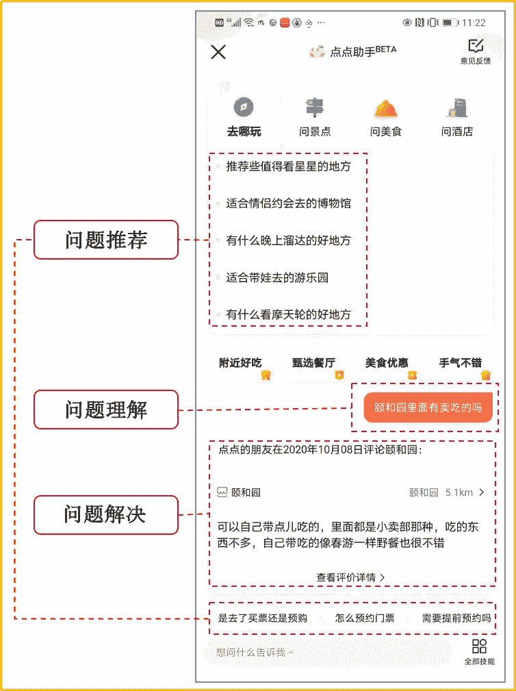

## 智能问答技术框架

智能问答通常会涉及三方面问题：

+ 问题推荐：当用户进入智能问答产品门户时，问答系统通常会根据用户信息推荐相关问题来帮助用户明确他的意图，以便很好的为他服务。这里通常涉及问题怎么来 ( 问题生成 )，推荐哪些问题 ( 问题排序 ) 和对话过程中还会问哪些问题，即多轮问题引导，问答系统通常会考虑问题之间的相关性，问题间的顺承关系给出相应的问题引导

+ 问题理解：当用户输入时，判断是不是问问题，是哪个领域/意图，有什么实体槽位，是不是时效性问题等等。如果问题可能属于多个领域，则需要领域路由澄清，如果意图不明确，则需进一步澄清等，如果一个实体名关联多个实体店，例如，七天酒店有很多门店，则需要澄清"你要问的是哪一个门店"

+ 问题解决：给出最终问题的答案，本文将重点介绍，包括基于阅读理解的问答 (`Document QA`)、社区问答 (`Community QA`) 以及基于图谱的问答 (`KBQA`)。另外针对有第三方API的问题， 也会以`TaskBot`方式调用API来解决，本次主要介绍"自供给"形式的问题解决方案，`TaskBot`暂不介绍

+ 智能问答技术框架如下图所示：

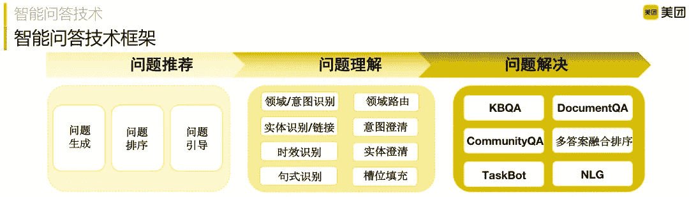

### Document QA

商户简介、攻略和`UGC`评论等非结构化文档中包含大量优质信息，从非结构化文档中提取答案，即文档问答 (`Document QA`)

近年来基于深度神经网络的机器阅读理解技术得到了快速的发展，逐渐成为问答和对话系统中的关键技术

`MRC`模型以问题和文档为输入，通过阅读文档内容预测问题的答案，根据需要预测的答案形式不同，阅读理解任务可以分为：

1. 填空式 (`Cloze-style`)

1. 多项选择式 (`Multi-choice`)

1. 片段提取式 (`Span-extraction`)

1. 自由文本 (`Free-form`)

在实际问答系统中最常使用的是片段提取式阅读理解 (`MRC`)，该任务需要从文档中提取连续的一段文字作为答案。最具影响力的片段提取式`MRC`公开数据集有`SQuAD`和`MSMARCO`等，这些数据集的出现促进了`MRC`模型的发展。在模型方面，深度神经网络结构被较早的应用到了机器阅读理解任务中，并采用基于边界预测(`boundary-based prediction`)方式解决片段提取式阅读理解任务。这些模型采用多层循环神经网络+注意力机制的结构获得问题和文档中每个词的上下文向量表示，在输出层预测答案片段的起始位置和终止位置。

近年来预训练语言模型如`BERT`，`RoBERTa`和`XLNet`等在众多`NLP`任务上取得突破性进展，尤其是在阅读理解任务上。这些工作在编码阶段采用`Transformer`结构获得问题和文档向量表示，在输出层同样采用边界预测方式预测答案在文档中的位置。目前在单文档阅读理解任务`SQuAD`上，深度神经网络模型的预测`EM/F1`指标已经超越了人类标注者的水平，说明了模型在答案预测上的有效性

`Document QA`借助机器阅读理解 (`MRC`) 技术，从非结构化文档中抽取片段回答用户问题。在问答场景中，当用户输入问题后，问答系统首先采用信息检索方式从商户详情或诸多`UGC`评论中查找到相关文档，再利用`MRC`模型从文档中摘取能够确切回答问题的一段文本。美团和大众点评上商户的简介攻略、`UGC`评论均有专业内容运营团队，可以产生内容优质、高可信度的答案，应用机器阅读理解技术直接从文档中提取答案，不需要人工维护意图类目，可以在不同业务领域灵活迁移，人工维护成本小

图中左边是颐和园的评论信息，右边是全季酒店的详细信息，这些信息构成了机器阅读理解中的文档要素。当询问"颐和园里面有午饭吗？"、"未成年人可以独自入住吗？"时，如果需要用户直接从文档中自我阅读的话，耗时费力。最好的方式是直接给答案，而这些答案往往隐藏在大段的文本里面。比如"颐和园里面有午饭吗？"，在评论里面描述有"中午饭还是建议自带，要是买的话有汉堡肉夹馍，还有牛肉面饭之类的"；"未成年人可以独自入住吗？"政策里面描述有"不接受18岁以下客人，在无监督人陪同的情况下入住。"

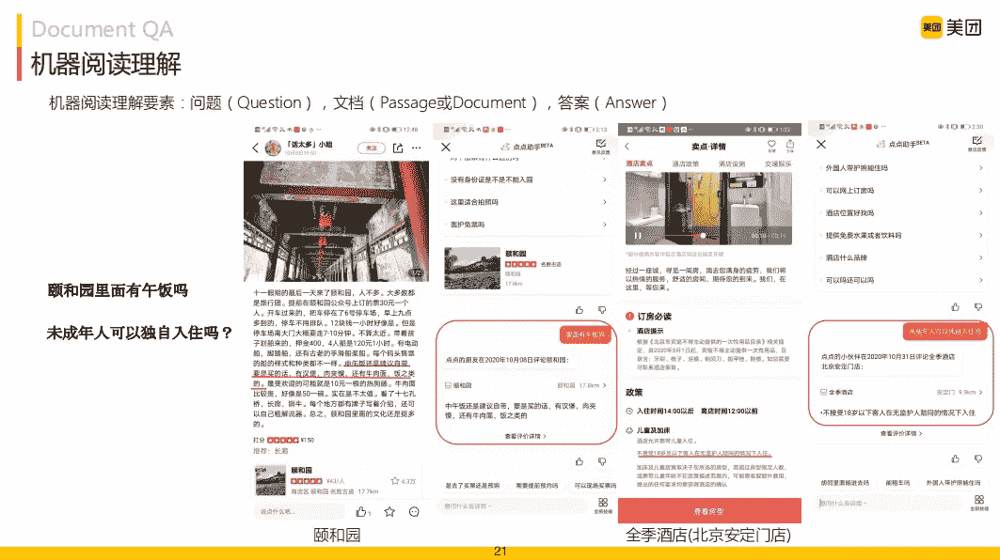

#### 机器阅读理解模型

深度神经网络结构较早的应用到机器阅读理解任务，代表性的包括`Bi-DAF`、`R-NET`、`QANet`、`BERT`等

这些模型均采用多层循环神经网络或`Transformer`加注意力机制等方式来解决问题和文档的上下文向量表示，最后通过边界预测来获取答案片段的起始和结束位置。选择表现最好的`BERT`模型进行相应任务的建模，将问题和文档作为输入，预测在文档中的起始位置和结束位置，将最大可能的起始位置和结束位置之间的片段抽取出来，作为答案

文档问答系统的答案预测流程包含三个步骤：

+ 文档检索与选择 (`Retriever`)：根据`Query`关键字检索景点等商户下的相关详情和`UGC`评论，根据相关性排序，筛选出相关的评论用于提取候选答案

+ 候选答案提取 (`Reader`)：利用`MRC`模型在每个相关评论上提取一段文字作为候选答案，同时判断当前评论是否有答案，预测有答案和无答案的概率

+ 答案排序 (`Ranker`)：根据候选答案的预测得分排序。这样能够同时处理多篇相关评论，比较并选择最优答案，同时根据无答案概率和阈值判断是否拒绝回答，避免无答案时错误回答

`Document QA`问答系统架构如下图所示：

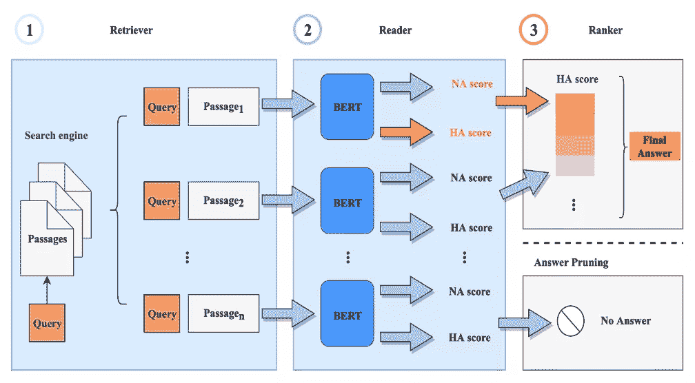

+ 文档检索和排序

上图①表示文档检索的过程，首先根据用户询问的商户名定位到具体商户，通过关键字或向量召回该商户下与`Query`相关评论或详情信息的`TopN`篇文档

+ 答案片段预测

在答案提取任务中，将每条详情或评论作为一个文档 (`Document`)，把用户`Query`和文档拼接起来，中间加入分割符号`[SEP]`，并在`Query`前加入特殊分类符号`[CLS]`；把拼接后的序列依次通过②中的模型，在每条评论上提取一段文字作为候选答案，并预测有答案概率 (`HA Score`) 和无答案概率 (`NA Score`)。长度分别为`N`和`M`的`Query`和`Document`，每一个`token`经过`BERT Encoder`，分别得到隐层向量表示 和 。将`Document`的向量表示经过全连接层和`Softmax`计算后得到每个`Token`作为答案起始和终止位置的概率 和 ，然后找到 最大的组合，将位置`i`和`j`之间文字作为候选答案， 作为有答案概率 (`HA Score`)

+ 答案排序

答案重排序部分如③所示，根据前一步的候选答案得分 (`HA Score`) 排序，选择最相关的一个或多个答案输出

+ 无答案判断

在实际使用中还会面临召回文档无答案问题，需要在答案提取的同时加入无答案判断任务。 的具体做法是联合训练，将`BERT`模型的`[CLS]`位置的向量表示`C`经过额外的全连接层和二分类`Softmax`，得到无答案概率 (`NA Score`) ，根据无答案概率 (`NA Score`) 和人为设定的阈值判断是否需要拒绝回答

`Document QA`在实际落地过程中也发现了一些问题。通常情况下，`MRC`模型抽取的答案偏短，回答信息不充分，如问"停车方便吗"，答案为"停车方便'，从`MRC`任务看，这样的回答也很不错，但该答案并没有回答为什么方便，信息不充分，更期望的答案是"停车方便，有免费停车场"。 通过在构造模型训练数据时选择更完整的句子作为标准答案，在预测时尽量选择完整的句子作为回答等方式来优化解决

另一个问题是时效性问题，比如"现在需要预约吗？"明确地问当前的情况，如果用经典的阅读理解获取的答案可能是"可以预约"和"不可以预约"。通常情况下，这种信息在 `UGC`是大量存在的，不过有一些信息，非常好的答案可能是一个时效性很差的问题，或是很久以前的评论，这种对用户来说帮助不大

所以对时效性进行了相应处理，根据时间的关键词，包括现在、今天，也包括一些事件如樱花、桃花等，它们都有一些特定时间点，这些都作为时间词来处理。还有很多场景，比如景点、酒店等领域，通过梳理也能发现有一些意图跟时效性相关，比如说门票、营业状态等， 对它们也做相应的时效性处理；再就是"是否类"问题缺少直接回答，`MRC`模型用于答案片段抽取，适合回答事实类的描述性问题。但是真实存在大量的"是不是、是否、能否"等是否类问题，如"酒店提供饮食吗？"，原来的回答是"早上10元一位管吃饱"，但是回答的不够直接， 希望同时也能更直接地先回答是否。故此采用多任务的学习方式，在`MRC`模型上加入了`Yes/No`的分类任务，来判断答案的观点是肯定还是否定。改进后的答案为"是的。早上10元一位管吃饱"

最终， `MRC`模型架构如下图所示：

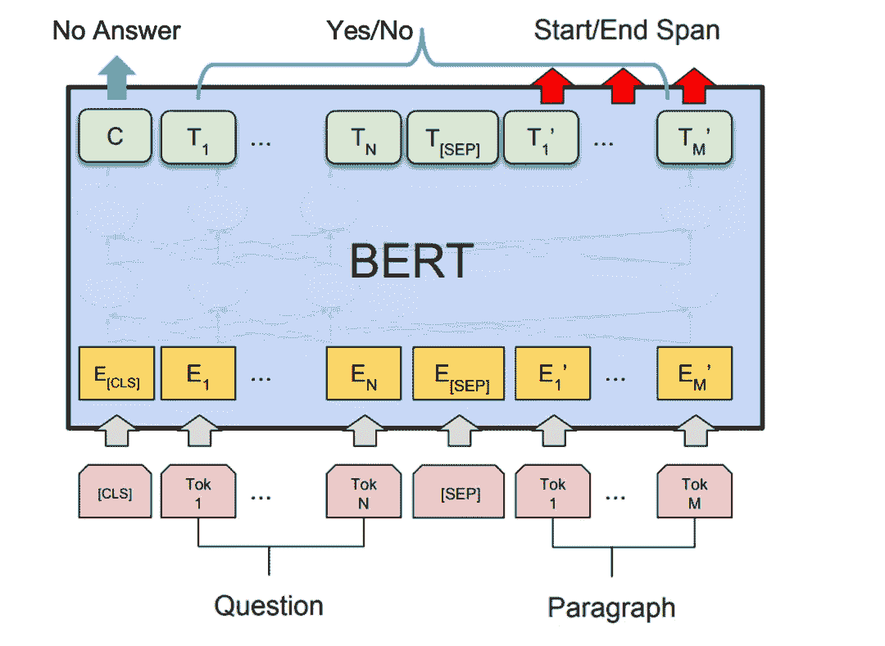

#### 多文档机器阅读理解

另外，针对当前应用从多个文档中查找一个与问题最相关的答案，促使尝试多文档`MRC`模型，即直接对多文档进行阅读理解的建模，从而选择最优的一个作为最终答案。在上图左边结构中， 将多篇文档作为输入，每篇文档都预测它的起始和结束位置，然后通过文档排序任务将多文档的相关性进行加权，对每个片段的得分进行排序。右边表格是 的模型在公开数据集`DuReader`上的验证结果，通过比较单文档模型、多文档联合训练以及在多文档联合训练基础上增加排序任务加权，`Rouge-L`和`Bleu-4`值都有大幅提升，当前模型在`DuReader Leaderboard`上排名第一

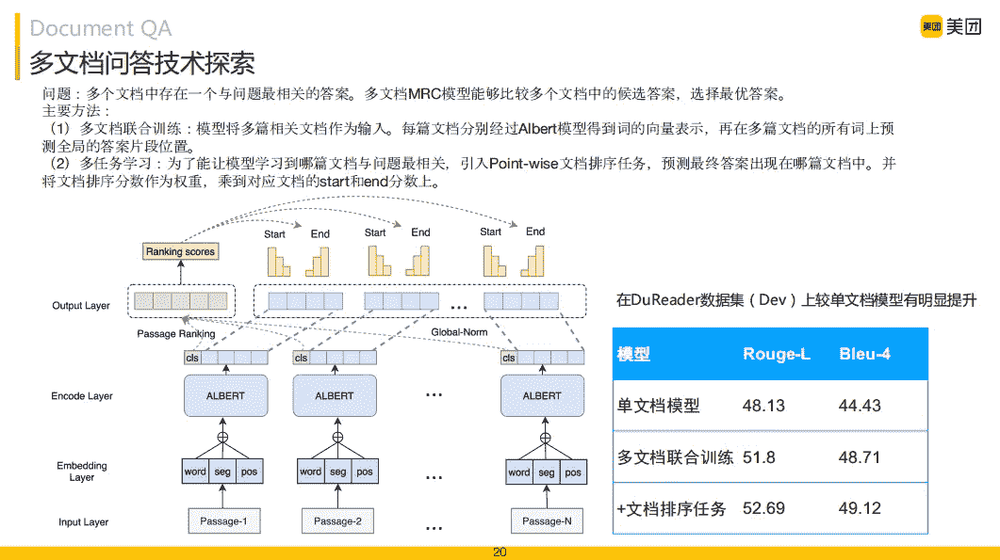

### Community QA

社区问答 (`Community Question Answering`，`CQA`) 和常见问题问答 (`Frequently Asked Questions`，`FAQ`) 是基于问答对的问答系统的两种方式

1. `FAQ`通常由人工事先维护好问答知识库，当用户问问题时，根据相似度匹配到最相关的问题，并给出对应的答案。`FAQ`在限定领域内回答质量较好，但是问答知识库整理成本高。随着社交媒体的发展

1. `CQA`可以通过社交平台获得大量用户衍生的问题答案对，为基于问答对的问答系统提供了稳定可靠的问答数据。在美团和大众点评`APP`中，商户详细页中有一个"问大家"模块，其问题和答案都是由用户生成，含有关于当前商户许多用户关心的关键信息

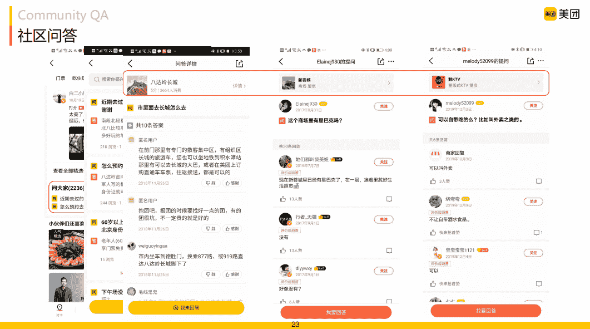

在问大家数据中，每个商户下通常存在多个问题，且每个问题下有多个用户回答的答案。如图所示，对于八达岭长城，有2000多个大家问的问题，"市里面去长城怎么去"问题下有10条不同用户回答的答案。由于社区问答中知识分享并不存在义务性，有价值的问答中往往混杂有大量无意义的信息，甚至语义相左的答案。如关于新荟城"这个商场里有星巴克吗？"答案中既有肯定的回答，也包含"好像没有"等

用户回答的质量参差不齐，如何挑选出好的答案，就非常重要

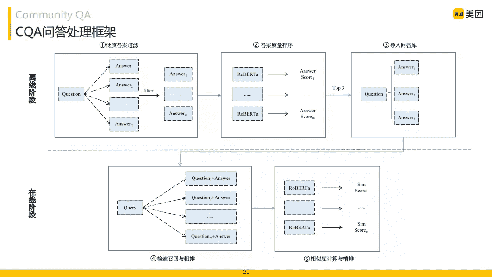

`CQA`问答系统处理框架如上图所示， 将问题处理分为两个阶段，首先离线阶段通过低质量过滤、答案质量排序等维护一个相对质量较好的问题-答案库，在线阶段，从知识库中检索到答案并回答用户

#### 答案质量过滤

由于问大家数据中用户回复答案质量的参差不齐，需要过滤掉与问题无关的低质量答案，保留相关性强的答案。 采用了如下方法保证答案质量：

+ 低质量答案过滤

1. 问大家数据中存在一些无意义、广告、不礼貌等低质量答案，严重影响答案质量和用户体验。 通过对问答数据分析并总结出一些广告、不礼貌的敏感词和`Pattern`,通过`Pattern`匹配的方式过滤

1. 总结一些表示无意义信息的关键词，更新到停用词表中，通过计算答案中停用词占比方式对无意义答案进行过滤

+ 答案质量排序

1. 除了对低质量问题过滤外， 期望对有多个答案的情况进行相应的排序。将质量更好的答案排在前面。基于`Pairwise`方式的排序模型其训练目标不仅要将候选答案分类到正确的类别，更关注于将`Top K`的结果排在前面，这与业务目标一致，因此 使用基于`Pairwise`方式的`RoBERTa`模型对答案质量进行排序

在训练阶段，给定一个问题`Q`和两个候选答案`A1`和`A2`，组成三元组 (`Q`,`A1`,`A2`) 输入到模型中，其中第一个候选答案`A1`比第二个候选答案`A2`质量要好。在模型训练时，这个三元组被拆分为两个问答对 (`Q`,`A1`) 和 (`Q`,`A2`)。每个问答对 (`Q`,`A`) 通过`[SEP]`标识符分割，并在问题前加入`[CLS]`，最终以`[CLS] Q [SEP] A [SEP]`的形式输入到`Bert`模型中。然后得到`[CLS]`的输出作为问答对的表示，经过一个全连接层和`Softmax`得到问答相似度值。 将两个候选答案的交叉熵损失和合页损失作为最终的损失函数。在预测阶段，将问答对输入到模型中得到文本相似度值，根据这个值对同一问题下的不同答案排序，从而选出Top答案

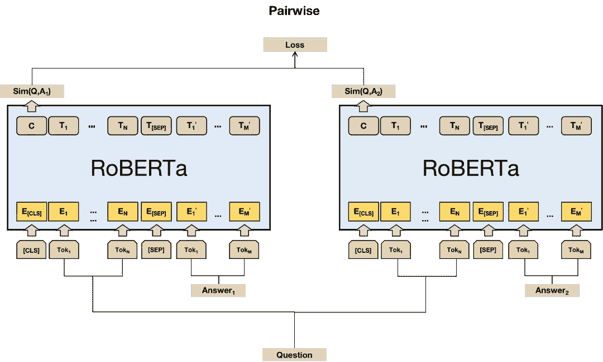

#### 在线问题匹配

在线阶段解决的是将用户的问题与知识库知识进行匹配的问题。同时考虑文本相关性和语义相关性，将问题匹配分为召回和精排两步：

+ 第一步检索召回候选问题并进行粗排

+ 第二步根据语义相似度对候选答案进行精排，返回`Top-K`问题和对应答案

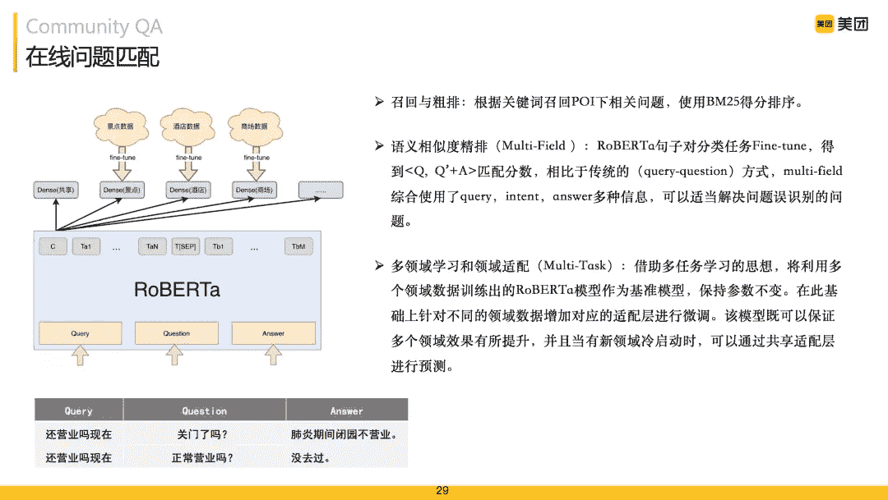

在任务中涉及到景点、酒店、商场等多场景，多领域知识适配任务突出。模型框架首先建模成`Multi-Task`架构，所有领域数据训练出一个共享参数，解决新领域与冷启动的问题，同时不同的领域，也会得到各自领域的参数，提升各自领域效果。除此之外，也发现只计算用户的`Query`和问答对里问题的相似度，是不太够的。答案往往也能帮助更好的去理解问题。上图中"还营业吗现在"的问题，语义上"正常营业吗？"比"关门了吗？"更相关，但从答案"肺炎期间闭园不营业"和"没去过"中很容易辨识出第一条答案更相关。因此建模时将答案也考虑进去，采用`Multi-Field`框架。最终 的模型为`Multi-Field Multi-Task RoBERTa`模型

### KBQA

在商户页面上还存在营业时间、地址、套餐价格等结构化信息，商场商户下还存在各商铺楼层分布、主营商品等信息，这类结构化信息源采用基于知识图谱的问答方式来回答用户问题。`KBQA`是一种基于知识图谱的问答技术，其主要任务是将自然语言问题 (`NLQ`) 通过不同方法映射到结构化的查询，并在知识图谱中获取答案。相比非结构化文本问答方法利用图谱丰富的语义关联信息，能够深入理解用户问题、解决更多复杂推理类问题

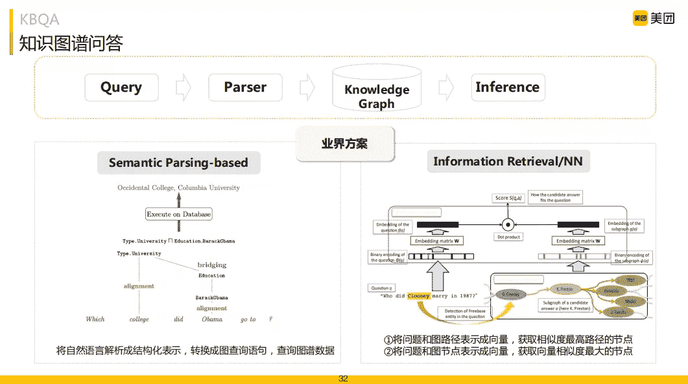

主流的`KBQA`解决方案包括：基于查询图方法 (`Semantic Parser`)、基于搜索排序方法 (`Information Retrieval`)

查询图方案核心思想就是将自然语言问题经过一些语义分析方式转化成中间的语义表示 (`Logical Forms`)，然后再将其转化为可以在 `KG` 中执行的描述性语言 ( 如 `SPARQL` 语言 ) 在图谱中查询，这种方式优势就是可解释强，符合知识图谱的显示推理过程。搜索排序方案首先会确定用户`Query`中的实体提及词 (`Entity Mention`)，然后链接到 `KG` 中的主题实体 (`Topic Entity`)，并将与`Topic Entity`相关的子图 (`Subgraph`) 提取出来作为候选答案集合，通过对`Query`以及`Subgraph`进行向量表示并映射到同一向量空间，通过两者相似度排序得到答案。这类方法更偏向于端到端的解决问题，但在扩展性和可解释性上不如查询图方案。在美团场景里采用以`Semantic Parser`方法为主的解决方案

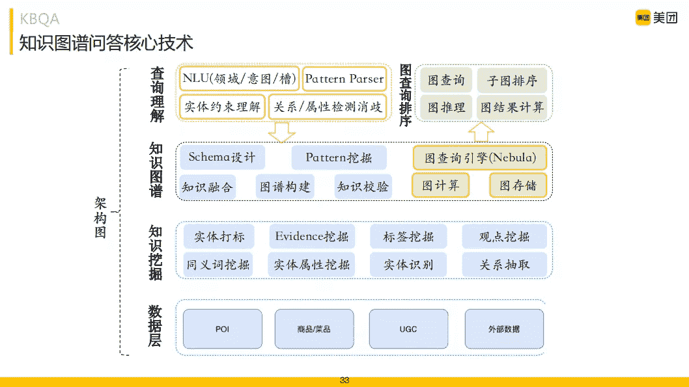

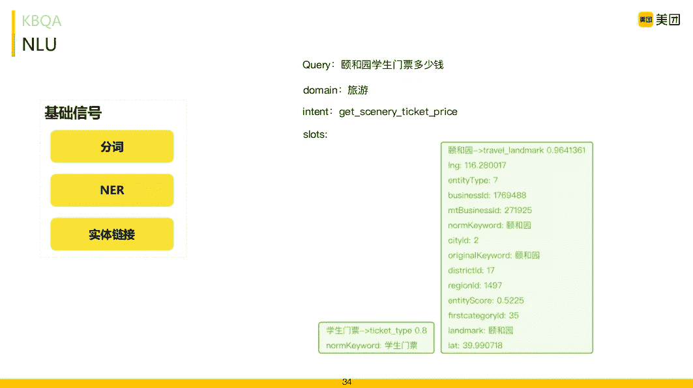

知识图谱问答核心技术共分为四层，数据层、知识挖掘和知识图谱层为知识图谱构建常见架构，知识图谱问答的关注重点为上层查询理解、图查询及图排序部分

+ 在对话理解阶段， 已将用户输入的`Query`理解成领域、意图和槽位的形式

比如"颐和园学生门票多少钱"理解为门票意图，"颐和园"是`travel_landmark`，"学生门票"是`ticket_type`。在`KBQA`的查询理解阶段 只需要解决好关系/属性检测和消歧、实体约束理解

+ 对于图谱问答来说，如何检测出图中关系？

一种是定义关系`Pattern`，建立`Pattern`和关系的映射关系；另一种是将关系检测定义为分类任务，或者是匹配任务，每种关系提前维护好可能全的不同说法，通过计算用户`Query`与关系说法的相似度匹配来确定关系。它的一个好处就是对冷启动非常友好，而分类通常需要构建大量的训练数据集，冷启动不友好。关系检测 采用了`Pattern`和说法匹配相结合的方式

### 约束理解建模为依存理解问题

相比通用的依存理解，依据业务场景将关系数量缩减到只有六类，主实体、并列关系、谓词信息、主实体约束、谓词约束和无意义词。模型选择上采用比较经典的`Deep Biaffine`模型，在这里通过在输入层加入`NER`的特征，如图右上角所示，指标上有较大的提升。

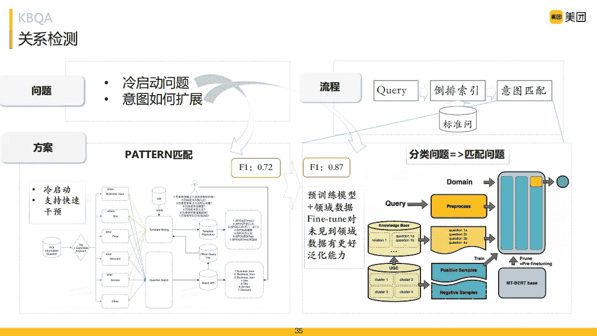

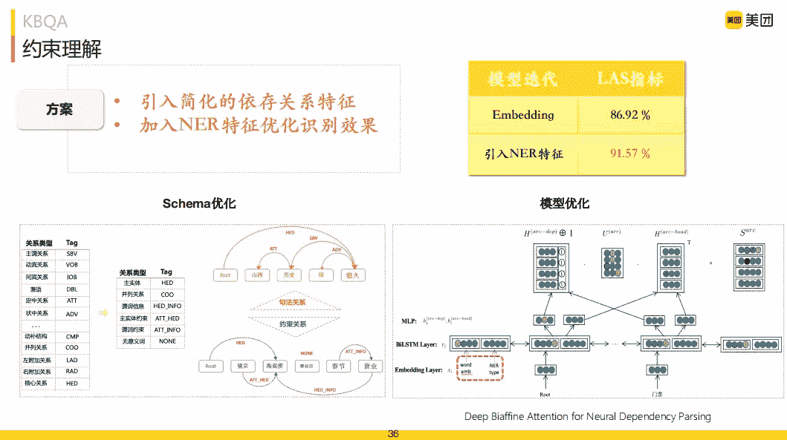

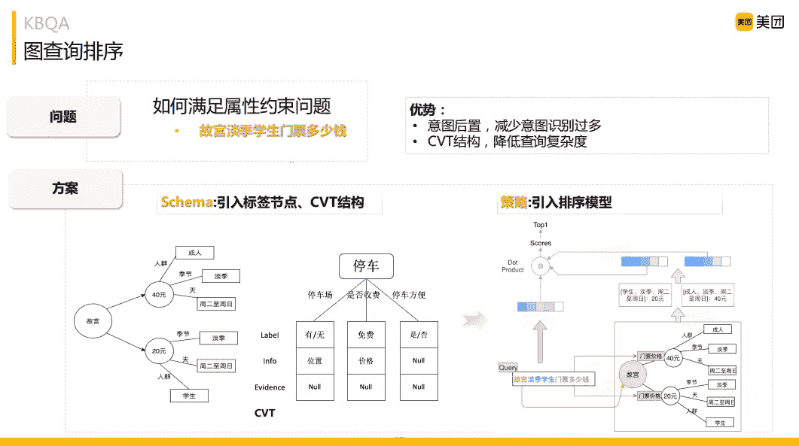

图查询排序方面，首先引入标签节点、`CVT`结构，将约束关联到节点上。比如"故宫成人票多少钱"，它的意图是问故宫价格，如图左下角所示，成人票是价格的一个约束，建模时把约束"成人"建在"价格"的节点上。在线查询时，通过一跳就能查询到价格节点， 要做的事情就是约束匹配，找到一条最优的路径；再就是引入排序模型，排序解决的就是选择含约束条件的最优路径。这样常见的约束可以比较快的整理出来，不常见的约束也可以作为约束节点加进去，因排序模型解决了相似计算问题，对于未见过的约束类型也同样生效

# 多`QA`答案融合排序

上述问答模块在回答范围上各有侧重，但对于同一个用户问题，不同的问答模块都有可能返回候选答案，如下表格中例子所示，有多个候选答案，如何做出选择。

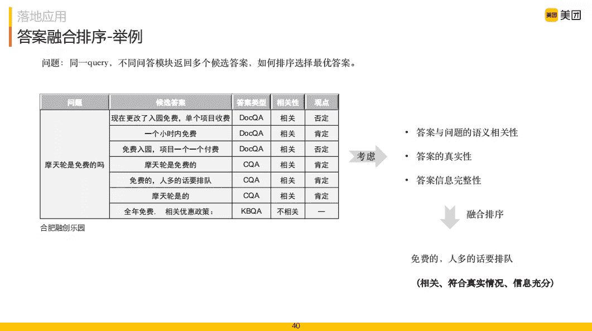

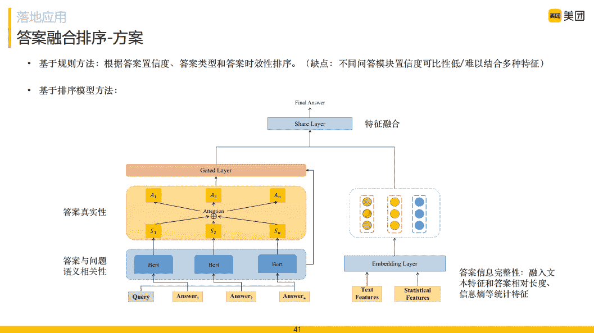

> 在答案选择时主要考虑以下三个因素：

### 答案与问题的语义相关性

> 希望选择与问题在语义上最相关的答案

### 答案信息完整性

> 希望答案能够完整地回答问题，而不仅仅回答问题的一个方面 ( 如问题"停车是否方便"，回答"停车方便，有免费停车场"比仅回答"停车方便"更好 )

### 答案的真实性

> 多个答案在观点上可能存在相互矛盾， 需要选择最接近实际情况的答案

# 落地应用示例

## 问答助手

在问景点、问酒店、问商场等生活服务场景中，问答助手可以回答用户如"去哪玩"、"住哪家酒店"等相关问题，辅助用户行前决策

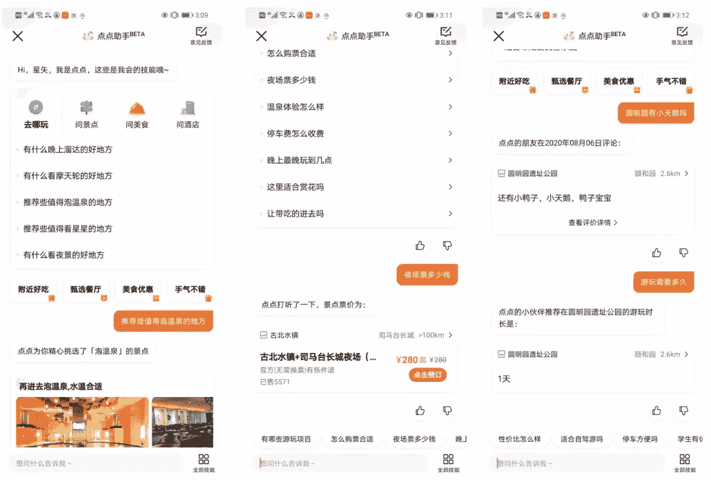

## 问答搜索

搜索仍然是当前主要获取信息的手段，问答搜索解决搜索中用户的问答诉求，提升搜索质量和用户满意度

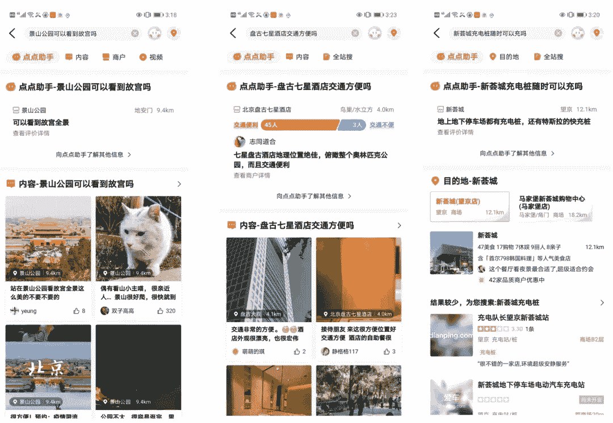

## 景点门票购票智能客服

在景点门口为无人售票带来温度，在景点门口通过扫码美团买票在线完成现场购票，智能客服完成用户相关问题答疑，减少地推人员工作量

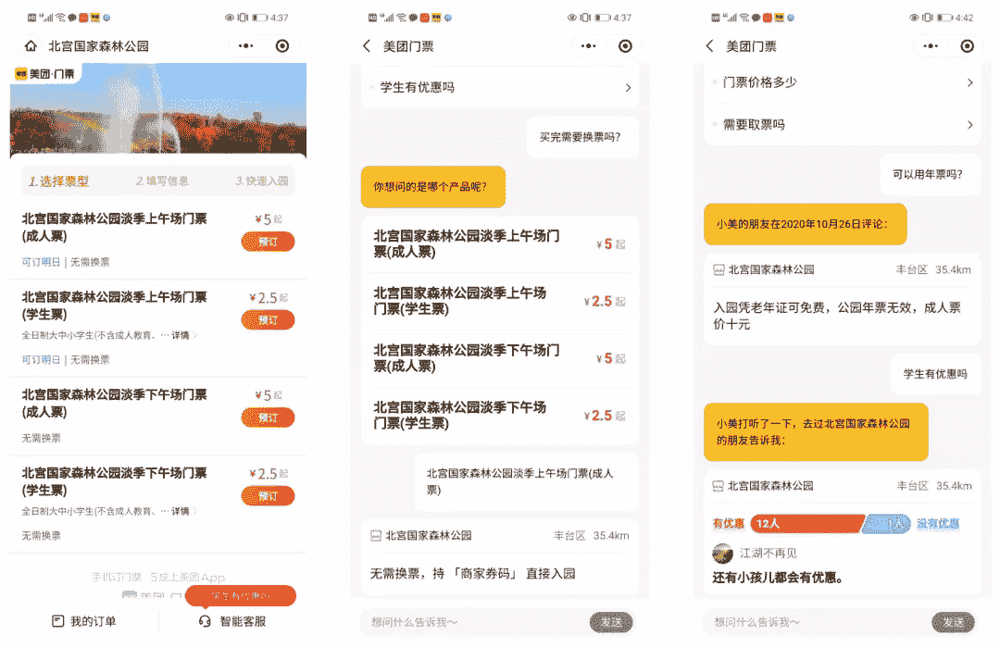

## 问大家

在问大家模块中，通常用户新问的问题很难有其他用户能及时回答，智能问答可以有效整合商户相关信息给出答案，及时解答用户的疑问，提升用户体验

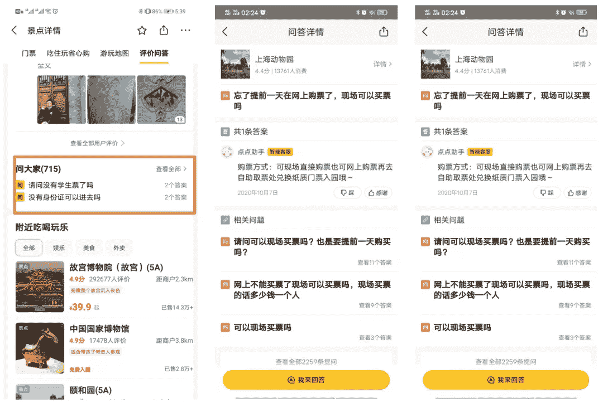
