# 基于知识图谱的问答在美团智能交互场景中的应用和演进

> 来源：[https://qqs7y1hozd1.feishu.cn/docx/IQQOd7H4hoFcvfxUTm8cnBeqnYD](https://qqs7y1hozd1.feishu.cn/docx/IQQOd7H4hoFcvfxUTm8cnBeqnYD)

**目前为止 IT 产业经历了六次浪潮，分别为：大****型机时代，小型机时代，个人电脑时代，桌面互联网时代，**移动互联网时代和 AI**OT 时**代。在这些时代背后可以发现是人机交互方式的变化：从鼠键交互，到触控交互，再到语音智能交互，可以看到人机交互的方式在向更自然更直接化的方式演进。今天会和大家分享基于知识图谱的问答在美团智能交互场景中的应用和演进

今天的介绍会围绕下面三点展开：

+   **智能交互背景介绍**

+   **受限场景问答应用和演进**

+   **复杂场景问答应用和演进**

# **——智能交互背景介绍——**

#### **智能交互的划分**

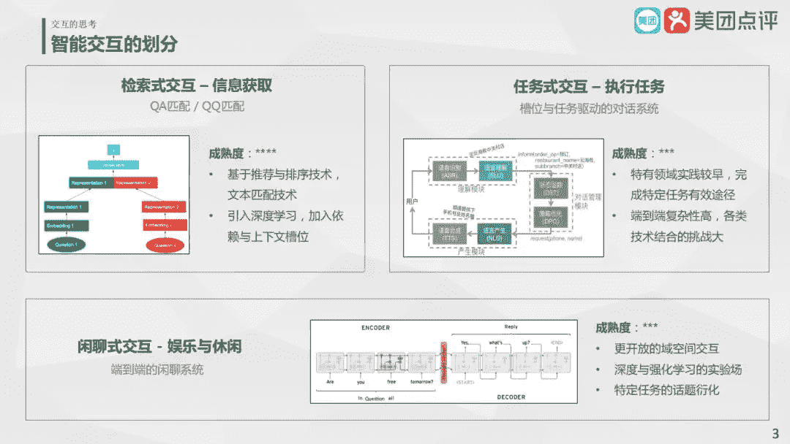

智能交互的划分基本上是根据人类需求拆分：

+   **检索式交互—信息获取，比较经典**的方法 FAQ：QA 匹配，QQ 匹配

+   **任务式交互—执行任务**，比如订机票 ( 酒店 ) 的特定任务

+   闲聊式交互—娱乐与休闲，**基于深度学习的端到端的学习系统**

#### **美团生活服务交互**

美团是做生活服务的公司，覆盖了餐饮、娱乐、酒店和旅游等各个生活领域，以上这么多种领域更适合哪种智能交互方式，以及智能交互方式是如何在场景中落地的，下文中都会进行说明

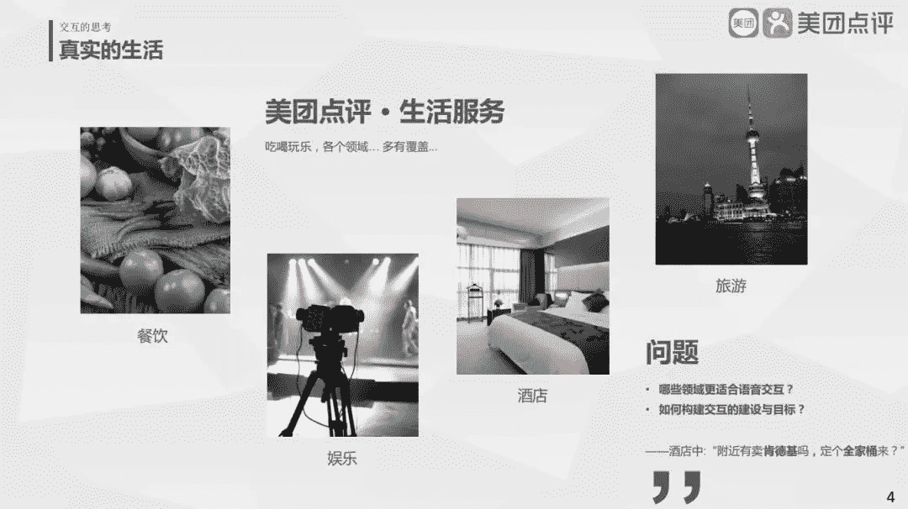

#### **美团 APP 中的交互**

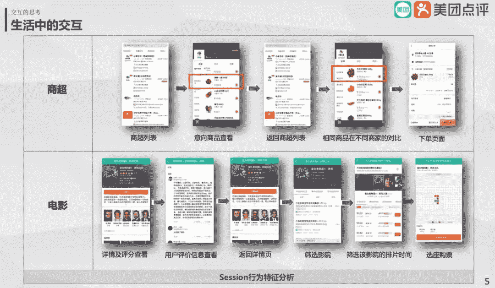

下面先举个例子，首先在商超场景下我们分析使用路径发现，接近4成的用户在商品** A 加入购物**车后，会去查看其他商家与商品 A 相似的商品。这个行为很明显是一个商品比较的诉求，而该诉求通过目前的功能交互方式很难完成

再举个例子，在打车场景下我们打车需要在 app 中进行12-14次页面交互，app 交互比较琐碎。而语言智能交互只需要简单的一句话就能完成，比如"帮我叫个快车，今天下午三点从天安门到北京西站"。

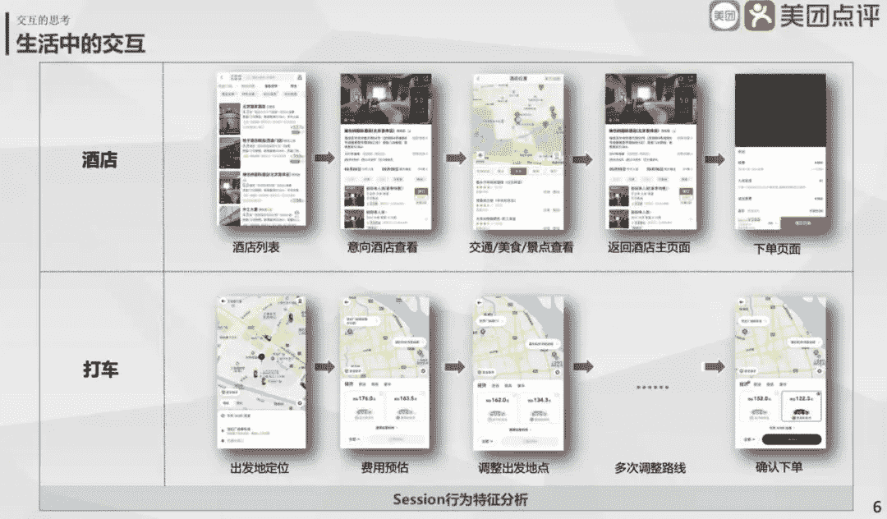

> 以上交互的场景对知识有重要的依赖，需要使用知识帮助人们完成选择：

+   **餐饮**：热门商家，人均价格，推荐菜，适合人群，食材等；

+   **商超**：附近商家，距离，促销商品，配送费，价格等；

+   **电影**：上映日期，导演，影片类型，影院，票价等；

+   **酒店**：房型，评价，星级，空调，早餐，价格等。

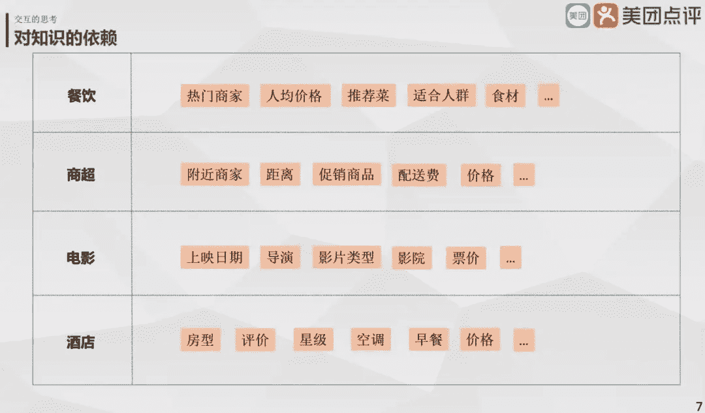

由于交互对知识有重要依赖，于是我们引入了基于知识图谱的问答 KBQA

#### **4. KBQA 特点**

由上表可以看到，KBQA 相对于其它技术的特点：

+   **数据准备：**KBQA 处于劣势，需要建构知识图谱，专业领域人参与并且较为复杂。

+   **数据管理**：KBQA 为知识结构易于管理和维护。

+   **意图判断**：KBQA 需要判断意图，定位到意图下面的子图，从而对子图进行检索，这样精度比较高。

+   **问题类型**：可支持多跳，带有约束的计算和推理，较为灵活。

+   **结果精准性**：由于知识结构，回答的精确性会比较高。

+   **轮次**：对于多轮问答能够很好完成。

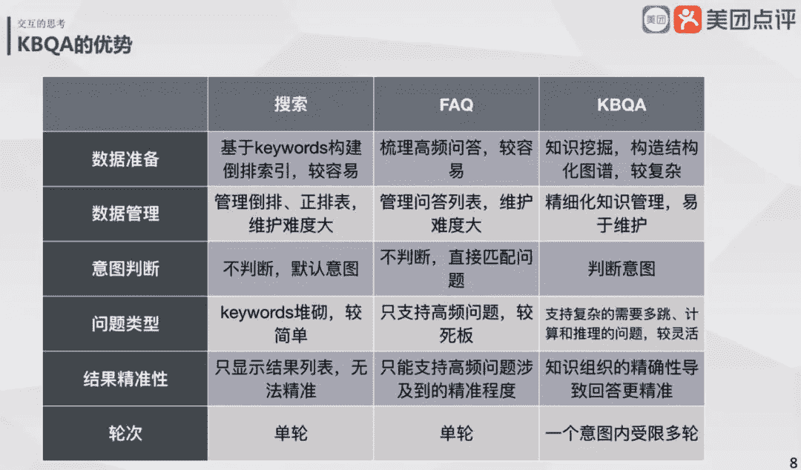

# **——受限场景问答——**

#### **1. 什么是受限场景**

受限场景有以下两个特征：

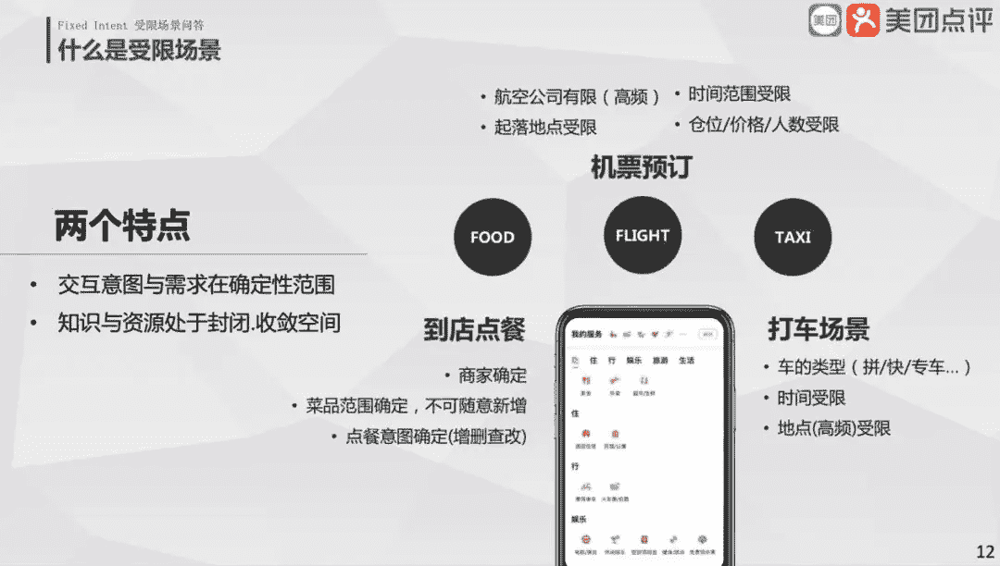

+   交互意图和需求在确定性范围

+   知识与资源处于封闭、收敛空间

> 例如到店点餐，点餐的意图确定，并且资源也是有限的，商家和菜品都是确定的；同样，机票预订起落地点、仓位、价格、人数也是有限的；打车意图是明确的，而地点可以任意选择不是受限的，但是可通过高频的地标建立受限的地点。

下面，会介绍一些受限场景具体实现方案

#### **2. 传统基于知识图谱的问答**

首先介绍的是传统基于知识图谱的问答，该类问答主要分成两大流派：

+   Semantic Parsing-based KB-QA

+   把用户的问题转换为机器的查询语句，直接查询知识图谱获取答案。

+   Information Retrieval-based KB-QA

+   使用端到端的方式解决问题。先抽取用户问题中核心信息，然后根据核心信息定位到图谱中确定子图 ( 子集 )，最后生成答案。生成答案有两种方式：

+   ① 子图的候选答案形成三元组逆向推导生成自然语言的问题和用户原始问题做匹配

+   ② 子图候选答案和周围的信息做 embedding 与原始问题 embedding 做匹配。

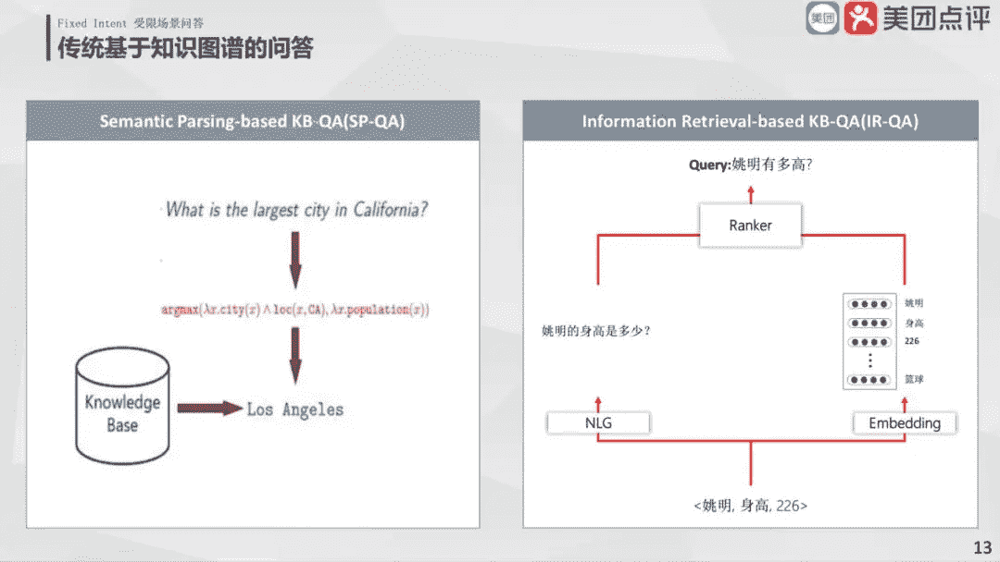

#### 3. Semantic Parsing

通过**《**Semantic Parsing on Freebase from Question-Answer Pairs, EMNLP 2013》这篇论文介绍 Semantic Parsing 的几个步骤：

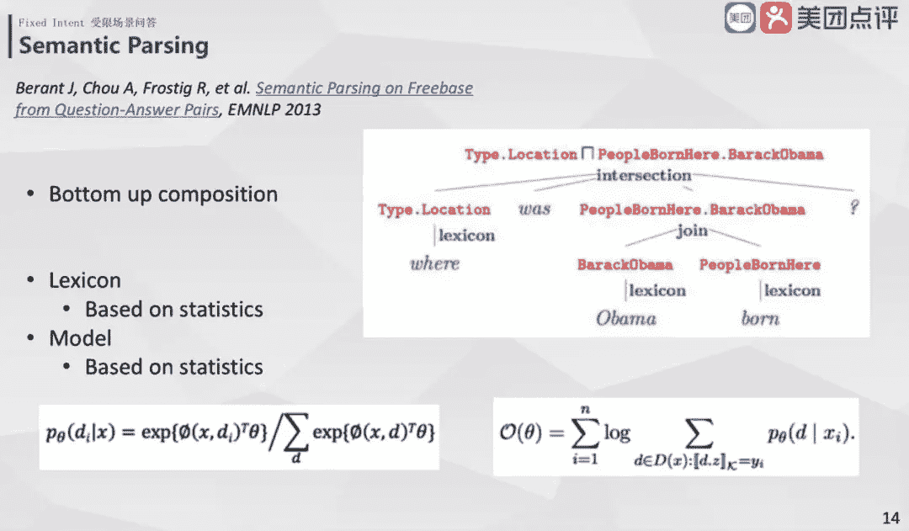

+   把问句的词语或者单词与知识库的实体或者关系进行映射，映射构成叶子节点。

+   直接对叶子节点使用链接、求交和聚合三种操作自下向上构建语法树。

+   这三种操作中会存在多颗语法树，需要构建一个分类器把正确的语法树区分出来。最终语法树的根节点则为输出的查询语句。

Semantic Parsing 会有一些局限，需要大量的自然语言逻辑表达式的标注，并且只能满足有限的场景和逻辑表达。而 Information Retrieval 可以改进 Semantic Parsing 的限制。

#### 4. Information Retrieval

同样，通过《Question Answering over Knowledge Base with Neural Attention Combining Global Knowledge Information, arxiv 2016》阐述 Information Retrieval 的几个步骤：

+   问题编码，问题使用双向 lstm 并加入答案的 attention 编码；

+   答案编码，把所有答案分成四块进行编码，分别为答案本身编码，答案到实体边的关系编码，答案类型编码和答案上下文编码；

+   匹配，使用问题编码和答案编码进行匹配，最终输出排名最高的作为匹配答案。

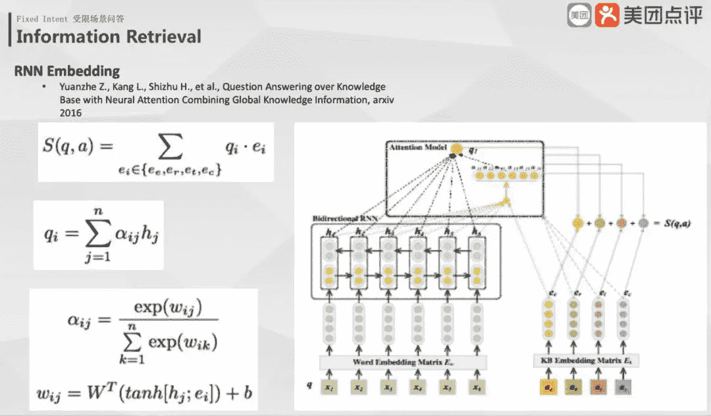

1.  **效果比较**

在 WebQuestion 数据集可以看到，Semantic Parsing+DeepLeanring 效果表现最好 f1 值在45-55之间。Information Retrieval 的端到端在复杂问题处理上表现不太好。

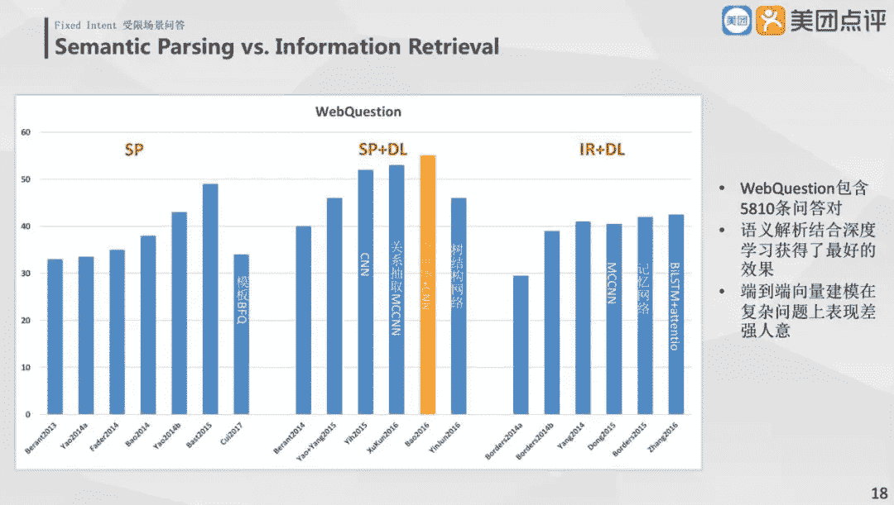

1.  **面向美团场景**

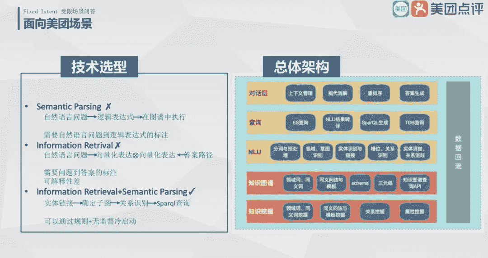

针对美团的场景技术如何选型呢？首先美团领域比较多，但是每个领域之间的关联不是很强，其次模型的训练样本也比较少，希望能快速实现领域之间迁移。Semantic Parsing 需要大量的自然语言标注样本，而 Information Retrieval 的可解释性在目前工业界稍微差些。

我们做法将这两者技术流派优点结合起来，通过 Information Retrieval 精确定位到有限空间的子图中，Semantic Parsing 生成可解释性的查询语句。那么技术步骤为首先做实体识别和链接，其次确定子图，之后做关系识别，最后 SparQL 查询输出结果。这样的优点为可通过规则和无监督冷启动快速进行迁移。

1.  **小结**

在受限场景的问答，其特征为资源内容、交互轮次、知识外延和意图都是有限的；它可以实现基础属性问答、带约束的资源查询、动态属性值计算和资源信息比较。

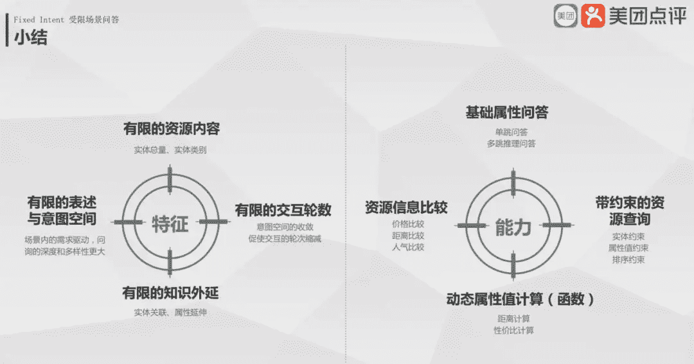

# **——复杂场景问答——**

1.  **复杂场景定义**

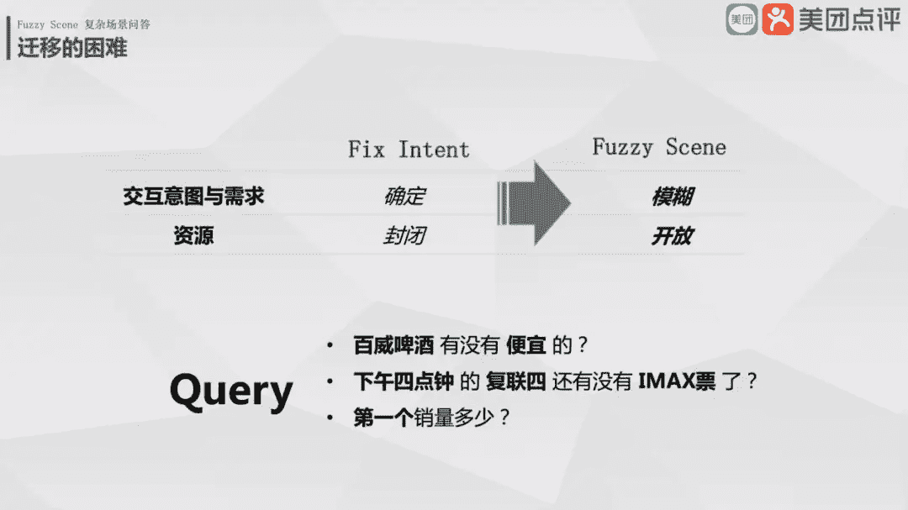

在美团，绝大多数都是复杂场景的问答。与简单场景相比，其交互意图与需求从确定的空间到模糊的空间，资源从封闭的数量到开放的数量。

这里举三个例子：

> **"百威啤酒**有没有**便宜****的？"，**在商家点餐的受限场景下**，百威啤**酒指代就是商家所卖的几款百威**啤酒；但**是在智能音箱的复**杂场**景，百威啤酒指代的是家**旁边**的超市所**卖的百威**啤酒还是旁边酒吧做活动的百威啤酒呢？

> **"下午四点钟**的**复联四**还有没有 **IMAX 票**了？"，假设已经识别**复联四**为一个电影，**下午四点****的时间如何与**电影关联起来，另外 IMAX 票为影厅的一个属性如何与电影关联起来呢？

> **"第一个****销量多**少？"，很明显用户在多轮问题所问的，那么第一个指代的是什么呢？

1.  **方案概述**

以上三个例子，我们可以归纳成三大问题：实体爆炸、非连通查询和融合上下文

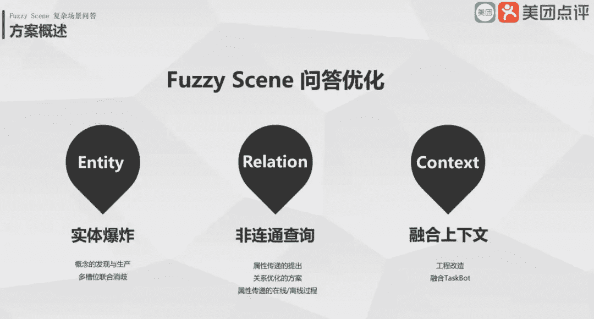

1.  **知识建设面临的挑战**

我们先介绍实体爆炸的问题。**传统的开放域知识图谱是根据实体上层的概**念节点 ( 抽象物理空间 ) 去建设的。比如：宫保鸡丁、青岛啤酒、复联四，它们不是商家卖的商品，就是一个抽象的概念。但是美团场景下，面临了挑战，比如：青岛啤酒原浆 5L 桶装 ( xxx超市，条形码:yy… )，青岛啤酒10度 500ml ( xxx超市，条形码:yy… ) 等这些都是实实在在商家卖的商品。这些实体如何与用户资源关联起来，并且把这些实体汇聚起来？

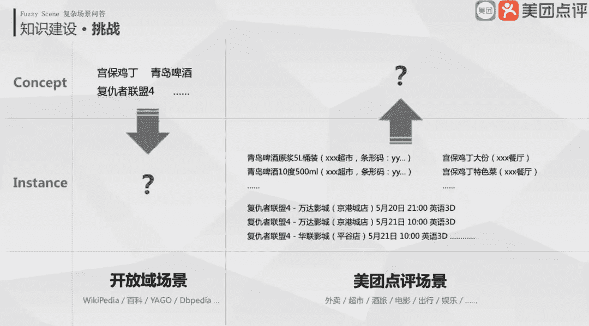

1.  **三层概念节点**

我们提出三层概念节点：产品/标品、同构非标品和异构纯概念

+   **产品/标品**

能区别不同商品类别的属性称为标品类概念，比如条形码可对商品做明确的区分，除此之外还有名称、尺寸和规格等等属性，这些属性一致就称为同类商品。

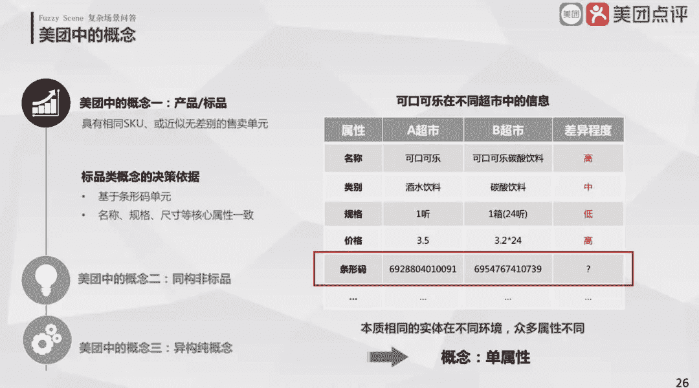

+   **同构非标品**

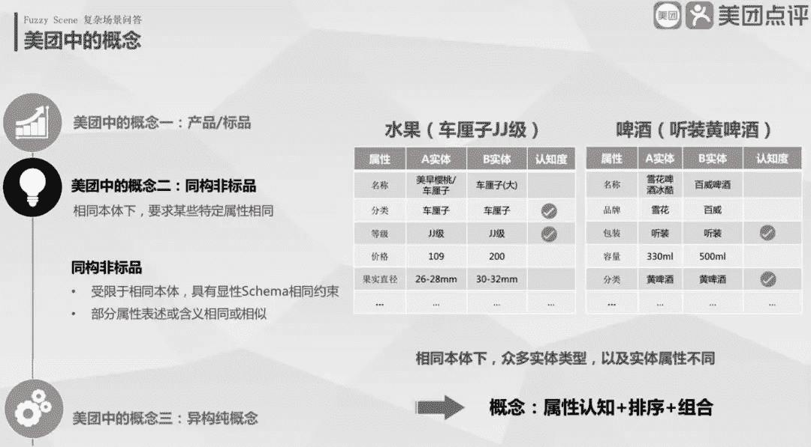

其定义为相同本体下，要求某些特殊属性相同。没有明确的属性做商品类别的区分，但是特殊的属性可以做区分，比如青岛啤酒、车厘子 JJ 级等，他们的品牌相同，等级相同、类型相同。这些概念可以作为商品检索词

+   **异构纯概念**

异构纯概念脱离了本体的概念，是由人类自行组织构建，形成的认知。比如消费的人群、消费的商圈，称之为异构纯概念。其给予场景化问答提供非常大的帮助。

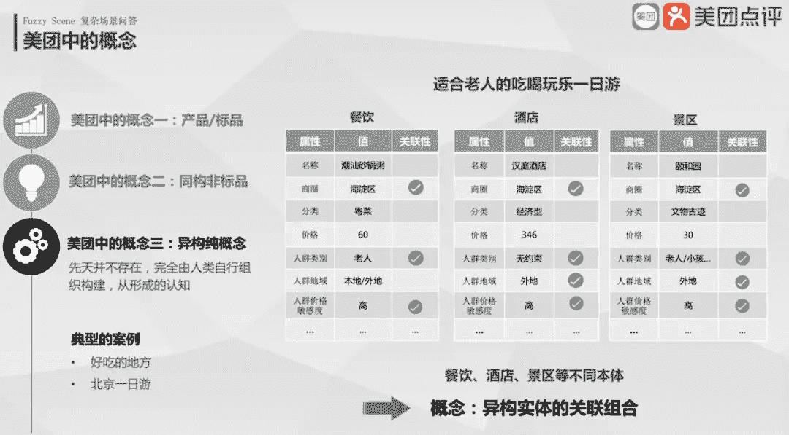

1.  **概念存储**

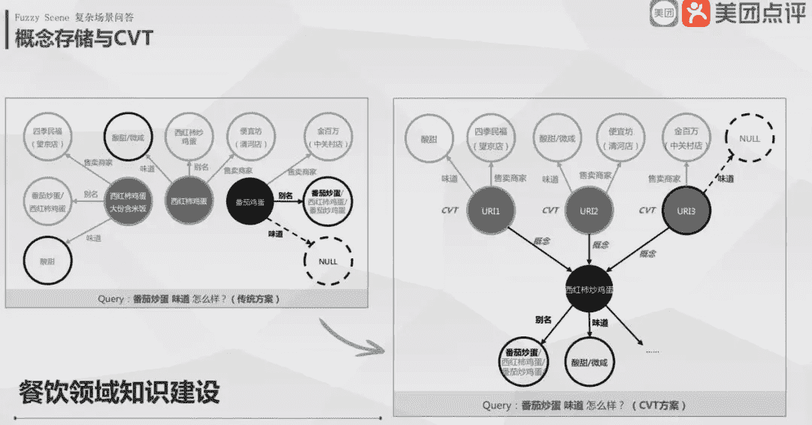

我们借鉴了 Freebase CVT 的存储，将概念节点当作节点，真实售卖的商品为概念节点的 CVT 子节点，把 CVT 相似的属性比如名称和品牌等抽取出来作为概念的属性

1.  **概念引入效果**

**① 实体链接的优化**

举**个例子，咖啡在没有概念的情况下，我想要咖啡会链接到很多资源 ( 咖啡类、咖啡店**和超市卖的速溶咖啡等 )；当概念引入后，会链接到概念节点上，再基于概念做链接和消歧，那么就能直接链接到商家、品类和商品上，并且若用户没有召回资源的真实诉求，不会进入下一个实体层去查询。

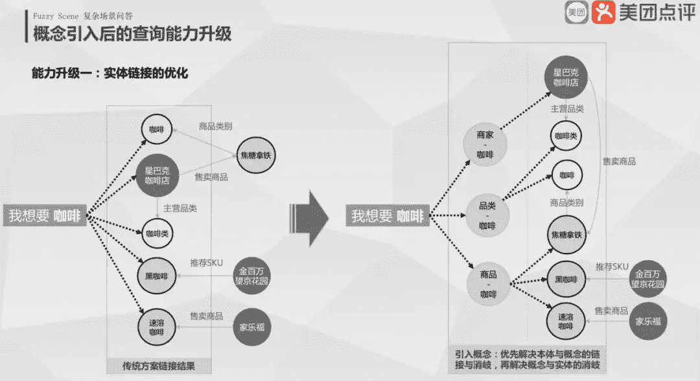

② 优化信息查询和对比类查询能力

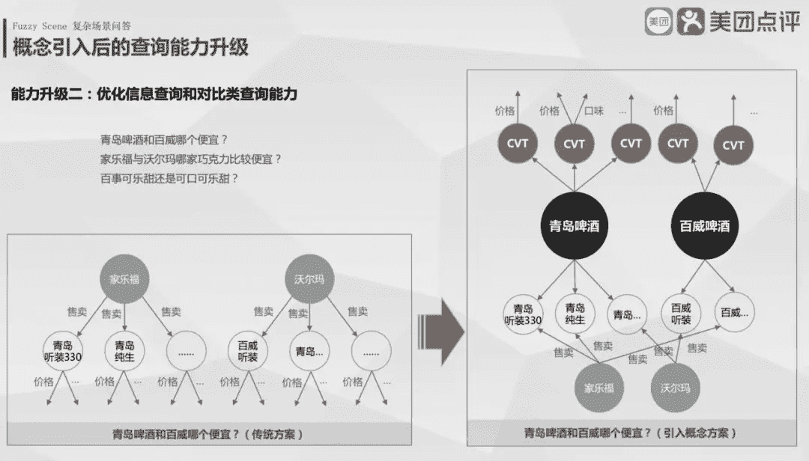

假设用户查询"青岛啤酒和百威啤酒哪个便宜"在没有概念的情况下，要查询成千上万个商品去做比较，但是概念的引入，只需要在概念层进行比较

**③ 缺失属性补全**

用户在金百万 ( 中关村店 )，问番茄炒蛋味道如何？假设知识图谱不存在番茄炒蛋在这家店的味道，该如何回答呢？

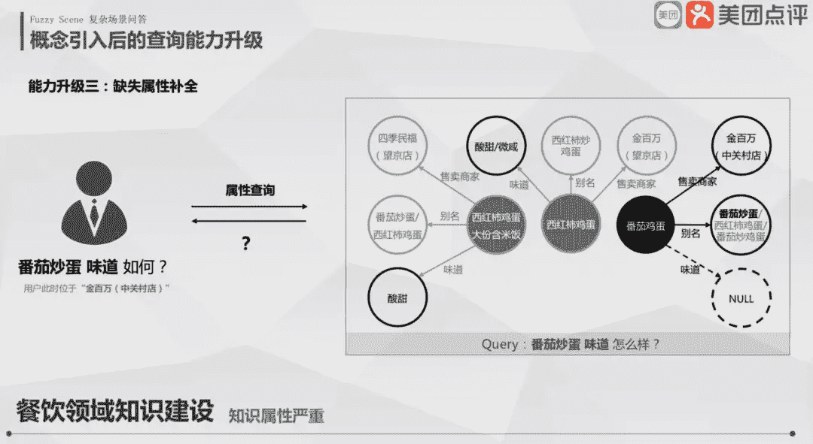

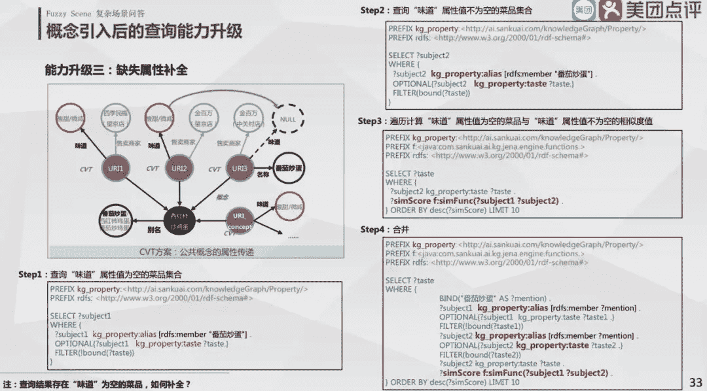

有两种方式：

> 第一，若存在番茄炒蛋概念且这个概念有味道属性，可使用这个概念的味道属性填充该问题；

> 第二，更好的方式：找到用户问题最相似的子节点，即金百万 ( 中关村店 ) 的子节点，发现其定义了番茄炒蛋和其味道属性，可拿该味道进行填充。

1.  **非连通查询**

> 在非连通查询中会存在属性传递 ( 传递约束 ) 的问题，举几个例子：

+   "我想吃簋街的小龙虾"，簋街为一个商圈其不能与小龙虾直接相连接；

+   "帮我找个辣的餐厅"，辣为菜的口味不能与餐厅直接相连接；

+   "帮我看一下下午4点复联四还有没有票"，复联四与排片时间也不能直接关联。

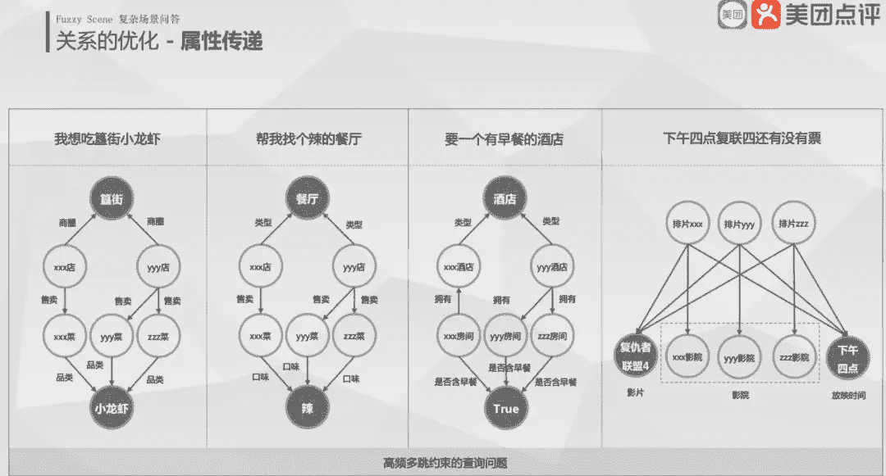

**① 属性传递**

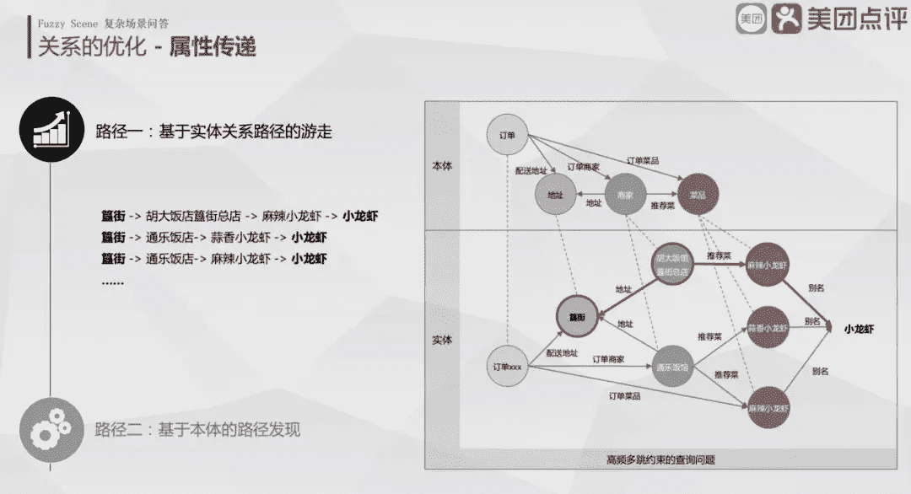

> 路径游走有两种方式：

+   一是实体关系路径游走，例如"簋街 -> 胡大饭店簋街总店 -> 麻辣小龙虾 -> 小龙虾"。

+   二是本体的路径发现，游走方式为"簋街 -> 地址(本体)-> 订单(本体)-> 菜品(本体)-> 小龙虾"。

**② 在线路径查询**

基于上面路径发现之后，融入到现有的流程中**，当用户输**入"帮我找个辣的餐厅"，首先做路径的发现，"餐厅->类型->眉州东坡->推荐菜->毛血旺->口味->辣"，再形成 SparQL 查询语句，得到结果就能回答用户的问题

**③ 离线关系发现**

既然眉州东坡大多数推荐菜的口味是辣的，那么可以构建眉州东坡口味的边为辣。同样发现簋街多跳之后特色菜为小龙虾，那么也可以构建簋街的特色菜为小龙虾.....由此可见，在离线把边补充足够成分，那么在线路径查询的压力要小很多

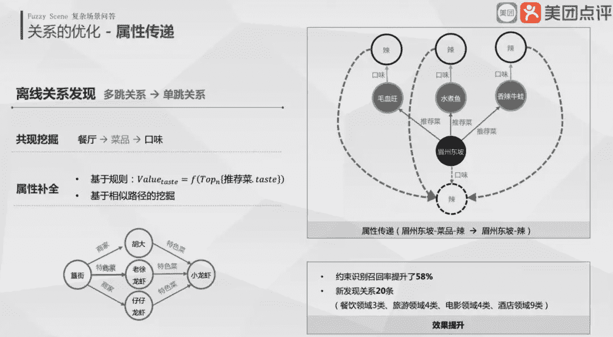

1.  **融合上下文**

**用户在外卖点餐的真实场景中，**首先通过任务型交互给到用户的商家列表**，用户可选择商家以及对**应的菜谱，然后从购物车里筛选内容，最后下单。这个场景为状态迁移的多轮交互任务。我们想在该场景中融合问答，那么用户在商家状态下问该商家的推荐菜品，在菜品状态问菜品口味，在购物车状态问优惠券，也可以在下单后问订单的状态。那么可以将任务型多元交互系统和问答系统融合起来。

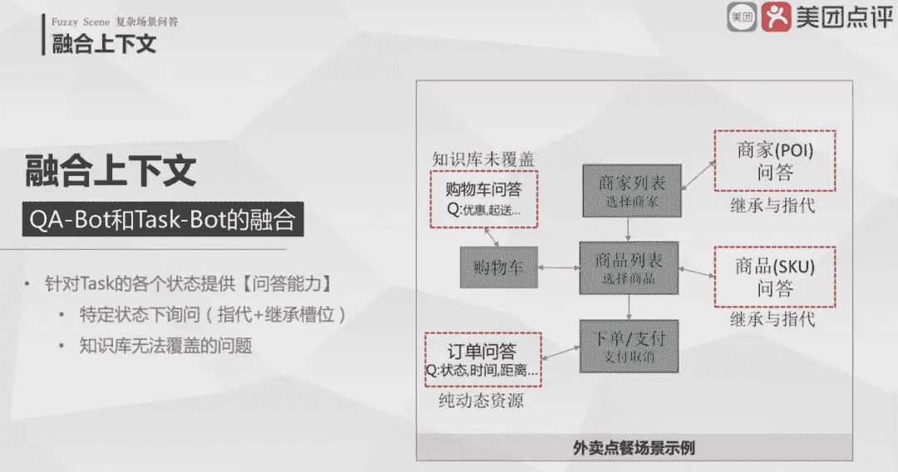

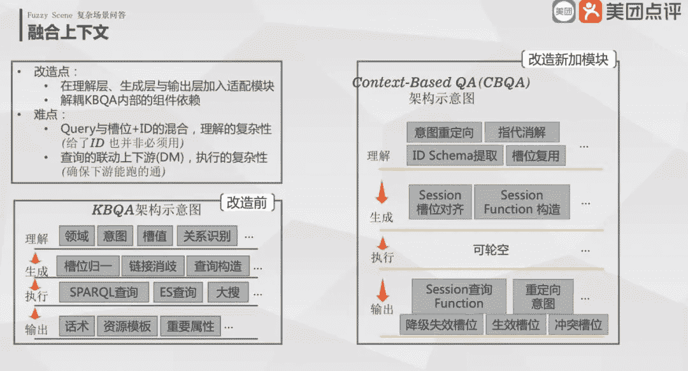

我们提出了两点改造：

+   **理解层、**生成层和输出层适配多轮交互模块。

+   解耦 KBQA 内部组件，可独立被外部模块调用。

> 在改造过程中遇到两个难点：

+   **理解复杂性提升**，需要理解上下文的传入槽位、id 与意图。

+   **执行复杂性提升，**融合了问答之后任务状态可随时打断或者变更。

> 具体的架构改造为：

+   **理解层，**加入了意图重定向、指代消解、ID Schema 提取和槽位复用等。

+   **生成层，**Session 槽位对齐、Session Function 构造等。

+   **输出层，**不会输出答案本身，而是输出查询 Function 和意图。

1.  **小结**

**在复杂场景问答中，表述与意图空间、资源内容、交互轮数、知识外延都是宽泛的**。在该场景下不仅仅只有优化算法本身，还需要知识建设和多轮交互系统做一个联动的优化

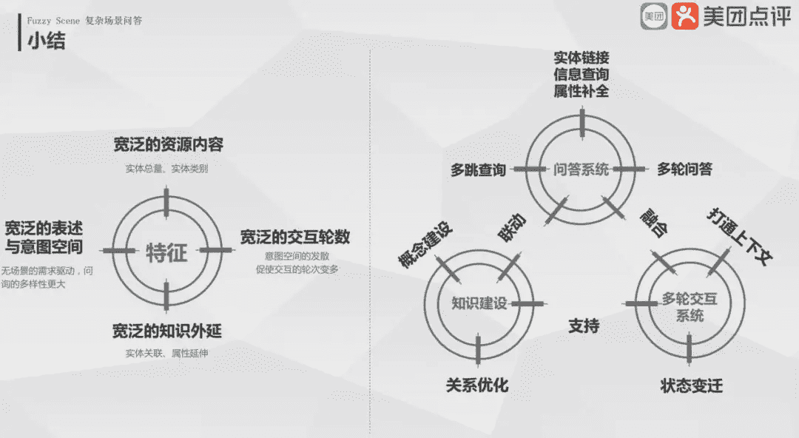