# 美团智能搜索模型预估框架 Augur 的建设与实践

> 来源：[https://qqs7y1hozd1.feishu.cn/docx/B0qldjgFVoM4Y9xrzyJcbxcrn6d](https://qqs7y1hozd1.feishu.cn/docx/B0qldjgFVoM4Y9xrzyJcbxcrn6d)

## 背景

搜索优化问**题，是个典型的 AI 应用问题，而 AI 应用问题首先是个**系统问题。经历近 10 年的技术积累和沉淀，美团搜索系统架构从传统检索引擎升级转变为 AI 搜索引擎。当前，美团搜索整体架构主要由搜索数据平台、在线检索框架及云搜平台、在线 AI 服务及实验平台三大体系构成。

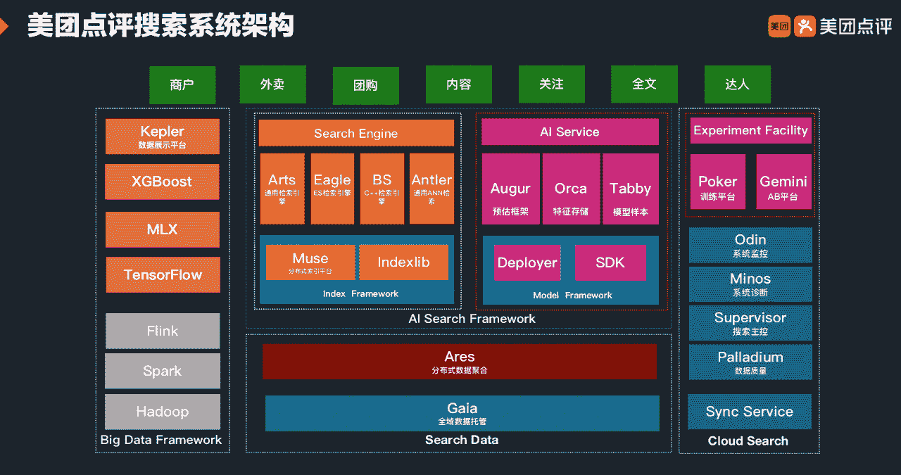

在 AI 服务及实验平台中，模型训练平台 Poker 和在线预估框架 Augur 是搜索 AI 化的核心组件，解决了模型从离线训练到在线服务的一系列系统问题，极大地提升了整个搜索策略迭代效率、在线模型预估的性能以及排序稳定性，并助力商户、外卖、内容等核心搜索场景业务指标的飞速提升。

首先，让我们看看在美团 App 内的一次完整的搜索行为主要涉及哪些技术模块。如下图所示，从点击输入框到最终的结果展示，从热门推荐，到动态补全、最终的商户列表展示、推荐理由的展示等，每一个模块都要经过若干层的模型处理或者规则干预，才会将最适合用户（指标）的结果展示在大家的眼前。

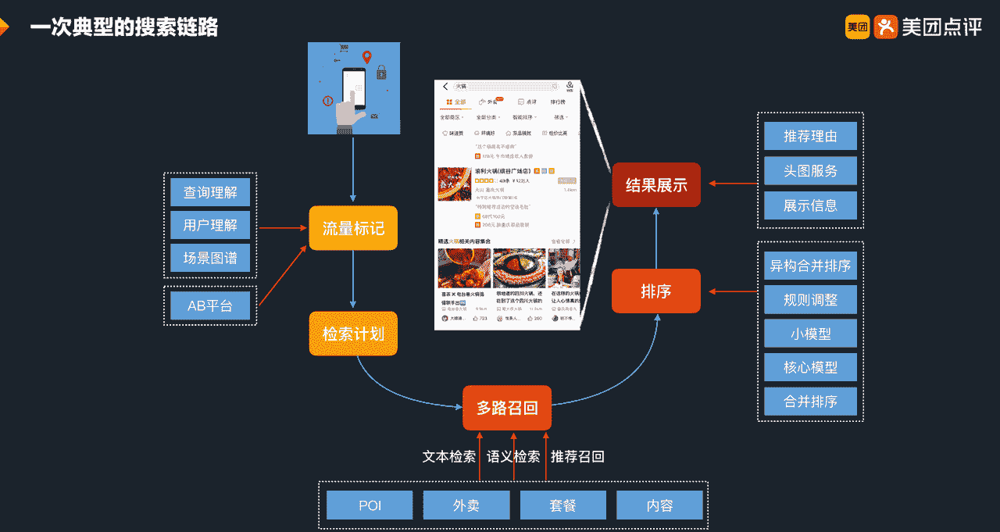

为了保证良好的用户体验，技术团队对模型预估能力的要**求变得越来越高，同时模型**与特征的类型、数量及复杂度也在与日俱增。算法团队如何尽量少地开发和部署上线，如何快速进行模型特征的迭代？如何确保良好的预估性能？在线预估框架 Augur 应运而生。经过一段时间的实践，Augur 也有效地满足了算法侧的需求，并成为美团搜索与 NLP 部通用的解决方案。下面，我们将从解读概念开始，然后再分享一下在实施过程中我们团队的一些经验和思考。

## 抽象过程：什么是模型预估

其实，模型预估的逻辑相对简单、清晰。但是如果要整个平台做得好用且高效，这就需要框架系统和工具建设（一般是管理平台）两个层面的配合，需要兼顾需求、效率与性能。

那么，什么是模型预估呢？如果忽略掉各种算法的细节，我们可以认为模型是一个函数，有一批输入和输出，我们提供将要预估文档的相关信息输入模型，并根据输出的值（即模型预估的值）对原有的文档进行排序或者其他处理。

纯粹从一个工程人员视角来看： 模型可以简化为一个公式（ 举例：f(x1,x2)= ax1 + bx2 +c ），训练模型是找出最合适的参数 abc。所谓特征，是其中的自变量 x1 与 x2，而模型预估，就是将给定的自变量 x1 与 x2 代入公式，求得一个解而已。（当然实际模型输出的结果可能会更加复杂，包括输出矩阵、向量等等，这里只是简单的举例说明。）

所以在实际业务场景中，一个模型预估的过程可以分为两个简单的步骤：第一步，特征抽取（找出 x1 与 x2）；第二步，模型预估（执行公式 ƒ，获得最终的结果）。

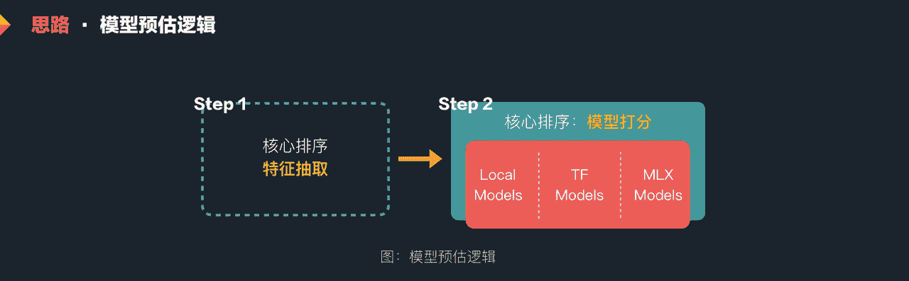

模型预估很简单，从业务工程的视角来看，无论多复杂，它只是一个计算分数的过程。对于整个运算的优化，无论是矩阵运算，还是底层的 GPU 卡的加速，业界和美团内部都有比较好的实践。美团也提供了高性能的 TF-Serving 服务（参见《基于 TensorFlow Serving 的深度学习在线预估》一文）以及自研的 MLX 模型打分服务，都可以进行高性能的 Batch 打分。基于此，我们针对不同的模型，采取不同的策略：

+   **深度学习模型** ：特征多，计算复杂，性能要求高；我们将计算过程放到公司统一提供的 TF-Serving/MLX 预估服务上；

+   **线性模型、树模型** ：搜索场景下使用的特征相对较少，计算逻辑也相对简单，我们将在构建的预估框架内部再构建起高性能的本机求解逻辑，从而减少 RPC。

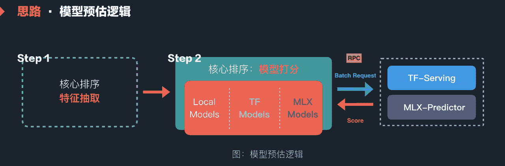

这一套逻辑很简单，构建起来也不复杂，所以在建设初期，我们快速在主搜**的核心业务逻辑**中快速实现了这一架构，如下图所示。这样的一个架构使得我们可以在主搜的核心排序逻辑中，能够使用各类线性模型的预估，同时也可以借助公司的技术能力，进行深度模型的预估。关于特征抽取的部分，我们也简单实现了一套规则，方便算法同学可以自行实现一些简单的逻辑。

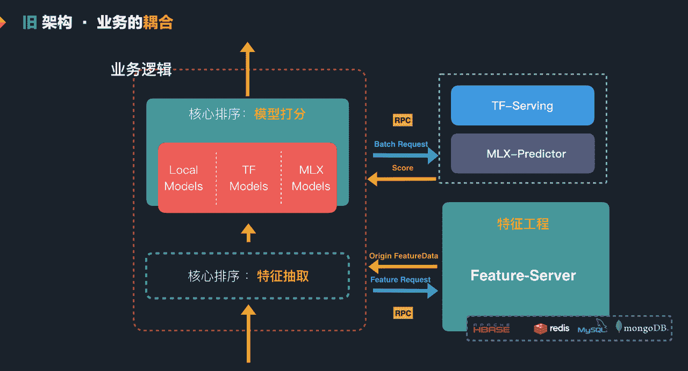

## 预估框架思路的改变

### 3.1 老框架的局限

旧架构中模型预估与业务逻辑耦合的方式，在预估文档数和特征数量不大的时候可以提供较好的支持。但是，从 2018 年开始，搜索业务瓶颈开始到来，点评事业部开始对整个搜索系统进行升级改造，并打造基于知识图谱的分层排序架构（详情可以参见点评搜索智能中心在 2019 年初推出的实践文章《大众点评搜索基于知识图谱的深度学习排序实践）。这意味着：更多需要模型预估的文档，更多的特征，更深层次的模型，更多的模型处理层级，以及更多的业务。在这样的需求背景下，老框架开始出现了一些局限性，主要包括以下三个层面：

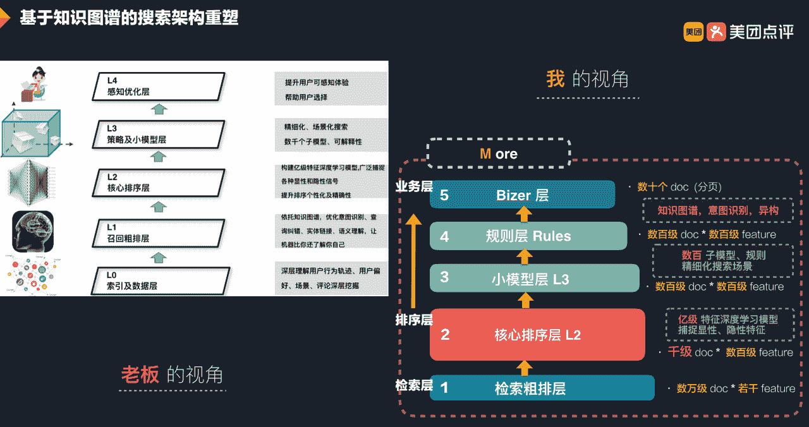

+   性能瓶颈：核心层的模型预估的 Size 扩展到数千级别文档的时候，单机已经难以承载；近百万个特征值的传输开销已经难以承受。

+   复用困难：模型预估能力已经成为一个通用的需求，单搜索就有几十个场景都需要该能力；而老逻辑的业务耦合性让复用变得更加困难。

+   平台缺失：快速的业务迭代下，需要有一个平台可以帮助业务快速地进行模型和特征的管理，包括但不限于配置、上线、灰度、验证等等。


### 3.2 新框架的边界

跟所有新系统的诞生故事一样，老系统一定会出现问题。原有架构在少特征以及小模型下虽有优势，但业务耦合，无法横向扩展，也难以复用。针对需求和老框架的种种问题，我们开始构建了新的高性能分布式模型预估框架 Augur，该框架指导思路是：

+   **业务解耦，设定框架边界** ：只做特征抽取和模型预估，对预估结果的处理等业务逻辑交给上层处理。

+   无状态，且可以做到分布式模型预估 ，无压力支持数千级别文档数的深度模型预估。

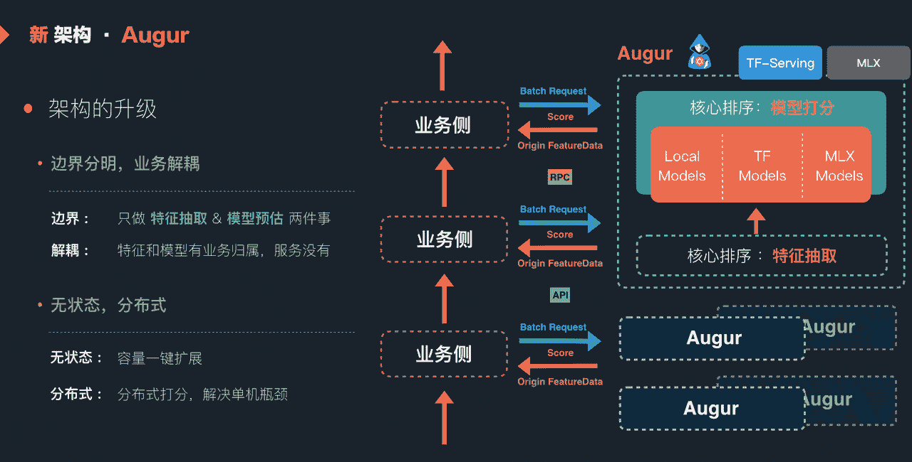

架构上的改变，让 Augur 具备了复用的基础能力，同时也拥有了分布式预估的能力。可惜，系统架构设计中没有“银弹”：虽然系统具有了良好的弹性，但为此我们也付出了一些代价，我们会在文末进行解释。

## 预估平台的构建过程

框**架思路只能解决“能用”的问题，平台则是为了“通用”与“好用”**。一个优秀的预估平台需要保证高性能，具备较为通用且接口丰富的核心预估框架，以及产品级别的业务管理系统。为了能够真正地提升预估能力和业务迭代的效率，平台需要回答以下几个问题：

+   如何解决特征和模型的高效迭代？

+   如何解决批量预估的性能和资源问题？

+   如何实现能力的快速复用并能够保障业务的安全？

下面，我们将逐一给出答案。

### 4.1 构建预估内核：高效的特征和模型迭代

#### 4.1.1 Operator 和 Transformer

在**搜索场景下，特征抽取**较为难做的原因主要包括以下几点：

+   **来源多：**商户、商品、交易、用户等数十个维度的数据，还有交叉维度。由于美团业务众多，难以通过统一的特征存储去构建，交易相关数据只能通过服务来获取。

+   **业务逻辑多：**大多数据在不同的业务层会有复用，但是它们对特征的处理逻辑又有所不同。

+   **模型差异：**同一个特征，在不同的模型下，会有不同的处理逻辑。比如，一个连续型特征的分桶计算逻辑一样，但“桶”却因模型而各不相同；对于离散特征的低频过滤也是如此。

+   **迭代快：**特征的快速迭代，要求特征有快速在线上生效的能力，如果想要改动一个判断还需要写代码上线部署，无疑会拖慢了迭代的速度。模型如此，特征也是如此。

针对**特征的处理逻辑**，我们抽象出两个概念：

**Operator** ：通用特征处理逻辑，根据功能的不同又可以分为两类：

+   **IO OP：**用处理原始特征的获取，如从 KV 里获取数据，或者从对应的第三方服务中获取数据。内置批量接口，可以实现批量召回，减少 RPC。

+   **Calc OP：**用于处理对获取到的原始特征做与模型无关的逻辑处理，如拆分、判空、组合。业务可以结合需求实现特征处理逻辑。

> **通**过 IO、计算分离，特征抽取执行阶段就可以进行 IO 异步、自动聚合 RPC、并行计算的编排优化，从而达到提升性能的目的。

**Transformer** ：用于处理与模型相关的特征逻辑，如分桶、低频过滤等等。一个特征可以配置一个或者多个 Transformer。Transformer 也提供接口，业务方可以根据自己的需求定制逻辑。

**离在线统一逻辑：**Transformer 是特征处理的模型相关逻辑，因此我们将 Transformer 逻辑单独抽包，在我们样本生产的过程中使用，保证离线样本生产与线上特征处理逻辑的一致性。

基于这两个概念，Augur 中特征的处理流程如下所示： 首先，我们会进行特征抽取 ，抽取完后，会对特征做一些通用的处理逻辑；而后，我们会根据模型的需求进行二次变换，并将最终值输入到模型预估服务中。如下图所示：

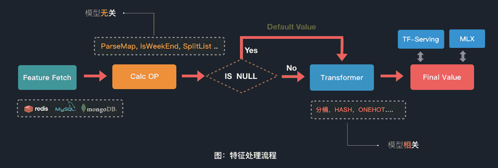

#### 4.1.2 特征计算 DSL

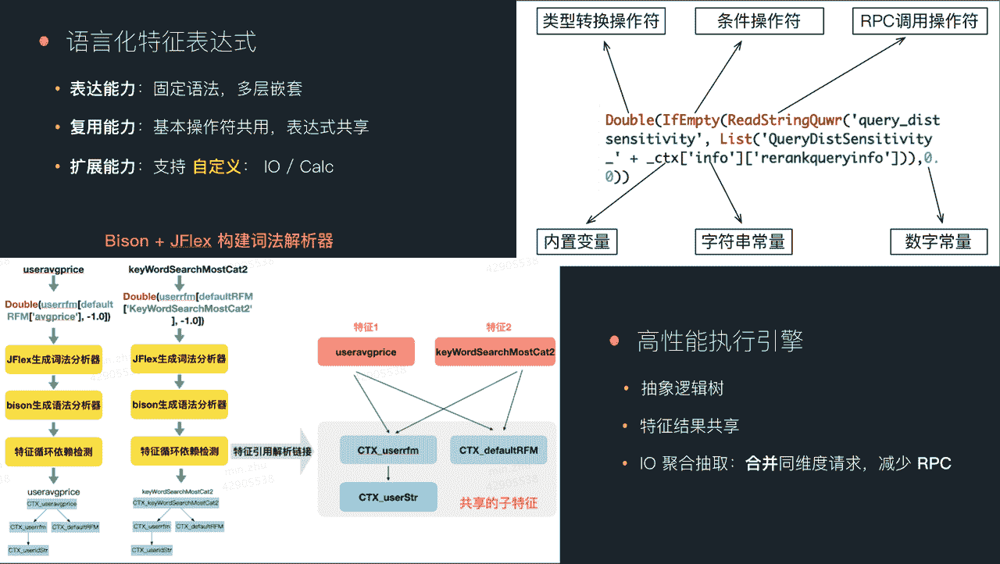

有了 Operator 的概念，为了方便业务方进行高效的特征迭代，Augur 设计了一套弱类型、易读的特征表达式语言，将特征看成一系列 OP 与其他特征的组合，并基于 Bison&JFlex 构建了高性能语法和词法解析引擎。我们在解释执行阶段还做了一系列优化，包括并行计算、中间特征共享、异步 IO，以及自动 RPC 聚合等等。

举个例子：

```
// IO Feature: binaryBusinessTime;  ReadKV 是一个 IO 类型的 OP
ReadKV(&#x27;mtptpoionlinefeatureexp&#x27;,&#x27;_id&#x27;,_id,&#x27;ba_search.platform_poi_business_hour_new.binarybusinesstime&#x27;,&#x27;STRING&#x27;)
// FeatureA : CtxDateInfo;   ParseJSON 是一个 Calc 类型的 OP
ParseJSON(_ctx[&#x27;dateInfo&#x27;]);
// FeatureB : isTodayWeekend 需要看 Json 这种的日期是否是周末, 便可以复用  CtxDateInfo  这个特征; IsWeekend 也是是一个 Calc 类型的 OP
IsWeekend(CtxDateInfo[&#x27;date&#x27;])
```

在上面的例子中，ParseJSON 与 IsWeekend 都是 OP， CtxDateInfo 与 isTodayWeekend 都是由其他特征以及 OP 组合而成的特征。通过这种方式，业务方根据自己的需求编写 OP , 可以快速复用已有的 OP 和特征，创造自己需要的新特征。而在真实的场景中，IO OP 的数量相对固定。所以经过一段时间的累计，OP 的数量会趋于稳定，新特征只需基于已有的 OP 和特征组合即可实现，非常的高效。

#### 4.1.3 配置化的模型表达

**特征可**以用利用 OP、使用表达式的方式去表现，但特征还可能需要经过 Transformer 的变换。为此，我们同样为模型构建一套可解释的 JSON 表达模板，模型中每一个特征可以通过一个 JSON 对象进行配置，以一个输入到 TF 模型里的特征结构为例：

**复制代码**

```
// 一个的特征的 JSON 配置
{
    &quot;tf_input_config&quot;: {&quot;otherconfig&quot;},
    &quot;tf_input_name&quot;: &quot;modulestyle&quot;,
    &quot;name&quot;: &quot;moduleStyle&quot;,
    &quot;transforms&quot;: [                      // Transfomers：模型相关的处理逻辑，可以有多个，Augur 会按照顺序执行
      {
        &quot;name&quot;: &quot;BUCKETIZE&quot;,             // Transfomer 的名称：这里是分桶
        &quot;params&quot;: {
          &quot;bins&quot;: [0,1,2,3,4]           // Transfomer 的参数
        }
      }
    ],
    &quot;default_value&quot;: -1
}
```

通过以上配置，一个模型可以通过特征名和 Transformer 的组合清晰地表达。因此，模型与特征都只是一段纯文本配置，可以保存在外部，Augur 在需要的时候可以动态的加载，进而实现模型和特征的上线配置化，无需编写代码进行上线，安全且高效。

其中，我们将输入模型的特征名（tf_input_name）和原始特征名（name）做了区分。这样的话，就可以只在外部编写一次表达式，注册一个公用特征，却能通过在模型的结构体中配置不同 Transfomer 创造出多个不同的模型预估特征。这种做法相对节约资源，因为公用特征只需抽取计算一次即可。

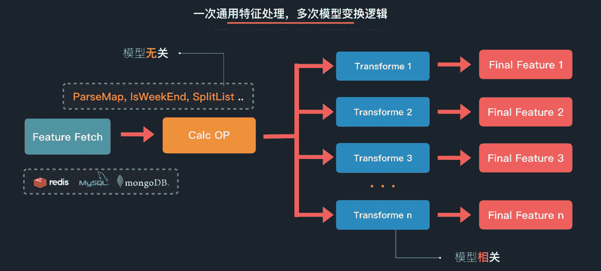

此外，这一套配置文件也是离线样本生产时使用的特征配置文件，结合统一的 OP&Transformer 代码逻辑，进一步保证了离线 / 在线处理的一致性，也简化了上线的过程。因为只需要在离线状态下配置一次样本生成文件，即可在离线样本生产、在线模型预估两个场景通用。

### 4.2 完善预估系统：性能、接口与周边设施

#### 4.2.1 高效的模型预估过程

OP 和 Transformer 构建了框架处理特征的基本能力。实际开发中，为了实现高性能的预估能力，我们采用了分片纯异步的线程结构，层层 Call Back，最大程度将线程资源留给实际计算。因此，预估服务对机器的要求并不高。

为了描述清楚整个过程，这里需要明确特征的两种类型：

+   ContextLevel Feature：全局维度特征，一次模型预估请求中，此类特征是通用的。比如时间、地理位置、距离、用户信息等等。这些信息只需计算一次。

+   DocLevel Feature：文档维度特征，一次模型预估请求中每个文档的特征不同，需要分别计算。

一个典型的模型预估请求，如下图所示：

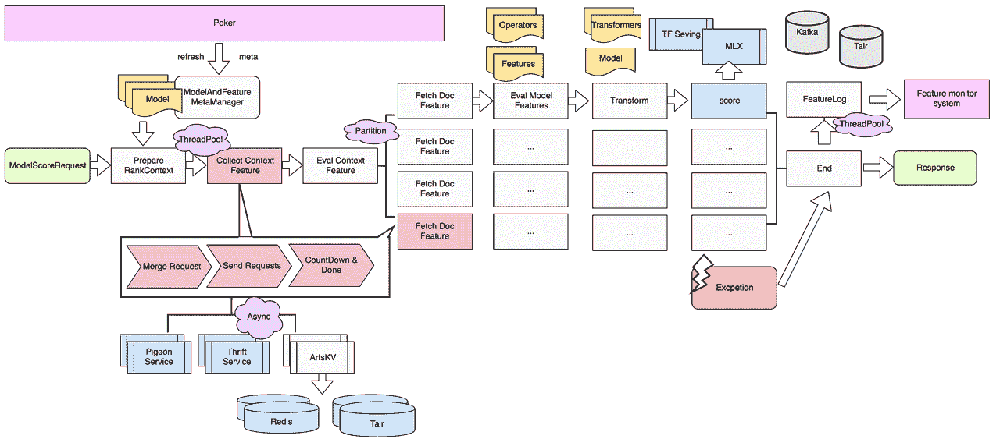

Augur 启动时会加载所有特征的表达式和模型，一个模型预估请求 ModelScoreRequest 会带来对应的模型名、要打分的文档 id（docid）以及一些必要的全局信息 Context。 Augur 在请求命中模型之后，将模型所用特征构建成一颗树，并区分 ContextLevel 特征和 DocLevel 特征。由于 DocLevel 特征会依赖 ContextLevel 特征，故先将 ContextLevel 特征计算完毕。对于 Doc 维度，由于对每一个 Doc 都要加载和计算对应的特征，所以在 Doc 加载阶段会对 Doc 列表进行分片，并发完成特征的加载，并且各分片在完成特征加载之后就进行打分阶段。也就是说，打分阶段本身也是分片并发进行的，各分片在最后打分完成后汇总数据，返回给调用方。 期间还会通过异步接口将特征日志上报，方便算法同学进一步迭代。

**在**这个过程中，为了使整个流程异步非阻塞，我们要求引用的服务提供异步接口。若部分服务未提供异步接口，可以将其包装成伪异步。这一套异步流程使得单机（16c16g）的服务容量提升超过 100%，提高了资源的利用率。

#### 4.2.2 预估的性能及表达式的开销

**框架的优势** ：得益于分布式，纯异步流程，以及在特征 OP 内部做的各类优化（公用特征 、RPC 聚合等），从老框架迁移到 Augur 后，上千份文档的深度模型预估性能提升了一倍。

至于大家关心的表达式解析对对于性能的影响其实可以忽略。因为这个模型预估的耗时瓶颈主要在于原始特征的抽取性能（也就是特征存储的性能）以及预估服务的性能（也就是 Serving 的性能）。而 Augur 提供了表达式解析的 Benchmark 测试用例，可以进行解析性能的验证。

```
_I(_I(&#x27;xxx&#x27;))
Benchmark              Mode  Cnt  Score   Error  Units
AbsBenchmarkTest.test  avgt   25  1.644 ± 0.009  ms/op
```

一个两层嵌套的表达式解析 10W 次的性能是 1.6ms 左右。相比于整个预估的时间，以及语言化表达式对于特征迭代效率的提升，这一耗时在当前业务场景下，基本可以忽略不计。

#### 4.2.3 系统的其他组成部分

一个完善可靠的预估系统，除了“看得见”的高性能预估能力，还需要做好以下几个常被忽略的点：

+   **几个常被忽略的点** ： 预估时产出的特征日志，需要通过框架上传到公司日志中心或者以用户希望的方式进行存储，方便模型的迭代。当然，必要的时候可以落入本地，方便问题的定位。

+   **，方便问题的定位** ：系统监控不用多说，美团内部的 Cat& 天网，可以构建出完善的监控体系。另一方面，特征的监控也很重要，因为特征获取的稳定性决定了模型预估的质量，所以我们构建了实时的特征分布监控系统，可以分钟级发现特征分布的异常，最大限度上保证模型预估的可靠性。

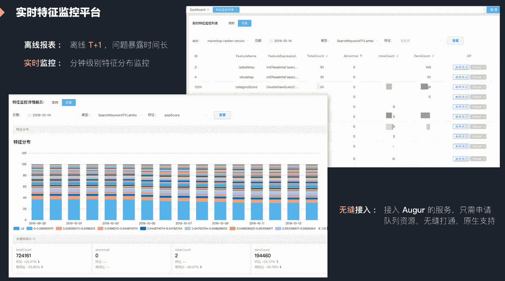

+   **丰富的接口** ：除了预估接口，还需要有特征抽取接口、模型打分 Debug 接口、特征表达式测试接口、模型单独测试接口、特征模型刷新接口、特征依赖检等等一系列接口，这样才可以保证整个系统的可用性，并为后面管理平台的建设打下基础。

A**ugur 在完成了以上多种能力的建设之后，就可以当做一个功能相对完善且易扩展**的在线预估系统。由于我们在构建 Augur 的时候，设立了明确的边界，故以上能力是独立于业务的，可以方便地进行复用。当然，Augur 的功能管理，更多的业务接入，都需要管理平台的承载。于是，我们就构建了 Poker 平台，其中的在线预估管理模块是服务于 Augur，可以进行模型特征以及业务配置的高效管理。我们将在下一小节进行介绍。

### 4.3 建设预估平台：快速复用与高效管理

#### 4.3.1 能力的快速复用

Augur 在设计之初，就将所有业务逻辑通过 OP 和 Transformer 承载，所以跟业务无关。考虑到美团搜索与 NLP 部模型预估场景需求的多样性，我们还为 Augur 赋予多种业务调用的方式。

+   **种业务调用的方式。** ：即基于 Augur 构建一个完整的 Service，可以实现无状态分布式的弹性预估能力。

+   **布式的弹性预估能** ：Java 服务化版本中内置了对 Thrift 的支持，使不同语言的业务都可以方便地拥有模型预估能力。

+   **地拥有** ：Augur 支持同一个服务同时提供 Pigeon（美团内部的 RPC 框架）以及 Thrift 服务，从而满足不同业务的不同需求。

+   **不同业务的不同需** ：Augur 同样支持以 SDK 的方式将能力嵌入到已有的集群当中。但如此一来，分布式能力就无法发挥了。所以，我们一般应用在性能要求高、模型比较小、特征基本可以存在本地的场景下。

其中服务化是被应用最多的方式，为了方便业务方的使用，除了完善的文档外，我们还构建了标准的服务模板，任何一个业务方基本上都可以在 30 分钟内构建出自己的 Augur 服务。服务模板内置了 60 多个常用逻辑和计算 OP , 并提供了最佳实践文档与配置逻辑，使得业务方在没有指导的情况下可以自行解决 95% 以上的问题。整个流程如下图所示：

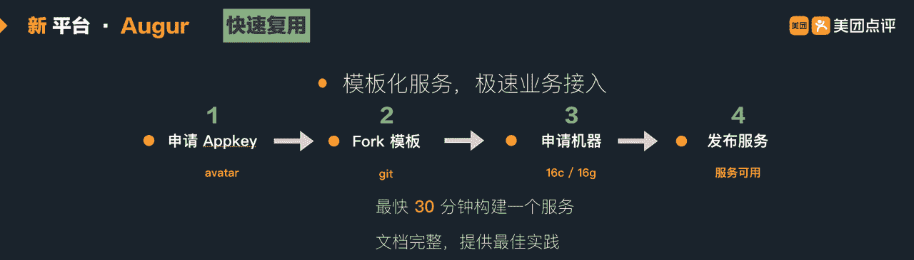

当然，无论使用哪一种方式去构建预估服务，都可以在美团内部的 Poker 平台上进行服务、模型与特征的管理。

#### 4.3.2 Augur 管理平台 Poker 的构建

实现一个**框架价值的最大化**，需要一个完整的体系去支撑。而一个合格的在线预估平台，需要一个产品级别的管理平台辅助。于是我们构建了 Poker（搜索实验平台），其中的在线预估服务管理模块，也是 Augur 的最佳拍档。Augur 是一个可用性较高的在线预估框架，而 Poker+Augur 则构成了一个好用的在线预估平台。下图是在线预估服务管理平台的功能架构：

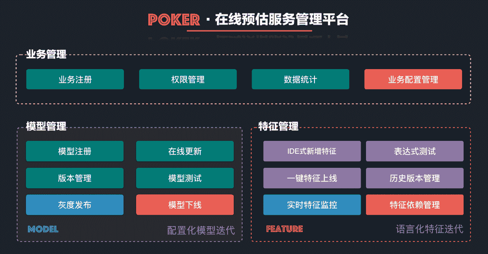

**首先是预**估核心特征的管理，上面说到我们构建了语言化的特征表达式，这其实是个较为常见的思路。Poker 利用 Augur 提供的丰富接口，结合算法的使用习惯，构建了一套较为流畅的特征管理工具。可以在平台上完成新增、测试、上线、卸载、历史回滚等一系列操作。同时，还可以查询特征被服务中的哪些模型直接或者间接引用，在修改和操作时还有风险提示，兼顾了便捷性与安全性。

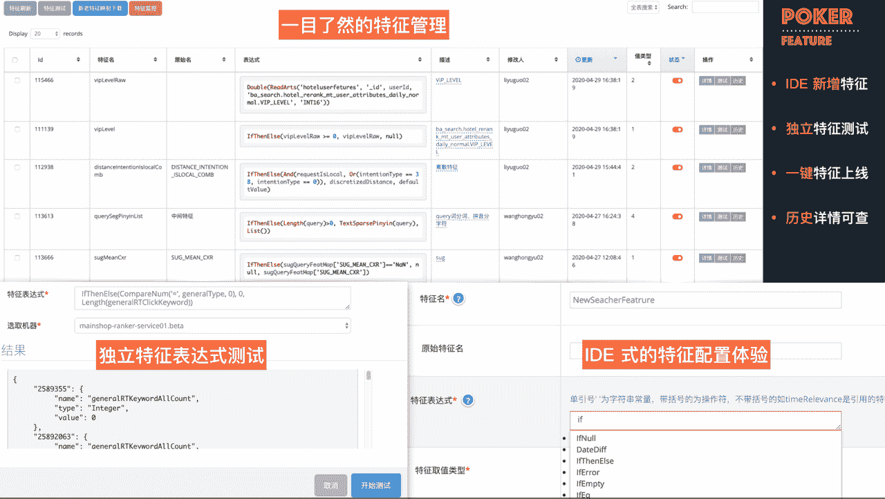

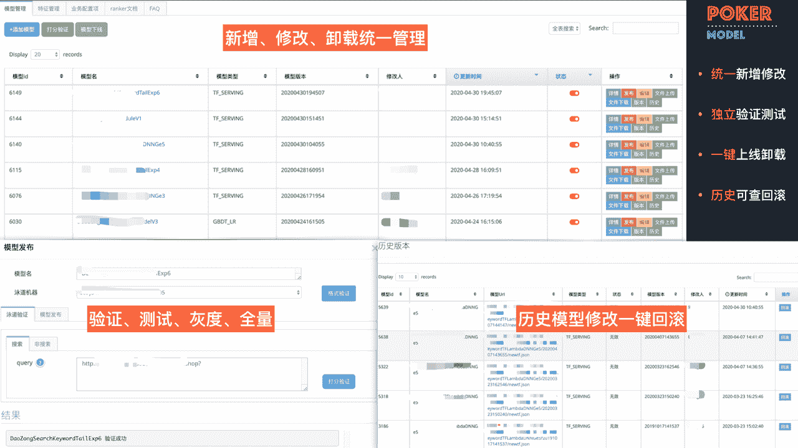

**模型管**理也是一样，我们在平台上实现了模型的配置化上线、卸载、上线前的验证、灰度、独立的打分测试、Debug 信息的返回等等。同时支持在平台上直接修改模型配置文件，平台可以实现模型多版本控制，一键回滚等。配置皆为实时生效，避免了手动上线遇到问题后因处理时间过长而导致损失的情况。

#### 4.3.3 Poker + Augur 的应用与效果

随着 Augur 和 Poker 的成熟，美团搜索与 NLP 部门内部已经有超过 30 个业务方已经全面接入了预估平台，整体的概况如下图所示：

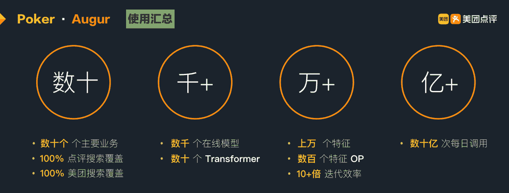

**预估框架使用迁移 Augur** 后，性能和模型预估稳定性上均获得了较大幅度的提升。更加重要的是，Poker 平台的在线预估服务管理和 Augur 预估框架，还将算法同学从繁复且危险的上线操作中解放出来，更加专注于算法迭代，从而取得更好的效果。以点评搜索为例，在 Poker+Augur 稳定上线之后，经过短短半年的时间，点评搜索核心 KPI 在高位基础上仍然实现了大幅提升，是过去一年半涨幅的六倍之多，提前半年完成全年的目标。

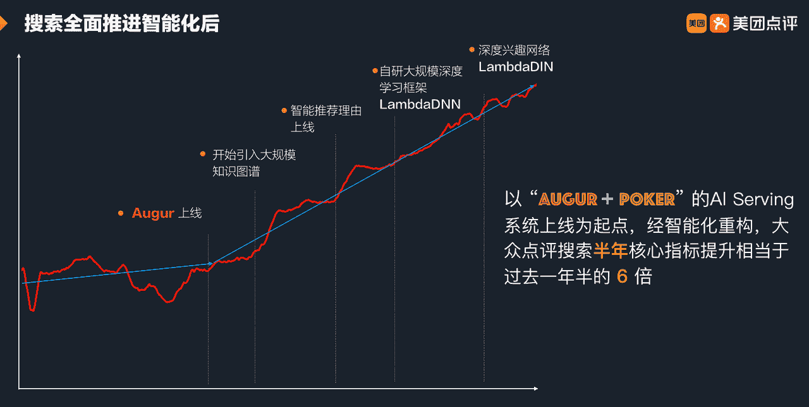

### 4.4 进阶预估操作：模型也是特征

#### 4.4.1 Model as a Feature，同构 or 异构？

在算法的迭代中，有时会将一个模型的预估的结果当做另外一个模型输入特征，进而取得更好的效果。如美团搜索与 NLP 中心的算法同学使用 BERT 来解决长尾请求商户的展示顺序问题，此时需要 BERT as a Feature。一般的做法是离线进行 BERT 批量计算，灌入特征存储供线上使用。但这种方式存在时效性较低（T+1）、覆盖度差等缺点。最好的方式自然是可以在线实时去做 BERT 模型预估，并将预估输出值作为特征，用于最终的模型打分。这就需要 Augur 提供 Model as a Feature 的能力。

得益于 Augur 抽象的流程框架，我们很快超额完成了任务。Model as a feature，虽然要对一个 Model 做预估操作，但从更上层的模型角度看，它就是一个特征。既然是特征，模型预估也就是一个计算 OP 而已。 所以我们只需要在内部实现一个特殊的 OP，ModelFeatureOpreator 就可以干净地解决这些问题了。

我们在充分调研后，发现 Model as a Feature 有两个维度的需求：同构的特征和异构的特征。同构指的是这个模型特征与模型的其他特征一样，是与要预估的文档统一维度的特征，那这个模型就可以配置在同一个服务下，也就是本机可以加载这个 Stacking 模型；而异构指的是 Model Feature 与当前预估的文档不是统一维度的，比如商户下挂的商品，商户打分需要用到商品打分的结果，这两个模型非统一维度，属于两个业务。正常逻辑下需要串行处理，但是 Augur 可以做得更高效。为此我们设计了两个 OP 来解决问题：

+   LocalModelFeature ： 解决同构 Model Feature 的需求，用户只需像配置普通特征表达式一样即可实现在线的 Model Stacking；当然，内部自然有优化逻辑，比如外部模型和特征模型所需的特征做统一整合，尽可能的减少资源消耗，提升性能。 该特征所配置的模型特征，将在本机执行，以减少 RPC。

+   RemoteModelFeature ：解决异构 Model Feature 的需求，用户还是只需配置一个表达式，但是此表达式会去调用相应维度的 Augur 服务，获取相应的模型和特征数据供主维度的 Augur 服务处理。虽然多了一层 RPC，但是相对于纯线性的处理流程，分片异步后，还是有不少的性能提升。

美团搜索内部，已经通过 LocalModelFeature 的方式，实现了 BERT as a Feature。在几乎没有新的使用学习成本的前提下，同时在线上取得了明显的指标提升。

#### 4.4.2 Online Model Ensemble

Augur 支持有单独抽取特征的接口，结合 Model as a Feature，若需要同时为一个文档进行两个或者多个模型的打分，再将分数做加权后使用，非常方便地实现离线 Ensemble 出来模型的实时在线预估。我们可以配置一个简单的 LR、Empty 类型模型（仅用于特征抽取），或者其他任何 Augur 支持的模型，再通过 LocalModelFeature 配置若干的 Model Feature，就可以通过特征抽取接口得到一个文档多个模型的线性加权分数了。而这一切都被包含在一个统一的抽象逻辑中，使用户的体验是连续统一的，几乎没有增加学习成本。

除了上面的操作外，Augur 还提供了打分的同时带回部分特征的接口，供后续的业务规则处理使用。

## 更多思考

当然，肯定没有完美的框架和平台。Augur 和 Poker 还有很大的进步空间，也有一些不可回避的问题。主要包括以下几个方面。

> 被迫“消失”的 Listwise 特征

> 前面说到，系统架构设计中没有“银弹”。在采用了无状态分布式的设计后，请求会分片。所以 ListWise 类型的特征就必须在打分前算好，再通过接口传递给 Augur 使用。在权衡性能和效果之后，算法同学放弃了这一类型的特征。

> 当然，不是说 Augur 不能实现，只是成本有些高，所以暂时 Hold 。我们也有设计过方案，在可量化的收益高于成本的时候，我们会在 Augur 中开放协作的接口。

> **单机多层打分的缺失**

> Augur 一次可以进行多个模型的打分，模型相互依赖（下一层模型用到上一层模型的结果）也可以通过 Stacking 技术来解决。但如果模型相互依赖又逐层减少预估文档（比如，第一轮预估 1000 个，第二轮预估 500），则只能通过多次 RPC 的方式去解决问题，这是一个现实问题的权衡。分片打分的性能提升，能否 Cover 多次 RPC 的开销？在实际开发中，为了保持框架的清晰简单，我们选择了放弃多层打分的特性。

> **离线能力缺失？**

> Poker 是搜索实验平台的名字。我们设计它的初衷，是解决搜索模型实验中，从离线到在线所有繁复的手工操作，使搜索拥有一键训练、一键 Fork、一键上线的能力。与公司其他的训练平台不同，我们通过完善的在线预估框架倒推离线训练的需求，进而构建了与在线无缝结合的搜索实验平台，极大地提升了算法同学的工作效。

>