# 开水团智能客服检索式对话系统

> 来源：[https://qqs7y1hozd1.feishu.cn/docx/N0kQd9NoxolDFcxMVtNcmerKnJd](https://qqs7y1hozd1.feishu.cn/docx/N0kQd9NoxolDFcxMVtNcmerKnJd)

> 在传统的客服、IM等**场景中，坐席**需要花费大量时间回答用户的各种咨询，通常面临答案查询时间长、问题重复、时效要求高等挑战。因而，使用技术手段辅助坐席快速、准确、高效地回答用户的各类问题非常有必要。

> 美团设计并迭代了一套基于检索式对话系统的框架，以推荐回复的方式，基于对话上文为坐席提供候选回复，提高坐席效率进而提升用户体验，在众多业务上均取得显著效果。

> 本文主要介绍整体架构、指标体系、召回排序、应用示例等方面。

## 1 背景与挑战

> 对话系统一直是人工智能研究的热门领域之一，近年来随着深度学习技术的发展，人工智能在对话系统上出现了不少的突破性进展。

但是，由于**自然语言的复杂性**，目前的智能对话系统还远远达不到可以直接替代人类的地步。

> **因此在一**些复杂的业务场景中，目前的智能对话系统如何更好的去辅助人类做到人机协同，提升沟通效率，也成为了当今研究的一个热点以及实际落地方向。

作为一家连接用户和商户的生活服务电子商务**平台**，美团在平台服务的售前、售中、售后全链路的多个场景中，用户向商家都存在有大量的问题咨询情况，如在线坐席CHAT、商家IM等。

因此美团希望利用对话系统，以推荐回复的方式，基于对话上文为客服提供候选回复，来帮助商家提升回答用户问题的效率，同时更快地解决用户问题，改善用户咨询体验。

一般来说，对话系统可以大致分为三类：

+   **任务型：**一般为受限域，以完成特**定领域的特定任务为目的，主流方**法是基于有限状态机（FSM）的可配置化TaskFlow，而基于强化学习、监督学习等基于数据驱动的对话管理方法在实际应用中尚不成熟，应用场景如售后退款等流程明确的智能机器人。

+   **问答型：**受限域或开放域，主要是回答特定领域的信息咨询或开放领域的知识性问题，主流方法包括图谱问答（KBQA）**、社区问**答（CQA）、文档问答（MRC）等单轮问答，也可能涉及多轮问答，应用场景如酒店、旅游等领域的售前咨询。

+   **闲聊型：**一般为开放域，无特定目的，在开放领域内让对话有意义地进行下去即可**，主流方法**是基于检索的召回排序二阶段方法或基于生成的端到端模型，应用场景如聊天机器人。

> 其中，任务型和问答型系统具备较高的准确性，但是需要针对细分领域进行不同程度的适配与优化，在大范围应用上需要较高的成本。

本文主要关注基于检索式方案的对话系统**，其准确性略低，但是成**本较小并且领域迁移性好，非常适合用于如话术推荐等人机协同场景。

## 2 架构与指标

检索式对话系统的整体架构如下图1所示，可以划分为五层：

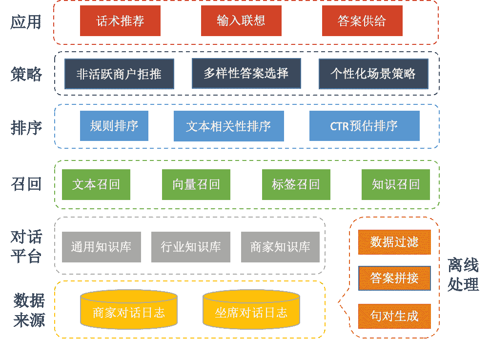

1.  **数据与平台层：**离线对坐席/商家与用户的历史对话Session进行清洗、处理，建立自动化流程，日更新话术索引库。同时，利用对话平台构建知识库，既可以用在智能客服中，也可以用作话术推荐。

1.  **召回层：**给定对话上文及其它限制条件，从话术索引库和知识库中召回结果，包括文本、向量、标签、知识等多路召回。

1.  **排序层：**针对召回模块返回的结果集合，进行排序打分，包括规则排序、文本相关性模型排序以及CTR预估排序。

1.  **策略层：****针对排序模块返****回的结果列表**，进行重排序或者拒推，例如非活跃商户拒推，推荐列表包含正确答案而商家长期无采纳行为则降低推荐概率；多样性答案选择，尽量选择语义及表达形式不同的答案，避免推荐过于相似的答案；个性化场景策略，针对场景特征定制策略。

1.  **应用层：**主要用于人工辅助场景，包括在线回复咨询时的话术推荐和输入联想，以及离线填答智能客服知识库时的答案推荐供给。

同时，为了更合理地指导系统相关优化，美团设计了一套离线到在线的指标体系。

以话术推荐为例，如下图2所示，具体来说可分为三个部分：

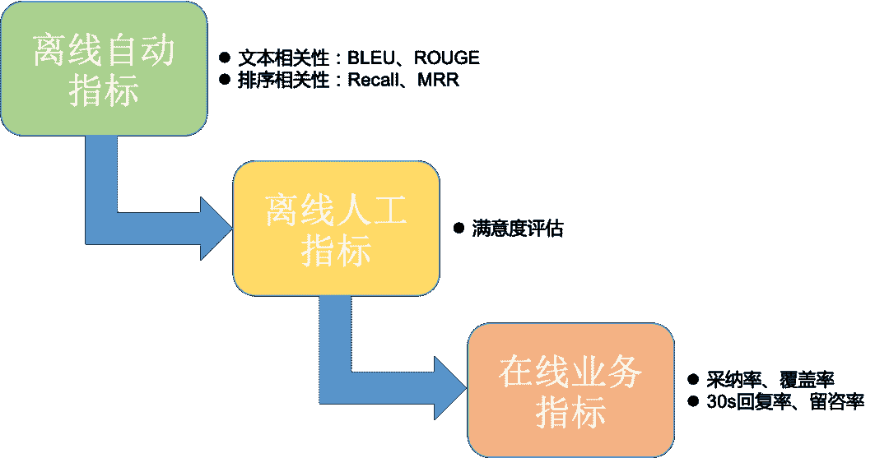

1.  **离线自动指标：**主要计算的是Top-N推荐话术与坐席/商家下一句真实回复的语义相关性，采用了文本相关性的BLEU、ROUGE指标，以及排序相关性的Recall、MRR指标。

1.  **离线人工指标：**通过人工打分来判断系统推荐回复是否满足当前对话回复上下文，并计算离线人工指标与离线自动指标的相关性。

1.  **线上业务指标：**此部分指标是系统线上效果的重点观测指标，直接真实反映话术推荐效果（在多次AB试验中，也证实了离线自动指标ROUGE与线上采纳率指标呈正相关性）。

> 因此在后续离线试验中，主要以**文本相关性指标**，尤其是ROUGE指标作为离线的核心观测指标。

## 3 召回模块

> **召回阶段**的主要目标是根据当前对话的上下文Context召回若干条相关的回复Response，这里的Context就相当于传统检索系统中的Query，Response就相当于Doc。

> 但与传统检索系统不同的地方在于，话术推荐中的每条推荐回复，都对应一个历史的对话上下文，而这里召回的核心也在于，利用当前上下文去检索一些相似的历史对话上下文，然后用这些上下文对应的回复作为召回结果。因此，这里的重点就在于如何利用当前上下文检索相似的对话历史上下文。

> 在召回阶段，美团采用了基于本文&基于向量&基于知识的多路召回方案。

> 其中，**知识的来源**主要包括商家结构化信息（KBQA）以及商家个性化知识库（QABOT），主要形式是上文最后一句的单轮问答。下面会重点介绍文本及向量召回。

针对上述对话多样性、商户个性化及时间迁移性等问题，在设计文本及向量召回索引时，美团划分了两类索引并引入日更新机制：

1.  **商户/坐席历史索引：**商户或坐席过去一个月的对话历史日志所抽取得到的Context-Response对，话术符合商家/坐席的业务场景及说话习惯，精准个性化召回。

1.  **通用高频话术索引：**主要包括通用及高频的Context-Response对，如问好、感谢等等场景，用于兜底，可大大提升覆盖率。

1.  **索引日更新机制：**借助离线数据表生产平台和在线索引查询平台，保证对话日志的回流和索引的日更新。

> 因此，在实际的话术推荐中，对商户/坐席而言，推荐答案的来源是该商户/坐席本身历史话术或通用高频话术，既部分缓解了个性化及时间漂移问题，也避免了因推荐不合格或违规话术引发客诉。

### 3.1 文本召回

> **对于文本召回**，在对历史对话建立索引时，最粗暴的方案是直接把历史对话上下文直接拼接成一长串文本建立索引，然后线上利用BM25进行召回。

这种做法主要存在两个较大的缺陷：

+   没有考虑到对话的顺承特性，即对话的下一句回复通常与最近几句对话历史更为相关。

+   把所有对话历史进行拼接导致内容较为杂乱，不利于精确检索。

针对这两个问题，美团对对话历史上下文索引的建立进行了优化。

具体来说，将整个对话历史划分为：

+   **短期对话上文：**一般为上文最后一句包含完整语义的话，中文分词后去停用词建立倒排索引。

+   **长期对话上文：**一般为上文除最后一轮外前N轮对话，中文分词后去停用词通过TF-IDF等方法挖掘Top-M关键词入索引库。

+   **机器人对话上文：**主要为进线标签等，可以增加对话初期的背景信息。

> 如下图3所示，针对不同的对话上文采用不同的信息抽取及建模方式，核心思想在于对于短期上文保留尽量多的信息，保证召回时的相关性，对于长期上文中的信息进行筛选过滤，只保留核心信息，提升召回的精准性。

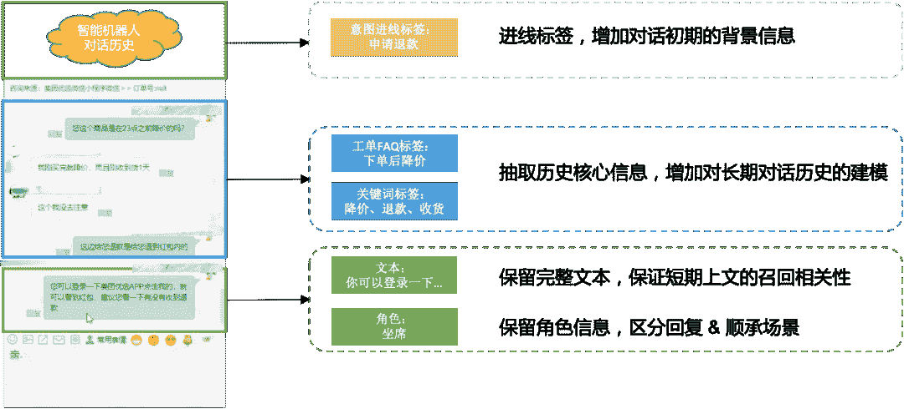

**此外，美团针对话术库构建的主要工作**集中于扩大数据规模和提升数据质量两部分：

1.  **扩大数据规模：**时间跨度上，使用过去一个月的对话历史日志；文本频率上，早期仅选择答案出现频率大于1的问答对，后期添加所有问答对发现效果有较为明显的提升。

1.  **提升数据质量：**主要是清洗过滤噪音数据，包括不限于链接、卡片、脏文本等。

### 3.2 向量召回

> 近年来，随着深度学习的火热发展，分布式语义表示（Distributed Representation）成为研究的热点。分布式语义表示通过将文档的语义压缩到一个稠密向量空间，有效的缓解了数据稀疏性的问题，同时结合一系列向量检索方案（如FAISS）还可以实现对文档的高效检索。

**针对话术推荐场景，在文本召回的基础上**增加向量召回作为补充主要有以下两点考虑：

1.  **增加短期上文的泛化性：**文本召回仅仅是词粒度的匹配，引入向量表示可以大大增强表示和匹配的泛化性。

1.  **增强长期上文的表示：**文本中的长期上文仅使用关键词进行表示，语义明显失真，通过向量召回的方法可以更加有效地表示和利用长期上文。

> **向量召回**即给定对话上文（Context，Q），检索得到答案集合（Response，A），一个最基本的问题就是召回方式的选择（🐧 vs QA）。

> 最终美团选择了🐧的方式来进行检索召回，即构建Context-Response Pair对，将Context表示为向量后检索召回索引中相似的历史Context，再使用这些历史Context对应的历史Response作为召回结果。

#### 3.2.1 表示模型

关于如何表征文档，我们简单介绍三类典型的模型框架：

1.  **BoW：**词袋向量模型（Bag-of-Words Embedding）是文档向量表示的一个基础模型，在大规模无监督对话语料中通过 Word2vec、Glove等算法计算出每个单词的向量表示，文档的向量表示可以通过文档中所有词语的向量进行组合来得到，比较简单有效的方法是平均池化（Average Pooling）。

1.  **BERT：**BERT和MLM（Mask Language Model）作为典型的模型及任务，在对话领域内大规模数据预训练后，可以获得词语的上下文相关表征向量，最终文档的向量依然可由平均池化获得。

1.  **DualEncoder：**双塔模型是大规模文本相似度计算或者说向量召回中最为经典的模型之一，以上述预训练之后的BERT作为基础模型来表征Context与Response（参数共享），最终文档的表示是[CLS]位置的向量。

**总结来看：**

+   BoW的局限之处在于对每个单词仅有一种表示，忽视不同上下文情境下词语的多义性；

+   BERT缓解了BoW的这一问题，考虑了词的上下文特征；

+   DualEncoder在BERT的基础上，不再使用平均池化的方式来表征文档，而是直接在文档级别进行训练，更好地建模了文档内部的长程依赖关系，同时考虑了对话本身的特征。

因此，最终选择了双塔模型，如下图4所示：

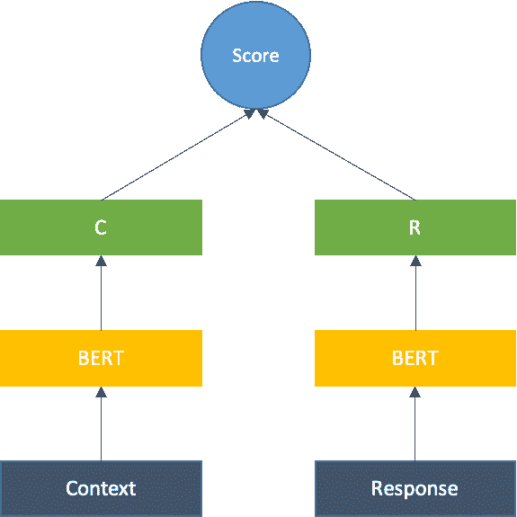

#### 3.2.2 数据采样

> 双塔模型的一个基本问题是如何**构造高质量的正样本对。**

在话术推荐的场景这个问题并不复杂，不过存在两种选择：

1.  Context-Response Pair：经由历史对话日志挖掘得到的样本对，及给定上文和其对应的回复。

1.  Context-Context Pair：借助商户Context与Response的对应关系，同一Response对应的Context集合互为正例，通过这种关系伪造获取Context及其对应Context。

我们选择了方式一，这是因为对话中Context与Response尽管存在一定的多样性，但是总体上来说相比搜索系统中的Query-Document还是具备很强的对应关系，Response本身提供了足够的监督信息来区分不同的Context。

**此外，负例采样是向量召回中最重要的问题，一**般来说典型的采样方法有以下三种[19]：

1.  **预定义采样：**在数据准备阶段预先根据某些规则或条件采样负例，在模型训练过程中单个正例对应的负例集合不变。局限于资源等问题，一般来说负例个数不会太多。

1.  **Batch内采样：**模型训练过程中，Batch内除当前正例及其对应样例之外的其它样例都可视作负例。

1.  **难负例采样：**除了简单负例之外，为了提升模型对难负例的识别效果以及对细节的学习能力，一般会结合场景特征挖掘部分难负例作为补充。

> 不管是学术界文章还是工业界实践，都显示Batch内简单负例+难负例的组合效果最好，经验比例大致在100:1。因此，美团最终也基本参考了这种设置。

如下图5所示，其中关于难负例的采样，美团尝试了如下两种方式：

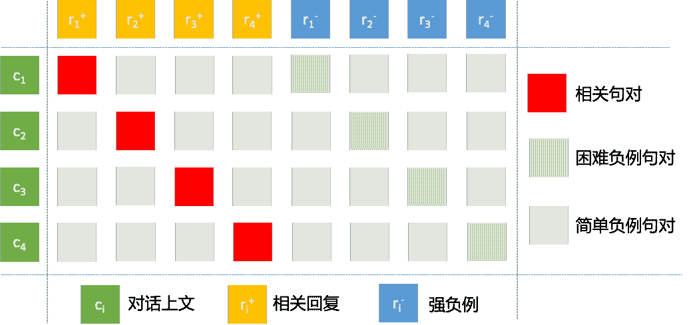

1.  基于Context的BM25难负例挖掘（CBM）：建立Context索引，通过BM25召回相似的Context，并在对应的Response集合中挑选难负例。

1.  基于Response的BM25难负例挖掘（RBM）：建立Response索引，通过BM25召回相似的Response，并在召回的Response集合中挑选难负例。

> 实验结果表明，CBM会带来一定提升而RBM则是负向效果，推测是RBM方法召回的样例与真实回复的字面相似度较高，本质上是假负例而非难负例，导致了模型效果的下降。

#### 3.2.3 多样性表征

> 因类目场景及商户特征所导致的多样性问题利用上述构建索引的原则已经得到了缓解，这里主要关注的是对话本身语义上的多样性，即给定一段Context，可能存在多个语义点，存在多样性的回复。

**具体来说，又可以分为两方面：**

1.  多个Context对应一个Response：在Context包含多轮历史对话的情形下尤其显著。

1.  一个Context对应多个Response：Context中包含多个主题或者说语义点，针对不同的语义点，存在不同的回复。即便是相似语义的回复，在表达形式上也会有所差异。

**针对第一类多样性，**在Context召回相似Context的设置下并不存在明显问题。

> 在实际的实验中，将同一个Response对应的Context集合做平均池化获取均值向量，以此合并多条记录到一条记录并以该均值向量作为Context表示，可以有效提升召回结果集合的文本相关性指标，称之为语义纯化。

> 推测平均池化的方式去除了每个Context向量上附着的噪音，仅保留与对应Response最为相关的语义向量部分，故而提升了召回效果。

**针对第二类多样性，**类似的问题或者思想在对话回复选择、电商推荐、文本检索中有过相关的工作：

1.  **弱交互：**对话回复选择任务，通过设计多个Poly Codes或直接选取First-M、Last-M个Context Hidden States将Context表征为多个向量，从而引入弱交互性质，相比双塔模型可以有效提升效果，相比交互模型可以大幅提升推理速度，不过其主要应用是在粗排模块，而非向量召回模块。

1.  **多兴趣：**单个向量难以表征用户历史的多兴趣，通过动态路由（Dynamic Routing）与自注意力（Self-Attentive）从历史中抽取K个向量表示不同的兴趣点，不同的兴趣点向量独立召回不同的Items，然后设计聚合模块对召回的Items进行重新分组和排序，聚合时除了相似度分数还可以考虑引入Diversity等更多的性质。

1.  **多向量：**稠密文档检索，简单的双塔模型可能造成文档表征严重的信息损失，因而利用迭代聚类（Iterative Clustering）的方法将文档表示为K个向量，即类簇中心点。在建立索引时保留文档的K个vector，检索时召回K * N个结果并经过重排序保留N个结果。

**因此，美团针对对话本身的结构特征和轮次信息，提**出了一种简单的对话特定的多向量生成方法：

> 和分别代表SHOP和USER说的一句话，是生成向量的位置。具体来说，在USER说完所有连续的话的位置，获取一个向量（以USER语义为准）。

整体的模型框架如下图6所示，称之为语义发散。

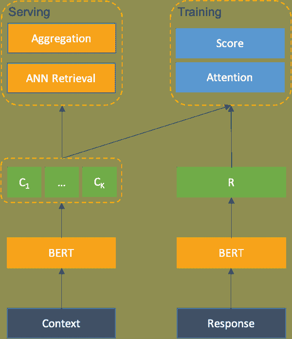

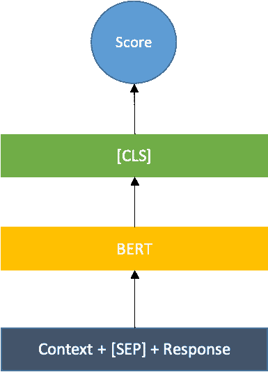

> 具体来说，Context和Response输入BERT编码器后，获取一个Context Vector Set，以及一个Response Vector即。在离线训练时，采取Scaled Dot Attention的方式来获取Context最终表征向量，而后与Response Vector计算Score。在线上推理时，对Context Vector Set中的每个Vector进行并行检索，而后通过重排和聚合获取最终结果。

## 4 排序模块

> 排序模块是在上一步召回模块的基础上，结合当前的对话上下文对每个召回的答案进行打分排序。

> **在召回阶段，**为了能够更高效率的进行检索，通常采用的是双塔架构模型，这种模型Context与Response信息交互的程度低，效果相对也较差。而在排序阶段，召回的候选集通常已经控制到了几十条，可以利用交互式架构模型，来更好的学习Context与Response之间的相关性，从而提升话术推荐的准确性。

典型的交互模型如上图7所示，一般采用BERT作为编码器。

### 4.1 对话预训练

> 目前，预训练语言模型（如BERT、GPT等）已经广泛应用于许多NLP任务。

针对检索式对话系统，尤其是对话回复选择这一任务，可以从下列两个角度出发设计预训练任务：

**（**1）对话层级：建模不同层级（Token-Level/Sentence-Level/Session-Level）的结构。

+   Token-Level的任务大多是通用NLP任务。最简单的Language Model（LM）任务，基于上文预测下一个单词。BERT的Masked Language Model（MLM）任务，根据句子中其余的词来预测被Mask的词。将句子中的Token随机排列后用自回归的方法训练预测末尾的Tokens。

+   Sentence-Level的任务众多，可以有效表征对话中的句间关系，通过特殊设计后也可以建模对话的一致性等性质。BERT中的Next Sentence Prediction（NSP）预测句子对是否是同一文档的上下句关系。Sentence Reordering Task（SRT）将对话中句子打乱顺序后预测正确的顺序。

+   Session-Level的任务较少，Next Session Prediction（NSP）预测两个片段是否是相邻的两个轮次，计算对话中两段Session之间的匹配程度，相当于是Next Sentence Prediction的对话改进版。

**（2**）对话性质：建模流畅性（Fluency）、一致性（Coherence）、可读性（Readability）、多样性（Diversity）、特异性（Specificity）等性质。

> 在本场景中，并未使用额外的语料，仅仅在BERT基础上继续进行预训练，主要实验了MLM、NSG、NSP任务分别建模Token、Sentence、Session层级的性质，均有一定提升。

### 4.2 负例采样

> 一般来说，在搜索推荐场景中，正样本为点击样本，负样本为曝光未点击样本。

根据推荐列表的数据来源可以把可能的负样本划分为下列三类，如下图8所示：

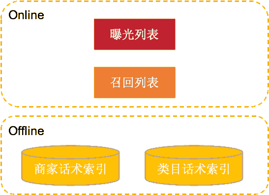

1.  曝光列表（View，False or Hard Negatives）：曝光未点击，上一版精排模型的排序Top-3结果集合，存在精排模型偏置。

1.  **召回列表（Retrieval，Hard o**r Common Negatives）：召回模块返回的样例集合，线上精排模型的输入全集，存在召回模型偏置。

1.  随机话术（Random， Easy Negatives）：该商户过去一个月发送过的句子集合，以及商户所属二级类目发送的高频句子集合。

实验表明将曝光未点击样例作为负例的效果极差，推测是因对话多样性导致其中包含过多假负例。后者更加稳定，对召回集合分布漂移问题具备更强的鲁棒性。

### 4.3 学会排序

针对排序的任务的建模一般有以下两种思想：

+   **二元绝对论：**非黑即白，候选回复要么是相关的要么就是不相关的，主要工作在于如何构造难负例。

+   **多元相对论：**次序关系，注重回复质量的多样性，主要工作在于如何构造数据建模更细粒度的好坏关系。

> 结合当前的场景，这两类方法的典型对比如下图9所示，区别在于将召回集合视作难负例还是灰度数据。

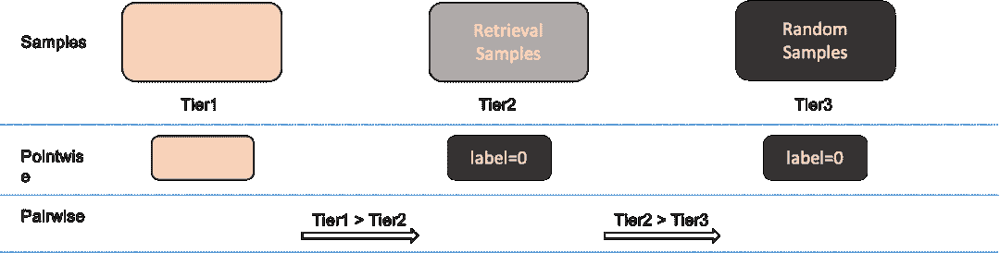

> 上述的基线模型就是Pointwise的建模方**式，针对二元组学习一个**0-1之间的分数，其损失函数为交叉熵函数。而Pairwise建模方式，则针对三元组进行分类，对具体的打分不关心。

实验结果表明，在Pairwise设置下Logistic形式的损失效果优于Hinge形式，并且GT > Retrieval > Random增强有效。

### 4.4 对比学习

> 在分析排序错误的过程中，存在Context或Response少量扰动导致最终分数变化较大的情形，典型的例子如短Response添加或删除句尾符号导致预测标签变化。

而对比学习的指导原则是通过自动构造相似实例和不相似实例学习一个表示模型，使得相似的实例在投影空间中比较接近，而不相似的实例在投影空间中距离比较远。

> 因此，为了缓解上述问题，美团希望借助对比学习的思想使得模型的输出结果更为稳定一致，具体来说，输出的向量表示尽可能接近，输出的概率分布尽可能一致。

**针对向量**表示，美团对Context和Response分别进行了数据增强，或者说添加了不改变语义的扰动，希望增强之后样例与原始样例在表示空间上尽可能接近，并且远离对应的负例，如下图10所示：

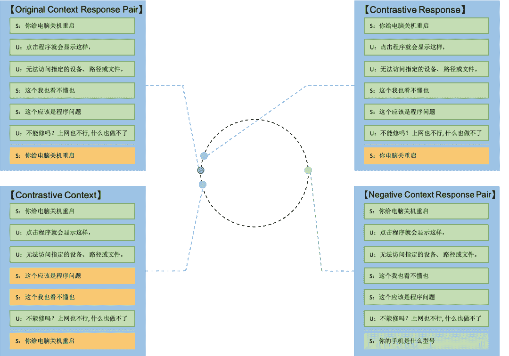

**具体来说：**

**（**1）Context端数据增强：基本原则是不显式改变Context的最后一句话，因为最后一句话的语义最为重要。

+   Context为单句，不进行显式改变，添加Dropout。

+   Context包含商家或用户连续说话情形，进行Sentence Re-ordering操作（角色信息很重要，不会调换不同角色说的话的位置）。

+   其它多轮情形，随机选择一句，进行Sentence Token Shuffling操作（针对中文，我们利用Jieba分词后再打乱重组，避免字级别打乱重组噪音过多）。

**（2）Response端数据增强：基**本原则是尽量不改变语义，不引入过多噪音。

+   **句子长度小于5，**随机进行Dropout或者Operate punctuations（添加删减句尾标点符号）操作。

+   **句子长度大于5，**随机选择Random Deletion或Random Swaping，每个位置20%概率进行替换或删除。

此外，关于如何设置对比负例也有两种方式：

+   **Batch角度：**Batch内其它样本都作为对比负例，目的是优化向量分布，改善Bert产生的向量各向异性和分布不均匀。

+   **Pair角度：**仅仅将同Pair内的负例作为对比负例，目的是拉远正例和负例的向量。

实验结果表明，Context增强方式下对比负例为Batch维度更好，而Response增强方式下对比负例为Pair维度更好。

### 4.5 个性化建模

> 上文的工作主要都集中在文本语义相关性上，但是没有考虑不同商户/坐席等的个性化偏好问题。

因此，美团采取了一种**非常简单但是极为有效的建模方案**，该方案基于一个明显的直觉，即在语义相关合理的回复候选集合中商户/坐席更偏好自己曾经说过的话。

以商家IM话术推荐为例，我们主要考虑三种类型的特征：

1.  **商家个性化特征：**对于精排模型输入集合的样例，关注答案是否来源于商户历史，即商家是否说过这句话。

1.  **商品个性化特征：**在咨询过程中，除了纯文本信息之外，还存在商品、团购等卡片信息，这类信息为“多少钱”、“适用人群”等问题提供了约束和限制。

1.  **时间个性化特征：**部分问题存在时效性和周期性。针对时效性问题，同样的问题下答案时间越近越好；针对周期性问题，上一周期的同时段的答案最好。

业界通用的特征建模方式是Wide & Deep模型，美团因为可用特征较少，所以采取了一种简化的联合建模的方式。

**具体来说，美团采取了一种简单的类双塔的形式来分别建模文本**特征和非文本个性化特征，如下图11所示：

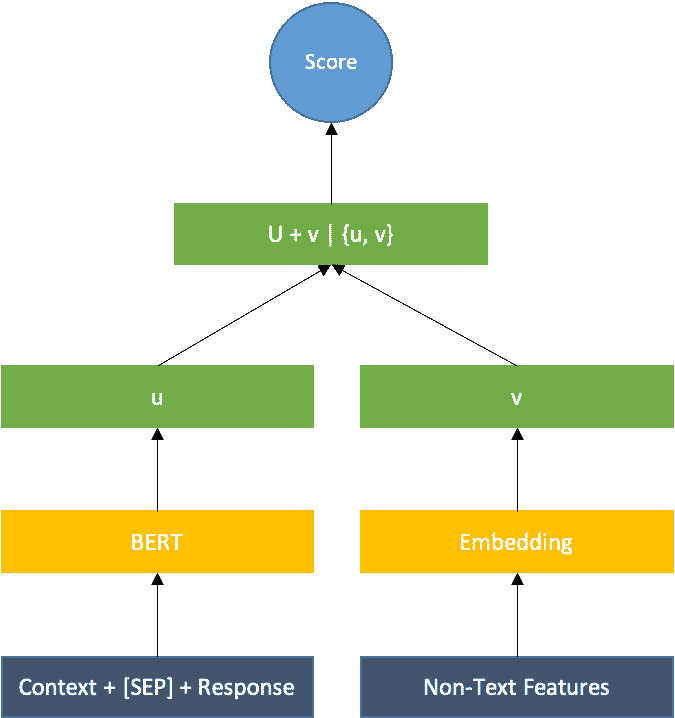

这是一种无交互的建模方式，本质上最终的打分相当于文本相关性打分加非文本特征打分，且由于非文本特征的维度都很小（2-5），因此实际上线时仅需要通过非文本特征分数微调即可。

## 5 应用实践

### 5.1 离线实验效果

> 为精准反映模型迭代的离线效果，我们针对召回及精排模型分别构造了一批Benchmark。

**召回模块主要考虑Top-6召回结果的BLE**U、ROUGE-2指标，结果如下表所示：

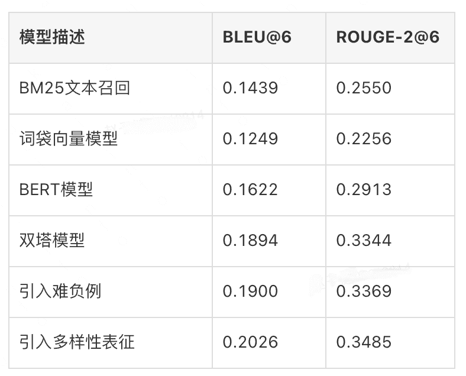

> 可以看到，**基于BM25的短期上文召回效果**优于基于长期上文的词袋向量模型，而BERT考虑了词的上下文特征，提升巨大；双塔模型则建模了对话本身的特征，效果进一步提升。

> 在双塔模型基础上，引入难负例会带来一定提升，而引入对话多样性表征则带来明显提升。

**精排模型主要考虑Top-1排序结果的BLEU、ROUG**E2、RECALL指标，结果如下表所示：

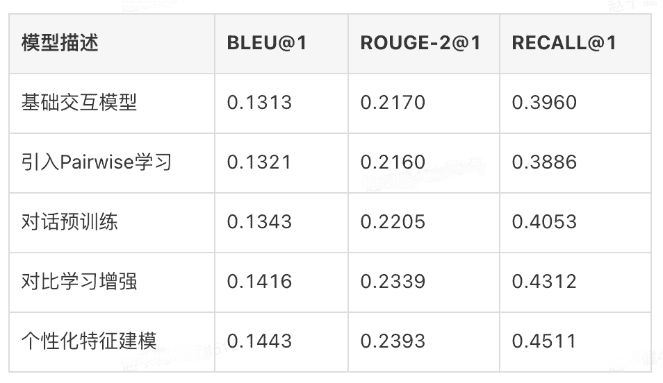

> 可以看到，引入Pairwise学习并不能带来完全的正向收益，对话预训练则带来了稳定提升，对比学习增强大大提升了所有指标。非文本特征融入在文本相关性指标上有一定提升，并且显著提升了排序相关性指标，说明该方法有效处理了在语言表达形式类似情况下商家个性化偏好问题。

## 6 小结

> 检索式对话系统是一个复杂的系统，包括离线数据流程、在线召回排序、个性场景策略等多个算法模块，其整体框架早已成熟，不过针对其中细分模块的优化仍然是研究和实践的重点。

> 经过一年多的技术探索与应用实践，美团不仅在多个业务中落地，并且构建了一套可快速推广复用的检索式对话系统。

尽管当前的系统已经达到了较高的满意度，基本覆盖解决了咨询场景中的闲聊、知识等类型问题，但是针对系统本身以及咨询场景的解决方案依然有很多探索优化的方向，包括但不限于：

> **检索与生成结合：**尽管生成式模型不适合作为主要解决方案，但是可以作为召回的补充来源或者是排序的打分器，并且在特定场景可能端到端模型更为适合。

> **多模态交互：**当前主要的交互模式是基于文本的，未来可以探索在业务场景和模型层面都支持语言、图片等的多模态交互。

> **全自动托管：**当前的模式仍需要人工客服每轮进行协同点击干预，希望在特定细分场景建立全自动托管对话机器人，解决闲聊、问答、任务等类型问题，完成咨询流程。