# 美团搜索广告排序深度学习实践

> 来源：[https://qqs7y1hozd1.feishu.cn/docx/XTykdVrjFoYGaqxpP0qcnuSJnEg](https://qqs7y1hozd1.feishu.cn/docx/XTykdVrjFoYGaqxpP0qcnuSJnEg)

## 一、从机器学习到深度学习的模型

### 模型

> 本文介绍传统机器学习模型（GBDT、LR、FM & FFM）及应用，然后再详细介绍在深度学习模型的迭代。

#### 1.GBDT

> **一种迭代的决策树算法。**

> 能自动发现多种有区分性的特征以及特征组合，并省去了复杂的特征预处理逻辑。Facebook实现GBDT ＋ LR5的方案，并取得了一定的成果。

#### 2.LR

> 一种宽而不深的结构，所有的特征直接作用在最后的输出结果上。

> 模型优点是简单、可控性好，但是效果的好坏取决于特征工程的程度。

> 需要非常精细的连续型、离散型、时间型等特征处理及特征组合。

> 通常通过正则化等方式控制过拟合。

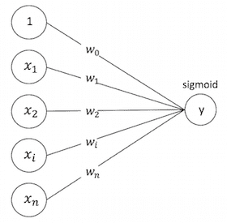

#### 3.FM & FFM

FM可以看做带特征交叉的LR，如下图所示：

从神经网络的角度考虑，可以看做下图的简单网络搭建方式：

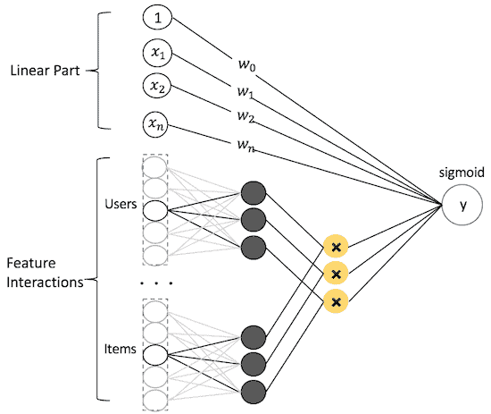

**模**型覆盖了LR的宽模型结构，同时也引入了交叉特征，增加模型的非线性，提升模型容量，能捕捉更多的信息，对于广告CTR预估等复杂场景有更好的捕捉。

**在使用DNN模型之前，搜索广告CTR预估使用了FFM模型，FFM模型中引入field**概念，把n个特征归属到f个field里，得到nf个隐向量的二次项，拟合公式如下：

上式中，fj表示第j个特征所属的field。设定隐向量长度为k，那么相比于FM的nk个二次项参数，FFM有nkf个二次项参数，学习和表达能力也更强。

> 例如，在搜索广告场景中，假设将特征划分到8个Field，分别是用户、广告、Query、上下文、用户－广告、上下文－广告、用户－上下文及其他，相对于FM能更好地捕捉每个Field的信息以及交叉信息，每个特征构建的隐向量长度 , 整个模型参数空间为

> **Yu-Chin Juan实现了一个C++版的FFM**模型工具包，但是该工具包只能在单机训练，难以支持大规模的训练数据及特征集合；并且它省略了常数项和一次项，只包含了特征交叉项，对于某些特征的优化需求难以满足，因此我们开发了基于PS-Lite的分布式FFM训练工具（支持亿级别样本，千万级别特征，分钟级完成训练，目前已经在公司内部普遍使用）。

**主要添加了以下新的特性：**

+   **支持FFM模型的分布式训练。**

**支**持一次项和常数项参数学习，支持部分特征只学习一次项参数（不需要和其他特征做交叉运算），例如广告位次特征等。拟合公式如下：

+   **支持多种优化算法。**

**从**GBDT模型切到FFM模型，积累的效果如下所示，主要的提升来源于对大规模离散特征的刻画及使用更充分的训练数据：

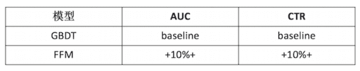

#### 4.DNN

> 从上面可以看到，美团场景具有多样性和很高的复杂度，而实验表明从线性的LR到具备非线性交叉的FM，到具备Field信息交叉的FFM，模型复杂度（模型容量）的提升，带来的都是结果的提升。

而LR和FM/FFM可以视作简单的浅层神经网络模型，基于下面一些考虑，在搜索广告的场景下把CTR模型切换到深度学习神经网络模型：

+   通过改进模型结构，加入深度结构，利用端到端的结构挖掘高阶非线性特征，以及浅层模型无法捕捉的潜在模式。

+   **对于某些ID类特别稀疏的特征，**可以在模型中学习到保持分布关系的稠密表达（embedding）。

+   充分利用图片和文本等在简单模型中不好利用的信息。

#### 5.Wide & Deep

**首**先是Google提出的经典模型Wide & Deep Model6，模型包含Wide和Deep两个部分，其中Wide部分可以很好地学习样本中的高频部分，在LR中使用到的特征可以直接在这个部分使用，但对于没有见过的ID类特征，模型学习能力较差，同时合理的人工特征工程对于这个部分的表达有帮助。Deep部分可以补充学习样本中的长尾部分，同时提高模型的泛化能力。Wide和Deep部分在这个端到端的模型里会联合训练。

在完成**场景与特征**部分介绍的特征工程后，我们基于Wide & Deep模型进行结构调整，搭建了以下网络：

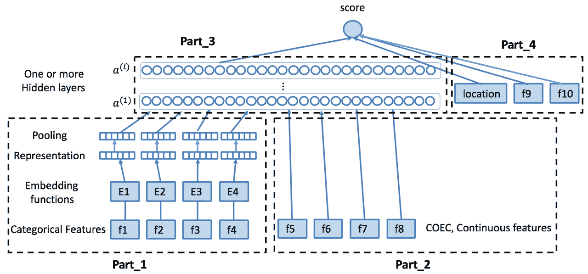

> **在搜索广告的场景中，上图的Part_1包含离散型特征及部分连续型特征离散化后的结果 (例如**用户ID、广告ID、商圈ID、品类ID、GEO、各种统计类特征离散化结果等等)。离散化方式主要采用等频划分或MDLP7。每个域构建自己的embedding向量 (缺失特征和按照一定阈值过滤后的低频特征在这里统一视作Rare特征)，得到特征的Representation，然后通过Pooling层做采样，并拼接在一起进行信息融合。

**右侧的Part_2部分主要包含我们场景下的统计类特征及部分其他途径建模表示后输入的特**征 (例如图片特征、文本特征等)，和Part_1的最后一层拼接在一起做信息融合。

**Part_3为多个全连接层，每个Layer后面连**接激活函数，例如ReLu, Tanh等。

右上的Part_4部分主要包含**广告曝光位次** (Position Bias) 及部分离散特征，主要为了提高模型的记忆性，具有更强的刻画能力。Wide和Deep部分结合，得到最终的模型：

> 深度学习模型在图像语音等数据上有显著作用的原因之一是，我们在这类数据上不太方便产出能很好刻画场景的特征，人工特征+传统机器学习模型并不能学习出来全面合理的数据分布表示，而深度学习end-to-end的方式，直接结合Label去学习如何从原始数据抽取合适的表达（representation）。但是在美团等电商的业务场景下，输入的数据形态非常丰富，有很多业务数据有明确的物理含义，因此一部分人工特征工程也是必要的，提前对信息做一个合理的抽取表示，再通过神经网络学习进行更好的信息融合和表达。

> 在美团搜索广告的场景下，用户的实时行为有非常强的指代性，但是以原始形态直接送入神经网络，会损失掉很多信息，因此我们对它进行了不同方式描述和表示，再送入神经网络之中进行信息融合和学习。

**下面以这两类数据特征为例，介绍在**Wide & Deep模型中的使用方式。

#### 1.**用户实时行为**

> **行为实体 用户的实时行为包括点击商户（C_P）、下单商户（**O_P）、搜索（Q）、筛选品类（S）等。商户的上层属性包括品类（Type: C_Type, O_Type）、位置（Loc: C_Loc, O_Loc）等。

> **Item Embedding 对用**户的行为实体构建embedding向量，然后进行Sum/Average/Weighted Pooling，和其他特征拼接在一起。实验发现，上层属性实体（C_Type, O_Type, C_Loc, O_Loc）的表现很正向，离线效果有了很明显的提升。但是C_P, O_P, Q, S这些实体因为过于稀疏，导致模型过拟合严重，离线效果变差。

**因此，做了两方面的改进：**

> 使用更充分的数据，单独对用户行为序列建模。例如LSTM模型，基于用户当前的行为序列，来预测用户下一时刻的行为，从中得到当前时刻的“Memory信息”，作为对用户的embedding表示；或Word2Vec模型，生成行为实体的embedding表示，Doc2Vec模型，得到用户的embedding表示。实验发现，将用户的embedding表示加入到模型Part_2部分，特征覆盖率增加，离线效果有了明显提升，而且由于模型参数空间增加很小，模型训练的时间基本不变。

> 使用以上方法产生的行为实体embedding作为模型参数初始值，并在模型训练过程中进行fine tuning。同时为了解决过拟合问题，对不同域的特征设置不同的阈值过滤。

计数特征 即对不同行为实体发生的频次，它是对行为实体更上一层的抽象。

> Pattern特征 用户最近期的几个行为实体序列（例如A-B-C）作为Pattern特征，它表示了行为实体之间的顺序关系，也更细粒度地描述了用户的行为轨迹。

**图片**

+   描述 商户的头图在App商品展示中占据着很重要的位置，而图片也非常吸引用户的注意力。

+   图片分类特征 使用VGG16、Inception V4等训练图片分类模型，提取图片特征，然后加入到CTR模型中。

+   E2E model 将Wide & Deep模型和图片分类模型结合起来，训练端到端的网络。

从FFM模型切到Wide & Deep模型，积累到目前的效果如下所示，主要的提升来源于模型的非线性表达及对更多特征的更充分刻画。

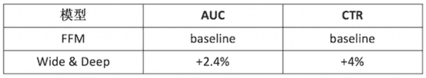

#### 2.DeepFM

有团队结合FM相比LR的特征交叉的功能，将Wide & Deep部分的LR部分替换成FM来避免人工特征工程，于是有了DeepFM(8)，网络结构如下图所示。

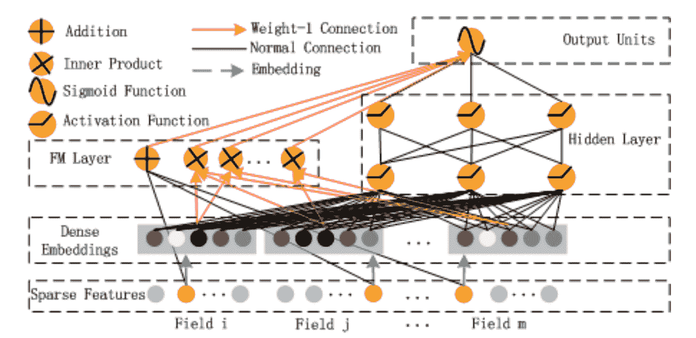

比起Wide & Deep的LR部分，DeepFM采用FM作为Wide部分的输出，在训练过程中共享了对不同Field特征的embedding信息。

在部分业务上用DeepFM模型，并进行了超参的重新调优，取得了一定的效果。其他业务也在尝试中。具体效果如下：

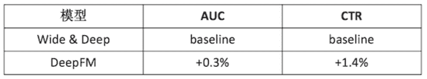

#### 3.Multi-Task

广告**预估场景中存在多个训**练任务，比如CTR、CVR、交易额等。既考虑到多个任务之间的联系，又考虑到任务之间的差别，我们利用Multi-Task Learning的思想，同时预估点击率、下单率，模型结构如下图所示：

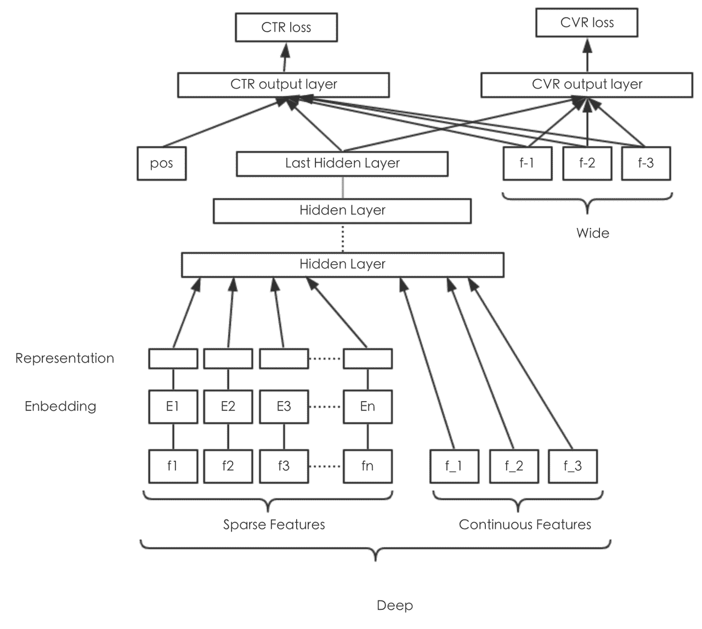

由于CTR、CVR两个任务非常类似，所以采用“Hard Parameter Sharing”的结构，完全共享网络层的参数，只在输出层区分不同的任务。

+   由于下单行为受展现位次的影响非常小，所以下单率的输出层不考虑位次偏差的因素。

+   输出层在不同任务上单独增加所需特征。

**离线训练和线上预估流程减半，性能**提升；效果上相对于单模型，效果基本持平：

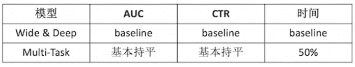

> 近期，阿里提出目前CVR预估主要存在Sample Selection Bias（SSB）和Data Sparsity（DS）两个问题，并提出在全局空间建模（以pCTCVR和pCTR来优化CVR）和特征Transform的方法来解决。

具体的Loss Function是：

**网络结构是：**

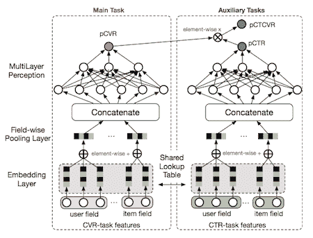

**超参调优**

> 除了以上对网络结构的尝试，也进行多组超参的调优。神经网络最常用的超参设置有：隐层层数及节点数、学习率、正则化、Dropout Ratio、优化器、激活函数、Batch Normalization、Batch Size等。

不同的参数对神经网络的影响不同，神经网络常见的一些问题也可以通过超参的设置来解决：

**过拟合**

+   网络宽度深度适当调小，正则化参数适当调大，Dropout Ratio适当调大等。

**欠拟合**

+   网络宽度深度适当调大，正则化参数调小，学习率减小等。

**梯度消失/爆炸问题**

+   合适的激活函数，添加Batch Normalization，网络宽度深度变小等。

**局部最优解**

+   调大Learning Rate，合适的优化器，减小Batch Size等。

**Covariate Shift**

+   增加Batch Normalization，网络宽度深度变小等。

**影响神经网络的超参数非常多，神经网络调参也是一件非常重**要的事情。工业界比较实用的调参方法包括：

+   网格搜索/Grid Search：这是在机器学习模型调参时最常用到的方法，对每个超参数都敲定几个要尝试的候选值，形成一个网格，把所有超参数网格中的组合遍历一下尝试效果。简单暴力，如果能全部遍历的话，结果比较可靠。但是时间开销比较大，神经网络的场景下一般尝试不了太多的参数组合。

+   随机搜索/Random Search：Bengio在“Random Search for Hyper-Parameter Optimization”10中指出，Random Search比Grid Search更有效。实际操作的时候，可以先用Grid Search的方法，得到所有候选参数，然后每次从中随机选择进行训练。这种方式的优点是因为采样，时间开销变小，但另一方面，也有可能会错过较优的超参数组合。

+   **分阶段调参：**先进行初步范围搜索，然后根据好结果出现的地方，再缩小范围进行更精细的搜索。或者根据经验值固定住其他的超参数，有针对地实验其中一个超参数，逐次迭代直至完成所有超参数的选择。

> 在实际调参过程中，使用的是第3种方式，在根据经验参数初始化超参数之后，按照隐层大小->学习率->Batch Size->Drop out/L1/L2的顺序进行参数调优。

在搜索广告数据集上，不同超参的实验结果如下：

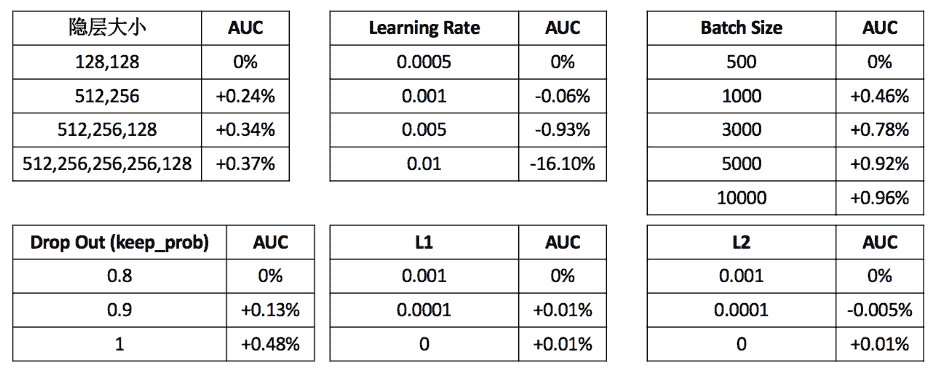

### （三）小结

搜索广告排序模型经历了从GBDT –> FFM –> DNN的迭代，同时构建了更加完善的特征体系，线下AUC累积提升13%＋，线上CTR累积提升15%＋。

## 二、基于深度学习模型的工程优化

### （一）线下训练

**TensorFlow程序如果单机运**行中出现性能问题，一般会有以下几种问题：

+   复杂的预处理逻辑耦合在训练过程中。

+   选择正确的IO方式。

#### 1.剥离预处理流程

> 在模型的试验阶段，为了快速试验，数据预处理逻辑与模型训练部分都耦合在一起，而数据预处理包含大量IO类型操作，所以很适合用HadoopMR或者Spark处理。

**具体流程如下：**

在预处理阶段将查表、join字典等操作都做完，并且将查询结果与原始数据merge在一起。

**将libfm格式的数据转为易于TensorFl**ow操作的SparseTensor方式：

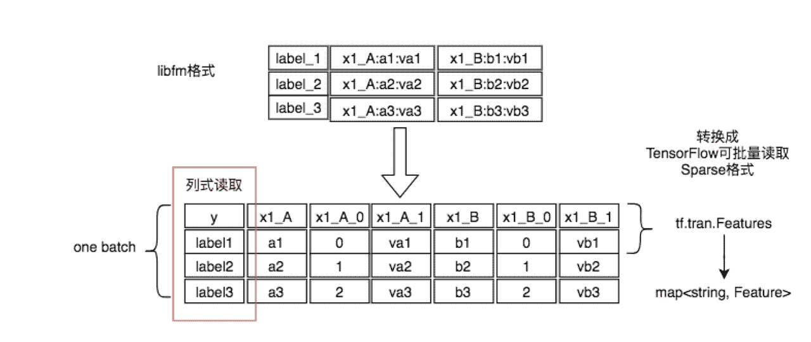

将原始数据转换为TensorFlow Record。

#### 2.选择正确的IO方式

**TensorFlow读取数据的方式主要有2种，**一般选择错误会造成性能问题，两种方式为：

1.  **F**eed_dict 通过feed_dict将数据喂给session.run函数，这种方式的好处是思路很清晰，易于理解。缺点是性能差，性能差的原因是feed给session的数据需要在session.run之前准备好，如果之前这个数据没有进入内存，那么就需要等待数据进入内存，而在实际场景中，这不仅仅是等待数据从磁盘或者网络进入内存的事情，还可能包括很多前期预处理的工作也在这里做，所以相当于一个串行过程。而数据进入内存后，还要串行的调用PyArrayToTF_Tensor，将其copy成tensorflow的tensorValue。此时，GPU显存处于等待状态，同时，由于tf的Graph中的input为空，所以CPU也处于等待状态，无法运算。

1.  **R**ecordReader 这种方式是tf在Graph中将读取数据这个操作看做图中一个operation节点，减少了一个copy的过程。同时，在tf中还有batch与threads的概念，可以异步的读取数据，保证在GPU或者CPU进行计算的时候，读取数据这个操作也可以多线程异步执行。静态图中各个节点间的阻塞：在一个复杂的DAG计算图中，如果有一个点计算比较慢时，会造成阻塞，下游节点不得不等待。此时，首先要考虑的问题是图中节点参数所存储的位置是否正确。比如如果某个计算节点是在GPU上运算，那么如果这个节点所有依赖的variable对象声明在CPU上，那么就要做一次memcpy，将其从内存中copy到GPU上。因为GPU计算的很快，所以大部分时间花在拷贝上了。总之，如果网络模型比较简单，那么这种操作就会非常致命；如果网络结构复杂，比如网络层次非常深，那么这个问题倒不是太大的问题了。

在这个Case中，需要提升吞吐，而不仅仅是在试验阶段。所以需要用RecordReader方式处理数据。

#### 3.优化过程

> 将整体程序中的预处理部分从代码中去除，直接用Map-Reduce批处理去做（因为批处理可以将数据分散去做，所以性能非常好，2亿的数据分散到4900多个map中，大概处理了15分钟左右）。

MR输出为TensorFlow Record格式，避免使用Feed_dict。

数据预读，也就是用多进程的方式，将HDFS上预处理好的数据拉取到本地磁盘（使用joblib库+shell将HDFS数据用多进程的方式拉取到本地，基本可以打满节点带宽2.4GB/s，所以，拉取数据也可以在10分钟内完成）。

> **程序通过TensorFlow提供的TFrecord**Reader的方式读取本地磁盘上的数据，这部分的性能提升是最为明显的。原有的程序处理数据的性能大概是1000条/秒，而通过TFrecordReader读取数据并且处理，性能大概是18000条/秒，性能大概提升了18倍。

> **由于每次run的时候计算都要等待TFrecordReade**r读出数据，而没用利用batch的方式。如果用多线程batch可以在计算期间异步读取数据。在TensorFlow所有例子中都是使用TFRecordReader的read接口去读取数据，再用batch将数据多线程抓过来。但是，其实这样做加速很慢。需要使用TFRecordReader的read_up_to的方法配合batch的equeue_many=True的参数，才可以做到最大的加速比。使用tf.train.batch的API后，性能提升了38倍。

> **此时，性能已经基本达到预期了。**例如整体数据量是2亿，按照以前的性能计算1000条/秒，大概需要运行55个小时。而现在大概需要运行87分钟，再加上预处理（15分钟）与预拉取数据（10分钟）的时间，在不增加任何计算资源的情况下大概需要2个小时以内。而如果是并行处理，则可以在分钟级完成训练。

### （二）线上预估

线上流量是模型效果的试金石。离线训练好的模型只有参与到线上真实流量预估，才能发挥其价值。在演化的过程中，我们开发了一套稳定可靠的线上预估体系，提高了模型迭代的效率。

#### 1.模型同步

**开发高可用的同步组件：**用户只需要提供线下训练好的模型的HDFS路径，该组件会自动同步到线上服务机器上。该组件基于HTTPFS实现，它是美团离线计算组提供的HDFS的HTTP方式访问接口。同步过程如下：

+   同步前，检查模型md5文件，只有该文件更新了，才需要同步。

+   同步时，随机链接HTTPFS机器并限制下载速度。

+   同步后，校验模型文件md5值并备份旧模型。

+   同步过程中，如果发生错误或者超时，都会触发报警并重试。依赖这一组件，我们实现了在2min内可靠的将模型文件同步到线上。

#### 2.模型计算

当前线上有两套并行的预估计算服务。

基于TF Serving的模型服务

**TF Serving是TensorFlo**w官方提供的一套用于在线实时预估的框架。它的突出优点是：和TensorFlow无缝链接，具有很好的扩展性。使用TF serving可以快速支持RNN、LSTM、GAN等多种网络结构，而不需要额外开发代码。这非常有利于我们模型快速实验和迭代。

> 使用这种方式，线上服务需要将特征发送给TF Serving，这不可避免引入了网络IO，给带宽和预估时延带来压力。我们尝试了以下优化，效果显著。

并发请求。一个请求会召回很多符合条件的广告。在客户端多个广告并发请求TF Serving，可以有效降低整体预估时延。

**特征ID化。**通过将字符串类型的特征名哈希到64位整型空间，可以有效减少传输的数据量，降低使用的带宽。

**在**典型的五层网络（512*256*256*256*128）下，单个广告的预估时延约4800μs，具体见下图：

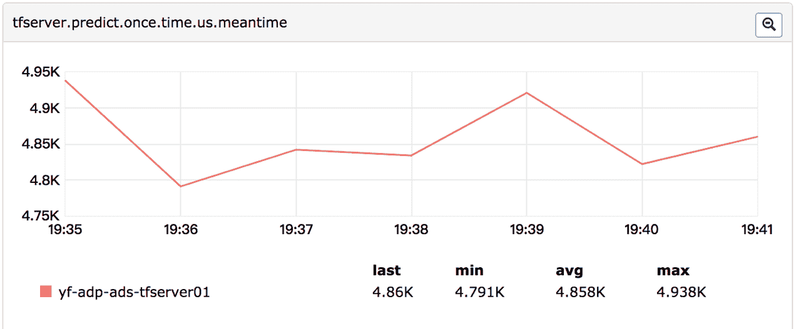

**定制的模型计算实现**

> 由于广告线上服务需要极高的性能，对于主流深度学习模型，我们也定制开发了具体计算实现。

全连接DNN模型中使用Relu作为激活函数时，可用滚动数组、剪枝、寄存器和CPU Cache，具体如下：

```
// 滚动数组
int nextLayerIndex = currentLayerIndex ^ 1 ;
System.arraycopy(bias, bOff, data[nextLayerIndex], 0, nextLayerSize);
for (int i = 0; i &lt; currentLayerSize; i ++) {
    float value = data[currentLayerIndex][i];
    // 剪枝
    if (value &gt; 0.0) {
        // 寄存器
        int index = wOff + i * nextLayerSize;
        // CPU 缓存友好
        for (int j = 0; j &lt; nextLayerSize; j++) {
            data[nextLayerIndex][j] += value * weights[index + j];
        }
    }
}
for (int i = 0; i &lt; nextLayerSize; k++) {
    data[nextArrayIndex][i] = ReLu(data[nextArrayIndex][i]);
}
arrayIndex = nextArrayIndex;
```

优化后的单个广告预估时延约650μs，见下图：

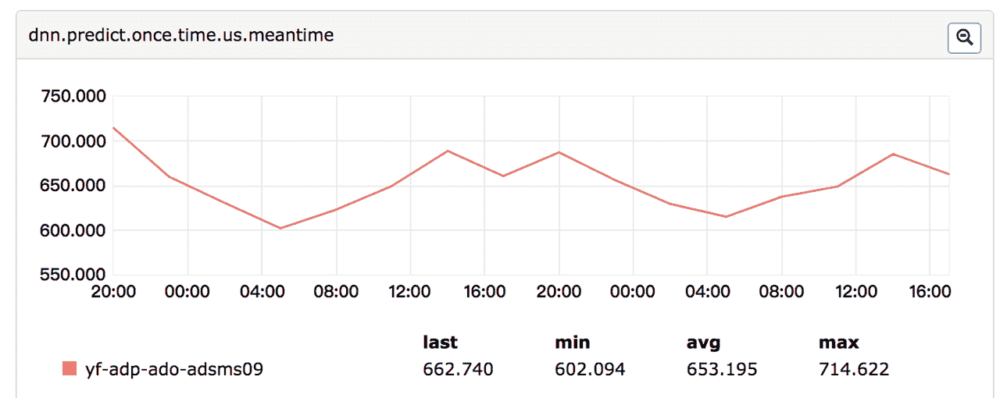

> 综上，当前线上预估采取“两条腿走路”的策略。利用TF Serving快速实验新的模型结构，以保证迭代效率；一旦模型成熟切换主流量，开发定制实现，以保证线上性能。

**模型效果**

> 借助于分层实验平台，我们可以方便的分配流量，完成模型的小流量实验上线。该分层实验平台同时提供了分钟粒度的小流量实时效果数据，便于模型评估和效果监控。