# 0-1落地智慧银行风控系统

> 来源：[https://qqs7y1hozd1.feishu.cn/docx/Ihr0dk4tTokQ9Hx1kjWcZFfTnJA](https://qqs7y1hozd1.feishu.cn/docx/Ihr0dk4tTokQ9Hx1kjWcZFfTnJA)

## 风控简介

> 所谓风险控制（风控），即针对用户风险进行管理规避的过程。

> 在风控环节中，传统观念A卡为主、B卡C卡为辅，但是在市场逐步饱和、政策利率要求越来越低的背景下，B卡和C卡也越来越重要。

### 贷前阶段：

这一阶段的数据来源主要分为申请信息、历史消费信息、外部信息（例如多投借贷、公积金等）。常用风控模型包括：

**1、用户响应风控模型：**针对互联网，数据来源多样，类似漏斗模式，分析获客阶段的用户转化情况，如：引流、导流、注册成功等信息，以及在某个阶段进行埋点分析流失状态。

**2、申请评分卡风控模型：**即`A卡`，主要侧重贷前风控，在客户获取初期，建立申请评分卡模型，预测未来客户在放款后逾期与违约的概率。

**3、申请反欺诈风控模型：**识别欺诈风险高的客户，捕捉各类欺诈行为，如身份造假，非客户本人的行为等。一般分为第一方反欺诈和第三方反欺诈。

**4、风险定价风控模型：**根据客户历史分析，制定初始额度和初始利率。

**5、用户价值风控模型：**在风险评分难以决策的区域，制定置入置出策略，预测客户在开户后能够为机构带来潜在收益。在相同风险等级客户里，可以筛选收益等级高的客户，最大化挖掘收益潜力。

### 贷中阶段：

> 和贷前阶段不同，这个阶段用户已经有过至少一次的还款行为，所以在数据维度会加入借贷数据，进入到贷中客户管理阶段。常用风控模型包括：

**1、行为评分卡风控模型：**也就是我们常说的`B卡`，通过分析不断去挖掘客户的各种需求，去推荐一些差异化的信贷产品，主要是给客户交叉销售产品和提额。

**2、交易反欺诈风控模型：**交易阶段，识别一些羊毛党刷单、薅羊毛和套现行为。

**3、客户流失风控模型：**对客户流失的原因进行分析，提前知道哪些客户会流失，及时采取挽回措施。

### 贷后阶段：

经过以上两个阶段，还有一小部分用户会逾期进入催收阶段。常用风控模型包括：

> **1、催收预警风控模型：**预测出来一些轻度逾期的客户，这类客户可能只是单纯的忘记还款而已，这个时候就不需太多人工催收参与进来，先进行短信提醒等简单的催收工作即可。

> **2、还款率预测风控模型：**预测经过催收之后，最终收回的欠款比率。

> **3、迁徙率模型：**评估客户短期内会不会违约，可以预测逾期的人群从轻度逾期发展到重度逾期的概率。

> **4、失联修复风控模型：**逾期阶段，客户本身联系不上，通过数据库挖掘新的联系方式（如，身边的亲戚朋友等），修复客户失联状态。

## 一、好坏样本定义

好坏样本的定义需要根据实际的业务需求进行界定，而不是存在逾期就界定为坏样本（由于收益与风险的正比关系，银行为了找到平衡，不会认为所有发生过逾期的客户都是坏客户，并且“适当”的逾期不仅不会带来损失，反而带来了可观的逾期利息收入），所以对于银行来说，他所关注的坏客户是坏到某一程度，也就是逾期等级较高且不还款的客户。

> `Vintage`分析（账龄分析）用于确定合适的表现期，即确定有多久表现期的客户能纳入模型。

> 表现期越长，信用风险暴露将越彻底，但意味着观察期离当前越远，用以提取样本特征的历史数据将越陈旧，建模样本和未来样本的差异也越大。

> 表现期越短，风险还未暴露完全，但好处是能用到更近的样本；随着账龄的变化，贷款逾期的变化情况，贷款逾期趋于稳定后，则可作为表现期，比如经过6个月

滚动率分析用于定义客户的好坏程度（逾期状态为`M4`的客户，几乎都会进一步恶化，则可将`M4`作为坏样本）。

### 1.1 名词定义

一个例子，有业务，在2021年4月12日上午10点8分在网络平台上借了一笔1万元的信用贷款，以等额本息的方式在未来12个月进行偿还。

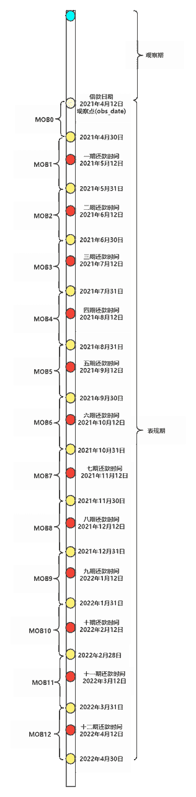

1. 观察点(`obs_date`)：客户贷款的时点（2021年4月12日上午10点8分）。

**2. 观察期：**用来生成客户特征（自变量）的时间区间。

**3. 表现期：**用来定义客户好坏的时间区间。严格来讲，分期12期的客户只有在所有钱都还完后才能定义好坏。

但是通过`Vintage`分析可以看出放款客户在经过多久后，该变坏的已经变坏，剩下的基本都能按时还款了，从而可以缩短表现期的时间，增加能进入建模的客户数量。

> 定义：客户到了应还款日还未还款，逾期天数为应还日次日起到实还日（含）期间的日数，如客户当期未还款无实还日，则取数据统计日取代实还日。

表达方式：`DPDN+`表示逾期天数≥N天的客户，如`DPD60+`表示逾期天数≥60天的客户。

示例：

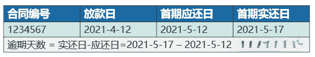

即客户在第一个还款日（2021年5月12日）未还款，那么2021年5月13日即为逾期一天，客户在5月17日还款，该客户首逾5天。

其他说明：

分析时按需求可采用任何逾期天数，如逾期3天/7天/15天/30天等。

分析时按逾期天数设定取决于入催方式及催回率。

### 1.2 账龄分析（Vintage Analysis）

`Vintage`曲线主要用途包括：

+ 分析变化规律

+ 确定最终品质

+ 确定成熟期

+ 分析影响因素

在信贷领域中，也可以用`Vintage`曲线分析资产（`portfolio`）质量的成熟过程变化规律。为更容易理解，在此列举了`Vintage`分析过程中两个领域的对应关系。

遵循同样的分析思路，按账龄（`MOB`）长短对齐后比较，可以了解同一产品不同时期放款的资产质量。

> 确定资产质量

> 分析变化规律

> 确定账户成熟期

**分析影响因素：**风控策略收紧或放松、客群变化、市场环境、政策法规等都会影响资产质量。分析影响因素，可以用来指导风控策略的调整。

**1. 目的：**统计每个月新增放款后在每个`MOB`中的逾期情况，对比每月放款的逾期情况，判断策略、模型的有效性，分析客户的风险成熟期。

2. 表现方式：`Vintage`曲线的横坐标是`MOB`，纵坐标是逾期率。逾期率可以计算金额维度的，也可以计算订单维度的。

3. 逾期率计算及统计方式（金额）：

+ 逾期率=逾期剩余本金/总放贷本金。

+ 分母是放款当月的总计本金，即合同金额，不随时间变动（不因结清或核销减少）。

+ 分子是逾期达到`Bad`定义时的本金余额，假设`Bad`定义为`M3+`，分子有两种计算方式。

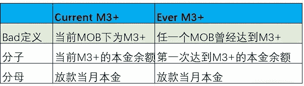

4. 逾期率计算及统计方式（订单笔数）：

+ 逾期率=逾期订单笔数/总放贷订单笔数

+ 分母是放款当月的总计订单笔数，不随时间变动（不因结清或核销减少）。

+ 分子是逾期达到`Bad`定义时的订单笔数，假设`Bad`定义为`M3+`，分子同样有两种计算方式。

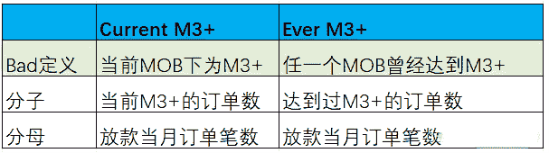

**`Vintage`表建立**

对客费率36%的现金贷产品，产品期限12期，件均2千元，月均放款笔数在1万笔左右，还款方式为等额本息。

由滚动率分析可以得到逾期`Mn+`的客户几乎不会从良，从而可以定义坏客户为`Mn+`的客户。

该产品通过滚动率分析后得到逾期状态为`M3+`的客户几乎不会从良。

统计2021年3月到2022年5月（如今）该产品的放款表现，可得到如下表格：

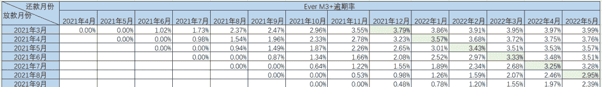

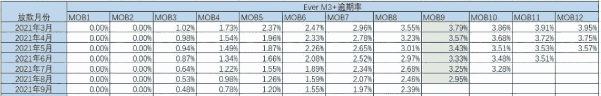

把`MOB`维度的表绘制成折线图，可得到如下`Vintage`表：

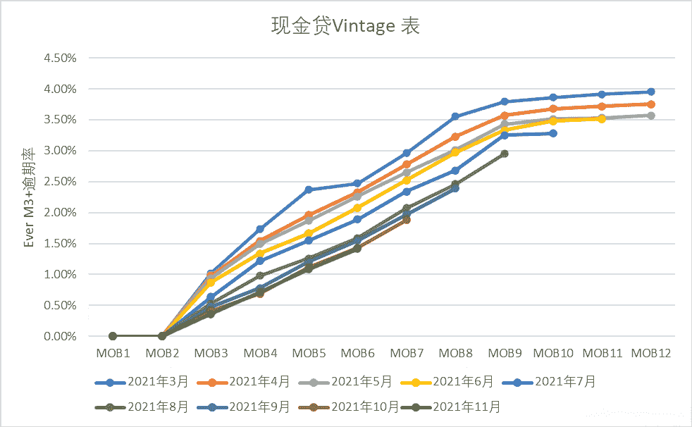

由`Vintage`表知：

> ①横轴表明客户的生命周期，体现了客户成熟过程中发生的变化。

> ②纵轴体现了拥有相同账龄的客户随时间改变而发生的变化，展示了不同月份的违约率变化情况。

> ③由于产品期限为12期，所以`MOB`（账龄）最长为12个月，反之也成立。

> ④数据统计的是`Ever M3+`逾期率，所以账龄`MOB1`、`MOB2`的都为0。

> ⑤放贷月份从2021年3月到2021年11月账户的逾期率都在降低，说明资产质量在不断提升，有可能是风控对该产品风险维度有了更全面的认识，风控水平在不断提升。

> ⑥不同月份放款的客户在经过9个`MOB`后逾期率`M3+`趋于稳定，说明账户的成熟期是9个月。

> ⑦由于统计的是`Ever M3+`逾期率，所以单月的逾期率数值只增不减。

**从该`Vintage`表知**，如果我们现在想要建立信用贷前评分卡模型（`A卡`），有完整表现（放款走完了12期）的放款月份是2021年3月到2021年6月。

如果只以有完整表现的数据建模，样本只能从放款月份是2021年3月到2021年5月的客户中取。

如果以账户成熟期9个月的数据建模，样本可以从2021年3月到2021年8月中取，多三个月的样本数据。

> 由于该`Vintage`表的数据是虚造的，看起来比较清晰。现实中有些放贷数据可能突然在某一个月由于流量、外部环境、风控策略调整等因素导致逾期表现突增。

比如有一个电商客群贷，产品期限12期、件均5,000元、对客费率36%的现金贷产品，`Vintage`表现如下（数据经过处理）：

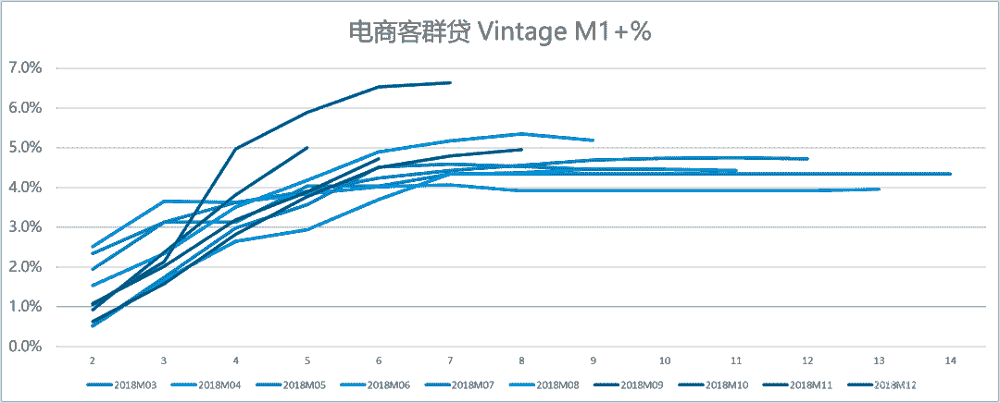

从该产品的`Vintage`表中可以看到2018年10月的放款逾期率相较于之前月份陡增，可能是由于流量、外部环境、风控策略调整等因素造成的。

### 1.3 滚动率分析

1. 目的：为了让风控模型有更好的区分能力，需要确定逾期多久的客户定义为`1`（坏客户）。

+ 因为有些逾期几天的客户很可能是忘记还款了，经过提醒就还了，并非没有还款意愿和还款能力。

+ 如果所有有逾期表现的客户都定义为`1`，会导致模型的坏客户定义不清晰，从而影响模型的区分能力。

滚动率分析可以展示客户在不同时间段从一种状态向另一种状态转移的情况，从而可以分析不同逾期状态的客户发展变化情况。

1. 定义：从观察点1之前一段时间（观察期1）的最坏状态，向观察点1之后一段时间（观察期2）的最坏状态转移情况。

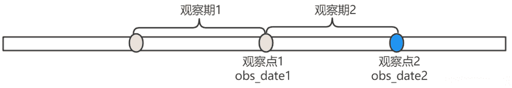

1. 滚动率分析具体步骤：

> `step1`：选择观察点1，以观察点1为截止时间，根据还款计划表统计客户在观察期1（如过去6个月）的最长逾期期数，按最坏逾期状态将客户分为不同层次，如`C`、`M1`、`M2`、`M3`、`M4+`等。

> `step2`：以观察点1为起始时间，统计客户在观察期2（如未来6个月）的最长逾期期数，按最坏逾期状态将用户分为不同层次，如`C`、`M1`、`M2`、`M3`、`M4+`等。

> `step3`：交叉统计转移矩阵中的客户数。

> `step4`：根据转移矩阵中的客户数统计占比。

> `step5`：选择不同的观察点，重复`step1`～`step4`，对比滚动率数值。

例如，选择观察点为2021年6月30日晚上12点，取20，000个客户作为观察对象，统计这些客户从观察期1到观察期2的最大逾期状态变化情况。

首先统计出如下客户逾期状态的明细表：

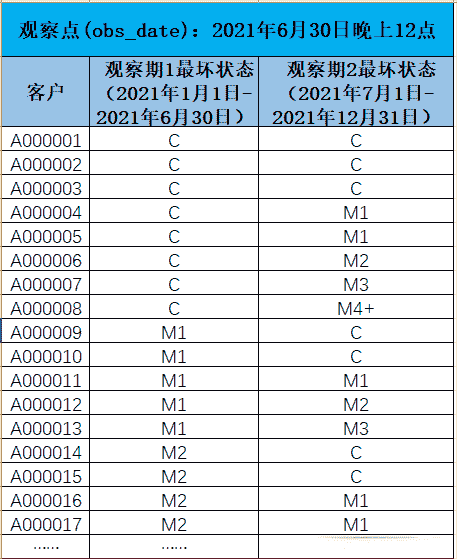

根据逾期状态明细表统计出如下滚动率分析矩阵：

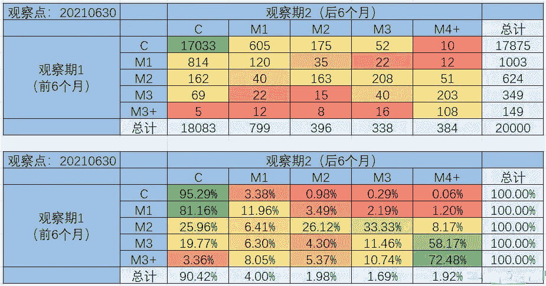

**观察滚动率分析矩阵可知：**

**①**观察期1中逾期状态为`C`(正常)的客户，在未来6个月里，有95.29%会继续保持正常状态，4.71%会转变为逾期客户。

**②**观察期1中逾期状态为`M1`的客户，未来有81.16%会回到正常状态，即从良率为81.86%，有11.96%依然是`M1`状态，6.88%会进一步恶化。

**③**观察期1中逾期状态为`M2`的客户，从良率为25.96%，有6.41%转化为`M1`状态，26.12%依然是`M2`状态，41.51%会进一步恶化。

**④**观察期1中逾期状态为`M3`的客户，从良率为19.77%，10.6%转化为`M1`和`M2`，11.46%依然是`M3`状态，58.17%会进一步恶化。

**⑤**观察期1中逾期状态为`M3+`的客户，从良率为3.36%，24.16%转化为`M1`、`M2`和`M3`，72.48%依然是`M3+`状态。

> 根据从良率数量来看，逾期状态为`M3+`的客户几乎不会从良，为了让风控模型有更好的区分能力，可以定义坏客户为逾期状态为`M3+`（逾期超过90天）的客户。

实际信贷建模时，由于业务规模、产品上线时间等约束，建模样本量可能较少，导致坏样本数量更少。

有时会人为划定逾期`n`天以上的为`1`（坏样本），未逾期的客户定义为`0`（好样本），逾期`n`天以内的定义为灰样本（舍弃）。

现在逾期多少天以上的客户定义为坏客户已经有了衡量的标准。需要确定有多久表现期的客户才能纳入评估。

产品的贷款期限是12期，需要12期都走完才能定义一个客户是否为坏客户吗？

> 严格来讲，确实如此。否则，我们只能说到目前为止，该客户不是坏客户，但并不能知道在未来几期会不会逾期变成坏客户。

而且有些账户是在前几期就达到`M3+`，有些是在后几期才达到`M3+`。

因此，只需确定一个合适的表现期能够覆盖足够多的坏客户即可。`Vintage`分析就是确定表现期设定多久比较合适。

### 1.4 因变量`Y`的确定

1. 定义：因变量`Y`即为客户好坏标签变量。

1. 方法：用滚动率分析定义客户的好坏程度，`Vintage`分析确定合适的表现期。

1. 具体操作步骤：

> `step1`：利用滚动率定义坏客户，例如上文案例中定义：逾期率为`M3+`的客户是坏客户。

> `step2`：以`M3+`作为资产质量统计指标，统计`Vintage`数据表，绘制`Vintage`曲线，分析账户成熟期。例如上文案例确定：账户成熟期是9个月。

> `step3`：表现期大于成熟期的样本可以用于建模，表现期小于成熟期的样本无法准确定义`Y`变量，暂时舍弃。

因此，我们将两者结合起来，定义：

> `Bad` = 账户经过9期表现期后，逾期状态为`M4+`（逾期超过90天）。

> `Good` = 经过9期表现期，但未达到`M4+`逾期状态。

> `Intermediate` = 未进入9期表现期，账户还未成熟，无法定义好坏，也就是不定样本。

### 1.5 迁移率分析法

迁移率分析法（`Flow Rate`）也叫做净流量滚动比例法（`Net Flow Rate`），能形象展示客户贷款账户在整个生命周期中的变化轨迹，也是预测未来坏账损失的最常用的方法。

其核心为：处于某一逾期状态（如`M2`）的账户，一个月后，要么从良为`M0`账户，要么恶化为更坏的下一个逾期状态（如`M3`）。

> 迁移率 = 前一期逾期金额到下一期逾期金额的转化率

> 一般缩写为`M0-M1`、`M4-M5`等形式，例如：

> `M0-M1` = 当月进入`M1`的贷款余额 / 上月末`M0`的贷款余额

> `M2-M3` = 当月进入`M3`的贷款余额 / 上月末`M2`的贷款余额

**迁移率分析的具体操作步骤为：**

> `step 1`：定义逾期状态，如前文所述的`M0`、`M1`、`M2`等。

> `step 2`：计算各逾期状态之间的迁移率，如`M0-M1`、`M2-M3`等。

> `step 3`：计算不同月份（也可称为`Vintage`）的平均迁移率。目的是对本平台在不同时期的资产的迁移率有整体的认知。

> `step 4`：根据平均迁移率和不良资产回收率，计算净坏账损失率。

接下来，我们以数值案例（非真实业务数据）展示上述过程。

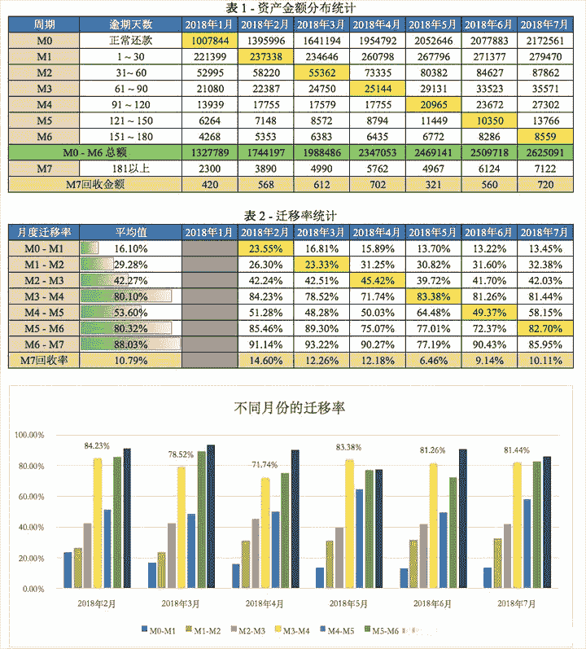

表2中，2月份的逾期`M1`资产只能从1月份的正常`M0`资产滚动而来，因此从逾期`M0`资产向`M1`的转化率为237338/1007844=23.55%。

通过迁移率，可以清晰观察到每个`Vintage`的资产在各逾期状态的演变规律。

表2中，从横向比较每个月的迁移率，发现不完全一样。这是因为随着时间推移、外在宏观经济环境、内部政策等变化而产生一定的波动。我们可以利用这些数据：

观察迁移率的发展轨迹，监控坏账的发展倾向和催收效果。

通过对多个月份的迁移率计算平均值，从而使迁移率更加稳定。

### 1.6 坏账准备金

呆帐风险是信贷机构必须面对的风险，主要来源于信用风险和欺诈风险等。为了应对未来呆帐的可能，信贷机构一般都会设定一个储备资金，这就是坏账准备金（`Bad Debt Reserve`）。

一般做法是，把未清偿贷款余额乘以一定的准备金比例（`Reserve Ratio`）所得。可以理解，资产逾期等级越高（越差），准备金比例也应该越高，因为恶化为呆帐的可能性也更高。正常`M0`资产恶化为呆帐的可能性最低，因此我们预留的准备金比例也就最少。

**总结下计算坏账准备金的步骤为：**

> `step 1`：统计未清偿贷款金额的分布，也就是`M0`~`M6`状态分别对应的资产余额。

> `step 2`：为每个逾期状态的资产分配一个准备金比例。

> `step 3`：每个子项目的准备金金额 = 未清偿贷款余额 x 准备金比例。

> `step 4`：每个子项目的准备金金额相加，得到最终的准备金。

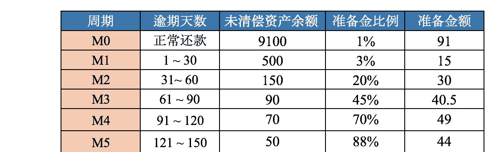

最关键的准备金比例是如何给出的？

由于坏账准备金是用来覆盖预期的未来呆帐损失的，准备金比例必须等于处于各个逾期状态的资产未来演变为呆帐的比例。

回到迁移率分析中，我们发现从正常`M0`资产迁移至逾期`M7`资产（呆帐）需经过7次迁移，如图。那么，只要把各个状态之间的转化率相乘，不就得到准备金比例了？

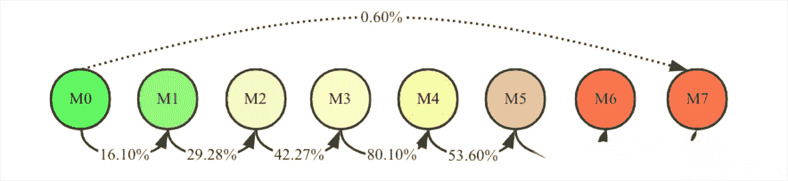

因此，定义正常`M0`资产对应的毛坏账损失率，也就是迁移到呆帐的转化率为：

> 毛坏账损失率=（`M0`-`M1`）×（`M1`-`M2`）×…×（`M6`-`M7`）

> 在本案例中，正常`M0`资产对应的毛坏账损失率为：16.1%×29.28%×42.27%×80.1%×53.6%×80.32%×88.03%=0.60%

在实际中，信贷机构会将不良资产打包转卖给第三方公司，这样就能回收部分不良资产，减少损失。因此，定义净坏账损失率为：

> 净坏账损失率 = 毛坏账损失率 - 不良资产外卖回收率

由于`M7`不良资产的平均回收率为10.79%，则可计算净坏账损失率为：

0.60%×（1-10.79%）=0.54%

同理，我们可以计算正常资产到不同逾期状态资产的毛损失率和净损失率如下：

根据图所示的损失率表，我们定义：

当月应计拨备额 = `SUM(净坏账损失率 * 月末应收账款余额)`

拨备率 = 当月应计拨备额 / 总资产金额

其中，拨备率是用来预防不良资产的发生而准备的金额的比例。拨备率应越低越好。拨备率越高说明风险越大，损失越大，利润越小。

在本案例中，当月应计拨备额为65421元，如图13所示。拨备率为：65421/2625091=2.49%

## 二、建模流程

1）前期准备工作

2）模型设计

3）数据拉取及清洗

4）特征工程

5）模型建立和评估

6）模型上线部署

7）模型监控

## 三、常用模型

1. 逻辑回归（最常用）

2. 决策树

3. 集成学习（随机森林，`Adaboost`，`GBDT`，`XGBOOST`，`LightGbm`）

## 四、模型效果

### 4.1 评分卡建模之前的评估

主要评估建模样本的稳定性，根据评分卡的目的不同，比较对象为总体或者近段时间的样本。

### 4.2 建模过程的评估

包括变化趋势，箱体之间`WOE`差异，`WOE`绝对值大小等。

### 4.3 模型评估

> **1）区分度：**主要是`KS`和`GINI`指标，一般二分类都是用`KS`衡量模型的效果，这里着重理解`KS`的定义及用法，理解`AUC`和`KS`的关系，他们之间有一个公式，大致可以推断出你模型得到的指标是不是正确的。

> **2）准确性：**主要是`ROC`曲线和`AUC`指标，理解`AUC`的定义和用法，需要注意的是，在建模的过程无论是训练集、测试集，还是验证集`AUC`的值不能相差太大，最好的状态是三个值一致。

### 4.4 模型上线后评估

#### 前期监控（模型上线后一个月内）：

**1）**模型最后设定`cutoff`点后可以得出模型的拒绝率（线下拒绝率）, 上线后需要比较模型每日的拒绝率与线下拒绝率。如果两者差异较大，说明线上的用户与建模的用户分布有很大差异，原因可能是没做拒绝推断，或者用户属性随着时间发生了偏移。

**2）**监控模型整体的稳定性，通常用`PSI`来衡量两个时间点的差异程度。模型的稳定性是一个需要长期观察的指标，可绘制月/周`PSI`变化趋势图来分析稳定性的变化，从中可以发现用户是否随着时间推移属性发生了变化，以便及时对模型做出合理的调整。

**3）**变量稳定度分析，目的是如果模型的稳定性不好，可利用变量稳定度分析来了解是哪些变量造成的。对于不稳定的变量要分析其原因，并对模型做出调整，弃用不稳定的变量或者找其他变量来替换。

#### 后期监控（用户表现出了好坏程度）：

此时已积累了一些线上的好坏用户，可做模型的线上效果的评估，评估的指标有`AUC`, `KS`, 基尼系数，如果模型的线下效果好，但线上效果却不理想，这个模型是要做优化的。

+ 好坏用户的评分分布。绘制线上好坏用户的评分分布图，如果符合期望（高分段好用户占比多，低分段坏用户占比多），则说明模型的线上的区隔能力较好。

+ 变量鉴别力分析。用线上的好坏用户来计算变量的`IV`值，评价变量的预测能力，预测能力不好的变量可以考虑弃用。

## 五、评分卡分数转换

评分卡中不直接用客户违约率`p`，而是用违约概率与正常概率的比值，称为`odds`，即：

原因是因为根据逻辑回归原理：

所以将`odds`映射成分数，可以和逻辑回归无缝连接。

评分卡的背后逻辑是`odds`的变动与评分变动的映射（把`odds`映射为评分），我们可以设计这个一个公式：

其中`A`与`B`是常数，`B`前面取负号的原因，是让违约概率越低，得分越高。

## 六、线上部署

> 评分卡的部署较为简单，因为评分卡将变量映射到了一个个区间及得分，所以在普通的风控决策引擎上就可以配置。像一些比较复杂的模型，比如`Xgboost`和`lightgbm`，一般是将模型文件转换成`pmml`格式，并封装成`pmml`，在风控后台上传`pmml`和变量参数文件，并配置好模型的阈值。`Python`和`R`开发的模型都可以用这种方式来部署。

### 6.1 风控模型的冷启动

风控模型的冷启动是指产品刚上线时，没有积累的用户数据，或者用户还没有表现出好坏，此时需要做模型就是一个棘手的问题，常用的方法如下：

**1）不做模型，只做规则。**凭借自己的业务经验，做一些硬性规则，比如设定用户的准入门槛，考量用户的信用历史和多头风险，而且可以接入第三方提供的反欺诈服务和数据产品的规则。另外可以结合人审来对用户的申请资料做风险评估。

2）借助相同模式产品的数据来建模。 如果两个产品的获客渠道，风控逻辑，用户特征都差不多的话，可以选择之前已上线那个产品所积累的用户来建模，不过在模型上线后需要比较线上用户的特征是否与建模用户有较大的差异，如果差异较大，需要对模型对一些调整。

**3）无监督模型+评分卡。**这种方法适用于产品上线一段时间后，表现出好坏的用户比较少，但需要做一个模型出来，此时可用线上的申请用户做无监督模型，找出一部分坏样本和好样本，用这些数据来做评分卡模型，当然这种模型准确性是存疑的，需要后续对模型不断迭代优化。

### 6.2 决策点（`cutoff`点）设定

> 规则只是判断用户好坏，而不会像模型会输出违约概率，所以设定决策点时需要考虑到规则的评估指标（精准率，查全率，误伤率，拒绝率），一般模型开发前会设定一个预期的拒绝率，在这个拒绝率下再考量精确率，查全率和误伤率的取舍，找到最佳的平衡点。好的模型能接受更多的好用户，拒绝掉更多的坏用户，也就是提高好坏件比例，所以可事先设定一个预期目标的好坏件比例来选择最佳的决策点。

定义两个决策点，若案件评分低于决策点，则系统自动拒绝，若高于决策点，则系统自动通过；若在两者之间，则转人工。

### 6.3 模型稳定性

> **1）**在数据预处理阶段可以验证变量在时间序列上的稳定性，通过这个方法筛掉稳定性不好的变量，也能达到降维的目的。筛选的手段主要有：计算月`IV`的差异，观察变量覆盖率的变化，两个时间点的`PSI`差异等。

> **2）**异常值的检查，**剔除噪声**，尤其对于逻辑回归这种对于噪声比较敏感的模型。

> **3）**在变量筛选阶段剔除与业务理解相悖的变量，如果是评分卡，可以剔除区分度过强的变量，这种变量一般不适合放入模型中，否则会造成整个模型被这个变量所左右，造成模型的稳定性下降，过拟合的风险也会增加。

> **4）**做交叉验证，一种是时间序列上的交叉验证，考察模型在时间上的稳定性，另一种是`K`折随机交叉验证，考察模型的随机稳定性。

> **5）**选择稳定性较好的模型，例如随机森林或`xgboost`这类泛化能力较好的模型。
