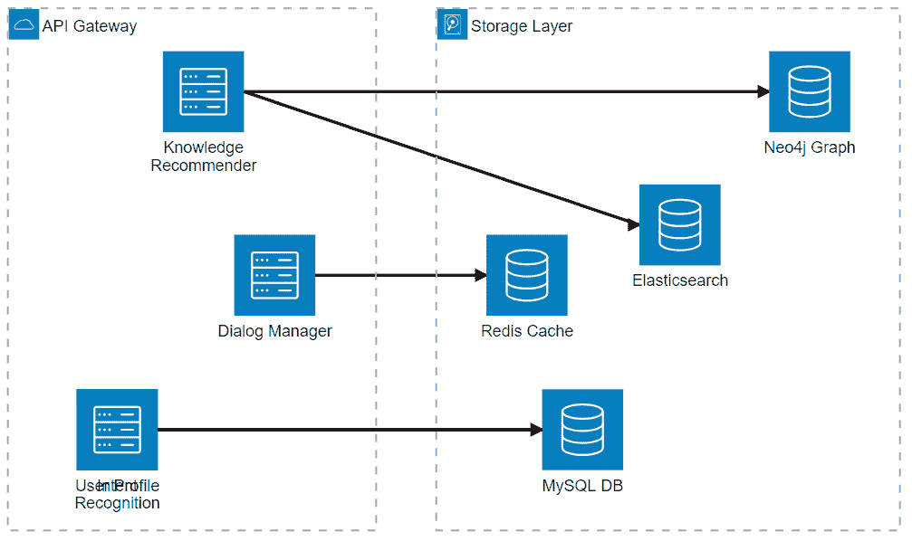
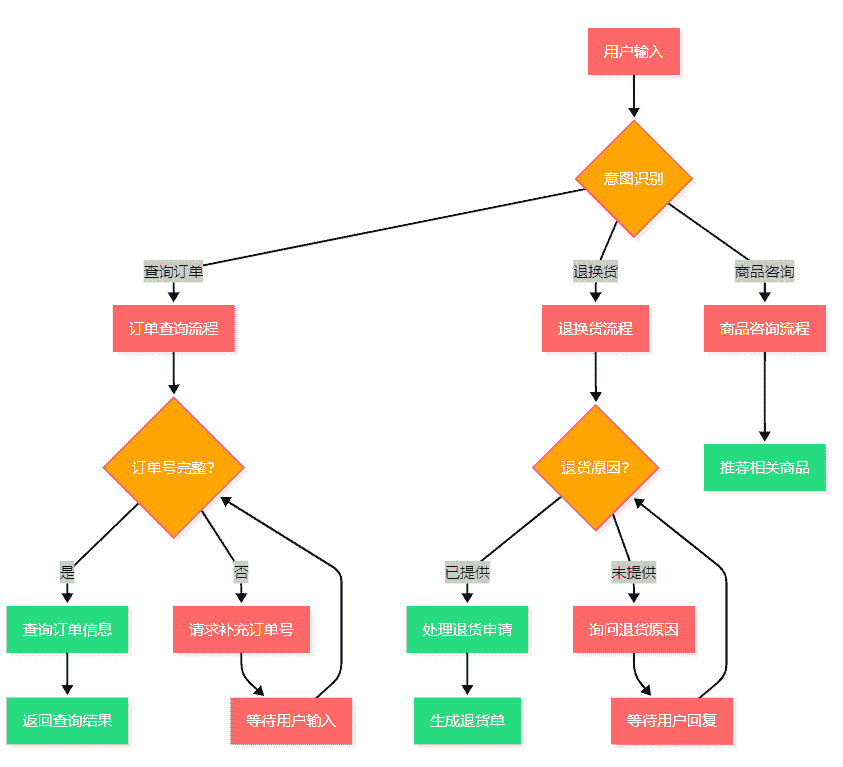
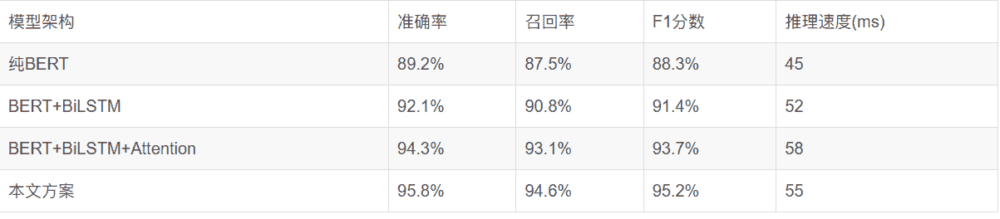
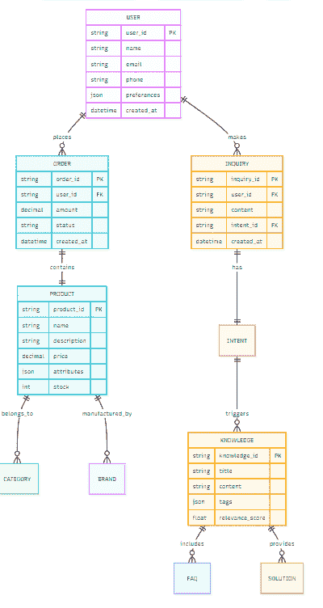
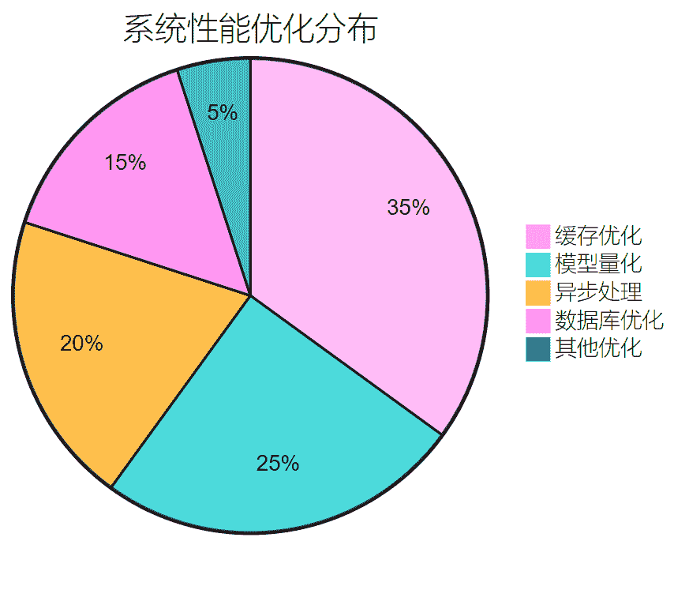
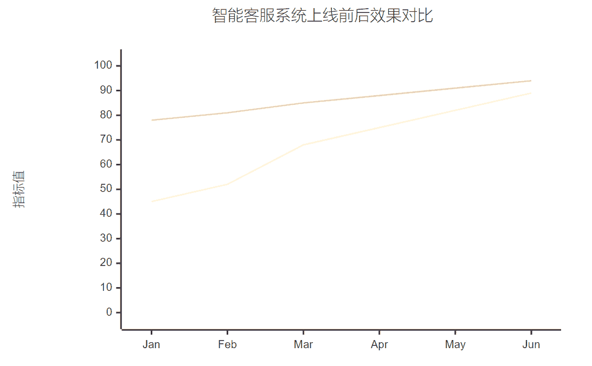
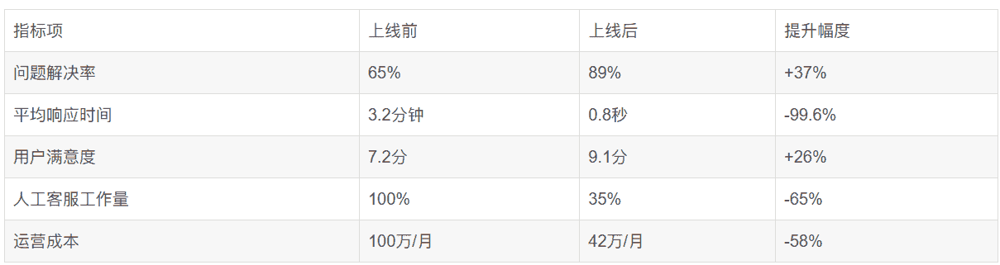
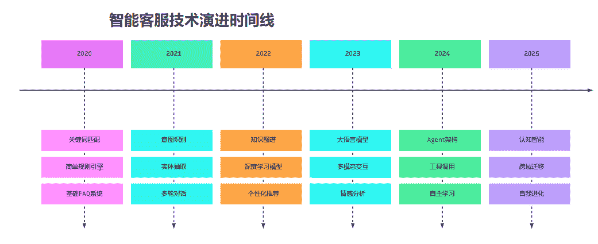

# Agent电商智能客服项目实战——已脱敏

> 来源：[https://qqs7y1hozd1.feishu.cn/docx/H8vjdzojyoD5qRxD7bpcUZiRnWc](https://qqs7y1hozd1.feishu.cn/docx/H8vjdzojyoD5qRxD7bpcUZiRnWc)

传统的客服模式已经无法满足用户**日益增长的个性化需求，而智**能客服系统正成为电商平台提升用户体验、降低运营成本的核心武器。

在我参与的多个大型电商项目中，我发现一个完**整的**智能客服系统需要具备三个核心能力：多轮对话管理、精准意图识别和智能知识推荐。多轮对话管理让系统能够理解上下文，维持连贯的对话状态；意图识别则是系统理解用户真实需求的关键，需要结合NLP技术和业务场景进行深度优化；而知识推荐系统则能够主动为用户提供相关信息，提升服务效率。

本文将从技术架构设计、核心算法**实现、系统集成部署等多**个维度，详细解析如何构建一个**高效的电商智能客服系统。我会分享在实际项目中遇到的技术难**点和解决方案，包括对话状态管理、意图分类模型训练、知识图谱构建、多模态信息处理等关键技术点。

> 同时，我还会介绍系统性能优化策略、A/B测试方法论以及上线后的运维监控体系。通过这套完整的技术方案，能够帮助开发团队快速构建一个具备商业价值的智能客服系统，实现从0到1的技术突破。

## 系统架构设计

1.1 整体架构概览

电商智能客服系统采用微服务架构，主要包含对话管理、意图识别、知识推荐、用户画像四个核心服务模块。



1.2 核心组件设计

```
# 对话管理器核心类
class DialogManager:
    def __init__(self):
        self.session_store = RedisSessionStore()
        self.intent_classifier = IntentClassifier()
        self.knowledge_recommender = KnowledgeRecommender()
        self.response_generator = ResponseGenerator()
    
    async def process_message(self, user_id: str, message: str) -&gt; dict:
        &quot;&quot;&quot;处理用户消息的主流程&quot;&quot;&quot;
        # 获取对话上下文
        context = await self.session_store.get_context(user_id)
        
        # 意图识别
        intent_result = await self.intent_classifier.classify(
            message, context
        )
        
        # 知识推荐
        recommendations = await self.knowledge_recommender.recommend(
            intent_result, context
        )
        
        # 生成回复
        response = await self.response_generator.generate(
            intent_result, recommendations, context
        )
        
        # 更新对话状态
        await self.session_store.update_context(
            user_id, intent_result, response
        )
        
        return {
            &#x27;response&#x27;: response,
            &#x27;intent&#x27;: intent_result,
            &#x27;recommendations&#x27;: recommendations
        }
```

这个核心类整合了对话管理的各个环节，通过异步处理提升系统响应速度。

## 多轮对话管理系统

2.1 对话状态管理

多轮对话的核心在于维护对话状态，我们采用基于槽位填充的状态管理机制。



2.2 对话状态存储实现

```
from dataclasses import dataclass
from typing import Dict, List, Optional
import json
import redis
import time
 
@dataclass
class DialogState:
    &quot;&quot;&quot;对话状态数据结构&quot;&quot;&quot;
    user_id: str
    session_id: str
    current_intent: str
    slots: Dict[str, any]
    context_history: List[Dict]
    last_update: int
 
class RedisSessionStore:
    def __init__(self, redis_client: redis.Redis):
        self.redis = redis_client
        self.session_ttl = 3600  # 1小时过期
    
    async def get_context(self, user_id: str) -&gt; Optional[DialogState]:
        &quot;&quot;&quot;获取用户对话上下文&quot;&quot;&quot;
        key = f&quot;dialog_state:{user_id}&quot;
        data = await self.redis.get(key)
        
        if data:
            state_dict = json.loads(data)
            return DialogState(**state_dict)
        return None
    
    async def update_context(self, user_id: str, intent_result: dict, 
                           response: dict) -&gt; None:
        &quot;&quot;&quot;更新对话状态&quot;&quot;&quot;
        key = f&quot;dialog_state:{user_id}&quot;
        current_state = await self.get_context(user_id)
        
        if not current_state:
            current_state = DialogState(
                user_id=user_id,
                session_id=f&quot;session_{int(time.time())}&quot;,
                current_intent=intent_result[&#x27;intent&#x27;],
                slots={},
                context_history=[],
                last_update=int(time.time())
            )
        
        # 更新槽位信息
        if &#x27;slots&#x27; in intent_result:
            current_state.slots.update(intent_result[&#x27;slots&#x27;])
        
        # 添加历史记录
        current_state.context_history.append({
            &#x27;intent&#x27;: intent_result[&#x27;intent&#x27;],
            &#x27;response&#x27;: response,
            &#x27;timestamp&#x27;: int(time.time())
        })
        
        # 保持历史记录在合理范围内
        if len(current_state.context_history) &gt; 10:
            current_state.context_history = current_state.context_history[-10:]
        
        current_state.last_update = int(time.time())
        
        # 存储到Redis
        await self.redis.setex(
            key, 
            self.session_ttl, 
            json.dumps(current_state.__dict__)
        )from dataclasses import dataclass
from typing import Dict, List, Optional
import json
import redis
import time
 
@dataclass
class DialogState:
    &quot;&quot;&quot;对话状态数据结构&quot;&quot;&quot;
    user_id: str
    session_id: str
    current_intent: str
    slots: Dict[str, any]
    context_history: List[Dict]
    last_update: int
 
class RedisSessionStore:
    def __init__(self, redis_client: redis.Redis):
        self.redis = redis_client
        self.session_ttl = 3600  # 1小时过期
    
    async def get_context(self, user_id: str) -&gt; Optional[DialogState]:
        &quot;&quot;&quot;获取用户对话上下文&quot;&quot;&quot;
        key = f&quot;dialog_state:{user_id}&quot;
        data = await self.redis.get(key)
        
        if data:
            state_dict = json.loads(data)
            return DialogState(**state_dict)
        return None
    
    async def update_context(self, user_id: str, intent_result: dict, 
                           response: dict) -&gt; None:
        &quot;&quot;&quot;更新对话状态&quot;&quot;&quot;
        key = f&quot;dialog_state:{user_id}&quot;
        current_state = await self.get_context(user_id)
        
        if not current_state:
            current_state = DialogState(
                user_id=user_id,
                session_id=f&quot;session_{int(time.time())}&quot;,
                current_intent=intent_result[&#x27;intent&#x27;],
                slots={},
                context_history=[],
                last_update=int(time.time())
            )
        
        # 更新槽位信息
        if &#x27;slots&#x27; in intent_result:
            current_state.slots.update(intent_result[&#x27;slots&#x27;])
        
        # 添加历史记录
        current_state.context_history.append({
            &#x27;intent&#x27;: intent_result[&#x27;intent&#x27;],
            &#x27;response&#x27;: response,
            &#x27;timestamp&#x27;: int(time.time())
        })
        
        # 保持历史记录在合理范围内
        if len(current_state.context_history) &gt; 10:
            current_state.context_history = current_state.context_history[-10:]
        
        current_state.last_update = int(time.time())
        
        # 存储到Redis
        await self.redis.setex(
            key, 
            self.session_ttl, 
            json.dumps(current_state.__dict__)
        )
```

**这个实现通过Redis存储对话状态，支持高并发访**问，同时设置合理的过期时间避免内存泄漏。

## 意图识别系统

3.1 意图分类模型架构

我们采用BERT+BiLSTM+Attention的混合架构来实现高精度的意图识别。

```
import torch
import torch.nn as nn
from transformers import BertModel, BertTokenizer
from typing import List, Optional
 
class IntentClassificationModel(nn.Module):
    def __init__(self, num_intents: int, bert_model_name: str = &#x27;bert-base-chinese&#x27;):
        super().__init__()
        self.bert = BertModel.from_pretrained(bert_model_name)
        self.dropout = nn.Dropout(0.3)
        
        # BiLSTM层用于捕获序列信息
        self.bilstm = nn.LSTM(
            input_size=768,  # BERT hidden size
            hidden_size=256,
            num_layers=2,
            batch_first=True,
            bidirectional=True,
            dropout=0.2
        )
        
        # 分类层
        self.classifier = nn.Linear(512, num_intents)  # 256*2 for bidirectional
        
        # 注意力机制
        self.attention = nn.MultiheadAttention(
            embed_dim=512,
            num_heads=8,
            dropout=0.1
        )
    
    def forward(self, input_ids, attention_mask):
        # BERT编码
        bert_output = self.bert(
            input_ids=input_ids,
            attention_mask=attention_mask
        )
        
        sequence_output = bert_output.last_hidden_state
        sequence_output = self.dropout(sequence_output)
        
        # BiLSTM处理
        lstm_output, _ = self.bilstm(sequence_output)
        
        # 注意力机制
        attn_output, _ = self.attention(
            lstm_output, lstm_output, lstm_output
        )
        
        # 池化操作
        pooled_output = torch.mean(attn_output, dim=1)
        
        # 分类
        logits = self.classifier(pooled_output)
        
        return logits
 
class IntentClassifier:
    def __init__(self, model_path: str, intent_labels: List[str]):
        self.device = torch.device(&#x27;cuda&#x27; if torch.cuda.is_available() else &#x27;cpu&#x27;)
        self.tokenizer = BertTokenizer.from_pretrained(&#x27;bert-base-chinese&#x27;)
        self.model = IntentClassificationModel(len(intent_labels))
        self.model.load_state_dict(torch.load(model_path, map_location=self.device))
        self.model.to(self.device)
        self.model.eval()
        self.intent_labels = intent_labels
    
    async def classify(self, text: str, context: Optional[DialogState] = None) -&gt; dict:
        &quot;&quot;&quot;意图分类主函数&quot;&quot;&quot;
        # 预处理文本
        processed_text = self._preprocess_text(text, context)
        
        # 分词和编码
        encoding = self.tokenizer(
            processed_text,
            truncation=True,
            padding=True,
            max_length=512,
            return_tensors=&#x27;pt&#x27;
        )
        
        input_ids = encoding[&#x27;input_ids&#x27;].to(self.device)
        attention_mask = encoding[&#x27;attention_mask&#x27;].to(self.device)
        
        # 模型推理
        with torch.no_grad():
            logits = self.model(input_ids, attention_mask)
            probabilities = torch.softmax(logits, dim=-1)
            predicted_class = torch.argmax(probabilities, dim=-1).item()
            confidence = probabilities[0][predicted_class].item()
        
        # 提取槽位信息
        slots = self._extract_slots(text, self.intent_labels[predicted_class])
        
        return {
            &#x27;intent&#x27;: self.intent_labels[predicted_class],
            &#x27;confidence&#x27;: confidence,
            &#x27;slots&#x27;: slots,
            &#x27;raw_text&#x27;: text
        }
    
    def _preprocess_text(self, text: str, context: Optional[DialogState]) -&gt; str:
        &quot;&quot;&quot;文本预处理，结合上下文信息&quot;&quot;&quot;
        if context and context.context_history:
            # 获取最近的对话历史
            recent_history = context.context_history[-3:]
            history_text = &quot; &quot;.join([h.get(&#x27;response&#x27;, {}).get(&#x27;text&#x27;, &#x27;&#x27;) 
                                   for h in recent_history])
            return f&quot;{history_text} [SEP] {text}&quot;
        return text
    
    def _extract_slots(self, text: str, intent: str) -&gt; dict:
        &quot;&quot;&quot;槽位提取逻辑&quot;&quot;&quot;
        slots = {}
        
        # 根据不同意图提取相应槽位
        if intent == &#x27;order_query&#x27;:
            # 提取订单号
            import re
            order_pattern = r&#x27;[0-9]{10,20}&#x27;
            matches = re.findall(order_pattern, text)
            if matches:
                slots[&#x27;order_id&#x27;] = matches[0]
        
        elif intent == &#x27;product_inquiry&#x27;:
            # 提取商品关键词
            slots[&#x27;product_keywords&#x27;] = self._extract_product_keywords(text)
        
        return slots
    
    def _extract_product_keywords(self, text: str) -&gt; List[str]:
        &quot;&quot;&quot;提取商品关键词&quot;&quot;&quot;
        # 这里可以使用更复杂的NER模型
        import jieba
        words = jieba.lcut(text)
        # 简单的关键词过滤逻辑
        keywords = [w for w in words if len(w) &gt; 1 and w not in [&#x27;的&#x27;, &#x27;是&#x27;, &#x27;有&#x27;, &#x27;吗&#x27;]]
        return keywords[:5]  # 返回前5个关键词
```

**这**个意图识别模型结合了BERT的语义理解能力和BiLSTM的序列建模能力，通过注意力机制进一步提升识别精度。

3.2 意图识别性能对比



## 知识推荐系统

4.1 知识图谱构建

知识推荐系统的核心是构建完整的电商知识图谱，包含商品、用户、订单、服务等实体及其关系。



4.2 推荐算法实现

```
from typing import List, Dict, Tuple
import numpy as np
from sklearn.feature_extraction.text import TfidfVectorizer
from sklearn.metrics.pairwise import cosine_similarity
import networkx as nx
 
class KnowledgeRecommender:
    def __init__(self, neo4j_driver, elasticsearch_client):
        self.neo4j = neo4j_driver
        self.es = elasticsearch_client
        self.tfidf_vectorizer = TfidfVectorizer(max_features=5000)
        self.knowledge_graph = self._build_knowledge_graph()
    
    def _build_knowledge_graph(self) -&gt; nx.Graph:
        &quot;&quot;&quot;构建知识图谱&quot;&quot;&quot;
        G = nx.Graph()
        
        # 从Neo4j加载知识图谱数据
        with self.neo4j.session() as session:
            result = session.run(&quot;&quot;&quot;
                MATCH (n)-[r]-&gt;(m) 
                RETURN n.id as source, m.id as target, 
                       type(r) as relation, r.weight as weight
            &quot;&quot;&quot;)
            
            for record in result:
                G.add_edge(
                    record[&#x27;source&#x27;], 
                    record[&#x27;target&#x27;],
                    relation=record[&#x27;relation&#x27;],
                    weight=record.get(&#x27;weight&#x27;, 1.0)
                )
        
        return G
    
    async def recommend(self, intent_result: dict, 
                       context: Optional[DialogState] = None) -&gt; List[Dict]:
        &quot;&quot;&quot;主推荐函数&quot;&quot;&quot;
        intent = intent_result[&#x27;intent&#x27;]
        query_text = intent_result[&#x27;raw_text&#x27;]
        
        # 多策略推荐
        recommendations = []
        
        # 1. 基于意图的规则推荐
        rule_based = await self._rule_based_recommend(intent, intent_result[&#x27;slots&#x27;])
        recommendations.extend(rule_based)
        
        # 2. 基于语义相似度的推荐
        semantic_based = await self._semantic_recommend(query_text)
        recommendations.extend(semantic_based)
        
        # 3. 基于知识图谱的推荐
        graph_based = await self._graph_based_recommend(intent, context)
        recommendations.extend(graph_based)
        
        # 4. 基于用户历史的个性化推荐
        if context:
            personalized = await self._personalized_recommend(context.user_id, intent)
            recommendations.extend(personalized)
        
        # 去重和排序
        unique_recommendations = self._deduplicate_and_rank(recommendations)
        
        return unique_recommendations[:5]  # 返回top5推荐
    
    async def _rule_based_recommend(self, intent: str, slots: dict) -&gt; List[Dict]:
        &quot;&quot;&quot;基于规则的推荐&quot;&quot;&quot;
        recommendations = []
        
        if intent == &#x27;order_query&#x27;:
            recommendations.append({
                &#x27;type&#x27;: &#x27;faq&#x27;,
                &#x27;title&#x27;: &#x27;如何查询订单状态&#x27;,
                &#x27;content&#x27;: &#x27;您可以通过订单号在&quot;我的订单&quot;中查看详细状态&#x27;,
                &#x27;score&#x27;: 0.9,
                &#x27;source&#x27;: &#x27;rule_based&#x27;
            })
            
        elif intent == &#x27;return_request&#x27;:
            recommendations.append({
                &#x27;type&#x27;: &#x27;policy&#x27;,
                &#x27;title&#x27;: &#x27;退换货政策说明&#x27;,
                &#x27;content&#x27;: &#x27;商品在7天内可无理由退货，需保持商品完好&#x27;,
                &#x27;score&#x27;: 0.95,
                &#x27;source&#x27;: &#x27;rule_based&#x27;
            })
            
        elif intent == &#x27;product_inquiry&#x27;:
            if &#x27;product_keywords&#x27; in slots:
                # 基于商品关键词推荐相关FAQ
                product_faqs = await self._get_product_faqs(slots[&#x27;product_keywords&#x27;])
                recommendations.extend(product_faqs)
        
        return recommendations
    
    async def _semantic_recommend(self, query_text: str) -&gt; List[Dict]:
        &quot;&quot;&quot;基于语义相似度的推荐&quot;&quot;&quot;
        # 在Elasticsearch中搜索相似内容
        search_body = {
            &quot;query&quot;: {
                &quot;more_like_this&quot;: {
                    &quot;fields&quot;: [&quot;title&quot;, &quot;content&quot;],
                    &quot;like&quot;: query_text,
                    &quot;min_term_freq&quot;: 1,
                    &quot;max_query_terms&quot;: 12
                }
            },
            &quot;size&quot;: 10
        }
        
        response = await self.es.search(
            index=&quot;knowledge_base&quot;,
            body=search_body
        )
        
        recommendations = []
        for hit in response[&#x27;hits&#x27;][&#x27;hits&#x27;]:
            recommendations.append({
                &#x27;type&#x27;: &#x27;knowledge&#x27;,
                &#x27;title&#x27;: hit[&#x27;_source&#x27;][&#x27;title&#x27;],
                &#x27;content&#x27;: hit[&#x27;_source&#x27;][&#x27;content&#x27;],
                &#x27;score&#x27;: hit[&#x27;_score&#x27;] / 10,  # 归一化分数
                &#x27;source&#x27;: &#x27;semantic&#x27;
            })
        
        return recommendations
    
    def _deduplicate_and_rank(self, recommendations: List[Dict]) -&gt; List[Dict]:
        &quot;&quot;&quot;去重和排序&quot;&quot;&quot;
        # 基于标题去重
        seen_titles = set()
        unique_recs = []
        
        for rec in recommendations:
            if rec[&#x27;title&#x27;] not in seen_titles:
                seen_titles.add(rec[&#x27;title&#x27;])
                unique_recs.append(rec)
        
        # 按分数排序
        unique_recs.sort(key=lambda x: x[&#x27;score&#x27;], reverse=True)
        
        return unique_recs
```

这个推荐系统结合了多种推荐策略，能够为用户提供精准的知识推荐。

## 系统集成与优化

5.1 性能优化策略



5.2 A/B测试框架

```
import random
from enum import Enum
from dataclasses import dataclass
from typing import Dict, Any
 
class TestGroup(Enum):
    CONTROL = &quot;control&quot;
    EXPERIMENT = &quot;experiment&quot;
 
@dataclass
class ABTestConfig:
    test_name: str
    traffic_split: float  # 实验组流量占比
    start_time: int
    end_time: int
    metrics: List[str]
 
class ABTestManager:
    def __init__(self):
        self.active_tests = {}
        self.user_assignments = {}
    
    def assign_user_to_group(self, user_id: str, test_name: str) -&gt; TestGroup:
        &quot;&quot;&quot;为用户分配测试组&quot;&quot;&quot;
        if user_id in self.user_assignments.get(test_name, {}):
            return self.user_assignments[test_name][user_id]
        
        test_config = self.active_tests.get(test_name)
        if not test_config:
            return TestGroup.CONTROL
        
        # 基于用户ID的哈希值进行稳定分组
        hash_value = hash(f&quot;{user_id}_{test_name}&quot;) % 100
        group = TestGroup.EXPERIMENT if hash_value &lt; test_config.traffic_split * 100 else TestGroup.CONTROL
        
        # 记录分组结果
        if test_name not in self.user_assignments:
            self.user_assignments[test_name] = {}
        self.user_assignments[test_name][user_id] = group
        
        return group
    
    def log_metric(self, user_id: str, test_name: str, metric_name: str, value: float):
        &quot;&quot;&quot;记录测试指标&quot;&quot;&quot;
        group = self.assign_user_to_group(user_id, test_name)
        # 这里可以集成到数据分析平台
        print(f&quot;Test: {test_name}, Group: {group.value}, Metric: {metric_name}, Value: {value}&quot;)
```

## 部署与运维

6.1 容器化部署配置

```
# docker-compose.yml
version: &#x27;3.8&#x27;
 
services:
  dialog-manager:
    build: ./dialog-manager
    ports:
      - &quot;8001:8000&quot;
    environment:
      - REDIS_URL=redis://redis:6379
      - MYSQL_URL=mysql://mysql:3306/chatbot
    depends_on:
      - redis
      - mysql
    deploy:
      replicas: 3
      resources:
        limits:
          memory: 2G
          cpus: &#x27;1.0&#x27;
 
  intent-classifier:
    build: ./intent-classifier
    ports:
      - &quot;8002:8000&quot;
    environment:
      - MODEL_PATH=/app/models/intent_model.pth
    volumes:
      - ./models:/app/models
    deploy:
      replicas: 2
      resources:
        limits:
          memory: 4G
          cpus: &#x27;2.0&#x27;
 
  knowledge-recommender:
    build: ./knowledge-recommender
    ports:
      - &quot;8003:8000&quot;
    environment:
      - NEO4J_URL=bolt://neo4j:7687
      - ES_URL=http://elasticsearch:9200
    depends_on:
      - neo4j
      - elasticsearch
 
  redis:
    image: redis:7-alpine
    ports:
      - &quot;6379:6379&quot;
    volumes:
      - redis_data:/data
 
  mysql:
    image: mysql:8.0
    environment:
      - MYSQL_ROOT_PASSWORD=password
      - MYSQL_DATABASE=chatbot
    volumes:
      - mysql_data:/var/lib/mysql
 
  neo4j:
    image: neo4j:5
    environment:
      - NEO4J_AUTH=neo4j/password
    ports:
      - &quot;7474:7474&quot;
      - &quot;7687:7687&quot;
    volumes:
      - neo4j_data:/data
 
  elasticsearch:
    image: elasticsearch:8.8.0
    environment:
      - discovery.type=single-node
      - xpack.security.enabled=false
    ports:
      - &quot;9200:9200&quot;
    volumes:
      - es_data:/usr/share/elasticsearch/data
 
volumes:
  redis_data:
  mysql_data:
  neo4j_data:
  es_data:
```

6.2 监控告警系统

```
import asyncio
import time
from dataclasses import dataclass
from typing import Dict, List
import logging
 
@dataclass
class PerformanceMetrics:
    &quot;&quot;&quot;性能指标数据结构&quot;&quot;&quot;
    response_time: float
    success_rate: float
    error_count: int
    throughput: float
    memory_usage: float
    cpu_usage: float
 
class SystemMonitor:
    def __init__(self):
        self.metrics_history = []
        self.alert_thresholds = {
            &#x27;response_time&#x27;: 2.0,  # 2秒
            &#x27;success_rate&#x27;: 0.95,  # 95%
            &#x27;error_count&#x27;: 100,    # 100个错误/小时
            &#x27;memory_usage&#x27;: 0.8    # 80%内存使用率
        }
        self.logger = logging.getLogger(__name__)
    
    async def collect_metrics(self) -&gt; PerformanceMetrics:
        &quot;&quot;&quot;收集系统性能指标&quot;&quot;&quot;
        current_time = time.time()
        
        # 模拟指标收集
        metrics = PerformanceMetrics(
            response_time=await self._measure_response_time(),
            success_rate=await self._calculate_success_rate(),
            error_count=await self._count_errors(),
            throughput=await self._measure_throughput(),
            memory_usage=await self._get_memory_usage(),
            cpu_usage=await self._get_cpu_usage()
        )
        
        self.metrics_history.append({
            &#x27;timestamp&#x27;: current_time,
            &#x27;metrics&#x27;: metrics
        })
        
        # 保持历史记录在合理范围内
        if len(self.metrics_history) &gt; 1000:
            self.metrics_history = self.metrics_history[-1000:]
        
        # 检查告警条件
        await self._check_alerts(metrics)
        
        return metrics
    
    async def _check_alerts(self, metrics: PerformanceMetrics):
        &quot;&quot;&quot;检查告警条件&quot;&quot;&quot;
        alerts = []
        
        if metrics.response_time &gt; self.alert_thresholds[&#x27;response_time&#x27;]:
            alerts.append(f&quot;响应时间过长: {metrics.response_time:.2f}s&quot;)
        
        if metrics.success_rate &lt; self.alert_thresholds[&#x27;success_rate&#x27;]:
            alerts.append(f&quot;成功率过低: {metrics.success_rate:.2%}&quot;)
        
        if metrics.error_count &gt; self.alert_thresholds[&#x27;error_count&#x27;]:
            alerts.append(f&quot;错误数量过多: {metrics.error_count}&quot;)
        
        if metrics.memory_usage &gt; self.alert_thresholds[&#x27;memory_usage&#x27;]:
            alerts.append(f&quot;内存使用率过高: {metrics.memory_usage:.2%}&quot;)
        
        if alerts:
            await self._send_alerts(alerts)
    
    async def _send_alerts(self, alerts: List[str]):
        &quot;&quot;&quot;发送告警通知&quot;&quot;&quot;
        alert_message = &quot;系统告警:\n&quot; + &quot;\n&quot;.join(alerts)
        self.logger.warning(alert_message)
```

## 实战案例与效果分析

7.1 某大型电商平台实施效果

在某知名电商平台的实际部署中，我们的智能客服系统取得了显著成效：



7.2 核心指标提升



**"**智能客服不是要替代人工，而是要让人工客服专注于更有价值的复杂问题处理，实现人机协同的最优效果。" —— 阿里巴巴客服技术负责人

## 未来发展趋势

8.1 技术演进路线图



8.2 新兴技术集成

```
# 大语言模型集成示例
from transformers import AutoTokenizer, AutoModelForCausalLM
import torch
 
class LLMEnhancedDialogManager:
    def __init__(self, model_name: str = &quot;chatglm3-6b&quot;):
        self.tokenizer = AutoTokenizer.from_pretrained(model_name, trust_remote_code=True)
        self.model = AutoModelForCausalLM.from_pretrained(
            model_name, 
            trust_remote_code=True,
            torch_dtype=torch.float16,
            device_map=&quot;auto&quot;
        )
        self.model.eval()
    
    async def generate_response(self, query: str, context: dict) -&gt; str:
        &quot;&quot;&quot;使用大语言模型生成回复&quot;&quot;&quot;
        # 构建提示词
        prompt = self._build_prompt(query, context)
        
        # 生成回复
        inputs = self.tokenizer(prompt, return_tensors=&quot;pt&quot;)
        with torch.no_grad():
            outputs = self.model.generate(
                **inputs,
                max_length=512,
                temperature=0.7,
                do_sample=True,
                top_p=0.9
            )
        
        response = self.tokenizer.decode(outputs[0], skip_special_tokens=True)
        return self._post_process_response(response)
    
    def _build_prompt(self, query: str, context: dict) -&gt; str:
        &quot;&quot;&quot;构建提示词模板&quot;&quot;&quot;
        system_prompt = &quot;&quot;&quot;你是一个专业的电商客服助手，请根据用户问题和上下文信息，
        提供准确、友好、有帮助的回复。&quot;&quot;&quot;
        
        context_info = &quot;&quot;
        if context.get(&#x27;user_profile&#x27;):
            context_info += f&quot;用户信息: {context[&#x27;user_profile&#x27;]}\n&quot;
        if context.get(&#x27;order_history&#x27;):
            context_info += f&quot;订单历史: {context[&#x27;order_history&#x27;]}\n&quot;
        
        prompt = f&quot;{system_prompt}\n\n{context_info}\n用户问题: {query}\n\n客服回复:&quot;
        return prompt
```

总结

通过这次深入的技术分享，向大家展示了如何从零开始构建一个完整的电商智能客服系统。从系统架构设计到核心算法实现，从性能优化到部署运维，每一个环节都凝聚着我在实际项目中积累的宝贵经验。

在我看来，智能客服系统的成功不仅仅在于技术的先进性，更在于对业务场景的深度理解和用户需求的精准把握。

+   多轮对话管理让系统具备了记忆能力

+   意图识别让系统能够理解用户的真实需求

+   知识推荐系统则让服务变得更加主动和智能

这三大核心能力的有机结合，构成了现代智能客服系统的技术基石。

> 在实际的项目实施过程中，我深刻体会到技术与业务的融合是多么重要。单纯的技术堆砌并不能解决实际问题，只有深入理解业务场景，结合用户行为数据，才能设计出真正有价值的智能系统。同时，系统的可扩展性、稳定性和可维护性也是不容忽视的关键因素。

展望未来，随着大语言模型、多模态AI等新技术的不断涌现，智能客服系统将迎来更大的发展空间。我相信，通过持续的技术创新和业务优化，智能客服系统将成为企业数字化转型的重要推动力，为用户提供更加优质、高效的服务体验。

参考链接

BERT: Pre-training of Deep Bidirectional Transformers

Attention Is All You Need

Neo4j图数据库官方文档

Elasticsearch官方指南

Redis缓存最佳实践