# 大厂大模型(LLMs)基础、进阶、微调面

> 来源：https://qqs7y1hozd1.feishu.cn/docx/AtxUdK3PVoQ0tuxJbrvcrnJCnbb

## 大模型（LLMs）基础面

### 1 目前主流的开源模型体系有哪些？

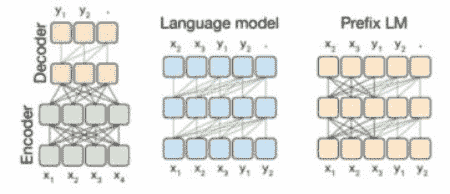

目前主流的开源模型体系分三种：

• 第一种：prefix Decoder 系

> 介绍：输入双向注意力，输出单向注意力

> 代表模型：ChatGLM、ChatGLM2、U-PaLM

• 第二种：causal Decoder 系

> 介绍：从左到右的单向注意力

> 代表模型：LLaMA-7B、LLaMa 衍生物

• 第三种：Encoder-Decoder

> 介绍：输入双向注意力，输出单向注意力

> 代表模型：T5、Flan-T5、BART

### 2 prefix Decoder 和 causal Decoder 和 Encoder-Decoder 区别是什么？

prefix Decoder 和 causal Decoder 和 Encoder-Decoder 区别在于 `attention mask` 不同：

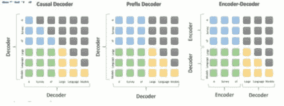

• Encoder-Decoder：

> 在输入上采用双向注意力，对问题的编码理解更充分

> 适用任务：在偏理解的 NLP 任务上效果好

> 缺点：在长文本生成任务上效果差，训练效率低；

• causal Decoder：

> 自回归语言模型，预训练和下游应用是完全一致的，严格遵守只有后面的token才能看到前面的 token的规则；

> 适用任务：文本生成任务效果好

> 优点：训练效率高， zero-shot 能力更强，具有涌现能力

• prefix Decoder：

> 特点：prefix部分的token互相能看到，causal Decoder 和 Encoder-Decoder 折中；

> 缺点：训练效率低

### 3 大模型LLM的训练目标是什么？

1. 语言模型

根据已有词预测下一个词，训练目标为最大似然函数：

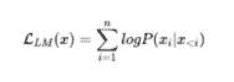

训练效率：Prefix Decoder < Causal Decoder

Causal Decoder 结构会在所有 token 上计算损失，而 Prefix Decoder 只会在输出上计算损失。

2. 去噪自编码器

随机替换掉一些文本段，训练语言模型去恢复被打乱的文本段。目标函数为：

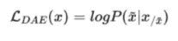

去噪自编码器的实现难度更高。采用去噪自编码器作为训练目标的任务有GLM-130B、T5。

### 4 涌现能力是啥原因？

根据前人分析和论文总结，大致是2个猜想：

> • 任务的评价指标不够平滑；

> • 复杂任务 vs 子任务，这个其实好理解，比如我们假设某个任务 T 有 5 个子任务 Sub-T 构成，每个 sub-T 随着模型增长，指标从 40% 提升到 60%，但是最终任务的指标只从 1.1% 提升到了 7%，也就是说宏观上看到了涌现现象，但是子任务效果其实是平滑增长的。

### 5 为何现在的大模型大部分是Decoder only结构？

因为decoder-only结构模型在没有任何微调数据的情况下，zero-shot的表现能力最好。而encoder-decoder则需要在一定量的标注数据上做multitask-finetuning才能够激发最佳性能。

目前的Large LM的训练范式还是在大规模语料shang 做自监督学习，显然zero-shot性能更好的decoder-only架构才能更好的利用这些无标注的数据。

大模型使用decoder-only架构除了训练效率和工程实现上的优势外，在理论上因为Encoder的双向注意力会存在低秩的问题，这可能会削弱模型的表达能力。就生成任务而言，引入双向注意力并无实质的好处。而Encoder-decoder模型架构之所以能够在某些场景下表现更好，大概是因为它多了一倍参数。所以在同等参数量、同等推理成本下，Decoder-only架构就是最优的选择了。

### 6 简单介绍一下大模型【LLMs】？

大模型：一般指1亿以上参数的模型，但是这个标准一直在升级，目前万亿参数以上的模型也有了。大语言模型（Large Language Model，LLM）是针对语言的大模型。

### 7 大模型【LLMs】后面跟的175B、60B、540B等指什么？

175B、60B、540B等：这些一般指参数的个数，B是Billion/十亿的意思，175B是1750亿参数，这是ChatGPT大约的参数规模。

### 8 大模型【LLMs】具有什么优点？

1. 可以利用大量的无标注数据来训练一个通用的模型，然后再用少量的有标注数据来微调模型，以适应特定的任务。这种预训练和微调的方法可以减少数据标注的成本和时间，提高模型的泛化能力；

1. 可以利用生成式人工智能技术来产生新颖和有价值的内容，例如图像、文本、音乐等。这种生成能力可以帮助用户在创意、娱乐、教育等领域获得更好的体验和效果；

1. 可以利用涌现能力（Emergent Capabilities）来完成一些之前无法完成或者很难完成的任务，例如数学应用题、常识推理、符号操作等。这种涌现能力可以反映模型的智能水平和推理能力。

### 9 大模型【LLMs】具有什么缺点？

1. 需要消耗大量的计算资源和存储资源来训练和运行，这会增加经济和环境的负担。据估计，训练一个GPT-3模型需要消耗约30万美元，并产生约284吨二氧化碳排放；

1. 需要面对数据质量和安全性的问题，例如数据偏见、数据泄露、数据滥用等。这些问题可能会导致模型产生不准确或不道德的输出，并影响用户或社会的利益；

1. 需要考虑可解释性、可靠性、可持续性等方面的挑战，例如如何理解和控制模型的行为、如何保证模型的正确性和稳定性、如何平衡模型的效益和风险等。这些挑战需要多方面的研究和合作，以确保大模型能够健康地发展。

## 大模型（LLMs）进阶面

### 一、什么是生成式大模型？

生成式大模型（一般简称大模型LLMs）是指能用于创作新内容，例如文本、图片、音频以及视频的一类深度学习模型。相比普通深度学习模型，主要有两点不同：

### 二、大模型是怎么让生成的文本丰富而不单调的呢？

1. 模型参数量更大，参数量都在Billion级别；

1. 可通过条件或上下文引导，产生生成式的内容（所谓的prompt engineer就是由此而来）。

1. 从训练角度来看：

   a. 基于Transformer的模型参数量巨大，有助于模型学习到多样化的语言模式与结构；

   b. 各种模型微调技术的出现，例如P-Tuning、Lora，让大模型微调成本更低，也可以让模型在垂直领域有更强的生成能力；

   c. 在训练过程中加入一些设计好的loss，也可以更好地抑制模型生成单调内容；

1. 从推理角度来看：

   a. 基于Transformer的模型可以通过引入各种参数与策略，例如`temperature`，nucleus sampler来改变每次生成的内容。

### 三、LLMs 复读机问题

#### 3.1 什么是 LLMs 复读机问题？

LLMs 复读机问题：

1. 字符级别重复，指大模型针对一个字或一个词重复不断的生成

   例如在电商翻译场景上，会出现“steckdose steckdose steckdose steckdose steckdose steckdose steckdose steckdose...”；

1. 语句级别重复，大模型针对一句话重复不断的生成

   例如在多模态大模型图片理解上，生成的结果可能会不断重复图片的部分内容，比如“这是一个杯子，这是一个杯子...”；

1. 章节级别重复，多次相同的prompt输出完全相同或十分近似的内容，没有一点创新性的内容

   比如你让大模型给你写一篇关于春天的小作文，结果发现大模型的生成结果千篇一律，甚至近乎一摸一样。

1. 大模型针对不同的prompt也可能会生成类似的内容，且有效信息很少、信息熵偏低

#### 3.2 为什么会出现 LLMs 复读机问题？

1. 数据偏差：大型语言模型通常是通过预训练阶段使用大规模无标签数据进行训练的。如果训练数据中存在大量的重复文本或者某些特定的句子或短语出现频率较高，模型在生成文本时可能会倾向于复制这些常见的模式。

1. 训练目标的限制：大型语言模型的训练通常是基于自监督学习的方法，通过预测下一个词或掩盖词来学习语言模型。这样的训练目标可能使得模型更倾向于生成与输入相似的文本，导致复读机问题的出现。

1. 缺乏多样性的训练数据：虽然大型语言模型可以处理大规模的数据，但如果训练数据中缺乏多样性的语言表达和语境，模型可能无法学习到足够的多样性和创造性，导致复读机问题的出现。

1. 模型结构和参数设置：大型语言模型的结构和参数设置也可能对复读机问题产生影响。例如，模型的注意力机制和生成策略可能导致模型更倾向于复制输入的文本。

1. 从 induction head[1]机制的影响角度：也就是模型会倾向于从前面已经预测的word里面挑选最匹配的词；

   在翻译上，由于input和output的天然差异性，你会发现容易出现重复的都是一些复杂度perplexity比较高的文本：也就是说input的句式越不常见，本身重复度越高，翻译结果重复的可能性也越高。

   > 注：我们分别以flores-101通用文本和电商标题文本做了尝试，后者出现重复的概率是前者的20倍以上。

1. 从信息熵的角度分析。“在模型生成采样时，我们就应该只采样那些与条件熵对应概率接近的字符”[2]，但我更理解为信息淹没；比如电商标题，作为一种语句连贯性很弱、基本是词序堆叠的文本，它的信息熵无疑是很高的，下一个词预测时，概率后验基本上很难预测出来，`Softmax`的分布也倾向于平稳，也就是说模型也预测不出来下一个词应该是什么。因此模型会倾向从前面的word里面挑选。无论是专业翻译大模型M2M、NLLB还是通用语言模型ChatGPT、LLAMA等，<HJIKL, HJIKLL, HJIKLL..>的TSNE二维分布基本一致；也就是说你添加了LLLL后，文本语义基本没有变化。

   另一点，就是为什么会一直是一个词L的反复重复？因为当前面t-1个词的分布趋于稳定，t以及t+1后面重复出现的L词的分布基本会沿着前面t-1个词的TSNE二维分布均匀铺开，也就是我们常说的各向异性，虽然生成的数量长了，但是<HJIKL, HJIKLL, HJIKLL..>的分布几乎不影响。这一点很值得探索，对应的解决方案也相当大力破巧。

#### 3.3 如何缓解 LLMs 复读机问题？

##### 3.3.1 Unlikelihood Training

• 思路：在训练中加入对重复词的抑制来减少重复输出；

• 介绍

式中集合C代表上文生成的token，本身likelihood training loss是要促使模型学习到原标签中自然的语言逻辑，而修改后的loss不仅要促进模型学习到真实标签的语言自然性，也要通过unlikelihood loss抑制模型，使其尽量不生成集合C中的token。一般对于生成式任务，只需要在原模型基础上加入unlikelihood training进行sentence级别finetune即可，不需要通过token级别的unlikelihood和likelihood loss叠加训练。（如果进入叠加训练虽然会降低重复率，但是句子困惑度会升高，准确率会下降）

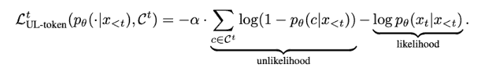

token级unlikelihood training loss

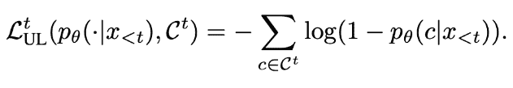

sentence级unlikelihood training loss

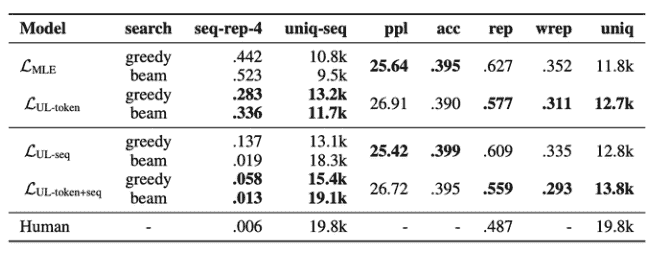

各训练Loss下的重复度结果

> 注：上图为论文中的结果，其中seq-rep-4代表4-gram重复率；uniq-seq代表总共出现的不同词的个数；ppl代表句子困惑度；acc代表句子准确性；rep代表前词重复率；wrep代表加权前词重复率。从这些指标中可以明显观察到，unlikelihood training能降低整体生成句子的重复度。

> unlikelihood training方法是一种表现不错的抑制重复方式，但其中集合C的设计比较困难。针对不同的任务，集合C都需要进行精心的设计，才能保证在生成精度基本不降的情况下抑制模型生成重复与单调的结果。（该方法仅能解决1.1节中阐述的前两种重复问题，无法解决输入多次相同prompt输出单调性的问题）

> 参考：NEURAL TEXT DEGENERATION WITH UNLIKELIHOOD TRAINING

##### 3.3.2 引入噪声

在生成文本时，引入一些随机性或噪声，例如通过采样不同的词或短语，或者引入随机的变换操作，以增加生成文本的多样性。这可以通过在生成过程中对模型的输出进行采样或添加随机性来实现。

##### 3.3.3 Repetition Penalty

• 思路：重复性惩罚方法通过在模型推理过程中加入重复惩罚因子，对原有`softmax`结果进行修正，降低重复生成的token被选中的概率

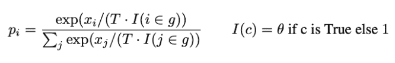

> 注：其中T代表温度，温度越高，生成的句子随机性越强，模型效果越不显著；I就代表惩罚项，c代表我们保存的一个list，一般为1-gram之前出现过的单词，theta值一般设置为1.2，1.0代表没有惩罚。

> 重复性惩罚方法是一种简单有效的重复抑制手段，因为它通过提高I值，有效降低集合c中词再次被选中的概率。当然，类似与unlikelihood training，本方法也可以通过设置不同的c集合来改变惩罚的方向。（该方法仅能解决1.1节中阐述的前两种重复问题，无法解决输入多次相同prompt输出单调性的问题）

> 参考：CTRL: A CONDITIONAL TRANSFORMER LANGUAGE MODEL FOR CONTROLLABLE GENERATION

> Huggingface中，`model.generate`已经包含此参数，仅需设置`repetition_penalty=p`（`p>1.0`）即可开启重复惩罚因子

##### 3.3.4 Contrastive Search

• 动机：Contrastive Search方法是为了解决原先解码方法，例如Beam Search，在采用最大化生成方式解码时出现解码退化的问题即生成的文本不自然的，并包含文本重复而提出的一种解决方案

• 思路：对比loss以及对比搜索两个创新点，从模型训练和模型推理层面缓解了生成式模型重复以及单调问题。

其中对比loss通过在原loss基础上添加对比loss，即对比token间相似度的方式去解决生成式模型重复单调问题，公式如下：

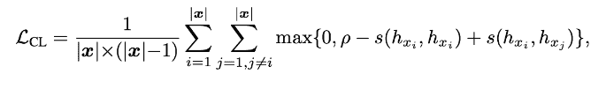

其中

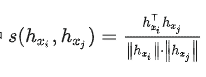

就是余弦相似度，下图给出了训练前后token间的相似度：对比训练前后token相似度

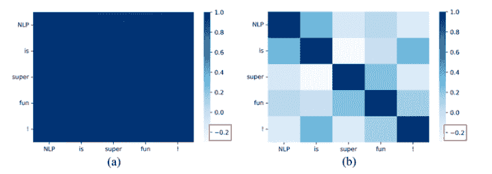

从图上可以明显看出token间相似度降低了，token间相似度降低即不同token在高维空间表征分离能有效降低模型仅生成个别重复词或字的概率。

而对比搜索方法就是在decode阶段限制相似token生成的概率，大大降低生成内容重复率和单调性。

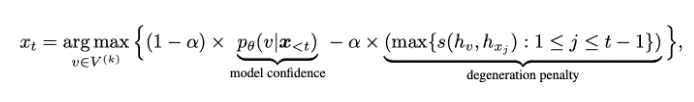

其中第一项就是原模型的概率，后面一项可以理解成一种惩罚，当前token与历史token相似度较高时，就降低当前token的概率。

对比loss和对比search在训练和推理两个阶段限制生成token间的相似度，有效降低了模型对一些特别常见表达的依赖，让模型尝试生成不一样的表达，整体上提升模型的创造性。（该方法仅能解决1.1节中阐述的前两种重复问题，无法解决输入多次相同prompt输出单调性的问题）

> 参考论文地址：A Contrastive Framework for Neural Text Generation

> Huggingface中，`model.generate`已经包含此参数，仅需设置`penalty_alpha=alpha`（`0<alpha<1`）即可开启对比Search因子alpha

##### 3.3.5 Beam Search

• 思路：Beam Search是对贪心策略一种改进。思路简单，就是稍微放宽考察的范围。在每一个时间步，不再只保留当前分数最高的1个输出，而是保留num_beams个。当`num_beams=1`时集束搜索（Beam Search）就退化成了贪心搜索。Beam Search虽然本质上并没有降低重复率的操作，但是该策略确实在结果上优化了


### Beam Search

部分生成结果，降低了一定的重复率。

下图是一个实际的例子，每个时间步有 ABCDE 共 5 种可能的输出，图中的 `num_beams=2`，也就是说每个时间步都会保留到当前步为止条件概率最优的 2 个序列。

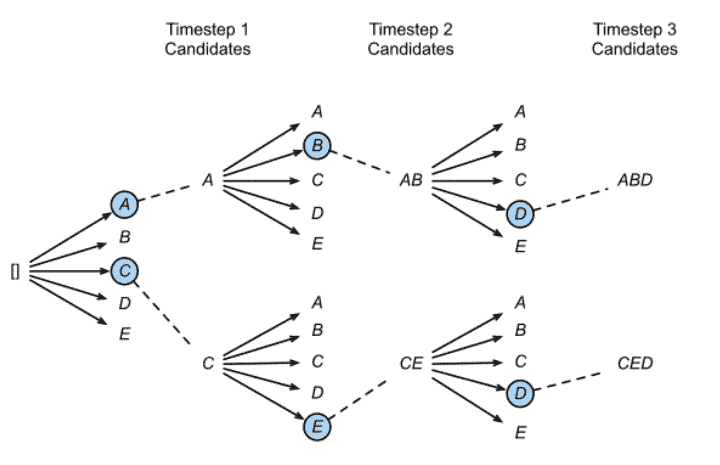

Beam Search 搜索方式 Beam search 理论上仅是为了解决贪婪搜索给到的答案仅局部最优，而全局搜索又在时间复杂度上不可行而提出的折中算法，并不能对大模型中的任何重复问题进行修正，甚至有可能增大重复概率。但从翻译的测试实验结果来看，它确实在一定程度上改变了模型 `Softmax` 后的分布情况，优化了输出的结果，所以在部分大模型任务上能抑制重复生成问题。

注：`Huggingface` 中，`model.generate` 中已经包含此参数，仅需设置 `num_beams=2` 即可开启集束搜索。

#### 3.3.6 TopK sampling

`TopK` 通过对 `Softmax` 的输出结果 `logit` 中最大的 K 个 `token` 采样来选择输出的 `token`，该方法存在的问题是当概率分布很极端时，即模型很确定下一个 `token` 时，容易造成生成错误。以下图为例，`TopK` 采样会选择最大的 K 个 `token`，并通过 `logit` 值对 K 个 `token` 进行采样，相比于贪心搜索增添了随机性，相当于同样的输入，多次经过 `TopK` 采样生成的结果大概率不会一样。

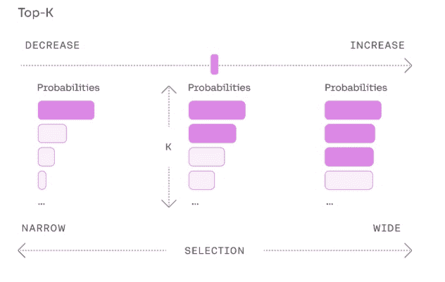

`TopK` 采样是一种行之有效，能简单暴力的解决 1.1 节中提出所有重复单调问题的方案之一，当然它存在的最大问题是最后生成的句子存在狗屁不通现象，并不能保证句子的通顺度以及对 prompt 的忠诚度。

`Huggingface` 中，`model.generate` 中已经包含此参数，需设置 `do_sample=True`，开启采样模式，同时设置 `top_k` 值，`top_k` 值默认为 50。

#### 3.3.7 Nucleus sampler

`Nucleus sampler` 俗称 `TopP` 采样，一种用于解决 `TopK` 采样问题的新方法，该采样方式不限制 K 的数目，而是通过 `Softmax` 后排序 `token` 的概率，当概率大于 `P` 时停止，相当于当模型很确定下一个 `token` 时，可采样的 K 也会很少，减少异常错误发生的概率。以下图为例，`TopP` 采样会不断选择 `logit` 中最大概率的 `token`，放入一个 list 中，直到 list 中计算的总概率大于设置的 `TopP` 值，后对 list 中的 `token` 概率进行重新计算，最终根据计算出来的概率值对 list 中的 `token` 进行采样。

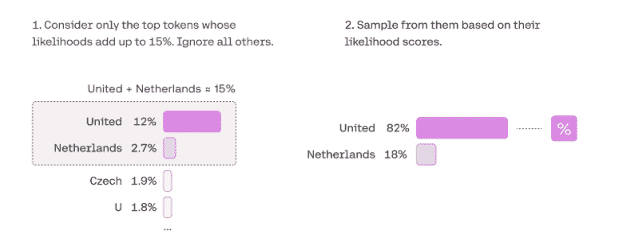

`Nucleus sampler` 是对简单暴力的 `TopK` 采样修改后的方法，也能解决 1.1 节中提出所有重复单调问题，相比 `TopK`，该方法生成的句子通顺度以及对 prompt 的忠诚度更佳，一般选择它，而不选择 `TopK`。

注：`Huggingface` 中，`model.generate` 中已经包含此参数，需设置 `do_sample=True`，开启采样模式，同时设置 `top_p` 值，`top_p` 值默认为 1.0。

#### 3.3.8 Temperature

生成模型中抽样包含随机性，因此每次生成时，相同的 prompt 可能会产生不同的输出。温度是用于调整随机程度的数字。

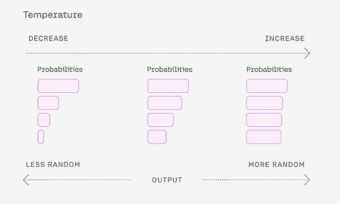

`Temperature` 参数使用方法

采样时如何选择温度？

较低的温度意味着较少的随机性；温度为 0 将始终产生相同的输出。执行具有“正确”答案的任务，对于总结类、翻译类等具有明确答案的任务，较低的温度（小于 1）更合适。如果模型开始自我重复，则表明温度设置过低。

高温意味着更多的随机性，这可以帮助模型给出更有创意的输出。如果模型开始偏离主题或给出无意义的输出，则表明温度过高。温度调整公式如下：

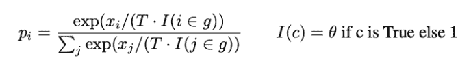

`Temperature` 参数就是前面介绍 repetition penalty 中的 `T` 参数。

提高 `Temperature` 配合上文两种采样算法，可以达到生成更激进创新性回答的需求，但生成句子的稳定性不可控。`Huggingface` 中，`model.generate` 中已经包含此参数，仅需设置 `temperature`，默认为 1.0。

#### 3.3.9 No repeat ngram size

该方法是一种最暴力抑制重复的方法，通过限制设置的 `ngram` 不能出现重复，如果重复，就选概率次大的一个，来强制模型不生成重复的 `token`。

该功能一般都会开启，来保证生成的句子不犯很离谱的连续重复问题。（该方法仅能解决 1.1 节中阐述的前两种重复问题，无法解决输入多次相同 prompt 输出单调性的问题）

`Huggingface` 中，`model.generate` 中已经包含此参数，仅需设置 `no_repeat_ngram_size=N` 即可。

#### 3.3.10 重复率指标检测

在 2.1 节的表中列出了常见重复率监测指标：`seq-rep-N`，`uniq-seq`，`rep`，`wrep`。通过这些指标的融合，可以对重复生成的结果进行一定程度的监测，并在监测到异常生成结果时，通过加入特殊字符，修改 prompt 表达等形式来重新生成结果。

通过我们的测试，通过切分或加入特殊字符的方式确实能让本身异常的翻译结果恢复正常，但潜在风险是翻译的语序可能会出现一定的问题。（对其他领域生成结果的影响有待进一步探索）

#### 3.3.11 后处理和过滤

对生成的文本进行后处理和过滤，去除重复的句子或短语，以提高生成文本的质量和多样性。可以使用文本相似度计算方法或规则来检测和去除重复的文本。

#### 3.3.12 人工干预和控制

对于关键任务或敏感场景，可以引入人工干预和控制机制，对生成的文本进行审查和筛选，确保生成结果的准确性和多样性。

## 四、llama 系列问题

### 4.1 llama 输入句子长度理论上可以无限长吗？

限制在训练数据。理论上 `rope` 的 `llama` 可以处理无限长度，但实际上存在一些限制和挑战。下面是一些相关的考虑因素：

1. **计算资源：**生成长句子需要更多的计算资源，包括内存和计算时间。由于 `LLMs` 通常是基于神经网络的模型，计算长句子可能会导致内存不足或计算时间过长的问题。
1. **模型训练和推理：**训练和推理长句子可能会面临一些挑战。在训练阶段，处理长句子可能会导致梯度消失或梯度爆炸的问题，影响模型的收敛性和训练效果。在推理阶段，生成长句子可能会增加模型的错误率和生成时间。
1. **上下文建模：**`LLMs` 是基于上下文建模的模型，长句子的上下文可能会更加复杂和深层。模型需要能够捕捉长句子中的语义和语法结构，以生成准确和连贯的文本。

尽管存在这些挑战，研究人员和工程师们已经在不断努力改进和优化 `LLMs`，以处理更长的句子。例如，可以采用分块的方式处理长句子，将其分成多个较短的片段进行处理。此外，还可以通过增加计算资源、优化模型结构和参数设置，以及使用更高效的推理算法来提高 `LLMs` 处理长句子的能力。

## 五、什么情况用 `Bert` 模型，什么情况下用 `LLaMA`、`ChatGLM` 类大模型，咋选？

`Bert` 的模型由多层双向的 `Transformer` 编码器组成，由 12 层组成，768 隐藏单元，12 个 `head`，总参数量 110M，约 1.15 亿参数量。`NLU`（自然语言理解）任务效果很好，单卡 GPU 可以部署，速度快，`V100` GPU 下 1 秒能处理 2 千条以上。

`ChatGLM-6B`、`LLaMA-7B` 模型分别是 60 亿参数量和 70 亿参数量的大模型，基本可以处理所有 `NLP` 任务，效果好，但大模型部署成本高，需要大显存的 GPU，并且预测速度慢，`V100` 都需要 1 秒一条。

所以建议：

> 1）`NLU` 相关的任务，用 `BERT` 模型能处理的很好，如实体识别、信息抽取、文本分类，没必要上大模型；
> 2）`NLG` 任务，纯中文任务，用 `ChatGLM-6B`，需要处理中英文任务，用 `chinese-alpaca-plus-7b-hf`

## 六、各个专业领域是否需要各自的大模型来服务？

各个专业领域通常需要各自的大模型来服务，原因如下：

1. **领域特定知识：**不同领域拥有各自特定的知识和术语，需要针对该领域进行训练的大模型才能更好地理解和处理相关文本。例如，在医学领域，需要训练具有医学知识的大模型，以更准确地理解和生成医学文本。
1. **语言风格和惯用语：**各个领域通常有自己独特的语言风格和惯用语，这些特点对于模型的训练和生成都很重要。专门针对某个领域进行训练的大模型可以更好地掌握该领域的语言特点，生成更符合该领域要求的文本。
1. **领域需求的差异：**不同领域对于文本处理的需求也有所差异。例如，金融领域可能更关注数字和统计数据的处理，而法律领域可能更关注法律条款和案例的解析。因此，为了更好地满足不同领域的需求，需要专门针对各个领域进行训练的大模型。
1. **数据稀缺性：**某些领域的数据可能相对较少，无法充分训练通用的大模型。针对特定领域进行训练的大模型可以更好地利用该领域的数据，提高模型的性能和效果。

尽管需要各自的大模型来服务不同领域，但也可以共享一些通用的模型和技术。例如，通用的大模型可以用于处理通用的文本任务，而领域特定的模型可以在通用模型的基础上进行微调和定制，以适应特定领域的需求。这样可以在满足领域需求的同时，减少模型的重复训练和资源消耗。

## 七、如何让大模型处理更长的文本？

• **动机：**目前绝大多数大模型支持的 `token` 最大长度为 2048，因为序列长度直接影响 `Attention` 的计算复杂度，太长了会影响训练速度。

• 让大模型处理更长的文本 方法

1. `LongChat`

就两步：

step1：将新的长度压缩到原来 2048 长度上，这样的好处是能复用原来的位置信息，增加长度并没有破坏 `position` 的权重。

比如从 2048 扩展到 16384，长度变为原来的 8 倍，那么值为 10000 的 `position_id`，被压缩成 10000/8=1250

代码只需要改一行：

```
# 将 position_ids 按比例缩一下。
query_states, key_states = apply_rotary_pos_emb(query_states, key_states, cos, sin, 
position_ids / ratio).  
```

step2：用训练 `Vicuna` 的对话语料做微调，超过 16k 的文本被截断。

2. `position` 等比例缩放既然有用，那后续会不会有一种新的 `position` 构造的方式，无论多长都可以归一到同样的尺度下，只要 `position` 的相对位置保持不变就可以？其实 `ALiBi` 的方法就是一个比较简单优雅的方式，可以部分解决扩展长度的问题。

商业模型比如 `ChatGPT` 和 `Claude` 到底是怎么做的？这个目前都没有公开。首先语料是不缺的，所以只能是结构上的变化。但是这两个商业模型规模都是 100B 这个量级的，这么大的参数，如果只增加序列长度而不做其他优化的话，很难训练起来。目前有证据的方法如下：

> a. 稀疏化，`GPT3` 的论文中曾提到有这方面的尝试。
>
> b. Google 的周彦祺在一次分享中透露 `GPT-4` 用了 `MoE` 的技术（猜测是 100B16E），所以应该有类似的方法来保证在序列变长的情况下，仍然能高效的训练模型。
>
> c. `Multi-Query Attention`。Google 的 `PaLM`、`Falcon` 等模型都用到过，通过权重共享来提升性能。

3. 真正的出路可能还是 `Linear Attention`，将 `Attention` 的复杂度从 `O(N2)` 降低为 `O(N)`。比如 `Linear Transformer` 和 `RWKV`。其实关于变长序列的问题，历史上现成的解决方案就是 `RNN`，通过信息传递来解决。`Transformer` 的卖点就是 `Attention is All your Need`，丢弃了 `RNN`，`RWKV` 敢于把 `RNN` 拿回来，还是很有勇气，非常好的一个工作。现在的 `Attention` 就有点像历史上的 `MLP`，每个节点之间都要建立关联，而 `MLP` 之后涌现了大量新的结构，所以 `Transformer` 是起点，后续肯定会有更合理的结构来取代它。

# 大模型（LLMs）微调面

1. 如果想要在某个模型基础上做全参数微调，究竟需要多少显存？
2. 为什么 `SFT` 之后感觉 `LLM` 傻了?
3. `SFT` 指令微调数据 如何构建?
4. 领域模型 `Continue PreTrain` 数据选取？
5. 领域数据训练后，通用能力往往会有所下降，如何缓解模型遗忘通用能力？
6. 领域模型 `Continue PreTrain` ，如何 让模型在预训练过程中就学习到更多的知识？
7. 进行 `SFT` 操作的时候，基座模型选用 `Chat` 还是 `Base`?
8. 领域模型微调 指令&数据输入格式 要求？
9. 领域模型微调 领域评测集 构建？
10. 领域模型词表扩增是不是有必要的？
11. 如何训练自己的大模型？
12. 训练中文大模型有啥经验？
13. 指令微调的好处？
14. 预训练和微调哪个阶段注入知识的？
15. 想让模型学习某个领域或行业的知识，是应该预训练还是应该微调？
16. 多轮对话任务如何微调模型？
17. 微调后的模型出现能力劣化，灾难性遗忘是怎么回事？
18. 微调模型需要多大显存？
19. 大模型 `LLM` 进行 `SFT` 操作的时候在学习什么？
20. 预训练和 `SFT` 操作有什么不同
21. 样本量规模增大，训练出现 `OOM` 错
22. 大模型 `LLM` 进行 `SFT` 如何对样本进行优化？
23. 模型参数迭代实验
24. 微调大模型的一些建议
25. 微调大模型时，如果 `batch size` 设置太小 会出现什么问题？
26. 微调大模型时，如果 `batch size` 设置太大 会出现什么问题？
27. 微调大模型时, `batch size` 如何设置问题？
28. 微调大模型时, 优化器如何？
29. 哪些因素会影响内存使用？
30. 进行领域大模型预训练应用哪些数据集比较好？
31. 用于大模型微调的数据集如何构建？
32. 大模型训练 `loss` 突刺原因和解决办法
32.1 大模型训练 `loss` 突刺是什么？
32.2 为什么大模型训练会出现 `loss` 突刺？
32.3 大模型训练 `loss` 突刺 如何解决？

### 1. 如果想要在某个模型基础上做全参数微调，究竟需要多少显存？

一般 `n B` 的模型，最低需要 `16-20 n G` 的显存。（`cpu offload` 基本不开的情况下）

`vicuna-7B` 为例，官方样例配置为 `4*A100 40G`，测试了一下确实能占满显存。（`global batch size 128` ，`max length 2048`）当然训练时用了 `FSDP`、梯度累积、梯度检查点等方式降显存。

### 2. 为什么 `SFT` 之后感觉 `LLM` 傻了?

• 原版答案：

`SFT` 的重点在于激发大模型的能力，  `SFT` 的数据量一般也就是万恶之源 `alpaca` 数据集的 52k 量级， 相比于预训练的数据还是太少了。

如果抱着灌注领域知识而不是激发能力的想法，去做 `SFT` 的话，可能确实容易把 `LLM` 弄傻。

• 新版答案：

指令微调是为了增强（或解锁）大语言模型的能力。

其真正作用：

指令微调后，大语言模型展现出泛化到未见过任务的卓越能力，即使在多语言场景下也能有不错表现。

### 3. `SFT` 指令微调数据 如何构建?

1. **代表性**。应该选择多个有代表性的任务；
2. **数据量**。每个任务实例数量不应太多（比如：数百个）否则可能会潜在地导致过拟合问题并影响模型性能；
3. **不同任务数据量占比**。应该平衡不同任务的比例，并且限制整个数据集的容量（通常几千或几万），防止较大的数据集压倒整个分布。

### 4. 领域模型 `Continue PreTrain` 数据选取？

技术标准文档或领域相关数据是领域模型 `Continue PreTrain` 的关键。因为领域相关的网站和资讯重要性或者知识密度不如书籍和技术标准。

### 5. 领域数据训练后，通用能力往往会有所下降，如何缓解模型遗忘通用能力？

• **动机：**仅仅使用领域数据集进行模型训练，模型很容易出现灾难性遗忘现象。

• **解决方法：**通常在领域训练的过程中加入通用数据集 那么这个比例多少比较合适呢？

目前还没有一个准确的答案。主要与领域数据量有关系，当数据量没有那么多时，一般领域数据与通用数据的比例在 1:5 到 1:10 之间是比较合适的。

### 6. 领域模型 `Continue PreTrain` ，如何让模型在预训练过程中就学习到更多的知识？

领域模型 `Continue PreTrain` 时可以同步加入 `SFT` 数据，即 `MIP`，`Multi-Task Instruction PreTraining`。

预训练过程中，可以加下游 `SFT` 的数据，可以让模型在预训练过程中就学习到更多的知识。

### 7. 进行 `SFT` 操作的时候，基座模型选用 `Chat` 还是 `Base`?

仅用 `SFT` 做领域模型时，资源有限就用在 `Chat` 模型基础上训练，资源充足就在 `Base` 模型上训练。（资源=数据+显卡）

资源充足时可以更好地拟合自己的数据，如果你只拥有小于 10k 数据，建议你选用 `Chat` 模型作为基座进行微调；如果你拥有 100k 的数据，建议你在 `Base` 模型上进行微调。

### 8. 领域模型微调 指令&数据输入格式 要求？

在 `Chat` 模型上进行 `SFT` 时，请一定遵循 `Chat` 模型原有的系统指令&数据输入格式。 建议不采用全量参数训练，否则模型原始能力会遗忘较多。

### 9. 领域模型微调 领域评测集 构建？

领域评测集是必要内容，建议有两份， 一份选择题形式自动评测、 一份开放形式人工评测。

选择题形式可以自动评测，方便模型进行初筛；开放形式人工评测比较浪费时间，可以用作精筛，并且任务形式更贴近真实场景。

### 10. 领域模型词表扩增是不是有必要的？


领域词表扩增真实解决的问题是解码效率的问题，给模型效果带来的提升可能不会有很大。

## 11. 如何训练自己的大模型？

如果我现在做一个`sota`的中文`GPT`大模型，会分2步走：1. 基于中文文本数据在`LLaMA-65B`上二次预训练；2. 加`CoT`和`instruction`数据，用`FT + LoRA SFT`。

提炼下方法，一般分为两个阶段训练：

- 第一阶段：扩充领域词表，比如金融领域词表，在海量领域文档数据上二次预训练`LLaMA`模型；

- 第二阶段：构造指令微调数据集，在第一阶段的预训练模型基础上做指令精调。还可以把指令微调数据集拼起来成文档格式放第一阶段里面增量预训练，让模型先理解下游任务信息。

当然，有低成本方案，因为我们有`LoRA`利器，第一阶段和第二阶段都可以用`LoRA`训练，如果不用`LoRA`，就全参微调，大概`7B`模型需要8卡`A100`，用了`LoRA`后，只需要单卡`3090`就可以了。

## 12. 训练中文大模型有啥经验？

链家技术报告《Towards Better Instruction Following Language Models for Chinese: Investigating the Impact of Training Data and Evaluation》中，介绍了开源模型的训练和评估方法：

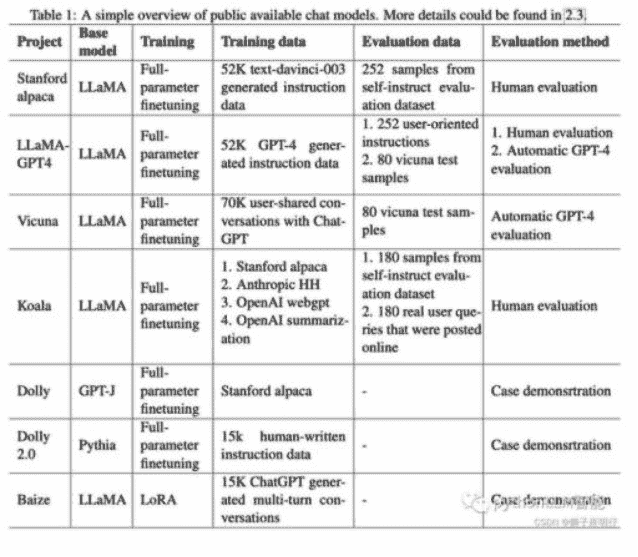

还对比了各因素的消融实验：

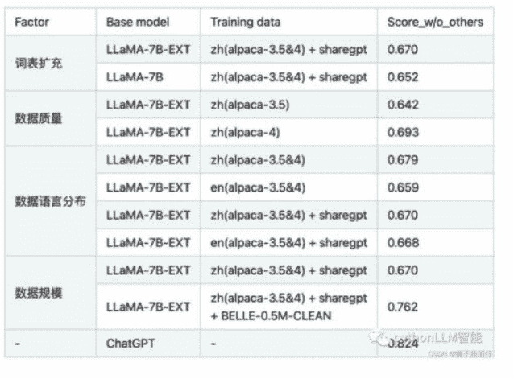

消融实验结论：

- 扩充中文词表后，可以增量模型对中文的理解能力，效果更好

- 数据质量越高越好，而且数据集质量提升可以改善模型效果

- 数据语言分布，加了中文的效果比不加的好

- 数据规模越大且质量越高，效果越好，大量高质量的微调数据集对模型效果提升最明显。解释下：数据量在训练数据量方面，数据量的增加已被证明可以显著提高性能。注意的是，如此巨大的改进可能部分来自`belle-3.5`和我们的评估数据之间的相似分布。评估数据的类别、主题和复杂性将对评估结果产生很大影响

- 扩充词表后的`LLaMA-7B-EXT`的评估表现达到了0.762/0.824=92%的水平

他们的技术报告证明中文大模型的训练是可行的，虽然与`ChatGPT`还有差距。这里需要指出后续`RLHF`也很重要，我罗列在这里，抛砖引玉。

## 13. 指令微调的好处？

有以下好处：

1. 对齐人类意图，能够理解自然语言对话（更有人情味）

2. 经过微调（`fine-tuned`），定制版的`GPT-3`在不同应用中的提升非常明显。`OpenAI`表示，它可以让不同应用的准确度能直接从83%提升到95%、错误率可降低50%。解小学数学题目的正确率也能提高2-4倍。（更准）

3. 踩在巨人的肩膀上，直接在1750亿参数的大模型上微调，不少研发人员都可以不用再重头训练自己的`AI`模型了。（更高效）

## 14. 预训练和微调哪个阶段注入知识的？

预训练阶段注入知识的，微调是在特定任务训练，以使预训练模型的通用知识跟特定任务的要求结合，使模型在特定任务上表现更好。

## 15. 想让模型学习某个领域或行业的知识，是应该预训练还是应该微调？

可以使用预训练和微调相结合的方式，先用篇章数据进行预训练以获取广泛的知识，再用问答对数据进行微调，使模型更好地学习到特定领域的知识。

当然，`GPT`大模型的预训练和微调，从实现方式来讲是没有什么差别的，都是`decoder only`的语言模型训练并更新参数，如果样本集小，没有大量的篇章文档数据，我认为只进行微调也能注入知识的，不必太纠结预训练。而且特定领域跟预训练模型的分布差别不大，也不用二次预训练。

## 16. 多轮对话任务如何微调模型？

这里列举了`ChatGLM-6B`的生成对话的例子

```
>>> from transformers import AutoTokenizer, AutoModel
>>> tokenizer = AutoTokenizer.from_pretrained("THUDM/chatglm-6b", trust_remote_code=True)
>>> model = AutoModel.from_pretrained("THUDM/chatglm-6b", trust_remote_code=True).half().cuda()
>>> model = model.eval()
>>> response, history = model.chat(tokenizer, "你好", history=[])
>>> print(f"response:{response}")
>>> print(f"history:{history}")
response：你好
!我是人工智能助手 ChatGLM-6B,很高兴见到你,欢迎问我任何问题。
history：["你好", "你好
!我是人工智能助手 ChatGLM-6B,很高兴见到你,欢迎问我任 何问题。"]
```

- `response` 为 `ChatGLM-6B` 模型的 当前反馈

- `history` 为 `ChatGLM-6B` 模型的 历史记录的保存

说白了，就是 `ChatGLM-6B` 模型简单的把上一轮对话扔进下一轮的`input`里，这种方法好处是简单，缺点是随着轮数的增加， `history` 存储的 对话会越来越多，导致 `max_length` 增加，从而 出现 爆显问题。

- 解决方法：

- 对 历史对话 做一层文本摘要，取其精华去其糟粕

- 将 历史对话 做成一个 `embedding`

- 如果是 任务型对话，可以将 用户意图 和 槽位 作为 上一轮信息 传递给 下一轮

## 17. 微调后的模型出现能力劣化，灾难性遗忘是怎么回事？

所谓的`灾难性遗忘`：即学习了新的知识之后，几乎彻底遗忘掉之前习得的内容。这在微调`ChatGLM-6B`模型时，有同学提出来的问题，表现为原始`ChatGLM-6B`模型在知识问答如"失眠怎么办"的回答上是正确的，但引入特定任务（如拼写纠错`CSC`）数据集微调后，再让模型预测"失眠怎么办"的结果就答非所问了。

我理解`ChatGLM-6B`模型是走完 "预训练-`SFT`-`RLHF`" 过程训练后的模型，其`SFT`阶段已经有上千指令微调任务训练过，现在我们只是新增了一类指令数据，相对大模型而已，微调数据量少和微调任务类型单一，不会对其原有的能力造成大的影响，所以我认为是不会导致灾难性遗忘问题，我自己微调模型也没出现此问题。

应该是微调训练参数调整导致的，微调初始学习率不要设置太高， `lr=2e-5`或者更小，可以避免此问题，不要大于预训练时的学习率。

## 18. 微调模型需要多大显存？

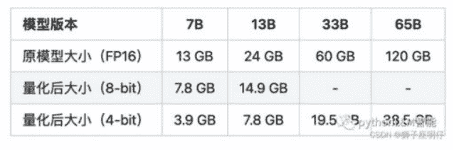

## 19. 大模型`LLM`进行`SFT`操作的时候在学习什么？

（1）预训练->在大量无监督数据上进行预训练，得到基础模型-->将预训练模型作为`SFT`和`RLHF`的起点。

(2) `SFT`-->在有监督的数据集上进行`SFT`训练，利用上下文信息等监督信号进一步优化模型-->将`SFT`训练后的模型作为`RLHF`的起点。

(3) `RLHF`-->利用人类反馈进行强化学习，优化模型以更好地适应人类意图和偏好-->将`RLHF`训练后的模型进行评估和验证，并进行必要的调整。

## 20. 预训练和`SFT`操作有什么不同

下面使用一个具体的例子进行说明。

问题：描述计算机主板的功能

进行预训练的时候会把这句话连接起来，用前面的词来预测后面出现的词。在计算损失的时候，问句中的损失也会被计算进去。

进行`SFT`操作则会构建下面这样一条训练语料。

```
 输入：描述计算机主板的功能[BOS]计算机主板是计算机中的主要电路板。它是系统的支撑。 [EOS]
标签：[......][BOS]计算机主板是计算机中的主要电路板。它是系统的支撑。[EOS]
```

其中`[BOS]`和`[EOS]`是一些特殊字符，在计算损失时，只计算答句的损失。在多轮对话中，也是一样的，所有的问句损失都会被忽略，而只计算答句的损失。

因此`SFT`的逻辑和原来的预训练过程是一致的，但是通过构造一些人工的高质量问答语料，可以高效地教会大模型问答的技巧。

## 21. 样本量规模增大，训练出现`OOM`错

- 问题描述：模型训练的样本数量从10万，增大300万，训练任务直接报`OOM`了。

- 解决方案，对数据并行处理，具体实现参考海量数据高效训练，核心思想自定义数据集本次的主要目标是使向量化耗时随着处理进程的增加线性下降，训练时数据的内存占用只和数据分段大小有关，可以根据数据特点，灵活配置化。核心功能分为以下几点:

- 均分完整数据集到所有进程（总的`GPU`卡数）

- 每个`epoch`训练时整体数据分片`shuffle`一次，在每个进程同一时间只加载单个分段大小数据集

- 重新训练时可以直接加载向量化后的数据。

## 22. 大模型`LLM`进行`SFT` 如何对样本进行优化？

- 对输入历史对话数据进行左截断，保留最新的对话记录。

- 去掉样本中明显的语气词，如嗯嗯，啊啊之类的。

- 去掉样本中不合适的内容，如`AI`直卖，就不应出现转人工的对话内容。

- 样本中扩充用户特征标签，如年龄，性别，地域，人群等

## 23. 模型参数迭代实验

验证历史对话轮次是否越长越好，通过训练两个模型，控制变量`max_source_length` | `max_target_length`，对训练好之后的模型从`Loss`、`Bleu`指标、离线人工评估等角度进行对比分析。

结论：从人工评估少量样本以及`loss`下降来看，历史对话长度`1024`比`512`长度好，后续如果训练可能上线模型，可以扩大到`1024`长度。

## 24. 微调大模型的一些建议

- 模型结构:

- 模型结构+训练目标: `Causal Decoder` + `LM`。有很好的`zero-shot`和`few-shot`能力，涌现效应

- layer normalization: 使用`Pre RMS Norm`

- 激活函数: 使用`GeGLU`或`SwiGLU`

- `embedding`层后不添加`layer normalization`，否则会影响`LLM`的性能

- 位置编码: 使用`ROPE`或`ALiBi`。 `ROPE`应用更广泛

- 去除偏置项:去除`dense`层和`layer norm`的偏置项，有助于提升稳定性

- 训练配置:

- `batch size`: 选用很大的`batch size`; 动态地增加`batch size`的策略，`GPT3`逐渐从`32K`增加到 `3.2M` tokens。

- 学习率调度:先`warmup`再衰减。学习率先线性增长，再余弦衰减到最大值的10%。最大值一般在`5e-5`到`1e-4`之间。

- 梯度裁剪:通常将梯度裁剪为`1.0`。

- 权重衰减: 采用`AdamW`优化器，权重衰减系数设置为`0.1``Adamw`相当于`Adam`加了一个`L2`正则项

- 混合精度训练:采用`bfloat16`，而不是`float16`来训练。

- 训练崩溃挽救:

- 选择一个好的断点，跳过训练崩溃的数据段，进行断点重训。选择一个好的断点的标准: 损失标度`lossscale`>0;梯度的`L2`范数<一定值 && 波动小

## 25. 微调大模型时，如果`batch size`设置太小 会出现什么问题？

当`batch size`较小时，更新方向（即对真实梯度的近似）会具有很高的方差，导致的梯度更新主要是噪声。经过一些更新后，方差会相互抵消，总体上推动模型朝着正确的方向前进，但个别更新可能不太有用，可以一次性应用（使用更大`batch size`进行更新）。

## 26. 微调大模型时，如果`batch size`设置太大 会出现什么问题？

当`batch size`非常大时，我们从训练数据中抽样的任何两组数据都会非常相似（因为它们几乎完全匹配真实梯度）。因此，在这种情况下，增加`batch size`几乎不会改善性能，因为你无法改进真实的梯度预测。换句话说，你需要在每一步中处理更多的数据，但并不能减少整个训练过程中的步数，这表明总体训练时间几乎没有改善。但是更糟糕的是你增加了总体的 `FLOPS`。

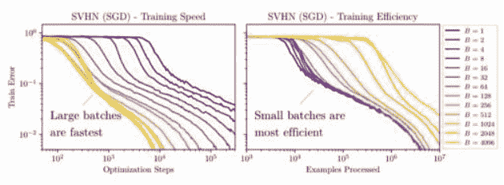

通过观察这些线性图，我们可以发现使用更大的`batch size`通常需要较少的训练 `step`。然而，这将相应地增加需要处理的数据。当`batch size`从 `2048` 翻倍时，达到同样性能所需要的 `step` 几乎没有任何改善，但你需要花费两倍的计算资源。 `Google` 的经验研究也有类似的观察，即在固定的 `epoch budget` 下，当 `batch size` 达到临界值时，模型的性能会 `batch size` 的增加而降低。可以如下说明：

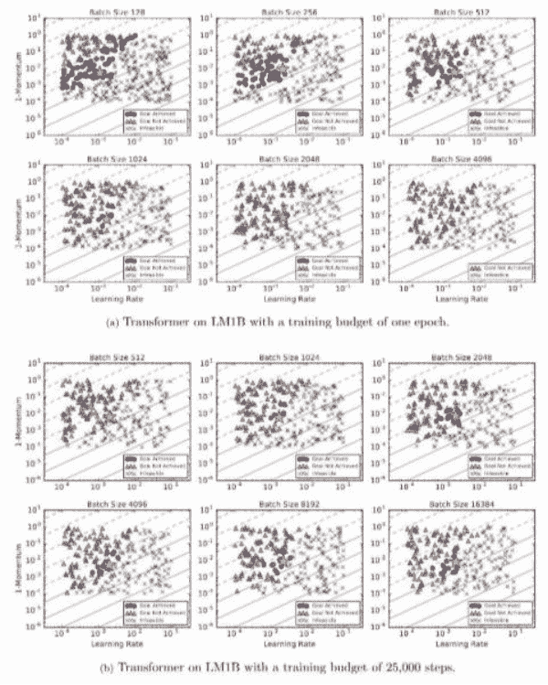

## 27. 微调大模型时, `batch size` 如何设置问题？

各种结果表明似乎存在着一个关于数据并行程度的临界点，通过找到这个临界点，我们可以有效的平衡训练的效率和模型的最终效果。

`OpenAI` 发现最优步长:

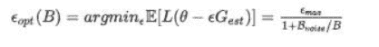

注： `B` 为 `batch size` ，`Bnoise`为 噪声尺度

在采用最优 `step size` 时，从含有噪声的梯度中获得的损失的最优改进现在变为：

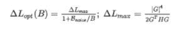

从这些公式中我们可以得出两个结论：

1. 无论我们如何准确地估计真实梯度，总存在一个最大步长

2. 批处理大小越大，我们优化模型的步长就越大（有一个上限）

左侧的图表说明了为什么使用更大的批次模型可以取得更多提升。但是当 `batch size` 太大时，我们会遇到收益递减的问题（因为分母中的 `1` 开始占主导地位）。但是需要注意的事，这仅在学习率调整良好的情况下有效。因此， `OpenAI` 建议将学习率调整到一个相对接近最优值的数值是理论能有效的前提。

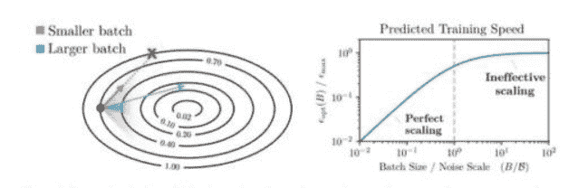

在进行一些其他数学计算后， `OpenAI` 发现噪声尺度可以通过以下方式估计：

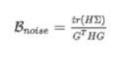

其中， `H` 是参数的真实 `Hessian` 矩阵， `C` 是相对于梯度的每个示例的协方差矩阵， `g` 是真实梯度。 为了进一步简化这个方程， `OpenAI`作出了一个（不切实际的）假设，即优化是完全`well-conditioned` 的。在这种情况下， `Hessian` 矩阵只是单位矩阵的倍数，噪声尺度简化就可以简化为以下形式：

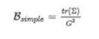

他们经验上发现结果相当接近。该方程表明噪声尺度等于个别梯度分量的方差之和，除以梯度的 `norm`。`OpenAI` 使用以上结论在后续的 `scaling law` 工作中预测了模型的最优 `batch size` 大小。

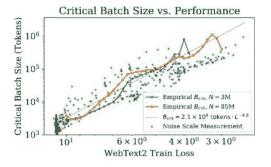

- `Learning rate as temperature`

前面的结论有提到一个前提，就是模型的 `LR` 是调的比较好的。这是因为 `OpenAI` 发现噪声尺度基本符合以下规律

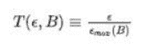

在使用 `SGD` 和小 `batch` 进行更新时，可以大概近似为

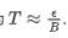

这表明

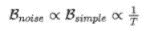

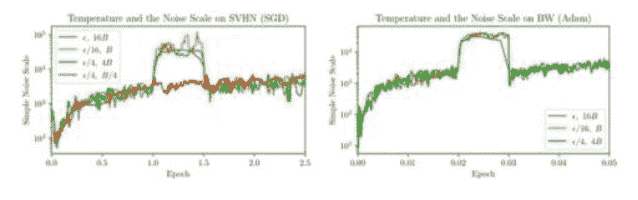

从以上内容，我们可以得知:

1. 高温度导致较小的噪声尺度。其中的直觉是在高温度下，相对于方差，梯度幅度较大。

2. 当学习率以一个常数因子衰减时，噪声尺度大致以相同的因子增长。因此，如果学习率太小，噪声尺度将被放大。

## 28. 微调大模型时, 优化器如何？

除了`Adam`和`AdamW`，其他优化器如`Sophia`也值得研究，它使用梯度曲率而非方差进行归一化，可能提高训练效率和模型性能。

## 29. 哪些因素会影响内存使用？

内存使用受到模型大小、批量大小、 `LoRA`参数数量以及数据集特性的影响。例如，使用较短的训练序列可以节省内存。

## 30. 进行领域大模型预训练应用哪些数据集比较好？

通过分析发现现有的开源大模型进行预训练的过程中会加入书籍、论文等数据。主要是因为这些数据的数据质量较高，领域相关性比较强，知识覆盖率（密度）较大，可以让模型更适应考试。给我们自己进行大模型预训练的时候提供了一个参考。同时领域相关的网站内容、新闻内容也是比较重要的数据。

## 31. 用于大模型微调的数据集如何构建？

进行大模型微调时，数据是比较重要的，数据的高度决定模型效果的高度，因此数据的质量重要性大于数据的数量的重要性，因此对于构建微调数据时的几点建议如下所示：

1. 选取的训练数据要干净、并具有代表性。

2. 构建的`prompt`尽量多样化，提高模型的鲁棒性。

3. 进行多任务同时进行训练的时候，要尽量使各个任务的数据量平衡。

## 32. 大模型训练`loss`突刺原因和解决办法

参考： `A Theory on Adam Instability in Large-Scale Machine Learning`

### 32.1 大模型训练`loss`突刺是什么？

`loss spike`指的是预训练过程中，尤其容易在大模型（`100B`以上）预训练过程中出现的`loss`突然暴涨的情况

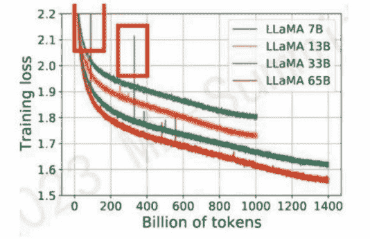


# 大模型训练Loss突刺分析与解决

如图所示模型训练过程中红框中突然上涨的`loss`尖峰 `loss spike`的现象会导致一系列的问题发生，譬如模型需要很长时间才能再次回到`spike`之前的状态（论文中称为`pre-explosion`），或者更严重的就是`loss`再也无法`drop back down`，即模型再也无法收敛。

`PaLM`和`GLM130b`之前的解决办法是找到`loss spike`之前最近的`checkpoint`，更换之后的训练样本来避免`loss spike`的出现。

## 32.2 为什么大模型训练会出现loss突刺？

大模型训练使用的`Adam`优化器会导致`loss`突刺。

首先回顾一下`Adam`优化器的结构（这里介绍的是较为传统的`Adam`优化器，现在`nlp`任务更偏向于使用带有正则化项的`Adamw`变体）：

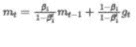

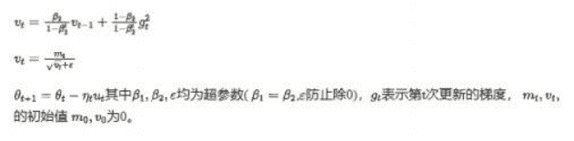

首先对`Adam`的有效性做了论述，其本质在于证明了`Adam`优化过程是对牛顿下降法（二阶导）的一个有效逼近，因此在收敛速度上大幅度领先传统`SGD`（一阶导），证明过程不做赘述，可以参考本文和`Adam`系列相关论文。

`Adam`算法是牛顿下降法的一个迭代逼近。

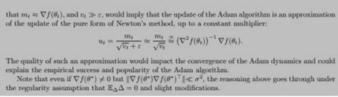

一切显得十分完美，但是理想很丰满，现实很骨感，收敛过程并不是一帆风顺的。首先我们想象一下`ut`这个更新参数的变化趋势。

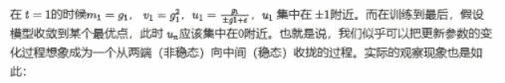

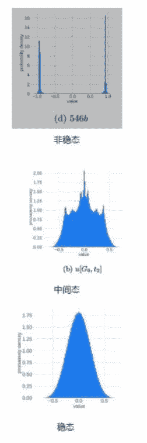

进入正态分布的稳态之后，理想的更新参数变化趋势应该是方差越来越小，所有更新参数逐渐向0靠近。这应该是一个单向的过程，即稳定的单峰状态（`unimodal`）不会再次进入非稳定的双峰状态（`bimodal`），但事实并非如此，更新参数会再次进入非稳定的双峰状态。

本文在理论层面做了研究和解释，从中心极限定理（可以结合道尔顿板实验理解）出发，认为随机事件的叠加进入单峰的正态分布的必要条件之一是各个随机事件事件之间应该是相互独立的，但是。

梯度变化以及更新参数的变化并不能特别好的满足独立性这一条件，而这一点恰恰是导致更新参数振荡，`loss spike`出现以及`loss`不收敛的重要原因之一。

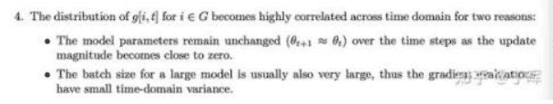

造成梯度变化不独立的原因（1、浅层参数长时间不更新2、`batch`太大，后期梯度更新趋于平稳）。上述的理论有些晦涩，本文作者可能也了解这一点，之后开始直接点题，结合实验观察抛出了重要现象和结论。

即训练过程中`loss spike`的出现与：梯度更新幅度，`e`大小，`batch`大小这三个条件密切相关。

本文作者对`loss spike`出现时模型的前后变化做了仔细拆解，发现下列一系列连续现象的出现导致了`loss spike`：

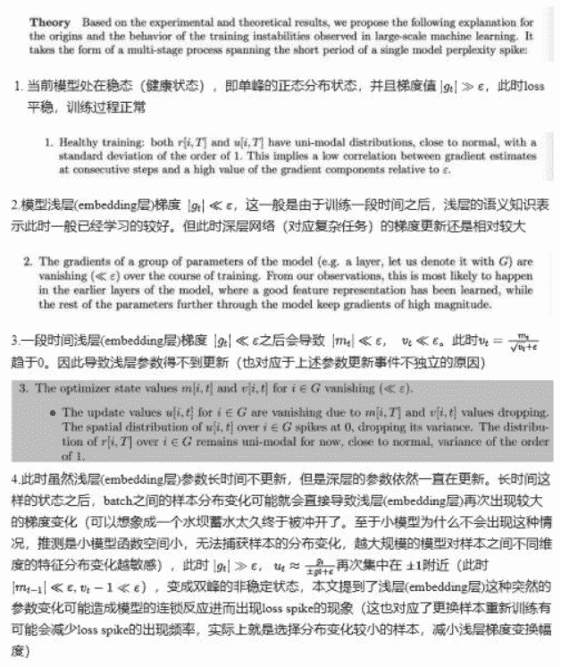

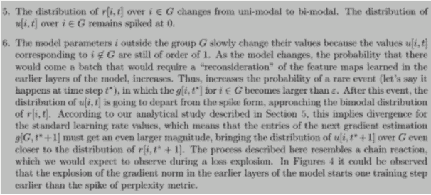

5.这个阶段模型处于非稳态，梯度变化幅度较大，每一次的梯度变化和更新参数变化事件之间又出现了一定的独立性，因此经过一定的时间之后模型有可能再次进入稳态，`loss`再次`drop back down`（注意，本文着重提了这个再次`drop back down`并不是一定出现的，也很有可能`loss`长期处于`flat`状态，再也无法收敛）。

因此我们得出一些结论，`loss spike`的出现和浅层的梯度更新幅度，`e`大小密切相关（`batch`大小带来的相关性问题倒是显得没那么大说服力），实际上就是浅层网络参数突然进入到了之前长时间不在的状态与模型深层参数当前的状态形成了连锁反应造成了模型进入非稳态。同时一般情况即使出现`loss spike`也会自动回复到正常状态，但也有可能再也不会。

## 32.3 大模型训练loss突刺如何解决？

本文最后提到了防止`loss spike`出现的一些方法：

1. 如之前提到的`PaLM`和`GLM130B`提到的出现`loss spike`后更换`batch`样本的方法（常规方法，但是成本比较高）。

1. 减小`learning rate`，这是个治标不治本的办法，对更新参数的非稳态没有做改进。

1. 减小`e`大小。或者直接把`e`设为0，重新定义。

在`vt`等于0时候的值（这应该是个值得尝试的办法）。

值得一提的是智谱华章在本文发表之前，在去年的`GLM130B`训练时似乎也观察到了浅层梯度变化和`loss spike`相关这一现象（`GLM-130B: An Open Bilingual Pre-trained Model`），他采取的是把浅层梯度直接乘以缩放系数`a`来减小浅层梯度更新值。

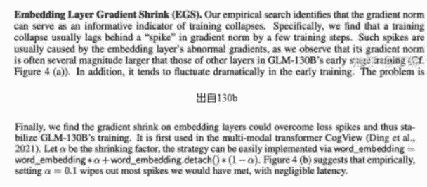

其实这块我有个自己的想法，`e`和`a`是否也可以做衰减，随着训练过程逐渐减小，来避免`loss spike`的现象。

另外假设我们能一次性加载所有样本进行训练（实际上不可能做到），是否还会出现`loss spike`的现象。

最后目前流行的`fp8`，`fp16`混合训练，如果`upscale`设置的过小，导致梯度在进入优化器之前就下溢，是不是会增加浅层梯度长时间不更新的可能性，进而增加`loss spike`的出现的频率。（这么看来似乎提升`upscale`大小以及优化`e`大小是进一步提升模型效果的一个思路）。
