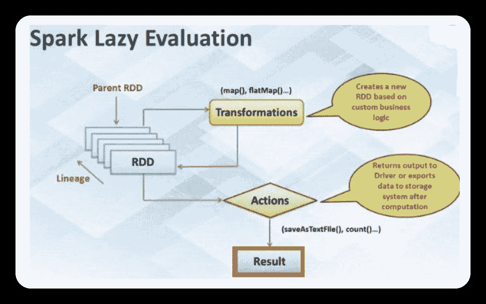
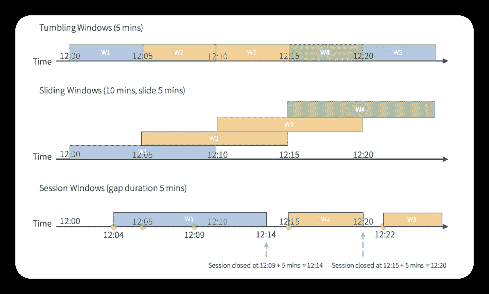
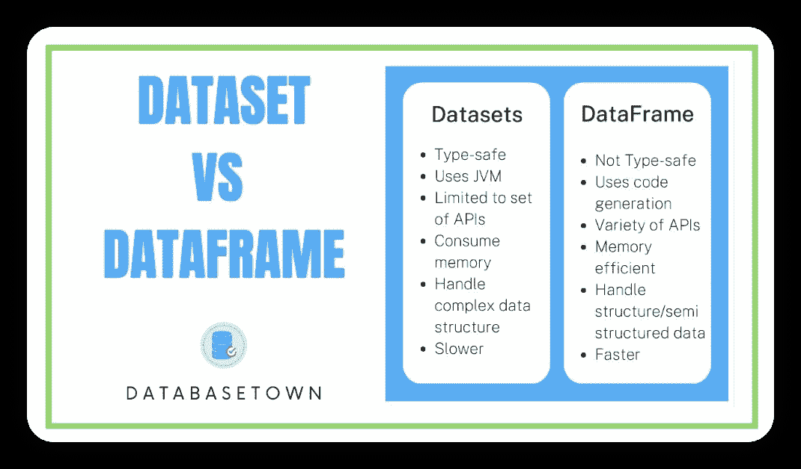

# 机器学习和大数据面试前需要学习的 23 个 Apache Spark 面试问题（已回答）

> 来源：[https://qqs7y1hozd1.feishu.cn/docx/Lpfdd7H46oqcsrxCdGOcwjRXnMd](https://qqs7y1hozd1.feishu.cn/docx/Lpfdd7H46oqcsrxCdGOcwjRXnMd)

# **问题1**：简要比较Apache Spark与 Apache Hadoop                               （简单）

## 参考**答案：**

+   **性能**：**Spark速度更快，因为它使用随机存取存储器（**RA**M），而**不是读取和写入中间**数据到磁盘。Hadoop 将数**据存储在多个源上，并通过MapReauce分批处理。成本：Hadoop 的运行成本较低，因为它依赖任何磁盘存储类型进行数据处理。Spark的运行成本较高，因为它依赖内存计算进行实时数据处理，这需要使用大量RAM来启动节点。

+   **处理**：虽然两个平台都在**分布式****环境中**处**理数据，**但 Hadoop 非常适合批处理和线性数据处理。Spark 非常适合实时处理和处理实时非结构化数据流。

+   **可扩展性**：当数据量快速增长时，Hadoop 可以通过 Hadoop** 分布式**文件系统（）快速扩展以满足需**求 HD**FS。反过来，Spark 依赖于HDFS对大量数据的容错能力。

+   **安全性**：Spark 通过**共享密钥**或事件日志进行身份验证来增强安全性，而 Had**oop 使用多种身份验证和访问控制方法。虽然总体而言，Had**oop 更安全，但 Spark 可以与 Hadoop 集成以达到更高的安全级别。

+   **机器学习（ML）****：Spar**k 是此类别中的优秀平台，因为它包括 MLLib执行迭代内存 ML 计算的平台。它还包括执行回归、分类、持久性、管道构建、评估等的工具。

# **问题2**：Apache Spark 中的惰性求值是什么？                                         （简单）

## 参考**答案：**

> **惰性求值**意味着 Spark 会等到最后一刻才执行计算指令图。在 Spark 中，您不会在表达某些操作时立即修改数据，而是会制定一个要应用于源数据的转换计划。

> 通过等到最后一分钟才执行代码，Spark 会将此计划从原始 DataFrame 转换编译为精简的物理计划，该计划将在整个集群中尽可能高效地运行。这带来了巨大的好处，因为Spark 可以优化从端到端的整个数据流。

> 一个例子就是DataFrames 上的谓词下推。如果我们构建一个大型 Spark 作业，但在最后指定一个过滤器，该过滤器仅要求我们从源数据中获取一行，则执行此操作的最有效方法是访问我们需要的单个记录。Spark 实际上会通过自动下推过滤器来为我们优化这一点。

# **问题3**：Apache Spark 中的Shuffling是什么？ 它何时发生？          （简单）

## 参考**答案：**

> 回**想一下，Apac****he Spark 通过将数据分布在多个****节点上并在每个节点上****分别计算值来处理查询。但是，有时，节点**需要在分区之间交换数据，这就是Shuffling所指的。因此，当数据行的源分区和目桥分区位于不同的机器上时，它们可以在工作节点之间移动。改组是一项耗时的操作，因此只有在别无选择或DataFrames 您明确请求数据重新分区时才会发生。当您按列值连接或分组数据，或者我们运行分组操作并计算聚合时，也会发生这种情况。

# **问题4**：Apache Spark 中的缓存和持久性有什么区别？                   （简单）

## 参考**答案：**

+   缓**存是一种将数据**存储在内存中以加快访问速度的机制。缓存数据集时，Spark 会将数据保存在内存中，以便下次需要时可以快速检索数据。要在 Spark 中缓存数据集，只需调用或cache（） 上的方法：RDD DataFrame myRDD. cache（）

+   **持久性**是 **Spark 中与缓**存相**关的概****念，不同之处在于您告诉 Sperk 将数据存储**在磁盘或内存中，或两者结合，以便下**次需要时可以快速检**索。要在 Spark 中持久化数据集，您可以 persist（） 在RDD 或 DataFrame 上使用方法以及存储级别，例如：myRDD.persist（StorageLeveL.MEMORY_AND_DISK）。存储级别的其他示例包括：MEMORY_ONLY _SER 、 MEMORY_AND_DISK_SER 和 DISK_ONLY

# **问题5**：如何更改RDD的分区？                                                                        （中等）

## 参考**答案：**

> **repartition（）****可以使用或更改现有 **RDD 的分区 coalesce（）。这些操作可以根据提供的分区数重新分配RDD

+   **repartition（） **可用于增加或减少分区的数量，但它涉及整个集群的大量数据混洗。

+   另一方面，**coalesce（）****只能用于减少分区数量****。在大多数情况下，coal**esce（）不会触发 shuffle，因此它可以提供比 更好的性能 repartition（）

+   **但是，在某些情况下，当您的**工作申请没有使用所有可用的插槽时，使用repartition（）可以使其运行得更快。

# **问题6**：如何处理Apache Spark 中的溢出？                                             （中等）

## 参考**答案：**

> **当正**在处理的数据量超过可用内存资源时，Spark 中就会发生溢出。为了管理这种溢出，Spark 将多余的数据临时写入磁盘，称为溢出文件。创建这些溢出文件是为了确保尽管内存容量有限，但仍能处理数据。

> **为了优化 Apache Spark 性能并减轻溢出的影响**，可以采用多种解决方案。三种有效的策略是：

1.  **增加集群内存**：解决溢出问题的一种方法是增加Spark 集群中的可用內存资源。通过为每个执行器配置更多內存，您可以为数据处理提供更大的工作空间，从而降低溢出到磁盘的可能性。这种方法可以提高整体性能并最大限度地减少溢出的影响。

1.  **减少分区大小**：另一种有效的技术是增加 Spark 中的分区数量。 通过这样做，您可以減小每个分区的大小，从而降低超出内存限制并触发溢出的可能性。较小的分区允许 Spark 更有效地管理和处理数据，从而提高性能。

1.  **解决倾斜问题**：倾斜会加剧溢出的发生。当某些键或值严重倾斜时，它们可能会导致分区大小不平衡，从而导致特定分区溢出。通过采用倾斜提示、自适应查询执行（AQE）或倾斜加盐连接等技术，您可以缓解与倾斜相关的问题并减轻溢出。

# **问题7**：Apache Spark 中最常见的性能问题是什么？                          （中等）

## 参考**答案：**

+   **倾斜**：是 Spark 中最常见的性能问题之一。当数据在集群中分布不均匀时，就会发生倾斜，某些分区的数据比其他分区多得多。这可能导致某些工作节点处理的数据比其他节点多得多，从而导致处理时间更长。

+   **溢出**：当单个工作节点处理的数据量超过可用内存量时发生。发生这种情况时，Spark 将开始将多余的数据溢出到磁盘，这会显著降低处理速度。

+   **Shuffle**：当 Spark 需要在集群中重新分配数据时（例如执行group by或join操作时），会发生这种性能问题。这可能是一项非常昂贵的操作，因为它需要通过网络移动数据。

+   **存储****：当 Spark需要读取或写入数据到磁**益时，就会出现性能问题。这可能是一项非常昂贵的操作，因为磁盘 I/O 通常比内存或网络I/O 慢得多。

+   **序列化**：当 Spark 需要将数据转换为序列化格式以**进行网络传输或存储时，就会出现性能问题。这可能是一**项非常昂贵的操作，因为序列化会占用大量 CPU 资源，并会显著减慢作业执行速度。

# **问题8**：哪些因素影响Apache Spark 中的Join操作？                          （中等）

## 参考**答案：**

> 影响连接操作的主要因素有：

1.  **数据集大小**

1.  **连接条件****：来源****于对数据集中字段的逻辑**比较。这些条件可以分为等价条件（=）（equi-join）或非等价条件（>，＜，≥，≤，~）

1.  **连接类型**：分为内连接、外连接、半连接和交叉连接

> **基于前面的内容**，**Sparks 通过**考虑Join 类型和Hint join来构建 join 策略。其中Hint join与数据集大小和join 条件直接相关。

# **问题9**：什么是数据倾斜，它如何影响 Apache Spark 作业的性能（中等）

## 参考**答案**

> Apache Spark 将数据以分区的形式加载到内存**中。理想**情况**下，分区中的数据应均匀分布。数据倾斜是指某个或某些分区的数据明****显多于其他分区****，通常是**由于需要对数据进行重新分区的操作造成的，主要是连接和分组（Groupey）操作。

> 根据数据倾佘程度，如果一个或多个分区的数据明显多于其他分区，则可能导致性能瓶颈和资源浪费。它可能导致以下问题：

+   **落后任务**：处理这些较大分区的任务可能会因为需要执行的工作量而落后于其他任务，并且可能会在它们完成工作时阻止整个作业进入下一阶段。这可能会导致延迟以资源的浪费，因为大多数资源在等待这些落后任务完成时处于闲置状态。

+   **溢出到磁盘和内存不足错误****：如果这些分区中的数据无法容纳处理它们的执行程序的内存，则垃圾**收集可能会成为问题，或者 Spark 可能不得不将数据溢出到磁盘上，从而进一步减慢这些任务的速度。虽然集群上的资源可能足以满足整体数据需求，但这种偏差可能会导致它们无法满足某些分区的需求，从而导致性能下降。在最坏的情况下，这可能会导致内存不足异常并导致作业失败。

# **问题10**：Apache Spark 中的转换 （Transformation 和操作 （Action有什么区别？  （中等）

## 参考**答案**

+   转换是每个返回、或 的Spark 操作。当我们构建转换链时，我们会将构建块添加到Spark 作业中，但不会处理任何数据。这是可能的，因为转换是延迟执行的。Spark会在必要时计算值。DataFrame Dataset RDD

+   另一方面，**操作不是情性执行的**。**当我们**在代码中放入操作并且 Spark 在运行作业时到达该代码行时，它将必须执行导致该操作的所有转换以产生值。

+   产生价值是这里的关键概念。虽然转换会返回 Spark 数据类**型之一，但**操作会返回元素数量**（例如函数 c**o**unt ）****、元素列表**（** collect、take **等），或者将数据存储在外部存储中（write、saveAsTextFile等）

# **问题11**：Apache Spark 中有哪些类型的时间窗口？                             （中等）

## 参考**答案**

> **在 Ap**ache Spark 中，时间窗口是指在流式**处理或批处理中用于聚**合数据的特定时间间隔。时间窗口允许您根据指定的时间范围对数据进行分组，从而使您能够对该窗口内的数据执行计算、聚合和转换。

> Spark 支持三种类型的时间窗口：

+   **滚动窗口****是一系列固定大小、不重鑫且**连续的时间间隔。一个输入只能绑定到一个窗口。

+   **滑动窗口****，从“固定大小"”的角度来看与滚动窗口类似，但是如果滑**动的持续时间小于窗口的持续时间，则窗口可以重叠，在这种情况下，一个输入可以绑定到多个窗口。

+   **会话窗口**，其窗口长度为动态大小，具体取决于输入。会话窗口以输入开始，如果在间隔持续时间内收到了后续输入，则会自动扩展。如果在收到最新输入后在间隔持续时间内没有收到任何输入，则会话窗口会关闭。这将启用组事件，直到在指定的时间段内没有新事件。

# **问题12**：Apache Spark 中无状态操作和有状态操作有何区别？   （中等）

## 参考**答案**

+   **无状态操作**不需**要前一行中的任何**信息来**处理下一行；每行**都**可以单独处**理。这些操作中缺少先前的“状态”因此它们是无状态的。无状态操作可以应用于批处理和流式DataFrame。此类操作的示例包括 select（）、等 filter（）。map（）

+   相比之下，**有状态操作**需要维护状态以跨多行组合数据。**更具体地说，任何涉****及**分组、连接或聚合的 DataFrame 操作都是有状态转换。虽然结构化流支持其中许多操，但其中一些组合不受支持，因为计算起来很困难或无法逐步计算它们。

# **问题13****：Apache Sp**ark 中的** DataSet ****vs有什么区别?DataFrame                                                        **                                                                                                 （中等）

## 参考**答案**

> A **Dataset** 和a **DataFrame**都用于以结构化方式存储和处理大量数据，但它们有一些关键区别：

+   **数据类型**：A **DataFrame **是 **2D**大小可变的表格数据结构，包含行和列**。它可**以**容纳任何数据类**型，而 a是强类型JVM Dataset对象的集合，并且是类型安全的。

+   **性能**：在性能方面，A **DataFrame** 通常比a更快，因为后者使用**Java 虚拟机（JVM）**，而前者使用代码生成。是在**RDD**之上实现的，并针对性能进行了优化。Dataset DataFrame

+   **APl**: **DataFrame ****拥有更多种类的A**PI，在数据操作方面更灵活，而Datasets API集更有限，但更简洁、更具表现力。

+   **类型安全**：**Datasets****提供编译时类型**安全，这意味着如果您**尝试在中存储不兼容**的类型 Dataset，则代码将无法编译。DataFrame 另一方面，不是类型安全的，可能会导致运行时错误。

+   **内存管理**：**DataFrame** 利用情性求值，**这意味着在对数据**执行操作之前不会执行任何计算。这可以实现更好的内存管理，而 Datasets执行即时求值会消耗更多内存。

+   **用例**：**DataFrame**** 通常用于结构化**和半结构化数据，而 Datasets用于强类型、面向对象编程，可以处理更复杂的数据结构和操作。

>