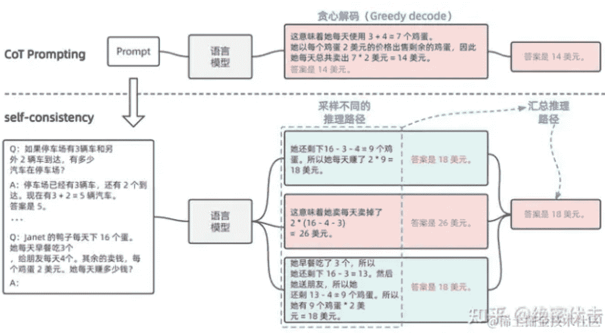
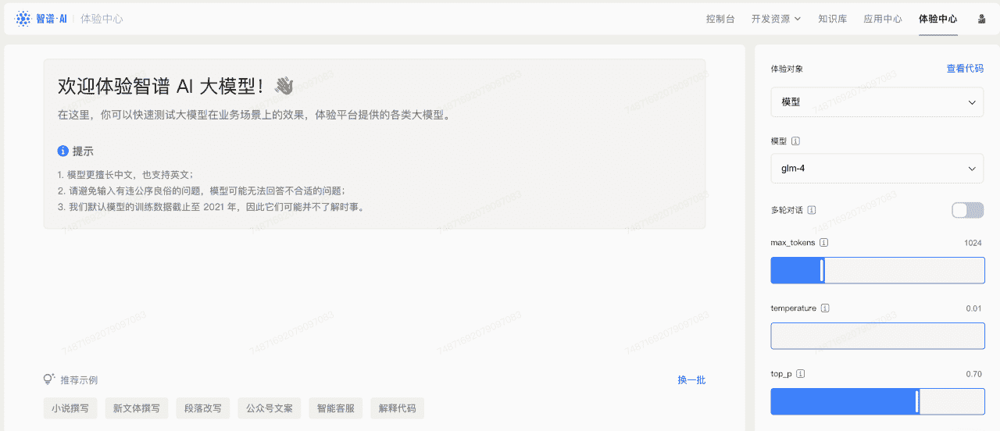

# 智谱AI产品经理笔试真题

> 来源：[https://qqs7y1hozd1.feishu.cn/docx/FSy1dAAnvovwiTxqyXlcKWninib](https://qqs7y1hozd1.feishu.cn/docx/FSy1dAAnvovwiTxqyXlcKWninib)

# **一、情感判断**

## **需求：**

**你需要根据用户的输入，利用****大模型****来****判断其中的情感标签**。

**情感标签有：**

| #### 情感 | #### 备注 |
| --- | --- |
| #### 正面 |  |
| #### 负面 |  |
| #### 混合 | 1.同时含有负面和正面的情感  2.话题情感不含混合 |
| #### 中性 | 1.无明显情感倾向的描述；  2.提问类、建议类归为中性 |

## **输入：**

> 1、通过京东进入的线上商城，是宝格丽正品吗？

> 2、不要给我打电话 我不方便接听，如果可以用🛰️联系我

> 3、购物车的产品不能点击进去详情页，找商品不方便

## **期望的输出：**

> **1、整体体验：中性**

> **2、整体体验：中性**

> **3、整体体验：负面**

## **请用以下参数做题，并将****prompt****模版和方案写出来：**

# **二、知识问答**

## **以下是知识：**

**few-shot-CoT：****多个例子，也叫多数投票机制**

> 目前从推特上观察，CoT已经被广泛应用，甚至很多人认为就是标准的做法。但国内来看，似乎缺乏对它的重视，觉得不过是个简单的 trick。其实不只是 CoT，对整体 LLM 的认知和谷歌、OpenAI 那边确实有些差距。至于为何，Jason Wei 那条推特一定程度说明问题，知乎上也有人把他删掉的推特截图放出来，大致意思是20年后入门 NLP 的人比之前的幸福，他们对 LM 的认知来自于强大的 LLM，而过去的人往往还停留在 BERT 的范式。

## **我的问题：**

+   **什么是****few shot cot ****？**

**要求：**思考采用什么样的方案，如何结合模型和工程，当我输入问题时，模型能在回复时把图片带出来。请基于这个要求反馈一个可行性的方案

# 三、**信息抽取**

## **输入：**

> **对话：**

> 发言人1 00:00:01

> 您好，请问是李佳李先生吗？

> 发言人2 00:00:05

> 你说是吗？

> 发言人1 00:00:05

> 您好，我这边是小明产险的回访客服露露。来电的话是有关注到您在去年5月30号的时候，在小明APP里面给您家人李勇这边购买了一份健康福的一个重疾险。您这边还有意向吗？先生？

> 发言人2 00:00:21

> 是啊，怎么了？

> 发言人1 00:00:22

> 是这样的，因为您购买的这份保险，它是有活逮产险承保的，是一个一年制的短险，到期之后就会截止了。那本次来电是给您提供一个延续保障的服务的，就是产品在售的情况下，你们家人李永格符合核保条件，他会继续按照您之前选择的一个月1交的这样的一个方式，来延续新一年的一个保障。那保就是保单到期前几天，这边也会通知您即将缴费，就是怕咱们老客户因为工作忙，好像断保了。我这边帮您备注一下这个服务，您看可以吗？

> 发言人2 00:00:55

## **期望的的输出：**

{

"是否提到自我介绍": "是",

"对话中自我介绍": "我是小明产险的回访客服露露"

}

## 请用以下参数做题，并将prompt模版和方案写出来：

# **四、函数调用**

## 多组函数（以下内容不可更改且需要在Prompt模版中完整引用）：

> **s**endEmail: `compose.sendEmail(emailAddress, subject, body): 用于发送邮件，每次只支持发给一个收件人，但是可以反复调用

> **checkEmailBox：**

+   'compose.checkEmailBox(sender, latest):'

+   函数checkEmailBox可接收两个函数，其中sender为字符串格式，描述了一个作为发件人的特定的邮箱地址，为非必传值；latest为布尔格式，描述了是否只返回最新的一封邮件，为非必传值；用户可以通过此接口查看邮箱是否有收到新邮件、或是来自指定人的新邮件，并决定是否取回最新的邮件内容

## **需求：**

**依据用户输入，利用****大模型**正确调用多组函数中的对应函数生成标准js代码

## **用户输入:**

给 hkt@yaocheng.cn发一封邮件说一下下周一8点开会。

## **期望输出：**

compose.sendEmail("hkt@yaocheng.cn", "下周一8点开会", "请注意，下周一8点我们将举行会议。")

## 请用以下参数做题，并将prompt模版和方案写出来：

