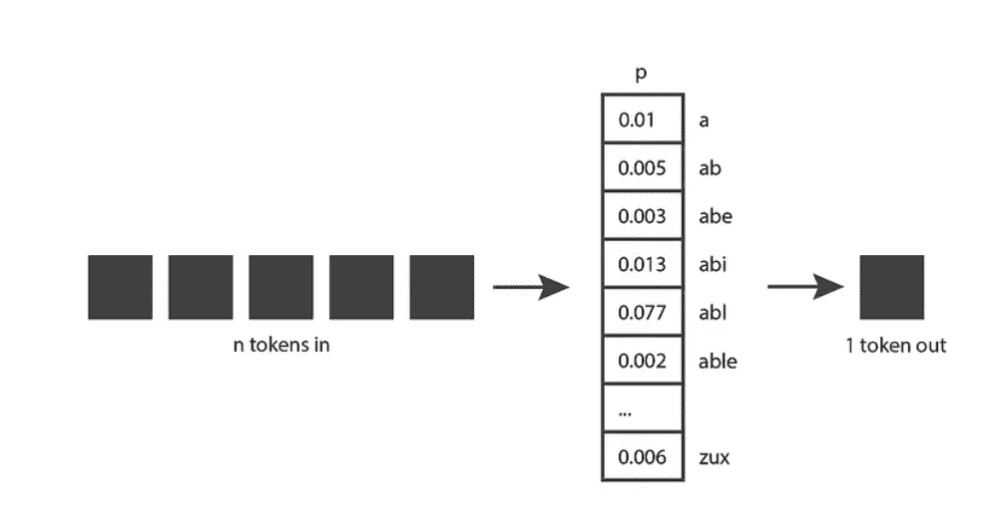
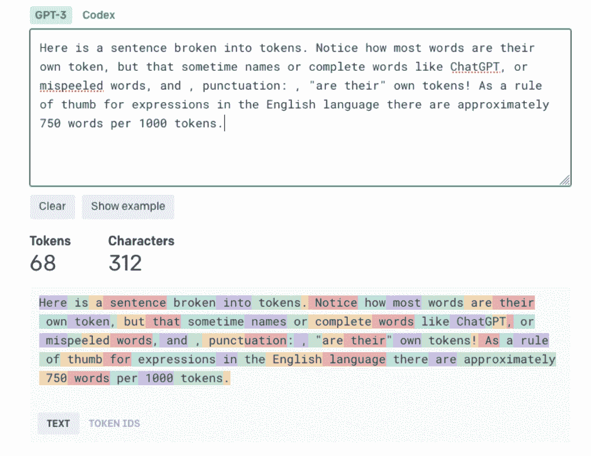
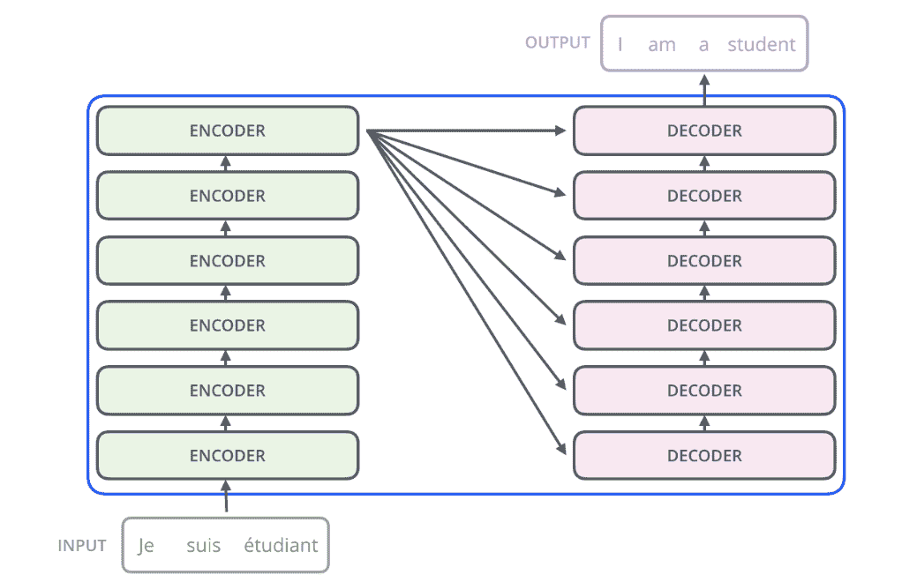
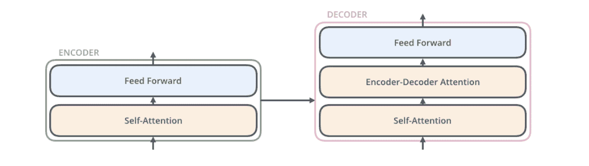
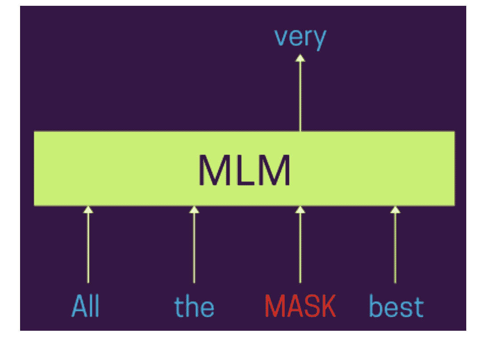

# LLMs面试问题

> 来源：[https://qqs7y1hozd1.feishu.cn/docx/TFA8dfYqzojHCFxALN6cuo7Nn5b](https://qqs7y1hozd1.feishu.cn/docx/TFA8dfYqzojHCFxALN6cuo7Nn5b)

# 一、生成语言模型如何工作？

**最基本的想法如下：**它们将**n**标记作为输入，并产生**one**标记作为输出


+   **标记是一段文本**

在 **OpenAI GPT** 模型中，**常用短词通常对应单个标记，而长词和不常用词通常会被拆分成**多个标记**，**这个基本思想应用**于扩展**窗口模式。你给它n输入标记，它产生one标记输出，然后它将输出标记合并为下一次迭代的输入的一部分，产生新的标记输出，依此类推。这个模式不断重复，直到达到停止条件，表明它已完成生成您需要的所有文本，现在，输出背后是所有可能标记的概率分布。模型的作用是返回一个向量，其中每个条目表示选择特定标记的概率



此概率分布来自训练阶段。在训练期间，模型会接触大量文本，并调整其权重以在给定输入标记序列的情况下预测良好的概率分布

**GPT生成模型是通过大量互联网数据进行训练的，**因此它们的预测反映了它们所见过的各种信息

# 二、在大型语言模型中可以使用哪些类型的提示？

大型语言模型可以通过以下几种方式产生输出：

+   **指令****：**专门设计用于遵循指令，例如：

+   迅速的：

```
Extract the name of the author from the quotation below.
“Some humans theorize that intelligent species go extinct before they can expand into outer space. If they&#x27;re correct, then the hush of the night sky is the silence of the graveyard.”
― Ted Chiang, Exhalation
```

+   输出：

```
Ted Chiang
```

+   **完成：**在这里你需要引导模型完成你想要的东西的开始。例如，

+   迅速的：

```
“Some humans theorize that intelligent species go extinct before they can expand into outer space. If they&#x27;re correct, then the hush of the night sky is the silence of the graveyard.”
― Ted Chiang, Exhalation
The author of this quote is
```

+   输出：

```
Ted Chiang
```

+   **演示：**向模型展示你想要的内容，可以使用提示中的几个示例，也可以使用微调训练数据集中的数百或数千个示例。例如：

+   迅速的：

```
Quote:
“When the reasoning mind is forced to confront the impossible again and again, it has no choice but to adapt.”
― N.K. Jemisin, The Fifth Season
Author: N.K. Jemisin
Quote:
“Some humans theorize that intelligent species go extinct before they can expand into outer space. If they&#x27;re correct, then the hush of the night sky is the silence of the graveyard.”
― Ted Chiang, Exhalation
Author:
```

+   输出：

```
Ted Chiang
```

# 三、大型语言模型上下文中的标记是什么？

**ChatGPT**和其他 **LLM**依赖于将输入文本分解成片段。每个片段大约是一个单词大小的字符序列或更小的片段。称这些为子词标记，该过程称为标记化，使用标记器完成

**标记可以是单词，也可以是字符块**

> 例如，“hamburger”一词被分解为标记“ham”、“bur”和“ger”，而“pear”等简短而常见的单词则是单个标记。许多标记以空格开头，例如“hello”和“bye”

这些模型理解这些标记之间的统计关系，并且擅长在标记序列中生成下一个标**记**。给定 A**P**I 请求中处理的**令牌数量**取决于输入和输出的长度。根据粗略的经验， 1标记大约为4字符或英文文本的0.75单词

考虑：



# 四、在**NLP**中使用基于**Transformer**的架构与基于**LSTM**的架构有何优势？

为了在**Transformer****之前创建**序列到序列模型，使用了著名的LSTM及其编码器-解码器架构，其中：

+   “编码器”部分创建单词序列的矢量表示

+   “解码器”从向量表示中返回一个单词序列

**LSTM****模型考虑到了单词之间的相互依赖性，因此需要前一**个状态的输入才能对当前状态进行任何操作；该模型有一个限制：训练速度相对较慢，输入序列不能并行传递

现在， **Transformer**的理念是不使用循环网络，而是仅使用位于其架构核心的注意力机制来保持序列中单词的相互依赖性。注意力机制衡量两个序列中两个元素之间的关联程度

在基于 **Transformer** 的架构中，注意力机制应用于单个序列（也称为自注意力层）自注意力层确定同一序列中不同单词的相互依赖性，以将相关表示与其关联

> 以这句话为例：“狗没有过马路，因为它太累了”。对人类来说，“它”显然指的是“狗”，而不是“街道”。因此，自注意力过程的目标是检测“狗”和“它”之间的联系。与前代产品相比，这一特性使 Transformer 的训练速度更快，而且事实证明，它们对噪声和缺失数据的鲁棒性更强

另外，在上下文嵌入中，**Transformer**可以从上下文中提取信息来纠正缺失或噪声数据，这是其他神经网络无法提供的功能

# 五、概述一下 **Transformers**的架构？

+   将模型视为一个黑盒子，在机器翻译应用程序中，它会接受一种语言的句子，然后输出另一种语言的翻译，如下所示：


> **深入研究黑匣子，变压器内部有：**

+   **编码组件：**它是一堆**N**编码器

+   **解码组件：**解码器堆栈**N**

+   **以及它们之间的联系**



+   **现在，每个编码器被分解为两**个子层： 自注意力层和前馈神经网络层

输入首先流经自注意力层，自注意力层的输出被馈送到前馈神经网络。这个序列不断重复，直到到达最后一个编码器最后，解码器接收编码器组件的输出，同样具有自注意层和前馈层，流程与之前类似，但是在它们之间有一个注意层，帮助解码器关注输入句子的相关部分



# 六、**Transformer** 架构中的**Self-Attention**和**Attention**有什么区别？

> **Self-attention**和**Attention**都是允许**Transformer**模型在进行预测时关注输入或输出序列的不同部分的机制

1.  注意力机制是指**Transformer**模型在进行预测时关注相关序列不同部分的能力。这通常用于编码器-解码器架构，其中编码器将输入序列矢量化，而解码器在进行预测时关注整个输入的编码表示。例如，在语言翻译中，注意力机制可以对原文和译文之间的关系进行建模

1.  另一方面，自注意力是指**Transformer** 模型在进行预测时关注输入序列不同部分的能力。这个名字的由来是，与“常规”注意力相反，自注意力指的是当前正在编码的同一序列。能够在编码每个输入元素时查看序列的整个上下文

# 七、如何评价语言模型的性能？

在**NLP**中，评估语言模型有两种方式：**外部评估和内部评估**

+   内在评估可以捕获模型捕获其应该捕获的内容（例如概率）的程度

+   外部评估（或基于任务的评估）捕捉模型在特定任务中的有用程度

> **LM**的一个常见的内在评价是困惑度。它是模型预测的单词的逆概率的几何平均值。直觉上，困惑意味着惊讶。在衡量模型对新数据的惊讶程度。困惑度越低，训练效果就越好

> 另一个常见的度量是交叉熵，它是困惑度的对数（以2为底）根据经验法则，困惑度降低10-20%是值得注意的

> 外部评估将取决于任务。例如：对于语音识别， 可以通过运行语音识别器两次（每个语言模型各一次）来比较两种语言模型的性能，看看哪个模型的转录更准确

# 八、**LLM**是如何进行预训练的？

> 预**训练LLM 基本上就是**用大量数据（至少几十亿个单词）训练 LLM，主要任务是预测句子中的单词。现在 可以通过两种方式来做到这一点，具体取决于模型的类型：

+   其中一种方法是双向模型（如BERT ）使用的掩码语言模型（MLM），其中训练集中一定比例的单词被掩码，模型的任务是预测这些缺失的单词。请注意，在这个任务中，模型可以看到缺失单词前面的单词和后面的单词，这就是它被称为双向的原因

+   还有其他类型的模型称为自回归模型（例如 GPT），它们是单向的，它们被训练来预测下一个单词而无需看到后续单词。这是因为这些自回归模型是专门为更好的语言生成而设计的，这使得模型必须以单向方式进行预训练



# 九、下一句预测 （NSP） 在语言建模中是如何使用的？

+   **下一句预**测 (NSP)用于语言建模，是BERT模型背后训练过程的一半（另一半是掩码语言建模 (MLM)）

+   下一句预测训练的目标是预测一个句子是否在逻辑上跟随呈现给模型的另一个句子

> 在训练过程中，模型会得到成对的句子，其中一些句子在原文中是连续的，而另一些则不是。然后，模型会接受训练，以预测给定的一对句子是否相邻。这使模型能够理解句子之间的长期依赖关系

**如果没有NSP，BERT在每个指标上的表**现都会变差——因此它的使用与语言建模相关

# 十、**LLM**中有哪些标记化技术？

标记化是将原始文本转换为一系列较小单元（称为标记）的**过程，**这些单元可以是单词、子单词或字符。LLM中使用的一些标记化方法和技术包括：

+   **基于单词的标记化：**此方法将文本拆分为单个单词，将每个单词视为单独的标记。基于单词的标记化虽然简单直观，但可能难以处理词汇表以外的单词，并且可能无法有效处理具有复杂形态的语言

+   **基于子词的标记化：**基于子词的方法（例如字节对编码 (BPE)和WordPiece）将文本拆分为较小的单元，这些单元可以组合成完整的单词。这种方法使 LLM 能够处理词汇表之外的单词并更好地捕捉不同语言的结构。例如，BPE合并最常出现的字符对以创建子词单元，而 WordPiece 采用数据驱动的方法将单词分割成子词标记

+   **基于字符的标记化：**此方法将单个字符视为标记。虽然它可以处理任何输入文本，但基于字符的标记化通常需要更大的模型和更多的计算资源，因为它需要处理更长的标记序列

# 十一、在开发**LLM**时，如何通过人机交互方法减轻偏见？

**人**机协同 (HITL)方法涉及在语言模型的开发和部署过程中纳入人工输入、反馈或监督，可以在大型语言模型中使用这些方法，以以下方式减轻偏见：

+   **训练数据管理：**人类可以参与管理和注释高质量和多样化的训练数据。这可能包括识别和纠正偏见、确保观点平衡以及减少有争议或冒犯性内容的影响

+   **模型微调：**主题专家可以通过对模型输出提供反馈来指导模型微调过程，帮助模型更好地泛化并避免出现偏差或不正确的反应

+   **评估和反馈：**人工审阅人员可以评估模型的性能并向开发人员提供反馈，然后开发人员可以迭代改进模型

+   **定制和控制：**可以为用户提供定制模型行为的选项，根据他们的偏好或要求调整输出。这种方法可以帮助用户根据特定环境或领域定制模型，从而减轻模型响应中的偏差

# 十二、**LLMs**迁移学习的主要好处是什么？

+   **减少训练时间和资源：**迁移学习可以更快、更有效地训练新模型。这是因为预训练的模型可以为新模型提供良好的起点，从而减少训练期间所需的迭代次数

+   **提高性能：**迁移学习可以提高新任务的性能，特别是当新任务的可用数据有限时。这是因为预训练的模型已经学习了数据的一般表示，这对于新任务很有用

+   **防止过度拟合：**通过提供数据的一般表示，新模型不太可能记住训练数据并在新数据上表现不佳

+   **知识迁移：**迁移学习可以帮助将知识从一个领域迁移到另一个领域。这意味着预训练的模型可以用来解决与原始问题相关的新问题，即使数据不同

# 十三、哪些因素会导致大型语言模型中的偏差？

**在大**型语言模型的背景下，偏见是指存在系统性的误述、归因错误或事实扭曲，导致偏向某些群体或想法，从而使刻板印象永久化，或根据学习的模式做出错误的假设。此类模型中的偏差可能由以下几个因素引起：

+   **训练数据：**如果用于训练语言模型的数据包含来自源材料或通过选择过程的偏差，这些偏差可以被模型吸收并随后反映在其行为中

+   **算法：**偏差也可以通过用于处理和学习数据的算法引入。例如，如果算法对某些特征或数据点更加重视，它可能会无意中引入或放大数据中存在的偏差

+   **语言模型主要旨在为特定人群或行业生成内容，则它**可能会无意中强化现有偏见并排除不同的观点