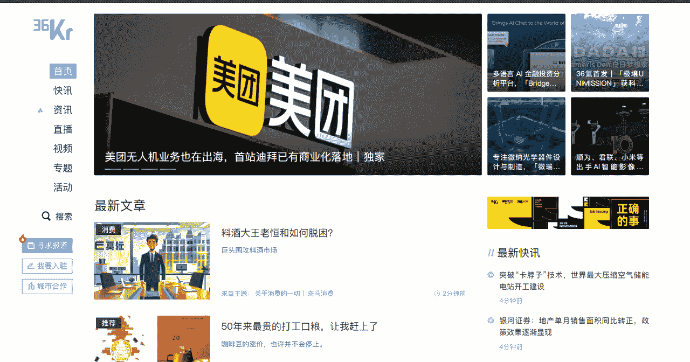

# OpenAI疯狂爬虫，把一家公司都给爬宕机了，CEO：堪比DDoS

> 来源：[https://qqs7y1hozd1.feishu.cn/docx/Ep7GddK35otZwqxr9cNcz5R5nPe](https://qqs7y1hozd1.feishu.cn/docx/Ep7GddK35otZwqxr9cNcz5R5nPe)

# 【光年日报】2025.1.13

# Mark的AI产品经理知识库——互联网前沿资讯推送！

######### 马斯克：Neuralink已将脑机芯片植入第三名受试者体内

######### 马斯克要对社交平台X收取8美元注册费，最快下月实施

######### 苹果股价下跌，知名分析师郭明錤预计2025年iPhone出货量不及预期

######### 苹果CEO库克2024年总薪酬7460万美元

######### 后视摄像头或存故障，特斯拉在美国召回约23.9万辆电动汽车

> 欢迎加入社群

# 今日热点 💎

## 💡OpenAI疯狂爬虫，把一家公司都给爬宕机了，CEO：堪比DDoS

（⬅️原文直达）

## TOP3大新闻

## 张雪峰称“春节放假23天”系口误：原计划放到大年初九

1月9日，峰学未来老师在社交媒体发布视频，张雪峰宣布公司春节假期为1月18日到2月10日。对此，张雪峰近日在直播中回应此事称，原计划春节放假到2月6日（大年初九），直播中说放假时间时看错日子了，说成放到2月10日（正月十三）。张雪峰表示，后来被同事提醒发现了，但话都说出去了，视频都放出去了，不好改了，“一下子就成了放23天，现在想想是有点多。”（九派新闻）

## 东京新荣记就提供阴阳菜单一事道歉

近日有网友在社交平台爆料称在东京吃新荣记台州菜花了19万日元（约合9000人民币），遭到店家区别对待。该网友称，同等价位的菜单，自己这边海参、贵妃鸡、象拔蚌等贵价食材被替换成便宜食材。别人的菜品是“金蒜拌象拔蚌”，自己的是“金蒜拌螺片”；别人菜单上的是“盐香贵妃鸡”，自己的是“脆皮乳鸽”。隔壁桌日本人有大闸蟹自己没有，经理称是因为大闸蟹过季了不够好；日本人有煲仔饭自己只有白米饭，经理称因为日本人餐后必须有一道主食。该网友质疑门店区别对待，门店经理却表示：“您这样想我也没办法，但您不能扭曲我们的服务。”1月11日，该网友发帖称，新荣记涉事门店经理已道歉，称未能提前与顾客确认菜单“非常不专业”。

新荣记前身是创始人张勇1995年在浙江台州开设的“新荣记食府”小排档，此后逐步成为一个主打台州菜的高端品牌并在2016年摘下第一颗米其林星。大众点评显示，其人均消费为500-1000元。（界面新闻）

## 国家卫健委：近期流感未超过上一年流行季水平

国家卫生健康委医疗应急司副司长高新强在国家卫生健康委1月12日举行的新闻发布会上表示，监测显示，近期处于流感相对高发期，但未超过上一年流行季的水平。全国发热门诊、急诊患者数量呈现一定程度的上升趋势，总体低于去年同期水平，未出现医疗资源明显紧张的情况。（e公司）

## 大公司/大事件

## 铁路节前春运车票进入发售最高峰，已累计发售5768万张

36氪获悉，“中国铁路”微信公众号消息显示，1月11日开始发售1月25日（腊月廿六）车票，铁路节前春运车票进入发售最高峰。自2024年12月31日开始发售春运车票以来，至1月11日9时，铁路已累计发售春运期间车票5768万张。

## 比亚迪今年将在日本发售第四款车型海狮07

当地时间1月10日，在“东京汽车沙龙”展会上，比亚迪日本公司宣布今年将在日发售运动型SUV海狮07，为公司在日本市场的第四款车型。比亚迪已在日本市场投放3款车型，分别为2023年1月、9月和去年6月推出的ATTO 3、海豚和海豹。2024年，比亚迪在日销量较上年增长53.7%至2223辆。（界面新闻）

## 美国最高法院最快下周裁决TikTok案

据报道，美国最高法院正加速审理一项涉及强制出售或全美封禁短视频社交媒体平台TikTok的法案，并可能最早于下周作出裁决。

据报道，美国最高法院于当地时间10日上午听取关于针对TikTok“不卖就禁”法令是否违反《美国宪法第一修正案》的口头辩论，辩论双方为TikTok公司与美国司法部。在辩论中，尽管有部分大法官对该法案与《宪法第一修正案》的潜在冲突表达担忧，但多数大法官认为，该法律针对的是TikTok的所有权，而非其言论内容。他们倾向认为该公司与中国的母公司字节跳动的关系对美国国家安全构成威胁。

美国政府官员长期以来以“中国可能利用TikTok收集美国用户数据并进行监视”为借口，将TikTok运营问题政治化。根据国会去年通过的法律，TikTok需在1月19日前与其母公司——字节跳动分离，否则将面临全面禁令。不过，TikTok、其母公司字节跳动以及众多内容创作者表示，国会针对TikTok的法律违反了美国《宪法第一修正案》的言论自由权，请求法院延迟或推翻该法律。（央视新闻）

## 美股三大指数集体收跌，热门中概股普跌

36氪获悉，1月10日收盘，美股三大指数集体下跌，纳指跌1.63%，道指跌1.63%，标普500指数跌1.54%。大型科技股多数下跌，AMD、奈飞跌超4%，英特尔跌超3%，英伟达跌3%，苹果跌超2%，亚马逊、微软跌超1%，Meta涨近1%。热门中概股普跌，拼多多、爱奇艺跌超5%，哔哩哔哩、百度、京东、理想汽车跌超4%，阿里巴巴、蔚来跌超3%。

## 2025年度电影总票房（含预售）突破10亿元

据猫眼专业版数据，2025年度电影总票房（含预售）突破10亿元。（选股通）

永辉超市天津首家学习胖东来调改店开业首日销售额达260万元

36氪获悉，1月10日，永辉超市天津首家学习胖东来调改店——永辉SM滨海广场店焕新亮相迎来“开门红”。永辉数据显示，该店开业首日销售额达260万元，较调改前日均销售额增长近8倍，客流突破6万人次，进店客流量较调改前提升近6倍，客单价174元，较调改前90元的客单价，增长超95%。超市客流的攀升，带动了其所在商场客流量大涨。据天津空港经济区SM广场统计，受永辉天津首家调改店影响，超市开业当天，共有近8万人次进入商场，同比增长200%。车流同比增长100%。

## 中国老年人感染艾滋病占比持续上升

近年来，中国老年人感染艾滋病的占比呈现持续上升的趋势，疾控中心的统计显示，老年人自愿检测率低，疾病晚发现情况比较普遍。而有研究预测，预计到2035年，老年艾滋病患者接近总艾滋病患者的33%，需引起全社会的重视。深圳市疾控中心发布的数据显示，2023年1-10月，深圳全市报告50岁及以上中老年病例198例（75.8%为男性），占新报病总数的15.1%，占比情况呈缓慢、持续上升趋势（2008年以前占比低于8.0%）。（羊城晚报）

## 口服GLP-1RA诺和忻®（司美格鲁肽片）在中国全面上市

36氪获悉，生物制药公司诺和诺德1月12日宣布，全球首个口服胰高糖素样肽-1受体激动剂（GLP-1RA）——诺和忻®（司美格鲁肽片）在中国全面上市。诺和忻®以便利的口服给药方式，帮助患者更早获益于GLP-1RA类药物，助力血糖优质达标与代谢综合管理，为中国2型糖尿病临床治疗带来一个创新品类。

## 苹果股价下跌，知名分析师郭明錤预计2025年iPhone出货量不及预期

苹果股价1月10日一度下跌4%，此前一位知名苹果分析师预计今年iPhone出货量可能不及华尔街预期。天风国际证券分析师郭明錤在Medium发文称，2025年iPhone出货量预计在2.2亿-2.25亿部之间，而市场共识预期为2.4亿部或以上。这位分析师表示，苹果在与一些供应商讨论今年的iPhone生产计划时采取了“谨慎立场”。他还提到预期中国市场走弱，并对苹果的AI功能会加快iPhone更换周期或提振其服务业务表示怀疑。（选股通）

## 苹果CEO库克2024年总薪酬7460万美元

苹果公司CEO库克2024年总薪酬7460万美元，之前一年为6320万美元。（选股通）

## 马斯克：Neuralink已将脑机芯片植入第三名受试者体内

据最新消息，埃隆·马斯克旗下脑机接口公司Neuralink已将脑机芯片植入第三名受试者体内，均运行良好。马斯克宣布，该公司计划在2025年再植入约20至30例。关于Neuralink的下一个研究方向，马斯克透露称，将帮助视障人士，即使是完全失去双眼或视神经受损，甚至是先天性失明的人，也可以通过直接与大脑视觉皮层连接来帮助他们重获视觉。（上观新闻）

## 洛杉矶山火或成美国史上损失最严重火灾

根据摩根大通当地时间1月9日发布的最新估算，预计本周美国洛杉矶的山火会成为美国历史上损失最惨重的火灾。摩根大通预计，总的经济损失或接近500亿美元，而需要保险公司赔付的损失或达到200亿美元。并且，摩根大通称，由于火势尚未得到控制，还在继续蔓延，这意味着潜在经济和保险损失可能还会进一步增加。（央视财经）

## 后视摄像头或存故障，特斯拉在美国召回约23.9万辆电动汽车

当地时间1月10日，美国特斯拉公司在美国国家公路交通安全管理局网站上发表声明称，该公司在美国召回约23.9万辆电动汽车，原因是部分电动汽车可能存在后视摄像头故障。

根据特斯拉发表的声明，后视摄像头发生故障会缩小驾驶员的视野范围，增加车祸风险。此次召回适用于特斯拉于2024年至2025年间生产的Model 3和Model S型汽车，以及2023年至2025年间生产的Model X和Model Y SUV型汽车。根据美国国家公路交通安全管理局追踪的数据，2024年特斯拉在美国共宣布了16次召回，涉及超过500万辆汽车。（央视新闻）

## 马斯克要对社交平台X收取8美元注册费，最快下月实施

知情人士称，埃隆·马斯克（Elon Musk）正准备对旗下社交平台X进行一系列调整，包括从主时间线（timeline）上显示的帖子中删除日期，以及对X平台的新用户收取8美元的注册费等，这可能会从根本上改变该社交媒体平台的核心功能。一位熟悉X平台内部讨论的人士称，马斯克最近几周向员工提出了取消X时间线上的日期和时间戳的想法。两位消息人士称，这一建议引发了一些员工对其可能加剧错误信息的担忧。（新浪财经）

## Meta取消事实核查，联合国：监管仇恨言论和有害内容不等同于“审查”

联合国人权事务高级专员蒂尔克1月10日表示，社交媒体上煽动仇恨和分裂的帖文带来“现实后果”，因此有责任对这些内容进行监管，“允许仇恨言论和有害内容在线传播，会对现实世界产生影响。对这些内容进行监管并非是审查行为”。

Meta本周早些时候宣布，该公司将停止在美国的事实核对计划，称事实核对员有可能出现政治偏见，而自我监管则可能导致过度审查。Meta首席执行官扎克伯格呼吁恢复该公司平台上的言论自由，并表示用户的信任已经受到侵蚀。被问及Meta最近决策对联合国社交媒体政策的影响时，联合国发言人强调，联合国持续监测和评估在线空间的情况。（界面新闻）

## 韩国一核电站泄漏29吨核废液

韩国原子能安全委员会12日表示，正在对庆尚北道庆州市月城核电站2号机组非正常排放29吨核废液展开调查。韩国原子能安全委员会当日在其官网发布公告说，负责运营该机组的韩国水力原子能公司当地时间12日10时23分报告，月城2号机组正常运转时，储藏罐内的核废液未经样本分析阶段就被排放入海。据估计，排放量约为29吨。工作人员随后立即“关闭阀门，切断了泄漏”。对罐内残留样本进行分析的结果显示，放射性物质含量“为平时排放水平”。（中国新闻网）

## *ST花王：撤销退市风险警示并继续实施其他风险警示

*ST花王公告，因公司重整而触及的退市风险警示情形已经消除，上海证券交易所同意撤销对公司股票实施的退市风险警示并继续实施其他风险警示。公司股票将于2025年1月13日开市起停牌1天，并于2025年1月14日开市起复牌。复牌后，公司A股简称将变更为“ST花王”，股票代码仍为603007，股票价格的日涨跌幅限制仍为5%。（财联社）

## 三菱汽车社长：加入本田日产合并磋商是“选项之一”

三菱汽车社长加藤隆雄1月10日接受采访，关于是否加入本田与日产汽车的经营合并磋商，他表示“这是选项之一”。谈及设想的益处，加藤隆雄称“在（三菱汽车没有生产据点的）北美业务方面能积极获得帮助”。加藤隆雄另外指出，在车载软件开发等方面，“也会有利用两家公司技术力的场景，有非常大的益处”。本田和日产去年12月宣布全面启动经营合并磋商。三菱汽车此前表示，将在1月底前后判断是否加入磋商。（界面新闻）

## 玛格丽特·贝拉尔将成荷兰银行首位女性CEO

荷兰银行1月10日宣布，玛格丽特·贝拉尔（Marguerite Bérard）将于4月23日出任CEO，接替将提前卸任的罗伯特·斯瓦克（Robert Swaak）。贝拉尔曾任法国巴黎银行法国商业和个人银行业务主管。（界面新闻）

## 大公司财报

## 广汽集团：预计2024年度净利润同比减少72.91%到81.94%

36氪获悉，广汽集团发布2024年年度业绩预告，预计2024年度实现归属于母公司所有者的净利润为8亿元到12亿元，同比减少72.91%到81.94%。主要原因是受汽车行业价格内卷、竞争格局剧变等因素影响，汽车销量减少，同时为应对市场竞争，公司及投资企业追加销售补贴等商务政策的投入约180亿元，综合导致本报告期归属于母公司所有者净利润同比下降。