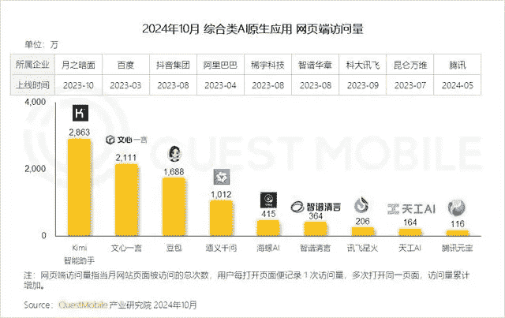
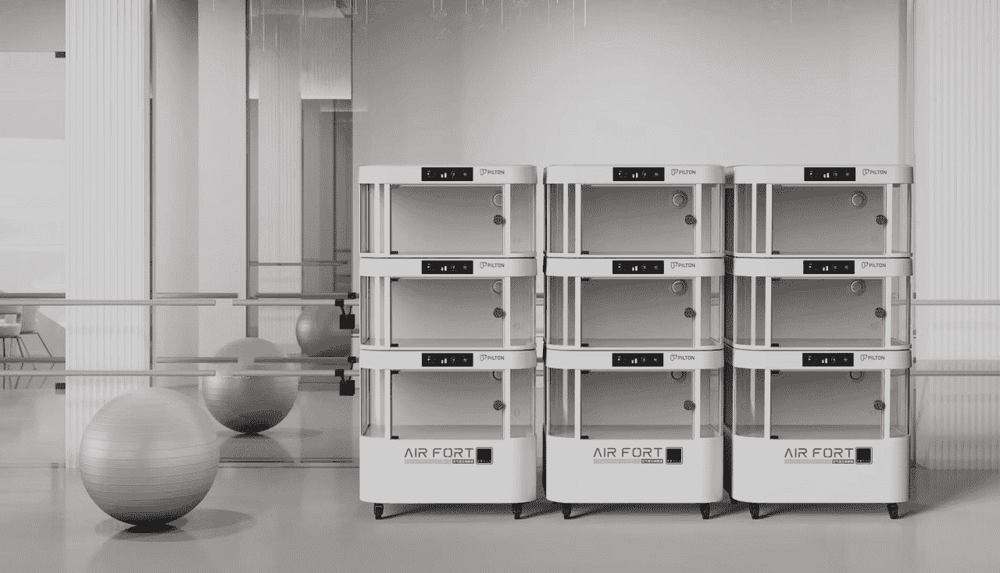

# 字节豆包新一代视频生成大模型将明年1月正式发布

> 来源：[https://qqs7y1hozd1.feishu.cn/docx/F6igdngN8oCelTxO4uhcJcIPnGe](https://qqs7y1hozd1.feishu.cn/docx/F6igdngN8oCelTxO4uhcJcIPnGe)

# 【光年日报】2024.12.19周四

# Mark的AI产品经理知识库——互联网前沿资讯推送！

> 字节豆包新一代视频生成大模型将明年1月正式发布

######### “通义”应用团队从阿里云分拆，并入阿里智能信息事业群 | 36氪独家

######### [「Pilton宠尔顿」完成300](https://qqs7y1hozd1.feishu.cn/wiki/KbxtwI230ilxM7kv80icNWECn2b#share-OS0Xdn6r1oCKHJxHmhhcCjWCnmc)0万元A轮融资，宠物智能舱已铺出超1万台

######### [图森未来宣布更名 CreateAI：从自动驾驶跨入 AI 赛](https://qqs7y1hozd1.feishu.cn/wiki/KbxtwI230ilxM7kv80icNWECn2b#share-Olo2dfnw6okEYMxzN2XckEMBned)道，打造《金庸群侠传》《三体》IP 内容

######### [人](https://qqs7y1hozd1.feishu.cn/wiki/KbxtwI230ilxM7kv80icNWECn2b#share-AQeXdRxgzoWC87x3YkXc3P4Un5d)人可享 AI 编程：免费版 GitHub Copilot 上线，VS Code 每月补全 2000 次代码

> 欢迎加入社群

# 今日热点 💎

## 💡字节豆包新一代视频生成大模型将明年1月正式发布

36氪 | https://www.36kr.com/p/3085016317311367

（⬅️原文直达）

## AI最前沿

字节豆包新一代视频生成大模型将明年1月正式发布

在火山引擎FORCE原动力大会上获悉，字节豆包新一代视频生成大模型将明年1月正式发布。此外，抖音旗下图片和视频生成工具——即梦AI，展示了新一代图片生成模型和动态海报功能。（财联社）

OpenAI近400名员工迎来股票出售机会，每人最多1000万美元

知情人士称，根据OpenAI与软银集团达成的一项协议，OpenAI大约有400名现任和前任员工有望通过出售股票而进账数百万美元。软银集团将以要约收购的方式从OpenAI员工手中收购价值约16亿美元的股票。这项交易将使软银获得OpenAI更多的股权，同时也为OpenAI员工提供了一个变现的机会。对于符合条件的员工，每位参与者将被允许出售价值高达1000万美元的股票。知情人士称，OpenAI预计，符合出售条件的股票总额价值约20亿美元。由于软银同意购买16亿美元，因此可能会有价值4亿美元的股票没有买家。（新浪科技）

OpenAI推出互动新方式，用户可与ChatGPT通电话、发短信

OpenAI为用户提供了一种与聊天机器人ChatGPT互动的新方式：1-800开头的号码。这家人工智能初创公司周三表示，在美国的用户可以拨打1-800-CHATGPT （1-800-242-8478），每月与这个广受欢迎的聊天机器人免费通话15分钟。该公司表示，其他国家的用户可以使用WhatsApp向同一号码发送消息，以与聊天机器人互动。OpenAI表示，这个新选项旨在让人工智能在全球范围内普及。它还有望进一步扩大其旗舰产品的覆盖范围。目前该产品的周活跃用户数已达3亿。（新浪财经）

卓翼科技：公司产品没有应用在AI眼镜相关领域

36氪获悉，卓翼科技发布公告，近期“AI眼镜”概念引起市场关注，公司就此说明如下：公司产品没有应用在AI眼镜相关领域，没有签署相关协议或订单。公司具备AR智能眼镜产品相关设计制造能力，但公司没有签署过AR智能眼镜产品的订单，对公司营业收入没有影响。在此，提醒投资者理性投资，注意投资风险。

## 大公司财报

毕马威2024财年全球收入增长5.1%至384亿美元

毕马威国际12月18日宣布，截至2024年9月30日止财政年度，毕马威全球成员所共实现年收入384亿美元，按当地货币计，较2023财年增长5.1%，按美元计则增长5.4%。根据声明，税务和法律服务、审计服务以及咨询服务分别取得10%、6%和2%的增长。（界面新闻）

## 投融资

“闪极科技”获绿洲资本数千万元A+轮融资

36氪获悉，智能硬件品牌“闪极科技”宣布获得由绿洲资本独家投资的数千万元A+轮融资，由跃为资本担任独家财务。至此，闪极1个月内已累计完成超亿元A轮系列融资。12月19日，闪极还将在深圳召开AI眼镜新品发布会，正式推出国内首款量产AI眼镜。

“中科睿医”完成A+轮融资

36氪获悉，据中科睿医官微，近日，中科睿医宣布完成由国新基金领投的数千万元A+轮融资，所筹资金将主要用于产品研发、临床试验、产品注册及市场推广等方面。

“Pilton宠尔顿”完成3000万元A轮融资

36氪获悉，宠物智能舱品牌“Pilton宠尔顿”已完成3000万元A轮融资，本轮由安吉产业基金领投，老股东博汇源创投、智宠科技跟投。谦佑创投担任本轮独家财务顾问。这笔融资将重点用于智能化产品研发。

珠海市合心财税科技有限公司获得5000万元A轮融资

36氪获悉，珠海市合心财税科技有限公司完成5000万元人民币的融资，由中经金控投资有限公司战略投资。此次融资将助力财税科技进一步优化产品功能，提升用户体验，并加大市场推广力度。

## 酷产品

宁德时代推出20号和25号两种标准化巧克力换电块

在2024宁德时代巧克力换电生态大会上，宁德时代董事长、CEO曾毓群表示，宁德时代会继续推进换电标准化，最核心的是电池尺寸的标准化。对标加油，汽油有92号和95号，而巧克力换电也将使用两种标准换电块，宁德时代把它命名为20号和25号换电块。通过不同的电量为用户提供按需配电的个性化服务。（证券时报）

SK海力士开发出适用于AI数据中心的高容量固态硬盘

SK海力士宣布，公司已开发出适用于AI数据中心的高容量固态硬盘（SSD，Solid State Drive）产品“PS1012 U.2”。公司计划在今年年内向全球服务器制造商提供样品进行产品评估，并计划在明年第三季度将产品群扩大至122TB。（界面新闻）

## 💡“通义”应用团队从阿里云分拆，并入阿里智能信息事业群 | 36氪独家

36氪 | https://www.36kr.com/p/3083725136869760（⬅️原文直达）

《智能涌现》从多个独立信源处获悉，阿里旗下的AI应用“通义”近期正式从阿里云分拆，并入阿里智能信息事业群。

有知情人士告诉《智能涌现》，此次调整包括通义To C方向的产品经理，以及相关的工程团队，一并调整至阿里智能信息事业群。调整后，通义PC及App团队与智能搜索产品“夸克”平级，原有的通义实验室，仍然留在阿里云体系内。

这一举措，可以看作是阿里梳理内部AI To C应用的一步。

此前，阿里旗下的大模型家族“通义”，包括应用层的“通义”App、PC端，均属于阿里云体系。其中，通义大模型家族由阿里云开发，而阿里云又是一个To B业务，也不适合投入进直面To C市场的应用开发和推广中。

模型团队和应用团队逐步分开，而不是作为一体而存在——这也是大模型从技术层迈向产品的必经之路。

## 💡「Pilton宠尔顿」完成3000万元A轮融资，宠物智能舱已铺出超1万台

36氪 |https://www.36kr.com/p/3080983870551944（⬅️原文直达）

宠物智能舱品牌「Pilton宠尔顿」已完成3000万元A轮融资，本轮由安吉产业基金领投，老股东博汇源创投、智宠科技跟投。谦佑创投担任本轮独家财务顾问。

Pilton宠尔顿诞生于2022年，是小宠科技旗下的宠物智能用品品牌。此前36氪曾报道，宠尔顿于2023年完成天使轮融资，其业务最初从线下宠物乐园切入，出于改善宠物寄养环境考虑，研发并推出“宠尔顿宠物智能舱”。根据艾媒咨询的调研结果，宠尔顿属于“宠物智能舱开创者”。

这轮融资是宠尔顿业务快速发展的一个缩影。据宠尔顿创始人鹿凡向36氪透露，今年宠尔顿预计实现销售额近4000万元，较于去年有6倍增长。旗下宠物智能舱产品已铺出超1万台，产品销往14个国家和地区。

## 💡图森未来宣布更名 CreateAI：从自动驾驶跨入 AI 赛道，打造《金庸群侠传》《三体》IP 内容

IT之家 | https://www.ithome.com/0/818/623.htm（⬅️原文直达）

[IT之家](https://www.ithome.com/) 12 月 19 日消息，自动驾驶公司图森未来（**TuSimple**）今日宣布启用全新品牌 CreateAI，并发布多项在生成式 AI 领域的进展。

在《三体》IP 方面，CreateAI 还将与动画导演河森正治（《超时空要塞》等），以及动画制作公司株式会社白组展开合作，利用 AIGC 技术推动创作者在展示宏大宇宙文明方面实现更多突破。

[与此同时，CreateAI](https://www.ithome.com/0/818/144.htm) 还发布了其首个大模型产品“Ruyi”，该模型定位于开源图生视频领域。作为其自研 AI 基础设施的底层核心，公司将基于“Ruyi”打造多个针对游戏和动画制作的 AI 生成式工具。

除业务进展外，CreateAI 公司也于今日发布了最新的商业计划书，为投资者展现企业转型相关内容。

据IT之家今年 8 月报道，图森未来与上海三体动漫有限公司达成合作，共同开发基于刘慈欣创作的国际知名科幻小说《三体》系列的首部动画长篇电影和视频游戏。

## 💡人人可享 AI 编程：免费版 GitHub Copilot 上线，VS Code 每月补全 2000 次代码

IT之家 | https://www.ithome.com/0/818/616.htm（⬅️原文直达）

<https://player.bilibili.com/player.html?bvid=17BkKY8Ehu&share_source=copy_web&vd_source=a702789e17302e9bbf7af05b4e38e57c>

[IT之家](https://www.ithome.com/) 12 月 19 日消息，微软旗下代码托管平台 GitHub 今天（12 月 19 日）发布博文，宣布 GitHub Copilot Free 免费订阅，开发者可以在 Visual Studio Code 代码编辑器中，免费使用 GitHub Copilot AI 服务。

GitHub 上周宣布其平台开发人员数量突破 1.5 亿，而本次免费开放，意味着全球 1.5 亿开发者能在 VS Code 中体验 AI 辅助编程的强大功能。IT之家附上相关介绍视频如下：